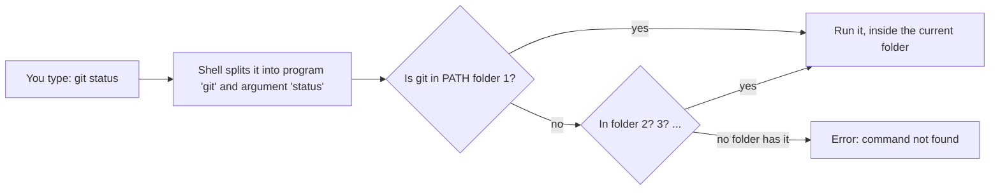
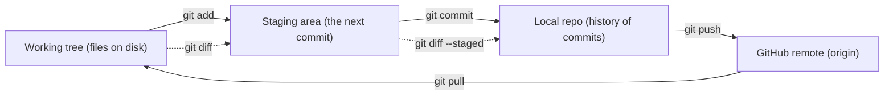
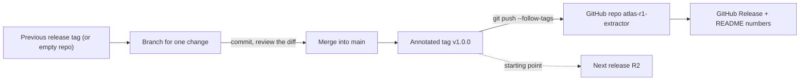

# Terminal, Git & GitHub

Every lesson asks you to run commands and keep code under version control, and five capstones
end up on GitHub. This primer gives you enough terminal to run and debug commands, enough Git to
never lose work, and a repeatable way to ship a release without leaking your API key.

## Who this is for

- **Read before:** [Day 1: The AI Engineer: Role, Skills & How to Use This Course](../Phase_0_Start_Here/Day_001_ai_engineer_role/ai_engineer_role.md).
  About 30 minutes, plus 10 minutes to run the two scripts.
- **For:** freshers who have mostly used an IDE's Run button, and anyone on Windows who hasn't set
  up WSL yet.
- **Skip if** you can explain `PATH`, read a `git diff`, keep `.env` out of every repo by habit
  and push an annotated tag. Not sure? All five Self-Check answers right means skip it.

## The terminal: running commands from the right folder

A lesson says "run `python3 where_am_i.py`". You paste it and get
`python3: can't open file '/home/maya/where_am_i.py': [Errno 2] No such file or directory`.
The command was fine. You ran it from the wrong folder.

Think of the terminal as a text conversation with your computer. You type one line and press
Enter, a program runs, and it prints its answer. The program reading your line is the **shell**
(bash or zsh on macOS, Linux and WSL). The shell always sits "in" one folder, the **working
directory**, the way a file-explorer window is always open on exactly one folder.

A tiny session you can check in your head:

```bash
pwd                               # print working directory: where am I?
mkdir -p code/atlas-r1-extractor  # make a folder (-p also makes missing parents)
cd code/atlas-r1-extractor        # change directory: move into it
pwd
ls -a                             # list files, including hidden ones starting with "."
```

```text
/home/maya
/home/maya/code/atlas-r1-extractor
.  ..
```

The folder is empty, so `ls -a` shows only `.` (this folder) and `..` (its parent).

Now name the parts:

- In `ls -a ~/code`, `ls` is the **command** (the program to run), `-a` is a **flag** (an option
  that changes its behaviour) and `~/code` is an **argument** (what to act on).
- An **absolute path** starts at the root, `/`, and means the same thing from anywhere:
  `/home/maya/code`. A **relative path** starts from the working directory: `datasets/orbit`.
- Shortcuts: `~` is your home folder, `.` is "here" and `..` is "one level up".

| Command | What it does | Watch out for |
|---|---|---|
| `pwd`, `ls -a`, `cd <dir>` | where am I, what's here, move | `cd` with no argument goes home |
| `mkdir -p <dir>` | make folders | spaces in names need quotes: `"My Projects"` |
| `cp`, `mv`, `rm` | copy, move/rename, delete | `rm` has no recycle bin |
| `python3 <file>.py` | run a script | relative paths inside it follow your cwd |
| Ctrl+C, Up arrow, Tab | stop a program, repeat, autocomplete | Tab-complete paths to avoid typos |

Two habits prevent most confusion: keep project folder names free of spaces, and `cd` into the
project root before running anything.

## PATH: how the shell finds programs

You install a tool, type its name and get `zsh: command not found: uv` (or
`bash: uv: command not found`). The tool is on your disk, but the shell can't find it.

Picture a row of drawers the shell checks, left to right, for a program with that name. The
first drawer that has it wins; if none do, you get "command not found". That row is `PATH`, an
**environment variable** (a named value the shell hands to every program it starts) holding
folders separated by `:`. You'll meet another environment variable,
`OPENAI_API_KEY`, in [A02: Project setup & secrets](A02_project_setup_secrets.md).

A worked example: say `PATH` is `/opt/homebrew/bin:/usr/bin:/bin` and you type `git`. The shell
looks for `/opt/homebrew/bin/git` (missing), then `/usr/bin/git` (found), and runs that one. It
never looks in `/bin`.



The commands for inspecting and changing it:

```bash
echo "$PATH"                          # the folder list, separated by ":"
which -a python3                      # every match, in the order the shell checks them
export PATH="$HOME/.local/bin:$PATH"  # put a folder first, for this terminal session only
```

To make a change permanent, add the `export` line to `~/.zshrc` (the macOS default shell) or
`~/.bashrc` (Ubuntu and WSL). A shell reads `PATH` when it starts, so open a new terminal after
any install or edit.

The same lookup from Python. Save it as `where_am_i.py` and run it from your project folder:

```python
# script_id: primer_a01/where_am_i
# Install: nothing (stdlib only). Env vars: none. Services: none.
# Run it from two different folders and compare the output.
import os
import shutil
from pathlib import Path

print("cwd: ", Path.cwd())
print("home:", Path.home())

# Relative paths resolve against the cwd, not against this file's folder.
print("datasets/orbit ->", Path("datasets/orbit").resolve())

# PATH is an ordered list of folders the shell searches for commands.
folders = os.environ.get("PATH", "").split(os.pathsep)
print(f"PATH has {len(folders)} folders. First two: {folders[:2]}")
for cmd in ("git", "python3", "orbit"):
    print(f"which {cmd:<8}", shutil.which(cmd))
```

Expected output (your paths will differ):

```text
cwd:  /home/maya/code/atlas-r1-extractor
home: /home/maya
datasets/orbit -> /home/maya/code/atlas-r1-extractor/datasets/orbit
PATH has 9 folders. First two: ['/home/maya/.local/bin', '/usr/local/bin']
which git      /usr/bin/git
which python3  /usr/bin/python3
which orbit    None
```

`orbit` (the fictional job library behind the course's Atlas project) isn't installed. That
`None` is the case where the shell says "command not found".

**Break it.** Run `cd ~`, then `python3 code/atlas-r1-extractor/where_am_i.py`. Now
`datasets/orbit` resolves to `/home/maya/datasets/orbit`, which doesn't exist. In a real lesson
that's `FileNotFoundError: [Errno 2] No such file or directory: 'datasets/orbit/issues.jsonl'`.
Fix it by `cd`-ing to the project root, or by setting the `ORBIT_DATA` environment variable
(which course code reads) to an absolute path.

Common mistakes: an old terminal that predates the install (open a new one); typing `python`,
which may be missing or unexpected on macOS and Linux (type `python3`); and the wrong copy of a
tool running (`which -a` shows every match, and the first one wins).

## Windows: use WSL

Course commands are written for bash (`export NAME=value`, `source .venv/bin/activate`).
PowerShell spells them differently, and much AI tooling documents Linux first. Rather than
translate every command, run Linux on your Windows machine.

**WSL** (Windows Subsystem for Linux) runs a real Linux distribution inside Windows, without
setting up a virtual machine or dual boot. It needs Windows 10 version 2004 or later
(build 19041+) or Windows 11. Open PowerShell with "Run as administrator", then run:

```powershell
wsl --install
```

Restart when it finishes. The default distribution is Ubuntu. Open "Ubuntu" from the Start menu
and create a Linux username and password (separate from your Windows login). From then on, every
command in this course runs in that Ubuntu terminal.

One rule saves hours: **keep your projects in the Linux file system** (`~/code/...`), not under
`/mnt/c/Users/...`, which is how your Windows `C:` drive appears inside WSL. Microsoft recommends
this for speed. To edit with VS Code, run `code .` from the Ubuntu terminal inside your project;
VS Code connects to WSL through its WSL extension.

## Git: save points for your code

The extractor worked an hour ago. You've changed four files since, now it fails, and undo doesn't
reach that far back. Or your folder holds `extract_final.py`, `extract_final_v2.py` and
`extract_REAL_final.py`, and nobody knows which one runs.

Git works like save points in a video game. You choose when to save, label each save, and can
compare two saves or go back to one. Branches are extra save slots for risky experiments.

A tiny history, small enough to check by hand:

| Save | Message | What changed |
|---|---|---|
| `a1` | Start R1 extractor | `extract.py` created |
| `b2` | Parse issue labels | `extract.py`: 12 lines added |
| `c3` | Add README | `README.md` created |

"What changed between `a1` and `c3`?" Twelve lines in `extract.py` and a new `README.md`. That is
the question `git diff a1 c3` answers for you.

Name the parts:

- **Repository (repo):** your project folder plus a hidden `.git` folder that stores the history.
- **Commit:** one save point: a snapshot of the tracked files, a message, an author and an ID
  called a **hash** (`04fd0e5` is the short form of a 40-character ID).
- **Working tree** and **staging area:** the working tree is the files you edit. The staging area
  (also called the index) holds the changes you've picked for the next commit.
- **Branch:** a movable name that points at a commit. This course uses `main` as the default.
- **Remote:** a copy of the repo somewhere else, usually GitHub. The default name is `origin`.



Set your identity once per machine. Use the email address on your GitHub account, so commits link
to your profile:

```bash
git config --global user.name "Maya Rao"
git config --global user.email "maya@example.com"
git config --global init.defaultBranch main
```

The daily loop, run inside the project folder:

```bash
git init                       # once per project: creates the hidden .git folder
git status                     # what changed? Run it before and after everything
git diff                       # unstaged edits, line by line
git add extract.py             # stage one file
git diff --staged              # exactly what the next commit will contain
git commit -m "Parse issue labels into IssueRecord"
git log --oneline              # history, newest first
```

And for a branch:

```bash
git switch -c add-readme       # create a branch and move onto it
# ...edit, add, commit as usual...
git switch main                # go back to main
git merge add-readme           # bring the branch's commits into main
```

Older tutorials use `git checkout -b add-readme`, which does the same as `git switch -c`. Write
messages that say what changed and why ("Retry extractor calls on 429", not "fix").

The most common mistake is committing without looking: `git add .` then `git commit`, with no
`git status` or `git diff --staged` in between. That's how secrets end up in history.

## .gitignore: keeping .env out of every repo

In [Day 2: Setup & Your First LLM Call](../Phase_0_Start_Here/Day_002_setup_first_call/setup_first_call.md)
your API key goes into a file called `.env`. One `git add .` and one push later, that key is
public. Both GitHub's secret scanning and people looking for keys to abuse scan public repos, so
treat any key that reaches GitHub as compromised.

A `.gitignore` file is a "do not pack" list. Git skips any untracked file that matches one of its
patterns, so `git add .` never picks it up. Here is the starting `.gitignore` for every course
repo:

```text
# Secrets: never commit these
.env
.env.*
!.env.example
# Python and editor clutter
.venv/
__pycache__/
*.pyc
.DS_Store
```

`.env.*` also catches files such as `.env.local`. The `!` line re-includes `.env.example`, a copy of
`.env` with the values left blank. You commit that file so others can see which variables to set.

The script below builds a throwaway repo and proves the rule works:

```python
# script_id: primer_a01/git_sandbox
# Install: Git 2.32+ (check with `git --version`). Env vars: none. Services: none.
# Runs in a throwaway temp folder with a demo identity; your real repos and config are untouched.
import os
import subprocess
import tempfile
from pathlib import Path

repo = Path(tempfile.mkdtemp(prefix="atlas-r1-"))
ENV = {**os.environ, "GIT_CONFIG_GLOBAL": os.devnull, "GIT_CONFIG_NOSYSTEM": "1",
       "GIT_AUTHOR_NAME": "Demo", "GIT_AUTHOR_EMAIL": "demo@example.com",
       "GIT_COMMITTER_NAME": "Demo", "GIT_COMMITTER_EMAIL": "demo@example.com"}


def git(*args: str) -> str:
    """Run one git command inside the demo repo and return what it printed."""
    done = subprocess.run(["git", *args], cwd=repo, env=ENV,
                          capture_output=True, text=True, check=True)
    return done.stdout.rstrip()


def write(name: str, text: str) -> None:
    (repo / name).write_text(text, encoding="utf-8")


git("init", "-b", "main")
write("extract.py", "print('extracting Orbit issues')\n")
write(".env", "OPENAI_API_KEY=sk-demo-not-a-real-key\n")
write(".env.example", "OPENAI_API_KEY=\n")
write(".gitignore", ".env\n.env.*\n!.env.example\n.venv/\n__pycache__/\n")

git("add", ".")
print("staged:\n" + git("status", "--short"))
print("rule that hides .env ->", git("check-ignore", "-v", ".env"))
git("commit", "-m", "Start R1 extractor")
print(git("log", "--oneline"), "| repo at", repo)
```

Expected output (your hash and temp path will differ):

```text
staged:
A  .env.example
A  .gitignore
A  extract.py
rule that hides .env -> .gitignore:1:.env	.env
922eac6 Start R1 extractor | repo at /tmp/atlas-r1-_s9yccph
```

`.env` is missing from the staged list, and `git check-ignore -v` names the exact line of
`.gitignore` that hid it. Run that command whenever you're unsure whether a file is ignored.

**Break it.** Ignore rules only apply to files Git isn't tracking yet. If `.env` was committed
before `.gitignore` existed, adding the rule later changes nothing:

```python
# script_id: primer_a01/git_sandbox
# Break it: an ignore rule only hides UNTRACKED files. `add -f` stands in for the
# classic mistake of committing .env before .gitignore existed. Same end state.
git("add", "-f", ".env")
git("commit", "-m", "oops: commit .env")
write(".env", "OPENAI_API_KEY=sk-demo-rotated-key\n")
print("after editing .env:", git("status", "--short"))  # tracked, so changes show up

# Fix: stop tracking it (the file stays on disk), then commit the removal.
git("rm", "--cached", ".env")
git("commit", "-m", "Stop tracking .env")
print("after rm --cached:", git("status", "--short") or "(clean)")
# History still holds the old key. On a pushed repo, that means: rotate the key.
print("commits that touched .env:\n" + git("log", "--oneline", "--", ".env"))
```

Expected output (your hashes will differ):

```text
after editing .env:  M .env
after rm --cached: (clean)
commits that touched .env:
50c4bfc Stop tracking .env
c04dd30 oops: commit .env
```

`git rm --cached .env` stops tracking the file but keeps it on disk. The `oops` commit still
contains the key, though, and anyone who clones the repo can read it. If that commit was ever
pushed, **revoke the key at the provider and create a new one**. Scrubbing history is out of scope
here, and it can't help once someone has copied the key.

## GitHub: one public repo per capstone, tagged at each release

Code that lives only on your laptop isn't a portfolio, and one dead disk loses it. The course
ships Atlas in five releases, and each one gets its own public repo:

| Release | Day | Suggested repo |
|---|---|---|
| R1 Extractor | [Day 22: Capstone R1: The Extractor](../Phase_2_Building_with_LLM_APIs/Day_022_capstone_r1_extractor/capstone_r1_extractor.md) | `atlas-r1-extractor` |
| R2 Ask | Day 34 | `atlas-r2-ask` |
| R3 Issue Investigator | Days 61–62 | `atlas-r3-investigator` |
| R4 Triage Pipeline | Day 76 | `atlas-r4-triage` |
| R5 Launch | Days 89–90 | `atlas-r5-launch` |

One repo per release lets a reviewer clone one project, read its README numbers and run it.
Inside each repo, a **tag** marks the release: a fixed name for one commit that, unlike a branch,
isn't meant to move. An *annotated* tag (`-a`) also stores a message, author and date, and GitHub
builds its Releases page from tags.



The last block of the sandbox script walks the left half of that diagram:

```python
# script_id: primer_a01/git_sandbox
# Ship it: work on a branch, review the diff, merge, then tag the exact commit you release.
git("switch", "-c", "add-readme")
write("README.md", "# Atlas R1: The Extractor\n")
git("add", "README.md")
git("commit", "-m", "Add README")
print("diff main..add-readme:\n" + git("diff", "--stat", "main", "add-readme"))

git("switch", "main")
git("merge", "add-readme")
git("tag", "-a", "v1.0.0", "-m", "R1 Extractor, first release")
print(git("log", "--oneline", "--decorate", "-3"))
print("tags:", git("tag", "-n"))
```

Expected output (your hashes will differ):

```text
diff main..add-readme:
 README.md | 1 +
 1 file changed, 1 insertion(+)
cacb61c (HEAD -> main, tag: v1.0.0, add-readme) Add README
50c4bfc Stop tracking .env
c04dd30 oops: commit .env
tags: v1.0.0          R1 Extractor, first release
```

To publish from a real project, log in once. GitHub no longer accepts your account password for
Git, and the GitHub CLI (`gh`) handles login for you:

```bash
gh auth login                                          # once per machine; follow the prompts
git ls-files .env                                      # must print nothing before any push
gh repo create atlas-r1-extractor --public --source=. --push
git push --follow-tags                                 # send annotated tags with the commits
gh release create v1.0.0 --verify-tag --title "R1: The Extractor" --notes-from-tag
```

Without `gh`, create an empty repo on github.com, then run
`git remote add origin https://github.com/<you>/atlas-r1-extractor.git` and
`git push -u origin main`. When Git asks for a password, paste a personal access token.

Two tag mistakes are common. A plain `git push` doesn't send tags, so GitHub shows none; use
`--follow-tags` or `git push origin v1.0.0`. And never move a pushed tag. Ship the fix as
`v1.0.1`, so README numbers always match the tagged code.

To start the next release, copy the previous one and point it at a new repo:

```bash
git clone https://github.com/<you>/atlas-r1-extractor.git atlas-r2-ask
cd atlas-r2-ask
git remote remove origin                               # cut the link to the R1 repo
gh repo create atlas-r2-ask --public --source=. --push
```

The R1 history comes along and shows how the project grew.

## Self-Check

1. From your home folder you run `python3 code/atlas-r1-extractor/extract.py` and get
   `FileNotFoundError: [Errno 2] No such file or directory: 'datasets/orbit/issues.jsonl'`.
   The file is in your project. What's wrong, and what are two fixes?

<details><summary>Answer</summary>

The relative path resolves against your working directory (home), not the project. Run
`cd ~/code/atlas-r1-extractor` first, or set `ORBIT_DATA` to an absolute path.

</details>

2. You installed `uv`, but the terminal says `command not found: uv`. What do you check?

<details><summary>Answer</summary>

Open a new terminal, because `PATH` is read when the shell starts. Still missing? Check that the
installer's folder is in `echo "$PATH"`, and if not, add an `export PATH=...` line to `~/.zshrc`
or `~/.bashrc`.

</details>

3. `git status` lists `extract.py` as modified, but `git diff` prints nothing. Why?

<details><summary>Answer</summary>

The change is already staged. `git diff` compares the working tree with the staging area. Use
`git diff --staged` to see what the next commit will contain.

</details>

4. Last week you pushed a commit that contained `.env`. Today you added `.env` to `.gitignore` and
   ran `git rm --cached .env`. Is your key safe?

<details><summary>Answer</summary>

No. The old commit still holds the key, and anyone who clones the repo can read it. Revoke the key
at the provider and create a new one. The `.gitignore` rule only protects you from now on.

</details>

5. You ran `git tag -a v1.0.0 -m "R1"` and `git push`, but GitHub shows no tags. Why, and why tag
   at all instead of pointing reviewers at `main`?

<details><summary>Answer</summary>

`git push` doesn't send tags by default. Use `git push --follow-tags` or `git push origin v1.0.0`.
A tag pins the exact commit your README numbers came from, while `main` keeps moving.

</details>

## Learn More

- [Install WSL (Microsoft Learn)](https://learn.microsoft.com/en-us/windows/wsl/install): the
  official setup, plus fixes for when `wsl --install` hangs.
- [Getting started with Git (GitHub Docs)](https://docs.github.com/en/get-started/learning-to-code/getting-started-with-git):
  one example project, first in GitHub Desktop, then on the command line.
- [Ignoring files (GitHub Docs)](https://docs.github.com/en/get-started/git-basics/ignoring-files):
  pattern syntax, a global ignore file, and untracking a committed file.
- [About releases (GitHub Docs)](https://docs.github.com/en/repositories/releasing-projects-on-github/about-releases):
  how tags become downloadable Releases with notes.
