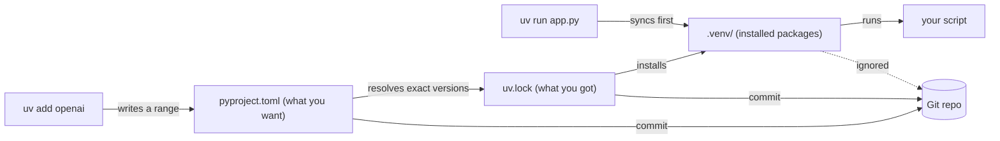
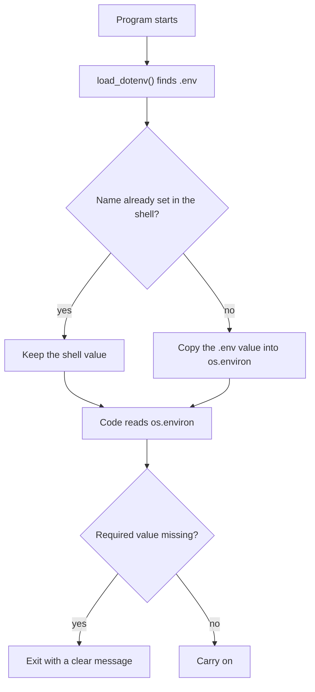
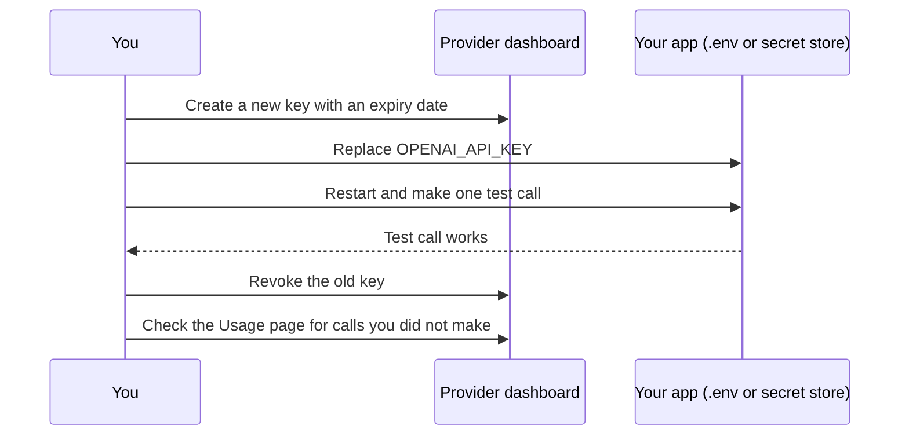

# Project Setup & Secrets

## Who this is for

For anyone who writes Python scripts but has never set up a project someone else can clone and run, or never handled a paid API key. Read it before [Day 2: Setup & Your First LLM Call](../Phase_0_Start_Here/Day_002_setup_first_call/setup_first_call.md). It assumes [Terminal, Git & GitHub](A01_terminal_git_github.md).

- **You'll end with:** an `atlas/` project on Python 3.11+, pinned dependencies, a `.env` that Git ignores, a config loader that fails fast, and a spend limit.
- **Skip if** you already use uv (or Poetry) with a committed lockfile, keep keys out of Git, and have a hard spend limit. Get all five [Self-Check](#self-check) answers right and move on.

## Why every project needs its own environment

You `pip install openai` for one tutorial. Months later Atlas needs a newer version, you upgrade, and the tutorial breaks. Or a teammate clones your repo and gets `ModuleNotFoundError`, because the package list only ever lived on your laptop.

Think of each project as a recipe card with its own pantry shelf. The card lists what you want ("flour, at least 1 kg"). The receipt records exactly what you bought ("Brand X, 1 kg, batch 4417"). The shelf holds those items, apart from every other recipe. Anyone with the card and the receipt can stock an identical shelf.

A tiny example:

| | Old tutorial | Atlas |
|---|---|---|
| Needs | `openai` 1.x | `openai` 3.x |
| One global install (only one version can exist) | breaks after the upgrade | works |
| One environment per project | its own 1.x copy: works | its own 3.x copy: works |

The fix is one isolated environment per project, plus two files: what you want, and exactly what you got.

## uv: create, add, run

This course uses one tool for this: **uv**, a fast Python package and project manager from Astral. It replaces the older `venv` + `pip` + `requirements.txt` routine. Install it once:

```bash
# macOS / Linux
curl -LsSf https://astral.sh/uv/install.sh | sh

# Windows (PowerShell)
powershell -ExecutionPolicy ByPass -c "irm https://astral.sh/uv/install.ps1 | iex"
```

Then create the project you will grow all course:

```bash
uv python install 3.11          # the course needs Python 3.11 or newer
uv init atlas --python 3.11     # new folder with pyproject.toml, .python-version and a Git repo
cd atlas
uv add python-dotenv openai     # record the dependencies and install them
uv run main.py                  # run the starter file inside the project's environment
```

```text
Initialized project `atlas` at `/home/you/atlas`
Using CPython 3.11.15
Creating virtual environment at: .venv
...
 + python-dotenv==1.2.4
Hello from atlas!
```

Your versions and paths will differ. Now name the parts:

- **Virtual environment** (`.venv/`): a private folder of installed packages for one project. The shelf.
- **`pyproject.toml`**: the project's manifest. It records the Python requirement (`requires-python = ">=3.11"`) and each dependency as a **version range**, such as `python-dotenv>=1.2.4`. The recipe card.
- **Lockfile** (`uv.lock`): the exact version and hash of every package, including your dependencies' dependencies. The receipt. Locking **pins** each package, so everyone installs the same bytes.
- **`.python-version`**: the Python version uv uses for this folder (`3.11`).



| File | Edited by | Commit it? |
|---|---|---|
| `pyproject.toml` | you, through `uv add` / `uv remove` | Yes |
| `uv.lock` | uv only; never edit by hand | Yes |
| `.python-version` | `uv python pin 3.11` | Yes |
| `.venv/` | uv | No. The `.gitignore` that `uv init` writes already excludes it |

A teammate who clones the repo runs `uv sync` to rebuild an identical `.venv`. `uv add --dev pytest` adds a development-only tool. Upgrades are deliberate: `uv lock --upgrade-package openai` moves one package and leaves the rest. In CI, `uv sync --locked` refuses to run if `pyproject.toml` changed without the lock:

```text
error: The lockfile at `uv.lock` needs to be updated, but `--locked` was provided. To update the lockfile, run `uv lock`.
```

Save this as `where_am_i.py` and run it two ways. It shows which Python is running and whether it sees the project's packages.

```python
# script_id: primer_a02/where_am_i
# Stdlib only, Python 3.11+. Run it twice: `uv run where_am_i.py`, then `python3 where_am_i.py`.
import importlib.util
import sys


def main() -> None:
    # Inside a virtual environment, sys.prefix points at .venv/ instead of the base install.
    in_venv = sys.prefix != sys.base_prefix
    has_dotenv = importlib.util.find_spec("dotenv") is not None
    print(f"Python      : {sys.version.split()[0]}")
    print(f"Interpreter : {sys.executable}")
    print(f"Inside venv : {in_venv}")
    print(f"dotenv found: {has_dotenv}")
    if sys.version_info < (3, 11):
        sys.exit("This course needs Python 3.11 or newer. Try: uv python install 3.11")


if __name__ == "__main__":
    main()
```

```text
$ uv run where_am_i.py
Python      : 3.11.15
Interpreter : /home/you/atlas/.venv/bin/python3
Inside venv : True
dotenv found: True

$ python3 where_am_i.py
Python      : 3.12.4
Interpreter : /usr/local/bin/python3
Inside venv : False
dotenv found: False
```

**Common mistake: running the wrong Python.** The second run used the system Python, which cannot see `.venv/`, so any project import fails:

```text
ModuleNotFoundError: No module named 'dotenv'
```

Start scripts with `uv run`, or activate the environment first (`source .venv/bin/activate` on macOS/Linux, `.venv\Scripts\activate` on Windows). A related trap: `pip install` into an activated `.venv` skips `pyproject.toml` and `uv.lock`, so teammates and CI never get that package. Use `uv add`.

## Environment variables and `.env` files

The tempting first LLM script contains `client = OpenAI(api_key="sk-proj-...")`. It works until you push it to GitHub and the key is public, or a teammate has to edit your code to use their own key. Settings that differ between machines, secrets above all, do not belong in code.

An **environment variable** is a named value the operating system hands to every program it starts, like a sticky note on the monitor of the machine doing the work. The code says "read the note labelled `OPENAI_API_KEY`". Your laptop, a teammate's laptop and the server each carry their own note, so the code stays identical everywhere.

Try it by hand in a terminal:

```bash
export ORBIT_DATA=/data/orbit          # Windows PowerShell: $env:ORBIT_DATA = "/data/orbit"
python3 -c "import os; print(os.environ.get('ORBIT_DATA', 'datasets/orbit'))"
```

```text
/data/orbit
```

In a new terminal, the second line alone prints the default, `datasets/orbit`: an `export` lasts one session, and retyping gets old fast.

A **`.env` file** is a plain text file of `NAME=value` lines in your project folder that never goes into Git. **python-dotenv** is a small library that reads it at startup and copies each value into `os.environ`, Python's dictionary of environment variables. You also commit a **`.env.example`** with the same names and no secrets, so a newcomer knows what to fill in.

```text
# .env  (on your machine only; Git ignores it)
OPENAI_API_KEY=sk-proj-...your key...
ORBIT_DATA=datasets/orbit
```

```text
# .env.example  (committed; names only, no secrets)
OPENAI_API_KEY=
ORBIT_DATA=datasets/orbit
```

Remember one rule, precedence: by default `load_dotenv()` never overwrites a variable that is already set, so a value exported in your shell (or set by your hosting platform) beats the file.



Here is the smallest useful config loader, a first sketch of the `atlas/config.py` you build on Day 2. Save it as `config.py`, create the `.env` above with your real key, and run `uv run config.py`.

```python
# script_id: primer_a02/config
# Install: uv add python-dotenv
# Env vars: OPENAI_API_KEY (required), ORBIT_DATA (optional, has a default)
import os
from pathlib import Path

from dotenv import load_dotenv

load_dotenv()  # finds .env next to this script (or a parent folder); real env vars win

DATA_DIR = Path(os.environ.get("ORBIT_DATA", "datasets/orbit"))


def mask(secret: str | None) -> str:
    """Enough to tell keys apart, never the key itself."""
    if not secret:
        return "(not set)"
    return f"set, {len(secret)} chars, ends ...{secret[-4:]}"


print(f"DATA_DIR       = {DATA_DIR}")
print(f"OPENAI_API_KEY = {mask(os.environ.get('OPENAI_API_KEY'))}")
```

```text
DATA_DIR       = datasets/orbit
OPENAI_API_KEY = set, 164 chars, ends ...Xq9A
```

Your numbers will differ. Never print a whole key, even while debugging: terminal output ends up in screenshots, logs and chats.

Now break it: rename `.env` to `.env.bak` and run again. The key shows `(not set)`, the script carries on, and the failure surfaces later, when code creates the OpenAI client, as an error that does not say which file to fix:

```text
openai.OpenAIError: Missing credentials. Please pass an `api_key`, `workload_identity`, `admin_api_key`, or set the `OPENAI_API_KEY` or `OPENAI_ADMIN_KEY` environment variable.
```

That wording is from `openai` 3.46 and may change. Better: check required settings at startup and name the fix. Append this to `config.py`:

```python
# script_id: primer_a02/config
def require(name: str) -> str:
    """Fail at startup with a clear message, not deep inside the first API call."""
    value = os.environ.get(name, "").strip()
    if not value:
        raise SystemExit(
            f"Missing {name}. Copy .env.example to .env and fill it in, "
            f"or export {name} in your shell."
        )
    return value


OPENAI_API_KEY = require("OPENAI_API_KEY")
print("Config OK")
```

```text
$ uv run config.py              # with .env in place
DATA_DIR       = datasets/orbit
OPENAI_API_KEY = set, 164 chars, ends ...Xq9A
Config OK

$ mv .env .env.bak && uv run config.py
DATA_DIR       = datasets/orbit
OPENAI_API_KEY = (not set)
Missing OPENAI_API_KEY. Copy .env.example to .env and fill it in, or export OPENAI_API_KEY in your shell.
```

The second run exits with status 1, so CI notices too. Restore the file with `mv .env.bak .env`.

**Common mistake: an old shell variable wins.** You paste a new key into `.env` and still get `openai.AuthenticationError: Error code: 401`. The usual cause is an `export OPENAI_API_KEY=...` left in `~/.zshrc` or `~/.bashrc` by an old tutorial; the shell value beats `.env`. Check with `echo ${OPENAI_API_KEY: -4}` (last four characters only), delete the stale line, and open a new terminal. Avoid `load_dotenv(override=True)` as a fix: on a server it lets a stray file overrule the platform's real settings.

## Keeping keys out of Git

Git remembers everything. A committed key stays in history even after the next commit deletes it, and automated scanners crawl public repositories for key-shaped strings. Treat a pushed key as stolen.

Three habits prevent most leaks:

1. **Ignore `.env` before your first commit.** The `.gitignore` from `uv init` covers `.venv/` but not `.env`, so run `echo ".env" >> .gitignore`. Then `git check-ignore -v .env` should print the matching rule, such as `.gitignore:11:.env	.env`. No output means it is not ignored.
2. **Commit `.env.example`, never `.env`.** Names travel with the code; values stay on each machine.
3. **Keep keys out of anything that ships or gets shared:** browser and mobile code (anyone can copy the key from it, so route calls through your backend), uploaded notebooks, screenshots, and text pasted into chats or coding assistants.

If `.env` was committed before you ignored it, `.gitignore` will not help, because Git keeps tracking files it already knows. Run `git rm --cached .env`, commit, and rotate the key (next section): the old commit still holds it, and it may already have been copied.

Here is a seatbelt to run before committing. It asks Git which files *would* be committed, then flags a visible `.env` or any key-shaped line.

```python
# script_id: primer_a02/scan_secrets
# Stdlib only. Run from your project's Git repo: uv run scan_secrets.py
import re
import subprocess
import sys
from pathlib import Path

# OpenAI and Anthropic keys both begin with "sk-"; add patterns for other services you use.
KEY_PATTERN = re.compile(r"\bsk-[A-Za-z0-9_-]{20,}")


def committable_files() -> list[Path]:
    """Tracked files plus untracked files that .gitignore does not hide."""
    out = subprocess.run(
        ["git", "ls-files", "--cached", "--others", "--exclude-standard"],
        capture_output=True, text=True, check=True,
    ).stdout
    return [Path(p) for p in out.splitlines() if Path(p).is_file()]


def main() -> int:
    problems = 0
    for path in committable_files():
        if path.name == ".env":
            print(f"DANGER  {path} would be committed; add it to .gitignore")
            problems += 1
            continue
        text = path.read_text(encoding="utf-8", errors="ignore")
        for lineno, line in enumerate(text.splitlines(), start=1):
            if KEY_PATTERN.search(line):
                print(f"LEAK?   {path}:{lineno} looks like an API key")
                problems += 1
    print(f"{problems} problem(s) found")
    return 1 if problems else 0


if __name__ == "__main__":
    sys.exit(main())
```

To see it catch something, remove `.env` from `.gitignore` and add a `quick_test.py` whose third line hard-codes a fake `sk-proj-...` key. Then undo both:

```text
$ uv run scan_secrets.py        # broken
DANGER  .env would be committed; add it to .gitignore
LEAK?   quick_test.py:3 looks like an API key
2 problem(s) found

$ uv run scan_secrets.py        # fixed
0 problem(s) found
```

It exits with status 1 on a problem, so it can run as a pre-commit hook or CI step. A regex misses key formats it does not know; production teams keep secrets in a secret manager and inject them as environment variables at deploy time ([Day 74: Least Privilege, Secrets & Securing MCP](../Phase_8_Safety_and_Security/Day_074_least_privilege_mcp_security/least_privilege_mcp_security.md)).

## Paying for API calls without surprises

An API key works like a credit card number: the provider bills your account for every token sent with it. A leaked key, or a retry loop that never stops, can spend money all night. You want a ceiling that holds even when your code is wrong.

Think prepaid phone card versus open bar tab: with the card, the worst case is what is on it; with the tab, it is whatever someone orders. Set your account up like the card. The dashboard terms:

- **Prepaid credit:** you buy credit first and each call draws the balance down.
- **Auto-reload:** an automatic top-up when the balance drops below a threshold.
- **Spend limit:** a monthly cap per organization or project; with hard enforcement, requests are blocked once you hit it.
- **Key rotation:** replacing a key with a new one and revoking the old.

For OpenAI, as of 2026-11 ([verify in the prepaid billing guide](https://help.openai.com/en/articles/8264644-how-can-i-set-up-prepaid-billing) and the [API key safety guide](https://help.openai.com/en/articles/5112595-best-practices-for-api-key-safety)):

| Setting | What to do while learning | Why |
|---|---|---|
| Prepaid credit | Buy a small amount (the minimum is $5; the default is $10) | New API accounts are prepaid; purchased credit expires after one year |
| Auto-reload | Turn it **off**, or set a monthly reload limit | It is on by default during setup and turns the card back into a tab |
| Spend limit | Set a monthly project limit with hard enforcement | Spend alerts on their own do not stop traffic |
| Keys | One key per person per project, with an expiry date | Sharing keys breaks the terms of use; expiry limits a leak's damage |

A tiny worked example: with $10 of credit and auto-reload off, a leaked key costs you about $10, not a month of unlimited usage. "About", because neither the balance nor the spend limit cuts off instantly; usage in flight can push you slightly below zero. When credit runs out, requests fail with a billing error whose code is `credit_balance_exhausted`: top up, it is not a bug. Day 2 estimates the whole-course budget.

Rotate keys on a schedule, and at once if you suspect a leak. Order matters, so nothing breaks in between:



**Common mistake: revoking first.** Revoke the old key before deploying the new one and every running copy of your app fails with `openai.AuthenticationError: Error code: 401`. For a leak, though, revoke at once: a short outage costs less than a working stolen key.

## Self-Check

1. What is the difference between `pyproject.toml` and `uv.lock`, and which one(s) do you commit?

<details><summary>Answer</summary>

`pyproject.toml` holds the ranges you asked for (`openai>=3.0`); `uv.lock` holds the exact versions and hashes uv resolved, including indirect dependencies. Commit both so `uv sync` rebuilds the same environment anywhere. Never commit `.venv/`.

</details>

2. `uv add python-dotenv` succeeded, but `python3 app.py` fails with `ModuleNotFoundError: No module named 'dotenv'`. Why, and what is the fix?

<details><summary>Answer</summary>

`python3` started the system interpreter, which cannot see `.venv/`. Run `uv run app.py`, or activate the environment first.

</details>

3. You pasted a new key into `.env`, but the app still sends the old, revoked key and gets a 401. What is the most likely cause?

<details><summary>Answer</summary>

An `OPENAI_API_KEY` exported in your shell profile (such as `~/.zshrc`). `load_dotenv()` does not overwrite variables already set, so the stale value wins. Delete that line and open a new terminal.

</details>

4. You pushed a commit containing your key, then deleted the key in the next commit. Are you safe?

<details><summary>Answer</summary>

No. The key is still in Git history and may already be copied. Rotate it at once (new key, update `.env`, revoke the old one), run `git rm --cached .env` if the file is tracked, ignore `.env`, and check the Usage page for calls you did not make.

</details>

5. Name two billing settings that cap the damage from a leaked key or a runaway loop, and one that does not stop spending on its own.

<details><summary>Answer</summary>

Caps: a small prepaid balance with auto-reload off, and a monthly project spend limit with hard enforcement. Not a cap: spend alerts only notify you while traffic keeps flowing. Even real caps take a moment to apply.

</details>

## Learn More

- [uv: Working on projects](https://github.com/astral-sh/uv/blob/main/docs/guides/projects.md): the official guide to project files and `uv run`.
- [python-dotenv README](https://github.com/theskumar/python-dotenv): `.env` syntax, `override` and variable expansion.
- [OpenAI: Best practices for API key safety](https://help.openai.com/en/articles/5112595-best-practices-for-api-key-safety): key expiry, rotation, spend limits and leak response.
- [OpenAI: Setting up and managing prepaid API billing](https://help.openai.com/en/articles/8264644-how-can-i-set-up-prepaid-billing): prepaid credit, auto-reload and running out.
