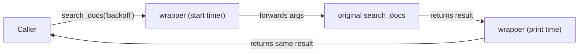
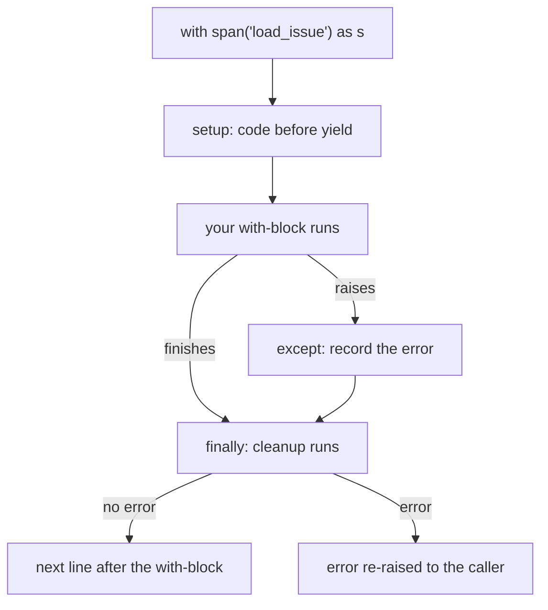
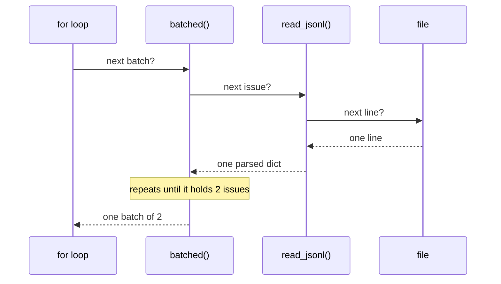

# Python for This Course

The course code leans on six Python features that intro courses often skip: type hints,
dataclasses, decorators, context managers, generators, and exceptions with logging. All six show up
by [Day 12: The OpenAI SDK in Production Code](../Phase_2_Building_with_LLM_APIs/Day_012_openai_sdk_production/openai_sdk_production.md).
This primer gives you enough of each to read that code, change it, and spot when it is wrong.

## Who this is for

- **Freshers** who can write functions, loops, lists and dicts, but stall on lines like
  `def ask(q: str) -> Answer | None:` or `@app.job(retries=3)`.
- **Engineers from other languages** who want the Python spelling of ideas they already use.

**Skip if** you can answer all five [Self-Check](#self-check) questions without peeking. Read it
before Day 12, and revisit the `TypedDict` and `Annotated` parts before
[Day 53: LangGraph I: Graphs, State & Routing](../Phase_6_Agents/Day_053_langgraph_graphs/langgraph_graphs.md).

> **Coming from another language?** Python type hints work like TypeScript types: tools check
> them, and the running program ignores them. Decorators look like Java annotations, but they are
> plain function wrapping. A `with` block is Java's try-with-resources or Go's `defer`. Generators
> are lazy iterators, like C# `yield return`.

Every example runs on Python 3.11+ with the standard library only. The examples use **Orbit**, the
fictional open-source background-jobs library whose docs and issues you work with all course. It has
jobs, queues, workers, and error codes such as `ORB-1201`.

## Type Hints: Labels Your Tools Can Read

**Problem.** You find `def route(issue, priority)` in a codebase. Is `priority` the string
`"high"`, the number `1`, or something else? You have to read every caller to find out.

**Intuition.** A type hint is a label on a box. Python itself never opens the box to check. Your
editor, a type checker, and libraries such as Pydantic read the label and act on it.

**Tiny example.** In `def count_labels(labels: list[str]) -> int:`, the hint after the colon says
"a list of strings goes in", and the hint after `->` says "an int comes out".

**Name the parts.**

| Hint | Means | Typical use |
|---|---|---|
| `list[str]`, `dict[str, int]` | a container, and what is inside it | `labels: list[str]` |
| `Optional[X]` | an X, or `None` | a lookup that can miss |
| `Literal["a", "b"]` | only these exact values | `Literal["low", "normal", "high"]` |
| `TypedDict` | a dict with known keys and value types | a JSON record |
| `Annotated[X, meta]` | an X, plus metadata for a library to read | Pydantic rules, LangGraph state |
| `TypeVar` | "the same type comes out as went in" (a light generic) | helpers over any list |

`Optional[X]` and `X | None` mean the same thing; newer code prefers the second.

```python
# script_id: primer_a03/type_hints
# Python 3.11+, stdlib only. No env vars or services.
from typing import Literal, Optional, TypedDict, TypeVar

Priority = Literal["low", "normal", "high"]  # only these three strings


class IssueSummary(TypedDict):
    id: int
    title: str
    labels: list[str]
    priority: Priority


def find_issue(issues: list[IssueSummary], issue_id: int) -> Optional[IssueSummary]:
    for issue in issues:
        if issue["id"] == issue_id:
            return issue
    return None  # the hint warns every caller to handle "not found"


T = TypeVar("T")


def first_or(items: list[T], default: T) -> T:
    # T ties input to output: a list of str gives back a str
    return items[0] if items else default


issues: list[IssueSummary] = [
    {"id": 12, "title": "Redis reconnect storm after failover",
     "labels": ["comp:broker-redis", "bug"], "priority": "high"},
]
hit = find_issue(issues, 12)
if hit is not None:  # narrow "IssueSummary or None" to IssueSummary
    print(hit["title"])
print(find_issue(issues, 99))
print(first_or(["3.2.1", "3.2.0"], default="unknown"))
```

```text
Redis reconnect storm after failover
None
3.2.1
```

`Annotated` attaches extra information to a type without changing it. Libraries read that
information at run time. Here is the idea behind LangGraph's state "reducers" (functions that
decide how an update merges into the current state), which you meet on Day 53:

```python
# script_id: primer_a03/annotated
# Python 3.11+, stdlib only.
import operator
from typing import Annotated, TypedDict, get_type_hints


class TriageState(TypedDict):
    issue_id: int
    notes: Annotated[list[str], operator.add]  # metadata: "merge by adding"


def merge(schema: type, state: dict, update: dict) -> dict:
    """Apply an update the way a graph framework reads your state class."""
    hints = get_type_hints(schema, include_extras=True)
    merged = dict(state)
    for key, value in update.items():
        extras = getattr(hints[key], "__metadata__", ())
        # a merge function in the metadata wins; otherwise overwrite
        merged[key] = extras[0](state[key], value) if extras else value
    return merged


state = {"issue_id": 12, "notes": ["seen on 3.1.0"]}
print(merge(TriageState, state, {"notes": ["fixed in 3.1.2"]}))
```

```text
{'issue_id': 12, 'notes': ['seen on 3.1.0', 'fixed in 3.1.2']}
```

**Common mistake.** Trusting hints to stop bad input. `find_issue(issues, "12")` runs without
complaint and returns `None`, because the string `"12"` never equals the int `12`. A type checker
catches it before you run anything (`uv add --dev mypy`, then `uv run mypy your_file.py`):

```text
error: Argument 2 to "find_issue" has incompatible type "str"; expected "int"  [arg-type]
```

A second trap: `Optional[str]` does not make an argument optional. Only a default value, as in
`name: Optional[str] = None`, lets callers leave it out.

## Dataclasses: Records Without Boilerplate

**Problem.** A plain class that holds a job's name, queue and retry count needs an `__init__` that
copies each argument, a `__repr__` so it prints readably, and an `__eq__` so two identical jobs
compare equal. That is about 15 lines of boilerplate for every record type.

**Intuition.** `@dataclass` is a form template. You list the fields once, and Python writes the
paperwork.

**Tiny example.** A dataclass `Point` with fields `x: int` and `y: int` lets you write
`Point(1, 2)`. It prints as `Point(x=1, y=2)` and equals any other `Point(1, 2)`.

**Name the parts.** A **field** is each annotated class attribute. A **default** makes a field
optional. `field(default_factory=list)` builds a fresh default for each instance. `frozen=True`
makes instances read-only. `asdict()` turns an instance into a plain dict, ready for `json.dumps`.

```python
# script_id: primer_a03/dataclasses
# Python 3.11+, stdlib only.
from dataclasses import asdict, dataclass, field


@dataclass
class Job:
    name: str
    queue: str = "default"
    retries: int = 3
    tags: list[str] = field(default_factory=list)  # a fresh list per Job


@dataclass(frozen=True)
class Release:
    version: str
    date: str


job = Job("send_receipt", tags=["billing"])
print(job)
print(job == Job("send_receipt", tags=["billing"]))
print(asdict(job))

current = Release("3.2.1", "2026-10-20")
try:
    current.version = "9.9.9"
except AttributeError as err:  # FrozenInstanceError is an AttributeError
    print(f"{type(err).__name__}: {err}")
```

```text
Job(name='send_receipt', queue='default', retries=3, tags=['billing'])
True
{'name': 'send_receipt', 'queue': 'default', 'retries': 3, 'tags': ['billing']}
FrozenInstanceError: cannot assign to field 'version'
```

**Common mistake.** Giving a list field a plain default, `tags: list[str] = []`. Python rejects it
when the class is defined, because one shared list would leak tags between every `Job`:

```text
ValueError: mutable default <class 'list'> for field tags is not allowed: use default_factory
```

Also note that dataclasses do not validate: `Job("x", retries="three")` is accepted. When data
comes from outside your code (an HTTP request, a model's JSON output), use Pydantic, which checks
types at run time. That is
[Day 15: Pydantic for LLM Apps](../Phase_2_Building_with_LLM_APIs/Day_015_pydantic_for_llms/pydantic_for_llms.md).

## Decorators: Wrapping a Function

**Problem.** You want every model call timed and logged. Pasting timing code into 30 functions is
repetitive, and function 31 will forget it.

**Intuition.** In Python a function is a value, like a number: you can pass it to another function
and get a new function back. A decorator is gift wrap. It takes your function and returns a wrapped
version that does something before and after the original runs.

**Tiny example.** Writing `@timed` above `def search_docs(...)` is shorthand for
`search_docs = timed(search_docs)`. Nothing more happens than that one assignment.

**Name the parts.** The **decorator** is the outer function (`timed`). The **wrapper** is the inner
function it returns, which calls the original. `*args, **kwargs` forward whatever arguments the
caller passed. `functools.wraps` copies the original's name and docstring onto the wrapper. A
**decorator factory** takes settings and returns a decorator: Orbit's `@app.job(retries=3)` is one.



```python
# script_id: primer_a03/decorators
# Python 3.11+, stdlib only.
import functools
import time
from typing import Callable

TOOLS: dict[str, Callable] = {}


def tool(func: Callable) -> Callable:
    """Register a function by name and return it unchanged."""
    TOOLS[func.__name__] = func
    return func


def timed(func: Callable) -> Callable:
    @functools.wraps(func)  # keep the original name and docstring
    def wrapper(*args, **kwargs):
        start = time.perf_counter()
        result = func(*args, **kwargs)
        print(f"{func.__name__} took {(time.perf_counter() - start) * 1000:.0f} ms")
        return result  # without this, every caller gets None
    return wrapper


@tool
@timed
def search_docs(query: str) -> list[str]:
    time.sleep(0.05)  # stand-in for a slow search
    return [f"docs/retries.md matches {query!r}"]


print(list(TOOLS))
print(TOOLS["search_docs"]("backoff"))
```

```text
['search_docs']
search_docs took 53 ms
["docs/retries.md matches 'backoff'"]
```

Your timing will differ. Stacked decorators apply bottom-up: `timed` wraps first, then `tool`
registers the wrapped version. A registry like `TOOLS` is how you turn functions into tools a model
can call in [Day 35: Function Calling: The Tool Loop](../Phase_4_Tools_and_MCP/Day_035_function_calling/function_calling.md).

A factory adds one more layer: `retry(times=3)` runs first and returns the real decorator.

```python
# script_id: primer_a03/decorators
def retry(times: int) -> Callable:
    """A decorator factory: retry(times=3) builds and returns the decorator."""
    def decorator(func: Callable) -> Callable:
        @functools.wraps(func)
        def wrapper(*args, **kwargs):
            for attempt in range(1, times + 1):
                try:
                    return func(*args, **kwargs)
                except ConnectionError as err:
                    print(f"attempt {attempt} failed: {err}")
            raise ConnectionError(f"gave up after {times} attempts")
        return wrapper
    return decorator


calls = {"n": 0}


@retry(times=3)
def ping_broker() -> str:
    calls["n"] += 1
    if calls["n"] < 3:  # fail twice, then succeed
        raise ConnectionError("ORB-1001 broker unreachable")
    return "broker ok"


print(ping_broker())
```

```text
attempt 1 failed: ORB-1001 broker unreachable
attempt 2 failed: ORB-1001 broker unreachable
broker ok
```

Production retries also need waits between attempts (backoff); that is
[Day 84: Reliability: Backoff, Fallbacks & LLM Gateways](../Phase_9_Production/Day_084_reliability_fallbacks/reliability_fallbacks.md).

**Common mistake.** Leaving out `@functools.wraps(func)`. Every wrapped function is then named
`wrapper`, so each tool you register overwrites the previous one:

```python
# script_id: primer_a03/wraps_mistake
# Python 3.11+, stdlib only.
TOOLS = {}


def tool(func):
    TOOLS[func.__name__] = func
    return func


def logged(func):
    def wrapper(*args, **kwargs):  # no @functools.wraps(func)
        return func(*args, **kwargs)
    return wrapper


@tool
@logged
def search_docs(query): ...


@tool
@logged
def get_issue(issue_id): ...


print(list(TOOLS))
```

```text
['wrapper']
```

## Context Managers: Setup With Guaranteed Cleanup

**Problem.** Opening a file, a database connection or a trace span means you must close it, even
when the code in between raises. A `try`/`finally` around every use works, but it buries the real
logic under cleanup code.

**Intuition.** A library checkout. You take the book (setup), read it, and the return happens
automatically when you leave, even if you leave in a hurry.

**Tiny example.** `with open("notes.txt") as f:` opens the file, hands it to you as `f`, and closes
it when the indented block ends, error or not.

**Name the parts.** The `with` statement runs a **context manager**: an object with `__enter__`
(setup; its return value goes to the name after `as`) and `__exit__` (cleanup, which also receives
any exception). The `@contextmanager` decorator from `contextlib` lets you write one as a
generator function: code before `yield` is setup, and code after it is cleanup.



```python
# script_id: primer_a03/context_managers
# Python 3.11+, stdlib only.
import time
from contextlib import contextmanager
from typing import Iterator


@contextmanager
def span(name: str) -> Iterator[dict]:
    info: dict = {"name": name}
    start = time.perf_counter()
    try:
        yield info  # the body of the with-block runs here
    except Exception as err:
        info["error"] = type(err).__name__
        raise  # record it, then let the caller see it
    finally:
        info["ms"] = round((time.perf_counter() - start) * 1000)
        print(f"span {info}")


with span("load_issue") as s:
    time.sleep(0.02)  # stand-in for real work
    s["issue_id"] = 12

try:
    with span("read_config"):
        raise KeyError("orbit.ini")  # the 2.x config file, replaced in 3.0
except KeyError:
    print("caller still sees the KeyError")
```

```text
span {'name': 'load_issue', 'issue_id': 12, 'ms': 21}
span {'name': 'read_config', 'error': 'KeyError', 'ms': 0}
caller still sees the KeyError
```

Your timings will differ. This is the shape of a tracing span, which
[Day 42: Tracing & Observability in Depth](../Phase_5_Evaluation_and_Observability/Day_042_tracing_observability/tracing_observability.md)
builds with real tracing tools.

**Common mistake.** Putting cleanup after `yield` without `try`/`finally`. When the body raises, the
line after `yield` never runs, so the connection stays open:

```python
# script_id: primer_a03/context_mistake
# Python 3.11+, stdlib only.
from contextlib import contextmanager


@contextmanager
def connection(name: str):
    print(f"open {name}")
    yield
    print(f"close {name}")  # skipped when the body raises


try:
    with connection("results-db"):
        raise TimeoutError("ORB-1601 result backend unavailable")
except TimeoutError as err:
    print(f"caught: {err}")
```

```text
open results-db
caught: ORB-1601 result backend unavailable
```

## Generators and Iterators: One Item at a Time

**Problem.** A list comprehension over `open(path)` reads every issue into memory before you can look
at the first. That is fine for 240 Orbit issues and slow for a million log lines. It cannot work at
all for a model's streamed reply, because most of the reply does not exist yet when you start
reading.

**Intuition.** A list is a delivered pallet: everything arrives at once. A generator is a vending
machine: each press gives you the next item, made on demand.

**Tiny example.** Take a function `count_to(n)` whose loop body is `yield i`. Calling
`g = count_to(2)` runs nothing yet. `next(g)` gives `1`, then `2`, then raises `StopIteration`,
which is how a `for` loop knows to stop.

**Name the parts.** An **iterable** is anything a `for` loop accepts: lists, strings, open files.
An **iterator** hands out items one at a time through `next()` and raises `StopIteration` when it
runs out. A **generator** is a function containing `yield`; calling it returns an iterator.
Generators chain into **pipelines**, where each stage pulls one item from the stage before it.



```python
# script_id: primer_a03/generators
# Python 3.11+, stdlib only.
import io
import json
from typing import Iterable, Iterator

# Stand-in for open(DATA_DIR / "issues.jsonl"): one JSON object per line
FAKE_FILE = io.StringIO(
    '{"id": 1, "title": "Windows worker ignores SIGTERM"}\n'
    "\n"
    '{"id": 2, "title": "SQS FIFO throttling (ORB-1901)"}\n'
    '{"id": 3, "title": "Scheduler drift across DST"}\n'
)


def read_jsonl(lines: Iterable[str]) -> Iterator[dict]:
    for line in lines:
        if line.strip():  # real files often contain blank lines
            yield json.loads(line)


def batched(items: Iterable[dict], size: int) -> Iterator[list[dict]]:
    batch: list[dict] = []
    for item in items:
        batch.append(item)
        if len(batch) == size:
            yield batch
            batch = []
    if batch:
        yield batch  # the last, partial batch


for batch in batched(read_jsonl(FAKE_FILE), size=2):
    print([issue["id"] for issue in batch])
```

```text
[1, 2]
[3]
```

Python 3.12 added `itertools.batched`, but this course supports 3.11, so you write your own. When you
stream a model's reply in
[Day 13: Streaming Responses](../Phase_2_Building_with_LLM_APIs/Day_013_streaming/streaming.md),
the SDK hands you an iterator of events, and you consume it with this same `for` loop.

**Common mistake.** Treating a generator like a list. It is single-use, so a second pass sees
nothing, with no error:

```python
# script_id: primer_a03/generator_mistake
# Python 3.11+, stdlib only.
payload_kb = (kb for kb in [120, 512, 64])  # a generator expression
print(sum(payload_kb))
print(sum(payload_kb))  # the same generator, already used up
print(payload_kb)
```

```text
696
0
<generator object <genexpr> at 0x102afb850>
```

Your memory address will differ. If you need the items twice, call `list()` once and keep the
list. Printing a generator shows the object, not its items, because it has not produced them yet.

## Exceptions and Logging: Fail Loudly, Leave a Trail

**Problem.** A job's arguments cannot be turned into JSON, the code around it says
`except Exception: pass`, and the job silently never runs. Nobody finds out until a user asks where
their receipt went.

**Intuition.** An exception is a fire alarm. It travels up through every caller until some code
handles it, or the program stops and prints a traceback (the list of calls that led to the error).
Logging is the incident log: each entry has a level and a source, and it can be kept.

**Tiny example.** `int("3.2.1")` raises
`ValueError: invalid literal for int() with base 10: '3.2.1'`. Wrap it in `try:` and
`except ValueError:`, and you decide what happens instead.

**Name the parts.**
- `try` / `except SomeError` / `else` (runs only if nothing raised) / `finally` (always runs).
- A **custom exception** subclasses `Exception`. A shared base class such as `OrbitError` lets
  callers catch the whole family with one `except`.
- `raise NewError(...) from err` keeps the original cause in the traceback.
- A **logger**, from `logging.getLogger(name)`, writes records at a **level**: DEBUG, INFO,
  WARNING or ERROR. `logging.basicConfig` sets the format and the lowest level that gets shown.

```python
# script_id: primer_a03/exceptions_logging
# Python 3.11+, stdlib only.
import json
import logging

logging.basicConfig(level=logging.INFO, format="%(levelname)s %(name)s: %(message)s")
logger = logging.getLogger("atlas.jobs")


class OrbitError(Exception):
    """Base class: callers can catch every Orbit failure with one except."""


class SerializationError(OrbitError):
    code = "ORB-1201"


def encode_args(args: dict) -> str:
    try:
        return json.dumps(args)
    except TypeError as err:
        # "from err" keeps the original cause in the traceback
        raise SerializationError(f"{SerializationError.code}: {err}") from err


for args in ({"order_id": "A-1001"}, {"order_id": {"A-1002"}}):
    try:
        payload = encode_args(args)
    except OrbitError as err:
        logger.error("enqueue failed: %s", err)
    else:  # runs only when nothing was raised
        logger.info("enqueued %s", payload)
```

```text
INFO atlas.jobs: enqueued {"order_id": "A-1001"}
ERROR atlas.jobs: enqueue failed: ORB-1201: Object of type set is not JSON serializable
```

**Common mistake.** Two habits to drop. First, `except Exception: pass` (or a bare `except:`) hides
every bug, including typos in your own code. Catch the narrowest exception you can handle, and let
the rest travel up. Second, using `print` for diagnostics: prints have no level and no off switch.
Inside an `except` block, `logger.exception("...")` logs at ERROR and appends the full traceback.
Pass values as arguments, as in `logger.info("enqueued %s", payload)`, so the message is only built
when that level is switched on. Re-asking a model after a bad answer is
[Day 17: Handling Semantic Failures: Validate, Re-ask, Bound](../Phase_2_Building_with_LLM_APIs/Day_017_semantic_failures/semantic_failures.md).

## Self-Check

**1.** Given `def get_issue(issue_id: int) -> Optional[dict]:`, what can the function return, and
does Python stop you from calling `get_issue("12")`?

<details><summary>Answer</summary>

A dict or `None`. Python does not stop the call: hints are not checked at run time. A type checker
such as mypy reports the wrong argument type before you run the code.

</details>

**2.** Why does `tags: list[str] = []` inside a dataclass raise a `ValueError`, and what is the fix?

<details><summary>Answer</summary>

A plain list default would be one list shared by every instance, so Python refuses it. Use
`tags: list[str] = field(default_factory=list)`, which builds a new list for each instance.

</details>

**3.** You stack a registry decorator on top of a wrapper that lacks `functools.wraps`, and register
three functions. What does the registry contain?

<details><summary>Answer</summary>

One entry, named `wrapper`. Every wrapper has the same `__name__`, so each registration overwrites
the last. Adding `@functools.wraps(func)` to the wrapper fixes it.

</details>

**4.** `ids = (issue["id"] for issue in issues)`, then `print(len(list(ids)))` prints `240`. What
does running the same `print` line again show, and why?

<details><summary>Answer</summary>

`0`. A generator is single-use, and the first `list()` consumed every item. Build the list once and
reuse it.

</details>

**5.** Inside the `span` context manager from this primer, the with-block raises `KeyError`. Which
parts of `span` run, does the caller see the error, and how should the caller log it?

<details><summary>Answer</summary>

The `except` branch records the error and re-raises it, and the `finally` branch always runs and
prints the span. The caller still receives the `KeyError`. In the caller's `except` block, use
`logger.exception(...)` so the log line includes the traceback.

</details>

## Learn More

- [mypy: Type hints cheat sheet](https://mypy.readthedocs.io/en/stable/cheat_sheet_py3.html): one
  page with every hint in this primer, and more, in working form.
- [Real Python: Primer on Python Decorators](https://realpython.com/primer-on-python-decorators/):
  a longer walk through decorators, including factories and class decorators.
- [Python docs: Logging HOWTO](https://docs.python.org/3/howto/logging.html): the official guide to
  loggers, levels, handlers and formatters.
- [Python tutorial: Errors and Exceptions](https://docs.python.org/3/tutorial/errors.html):
  `try`/`except`/`else`/`finally`, custom exceptions and exception chaining.
