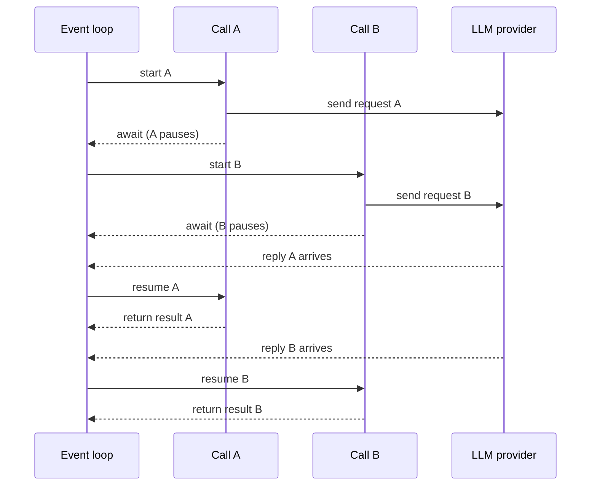
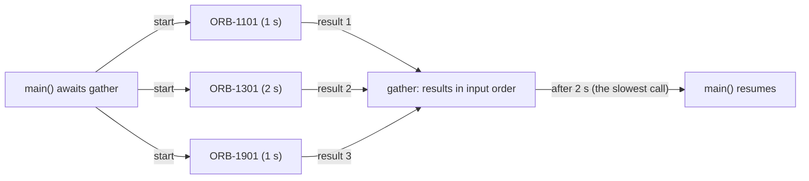

# Async Python I: await and gather

## Who this is for

You know basic Python (functions, lists, dicts, loops, `pip install`) but have never written
`async def`, or you have copied async code without being sure what `await` does. Read this before
the optional async block in
[Day 12: The OpenAI SDK in Production Code](../Phase_2_Building_with_LLM_APIs/Day_012_openai_sdk_production/openai_sdk_production.md).
You need it by
[Day 22: Capstone R1: The Extractor](../Phase_2_Building_with_LLM_APIs/Day_022_capstone_r1_extractor/capstone_r1_extractor.md),
the first day where async code is required. Type hints such as `-> str` are covered in
[Python for this course](A03_python_for_this_course.md). Allow 20–30 minutes.

**Skip if** you can explain what the event loop does at an `await`, why `time.sleep()` inside an
`async def` slows down every other task, and write `asyncio.gather` over a list of calls.
Concurrency limits, timeouts, cancellation and `async for` come next, in
[Async Python II](A04b_async_python_concurrency.md).

**New terms:** I/O-bound, coroutine, event loop, `await`, `asyncio.gather`.

> **Coming from Software Engineering?** Python's `asyncio` uses the same model as JavaScript:
> `async def` is `async function`, `await` is `await`, and `asyncio.gather` is `Promise.all`.
> One difference catches JS developers: calling an `async def` function does not start it. You get
> back a coroutine object that does nothing until you await it or hand it to `gather`. As in Node,
> everything runs on one thread, so a single blocking call (a sync HTTP client, `time.sleep`) stalls
> every request in flight.

## Why waiting is the problem

An LLM call is a network request. Your program sends a prompt, the provider's servers generate
text, and a reply comes back a second or more later. During that second your CPU does almost
nothing. Work like this is **I/O-bound**: its speed is limited by waiting on input/output (the
network, a disk), not by computation.

A plain loop waits for each call to finish before it starts the next one. Here is that loop over
three Orbit issues, with `time.sleep()` standing in for the model so the code runs offline and
costs nothing:

```python
# script_id: primer_a04a/sync_baseline
# Install: nothing (stdlib only). Env vars: none. Services: none.
# time.sleep() stands in for an LLM call, so this runs offline and costs nothing.
import time

LATENCY = {"ORB-1101": 1.0, "ORB-1301": 2.0, "ORB-1901": 1.0}  # issue -> seconds


def fake_llm(issue: str, seconds: float) -> str:
    time.sleep(seconds)  # the network wait: your CPU sits idle here
    return f"summary of {issue}"


start = time.perf_counter()
summaries = [fake_llm(issue, secs) for issue, secs in LATENCY.items()]
print(summaries)
print(f"took {time.perf_counter() - start:.1f} s")
```

Expected output (timings may differ by a few hundredths of a second):

```text
['summary of ORB-1101', 'summary of ORB-1301', 'summary of ORB-1901']
took 4.0 s
```

**The intuition.** Picture a waiter in a restaurant. A poor waiter takes table 1's order, carries it
to the kitchen, and stands there until the food is ready before going to table 2. A good waiter
drops the order off and serves other tables while the kitchen cooks. The kitchen is no faster; the
waiter has stopped standing idle. Async Python turns your program into the good waiter, and the
provider's servers are the kitchen.

**A tiny worked example.** Three calls take 1 s, 2 s and 1 s.

- One after another, you wait 1 + 2 + 1 = **4 s**.
- Started together, you wait only for the slowest: max(1, 2, 1) = **2 s**.
- Scale it up: 50 one-second calls take 50 s in a loop and about 1 s together. Real providers
  enforce rate limits, so in practice you cap how many run at once. That is part of Async Python II.

This is **concurrency**: several tasks in progress at once, taking turns on one thread. It differs
from parallelism, where tasks run at the same instant on different CPU cores. For I/O-bound work,
concurrency is all you need, because the tasks spend their time waiting rather than computing.

## Coroutines and the event loop

Python's built-in `asyncio` module gives you four parts. Learn these names; every async lesson in
the course uses them.

- **Coroutine:** a function defined with `async def`. Calling it does not run its body. It returns a
  *coroutine object*, a paused piece of work waiting to be started.
- **`await`:** means "pause me here until this result is ready". While one coroutine waits, the event
  loop is free to run others. You can only write `await` inside an `async def`.
- **Event loop:** the scheduler that runs coroutines. It runs one at a time, on one thread. When a
  coroutine reaches an `await` on something that isn't ready yet (a network reply, a timer), the
  loop switches to another coroutine that can make progress, and resumes the first one when its
  result arrives.
- **`asyncio.run(main())`:** the bridge from ordinary code. It creates an event loop, runs `main()`
  until it finishes, then closes the loop. Call it once, at the top of your program.

```python
# script_id: primer_a04a/first_coroutine
# Install: nothing (stdlib only). Env vars: none. Services: none.
import asyncio


async def fake_llm(issue: str) -> str:
    await asyncio.sleep(1.0)  # a non-blocking wait: the loop may run other work meanwhile
    return f"summary of {issue}"


async def main() -> None:
    coro = fake_llm("ORB-1101")  # nothing has run yet; this is only a coroutine object
    print(type(coro).__name__)
    result = await coro  # now it runs, and main() pauses until it returns
    print(result)


asyncio.run(main())  # create the loop, run main() to completion, close the loop
```

Expected output (after a one-second pause):

```text
coroutine
summary of ORB-1101
```

`asyncio.sleep()` is the async version of `time.sleep()`. Instead of freezing the thread, it tells
the loop "wake me in one second" and hands control back. Real async clients do the same thing with
network sockets. The diagram shows how the loop interleaves two calls on a single thread:



The key rule: the loop never interrupts a coroutine. It can switch only at an `await`. That rule
explains both the speed-up and the most common async bug, which you will meet in the last section.

## Running calls together with gather

Awaiting one coroutine after another is still sequential, because each `await` waits for its call to
finish. To overlap calls, hand them all to **`asyncio.gather(*coros)`**. It schedules every coroutine
on the loop, waits until all of them have finished, and returns their results as a list **in the
order you passed them in**, not the order in which they finished.

```python
# script_id: primer_a04a/gather_demo
# Install: nothing (stdlib only). Env vars: none. Services: none.
import asyncio
import time

LATENCY = {"ORB-1101": 1.0, "ORB-1301": 2.0, "ORB-1901": 1.0}  # issue -> seconds


async def fake_llm(issue: str, seconds: float) -> str:
    await asyncio.sleep(seconds)
    print(f"  finished {issue}")
    return f"summary of {issue}"


async def main() -> None:
    start = time.perf_counter()
    coros = [fake_llm(issue, secs) for issue, secs in LATENCY.items()]
    summaries = await asyncio.gather(*coros)  # start all three, wait for every one
    print(summaries)
    print(f"took {time.perf_counter() - start:.1f} s")


asyncio.run(main())
```

Expected output:

```text
  finished ORB-1101
  finished ORB-1901
  finished ORB-1301
['summary of ORB-1101', 'summary of ORB-1301', 'summary of ORB-1901']
took 2.0 s
```

The same three calls now take 2 s instead of 4 s, matching the hand calculation. ORB-1301 finished
last, yet its summary is still second in the list, because `gather` keeps input order. That is what
lets you `zip` the results back to your inputs safely.



**Turn the knob.** Add 30 more issues to `LATENCY`, each at 1.0 s. The total stays at about 2 s,
because the waits overlap. Now break it: replace the `gather` line with
`summaries = [await c for c in coros]`. Each `await` finishes before the next coroutine starts, so
you are back to 4 s plus one second per extra issue.

**When one call fails.** By default, the first exception inside `gather` is raised from the
`await asyncio.gather(...)` line, and you lose the results of the calls that succeeded. For batch
jobs (summarize 200 issues, keep the ones that worked), pass `return_exceptions=True`. Failures then
come back as exception objects in the result list, in their usual position:

```python
# script_id: primer_a04a/gather_errors
# Install: nothing (stdlib only). Env vars: none. Services: none.
import asyncio


async def fake_llm(issue: str) -> str:
    await asyncio.sleep(0.5)
    if issue == "ORB-1901":
        raise TimeoutError(f"{issue}: provider took too long")
    return f"summary of {issue}"


async def main() -> None:
    issues = ["ORB-1101", "ORB-1901", "ORB-1301"]
    results = await asyncio.gather(*(fake_llm(i) for i in issues), return_exceptions=True)
    for issue, result in zip(issues, results):
        if isinstance(result, Exception):
            print(f"{issue}: FAILED ({result})")
        else:
            print(f"{issue}: {result}")


asyncio.run(main())
```

Expected output:

```text
ORB-1101: summary of ORB-1101
ORB-1901: FAILED (ORB-1901: provider took too long)
ORB-1301: summary of ORB-1301
```

## Sync and async clients

Fake sleeps prove the idea; now make real calls. The OpenAI Python SDK ships two clients with the
same methods. The only differences are the class name and the `await`:

| | Sync client | Async client |
|---|---|---|
| Import | `from openai import OpenAI` | `from openai import AsyncOpenAI` |
| Call | `client.responses.create(...)` | `await client.responses.create(...)` |
| Runs inside | ordinary functions | `async def` only |
| Good for | one call at a time: scripts, notebook cells | many calls at once: batches, evals, web servers |

The script below summarizes three Orbit bug reports concurrently. It costs well under $0.001 on
`gpt-6-luna` (prices as of 2026-11, [verify](https://developers.openai.com/api/docs/pricing)).

```python
# script_id: primer_a04a/async_client
# Install: uv add openai
# Env vars: OPENAI_API_KEY (required), ATLAS_MODEL (optional). Services: none.
import asyncio
import os

from openai import AsyncOpenAI

MODEL = os.environ.get("ATLAS_MODEL", "gpt-6-luna")
ISSUES = [
    "Workers run the same job twice when it runs longer than 5 minutes.",
    "Jobs land in the dead-letter queue after 3 failed attempts.",
    "SQS returns throttling errors when we enqueue 500 jobs at once.",
]


async def summarize(client: AsyncOpenAI, issue: str) -> str:
    response = await client.responses.create(
        model=MODEL,
        input=f"Summarize this Orbit bug report in at most 8 words: {issue}",
    )
    return response.output_text


async def main() -> None:
    # One shared client reuses its connections; `async with` closes them at the end.
    async with AsyncOpenAI() as client:  # reads OPENAI_API_KEY from the environment
        summaries = await asyncio.gather(*(summarize(client, i) for i in ISSUES))
    for summary in summaries:
        print("-", summary)


asyncio.run(main())
```

Expected output (your wording will differ; the order always matches `ISSUES`):

```text
- Long-running jobs execute twice after lease timeout
- Jobs move to dead-letter queue after three failures
- SQS throttles bulk enqueue of 500 jobs
```

The shape is the same as `gather_demo`: `asyncio.sleep()` became `await client.responses.create()`.
While one request waits on the network, the loop sends the others.

**When not to use async.** Async code is harder to read and debug, so use it only where it pays:

| Situation | Choose |
|---|---|
| One call, or a few in sequence where each needs the previous answer | Sync client |
| Many independent calls (batch extraction, eval runs) | Async client + `gather` |
| Inside a web handler that is already `async def` (FastAPI, see [Day 77: Serving LLM Apps with FastAPI](../Phase_9_Production/Day_077_fastapi_serving/fastapi_serving.md)) | Async client |
| CPU-heavy work (parsing a huge file, number crunching) | Neither client helps; async speeds up waiting, not computing |

## Common mistakes

All of the classic bugs come from the rule in the event-loop section: the loop can switch only at an
`await`. This script triggers the two most common ones on purpose:

```python
# script_id: primer_a04a/blocking_mistake
# Install: nothing (stdlib only). Env vars: none. Services: none.
import asyncio
import time


async def blocking_llm(issue: str) -> str:
    time.sleep(1.0)  # BUG: a sync call freezes the whole event loop
    return f"summary of {issue}"


async def forgot_await() -> None:
    asyncio.sleep(1.0)  # BUG: builds a coroutine object and throws it away


async def main() -> None:
    start = time.perf_counter()
    await asyncio.gather(*(blocking_llm(i) for i in ["ORB-1101", "ORB-1301", "ORB-1901"]))
    print(f"blocking gather took {time.perf_counter() - start:.1f} s")
    start = time.perf_counter()
    await forgot_await()
    print(f"forgot_await took {time.perf_counter() - start:.1f} s")


asyncio.run(main())
```

Expected output (the warning goes to stderr; your file path will differ):

```text
blocking gather took 3.0 s
/path/to/blocking_mistake.py:13: RuntimeWarning: coroutine 'sleep' was never awaited
  asyncio.sleep(1.0)  # BUG: builds a coroutine object and throws it away
RuntimeWarning: Enable tracemalloc to get the object allocation traceback
forgot_await took 0.0 s
```

- **A blocking call inside a coroutine.** *Symptom:* `gather` takes the sum of the calls (3.0 s), not
  the slowest one. *Cause:* `time.sleep()`, `requests.get()` or the sync `OpenAI()` client never
  reaches an `await`, so the loop cannot switch. *Fix:* use the async version (`asyncio.sleep`,
  `AsyncOpenAI`). If no async version exists, `await asyncio.to_thread(func, *args)` runs the sync
  function in a worker thread so the loop stays free.
- **A missing `await`.** *Symptom:* `RuntimeWarning: coroutine '...' was never awaited`, or a
  `<coroutine object ...>` printed where you expected a string. *Cause:* calling an `async def`
  function only creates the coroutine. *Fix:* put `await` in front, or pass the coroutine to `gather`.
- **`await` in an ordinary function.** *Symptom:* `SyntaxError: 'await' outside function` (or
  `'await' outside async function` inside a plain `def`). *Fix:* make the function `async def`, and
  start the program with `asyncio.run(main())`.
- **`asyncio.run()` when a loop is already running.** *Symptom:*
  `RuntimeError: asyncio.run() cannot be called from a running event loop`. *Cause:* Jupyter
  notebooks already run a loop, and so does any code already inside a coroutine. *Fix:* in a notebook
  cell, write `await main()` directly; inside a coroutine, `await` the other coroutine instead.
- **Awaiting in a loop when you meant to overlap.** *Symptom:* the async version is no faster than the
  sync one. *Cause:* `for c in coros: await c` runs them one at a time. *Fix:* `await asyncio.gather(*coros)`.

## Self-Check

1. `summarize` is defined with `async def`. You write `result = summarize("ORB-1101")` inside
   `main()` and print `result`. What prints, and did the model get called?

   <details><summary>Answer</summary>

   You print a coroutine object such as `<coroutine object summarize at 0x...>`, and no request is
   sent: calling an `async def` function only creates the coroutine. Python also warns
   `coroutine 'summarize' was never awaited`. Write `result = await summarize("ORB-1101")`.

   </details>

2. Three calls take 3 s, 1 s and 2 s. How long does a sequential loop take, how long does `gather`
   take, and in what order does `gather` return the results?

   <details><summary>Answer</summary>

   The loop takes 3 + 1 + 2 = 6 s. `gather` takes about 3 s, the slowest call. Results come back in
   the order you passed the coroutines in (the 3-second call's result first), whatever order they
   finished in.

   </details>

3. A teammate's `gather` over 10 one-second calls takes 10 s, the same as a plain loop. What is the
   likely cause, and what are two ways to fix it?

   <details><summary>Answer</summary>

   Something inside the coroutine blocks without awaiting, often `time.sleep()`, `requests`, or the
   sync `OpenAI()` client. Fix it by switching to the async equivalent (`asyncio.sleep`,
   `AsyncOpenAI`), or by wrapping the unavoidable sync call in `await asyncio.to_thread(...)`.

   </details>

4. Why does async speed up 100 LLM calls but not a pure-Python loop that scores a million vectors?

   <details><summary>Answer</summary>

   LLM calls are I/O-bound: almost all their time is spent waiting on the network, and the event loop
   fills that waiting time with other calls. Scoring vectors is CPU-bound: there is no waiting to
   overlap, and the loop runs one coroutine at a time on one thread, so the work takes as long as before.

   </details>

5. What does `asyncio.run(main())` do, and why does it fail inside a Jupyter notebook?

   <details><summary>Answer</summary>

   It creates an event loop, runs the `main()` coroutine until it finishes, and closes the loop.
   Jupyter already runs its own event loop, so a second `asyncio.run()` raises
   `RuntimeError: asyncio.run() cannot be called from a running event loop`. In a notebook cell,
   write `await main()` instead.

   </details>

## Learn More

- [Python docs: A conceptual overview of asyncio](https://docs.python.org/3/howto/a-conceptual-overview-of-asyncio.html):
  the official mental model of the event loop, tasks and `await`. Read it after this primer.
- [Python docs: Coroutines and Tasks](https://docs.python.org/3/library/asyncio-task.html):
  the reference for `asyncio.run`, `gather` and `to_thread`, with short examples.
- [Real Python: Async IO in Python](https://realpython.com/async-io-python/): a longer free
  walkthrough with more examples and history.
- [OpenAI Python SDK README: Async usage](https://github.com/openai/openai-python#async-usage):
  how `AsyncOpenAI` is set up, from the SDK maintainers.
