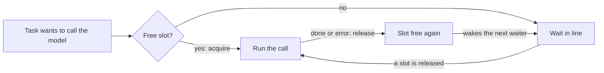
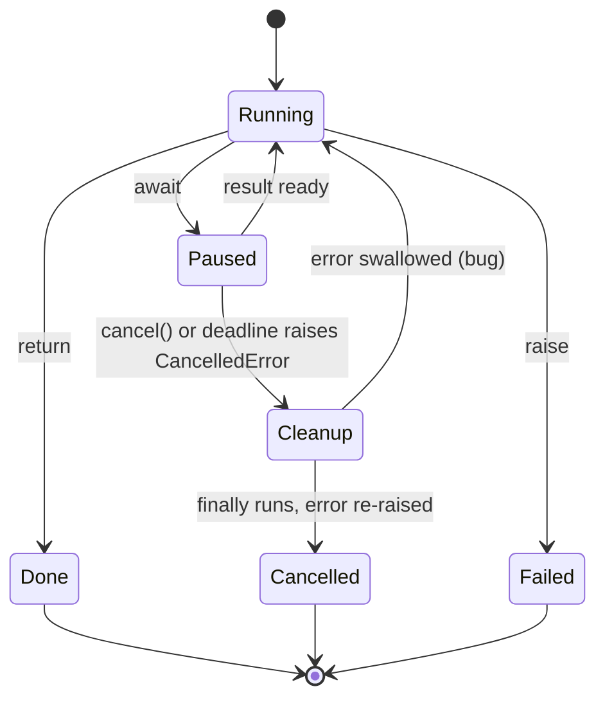
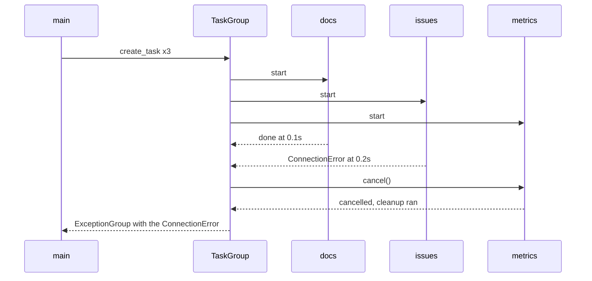

# Async Python II: Limits, Timeouts and Cancellation

## Who this is for

[Async Python I](A04a_async_python_basics.md) showed you how to run many LLM calls at once with
`asyncio.gather`. Real batches also need a cap on calls in flight, deadlines, a clean way to stop,
and protection from blocking code.

- **Read before:** [Day 37: Robust Tool Execution](../Phase_4_Tools_and_MCP/Day_037_robust_tool_execution/robust_tool_execution.md)
  and [Day 77: Serving LLM Apps with FastAPI](../Phase_9_Production/Day_077_fastapi_serving/fastapi_serving.md).
  Also useful for [Day 13: Streaming Responses](../Phase_2_Building_with_LLM_APIs/Day_013_streaming/streaming.md)
  and [Day 22: Capstone R1](../Phase_2_Building_with_LLM_APIs/Day_022_capstone_r1_extractor/capstone_r1_extractor.md).
- **You need:** `async def`, `await`, `asyncio.run` and `asyncio.gather` (Async Python I).
- **Time:** about 30 minutes. Scripts use the standard library on Python 3.11+ and fake the model
  call with `asyncio.sleep`: no API key, no cost.
- **New terms:** semaphore, cancellation, task group, async generator, blocking call.
- **Skip if** you get all five Self-Check questions right without reading on.

> **Coming from Software Engineering?** A semaphore is a connection-pool size, the same idea as
> Orbit's `orbit worker --concurrency 8`. `asyncio.timeout` is a request deadline, like Go's
> `context.WithTimeout`. `TaskGroup` is structured concurrency (child tasks never outlive their
> parent block), like Go's `errgroup`. New if you know threads: cancellation arrives as an
> exception at an `await`, and one blocking call stalls every task, since all share one thread.

## Cap concurrency with a Semaphore

**The problem.** You `gather` summaries for all 240 Orbit issues. That fires 240 requests in one
second, the provider answers many with `429 Too Many Requests` (you exceeded your rate limit, the
requests per minute your key may send), and the batch fails. You want every issue processed, but no
more than N at a time.

**The intuition.** Think of a restaurant with two tables. Guests queue at the door. When a table
frees up, the next guest sits down. Nobody is turned away; they wait their turn.

**A tiny example by hand.** Six issues, each call takes 1 second, two "tables":

| Seconds | Running |
|---|---|
| 0–1 | #101, #102 |
| 1–2 | #103, #104 |
| 2–3 | #105, #106 |

About 3 seconds in total. Six tables: 1 second; one table: 6 seconds. Pick N from the provider's
rate limit and how long you can wait.

**Name the parts.**

- A **semaphore** is a counter of free slots that many tasks share.
- **Acquire** takes a slot, or waits in line if none is free. **Release** gives the slot back and
  wakes the next task in line.
- `async with sem:` acquires on entry and releases on exit, even if the body raises an error.



Six fake calls behind a limit of 2, recording the most that ever ran at once:

```python
# script_id: primer_a04b/semaphore_cap
# Requires: Python 3.11+, stdlib only. No API key, env vars or services.
import asyncio
import time

in_flight = 0  # calls running right now
peak = 0       # the most that ever ran at once


async def summarize(issue_id: int, sem: asyncio.Semaphore) -> str:
    global in_flight, peak
    async with sem:              # wait here until a slot is free
        in_flight += 1
        peak = max(peak, in_flight)
        await asyncio.sleep(1)   # stands in for one LLM call
        in_flight -= 1
    return f"summary of issue #{issue_id}"


async def main() -> None:
    sem = asyncio.Semaphore(2)   # ONE shared limit for every task
    start = time.perf_counter()
    results = await asyncio.gather(*(summarize(i, sem) for i in range(101, 107)))
    elapsed = time.perf_counter() - start
    print(f"{len(results)} summaries in {elapsed:.1f}s, peak in flight = {peak}")


asyncio.run(main())
```

Expected output (timings on your machine may differ slightly):

```text
6 summaries in 3.0s, peak in flight = 2
```

**Common mistake: a semaphore per call.** Replace `async with sem:` with
`async with asyncio.Semaphore(2):` and run it again:

```text
6 summaries in 1.0s, peak in flight = 6
```

Faster, but there is no limit any more: every call built its own private restaurant, so none ever
waited. Create the semaphore once, in `main()` or at app startup, and pass that object to every task.

## Timeouts and cancellation

**The problem.** Now and then a provider call hangs for minutes. Without a deadline, your user
stares at a spinner and your batch never finishes.

**The intuition.** A kitchen timer. When it rings, the cook is told to stop. A good cook turns off
the stove (cleanup) before walking off. A bad cook says "sure" and keeps cooking.

**A tiny example by hand.** Give each call a 1-second deadline. A call that needs 0.2 seconds
returns its answer. A call that needs 5 seconds is stopped at the 1-second mark, and you return a
fallback. The pair takes about 1.2 seconds instead of 5.2.

**Name the parts.**

- A **deadline** is the moment you stop waiting. `async with asyncio.timeout(1.0):` (Python 3.11+)
  sets one and raises `TimeoutError` if the block is still running when it passes.
- **Cancellation** is how asyncio stops a task. `task.cancel()`, or a passing deadline, raises
  `asyncio.CancelledError` inside the task at the `await` where it is paused. It is cooperative: the
  task only notices at an `await`.
- **Cleanup** lives in `finally:` blocks and `async with` exits, which also run on cancellation.
- `asyncio.timeout` is built on cancellation: at the deadline it cancels your task, then turns the
  `CancelledError` into `TimeoutError` as it leaves the block.



```python
# script_id: primer_a04b/timeouts
# Requires: Python 3.11+ (asyncio.timeout arrived in 3.11), stdlib only.
import asyncio


async def slow_llm(seconds: float) -> str:
    try:
        await asyncio.sleep(seconds)   # stands in for a model call
        return "answer"
    finally:
        # Runs on success AND on cancellation: close files, sockets, spans here.
        print(f"  cleanup for the {seconds}s call")


async def ask(seconds: float, deadline: float = 1.0) -> str:
    try:
        async with asyncio.timeout(deadline):
            return await slow_llm(seconds)
    except TimeoutError:
        return "fallback: the model took too long"


async def main() -> None:
    print(await ask(0.2))
    print(await ask(5.0))


asyncio.run(main())
```

Expected output:

```text
  cleanup for the 0.2s call
answer
  cleanup for the 5.0s call
fallback: the model took too long
```

**Common mistake: swallowing the cancellation.** This is the bad cook:

```python
# script_id: primer_a04b/swallowed_cancel
# Requires: Python 3.11+, stdlib only. This script shows a BUG on purpose.
import asyncio
import time


async def stubborn_llm() -> str:
    try:
        await asyncio.sleep(5)
    except asyncio.CancelledError:
        pass                    # BUG: eats the "please stop" signal
    await asyncio.sleep(2)      # ...and keeps working anyway
    return "late answer"


async def main() -> None:
    start = time.perf_counter()
    try:
        async with asyncio.timeout(1):
            print(await stubborn_llm())
    except TimeoutError:
        print("timed out")
    print(f"took {time.perf_counter() - start:.1f}s")


asyncio.run(main())
```

```text
late answer
took 3.0s
```

No error, no "timed out": the deadline was silently ignored. If you catch `CancelledError`, clean
up and `raise` it again; better, use `finally`. Ordinary `except Exception:` is safe, because
`CancelledError` inherits from `BaseException`. The danger is a bare `except:` or
`except BaseException:`.

SDK clients have their own per-request timeout setting
([Day 12: The OpenAI SDK in Production Code](../Phase_2_Building_with_LLM_APIs/Day_012_openai_sdk_production/openai_sdk_production.md)).
`asyncio.timeout` is the outer deadline for a whole operation, retries included.

## TaskGroup: start together, fail together

**The problem.** With `asyncio.gather`, if one call raises, you get that error, but the other calls
keep running in the background, unwatched, still spending tokens. You want: if one part fails, stop
the rest and report what went wrong.

**The intuition.** A team lead does not leave the room until every member is done. If one member
hits a blocker that sinks the project, the lead tells the others to stop, waits for them to tidy up,
then reports the failure.

**A tiny example by hand.** Three fetches: `docs` (0.1 s), `issues` (fails at 0.2 s) and `metrics`
(1.0 s). `docs` finishes; `issues` fails, so `metrics` is cancelled at 0.2 s. You get the error after
0.2 seconds, not 1.0.

**Name the parts.**

- A **task group** is a block that owns its tasks: `async with asyncio.TaskGroup() as tg:`.
  `tg.create_task(coro)` starts a task; the block exits only when all of them finish.
- On the first failure, the group cancels the other tasks, waits for their cleanup, then raises an
  `ExceptionGroup`, one exception that bundles every failure.
- `except* ConnectionError:` (new in 3.11) handles the matching errors inside that bundle.



```python
# script_id: primer_a04b/taskgroup
# Requires: Python 3.11+ (TaskGroup and except* arrived in 3.11), stdlib only.
import asyncio


async def fetch(name: str, seconds: float, fail: bool = False) -> str:
    try:
        await asyncio.sleep(seconds)          # stands in for a network call
        if fail:
            raise ConnectionError(f"{name}: broker unreachable")
        print(f"{name} done")
        return name
    except asyncio.CancelledError:
        print(f"{name} cancelled")
        raise                                 # always let cancellation through


async def main() -> None:
    try:
        async with asyncio.TaskGroup() as tg:
            docs = tg.create_task(fetch("docs", 0.1))
            tg.create_task(fetch("issues", 0.2, fail=True))
            tg.create_task(fetch("metrics", 1.0))
    except* ConnectionError as group:
        for err in group.exceptions:
            print("failed:", err)
    print("docs result:", docs.result())


asyncio.run(main())
```

Expected output:

```text
docs done
metrics cancelled
failed: issues: broker unreachable
docs result: docs
```

**Common mistake: a plain `except`.** With `except ConnectionError:` instead of `except*`, the
error goes straight past, because what arrives is the bundle:

```text
ExceptionGroup: unhandled errors in a TaskGroup (1 sub-exception)
```

### Putting the three together

A real batch usually wants partial results: 239 summaries and one "timed out" beat none. So each
task catches its own expected failure and returns `None`; the group aborts only on surprises. Note
the order in `summarize`: take a slot, then start the clock, or time spent in line counts against
the call.

```python
# script_id: primer_a04b/batch_summaries
# Requires: Python 3.11+, stdlib only. The "LLM" is faked, so no API key is needed.
import asyncio
import time

# Fake latency per Orbit issue; #103 hangs, the way a stuck request does.
LATENCY = {101: 0.3, 102: 0.5, 103: 9.0, 104: 0.2, 105: 0.4, 106: 0.1}


async def summarize(issue_id: int, sem: asyncio.Semaphore) -> str | None:
    async with sem:                               # cap first...
        try:
            async with asyncio.timeout(1.0):      # ...then start the clock
                await asyncio.sleep(LATENCY[issue_id])
                return f"#{issue_id}: summary"
        except TimeoutError:
            return None                           # one slow issue must not sink the batch


async def main() -> None:
    sem = asyncio.Semaphore(3)
    start = time.perf_counter()
    async with asyncio.TaskGroup() as tg:
        tasks = {i: tg.create_task(summarize(i, sem)) for i in LATENCY}
    results = {i: t.result() for i, t in tasks.items()}
    print("ok:       ", [i for i, r in results.items() if r])
    print("timed out:", [i for i, r in results.items() if r is None])
    print(f"elapsed:   {time.perf_counter() - start:.1f}s")


asyncio.run(main())
```

Expected output:

```text
ok:        [101, 102, 104, 105, 106]
timed out: [103]
elapsed:   1.0s
```

| You need | Use |
|---|---|
| All results, or fail fast with no leftover tasks | `asyncio.TaskGroup` |
| Partial results; some failures are normal | catch inside each task, or `gather(..., return_exceptions=True)` |
| At most N calls at once | one shared `asyncio.Semaphore(N)` |
| A limit per call | `asyncio.timeout` inside the task, after the semaphore |
| A limit on the whole batch | `asyncio.timeout` around the `TaskGroup` |

## Streams with async for

**The problem.** A streamed LLM answer arrives in pieces over several seconds. A normal `for` loop
cannot pause for the next piece without blocking every other task. And when the user presses Stop,
the connection should close now, not at some unknown later point.

**The intuition.** A sushi conveyor belt. You take plates as they arrive while other diners eat.
When you are full, you tell the kitchen to stop sending.

**A tiny example by hand.** Ten words arrive 50 ms apart. You print each one as it lands, at 50, 100,
150 ms and so on. The user stops after word 6, at 300 ms, so words 7 to 10 are never sent.

**Name the parts.**

- An **async generator** is an `async def` function that uses `yield`, so it can `await` between
  pieces. Day 13's SDK streams look the same from your side.
- `async for chunk in stream:` awaits each next piece; other tasks run while it waits.
- `contextlib.aclosing(stream)` closes the generator when its block ends, running its `finally:`
  cleanup right away.

```python
# script_id: primer_a04b/stream
# Requires: Python 3.11+, stdlib only.
import asyncio
from collections.abc import AsyncIterator
from contextlib import aclosing


async def fake_stream(text: str) -> AsyncIterator[str]:
    try:
        for word in text.split():
            await asyncio.sleep(0.05)     # chunks arrive over the network
            yield word + " "
    finally:
        print("[stream closed]")          # a real client closes its HTTP connection here


async def main() -> None:
    answer = "Raise lease_seconds above your longest job to stop duplicate runs."
    async with aclosing(fake_stream(answer)) as stream:
        async for chunk in stream:
            print(chunk, end="", flush=True)
            if chunk.startswith("job"):
                print()
                break                     # the user pressed Stop
    print("after the loop")


asyncio.run(main())
```

Expected output:

```text
Raise lease_seconds above your longest job
[stream closed]
after the loop
```

**Common mistake: breaking out without closing.** Drop `aclosing`, loop over `fake_stream(...)`
directly, and do more work after the loop. Cleanup now waits until Python collects the generator,
here at the very end:

```text
Raise lease_seconds above your longest job
after the loop
still running other work
[stream closed]
```

With a real client, that delay is an open connection, and the server may keep generating tokens you
pay for. Wrap streams you might leave early in `aclosing`, or use the client's `async with` form.

**Turn a knob: idle timeout.** A timeout around the whole loop caps total time. For streams you
often want "give up if nothing arrives for 5 seconds". `reschedule()` pushes the deadline forward
each time a piece arrives:

```python
# script_id: primer_a04b/idle_timeout
# fragment: the loop body from the stream script, with an idle deadline
loop = asyncio.get_running_loop()
async with asyncio.timeout(5) as cm:
    async for chunk in stream:
        cm.reschedule(loop.time() + 5)   # each chunk buys another 5 s
        print(chunk, end="", flush=True)
```

## Blocking calls and deadlocks

**The problem.** You switch a batch to async and it is no faster than sync. The usual cause is one
sync call hiding inside an `async def`.

**The intuition.** One cook moves between many pans. If the cook stands staring at the oven for a
minute, nothing else in the kitchen moves. A blocking call does that to the event loop, the single
thread that runs all your tasks.

**A tiny example by hand.** Three tasks each wait 1 second. With `await asyncio.sleep(1)` they wait
together: about 1 second. With `time.sleep(1)` each holds the loop, so they run one after another:
about 3 seconds.

**Name the parts.**

- A **blocking call** waits without `await`: `time.sleep`, `requests.get`, the sync `OpenAI()`
  client (use `AsyncOpenAI()` in async code), or heavy CPU work like parsing a large PDF.
- `await asyncio.to_thread(fn, *args)` runs a blocking function in a worker thread, keeping the
  loop free.
- Debug mode, `asyncio.run(main(), debug=True)`, logs every step that holds the loop over 100 ms.

```python
# script_id: primer_a04b/blocking
# Requires: Python 3.11+, stdlib only.
import asyncio
import time
from collections.abc import Awaitable, Callable


def sync_call() -> None:
    time.sleep(1)   # any blocking call: requests.get(), a sync SDK client, a big parse


async def bad() -> None:
    sync_call()                          # BUG: freezes the event loop for 1 s


async def good() -> None:
    await asyncio.to_thread(sync_call)   # a worker thread blocks; the loop stays free


async def run_three(label: str, worker: Callable[[], Awaitable[None]]) -> None:
    start = time.perf_counter()
    await asyncio.gather(worker(), worker(), worker())
    print(f"{label:<26} 3 calls took {time.perf_counter() - start:.1f}s")


async def main() -> None:
    await run_three("sync call in async def:", bad)
    await run_three("asyncio.to_thread:", good)


asyncio.run(main())
```

Expected output:

```text
sync call in async def:    3 calls took 3.0s
asyncio.to_thread:         3 calls took 1.0s
```

With `debug=True`, asyncio names the culprit, one line per blocked task (paths shortened here):

```text
Executing <Task finished name='Task-2' coro=<bad() done, defined at .../blocking.py:12> result=None created at .../asyncio/tasks.py:695> took 1.005 seconds
```

**Deadlocks.** A deadlock is a hang where every task waits for something only another waiting task
can provide. The common async version: acquiring the same semaphore twice in one chain of calls.
Below, `answer` holds a slot and calls `lookup_doc`, which needs a second slot. One issue works. With
two, both slots belong to tasks waiting for a free slot, so nothing moves:

```python
# script_id: primer_a04b/deadlock
# Requires: Python 3.11+, stdlib only. This script shows a BUG on purpose.
import asyncio


async def lookup_doc(sem: asyncio.Semaphore) -> str:
    async with sem:                        # needs a second slot...
        await asyncio.sleep(0.1)
        return "leases-and-heartbeats"


async def answer(issue_id: int, sem: asyncio.Semaphore) -> str:
    async with sem:                        # ...while still holding the first
        await asyncio.sleep(0.1)           # read the issue
        doc = await lookup_doc(sem)
        return f"#{issue_id} cites {doc}"


async def main(n_issues: int) -> None:
    sem = asyncio.Semaphore(2)
    try:
        async with asyncio.timeout(2):     # turns a silent hang into a visible error
            print(await asyncio.gather(*(answer(100 + i, sem) for i in range(1, n_issues + 1))))
    except TimeoutError:
        print(f"{n_issues} issues: deadlock, every slot is held by a task waiting for a slot")


asyncio.run(main(1))
asyncio.run(main(2))
```

Expected output:

```text
['#101 cites leases-and-heartbeats']
2 issues: deadlock, every slot is held by a task waiting for a slot
```

That is why deadlocks slip through testing: small inputs pass and the hang appears under load.
Hold a slot only around the leaf call that talks to the network, never acquire one semaphore twice
in a call chain, and put a deadline on every top-level operation so a hang becomes a visible error.

Three more you will meet:

- `RuntimeError: asyncio.run() cannot be called from a running event loop`: you called
  `asyncio.run` inside async code (a Jupyter notebook, a FastAPI handler). Use `await main()` there.
- `RuntimeWarning: coroutine 'summarize' was never awaited`: you forgot `await`, so it never ran.
- A task waits on `queue.get()` or `event.wait()` that nothing will fill or set. It hangs silently;
  wrap the wait in `asyncio.timeout`.

## Self-Check

1. You `gather` 50 calls, and each runs `async with asyncio.Semaphore(5):` inside the worker. How
   many run at once, and why?

<details><summary>Answer</summary>

All 50. Each call creates its own semaphore, so nothing shares a limit. Create one
`asyncio.Semaphore(5)` in `main()` and pass it to every call.

</details>

2. A call wrapped in `async with asyncio.timeout(30):` runs for 45 seconds and returns normally.
   What is the likely bug?

<details><summary>Answer</summary>

Something inside catches `asyncio.CancelledError` (a bare `except:`, `except BaseException:` or
`except asyncio.CancelledError: pass`) and carries on. The timeout works by cancelling the task, so
swallowing the cancellation disables it. Clean up in `finally:`, or re-raise.

</details>

3. A `TaskGroup` runs three tasks; one raises `ValueError`. What happens to the other two, and how
   do you catch what reaches your code?

<details><summary>Answer</summary>

The group cancels the other two (their `finally:` blocks run), then raises an `ExceptionGroup`
holding the `ValueError`. Catch it with `except* ValueError:`; a plain `except ValueError:` misses it.

</details>

4. Your code breaks out of `async for` over a streamed answer when the user presses Stop. What do
   you add so the connection closes straight away, and why?

<details><summary>Answer</summary>

Wrap the stream in `contextlib.aclosing(...)`, or use the client's `async with` form. Without it,
cleanup runs only when Python garbage-collects the generator, possibly much later, and the
connection stays open until then.

</details>

5. An async batch of 10 calls takes 10 times as long as one call. Likely cause, and two fixes?

<details><summary>Answer</summary>

A blocking call inside `async def` (`time.sleep`, `requests.get`, the sync SDK client) holds the
event loop, so calls run one after another. Switch to an async client (`AsyncOpenAI`,
`httpx.AsyncClient`), or move the blocking work into `await asyncio.to_thread(...)`. Debug mode
helps you find the culprit.

</details>

## Learn More

- [Python docs: Coroutines and Tasks](https://docs.python.org/3/library/asyncio-task.html): the
  official reference for `TaskGroup`, `asyncio.timeout`, cancellation and `to_thread`.
- [Python docs: Synchronization Primitives](https://docs.python.org/3/library/asyncio-sync.html):
  `Semaphore`, `Lock` and `Event`, with short examples.
- [Python docs: Developing with asyncio](https://docs.python.org/3/library/asyncio-dev.html): debug
  mode and finding blocking calls.
- [Real Python: Async IO in Python](https://realpython.com/async-io-python/): a longer walkthrough
  with more examples.
