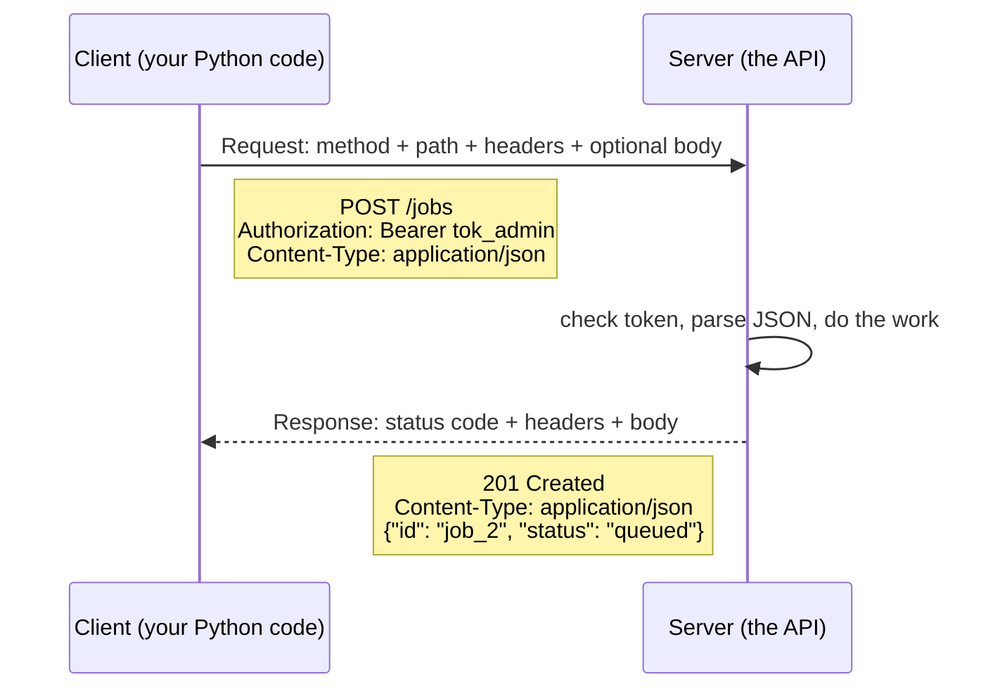
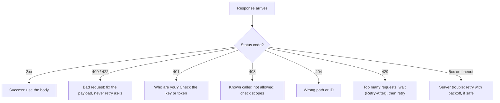
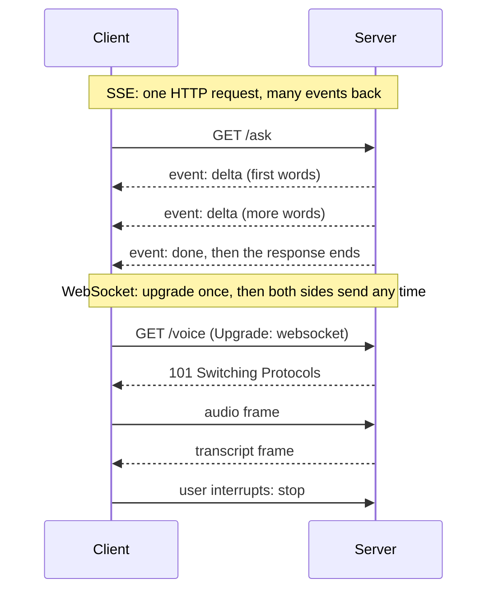
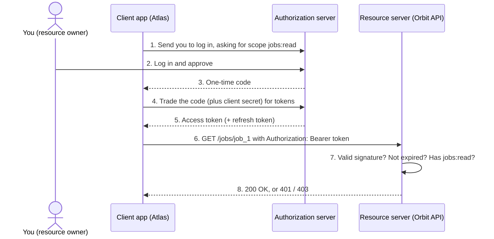

# HTTP, JSON & APIs

Every LLM call in this course is an HTTP request with a JSON body, and every failure you debug arrives
as a status code. This primer covers what a request carries, what the status codes mean, when a retry is
safe, how streaming works, and who holds which token in OAuth.

## Who this is for

Read this before [Day 2: Setup & Your First LLM Call](../Phase_0_Start_Here/Day_002_setup_first_call/setup_first_call.md)
if you have never called a web API from code, or if "401 vs 403" and "SSE" are fuzzy. Revisit it before
[Day 13: Streaming Responses](../Phase_2_Building_with_LLM_APIs/Day_013_streaming/streaming.md).

**Skip it if** you can answer the Self-Check without looking. All examples run offline against a stand-in
API on your machine: Python 3.11+, no API key, no installs.

## Requests and responses

**The problem.** An SDK call like `client.responses.create(...)` hides a network round trip. When it
fails with "429" or hangs, you need to know what went over the wire.

**The intuition.** HTTP (HyperText Transfer Protocol, the request/response protocol of the web) works like
ordering at a counter. You hand over a slip saying what you want (the request) and get back a result code
plus your order (the response). The counter remembers nothing between orders, so every slip carries
everything, including proof of who you are.

**A tiny example.** A request that creates an Orbit job, exactly as it travels over the wire:

```text
POST /jobs HTTP/1.1
Host: orbit.example.com
Authorization: Bearer tok_admin
Content-Type: application/json
Content-Length: 24

{"name": "send_receipt"}
```

The server's answer:

```text
HTTP/1.1 201 Created
Content-Type: application/json
Content-Length: 59

{"id": "job_2", "name": "send_receipt", "status": "queued"}
```

**Naming the parts.**

- **Method:** the verb. `GET` reads, `POST` creates or triggers, `PUT` replaces, `PATCH` changes part of
  something, `DELETE` removes.
- **Path:** which thing (`/jobs/job_1`). With the host, it forms the URL.
- **Headers:** `Name: value` metadata. `Content-Type` says how the body is encoded; `Authorization`
  carries credentials.
- **Body:** the payload, here JSON (JavaScript Object Notation): text built from objects, arrays,
  strings, numbers, `true`/`false` and `null`. It maps one-to-one onto Python dicts and lists.
- **Status code:** a three-digit result. `2xx` is success, `4xx` means your request was wrong, `5xx`
  means the server failed.
- **Bearer auth:** `Authorization: Bearer <token>` means "whoever bears this token gets in". LLM API keys
  travel this way, so a leaked key is as bad as a leaked password.



An API (Application Programming Interface) is a set of such endpoints with documented methods, paths and
JSON shapes. In the common REST style, paths name things and methods say what to do with them.

## Calling an API from Python

First, start a stand-in Orbit jobs API on your machine (about 60 lines of standard library). Copy both
blocks; read them later.

<details>
<summary>Setup: the stand-in Orbit API (copy both blocks, read later)</summary>

```python
# script_id: primer_a05/orbit_api
# A stand-in Orbit jobs API on localhost, so every example in this primer runs offline.
# Install: nothing (stdlib only, Python 3.11+). Env vars: none. Services: none.
import json
import threading
import time
from email.message import Message
from http.server import BaseHTTPRequestHandler, ThreadingHTTPServer

TOKENS = {"tok_read": {"jobs:read"}, "tok_admin": {"jobs:read", "jobs:write"}}  # fake token -> scopes
JOBS = {"job_1": {"id": "job_1", "name": "send_receipt", "status": "succeeded"}}
BY_KEY: dict[str, dict] = {}  # Idempotency-Key -> the job that key created
STATS = [(429, {"error": "rate limited"}, {"Retry-After": "1"}), (503, {"error": "overloaded"}, {})]

def route(method: str, path: str, headers, raw: bytes) -> tuple[int, dict, dict]:
    token = headers.get("Authorization", "").removeprefix("Bearer ")
    scope = "jobs:write" if method == "POST" else "jobs:read"
    if token not in TOKENS:
        return 401, {"error": "missing or invalid token"}, {"WWW-Authenticate": "Bearer"}
    if scope not in TOKENS[token]:
        return 403, {"error": f"token lacks scope {scope}"}, {}
    if path == "/slow":
        time.sleep(3)  # a server that hangs
    if path == "/stats":  # fails twice, then works
        return STATS.pop(0) if STATS else (200, {"queue": "default", "waiting": 12}, {})
    if method == "GET":
        job = JOBS.get(path.removeprefix("/jobs/"))
        return (200, job, {}) if job else (404, {"error": f"no job at {path}"}, {})
    try:
        name = json.loads(raw)["name"]
    except (json.JSONDecodeError, KeyError, TypeError):
        return 400, {"error": 'body must be JSON with a "name" field'}, {}
    key = headers.get("Idempotency-Key")
    if key in BY_KEY:
        return 200, BY_KEY[key], {}  # a replay: same job back, nothing new created
    job = {"id": f"job_{len(JOBS) + 1}", "name": name, "status": "queued"}
    JOBS[job["id"]] = job
    if key:
        BY_KEY[key] = job
    return 201, job, {}
```

```python
# script_id: primer_a05/orbit_api
class OrbitAPI(BaseHTTPRequestHandler):
    def handle_any(self) -> None:
        raw = self.rfile.read(int(self.headers.get("Content-Length", 0)))
        status, body, extra = route(self.command, self.path, self.headers, raw)
        data = json.dumps(body).encode()
        try:
            self.send_response(status)
            for name, value in {"Content-Type": "application/json", **extra}.items():
                self.send_header(name, value)
            self.send_header("Content-Length", str(len(data)))
            self.end_headers()
            self.wfile.write(data)
        except (BrokenPipeError, ConnectionResetError):
            pass  # the client hung up first (it timed out)

    do_GET = do_POST = handle_any

    def log_message(self, *args) -> None:  # keep the demo output quiet
        pass


server = ThreadingHTTPServer(("127.0.0.1", 0), OrbitAPI)  # port 0 = any free port
threading.Thread(target=server.serve_forever, daemon=True).start()
BASE = f"http://127.0.0.1:{server.server_port}"
print("stand-in Orbit API running at", BASE)
```

</details>

Now the client. `call()` is the anatomy above in code: method, path, headers and an optional JSON body
go out; status, headers and parsed JSON come back.

```python
# script_id: primer_a05/orbit_api
import urllib.error
import urllib.request


def call(method: str, path: str, token: str = "tok_admin", body: dict | None = None,
         headers: dict | None = None, timeout: float = 5.0) -> tuple[int, Message, dict]:
    data = json.dumps(body).encode() if body is not None else None
    req = urllib.request.Request(BASE + path, data=data, method=method)
    req.add_header("Authorization", f"Bearer {token}")  # real code: a key read from os.environ
    if data is not None:
        req.add_header("Content-Type", "application/json")
    for name, value in (headers or {}).items():
        req.add_header(name, value)
    try:
        with urllib.request.urlopen(req, timeout=timeout) as resp:
            return resp.status, resp.headers, json.loads(resp.read())  # headers: case-insensitive
    except urllib.error.HTTPError as err:  # urllib raises on 4xx/5xx; we want the status back
        return err.code, err.headers, json.loads(err.read())


status, headers, job = call("GET", "/jobs/job_1")
print(status, headers["Content-Type"], job)
```

```text
stand-in Orbit API running at http://127.0.0.1:52144   (your port will differ)
200 application/json {'id': 'job_1', 'name': 'send_receipt', 'status': 'succeeded'}
```

Real projects use `httpx`, `requests` or a provider SDK instead of `urllib`; the steps are the same.

**Break it.** Create a job, then send the wrong JSON shape:

```python
# script_id: primer_a05/orbit_api
status, _, job = call("POST", "/jobs", body={"name": "send_receipt", "args": {"order_id": "A-1001"}})
print(status, job)
status, _, err = call("POST", "/jobs", body={"job": "send_receipt"})  # wrong field name
print(status, err)
```

```text
201 {'id': 'job_2', 'name': 'send_receipt', 'status': 'queued'}
400 {'error': 'body must be JSON with a "name" field'}
```

A 400 means the request itself is wrong; resending changes nothing. Classic causes: a misspelled
field, or form data instead of JSON (in `requests`, `data=` form-encodes a dict; `json=` sends JSON and
sets `Content-Type`). Without the `try`/`except` in `call()`, urllib raises
`urllib.error.HTTPError: HTTP Error 400: Bad Request`. Always print the error body: it usually names the
bad field.

## Status codes that matter

First ask whose fault a failure is: yours (4xx) or the server's (5xx). That decides fix versus retry.



| Code | Name | Usually means |
|---|---|---|
| 400 | Bad Request | malformed JSON, missing or wrong field |
| 401 | Unauthorized | no token, or a mistyped or revoked key |
| 403 | Forbidden | known caller, missing permission (scope or role) |
| 404 | Not Found | wrong path, ID or API version |
| 422 | Unprocessable Content | valid JSON failing validation (FastAPI's default) |
| 429 | Too Many Requests | rate limit or quota hit |
| 5xx | Server errors (500, 502, 503, 504) | crash, bad gateway, overload, upstream timeout |

Despite its name, 401 means *unauthenticated* ("who are you?"); 403 means "I know who you are, and no."
Here are both, plus a 404:

```python
# script_id: primer_a05/orbit_api
for label, method, path, token in [
    ("bad token", "GET", "/jobs/job_1", "tok_typo"),
    ("read-only token", "POST", "/jobs", "tok_read"),
    ("missing job", "GET", "/jobs/job_99", "tok_admin"),
]:
    body = {"name": "send_receipt"} if method == "POST" else None
    status, headers, err = call(method, path, token=token, body=body)
    print(f"{label:15} -> {status} {err} {headers.get('WWW-Authenticate', '')}".rstrip())
```

```text
bad token       -> 401 {'error': 'missing or invalid token'} Bearer
read-only token -> 403 {'error': 'token lacks scope jobs:write'}
missing job     -> 404 {'error': 'no job at /jobs/job_99'}
```

From LLM providers, a 429 means either too many requests this minute (waiting fixes it) or exhausted quota or credit (waiting never
fixes it). The error body tells you which.

## Timeouts and safe retries

**The problem.** Servers stall and networks drop packets. Without a timeout, one stuck call hangs your app
forever; with careless retries, one flaky call emails a customer two receipts.

**The intuition.** A timeout says "if the kitchen hasn't answered in N seconds, stop waiting". A retry says
"ask again", which is safe only if asking twice has the same effect as asking once. That property is
**idempotency**.

**A tiny example.** `GET /jobs/job_1` twice reads the same job twice: harmless. `POST /jobs` twice creates
two jobs. `DELETE /jobs/job_1` twice leaves the job gone either way (the second call may get a 404).

**Naming the parts.**

- **Timeout:** the longest you will wait. `urllib` and `requests` wait forever unless you pass one.
- **Idempotent methods:** `GET`, `HEAD`, `PUT` and `DELETE`. `POST` and `PATCH` are not.
- **Exponential backoff:** waiting longer after each failure (0.5 s, 1 s, 2 s…) so a struggling server can
  recover. Production code adds random jitter too.
- **`Retry-After`:** a response header saying how long to wait (seconds, or a date).
- **Idempotency key:** a unique ID sent with a `POST` (commonly an `Idempotency-Key` header) so the server
  recognises a retry and returns the original result. Orbit jobs use the same idea
  (`idempotency_key="order_id"`).

First, a timeout (`/slow` sleeps for 3 seconds):

```python
# script_id: primer_a05/orbit_api
try:
    call("GET", "/slow", timeout=1.0)
except TimeoutError as exc:  # socket timeouts raise TimeoutError in Python 3.10+
    print("gave up after 1 s:", repr(exc))
```

```text
gave up after 1 s: TimeoutError('timed out')
```

Next, retries that follow those rules (`/stats` fails twice, then works):

```python
# script_id: primer_a05/orbit_api
RETRYABLE = {429, 500, 502, 503, 504}
IDEMPOTENT = {"GET", "HEAD", "PUT", "DELETE"}


def call_with_retries(method: str, path: str, attempts: int = 4,
                      **kw) -> tuple[int, Message, dict]:
    safe = method in IDEMPOTENT or "Idempotency-Key" in (kw.get("headers") or {})
    for attempt in range(1, attempts + 1):
        status, headers, body = call(method, path, **kw)
        if status not in RETRYABLE or not safe or attempt == attempts:
            break
        wait = float(headers.get("Retry-After", 0.5 * 2**attempt))  # the server's hint wins
        print(f"  attempt {attempt}: {status}, waiting {wait:.1f}s")
        time.sleep(wait)
    return status, headers, body


status, _, stats = call_with_retries("GET", "/stats")
print(status, stats)
```

```text
  attempt 1: 429, waiting 1.0s
  attempt 2: 503, waiting 2.0s
200 {'queue': 'default', 'waiting': 12}
```

A `POST` without a key is never retried (the safe default). With a key, it can be:

```python
# script_id: primer_a05/orbit_api
key = {"Idempotency-Key": "receipt-A-1001"}  # one logical action -> one key, reused on every retry
first = call_with_retries("POST", "/jobs", body={"name": "send_receipt"}, headers=key)
again = call_with_retries("POST", "/jobs", body={"name": "send_receipt"}, headers=key)
print(first[0], first[2]["id"], "|", again[0], again[2]["id"], "| jobs stored:", len(JOBS))
```

```text
201 job_3 | 200 job_3 | jobs stored: 3
```

The second `POST` returned the original `job_3` with a 200 instead of creating `job_4`.

**The common mistake** is retrying everything. Retrying a 400 or 401 wastes calls, and retrying a `POST`
without a key creates duplicates. Retry only 429s, 5xx errors and timeouts, and only when repeating is
safe. Provider SDKs often retry some of these for you;
[Day 12: The OpenAI SDK in Production Code](../Phase_2_Building_with_LLM_APIs/Day_012_openai_sdk_production/openai_sdk_production.md)
shows the settings, and
[Day 84: Reliability: Backoff, Fallbacks & LLM Gateways](../Phase_9_Production/Day_084_reliability_fallbacks/reliability_fallbacks.md)
builds production backoff.

## Streaming: SSE vs WebSockets

**The problem.** A long LLM answer can take 20 seconds. A spinner then a wall of text feels broken; words
appearing as generated feel fast.

**The intuition.** A normal response is a letter: it arrives once, complete. SSE (Server-Sent Events) is a
radio broadcast: one request tunes in, and the server talks until it is done. A WebSocket is a phone call:
after one handshake, both sides talk whenever they like.

**A tiny example.** SSE is plain text in an ordinary HTTP response with `Content-Type` set to
`text/event-stream`. Each event is a few `field: value` lines, ended by a blank line:

```text
event: delta
data: {"text": "Raise"}

event: delta
data: {"text": " lease_seconds"}

event: done
data: {}
```

**Naming the parts.** `data:` carries the payload (often JSON), `event:` names the event type (`message`
if absent), and a blank line ends each event. A WebSocket starts as an HTTP request with an
`Upgrade: websocket` header; the server answers `101 Switching Protocols`, and the connection becomes a
two-way channel of text or binary messages (frames).



SSE end to end, server and client:

```python
# script_id: primer_a05/sse_stream
# Server-sent events end to end: a tiny streaming server, and a client that reads each event as it arrives.
# Install: nothing (stdlib only, Python 3.11+). Env vars: none. Services: none.
import json
import threading
import time
import urllib.request
from http.server import BaseHTTPRequestHandler, ThreadingHTTPServer


class Stream(BaseHTTPRequestHandler):
    def do_GET(self) -> None:
        self.send_response(200)
        self.send_header("Content-Type", "text/event-stream")
        self.end_headers()
        for word in ["Raise", " lease_seconds", " or", " add", " heartbeats."]:
            self.wfile.write(f"event: delta\ndata: {json.dumps({'text': word})}\n\n".encode())
            time.sleep(0.3)  # pretend the model is still generating
        self.wfile.write(b"event: done\ndata: {}\n\n")

    def log_message(self, *args) -> None:
        pass


server = ThreadingHTTPServer(("127.0.0.1", 0), Stream)
threading.Thread(target=server.serve_forever, daemon=True).start()
```

```python
# script_id: primer_a05/sse_stream
start = time.perf_counter()
with urllib.request.urlopen(f"http://127.0.0.1:{server.server_port}/ask", timeout=10) as resp:
    print(resp.status, resp.headers["Content-Type"])
    event = "message"  # the SSE default when no "event:" line is sent
    for raw in resp:  # yields one line at a time, as bytes arrive
        line = raw.decode().rstrip("\n")
        if line.startswith("event:"):
            event = line.removeprefix("event:").strip()
        elif line.startswith("data:"):
            data = json.loads(line.removeprefix("data:"))
            print(f"{time.perf_counter() - start:.1f}s  {event}: {data}")
        elif line == "":
            event = "message"  # a blank line ends one event
```

```text
200 text/event-stream
0.0s  delta: {'text': 'Raise'}
0.3s  delta: {'text': ' lease_seconds'}
0.6s  delta: {'text': ' or'}
0.9s  delta: {'text': ' add'}
1.2s  delta: {'text': ' heartbeats.'}
1.5s  done: {}
```

**Turn a knob.** Replace the `for raw in resp:` loop with `print(resp.read())`. Same bytes, but nothing
appears for 1.5 seconds, then everything lands at once: you have un-streamed it. A proxy that buffers
responses does the same in production.

| | SSE | WebSocket |
|---|---|---|
| Direction | server to client only | both ways, any time |
| Transport | an ordinary HTTP response | an HTTP upgrade to its own protocol |
| Payload | UTF-8 text events | text or binary messages |
| Reconnect | the browser's `EventSource` does it | you write it |
| Typical AI use | streaming LLM text | realtime voice, interruptions |

Rule of thumb: the client asks once and the server answers for a while? SSE. Both sides talk mid-stream
(audio in, audio out, "stop")? WebSocket. LLM APIs stream text over SSE;
[Day 79: Chat UIs & Streaming Transports](../Phase_9_Production/Day_079_chat_uis_streaming/chat_uis_streaming.md)
covers both transports in production.

## OAuth basics: who holds what

**The problem.** Atlas wants to read a maintainer's jobs in the Orbit dashboard. Asking for their password
is unacceptable: Atlas could then do anything as them, forever.

**The intuition.** A hotel front desk checks your ID once and hands you a key card. The card opens your
room and the gym, nothing else, and stops working at checkout. Door locks never see your ID; they only
check the card. OAuth 2.0 (an open standard for delegated access) splits the work the same way.

**A tiny example.** A maintainer clicks "Connect Orbit" in Atlas, logs in on the company login page and
approves "read jobs". Atlas receives a token with scope `jobs:read`: `GET /jobs/job_1` returns 200 and
`POST /jobs` returns 403, like `tok_read` earlier.

**Naming the parts.**

| Role | Hotel | Orbit example | Holds |
|---|---|---|---|
| Resource owner | guest | the maintainer | a password, typed only at the authorization server |
| Client | key-card holder | Atlas | a client ID (plus a secret if server-side) and the tokens |
| Authorization server | front desk | company login (Orbit's `oidc_issuer`) | accounts, signing keys; issues tokens |
| Resource server | door lock | Orbit dashboard API, or a remote MCP server | the data; checks tokens, never passwords |

- **Access token:** a short-lived bearer credential (minutes to an hour). Often a JWT (JSON Web Token):
  signed JSON the resource server verifies with the authorization server's public key.
- **Refresh token:** longer-lived, sent only to the authorization server for a fresh access token.
- **Scope:** a named permission inside the token, like `jobs:read`. Request the fewest you need.



Orbit's `auth = "oidc"` setting uses OIDC (OpenID Connect, a login layer on top of OAuth). Remote MCP servers
follow the same split
([Day 74: Least Privilege, Secrets & Securing MCP](../Phase_8_Safety_and_Security/Day_074_least_privilege_mcp_security/least_privilege_mcp_security.md)).

An **API key** is different: a long-lived bearer secret for *your own* account, as with LLM
providers. OAuth is for acting *on someone else's behalf*, with limited, expiring rights.

**Common mistakes:** tokens in URLs (query strings end up in logs), logging the `Authorization` header,
requesting every scope "to be safe", and treating a 403 as a login problem: logging in again changes
nothing until you request the missing scope.

## Self-Check

1. One script gets a 401, another a 403. What do you check in each case?

<details>
<summary>Answer</summary>

401: the server could not identify you. The key is missing, mistyped, expired or revoked, so check the
env var and the `Authorization` header. 403: it knows you, but you lack permission, so check the token's
scopes or your account's role.

</details>

2. After a timeout, which may you retry automatically: `GET /jobs/job_1`, `DELETE /jobs/job_1`,
   `POST /jobs`? What makes the unsafe one safe?

<details>
<summary>Answer</summary>

`GET` and `DELETE` are idempotent: repeating them leaves the same end state. `POST` is not; a retry could
create a second job. An `Idempotency-Key` header, reused on every retry, makes it safe.

</details>

3. A response is `429` with `Retry-After: 30`. What should your client do, and why not retry at once?

<details>
<summary>Answer</summary>

Wait 30 seconds, then retry. Retrying at once hits the same limit and wastes requests. If the body says
quota or credit is exhausted, waiting won't help: fix billing.

</details>

4. You stream chat answers to a web page, then add a voice mode the user can interrupt. Which transport
   fits each?

<details>
<summary>Answer</summary>

SSE for chat: one request, a one-way stream of text events over plain HTTP. A WebSocket for voice: both
sides send continuously, and the client must say "stop" while the server is still talking.

</details>

5. In OAuth, who issues the access token, who checks it, and which party never sees the user's password?

<details>
<summary>Answer</summary>

The authorization server issues it; the resource server (the API) checks its signature, expiry and
scopes. Neither the client (Atlas) nor the resource server sees the password: the user types it only into
the authorization server.

</details>

## Learn More

- [MDN: An overview of HTTP](https://developer.mozilla.org/en-US/docs/Web/HTTP/Guides/Overview): requests,
  responses and headers.
- [MDN: HTTP response status codes](https://developer.mozilla.org/en-US/docs/Web/HTTP/Reference/Status):
  every code, explained; bookmark it.
- [MDN: Using server-sent events](https://developer.mozilla.org/en-US/docs/Web/API/Server-sent_events/Using_server-sent_events):
  the full event-stream format, including `id:` and `retry:`.
- [MDN: The WebSocket API](https://developer.mozilla.org/en-US/docs/Web/API/WebSockets_API): how WebSocket
  connections and messages work.
