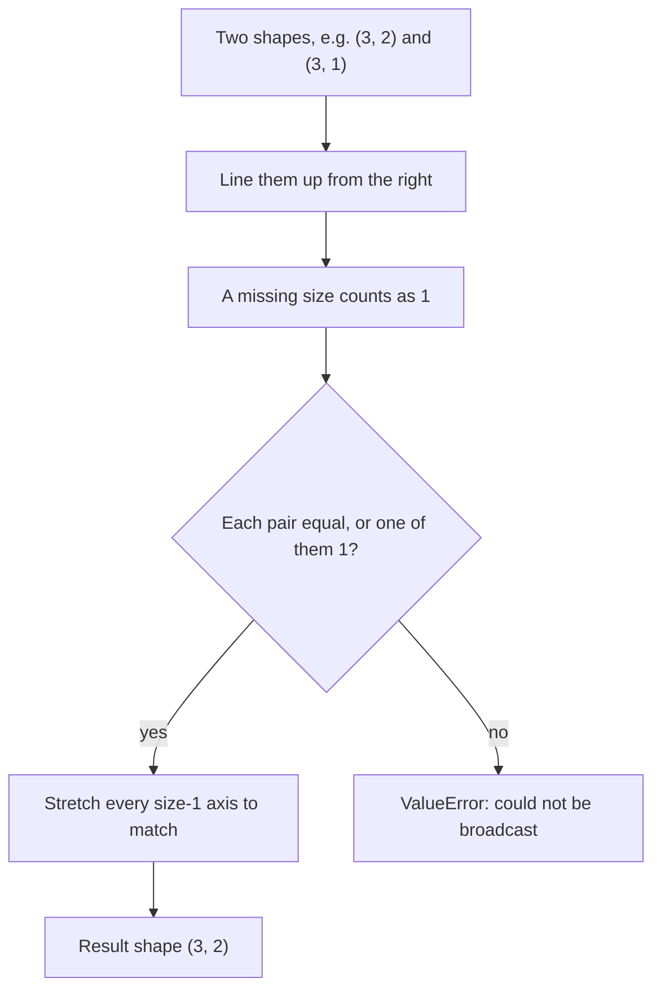
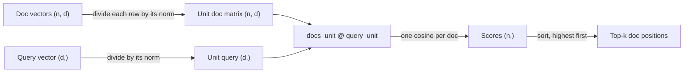

# NumPy & Vectors

An embedding is a list of numbers that stands for the meaning of a piece of text. From [Day 23: Embeddings & Semantic Similarity](../Phase_3_RAG/Day_023_embeddings/embeddings.md) onward, Atlas turns every Orbit doc and every user question into one of these lists, then asks "which docs point the same way as this question?" NumPy turns that question into one line of code instead of a slow loop. This primer gives you the mechanics and a mental picture.

## Who this is for

- **Read this if** you have written Python but not NumPy, or if `docs @ query` and "broadcasting" make you nervous. Read it before Day 23; it takes about 30 minutes.
- **Skip it if** you can answer the five [Self-Check](#self-check) questions without peeking.
- **You need:** basic Python (lists, functions, loops; see the [Python primer](A03_python_for_this_course.md) if not) and `uv add numpy`. Every script runs on Python 3.11+ with NumPy 1.26 or 2.x and needs no API key.

> **Coming from Software Engineering?** A NumPy array is a typed, fixed-width buffer (like a C array) plus a small header that records its shape. Operations run as compiled loops over that buffer: a vectorized batch job, not a Python for-loop. Scoring a query against a document matrix is a full table scan that computes a score column; Day 26's vector index skips most of that scan. Broadcasting applies one value or row to every record without copying it.

## Arrays: lists that know their shape and type

**The problem.** A Python list of floats looks like a vector but doesn't act like one. `[0.2, 0.9] * 2` gives a longer list, not doubled numbers, and comparing one question against 10,000 documents with nested `for` loops is slow and error-prone.

**The intuition.** Picture a fixed-size spreadsheet where every cell holds the same kind of number. That grid is a NumPy array. Because the grid is rectangular and every cell has one type, NumPy runs arithmetic over all of it at once in compiled code.

**A tiny example.** Three docs of four numbers each form a grid of 3 rows and 4 columns. Row 1 is the second doc; column 0 is "the first number of every doc". Multiplying the grid by 2 doubles all 12 cells.

**Name the parts.**

| Term | Plain meaning | Example |
|---|---|---|
| `ndarray` | NumPy's array type: a grid of same-typed numbers | `np.array([0.2, 0.9, 0.4])` |
| shape | the size along each direction, as a tuple | `(3,)` is 3 numbers; `(3, 4)` is 3 rows, 4 columns |
| `ndim` | how many directions (axes) there are | 1 for a vector, 2 for a matrix |
| dtype | the type of every cell | `float64`, `float32`, `int64` |
| axis | one direction you can move along | axis 0 runs down rows; axis 1 across columns |

Here a **vector** is a 1-D array of shape `(d,)`, where `d` is the number of dimensions, and a **matrix** is a 2-D array of shape `(rows, columns)`. Stacked doc vectors put one doc per row.

```python
# script_id: primer_a06/arrays_basics
# Install: uv add numpy  ·  Env vars: none  ·  Services: none
import numpy as np

scores = [0.2, 0.9, 0.4]
print(scores * 2)            # a list repeats itself

v = np.array(scores)
print(v * 2)                 # an array does math on every element
print(v.shape, v.ndim, v.dtype)

# 3 docs x 4 numbers each: rows are docs, columns are dimensions
docs = np.array([
    [0.9, 0.1, 0.0, 0.2],
    [0.1, 0.8, 0.1, 0.0],
    [0.0, 0.2, 0.9, 0.1],
])
print(docs.shape)            # (rows, columns)
print(docs[1])               # row 1, the second doc
print(docs[:, 0])            # column 0 across all docs
print(docs[0, 2], docs[-1])  # one cell; the last row
```

Expected output:

```text
[0.2, 0.9, 0.4, 0.2, 0.9, 0.4]
[0.4 1.8 0.8]
(3,) 1 float64
(3, 4)
[0.1 0.8 0.1 0. ]
[0.9 0.1 0. ]
0.0 [0.  0.2 0.9 0.1]
```

Read `docs[:, 0]` as "every row, column 0". The colon means "all of this axis", and slices work like list slices: `docs[:2]` is the first two rows.

**Break it: dtype surprises.** An array has one dtype for every cell, and NumPy converts values to fit it without warning. This block extends the same script.

```python
# script_id: primer_a06/arrays_basics
ids = np.array([1, 2, 3])
print(ids.dtype)
ids[0] = 0.75                # silently truncated to fit the int dtype
print(ids)

small = docs.astype(np.float32)
print(docs.dtype, docs.nbytes, "bytes")
print(small.dtype, small.nbytes, "bytes")
```

Expected output (Windows with NumPy 1.x may print `int32`):

```text
int64
[0 2 3]
float64 96 bytes
float32 48 bytes
```

The 0.75 became 0 because an integer array can't hold a fraction. Build arrays from floats (`[1.0, 2.0]`) or pass `dtype=np.float32`. The second half shows why embedding stores usually keep `float32`: half the memory of `float64`, and the extra precision rarely changes which docs rank highest.

## Broadcasting: how shapes line up

**The problem.** Soon you'll want to divide every doc vector by its own length (the next sections explain why). That means dividing a `(3, 2)` grid by three numbers, one per row. NumPy can do it in one expression if the shapes line up.

**The intuition.** **Broadcasting** is NumPy's rule for combining arrays of different shapes: the smaller one is stretched, without copying, to match the bigger one. Adding 10 to a grid stretches the number 10 over every cell. A column of three lengths is stretched sideways across both columns.

**A tiny example.** Take the rows `[3, 4]`, `[1, 0]` and `[0, 2]`. Their lengths are 5, 1 and 2. Dividing row by row gives `[0.6, 0.8]`, `[1, 0]` and `[0, 1]`. For NumPy to do that, the lengths must be shaped as a column, `(3, 1)`, so each length lines up with its own row.



So `(3, 2)` with `(2,)` works (the `2`s match, and one row is reused for every doc), while `(3, 2)` with `(3,)` fails: 2 vs 3 on the right.

```python
# script_id: primer_a06/broadcasting
# Install: uv add numpy  ·  Env vars: none  ·  Services: none
import numpy as np

docs = np.array([
    [3.0, 4.0],
    [1.0, 0.0],
    [0.0, 2.0],
])
print(docs + 10)                      # scalar is stretched to every cell
print(docs * np.array([1.0, 0.5]))    # (3,2) * (2,) -> each row scaled

lengths = np.linalg.norm(docs, axis=1, keepdims=True)
print(lengths.shape)                  # (3, 1): one length per row
print(docs / lengths)                 # (3,2) / (3,1) -> every row now has length 1
```

Expected output:

```text
[[13. 14.]
 [11. 10.]
 [10. 12.]]
[[3. 2.]
 [1. 0.]
 [0. 1.]]
(3, 1)
[[0.6 0.8]
 [1.  0. ]
 [0.  1. ]]
```

`np.linalg.norm(docs, axis=1)` measures each row (the next section defines "norm"). `keepdims=True` keeps the answer as a `(3, 1)` column instead of flattening it to `(3,)`.

**Break it: forget `keepdims`.** This is the most common broadcasting bug in embedding code.

```python
# script_id: primer_a06/broadcasting
flat = np.linalg.norm(docs, axis=1)   # forgot keepdims=True
print(flat.shape)
try:
    docs / flat                       # (3,2) / (3,) -> trailing dims 2 vs 3
except ValueError as err:
    print("ValueError:", err)
```

Expected output:

```text
(3,)
ValueError: operands could not be broadcast together with shapes (3,2) (3,)
```

The error is the lucky case. If your matrix is square, say 3 docs with 3 dimensions, `(3, 3) / (3,)` broadcasts and divides each **column** by the lengths: no error, quietly wrong numbers. When in doubt, print `.shape`.

## Dot product and length: vectors as arrows

**The problem.** Embeddings are only useful if you can score how alike two of them are: one number, high when they agree and low when they don't.

**The intuition.** Draw each 2-D vector as an arrow from the origin, like a direction on a map. The **dot product** asks "how much do these arrows point the same way, weighted by their lengths?" Arrows pointing together give a big positive number, arrows at a right angle (perpendicular) give 0, and opposite arrows give a negative number. The **norm** is the arrow's length.

**A tiny example by hand.** Let `a = [3, 4]`, `b = [4, 3]` and `c = [-4, 3]`.

- Dot product: multiply matching positions, then add. `a · b = 3×4 + 4×3 = 24`. `a · c = 3×(-4) + 4×3 = 0`, so `a` and `c` are perpendicular.
- Norm: the square root of the vector's dot product with itself. `|a| = √(9 + 16) = 5`. This is Pythagoras: a 3-4-5 triangle.

**Name the parts.** A **dimension** is one position in the vector (2 here; hundreds to a few thousand for real embeddings). The dot product (`a @ b` or `np.dot(a, b)`) returns one number; so does the norm (`np.linalg.norm(a)`), never negative. A **unit vector** has norm 1. Dividing a vector by its own norm to get one is called **normalizing**.

```python
# script_id: primer_a06/dot_norm_cosine
# Install: uv add numpy  ·  Env vars: none  ·  Services: none
import numpy as np

a = np.array([3.0, 4.0])
b = np.array([4.0, 3.0])
c = np.array([-4.0, 3.0])

print(np.dot(a, b), a @ b)          # two spellings of the same dot product
print(a @ c)                        # perpendicular -> 0
print(np.linalg.norm(a))            # length of the arrow


def cosine(x: np.ndarray, y: np.ndarray) -> float:
    """Direction match in [-1, 1]; ignores how long the arrows are."""
    return float(x @ y / (np.linalg.norm(x) * np.linalg.norm(y)))


print(round(cosine(a, b), 2), round(cosine(a, c), 2), round(cosine(a, -a), 2))
print(round(cosine(a, 10 * b), 2))  # 10x longer, same direction, same score
```

Expected output:

```text
24.0 24.0
0.0
5.0
0.96 0.0 -1.0
0.96
```

## Cosine similarity: compare direction, not length

**The problem.** The raw dot product mixes direction and length. In embedding search, a long vector can win because it is long, not because it is relevant.

**The intuition.** Two hikers both head north-east; one walks 1 km, the other 10 km. Their headings match even though their distances differ. **Cosine similarity** compares headings only. It runs from 1 (same direction) through 0 (perpendicular, unrelated) to -1 (opposite).

**A tiny example by hand.** Divide the dot product by both lengths: `cos(a, b) = 24 / (5 × 5) = 0.96`. Stretch `b` to `10b = [40, 30]`: the dot product grows to 240 and the length to 50, so the score is `240 / (5 × 50) = 0.96` again, as the `cosine` function printed.

**The shortcut search systems rely on.** Normalize both vectors first and their lengths are 1, so the division does nothing. On unit vectors, **dot product equals cosine similarity**. That's why embedding code normalizes once, then uses `@` everywhere.

```python
# script_id: primer_a06/dot_norm_cosine
def normalize(x: np.ndarray) -> np.ndarray:
    return x / np.linalg.norm(x)


a_unit, b_unit = normalize(a), normalize(b)
print(a_unit, np.linalg.norm(a_unit))
print(round(float(a_unit @ b_unit), 2))   # on unit vectors, dot == cosine
```

Expected output:

```text
[0.6 0.8] 1.0
0.96
```

**Common mistake: the all-zero vector.** A vector of zeros has length 0, so normalizing it divides by zero. NumPy doesn't raise; it prints `RuntimeWarning: invalid value encountered in divide` and returns `[nan nan nan]`, and every score computed from it is `nan` (Not a Number). Empty or failed embeddings cause this; the realistic version below guards against it.

<details>
<summary>Under the hood: the formulas (optional, safe to skip)</summary>

In words: multiply matching positions and add them up; that's the dot product. Toy numbers: `[3, 4] · [4, 3] = 12 + 12 = 24`. As a formula, for vectors with `d` dimensions:

- dot product: `a · b = a₁b₁ + a₂b₂ + … + a_d b_d`
- norm: `|a| = √(a · a)`
- cosine similarity: `cos θ = (a · b) / (|a| |b|)`, where θ is the angle between the arrows

The geometric fact behind it: `a · b = |a| |b| cos θ`. Dividing out both lengths leaves only the angle.

</details>

## One query vs many docs: matrix multiply

**The problem.** Atlas will hold thousands of Orbit doc chunks, and scoring them in a Python loop is slow. You want every score in one operation.

**The intuition.** Stack the doc vectors as rows of one matrix, shape `(n, d)` for `n` docs with `d` dimensions. **Matrix multiplication** (`@` between a matrix and a vector) takes the dot product of every row with the query, giving `n` scores: the same scan a loop would do, in compiled code.

**A tiny example.** The vectors below are hand-made 3-D toys whose dimensions mean roughly [broker, retries, scheduling]. Real embeddings come from a model and have far more dimensions, but the shapes work the same way. The rule for `@` is that the **inner sizes must match**, and they disappear from the result: `(4, 3) @ (3,)` gives `(4,)`, one score per doc.



```python
# script_id: primer_a06/one_query_many_docs
# Install: uv add numpy  ·  Env vars: none  ·  Services: none
# Toy 3-D "embeddings" made by hand: [broker, retries, scheduling]
import numpy as np

titles = ["Redis broker reconnects", "Retry policy and the DLQ",
          "Cron schedules and DST drift", "Lease expiry and duplicate runs"]
docs = np.array([
    [0.9, 0.2, 0.0],
    [0.1, 0.9, 0.1],
    [0.0, 0.1, 0.9],
    [0.3, 0.6, 0.4],
])                                         # shape (4, 3): 4 docs, 3 dims
query = np.array([0.2, 0.7, 0.1])          # "job retried, then went to the DLQ"

docs_unit = docs / np.linalg.norm(docs, axis=1, keepdims=True)
query_unit = query / np.linalg.norm(query)
scores = docs_unit @ query_unit            # (4, 3) @ (3,) -> (4,)
print(scores.round(3))

for i in np.argsort(-scores)[:2]:          # highest score first
    print(f"{scores[i]:.3f}  {titles[i]}")
```

Expected output:

```text
[0.472 0.986 0.24  0.906]
0.986  Retry policy and the DLQ
0.906  Lease expiry and duplicate runs
```

`np.argsort` returns the *positions* that would sort the array smallest first. Negating the scores flips that to largest first, and `[:2]` keeps the top two. The DLQ (dead-letter queue) is where Orbit parks jobs that ran out of retries, so the retry doc should win.

**Break it three ways.** Each mistake shows up in real retrieval code.

```python
# script_id: primer_a06/one_query_many_docs
# Break it 1: rank by raw dot product, with one long "covers everything" doc
titles.append("Troubleshooting guide (all topics)")
docs = np.vstack([docs, [1.5, 1.5, 1.5]])
raw = docs @ query                         # no normalizing
print(titles[int(np.argmax(raw))])         # the long doc wins on length alone

# Break it 2: argsort sorts ascending, so [:2] is the two WORST matches
print([titles[i] for i in np.argsort(scores)[:2]])

# Break it 3: query built with a different number of dims than the docs
try:
    docs @ np.array([0.2, 0.7, 0.1, 0.0])
except ValueError as err:
    print("ValueError:", err)
```

Expected output:

```text
Troubleshooting guide (all topics)
['Cron schedules and DST drift', 'Redis broker reconnects']
ValueError: matmul: Input operand 1 has a mismatch in its core dimension 0, with gufunc signature (n?,k),(k,m?)->(n?,m?) (size 4 is different from 3)
```

The third error usually means the query and the docs were embedded with different models. Vectors from different models live in different spaces, so even when the sizes match, the scores are meaningless.

**The realistic version.** Production code normalizes doc vectors once, when they are indexed, stores them as `float32`, and scores queries in batches. A batch of queries is an `(m, d)` matrix; multiply it by the **transpose** of the doc matrix (`.T`, rows and columns swapped, shape `(d, n)`). The inner `d`s match, so the result is `(m, n)`: one row of scores per query.

```python
# script_id: primer_a06/one_query_many_docs
# Realistic version: float32, normalize once at index time, many queries at once
def unit_rows(m: np.ndarray | list) -> np.ndarray:
    m = np.asarray(m, dtype=np.float32)
    norms = np.linalg.norm(m, axis=-1, keepdims=True)
    return m / np.maximum(norms, 1e-12)        # an all-zero row stays zero, not NaN


def top_k(index: np.ndarray, queries: np.ndarray, k: int = 2) -> np.ndarray:
    """index (n, d) and queries (m, d), both unit rows -> (m, k) doc positions."""
    sims = queries @ index.T                   # (m, d) @ (d, n) -> (m, n)
    return np.argsort(-sims, axis=1)[:, :k]


index = unit_rows(docs)                        # once, when docs are added
questions = unit_rows([
    [0.2, 0.7, 0.1],                           # "job retried, then went to the DLQ"
    [0.1, 0.0, 0.8],                           # "nightly cron ran an hour late"
])
print(index.dtype, index.shape, questions.shape)
for row in top_k(index, questions):
    print([titles[i] for i in row])
```

Expected output:

```text
float32 (5, 3) (2, 3)
['Retry policy and the DLQ', 'Lease expiry and duplicate runs']
['Cron schedules and DST drift', 'Troubleshooting guide (all topics)']
```

Normalized, the long troubleshooting doc no longer wins the DLQ question; it places second for cron because it does cover scheduling.

**When this stops being enough.** A full scan with `@` handles thousands to low hundreds of thousands of vectors. Memory is the first limit: one million docs at 1,024 dimensions in `float32` is 1,000,000 × 1,024 × 4 bytes, about 4 GB. Past that, teams move to a vector index that searches only part of the data, as you'll do with pgvector in [Day 26](../Phase_3_RAG/Day_026_pgvector_search/pgvector_search.md). The scoring idea doesn't change.

## Self-Check

1. `docs` has shape `(500, 768)`. What are the shapes of `docs[10]` and `docs[:, 0]`?

<details>
<summary>Answer</summary>

`docs[10]` is one doc, shape `(768,)`. `docs[:, 0]` is the first number of every doc, shape `(500,)`.

</details>

2. Does `(4, 3) / (4,)` broadcast? What about `(4, 3) / (4, 1)`?

<details>
<summary>Answer</summary>

Line the shapes up from the right. `(4, 3)` vs `(4,)` compares 3 with 4, so it fails with `ValueError: operands could not be broadcast together`. `(4, 3)` vs `(4, 1)` compares 3 with 1 (stretch) and 4 with 4 (match), so each row is divided by its own number. That's the shape `keepdims=True` gives you.

</details>

3. Work out the dot product and the cosine similarity of `a = [1, 2]` and `b = [2, 1]` by hand.

<details>
<summary>Answer</summary>

Dot product: `1×2 + 2×1 = 4`. Both lengths are `√(1 + 4) = √5`. Cosine: `4 / (√5 × √5) = 4 / 5 = 0.8`: similar, not identical, directions.

</details>

4. Why does embedding search normalize vectors before ranking with `@`?

<details>
<summary>Answer</summary>

The raw dot product grows with vector length, so a long vector can outrank a more relevant one. After normalizing, every length is 1 and the dot product equals cosine similarity, which compares direction only. Normalizing once at index time also makes every later search a single `@`.

</details>

5. `docs_unit` has shape `(500, 768)` and `query_unit` has shape `(768,)`. What does `docs_unit @ query_unit` return, and how do you get the positions of the top 5 docs? What changes for 20 queries at once?

<details>
<summary>Answer</summary>

It returns shape `(500,)`, one cosine per doc. The top 5 positions are `np.argsort(-scores)[:5]` (drop the minus and you get the 5 worst). For 20 queries stacked as `Q`, shape `(20, 768)`, `Q @ docs_unit.T` gives `(20, 500)`: one row of scores per query.

</details>

## Learn More

- [NumPy: the absolute basics for beginners](https://numpy.org/doc/stable/user/absolute_beginners.html): the official tour of creating, indexing and reshaping arrays.
- [NumPy: Broadcasting](https://numpy.org/doc/stable/user/basics.broadcasting.html): the exact rule from the flowchart above, with pictures.
- [3Blue1Brown: Vectors, what even are they?](https://www.3blue1brown.com/lessons/vectors): chapter 1 of *Essence of Linear Algebra*, an animated lesson on vectors as arrows and as lists of numbers.
- [3Blue1Brown: Dot products and duality](https://www.3blue1brown.com/lessons/dot-products): chapter 9 of the series: why the dot product measures "pointing the same way".
