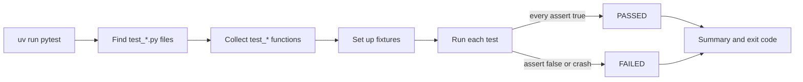
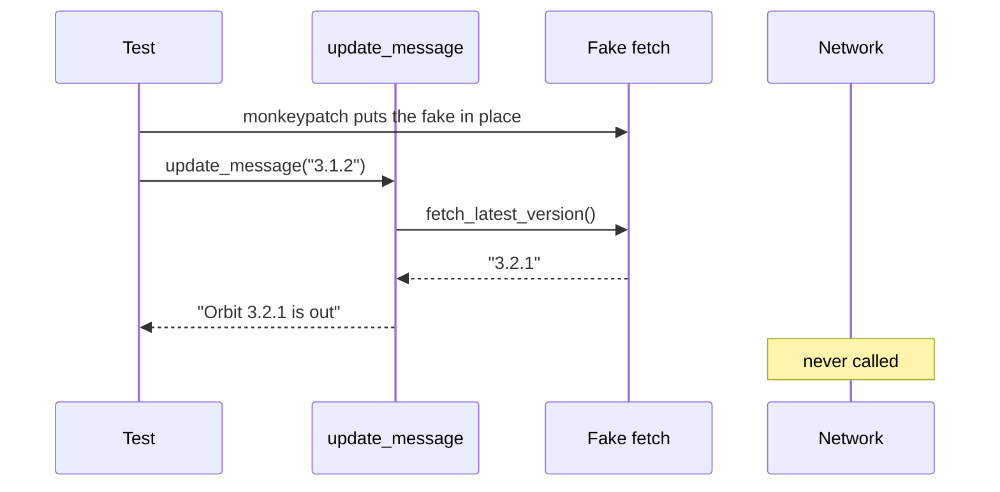
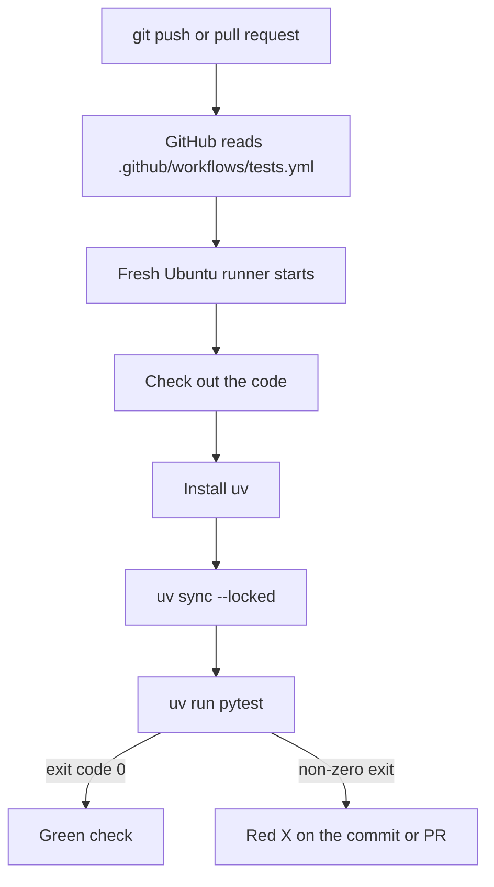

# pytest & Your First CI Workflow

## Who this is for

You write Python, but you check it by running the file and reading the printout. This primer replaces that habit with automated tests that GitHub runs on every push. Read it before [Day 19: Testing LLM Code](../Phase_2_Building_with_LLM_APIs/Day_019_testing_llm_code/testing_llm_code.md), which applies all of this to an LLM client.

- **You need:** Python 3.11+, uv ([Primer A2](A02_project_setup_secrets.md)) and a GitHub account ([Primer A1](A01_terminal_git_github.md)).
- **Skip if** you can write a fixture, parametrize a test, replace a network call with `monkeypatch`, and set up a GitHub Actions workflow. Not sure? Try the [Self-Check](#self-check) first.
- **Coming from JUnit, Jest or Go's `testing` package?** Same idea, less ceremony: plain functions, plain `assert`, setup injected by argument name. Skim the code; read the CI section.

Every example tests a piece of **Orbit**, the course's fictional open-source background-jobs library. Create one scratch project and put every file from this primer next to its `pyproject.toml`:

```bash
uv init orbit-checks && cd orbit-checks
uv add --dev pytest   # a dev dependency: you and CI need it, Orbit's users don't
```

## Your First Test: a Function and an assert

Orbit takes durations as strings (`delay="10s"`). Say you write `parse_delay()` to turn them into seconds, try three values in the REPL, and move on. Next month someone edits the unit table, nothing complains, and jobs fire at the wrong time. Your REPL checks vanished with the terminal.

A test is a REPL check saved in a file so it reruns itself. Think of a smoke alarm: silent while things are fine, loud the moment they aren't.

Work out the expected values by hand first, because a test is only as good as its expectations:

| Input | Reasoning | Expected |
|---|---|---|
| `"10s"` | 10 × 1 | `10` |
| `"2m"` | 2 × 60 | `120` |
| `"10x"` | `x` is not a unit | raises `ValueError` |

Now name the parts:

- **Test file:** a file named `test_*.py` or `*_test.py`. pytest only looks inside these.
- **Test function:** a function whose name starts with `test`. No class or registration.
- **`assert`:** Python's built-in "this must be true" statement. If it is false, the test fails.
- **`pytest.raises`:** a `with` block that passes only if the code inside raises the named exception.
- **Exit code:** the number pytest hands back to the shell. 0 means everything passed; anything else means it didn't. CI reads this number.



The code under test goes in `orbit_time.py`:

```python
# script_id: primer_a09/orbit_time
# Orbit-style durations ("10s", "2m", "1h") -> seconds. Stdlib only.
UNITS = {"s": 1, "m": 60, "h": 3600}


def parse_delay(text: str) -> int:
    """Parse the strings Orbit accepts in delay= and timeout=."""
    text = text.strip().lower()
    number, unit = text[:-1], text[-1:]
    if unit not in UNITS or not number.isdigit():
        raise ValueError(f"bad duration: {text!r}")
    return int(number) * UNITS[unit]
```

The tests go in a separate file, `test_orbit_time.py`:

```python
# script_id: primer_a09/test_orbit_time
# Install: uv add --dev pytest      Run: uv run pytest -v
import pytest

from orbit_time import parse_delay


def test_seconds() -> None:
    assert parse_delay("10s") == 10


def test_minutes() -> None:
    assert parse_delay("2m") == 120


def test_unknown_unit_raises() -> None:
    with pytest.raises(ValueError, match="bad duration"):
        parse_delay("10x")
```

Run them from the project folder (`-v` lists each test by name):

```bash
uv run pytest -v
```

```text
collected 3 items

test_orbit_time.py::test_seconds PASSED                                  [ 33%]
test_orbit_time.py::test_minutes PASSED                                  [ 66%]
test_orbit_time.py::test_unknown_unit_raises PASSED                      [100%]

============================== 3 passed in 0.01s ===============================
```

Your timings will differ. Nothing imports the test file and nothing lists the tests: pytest finds them by name.

## Reading a Failure

A test earns its keep the day it fails. In `orbit_time.py`, change `"m": 60` to `"m": 6`, then run `uv run pytest` without `-v`:

```text
test_orbit_time.py .F.                                                   [100%]

=================================== FAILURES ===================================
_________________________________ test_minutes _________________________________

    def test_minutes() -> None:
>       assert parse_delay("2m") == 120
E       AssertionError: assert 12 == 120
E        +  where 12 = parse_delay('2m')

test_orbit_time.py:13: AssertionError
=========================== short test summary info ============================
FAILED test_orbit_time.py::test_minutes - AssertionError: assert 12 == 120
========================= 1 failed, 2 passed in 0.01s ==========================
```

Read it in this order:

1. **Progress line** `.F.`: one character per test. `.` passed, `F` failed, and `E` means an error outside the test body, such as a crash in setup.
2. **Short test summary** at the bottom: which tests failed, with a one-line reason. On a long run, start here.
3. **The `>` line:** the exact line that failed.
4. **The `E` lines:** the actual values. pytest rewrites `assert` statements so it can print both sides (`12 == 120`) and where the `12` came from. The left side is what your code returned; the right side is what you expected.
5. **`file:line`:** where to jump in your editor.

Diagnosis: `"2m"` gave 12, so the minutes multiplier is 6, not 60. Restore it and the run goes green.

**Common mistake: tests that never run.** Rename the file to `orbit_time_tests.py` and pytest prints `collected 0 items` and `no tests ran`. Nothing failed, so it reads like success. It isn't: pytest returns exit code 5 for "no tests collected", which fails a CI run. Keep the `test_` prefix on files and functions.

## Fixtures: Shared Setup Without Copy-Paste

Orbit 3.x reads its settings from an `orbit.toml` file. Testing the loader needs a real file, so every config test would start with the same lines: make a temp folder, write a file, clean up. Copy-pasted setup drifts, and one stale copy makes a test lie.

A **fixture** is prep work pytest does before a test starts, like a kitchen's prep station: the vegetables are chopped before the cook arrives. You write the prep once, and any test that names it as an argument receives it.

The hand-worked case: a file containing only a `[worker]` table with `concurrency = 8`. Loading it should give `concurrency == 8` from the file and `lease_seconds == 300` from Orbit's defaults, because the file doesn't mention it.

The parts:

- **`@pytest.fixture`:** marks a function as setup. Its return value is what the test receives.
- **Requesting by name:** a test parameter called `config_file` makes pytest run the `config_file` fixture first and pass in the result. This is dependency injection: the test declares what it needs; pytest provides it.
- **Built-in fixtures:** pytest ships several. `tmp_path` gives each test a fresh empty folder as a `pathlib.Path`; `monkeypatch` appears in the mocking section.
- **Scope:** by default a fixture runs again for every test, so tests can't leak state into each other.
- **`conftest.py`:** fixtures in a file with this name are available to every test file in that folder, with no import.

The loader, in `orbit_config.py`:

```python
# script_id: primer_a09/orbit_config
# Read the [worker] table of orbit.toml, filling in Orbit's defaults.
import tomllib  # stdlib since Python 3.11
from pathlib import Path

DEFAULTS = {"concurrency": 4, "prefetch": 10, "lease_seconds": 300}


def load_worker_settings(path: Path) -> dict:
    with path.open("rb") as f:  # tomllib wants bytes
        data = tomllib.load(f)
    return {**DEFAULTS, **data.get("worker", {})}
```

The tests, in `test_orbit_config.py`. Note that `config_file` itself requests `tmp_path`: fixtures can use other fixtures.

```python
# script_id: primer_a09/test_orbit_config
# Install: uv add --dev pytest      Run: uv run pytest -v
from pathlib import Path

import pytest

from orbit_config import load_worker_settings


@pytest.fixture
def config_file(tmp_path: Path) -> Path:
    """A throwaway orbit.toml; tmp_path is a fresh folder per test."""
    path = tmp_path / "orbit.toml"
    path.write_text("[worker]\nconcurrency = 8\n")
    return path


def test_file_value_wins(config_file: Path) -> None:
    assert load_worker_settings(config_file)["concurrency"] == 8


def test_missing_keys_use_defaults(config_file: Path) -> None:
    assert load_worker_settings(config_file)["lease_seconds"] == 300
```

```text
test_orbit_config.py::test_file_value_wins PASSED                        [ 50%]
test_orbit_config.py::test_missing_keys_use_defaults PASSED              [100%]
```

Need cleanup afterwards, such as closing a database connection? Write `yield path` instead of `return path`. The code after `yield` runs when the test finishes, even if it failed.

**Common mistake: calling the fixture yourself.** Writing `config_file()` inside a test fails with:

```text
Fixture "config_file" called directly. Fixtures are not meant to be called directly,
but are created automatically when test functions request them as parameters.
```

Add `config_file` to the test's parameters instead.

## parametrize: One Test, Many Inputs

You also want `"1h"`, uppercase `"1H"` and five kinds of bad input covered. Copying `test_seconds` nine times works until you fix a bug in one copy and forget the rest.

**`@pytest.mark.parametrize`** turns one test into a table-driven test: write the check once, list the rows. It takes the parameter names, then a list of value tuples in the same order. pytest runs each row as its own test, so one bad row doesn't hide the others. Append this to `test_orbit_time.py`:

```python
# script_id: primer_a09/test_orbit_time
@pytest.mark.parametrize(
    ("text", "expected"),
    [("10s", 10), ("2m", 120), ("1h", 3600), ("1H", 3600)],
)
def test_parse_delay_cases(text: str, expected: int) -> None:
    assert parse_delay(text) == expected


@pytest.mark.parametrize("bad", ["", "10", "s", "-5s", "1.5m"])
def test_bad_input_raises(bad: str) -> None:
    with pytest.raises(ValueError):
        parse_delay(bad)
```

```text
test_orbit_time.py::test_parse_delay_cases[10s-10] PASSED                [ 33%]
test_orbit_time.py::test_parse_delay_cases[2m-120] PASSED                [ 41%]
test_orbit_time.py::test_parse_delay_cases[1h-3600] PASSED               [ 50%]
test_orbit_time.py::test_parse_delay_cases[1H-3600] PASSED               [ 58%]
test_orbit_time.py::test_bad_input_raises[] PASSED                       [ 66%]
test_orbit_time.py::test_bad_input_raises[10] PASSED                     [ 75%]
test_orbit_time.py::test_bad_input_raises[s] PASSED                      [ 83%]
test_orbit_time.py::test_bad_input_raises[-5s] PASSED                    [ 91%]
test_orbit_time.py::test_bad_input_raises[1.5m] PASSED                   [100%]
```

The text in brackets is the **test ID**, built from the row's values. When a row fails, the ID names the input that broke. You can rerun one row by its ID: `uv run pytest "test_orbit_time.py::test_parse_delay_cases[2m-120]"`.

**Common mistake: names that don't match.** The names in the first argument must match the function's parameters exactly. Write `("text", "expect")` with a parameter called `expected`, and collection stops before any test runs:

```text
In test_orbit_time.py::test_parse_delay_cases: function uses no argument 'expect'
```

## Mocking External Calls: monkeypatch and unittest.mock

`orbit doctor` checks whether a newer Orbit release is out. A test that makes that network call is slow, fails when the Wi-Fi drops, and changes its answer whenever Orbit ships. Replace "network" with "LLM API" and add a bill per run, and you see why this course's tests rarely call a real model.

The fix is a **test double**: a stand-in that sits where the real call was and does exactly what the test scripts. Think of a film's stunt double: same costume, but the director controls every move.

Hand-worked expectations: if the latest release is `"3.2.1"` and you run `"3.1.2"`, the message reads `Orbit 3.2.1 is out (you have 3.1.2).` If the network is down, it reads `Could not check for updates.` instead of crashing.

The tools:

- **`monkeypatch.setattr(module, "name", new)`:** a built-in fixture that replaces an attribute for one test and restores the original afterwards. `monkeypatch.setenv("ORBIT_DATA", "...")` does the same for an environment variable.
- **`unittest.mock.Mock`** (standard library): a fake callable that records how it was called. `return_value` sets what it returns; `side_effect` makes it raise an exception instead.
- **`assert_called_once_with(...)`:** checks the fake was called exactly once, with those arguments.
- **`unittest.mock.patch("module.name", ...)`:** the same swap as `setattr`, written as a `with` block or decorator.



The code under test, `orbit_updates.py`:

```python
# script_id: primer_a09/orbit_updates
# The version check behind `orbit doctor`. Stdlib only.
import json
import urllib.request

RELEASES_URL = "https://example.com/orbit/latest.json"  # stand-in endpoint


def fetch_latest_version() -> str:
    """The external call: slow, flaky, and out of your control."""
    with urllib.request.urlopen(RELEASES_URL, timeout=5) as resp:
        return json.load(resp)["version"]


def update_message(current: str) -> str:
    try:
        latest = fetch_latest_version()
    except OSError:  # covers URLError and TimeoutError
        return "Could not check for updates."
    if latest == current:
        return "Orbit is up to date."
    return f"Orbit {latest} is out (you have {current})."
```

The first test, in `test_orbit_updates.py`, swaps in a lambda (a one-line anonymous function):

```python
# script_id: primer_a09/test_orbit_updates
# Install: uv add --dev pytest      Run: uv run pytest -v
import pytest

import orbit_updates


def test_new_version_available(monkeypatch: pytest.MonkeyPatch) -> None:
    # Swap the network call for a stand-in that returns a fixed answer.
    monkeypatch.setattr(orbit_updates, "fetch_latest_version", lambda: "3.2.1")
    assert orbit_updates.update_message("3.1.2") == "Orbit 3.2.1 is out (you have 3.1.2)."
```

A `Mock` adds two things a lambda can't: it records its calls, and it can raise on cue. Append to the same file:

```python
# script_id: primer_a09/test_orbit_updates
from unittest.mock import Mock, patch


def test_up_to_date_calls_once(monkeypatch: pytest.MonkeyPatch) -> None:
    fake = Mock(return_value="3.2.1")
    monkeypatch.setattr(orbit_updates, "fetch_latest_version", fake)
    assert orbit_updates.update_message("3.2.1") == "Orbit is up to date."
    fake.assert_called_once_with()  # called exactly once, with no arguments


def test_network_down_is_handled() -> None:
    # side_effect makes the fake raise instead of return.
    with patch("orbit_updates.fetch_latest_version", side_effect=TimeoutError("timed out")):
        assert orbit_updates.update_message("3.2.1") == "Could not check for updates."
```

```text
test_orbit_updates.py::test_new_version_available PASSED                 [ 88%]
test_orbit_updates.py::test_up_to_date_calls_once PASSED                 [ 94%]
test_orbit_updates.py::test_network_down_is_handled PASSED               [100%]

============================== 17 passed in 0.13s ==============================
```

The last test proves the error path works without unplugging anything. `TimeoutError` is a subclass of `OSError`, so `update_message` catches it.

**Common mistake: patching the wrong name.** Patch a name *where it is looked up*, not where it was defined. If a new `doctor.py` does `from orbit_updates import fetch_latest_version`, it holds its own reference. Patching `orbit_updates.fetch_latest_version` leaves that copy untouched, and your "mocked" test quietly hits the network. Patch `doctor.fetch_latest_version` instead. The tests above are safe because `update_message` looks the name up inside `orbit_updates` on every call.

## Your First CI Workflow: GitHub Actions and uv

Tests only protect you when someone runs them. A teammate skips pytest, pushes, and `main` stays broken for days. **CI** (continuous integration: automatically testing every change) closes that gap.

Picture a robot teammate who, on every push, copies your repo onto a clean computer, installs exactly your dependencies, runs `uv run pytest`, and pins a green check or a red X on the commit. Because the machine starts clean, CI also catches "works on my machine" bugs, such as a package you installed by hand but never declared.

The parts of **GitHub Actions**, GitHub's built-in CI:

- **Workflow:** a YAML file in `.github/workflows/`.
- **Event:** what starts the workflow, listed under `on:`. Here: pushes to `main` and every pull request.
- **Job:** a group of steps that runs on one machine.
- **Runner:** that machine, a fresh virtual machine GitHub provides.
- **Step:** one shell command (`run:`) or one **action** (`uses:`), a reusable step someone published, such as "check out the code".



Create `.github/workflows/tests.yml`:

```yaml
name: tests

on:
  push:
    branches: [main]
  pull_request:

jobs:
  pytest:
    runs-on: ubuntu-latest
    steps:
      - uses: actions/checkout@v7          # copy the repo onto the runner
      - uses: astral-sh/setup-uv@v10.3.3   # install uv (this action publishes exact tags only)
      - run: uv sync --locked              # install exactly what uv.lock lists
      - run: uv run pytest -v              # a non-zero exit turns the run red
```

`uv.lock` records the exact version of every package; `--locked` makes the sync fail rather than quietly install something different. uv also reads the `.python-version` file that `uv init` wrote and downloads that Python if the runner lacks it. Commit everything, lockfile included, and push to a GitHub repo ([Primer A1](A01_terminal_git_github.md) covers remotes):

```bash
git add .   # uv init's .gitignore already excludes .venv/
git commit -m "Add pytest suite and CI"
git push
```

Open the repo's **Actions** tab: the `uv run pytest -v` step prints your local output, ending in `17 passed`, and the commit gets a green check. Break `parse_delay`, push, and watch it turn red.

Standard GitHub-hosted runners are free for public repositories; private ones draw on your plan's included minutes (as of 2026-11, verify at [GitHub Actions billing](https://docs.github.com/en/billing/concepts/product-billing/github-actions)). Action versions move too: check each action's releases page before copying a tag, and for stricter supply-chain safety pin the full commit SHA.

**Common mistake: a lockfile out of step with `pyproject.toml`.** Edit the dependency list by hand, push without relocking, and the sync step fails:

```text
error: The lockfile at `uv.lock` needs to be updated, but `--locked` was provided.

hint: To update the lockfile, run `uv lock`.
```

Run `uv lock` (or use `uv add`, which updates both files), commit `uv.lock`, and push again. Forgot to commit `uv.lock` at all? The error starts `Unable to find lockfile at uv.lock`. Both failures are the point: CI refuses to test versions you never tested locally.

## Self-Check

1. You saved your tests in `checks.py`, and `uv run pytest` prints `no tests ran`. Why, and what does CI make of it?

<details><summary>Answer</summary>

pytest only collects files named `test_*.py` or `*_test.py`. Rename it `test_checks.py`. With nothing collected, pytest exits with code 5, so CI fails the run.

</details>

2. A failure shows `E  assert 12 == 120` and `E  +  where 12 = parse_delay('2m')`. Which number did your code produce, and where do you look next?

<details><summary>Answer</summary>

Your code returned 12 (the left side); the test expected 120. The `>` line and `file:line` point at the failing assert. The minutes multiplier is wrong.

</details>

3. Six inputs need the same check, and three tests each need a fresh `orbit.toml`. Which pytest feature fits each job?

<details><summary>Answer</summary>

`@pytest.mark.parametrize` for the inputs: one test, six rows, each with its own ID. A fixture built on `tmp_path` for the file: each test requests it by name and gets a fresh copy, since fixtures rerun per test by default.

</details>

4. `doctor.py` does `from orbit_updates import fetch_latest_version`. Your test patches `orbit_updates.fetch_latest_version`, yet still hits the network. Why, and how do you make the fake raise `TimeoutError`?

<details><summary>Answer</summary>

`doctor` holds its own reference, so patch where the name is looked up: `monkeypatch.setattr(doctor, "fetch_latest_version", fake)`. To raise, use `Mock(side_effect=TimeoutError("timed out"))`; `return_value` only sets a return value.

</details>

5. CI fails at `uv sync --locked` with "The lockfile at `uv.lock` needs to be updated". What happened, and why is failing here useful?

<details><summary>Answer</summary>

`pyproject.toml` changed but `uv.lock` wasn't regenerated. Run `uv lock` (or use `uv add`) and commit the lockfile. Failing loudly guarantees CI tests the versions you tested locally.

</details>

## Learn More

- [pytest: Get Started](https://docs.pytest.org/en/stable/getting-started.html): the official tour, including `pytest.raises` and `tmp_path`.
- [pytest: monkeypatch how-to](https://docs.pytest.org/en/stable/how-to/monkeypatch.html): patching functions, environment variables and dictionaries.
- [uv: Using uv in GitHub Actions](https://docs.astral.sh/uv/guides/integration/github/): caching, Python version matrices, and pinning uv.
- [GitHub Actions quickstart](https://docs.github.com/en/actions/get-started/quickstart): a first workflow from GitHub's side, including where to find logs.
