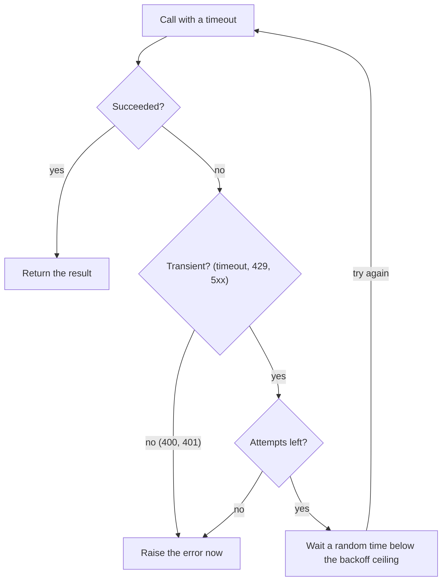
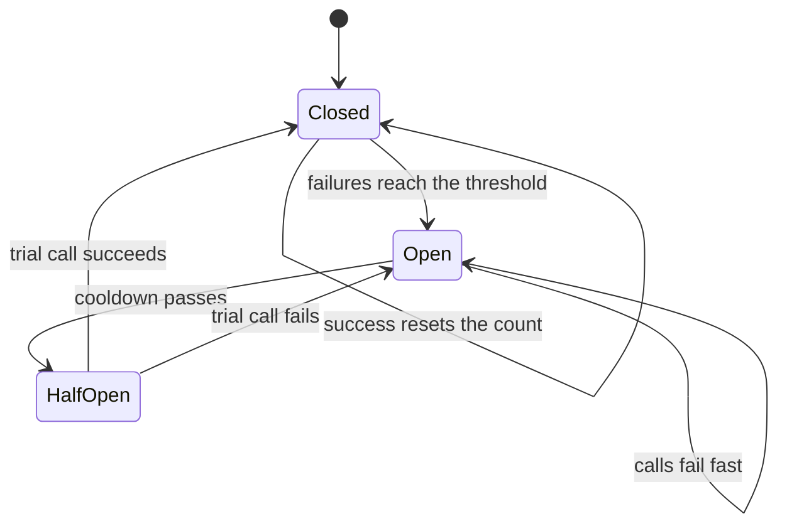
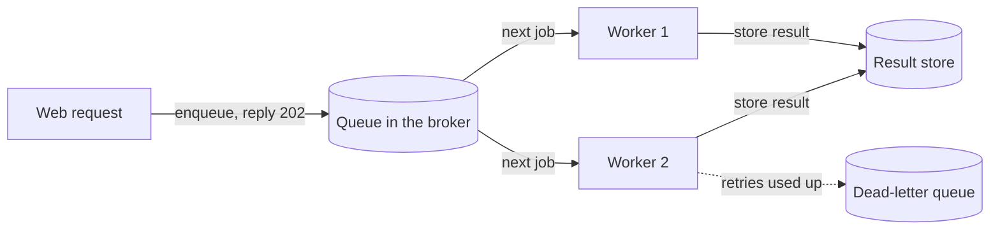
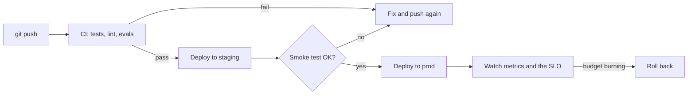

# Backend & Production Vocabulary

## Who this is for

This primer is for freshers who write Python but have never run a service other people depend on. From [Day 12: The OpenAI SDK in Production Code](../Phase_2_Building_with_LLM_APIs/Day_012_openai_sdk_production/openai_sdk_production.md) onward, lessons say p95, backoff or circuit breaker with only a one-clause gloss. Read this before Day 12, then keep it as a glossary.

- **Time:** 20–40 minutes. Every script is stdlib-only Python 3.11+ and runs offline.
- **Skip if** you can explain why teams alert on p95 rather than the average, why retries need jitter and idempotency keys, and what an error budget is. Or answer all five [Self-Check](#self-check) questions first.

## Speed: latency, throughput and percentiles

Atlas's dashboard says "average response time: 433 ms", yet users say it sometimes hangs for seconds. Both are true: the average hides the slow requests.

**Latency** is how long one request takes, from sending it to getting the reply. **Throughput** is how many requests the system finishes per second. A highway can carry 6,000 cars an hour (throughput) while each trip still takes 40 minutes (latency). Adding lanes raises throughput without making any trip faster.

Tiny example: ten Atlas calls took 100, 110, 120, 120, 130, 140, 150, 160, 900 and 2400 ms. The mean is 433 ms, a wait no user actually had. Sort the list and read positions instead:

- **p50** (50th percentile, or median): half the requests were this fast or faster. Here, the 5th value: 130 ms.
- **p95**: 95% were this fast or faster. Here, the 10th value: 2400 ms.

Teams set latency targets on p95 or p99 because complaints come from the slow tail, and an agent making eight model calls per answer hits some call's tail far more often.

```python
# script_id: primer_a10/percentiles
# Stdlib only, Python 3.11+. Run: python3 percentiles.py
import math
import statistics

# Ten Atlas API calls, in milliseconds (the tiny example above).
latencies_ms = [100, 110, 120, 120, 130, 140, 150, 160, 900, 2400]
WINDOW_SECONDS = 5.0  # all ten finished inside one 5-second window


def percentile(values: list[float], p: float) -> float:
    """Nearest-rank percentile: the smallest value that p% of samples are at or below."""
    ordered = sorted(values)
    rank = math.ceil(p / 100 * len(ordered))  # 1-based position in the sorted list
    return ordered[max(rank, 1) - 1]


print(f"mean       : {statistics.mean(latencies_ms):.0f} ms")
print(f"p50        : {percentile(latencies_ms, 50)} ms")
print(f"p95        : {percentile(latencies_ms, 95)} ms")
print(f"throughput : {len(latencies_ms) / WINDOW_SECONDS:.1f} requests/s")
```

```text
mean       : 433 ms
p50        : 130 ms
p95        : 2400 ms
throughput : 2.0 requests/s
```

Turn a knob: delete `2400` and rerun. The p50 stays at 130 ms, the p95 drops to 900 ms, and the mean halves to 214 ms. One outlier moved the mean; the median ignored it.

**Common mistake: averaging percentiles.** If server A's p95 is 300 ms and server B's is 900 ms, the combined p95 is not 600 ms. Compute them from raw samples or a histogram. And a p95 over ten samples is the single slowest call; trust it only with hundreds.

## When calls fail: timeouts, retries, backoff and idempotency

Atlas fetches an Orbit issue and the network stalls. With no limit, your code can hang for minutes, and a second attempt might send a customer a second receipt.

Think of phoning a busy shop: hang up after a few rings, call back later, wait longer each time, avoid calling at 9:00 sharp with everyone else, and quote the same order number so you don't get two pizzas. Each habit has a name:

- **Timeout:** the longest you wait for a reply before treating the call as failed. `urlopen(url, timeout=10)` gives up after 10 seconds. The OpenAI client defaults to 600, so Day 12 tightens it with `client.with_options(timeout=30.0)`.
- **Retry:** trying a failed call again. Retry only **transient** failures: timeouts, dropped connections, 429 (rate limited) and 5xx (server error). Never retry a 400 (bad request) or 401 (bad key); they fail the same way every time.
- **Exponential backoff:** doubling the wait before each retry (0.5 s, 1 s, 2 s, 4 s) up to a cap, so a struggling service gets room to recover.
- **Jitter:** randomness in each wait. Without it, clients that failed together retry together and knock the service over again (a **thundering herd**). "Full jitter" waits a random time between zero and the current ceiling.
- **Idempotency:** an operation is idempotent if doing it twice has the same effect as doing it once. Reading an issue is; sending a receipt is not. An **idempotency key** is a unique ID on a request that lets the receiver spot a repeat and skip it, as in Orbit's `@app.job(idempotency_key="order_id")`.



Here is that flow as code, with a fake sleep and a seeded random generator for repeatable output:

```python
# script_id: primer_a10/retry_backoff
# Stdlib only, Python 3.11+. The sleep is faked so the demo runs instantly and prints the same delays every time.
import random
from collections.abc import Callable


class PermanentError(Exception):
    """A failure that retrying cannot fix, such as HTTP 400 (bad request) or 401 (bad key)."""


def call_with_retries(fn: Callable[[], str], *, max_attempts: int = 4, base: float = 0.5,
                      cap: float = 8.0, rng: random.Random | None = None,
                      sleep: Callable[[float], None] = lambda seconds: None) -> str:
    rng = rng or random.Random()
    for attempt in range(1, max_attempts + 1):
        try:
            return fn()
        except PermanentError:
            raise  # a bad request fails the same way every time, so don't retry it
        except TimeoutError as err:
            if attempt == max_attempts:
                raise  # out of attempts: let the caller see the real error
            ceiling = min(cap, base * 2 ** (attempt - 1))  # 0.5, 1, 2, 4 ... never above cap
            delay = rng.uniform(0, ceiling)  # full jitter: a random point below the ceiling
            print(f"attempt {attempt} failed ({err}); waiting {delay:.2f}s (ceiling {ceiling}s)")
            sleep(delay)
    raise AssertionError("unreachable")
```

```python
# script_id: primer_a10/retry_backoff
outcomes = iter(["timeout", "timeout", "ok"])  # fails twice, then works


def fetch_issue() -> str:
    """Stands in for an HTTP call to the Orbit issue tracker."""
    if next(outcomes) == "timeout":
        raise TimeoutError("no reply within 10s")
    return "issue #412: Redis reconnect storm after failover"


print(call_with_retries(fetch_issue, rng=random.Random(42)))
```

```text
attempt 1 failed (no reply within 10s); waiting 0.32s (ceiling 0.5s)
attempt 2 failed (no reply within 10s); waiting 0.03s (ceiling 1.0s)
issue #412: Redis reconnect storm after failover
```

The second wait is shorter than the first: only the ceiling doubles. Now break it with `max_attempts=2` in the last call. After one wait, the second timeout escapes:

```text
attempt 1 failed (no reply within 10s); waiting 0.32s (ceiling 0.5s)
Traceback (most recent call last):
  ...
TimeoutError: no reply within 10s
```

Good: when retries run out, the caller sees the real error. The OpenAI SDK already retries connection errors, 408, 409, 429 and 5xx twice by default, so you write this loop for your own dependencies. [Day 84: Reliability: Backoff, Fallbacks & LLM Gateways](../Phase_9_Production/Day_084_reliability_fallbacks/reliability_fallbacks.md) builds the production version.

But what if the first attempt worked and only the reply was lost? An idempotency key turns the repeat into a no-op:

```python
# script_id: primer_a10/idempotency
# Stdlib only, Python 3.11+. In a real service, seen_keys is a database table with a unique constraint.
sent: list[str] = []         # receipts that really went out: the side effect we must not repeat
seen_keys: set[str] = set()  # idempotency keys already handled


def send_receipt(order_id: str, idempotency_key: str | None = None) -> str:
    if idempotency_key is not None:
        if idempotency_key in seen_keys:
            return "duplicate ignored"
        seen_keys.add(idempotency_key)
    sent.append(order_id)
    return "sent"


# Each first reply is lost on the network, so the caller retries the same request.
for attempt in (1, 2):
    print(f"no key,   attempt {attempt}: {send_receipt('A-1001')}")
for attempt in (1, 2):
    print(f"with key, attempt {attempt}: {send_receipt('A-1002', idempotency_key='receipt:A-1002')}")
print("receipts sent:", sent)
```

```text
no key,   attempt 1: sent
no key,   attempt 2: sent
with key, attempt 1: sent
with key, attempt 2: duplicate ignored
receipts sent: ['A-1001', 'A-1001', 'A-1002']
```

**Common mistake: a fresh key on every attempt.** If the loop calls `uuid.uuid4()` per attempt, every retry looks new and the duplicate goes through. Derive the key from the action (`receipt:A-1002`) or create it once, before the loop. In Orbit, a job that outlives its lease (`ORB-1101 LeaseExpired`) may run twice, so job bodies must be idempotent too. For agents, see [Day 54: LangGraph II: Durable Execution, Checkpoints & Time Travel](../Phase_6_Agents/Day_054_langgraph_durability/langgraph_durability.md).

## Protecting services: rate limits and circuit breakers

Retries help with brief failures. When the vector database is down for ten minutes, every Atlas request still waits out its timeout and retries, so Atlas gets slow *and* hammers a struggling service. Conversely, one script in a loop can burn the team's whole API quota.

**Rate limit:** a cap on how many requests (or tokens) a client may send per time window. Over the cap, the server replies **429 Too Many Requests**, often with a `Retry-After` header giving the seconds to wait. At 60 requests per minute, request 61 gets a 429 and `Retry-After: 12`; Orbit reports SQS throttling as `ORB-1901 BrokerRateLimited`. [Day 83: Auth, Multi-Tenancy & Usage Quotas](../Phase_9_Production/Day_083_auth_multitenancy_quotas/auth_multitenancy_quotas.md) builds per-user limits.

**Circuit breaker:** named after the household switch that cuts power before wires overheat. It counts a dependency's failures and, past a threshold, stops calling it for a cooldown, failing instantly instead. With a threshold of 3, three quick failures open it, and the next call fails in microseconds instead of waiting for a timeout.



**Closed:** calls go through and failures are counted. **Open:** calls fail fast. **Half-open:** one trial call goes through after the cooldown. The clock is passed in, so the demo can jump ahead:

```python
# script_id: primer_a10/circuit_breaker
# Stdlib only, Python 3.11+. The clock is passed in, so the demo runs instantly.
from collections.abc import Callable


class CircuitOpenError(Exception):
    """Raised instead of calling a dependency that is known to be failing."""


class CircuitBreaker:
    def __init__(self, clock: Callable[[], float], threshold: int = 3, cooldown: float = 30.0):
        self.clock, self.threshold, self.cooldown = clock, threshold, cooldown
        self.state, self.failures, self.opened_at = "closed", 0, 0.0

    def call(self, fn: Callable[[], str]) -> str:
        if self.state == "open":
            if self.clock() - self.opened_at < self.cooldown:
                raise CircuitOpenError("failing fast while the dependency cools down")
            self.state = "half_open"  # cooldown is over: let one trial call through
        try:
            result = fn()
        except Exception:
            self.failures += 1
            if self.state == "half_open" or self.failures >= self.threshold:
                self.state, self.opened_at = "open", self.clock()
            raise
        self.state, self.failures = "closed", 0  # one success resets everything
        return result
```

```python
# script_id: primer_a10/circuit_breaker
now, healthy = 0.0, False


def search_index() -> str:
    """Stands in for a call to Atlas's vector database."""
    if not healthy:
        raise ConnectionError("vector DB unreachable")
    return "3 chunks"


breaker = CircuitBreaker(clock=lambda: now)
timeline = [(0, False), (1, False), (2, False), (3, False), (40, True), (41, True)]
for now, healthy in timeline:  # (seconds since start, is the vector DB up?)
    try:
        outcome = breaker.call(search_index)
    except Exception as err:
        outcome = type(err).__name__
    print(f"t={now:>2}s  {outcome:<17} state={breaker.state}")
```

```text
t= 0s  ConnectionError   state=closed
t= 1s  ConnectionError   state=closed
t= 2s  ConnectionError   state=open
t= 3s  CircuitOpenError  state=open
t=40s  3 chunks          state=closed
t=41s  3 chunks          state=closed
```

Turn a knob: change `(40, True)` to `(40, False)`. The half-open trial fails and the breaker reopens at once.

**Common mistake: counting the wrong failures.** If 400s from one buggy caller trip the breaker, that caller cuts off every user. Count only signs of an unhealthy dependency: timeouts, connection errors and 5xx. While it is open, serve a **fallback** such as a cached answer or "search is degraded" (Day 84).

## Doing less work now: caches, queues and workers

Some Atlas work is repeated and some is slow. Answering the same question forty times a day wastes money; building a weekly digest inside a web request makes the browser wait a minute.

**Cache:** a fast store of results already computed, checked by key before the slow work. A **hit** means the key was there; a **miss** means compute, then store. The **TTL** (time to live) is how long an entry stays valid. The hard part is **invalidation**: when the Orbit docs change, answers built from the old docs must go.

```python
# script_id: primer_a10/ttl_cache
# Stdlib only, Python 3.11+. A cache is a dict plus timestamps; Redis adds sharing between processes.
import time

TTL_SECONDS = 60.0
_cache: dict[str, tuple[float, str]] = {}  # key -> (stored_at, value)


def slow_answer(question: str) -> str:
    time.sleep(0.3)  # stands in for a 300 ms model call
    return f"answer to {question!r}"


def cached_answer(question: str, now: float) -> str:
    key = question.strip().lower()  # normalise, so "How" and "how" share one entry
    entry = _cache.get(key)
    if entry and now - entry[0] < TTL_SECONDS:
        return "hit " + entry[1]
    value = slow_answer(question)
    _cache[key] = (now, value)
    return "miss " + value


for t, q in [(0, "How do I set retries?"), (5, "how do I set retries? "), (90, "How do I set retries?")]:
    start = time.perf_counter()
    result = cached_answer(q, now=t)  # `now` is passed in so the demo can jump ahead 90 seconds
    print(f"t={t:>2}s  {(time.perf_counter() - start) * 1000:>3.0f} ms  {result}")
```

```text
t= 0s  305 ms  miss answer to 'How do I set retries?'
t= 5s    0 ms  hit answer to 'How do I set retries?'
t=90s  305 ms  miss answer to 'How do I set retries?'
```

Your timings will differ slightly. The third call misses because 90 seconds is past the TTL. [Day 85: Caching & Cost Optimization at Scale](../Phase_9_Production/Day_085_caching_cost_scale/caching_cost_scale.md) goes further.

**Queue and workers:** a **queue** is a line of jobs waiting to run; a **worker** is a separate process that takes jobs off it and runs them. The web request only enqueues and returns. That is Orbit's purpose: `send_receipt.enqueue(order_id="A-1001")` returns at once, and `orbit worker --queues default,high --concurrency 8` runs up to eight jobs in parallel. Queues also absorb bursts: 500 issues in one minute, with workers handling 100 a minute, drain over five minutes instead of crashing the service.



The **broker** (Redis, Postgres or SQS for Orbit) holds the queue. A job that fails all its retries lands in the **dead-letter queue** for a human to inspect. [Day 78: Async Jobs & Long-Running Work](../Phase_9_Production/Day_078_async_jobs/async_jobs.md) builds this for Atlas.

**Common mistake: no expiry, no limit.** A cache with no TTL or invalidation serves stale answers forever, like Atlas quoting `orbit.ini` settings after Orbit 3.0 moved to `orbit.toml`. A queue that keeps growing means workers are slower than arrivals; watch its length like latency.

## Seeing and shipping: observability, CI/CD and SLOs

A user reports a wrong Atlas answer around 3 pm. Without records, you can't find that request or tell whether this morning's deploy caused it. Rule of thumb: metrics tell you *that* something is wrong, traces *where*, logs *what exactly happened*.

- **Logs:** timestamped records of single events. Structured logs are JSON with named fields you can filter on.
- **Metrics:** numbers aggregated over time, such as request count, error count and a latency histogram. They drive dashboards and alerts but can't point to one request.
- **Traces:** one request's path through every step, as timed **spans** sharing a **trace ID**. Example: `ask()` took 2.7 s: embedding 0.1 s, search 0.2 s, model call 2.4 s. [Day 42: Tracing & Observability in Depth](../Phase_5_Evaluation_and_Observability/Day_042_tracing_observability/tracing_observability.md) uses OpenTelemetry, the common standard.
- **SLO (service level objective):** a target for a measured number over a window, such as "99% of requests succeed in under 2 seconds, over 30 days". The measured number is the **SLI** (service level indicator). The 1% you may miss is the **error budget**: 10 bad requests per 1000. When it runs out, teams pause risky launches and fix reliability.

```python
# script_id: primer_a10/slo_budget
# Stdlib only, Python 3.11+. Simulates one day of Atlas traffic with a fixed seed.
import json
import random

SLO_TARGET = 0.99    # objective: 99% of requests succeed in under 2 seconds
THRESHOLD_MS = 2000

rng = random.Random(7)
requests = []
for i in range(1000):
    latency_ms = round(rng.lognormvariate(6.5, 0.45))  # typical call ~650 ms, with a slow tail
    ok = rng.random() > 0.004                         # about 0.4% hard errors
    requests.append({"trace_id": f"tr-{i:04d}", "latency_ms": latency_ms, "ok": ok})

errors = sum(1 for r in requests if not r["ok"])
slow = sum(1 for r in requests if r["ok"] and r["latency_ms"] >= THRESHOLD_MS)
good = len(requests) - errors - slow
bad = errors + slow
budget = round((1 - SLO_TARGET) * len(requests))  # bad requests the SLO allows
print(f"metrics      : {len(requests)} requests, {errors} errors, {slow} slow")
print(f"SLI          : {good / len(requests):.1%} good (target {SLO_TARGET:.0%})")
print(f"error budget : {budget} bad allowed, {bad} spent, {budget - bad} left")

slowest = max(requests, key=lambda r: r["latency_ms"])
print(json.dumps({"level": "warning", "event": "slow_request", **slowest}))  # one structured log line
```

```text
metrics      : 1000 requests, 5 errors, 6 slow
SLI          : 98.9% good (target 99%)
error budget : 10 bad allowed, 11 spent, -1 left
{"level": "warning", "event": "slow_request", "trace_id": "tr-0749", "latency_ms": 2699, "ok": true}
```

The budget is overspent by one, and the log line's trace ID says which trace to open first. Turn a knob: with `SLO_TARGET = 0.98` the budget is 20, with 9 left.

The other half is shipping changes without breaking prod:

- **CI (continuous integration):** every push runs automated checks (tests, lint, evals) on a server, such as a GitHub Actions workflow running `pytest` on each pull request. See [pytest & CI](A09_pytest_and_ci.md).
- **CD (continuous delivery or deployment):** code that passes is packaged and released automatically, or after one approval. [Day 82: Containerize & Deploy with CI/CD](../Phase_9_Production/Day_082_containerize_deploy/containerize_deploy.md) sets it up.
- **Staging vs prod:** **production (prod)** serves real users, data and money. **Staging** is a copy with the same setup but separate keys and data, where each release is tried first.



**Common mistake: a staging that doesn't match prod.** If staging uses a different model ID, a ten-row dataset or debug flags, a pass there means little. Another: an SLO of 100% leaves zero error budget, so every deploy is a breach. [Day 87: Shipping Changes Safely](../Phase_9_Production/Day_087_shipping_changes_safely/shipping_changes_safely.md) covers rollouts and rollbacks.

## Self-Check

1. Atlas's p50 is 130 ms and its p95 is 2.4 s. Why is alerting on the mean latency a bad idea?

<details><summary>Answer</summary>

The mean is a number no user had, and one outlier can swing it. Alert on p95 or p99, because users feel the slow tail.

</details>

2. Why add jitter to exponential backoff?

<details><summary>Answer</summary>

Without it, clients that failed together retry together and hit the recovering service in waves (a thundering herd). Random waits spread them out.

</details>

3. A call to `charge_card(order_id)` times out. Why is a blind retry risky, and what makes it safe?

<details><summary>Answer</summary>

The first call may have succeeded with only the reply lost, so a retry could charge twice. Send an idempotency key derived from the action (`charge:A-1002`), created once before the loop, so the server skips repeats.

</details>

4. A breaker opened at second 0 with a 30-second cooldown. What happens to calls at second 10 and second 31? Should a 400 count as a failure?

<details><summary>Answer</summary>

At second 10 the call fails instantly. At second 31 one trial call goes through (half-open): success closes the breaker, failure reopens it. A 400 should not count: it means the request was bad, not the dependency.

</details>

5. Your SLO is 99.5% good requests. Of 2000 requests, 7 failed and 6 were too slow. How much error budget is left, and what happens next?

<details><summary>Answer</summary>

The budget is 0.5% of 2000, or 10 bad requests. You spent 13: 3 over. Teams pause risky launches and work on reliability until the SLI recovers.

</details>

## Learn More

- [System Design Primer: "Latency vs throughput"](https://github.com/donnemartin/system-design-primer#latency-vs-throughput), plus its ["Cache"](https://github.com/donnemartin/system-design-primer#cache) and ["Asynchronism"](https://github.com/donnemartin/system-design-primer#asynchronism) sections: short overviews of speed, caching and queues.
- [AWS Builders' Library: "Timeouts, retries, and backoff with jitter"](https://aws.amazon.com/builders-library/timeouts-retries-and-backoff-with-jitter/): read "Retries and backoff" and "Jitter" for how a large provider tunes them.
- [Azure Architecture Center: "Circuit Breaker pattern"](https://learn.microsoft.com/en-us/azure/architecture/patterns/circuit-breaker): the "Solution" section walks through the three states.
- [Google Cloud blog: "SRE fundamentals: SLAs vs SLOs vs SLIs"](https://cloud.google.com/blog/products/devops-sre/sre-fundamentals-slis-slas-and-slos): a short guide to how the three terms differ.
