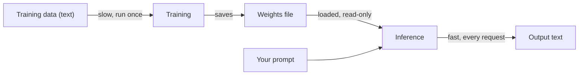
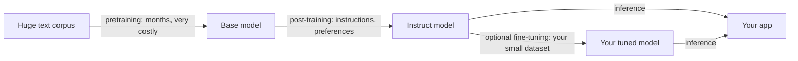
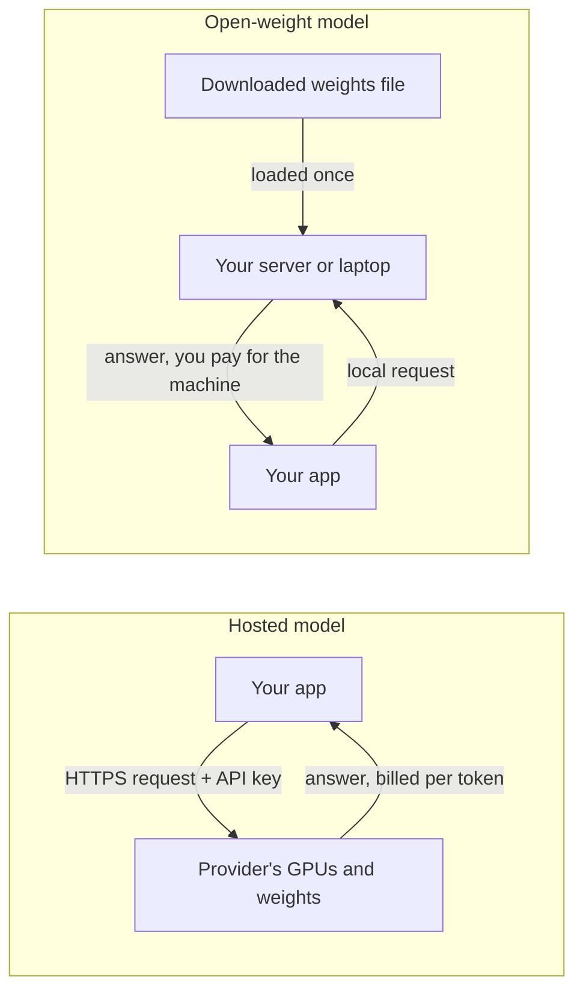

# Model Words: Parameters, Training & Inference

From Day 3 on, lessons say things like "a 20-billion-parameter open-weight model" or "fine-tune a base model". If those words are fuzzy, so is everything built on them: why a model forgets yesterday's chat, why every call is billed, why you can't "update" what it knows. This primer gives you the vocabulary as intuition, with no math.

## Who this is for

- **Read this if** *weights*, *inference* or *post-training* feel vague. Read it before [Day 3: What an LLM Is (and Isn't)](../Phase_1_How_LLMs_Work/Day_003_what_is_an_llm/what_is_an_llm.md); it takes about 30 minutes.
- **Skip it if** you can answer the five [Self-Check](#self-check) questions without peeking.
- **You need:** basic Python. Scripts use only the standard library (Python 3.11+, no API key).
- **Stops at:** how training adjusts the numbers (loss, gradient descent); that's the [training vocabulary primer](A11b_training_vocabulary.md).

> **Coming from Software Engineering?** A model is a build artifact. Training is the build: slow, expensive, rare, usually run by someone else. Inference is runtime: every request executes the artifact. The weights file is a binary whose constants were learned from data, and it is read-only at runtime, so a model no more learns from requests than a binary rewrites itself while serving. Open-weight vs hosted is self-hosted vs managed database; fine-tuning is a patch on someone else's release.

## What a model is: fixed code plus learned numbers

**The problem.** Try writing rules for "which word comes next after *the worker retries the*". You'd need an `if` for every phrase in every language; nobody can write that by hand.

**The intuition.** Instead, you write a general calculation full of adjustable knobs and let a computer turn the knobs until the outputs match lots of examples. Think of a mixing desk: the wiring is fixed, and the knob positions decide the sound. A **model** is the wiring plus the knob positions.

**A tiny example by hand.** Say an Orbit job's runtime grows with its payload size. A one-line model is `minutes = w × payload_mb + b`. With `w = 2` and `b = 1`, a 3 MB payload predicts `2 × 3 + 1 = 7` minutes. Set the knobs to `w = 0.5` and `b = 3` and the same job predicts 4.5 minutes.

**Name the parts.**

| Term | Plain meaning | In the example |
|---|---|---|
| model | a calculation that turns an input into an output | the runtime formula |
| architecture | the fixed shape of that calculation, written as code | `w × payload_mb + b` |
| parameters (or weights) | the adjustable numbers inside it, set by training | `w` and `b` |
| weights file (checkpoint) | the parameters saved to disk so anyone can load them | a file holding `w = 2, b = 1` |

A **large language model (LLM)** is the same idea at enormous scale: the input is text, the output is a guess at the next piece of text, and the parameters number in the billions. "A 20B model" means about 20 billion parameters.

```python
# script_id: primer_a11a/parameters
# Install: none (stdlib only)  ·  Env vars: none  ·  Services: none
def predict_minutes(payload_mb: float, weights: dict[str, float]) -> float:
    """The architecture: this calculation's shape never changes."""
    return weights["w"] * payload_mb + weights["b"]


june = {"w": 2.0, "b": 1.0}     # numbers fitted to June's job logs
july = {"w": 0.5, "b": 3.0}     # refitted after a faster worker fleet

print(predict_minutes(3.0, june))
print(predict_minutes(3.0, july))
print("parameters:", len(june))
```

Expected output:

```text
7.0
4.5
parameters: 2
```

Same code, different numbers. That's why a model release is mostly a file of numbers.

## Training vs inference: learning the numbers, then using them

**The problem.** Where do the numbers come from? Nobody types in 20 billion of them.

**The intuition.** Think of a student. **Training** is studying: slow, done once, and it changes the student. **Inference** is sitting the exam: fast, done many times, and answering a question doesn't change what the student knows. For a big model, studying takes months on thousands of GPUs (graphics processing units, chips built for fast arithmetic); the exam happens on every call your app makes.

**A tiny example by hand.** A **bigram model** predicts the next word from the current word alone. Train it on three Orbit sentences:

1. the worker takes the job
2. the worker retries the job
3. the job goes to the dlq

Training is counting. After "the", the text has "worker" twice, "job" three times and "dlq" (dead-letter queue) once. Those counts are the parameters. At inference, "what follows *the*?" gets "job", the most common follower.



**Name the parts.** **Training data** is the text a model learns from. **Training** adjusts the parameters until the model's guesses match that data. **Inference** runs the finished model on new input; every API call in this course is inference. The **knowledge cutoff** is the date the training data ends.

```python
# script_id: primer_a11a/bigram_model
# Install: none (stdlib only)  ·  Env vars: none  ·  Services: none
from collections import Counter, defaultdict

corpus = [
    "the worker takes the job",
    "the worker retries the job",
    "the job goes to the dlq",
]


def train(sentences: list[str]) -> dict[str, Counter]:
    """Training: read the text once and store what tends to follow each word."""
    weights: dict[str, Counter] = defaultdict(Counter)
    for sentence in sentences:
        words = sentence.split()
        for current, following in zip(words, words[1:]):
            weights[current][following] += 1
    return dict(weights)


def predict_next(weights: dict[str, Counter], word: str) -> str | None:
    """Inference: read the stored numbers; nothing is updated."""
    if word not in weights:
        return None
    return weights[word].most_common(1)[0][0]


weights = train(corpus)
print("parameters:", sum(len(c) for c in weights.values()))
print(dict(weights["the"]))
print(predict_next(weights, "the"), predict_next(weights, "job"))
```

Expected output:

```text
parameters: 10
{'worker': 2, 'job': 3, 'dlq': 1}
job goes
```

Ten parameters, one count per distinct word pair. A real LLM stores billions of numbers and looks at far more than one previous word, but the split holds: training writes the numbers, inference reads them.

**Break it.** Ask about an unseen word, then try to teach the model by using it.

```python
# script_id: primer_a11a/bigram_model
# Break it 1: a word that was not in the training text
print(predict_next(weights, "flow"))

# Break it 2: using the model a thousand times teaches it nothing
before = {w: dict(c) for w, c in weights.items()}
for _ in range(1_000):
    predict_next(weights, "the")
print("weights changed:", before != {w: dict(c) for w, c in weights.items()})

# The only way to change what it knows: train again on new text
weights = train(corpus + ["a flow runs each step"])
print(predict_next(weights, "flow"))
```

Expected output:

```text
None
weights changed: False
runs
```

A model trained before Orbit 3.0 added Flows is in the same spot, except an LLM rarely says "None": it guesses fluently, one source of hallucination (a confident wrong answer; see Day 3).

**Common mistake: "the model learns from my chats."** The weights are read-only at inference, so nothing you send changes them. A chat app that seems to remember is resending earlier messages each time ([Day 8](../Phase_2_Building_with_LLM_APIs/Day_008_messages_and_state/messages_and_state.md)). A provider may train a *future* model on chats, but the one answering you stays the same. To give a model new facts today, put them in the prompt; RAG (retrieval-augmented generation: fetch relevant documents and add them to the prompt) does that from [Day 28](../Phase_3_RAG/Day_028_rag_pipeline/rag_pipeline.md).

## Pretraining, post-training and fine-tuning

**The problem.** Train a big model only to continue internet text, then ask "How do I retry a failed Orbit job?". It may reply with more questions ("How do I cancel a job? How do I pause a queue?"), because on the web questions often come in lists. Predicting likely text is not the same as being helpful.

**The intuition.** Think of a new hire. University gives broad knowledge (pretraining). Onboarding teaches how to behave at work: answer the question asked, follow instructions, turn down harmful requests (post-training). A short course on one team's codebase specializes them further (fine-tuning).

**Name the parts.**

- **Pretraining** is next-token prediction over trillions of tokens of text (a **token** is a word or word piece; see [Day 4](../Phase_1_How_LLMs_Work/Day_004_tokens/tokens.md)). Most of the knowledge, and most of the cost, comes from here. The result is a **base model**: fluent and well-read, but it continues text instead of following instructions.
- **Post-training** teaches behaviour: **supervised fine-tuning (SFT)** on instruction-and-answer pairs, then **preference tuning** on ratings of which answer is better (RLHF, reinforcement learning from human feedback, is the best-known kind). The result is an **instruct model** (or chat model), the kind you call through an API.
- **Fine-tuning** means *you* train an existing model a little more on a small dataset of your own, to change its style, format or one narrow skill. It reuses the earlier work, so it needs far less data and compute.



Model labs run pretraining and post-training; you fine-tune rarely, if ever ([Day 94](../Phase_10_Open_Models_and_Fine_Tuning/Day_094_should_you_finetune/should_you_finetune.md)). Most of this course trains nothing: you take a finished instruct model and steer it with prompts, tools and retrieved documents.

**Common mistake: fine-tuning to add facts.** A team fine-tunes a model on Orbit's docs so it "knows" version 3.2, and results disappoint: fine-tuning shapes behaviour more reliably than it stores facts, and every docs change needs another training run. Put changing facts in the prompt with RAG; save fine-tuning for style and format problems prompting can't fix.

## Open-weight vs hosted models

**The problem.** You can send a request to someone else's servers, or download the weights and run them yourself. The choice changes cost, privacy and how much work lands on your team.

**The intuition.** A hosted model is like a managed database service: you call it, the provider runs the hardware, you pay per use. An open-weight model is like installing an open-source database yourself: free to download, but the servers and upkeep are yours.

**Name the parts.** A **hosted model** (closed or proprietary) runs only on the provider's servers; you reach it through an API and never see the weights. This course's default, OpenAI's GPT-6 family, is hosted. An **open-weight model** publishes its weights file for anyone to download and run under a licence: OpenAI's `gpt-oss-20b` and `gpt-oss-120b` ship under Apache 2.0, and the Llama, Qwen, Mistral and Gemma families are popular too. Open-weight is not always open source: training data and code usually stay private, and some licences restrict commercial use.



| Question | Hosted (API) | Open-weight (you run it) |
|---|---|---|
| Who runs the hardware? | the provider | you |
| What do you pay for? | tokens sent and received | machines by the hour, busy or idle |
| Does your data leave your network? | yes, under the provider's data terms | no, if you run it in-house |
| Can the model change under you? | yes: providers update and retire models | no: your file stays the same until you swap it |
| Usually best for | getting started, top capability, small teams | strict privacy, offline use, high steady volume |

You start hosted in [Day 2](../Phase_0_Start_Here/Day_002_setup_first_call/setup_first_call.md), compare models in [Day 7](../Phase_1_How_LLMs_Work/Day_007_choosing_a_model/choosing_a_model.md), and run open-weight models locally in [Day 91](../Phase_10_Open_Models_and_Fine_Tuning/Day_091_open_weight_local/open_weight_local.md).

## Why inference costs money

**The problem.** The model is already trained, so why is every call billed? Because every token it reads or writes is fresh arithmetic on expensive hardware.

**The intuition.** Think of a taxi. The car costs money whether or not it moves: that's the GPU holding the model in memory. The meter ticks with distance: that's the tokens processed.

**A tiny example by hand.** Take an 8-billion-parameter model stored as 16-bit numbers (2 bytes each). Holding it takes 8 billion × 2 bytes = 16 GB of GPU memory, before any working space. A common rule of thumb is about 2 arithmetic operations per parameter per token, so each token costs about 16 billion operations, and a 500-token answer about 8 trillion.

**Name the parts.** **Input tokens** are what you send (instructions, question, documents, chat history); **output tokens** are what the model writes. Providers price each per million tokens, output usually higher: input is processed in one pass, while output comes one token at a time, each needing its own pass. Self-hosting swaps per-token bills for hourly machine bills.

```python
# script_id: primer_a11a/inference_cost
# Install: none (stdlib only)  ·  Env vars: none  ·  Services: none
def weights_gb(params_billion: float, bytes_per_param: float = 2.0) -> float:
    """Memory to hold the weights alone; 16-bit numbers take 2 bytes each."""
    return params_billion * bytes_per_param


def ops_per_token(params_billion: float) -> float:
    """Rule of thumb: about 2 arithmetic operations per parameter, per token."""
    return 2 * params_billion * 1e9


for size in (1, 8, 70):
    print(f"{size:>2}B params: {weights_gb(size):>4.0f} GB of weights, "
          f"{ops_per_token(size):.1e} operations per token")
# Turn a knob: store each weight in 4 bits (0.5 bytes) instead of 16
print(f"20B params at 4-bit: {weights_gb(20, 0.5):.0f} GB")
```

Expected output:

```text
 1B params:    2 GB of weights, 2.0e+09 operations per token
 8B params:   16 GB of weights, 1.6e+10 operations per token
70B params:  140 GB of weights, 1.4e+11 operations per token
20B params at 4-bit: 10 GB
```

Storing each weight in fewer bits is called quantization ([Day 92](../Phase_10_Open_Models_and_Fine_Tuning/Day_092_quantization_hardware/quantization_hardware.md)); it's a big part of how a 20B model such as `gpt-oss-20b` runs on a machine with 16 GB of memory.

With a hosted model you never see GPUs, only tokens. At list prices for `gpt-6-luna`, the course's cheapest model ($0.10 per 1M input tokens and $0.50 per 1M output tokens, as of 2026-11, [verify](https://developers.openai.com/api/docs/pricing)):

```python
# script_id: primer_a11a/inference_cost
# gpt-6-luna USD per 1M tokens, as of 2026-11; verify at developers.openai.com/api/docs/pricing
PRICE_IN, PRICE_OUT = 0.10, 0.50


def request_cost(input_tokens: int, output_tokens: int) -> float:
    return (input_tokens * PRICE_IN + output_tokens * PRICE_OUT) / 1_000_000


one = request_cost(input_tokens=1_500, output_tokens=300)   # question + doc chunks in, answer out
print(f"one Atlas answer: ${one:.4f}")
print(f"10,000 a day:     ${one * 10_000 * 30:.2f} a month")
```

Expected output (prices change; your numbers will differ if they have):

```text
one Atlas answer: $0.0003
10,000 a day:     $90.00 a month
```

Notice that 300 output tokens cost as much as 1,500 input tokens. **Break it:** a chat resends its whole history on every turn, so input grows each time.

```python
# script_id: primer_a11a/inference_cost
history, chat_total = 0, 0.0
for turn in range(10):
    history += 200                          # the new question
    chat_total += request_cost(history, 150)
    history += 150                          # the answer joins the history
alone = 10 * request_cost(200, 150)
print(f"10-turn chat: ${chat_total:.6f}  vs  10 separate questions: ${alone:.6f}")
```

Expected output:

```text
10-turn chat: $0.002525  vs  10 separate questions: $0.000950
```

**Common mistake: pricing a chat by its last message.** The 10-turn chat costs about 2.7 times as much as ten separate questions, and the gap widens every turn. Trimming history and caching, in [Day 18](../Phase_2_Building_with_LLM_APIs/Day_018_cost_latency_caching/cost_latency_caching.md), are the fixes.

## Self-Check

1. A model card says "8B parameters, 16-bit weights". What are the parameters, and about how much GPU memory do they need?

<details>
<summary>Answer</summary>

The 8 billion numbers learned in training, which the fixed architecture code uses. At 2 bytes each: about 16 GB for the weights alone, plus working memory.

</details>

2. On Monday you tell a chat assistant which Orbit version you run. On Tuesday, in a new chat, it has no idea. Why?

<details>
<summary>Answer</summary>

Chatting is inference, which never changes the weights. Monday's chat seemed to remember only because the app resent the history each turn; a new chat starts empty.

</details>

3. What's the difference between a base model and an instruct model, and which one do you usually call through an API?

<details>
<summary>Answer</summary>

A base model is only pretrained, so it continues text. An instruct model is also post-trained (SFT, preference tuning) to follow instructions. APIs serve instruct models.

</details>

4. Orbit 3.2.1 shipped after your model's knowledge cutoff. Should Atlas fine-tune on the new docs or put them in the prompt?

<details>
<summary>Answer</summary>

Put them in the prompt with RAG. Fine-tuning stores facts unreliably and needs a new run per docs change; retrieval picks up an edited doc on the next request.

</details>

5. Give two reasons a team might choose an open-weight model over a hosted one, and one cost it takes on.

<details>
<summary>Answer</summary>

Any two of: data stays in its network; the model can't change or be retired under it; full control over fine-tuning; lower cost at high, steady volume. The cost: it pays for GPUs, busy or idle, and runs serving and upgrades itself.

</details>

## Learn More

- [Hugging Face LLM Course: How do Transformers work?](https://huggingface.co/learn/llm-course/chapter1/4): pretraining, transfer learning and fine-tuning in plain words, with diagrams.
- [Hugging Face: Illustrating RLHF](https://huggingface.co/blog/rlhf): how post-training turns a base model into a helpful assistant.
- [OpenAI: Introducing gpt-oss](https://openai.com/index/introducing-gpt-oss/): a real open-weight release, with sizes, licence, hardware needs and its training stages.
- [OpenAI API pricing](https://developers.openai.com/api/docs/pricing): the per-million-token prices used above; check them before you budget.
