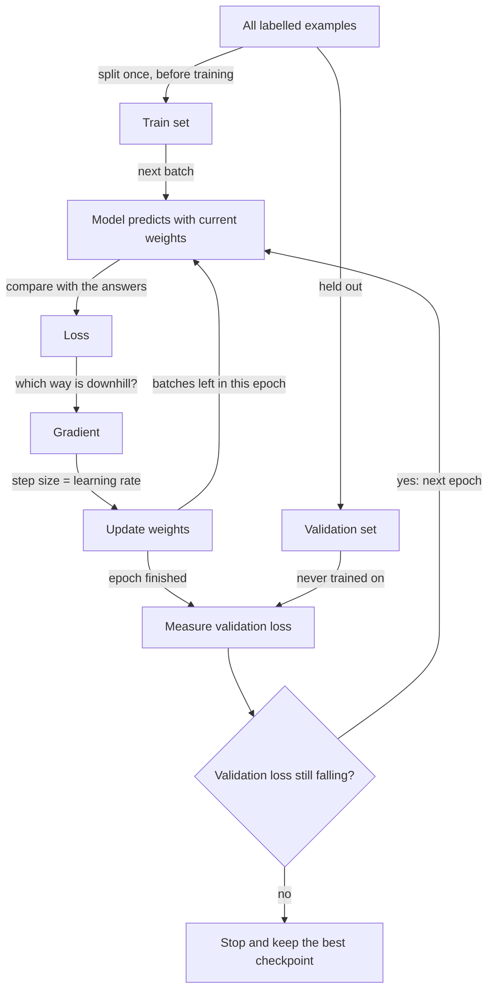
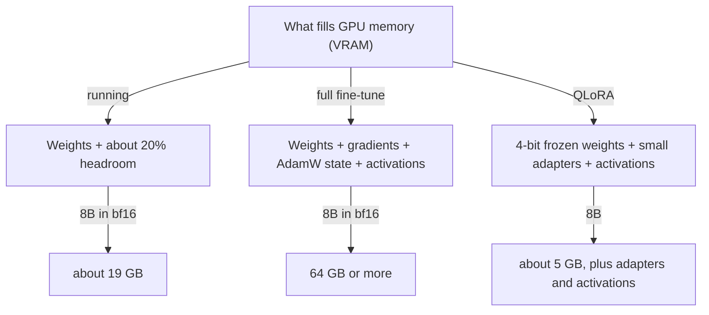

# Training Vocabulary for Fine-Tuning

From [Day 91: Open-Weight Models & Local Inference](../Phase_10_Open_Models_and_Fine_Tuning/Day_091_open_weight_local/open_weight_local.md) onward you run models on your own hardware, and in Day 95 you train one. The tools print words such as `loss 1.84`, `learning_rate 2e-4`, `num_train_epochs 3`, `bf16`, `load_in_4bit` and, eventually, `CUDA out of memory`. This primer gives each word a picture and a tiny runnable example.

## Who this is for

- **Read this if** "epoch", "learning rate" and "bf16" are new or half-familiar. Read it before Day 91; it takes about 30 minutes.
- **Skip it if** you can answer the five [Self-Check](#self-check) questions without peeking.
- **You need:** basic Python, and the idea that a model is a big set of numbers called weights (see the [Model words primer](A11a_model_words.md)). Scripts need only Python 3.11+: no GPU, installs or API key.

> **Coming from Software Engineering?** Training is a feedback loop, like an autoscaler adjusting replicas from an error metric: the loss is the metric, the gradient says which way to turn each knob, and the learning rate is the gain. The validation set is a holdout environment training never touches; overfitting is a test suite written against the implementation. VRAM is a hard memory budget; quantization is lossy compression for weights.

## Loss: one number for "how wrong"

**The problem.** Fine-tuning nudges millions of weights until the model behaves like your examples. A computer can't optimize "the answers look better"; it needs one number to push down.

**The intuition.** The **loss** is that number, a golf score for predictions: lower is better, zero is perfect.

**A tiny example.** An LLM gives every possible next token a probability. If the right token is `replay` and the model gave it 0.9, the loss is `log(1/0.9) ≈ 0.11`; at 0.1, it is `log(1/0.1) ≈ 2.30`. The training log prints the average over every token of every example.

**Name the parts.**

| Term | Plain meaning |
|---|---|
| loss | one number for how wrong the model is on some examples; lower is better |
| cross-entropy | the loss LLMs use: the average of `log(1/p)`, where `p` is the probability given to the correct token |
| training loss | loss on the examples being learned from |

```python
# script_id: primer_a11b/next_token_loss
# Install: none (stdlib only)  ·  Env vars: none  ·  Services: none
import math

def token_loss(p_correct: float) -> float:
    """Cross-entropy for one token: low when the model expected the right token."""
    return math.log(1 / p_correct)

# Probability the model gave to each correct token of the answer "orbit dlq replay"
confident = [0.90, 0.80, 0.95]
unsure = [0.30, 0.10, 0.50]
for name, probs in [("confident", confident), ("unsure", unsure)]:
    losses = [token_loss(p) for p in probs]
    rounded = [round(x, 2) for x in losses]
    print(f"{name:9}  per token {rounded}  mean {sum(losses) / len(losses):.2f}")

for p in (1.0, 0.5, 0.01):
    print(f"p={p:<4} -> loss {token_loss(p):.2f}")
```

Expected output:

```text
confident  per token [0.11, 0.22, 0.05]  mean 0.13
unsure     per token [1.2, 2.3, 0.69]  mean 1.40
p=1.0  -> loss 0.00
p=0.5  -> loss 0.69
p=0.01 -> loss 4.61
```

**Common mistake: reading loss like a grade.** A loss of 0.8 isn't "80%", and it can't be compared across datasets or tokenizers. Compare a run with itself over time and with its validation loss. Training loss heading to zero is a warning, not a trophy.

## Gradient descent and the learning rate

**The problem.** Even small models have hundreds of millions of weights; random guessing would never finish. You need a rule that tells every weight "move a little this way".

**The intuition.** Walk downhill in thick fog: you can't see the valley, but you can feel the slope underfoot. Step downhill, feel again, repeat. The slope is the **gradient**, and the length of each step is the **learning rate**.

**A tiny example.** Model an Orbit job's runtime as `runtime = w × payload_MB` with one weight `w`, and squared error as the loss (easier to check by hand than cross-entropy; the loop is identical). One job: 2 MB took 4 s.

- Start at `w = 1`. The model predicts 2 s, the error is −2, and the loss is 4.
- The gradient is `2 × error × payload = 2 × (−2) × 2 = −8`. Negative means "a bigger `w` lowers the loss".
- With learning rate 0.1: `w = 1 − 0.1 × (−8) = 1.8`, so the prediction is 3.6 s and the loss drops to 0.16.
- With learning rate 0.5: `w = 1 + 4 = 5`, so the prediction is 10 s and the loss jumps to 36: the step overshot.

**Name the parts.**

| Term | Plain meaning |
|---|---|
| weight (parameter) | one adjustable number inside the model |
| gradient | for each weight, which direction increases the loss and how steeply |
| learning rate (LR) | how far each update moves, as a multiplier on the gradient |
| step | one update of all the weights |
| optimizer | turns gradients into updates; the usual one, AdamW, keeps two extra numbers per weight |

```python
# script_id: primer_a11b/gradient_descent
# Install: none (stdlib only)  ·  Env vars: none  ·  Services: none
# Orbit job timings: (payload in MB, runtime in seconds). Roughly 2 s per MB.
jobs = [(1.0, 2.1), (2.0, 3.9), (3.0, 6.2), (4.0, 7.8)]

def loss(w: float) -> float:
    """Mean squared error of the one-weight model `runtime = w * payload`."""
    return sum((w * x - y) ** 2 for x, y in jobs) / len(jobs)

def gradient(w: float) -> float:
    """Slope of the loss at w. Positive means "w is too big"."""
    return sum(2 * (w * x - y) * x for x, y in jobs) / len(jobs)

def train(lr: float, steps: int, w: float = 0.0) -> float:
    for step in range(1, steps + 1):
        w = w - lr * gradient(w)          # this line is all of gradient descent
        print(f"step {step}: w={w:.3f}  loss={loss(w):.4f}")
    return w

train(lr=0.05, steps=5)
```

Expected output:

```text
step 1: w=1.493  loss=1.8805
step 2: w=1.866  loss=0.1403
step 3: w=1.959  loss=0.0315
step 4: w=1.982  loss=0.0247
step 5: w=1.988  loss=0.0243
```

The loss starts near 29.7 (at `w = 0`) and `w` settles near 1.99 s per MB, the best weight for these jobs.

**Break it: turn the learning-rate knob.** This block extends the same script.

```python
# script_id: primer_a11b/gradient_descent
print("--- learning rate too small")
train(lr=0.001, steps=3)
print("--- learning rate too big")
train(lr=0.15, steps=4)
```

Expected output:

```text
--- learning rate too small
step 1: w=0.030  loss=28.8407
step 2: w=0.059  loss=27.9827
step 3: w=0.088  loss=27.1502
--- learning rate too big
step 1: w=4.478  loss=46.4317
step 2: w=-1.119  loss=72.5358
step 3: w=5.877  loss=113.3236
step 4: w=-2.868  loss=177.0545
```

Too small and the loss barely moves. Too big and `w` bounces across the valley, further each time; left running, the loss prints `inf`, and GPU training logs show `loss: nan` ("not a number"). **Fix:** lower the learning rate first. LoRA guides often start around `2e-4` (0.0002); Day 95 uses the tool's tested defaults.

## Epochs, batches and the validation split

**The problem.** A model can score brilliantly on its training examples and still fail on new ones. Watch only training loss and users notice before you do.

**The intuition.** A student works through past exam papers: one pass through the stack is an **epoch**, and a handful marked before adjusting is a **batch**. A teacher keeps some papers back as a mock exam. Practice scores rising while the mock score falls means memorizing, not learning: **overfitting**.

**A tiny example.** Of 500 Orbit question-and-answer pairs, hold back 100 for validation and train on 400. With batch size 8, one epoch is `400 / 8 = 50` steps; 3 epochs is 150. After each epoch, score the model on the 100 held-back pairs.

**Name the parts.**

| Term | Plain meaning |
|---|---|
| batch size | how many examples the model sees before one update (one step) |
| epoch | one full pass over the training set |
| train / validation split | examples you learn from vs examples you only measure on (often 90/10 or 80/20) |
| overfitting | training loss keeps falling while validation loss rises: memorizing, not generalizing |
| checkpoint | a saved copy of the weights at some point in training, so you can keep the best one |

Bigger batches give steadier gradients but need more memory; **gradient accumulation** sums several small batches' gradients before one update to mimic a bigger batch.



Below, each Orbit job has 12 logged signals, but only signal 0 (think "payload size") drives runtime. With 12 training jobs and 12 weights, the model can fit the training jobs almost perfectly using noise.

```python
# script_id: primer_a11b/overfitting
# Install: none (stdlib only)  ·  Env vars: none  ·  Services: none
import random

rng = random.Random(2)        # fixed seed, so your numbers match these
N_SIGNALS = 12                # numbers logged per Orbit job; only signal 0 matters

def make_job() -> tuple[list[float], float]:
    signals = [rng.uniform(-1, 1) for _ in range(N_SIGNALS)]
    runtime = 3 * signals[0] + rng.uniform(-1.5, 1.5)    # everything else is noise
    return signals, runtime

jobs = [make_job() for _ in range(212)]
train, val = jobs[:12], jobs[12:]    # split BEFORE training; never train on val

def predict(w: list[float], x: list[float]) -> float:
    return sum(wi * xi for wi, xi in zip(w, x))

def mse(w: list[float], data: list) -> float:
    return sum((predict(w, x) - y) ** 2 for x, y in data) / len(data)

w, lr = [0.0] * N_SIGNALS, 0.1
best = (float("inf"), 0, w)          # (val loss, epoch, weights): our checkpoint
for epoch in range(1, 801):          # one epoch = one full pass over train
    grad = [0.0] * N_SIGNALS
    for x, y in train:               # batch size 12: the whole train set per update
        err = predict(w, x) - y
        for k in range(N_SIGNALS):
            grad[k] += 2 * err * x[k] / len(train)
    w = [wi - lr * gi for wi, gi in zip(w, grad)]
    if mse(w, val) < best[0]:
        best = (mse(w, val), epoch, w)
    if epoch in (1, 10, 25, 50, 100, 200, 400, 800):
        print(f"epoch {epoch:3}: train loss {mse(w, train):.2f}   val loss {mse(w, val):.2f}")
print(f"best checkpoint: epoch {best[1]}, val loss {best[0]:.2f}")
```

Expected output:

```text
epoch   1: train loss 3.14   val loss 3.05
epoch  10: train loss 1.16   val loss 1.90
epoch  25: train loss 0.70   val loss 1.44
epoch  50: train loss 0.49   val loss 1.29
epoch 100: train loss 0.36   val loss 1.40
epoch 200: train loss 0.27   val loss 1.96
epoch 400: train loss 0.21   val loss 3.23
epoch 800: train loss 0.18   val loss 5.12
best checkpoint: epoch 55, val loss 1.29
```

Training loss falls every epoch. Validation loss bottoms out near epoch 55, then climbs to four times its best as the model memorizes noise. Keeping the best checkpoint is **early stopping**; fine-tuning tools do it when given a validation set.

**Common mistake: no honest validation set.** Symptom: near-zero training loss, and a model that parrots training answers. Causes: no validation set, near-duplicates across the split, or many epochs over little data. Fix: split first, de-duplicate, judge by validation loss, and keep epochs low (LLM fine-tunes commonly run 1–3).

## VRAM, precision and why model size matters

**The problem.** The first training error most people meet is `CUDA out of memory` (CUDA is NVIDIA's GPU platform). Everything must fit in the GPU's own, fixed memory.

**The intuition.** A model is a long list of numbers, each taking bytes. **VRAM** (video RAM) is the GPU's memory, separate from your computer's RAM (Apple silicon Macs share one pool). **Precision** is the bits per number: fewer bits, smaller and blurrier, like a photo's resolution.

**A tiny example.** An 8-billion-parameter ("8B") model at 2 bytes per weight needs `8 × 2 = 16 GB` for the weights alone. At 4 bits (half a byte) per weight it needs 4 GB.

**Name the parts.**

| Format | Bytes per weight | Plain meaning |
|---|---|---|
| fp32 | 4 | standard 32-bit float, about 7 significant digits |
| fp16 | 2 | 16-bit float, about 3 digits; the largest value it holds is 65,504 |
| bf16 | 2 | fp32's range with fewer digits; the usual training choice on recent GPUs |
| int8 | 1 | whole numbers from −128 to 127, plus a scale to map them back |
| 4-bit | 0.5 | 16 levels plus scales, e.g. NF4 (QLoRA) or GGUF Q4 ([Day 92](../Phase_10_Open_Models_and_Fine_Tuning/Day_092_quantization_hardware/quantization_hardware.md)) |

**Quantization** converts trained weights to fewer bits so the model fits and runs faster, at some accuracy cost. Below, `struct` rounds numbers through fp32 and fp16, and a bit mask emulates bf16 (the top half of an fp32).

```python
# script_id: primer_a11b/precision
# Install: none (stdlib only)  ·  Env vars: none  ·  Services: none
import struct

def as_fp32(x: float) -> float:
    return struct.unpack("<f", struct.pack("<f", x))[0]

def as_fp16(x: float) -> float:
    return struct.unpack("<e", struct.pack("<e", x))[0]    # "e" = IEEE half precision

def as_bf16(x: float) -> float:
    # bf16 keeps the top 16 bits of a float32 (real hardware rounds; we truncate)
    bits = struct.unpack("<I", struct.pack("<f", x))[0] & 0xFFFF0000
    return struct.unpack("<f", struct.pack("<I", bits))[0]

for x in (0.1234567, 1000.37):
    print(f"{x:<10} fp32 {as_fp32(x):<10.7g} fp16 {as_fp16(x):<10.7g} bf16 {as_bf16(x):.7g}")

print("bf16 of 70000:", as_bf16(70000.0))
try:
    as_fp16(70000.0)                     # fp16 tops out at 65504
except OverflowError as err:
    print("fp16 of 70000: OverflowError:", err)
```

Expected output:

```text
0.1234567  fp32 0.1234567  fp16 0.1234741  bf16 0.1230469
1000.37    fp32 1000.37    fp16 1000.5     bf16 1000
bf16 of 70000: 69632.0
fp16 of 70000: OverflowError: float too large to pack with e format
```

fp16 keeps more digits but can't hold 70,000; bf16 holds it roughly. Training prefers bf16: fp16 overflow becomes `inf`, then a `nan` loss, while a little lost precision rarely matters. Older GPUs such as the NVIDIA T4 lack fast bf16, so notebooks fall back to fp16.

**Break it: squeeze to 4 bits.** This block extends the script with the simplest scheme: divide each weight by one shared scale and round to a whole number from −7 to 7.

```python
# script_id: primer_a11b/precision
weights = [0.42, -0.13, 0.07, -0.88, 0.31, 0.02, -0.55, 0.19]
scale = max(abs(w) for w in weights) / 7
codes = [round(w / scale) for w in weights]      # each code fits in 4 bits
restored = [c * scale for c in codes]
worst = max(abs(w - r) for w, r in zip(weights, restored))
print("codes:   ", codes)
print("restored:", [round(r, 2) for r in restored])
print(f"worst error {worst:.3f}, size 4 bytes + 1 scale (fp32 would need 32 bytes)")
```

Expected output:

```text
codes:    [3, -1, 1, -7, 2, 0, -4, 2]
restored: [0.38, -0.13, 0.13, -0.88, 0.25, 0.0, -0.5, 0.25]
worst error 0.061, size 4 bytes + 1 scale (fp32 would need 32 bytes)
```

Most weights come back close, but 0.07 became 0.13: small weights beside a big one get crushed. Real formats give each small block its own scale; Day 92 measures the cost on your evals.

**Turn it into a budget.** Training also stores a gradient and AdamW's two running numbers per weight (at least 4× the weights), plus **activations**, intermediate results that grow with batch size and sequence length. **QLoRA** (quantized LoRA, [Day 95](../Phase_10_Open_Models_and_Fine_Tuning/Day_095_lora_finetuning/lora_finetuning.md)) freezes the base model in 4-bit and trains small adapters on top, so only the adapters need gradients.



```python
# script_id: primer_a11b/vram_estimate
# Install: none (stdlib only)  ·  Env vars: none  ·  Services: none
BYTES_PER_PARAM = {"fp32": 4, "bf16": 2, "int8": 1, "4-bit": 0.5}

def weights_gb(params_billion: float, dtype: str) -> float:
    """Weights only. 1 billion params at 1 byte each is 1 GB."""
    return params_billion * BYTES_PER_PARAM[dtype]

def plan_gb(params_billion: float) -> dict[str, float]:
    # Rules of thumb only: +20% headroom to run; >=4x the weights to fully fine-tune
    return {
        "run in bf16": weights_gb(params_billion, "bf16") * 1.2,
        "run in 4-bit": weights_gb(params_billion, "4-bit") * 1.2,
        "full fine-tune, bf16 + AdamW": weights_gb(params_billion, "bf16") * 4,
        "QLoRA base (4-bit, frozen)": weights_gb(params_billion, "4-bit") * 1.2,
    }

GPU_GB = 16    # e.g. a 16 GB card such as the NVIDIA T4
for task, gb in plan_gb(8).items():
    verdict = "fits" if gb <= GPU_GB else "does NOT fit"
    print(f"8B, {task:29} ~{gb:5.1f} GB  {verdict} in {GPU_GB} GB")
```

Expected output (estimates; verify on your hardware):

```text
8B, run in bf16                   ~ 19.2 GB  does NOT fit in 16 GB
8B, run in 4-bit                  ~  4.8 GB  fits in 16 GB
8B, full fine-tune, bf16 + AdamW  ~ 64.0 GB  does NOT fit in 16 GB
8B, QLoRA base (4-bit, frozen)    ~  4.8 GB  fits in 16 GB
```

**Why size and quantization matter.** Bigger models usually answer better, but every billion parameters costs memory, money and latency. Quantization moves the line: an 8B model that won't fit a 16 GB GPU in bf16 fits in 4-bit. Whether it is still good enough for Atlas is for your evals to decide.

**Common mistake: sizing from the download alone.** Symptom: `CUDA out of memory` a few steps into training, though the model loaded fine. Cause: training adds gradients, optimizer state and activations. Fix: estimate first, then lower batch size or sequence length, use gradient accumulation, or switch to QLoRA.

## Self-Check

1. A fine-tune logs training loss 1.9, 1.1, 0.6, 0.2 and validation loss 1.8, 1.3, 1.4, 1.7 over four epochs. What is happening, and which checkpoint do you keep?

<details>
<summary>Answer</summary>

Overfitting after epoch 2: training loss falls while validation loss rises. Keep the epoch-2 checkpoint (validation loss 1.3), and next time train fewer epochs or add varied data.

</details>

2. Your loss reads 1.8, 2.9, 6.4, then `nan`. Which knob do you turn first?

<details>
<summary>Answer</summary>

Lower the learning rate: each step overshoots, as in the `lr=0.15` run. In fp16, also suspect overflow and switch to bf16 if the GPU supports it.

</details>

3. You have 1,200 examples, keep 10% for validation, and train with batch size 4 for 2 epochs. How many update steps run?

<details>
<summary>Answer</summary>

1,080 training examples ÷ 4 = 270 steps per epoch, so 540 in total.

</details>

4. Can a 14B model run on a 16 GB GPU in bf16? In 4-bit?

<details>
<summary>Answer</summary>

bf16 weights alone are 14 × 2 = 28 GB: no. 4-bit weights are 7 GB, about 8.4 GB with headroom: yes, if your evals show quality held up.

</details>

5. fp16 and bf16 both use 2 bytes per number. What differs, and why do training recipes prefer bf16?

<details>
<summary>Answer</summary>

fp16 keeps more digits but tops out at 65,504; bf16 has fp32's range with fewer digits. Large training values overflow fp16 into `inf` and a `nan` loss; training tolerates bf16's lost precision.

</details>

## Learn More

- [Hugging Face LLM Course: Understanding Learning Curves](https://huggingface.co/learn/llm-course/chapter3/5): reading training and validation loss curves, including overfitting.
- [Hugging Face LLM Course: Fine-tuning a model with the Trainer API](https://huggingface.co/learn/llm-course/chapter3/3): learning rate, batch size, epochs and fp16 in real training code.
- [Google Cloud: Improve your model's performance with bfloat16](https://cloud.google.com/tpu/docs/bfloat16): why bf16 keeps fp32's range at half the memory.
- [Hugging Face Accelerate: Model memory estimator](https://huggingface.co/docs/accelerate/usage_guides/model_size_estimator): memory to load and train a real model at each precision.
