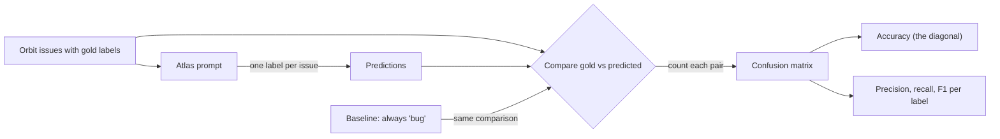
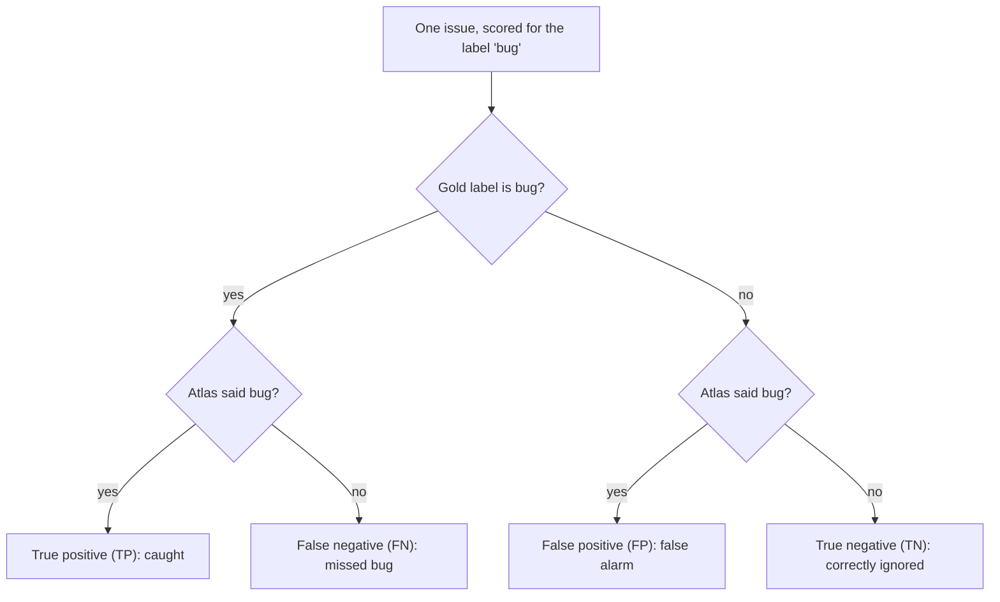

# Eval Metrics Basics

Your few-shot prompt labels 16 of 20 Orbit issues correctly. Is 80% good? Better than yesterday's prompt? The number alone can't tell you. This primer covers the metrics the course uses from [Day 10: Few-Shot Prompting](../Phase_2_Building_with_LLM_APIs/Day_010_few_shot_prompting/few_shot_prompting.md) onward, plus the statistical warning that stops you fooling yourself.

## Who this is for

- **Read this if** "precision vs recall" is fuzzy, or you have never asked whether a score could be luck. Read it before Day 10; it takes about 30 minutes.
- **Skip it if** you can answer the five [Self-Check](#self-check) questions without peeking.
- **You need:** basic Python (lists, `zip`, f-strings; see the [Python primer](A03_python_for_this_course.md)). Scripts use only the standard library on Python 3.11+, with no API key.

> **Coming from Software Engineering?** A confusion matrix is a `GROUP BY expected, actual` count over test results. Precision and recall are the alerting trade-off you already tune: precision is "what share of pages were real incidents", recall is "what share of incidents paged someone". A baseline is a benchmark's control run. And the small-sample warning is why you wouldn't trust a 5% latency win from three benchmark runs.

## Accuracy and baselines: is 80% good?

**The problem.** Atlas, the assistant you build in this course, labels each Orbit issue as `bug`, `question`, `feature` or `docs`. With nothing to compare against, 80% could be excellent or worse than guessing.

**The intuition.** A desert weather app that always says "no rain" is right 95% of the time and useless. Before celebrating a score, ask what the laziest strategy would get.

**A tiny example.** Your 20 test issues have **gold labels** (right answers) from a maintainer: nine bugs, five questions, four features, two docs. Atlas gets 16 right: accuracy 16/20 = 80%. A "classifier" that always answers `bug` gets 9/20 = 45%. That lazy strategy is your baseline; the honest claim is "80% against a 45% baseline".

**Name the parts.**

| Term | Plain meaning | In the example |
|---|---|---|
| gold label | the correct answer, decided by a person | `question` |
| accuracy | correct predictions ÷ all predictions | 16/20 = 80% |
| majority baseline | accuracy of always predicting the most common label | 9/20 = 45% |
| class imbalance | some labels are far more common than others | 9 bugs vs 2 docs |

```python
# script_id: primer_a12/issue_metrics
# Install: none (stdlib only) · Env vars: none · Services: none
from collections import Counter

# 20 hand-labelled Orbit issues: (gold label, label Atlas predicted)
RESULTS = [
    ("bug", "bug"), ("bug", "bug"), ("bug", "bug"), ("bug", "bug"),
    ("bug", "bug"), ("bug", "bug"), ("bug", "bug"), ("bug", "bug"),
    ("bug", "feature"),       # "Windows worker should stop on SIGTERM"
    ("question", "bug"),      # "Why did my job run twice? ORB-1101 in logs"
    ("question", "bug"),      # "Is ORB-1901 expected with SQS FIFO?"
    ("question", "question"), ("question", "question"), ("question", "question"),
    ("feature", "feature"), ("feature", "feature"),
    ("feature", "feature"), ("feature", "feature"),
    ("docs", "docs"),
    ("docs", "question"),     # "Docs gap: idempotency with SQS"
]
gold = [g for g, _ in RESULTS]
pred = [p for _, p in RESULTS]


def accuracy(gold: list[str], pred: list[str]) -> float:
    """Share of predictions that match the gold label."""
    return sum(g == p for g, p in zip(gold, pred, strict=True)) / len(gold)


majority = Counter(gold).most_common(1)[0][0]
print(f"Atlas accuracy:          {accuracy(gold, pred):.0%}")
print(f"Baseline (always {majority!r}): {accuracy(gold, [majority] * len(gold)):.0%}")
```

Expected output:

```text
Atlas accuracy:          80%
Baseline (always 'bug'): 45%
```

**Break it.** Two failures show up in nearly every first eval: model text like `"Bug."` never equals `"bug"`, and a lost prediction breaks the pairing. This block extends the same script.

```python
# script_id: primer_a12/issue_metrics
# Break it 1: the model's raw text rarely matches your label strings exactly
raw = ["Bug", "bug.", " feature", "Question"]
truth = ["bug", "bug", "feature", "question"]
print("raw:", accuracy(truth, raw))
print("normalized:", accuracy(truth, [r.strip().strip(".").lower() for r in raw]))

# Break it 2: a prediction went missing (say, one API call crashed)
try:
    accuracy(gold, pred[:-1])
except ValueError as err:
    print("ValueError:", err)
```

Expected output:

```text
raw: 0.0
normalized: 1.0
ValueError: zip() argument 2 is shorter than argument 1
```

Normalize labels before comparing, and count outputs that match no label separately. `strict=True` makes a missing prediction a loud error; plain `zip` stops silently at the shorter list, and a gap in the middle misaligns every later pair.

**The common mistake: accuracy on imbalanced labels.** Suppose 2 of 20 bug reports are severity S1 (a critical outage). A detector that never says S1 scores 90% accuracy and catches zero outages. Accuracy hides exactly the rare cases you care about; the next two sections fix that.

## The confusion matrix: where the mistakes go

**The problem.** "80%" tells you how many mistakes Atlas made, not which ones. To fix a prompt you need the which.

**The intuition.** In a mail room, note for every letter the pigeonhole it belonged in and the one it landed in. The tally shows at a glance that invoices keep landing in "receipts".

**A tiny example.** Two of Atlas's four mistakes are questions labelled `bug`. Both paste an Orbit error code (ORB-1101, ORB-1901), which reads like a bug report. That one fixable pattern is worth more than the 80%.

**Name the parts.** A **confusion matrix** is that tally as a table: one row per gold label, one column per predicted label. The **diagonal** (gold equals predicted) holds the correct answers; every other cell is one kind of mistake.



```python
# script_id: primer_a12/issue_metrics
LABELS = ["bug", "question", "feature", "docs"]
matrix = Counter(zip(gold, pred))          # (gold, predicted) -> count

corner = "gold \\ pred"
print(f"{corner:<12}" + "".join(f"{p:>9}" for p in LABELS))
for g in LABELS:
    print(f"{g:<12}" + "".join(f"{matrix[(g, p)]:>9}" for p in LABELS))

errors = Counter({pair: n for pair, n in matrix.items() if pair[0] != pair[1]})
print("Most common mistake:", errors.most_common(1))
```

Expected output:

```text
gold \ pred       bug question  feature     docs
bug                 8        0        1        0
question            2        3        0        0
feature             0        0        4        0
docs                0        1        0        1
Most common mistake: [(('question', 'bug'), 2)]
```

Read across a row to see where that label's issues went: of 5 real questions, 2 became `bug`. Read down a column to see what a prediction really contained: of 10 issues labelled `bug`, 2 were questions.

## Precision, recall and F1: one label at a time

**The problem.** Maintainers route bugs to triage. A missed bug sits unanswered; a question called a bug wastes a triager's time. Accuracy lumps both failures together.

**The intuition.** Think of a fishing net. **Precision** asks "of everything in the net, how much is fish?" **Recall** asks "of all the fish in the lake, how many did we catch?" A huge net catches every fish plus old boots: high recall, low precision.

**A tiny example.** Atlas said `bug` 10 times and 8 were real bugs: precision 8/10 = 0.80. Of 9 real bugs it found 8: recall 8/9 = 0.89.

**Name the parts.** Pick one label and treat every other label as "not it" (one-vs-rest). Each issue lands in one of four boxes:



- **Precision** = TP ÷ (TP + FP): how far you can trust a `bug` label.
- **Recall** = TP ÷ (TP + FN): what share of real bugs gets caught.
- **F1** = 2 × precision × recall ÷ (precision + recall), an average that is high only when both are high. For `bug`: 2 × 0.80 × 0.89 ÷ 1.69 = 0.84.

```python
# script_id: primer_a12/issue_metrics
def prf(gold: list[str], pred: list[str], label: str) -> tuple[float, float, float]:
    """Precision, recall, F1 for one label; every other label counts as 'not it'."""
    tp = sum(g == label and p == label for g, p in zip(gold, pred))
    fp = sum(g != label and p == label for g, p in zip(gold, pred))
    fn = sum(g == label and p != label for g, p in zip(gold, pred))
    precision = tp / (tp + fp)
    recall = tp / (tp + fn)
    f1 = 2 * precision * recall / (precision + recall)
    return precision, recall, f1


for label in LABELS:
    p, r, f = prf(gold, pred, label)
    print(f"{label:<9} precision {p:.2f}   recall {r:.2f}   F1 {f:.2f}")
```

Expected output:

```text
bug       precision 0.80   recall 0.89   F1 0.84
question  precision 0.75   recall 0.60   F1 0.67
feature   precision 0.80   recall 1.00   F1 0.89
docs      precision 1.00   recall 0.50   F1 0.67
```

`docs` has perfect precision and poor recall: the one issue Atlas labelled `docs` was right, but it missed the other.

**Break it: score the lazy baseline per label.**

```python
# script_id: primer_a12/issue_metrics
always_bug = ["bug"] * len(gold)
p, r, f = prf(gold, always_bug, "bug")
print(f"always-bug: precision {p:.2f}   recall {r:.2f}   F1 {f:.2f}")
try:
    prf(gold, always_bug, "question")      # 'question' is never predicted
except ZeroDivisionError as err:
    print("ZeroDivisionError:", err)
```

Expected output:

```text
always-bug: precision 0.45   recall 1.00   F1 0.62
ZeroDivisionError: division by zero
```

Recall 1.00 looks perfect until you see precision 0.45. And since the baseline never predicts `question`, its precision is 0 ÷ 0, which Python refuses to compute.

**The realistic version.** Treat 0 ÷ 0 as 0.0 (a common convention; scikit-learn does this too, with a warning). Then add **macro-F1**, the plain average of per-label F1, so two `docs` issues count as much as nine bugs.

```python
# script_id: primer_a12/issue_metrics
def safe_div(num: float, den: float) -> float:
    return num / den if den else 0.0       # undefined score -> 0.0


def prf(gold: list[str], pred: list[str], label: str) -> tuple[float, float, float]:
    pairs = list(zip(gold, pred, strict=True))
    tp = sum(g == label and p == label for g, p in pairs)
    fp = sum(g != label and p == label for g, p in pairs)
    fn = sum(g == label and p != label for g, p in pairs)
    precision, recall = safe_div(tp, tp + fp), safe_div(tp, tp + fn)
    return precision, recall, safe_div(2 * precision * recall, precision + recall)


def macro_f1(gold: list[str], pred: list[str], labels: list[str]) -> float:
    """Average F1 over labels, so small labels count as much as big ones."""
    return sum(prf(gold, pred, label)[2] for label in labels) / len(labels)


for name, guesses in [("Atlas", pred), ("always-bug", always_bug)]:
    print(f"{name:<11} accuracy {accuracy(gold, guesses):.2f}"
          f"   macro-F1 {macro_f1(gold, guesses, LABELS):.2f}")
```

Expected output:

```text
Atlas       accuracy 0.80   macro-F1 0.77
always-bug  accuracy 0.45   macro-F1 0.16
```

Macro-F1 rates the lazy baseline at 0.16, closer to its real value for triage. With imbalanced labels, report per-label precision and recall next to accuracy. Both return in [Day 29: Evaluating Retrieval](../Phase_3_RAG/Day_029_retrieval_evaluation/retrieval_evaluation.md), where the label is "this doc is relevant".

## Pass rate and agreement: scoring checks and judges

**The problem.** Not every eval matches a label. From [Day 20: Your First Eval Set](../Phase_2_Building_with_LLM_APIs/Day_020_first_eval_set/first_eval_set.md), each case runs a check (did the extractor return version `3.2.1`?) that passes or fails. In [Day 45: LLM-as-Judge](../Phase_5_Evaluation_and_Observability/Day_045_llm_as_judge/llm_as_judge.md) an LLM grades answers, and you must decide whether to trust it.

**The intuition.** Two code reviewers read the same 10 PRs. If 9 PRs were fine, a reviewer who approves everything still agrees with the careful one 9 times. What matters is who catches the bad ones.

**A tiny example.** A maintainer grades 10 Atlas answers: 7 pass, 3 fail. The judge passes all 7 good ones but fails only 1 bad one. They agree on 8 of 10.

**Name the parts.** The **positive class** is the outcome the metrics are named after. Here it's "pass", as in [Day 46: Trusting Your Judge](../Phase_5_Evaluation_and_Observability/Day_046_judge_validation/judge_validation.md); state your choice in every report.

- **Pass rate** = passing cases ÷ all cases: accuracy for checks. Day 20 fails CI below a threshold.
- **Percent agreement** = cases where judge and human agree ÷ all cases.
- **TPR** (true positive rate) = of answers the human passed, the share the judge passed (recall for "pass").
- **TNR** (true negative rate) = of answers the human failed, the share the judge failed: how well it catches bad answers.

```python
# script_id: primer_a12/judge_agreement
# Install: none (stdlib only) · Env vars: none · Services: none
# 10 Atlas answers, each graded by a maintainer and by an LLM judge (True = pass)
human = [True, True, True, True, True, True, True, False, False, False]
judge = [True, True, True, True, True, True, True, True, False, True]


def agreement_report(human: list[bool], judge: list[bool]) -> dict[str, float]:
    pairs = list(zip(human, judge, strict=True))
    tp = sum(h and j for h, j in pairs)              # both say pass
    tn = sum(not h and not j for h, j in pairs)      # both say fail
    passes = sum(human)
    fails = len(human) - passes
    return {
        "judge_pass_rate": sum(judge) / len(judge),
        "agreement": (tp + tn) / len(pairs),
        "TPR": tp / passes,                          # real passes the judge passed
        "TNR": tn / fails,                           # real fails the judge caught
    }


print(f"human pass rate {sum(human) / len(human):.2f}")
for name, verdicts in [("LLM judge", judge), ("always-pass", [True] * 10)]:
    stats = agreement_report(human, verdicts)
    print(f"{name:<12}" + "  ".join(f"{k} {v:.2f}" for k, v in stats.items()))
```

Expected output:

```text
human pass rate 0.70
LLM judge   judge_pass_rate 0.90  agreement 0.80  TPR 1.00  TNR 0.33
always-pass judge_pass_rate 1.00  agreement 0.70  TPR 1.00  TNR 0.00
```

**The common mistake: reporting agreement alone.** The always-pass judge agrees 70% of the time and catches nothing. The real judge agrees 80%, yet catches one bad answer in three and inflates the pass rate from 70% to 90%. Report n, agreement, TPR and TNR together.

## Small samples: why 20 examples can mislead

**The problem.** Prompt A scores 16/20 and prompt B 14/20. Is A better? At n = 20 each example is worth 5 points, so two issues decide it.

**The intuition.** Flip a fair coin 20 times and you'll often see 13 heads, or 7. The coin didn't change; the sample was small. An eval set samples the issues Atlas will see, so its score wobbles the same way.

**A tiny example.** Pretend a prompt is right on exactly 80% of all Orbit issues. Score it on 20 random issues, again and again: it won't always get 80%.

**Name the parts.** The **true accuracy** is the score over every possible issue, which you never see; your eval score estimates it. **Sampling noise** is how far that estimate moves between samples; it shrinks as n grows.

```python
# script_id: primer_a12/small_samples
# Install: none (stdlib only) · Env vars: none · Services: none
import random

random.seed(12)          # fixed seed so your output matches the text
TRUE_ACCURACY = 0.80     # pretend we know the prompt's accuracy on ALL Orbit issues


def correct_on_sample(n: int) -> int:
    """Draw n fresh issues; each is labelled right with probability 0.80."""
    return sum(random.random() < TRUE_ACCURACY for _ in range(n))


for n in (20, 100, 500):
    scores = sorted(correct_on_sample(n) / n for _ in range(2_000))
    low, high = scores[50], scores[1_949]            # middle 95% of 2,000 runs
    print(f"n={n:<4} 95% of runs scored between {low:.0%} and {high:.0%}")

# Two prompts with the SAME true accuracy, each scored on its own 20 issues
gaps = [abs(correct_on_sample(20) - correct_on_sample(20)) for _ in range(2_000)]
share = sum(gap >= 2 for gap in gaps) / len(gaps)  # 2 issues = 10 points at n=20
print(f"Identical prompts differed by 10+ points in {share:.0%} of runs")
```

Expected output:

```text
n=20   95% of runs scored between 60% and 95%
n=100  95% of runs scored between 72% and 88%
n=500  95% of runs scored between 77% and 83%
Identical prompts differed by 10+ points in 55% of runs
```

An unchanged prompt scored anywhere from 60% to 95% on 20 issues, and identical prompts differed by 10+ points in over half the runs.

**Fix it: compare on the same issues.** Score both prompts on one set and list what changed, like reading a test diff.

```python
# script_id: primer_a12/small_samples
# Per-issue results for two prompts on the SAME 20 issues (True = labelled right)
old = [True] * 14 + [False, False, False, True, False, False]
new = [True] * 13 + [False, True, True, True, True, False, False]
fixed = [i for i, (o, n) in enumerate(zip(old, new, strict=True)) if not o and n]
broke = [i for i, (o, n) in enumerate(zip(old, new, strict=True)) if o and not n]
print(f"old {sum(old)}/20, new {sum(new)}/20")
print(f"fixed issues {fixed}, broke issues {broke}")
```

Expected output:

```text
old 15/20, new 17/20
fixed issues [14, 15, 16], broke issues [13]
```

A net gain of 2 hides 3 fixes and 1 regression; read those four issues before deciding. Rules of thumb:

- Write counts next to percentages ("16/20, 80%") so readers see n.
- Treat a gap of one or two examples on 20 as noise; per-label numbers on tiny labels (docs recall from two issues) mean even less.
- Rerun before trusting a small change, because LLM outputs vary between runs.
- Grow the set: [Day 43: Building Eval Datasets](../Phase_5_Evaluation_and_Observability/Day_043_eval_datasets/eval_datasets.md) goes well past 20.

<details>
<summary>Under the hood: a quick margin of error (optional, safe to skip)</summary>

In words: noise shrinks with the square root of n, so four times the examples halves it.

Toy numbers: at 80% on 20 issues, √(0.8 × 0.2 ÷ 20) ≈ 0.089. Doubled, that's about ±18 points, close to the simulation's 60%–95%. At n = 100 it's about ±8.

Formula: margin of error ≈ 2 × √(p(1 − p) ÷ n), where p is the observed score. It's rough for small n or p near 0 or 1, where a bootstrap (resampling your own results) does better.

</details>

## Self-Check

1. An eval set has 30 Orbit issues: 24 bugs and 6 others. A new prompt scores 80% accuracy. What should you compare it with?

<details>
<summary>Answer</summary>

The majority baseline: always answering `bug` also scores 24/30 = 80%. Check per-label precision and recall on the 6 non-bugs.

</details>

2. In this primer's confusion matrix, what do the `question` row and the `bug` column tell you?

<details>
<summary>Answer</summary>

The row: of 5 real questions, 3 became `question` and 2 `bug` (question recall 0.60). The column: of 10 `bug` predictions, 8 were bugs and 2 questions (bug precision 0.80).

</details>

3. Atlas flags 12 issues as S1; 6 of them are really S1, and there are 8 real S1 issues. What are precision, recall and F1?

<details>
<summary>Answer</summary>

TP = 6, FP = 6, FN = 2. Precision 6/12 = 0.50, recall 6/8 = 0.75, F1 = 2 × 0.50 × 0.75 ÷ 1.25 = 0.60.

</details>

4. A judge agrees with human labels on 46 of 50 answers (92%), and the human passed 46. Can it gate releases?

<details>
<summary>Answer</summary>

Not yet. An always-pass judge would also score 92%. Check TNR: did it catch the 4 failures? With only 4 failing cases even TNR is shaky, so label more failures first.

</details>

5. Prompt A scores 15/20 and prompt B 17/20, each on a different random sample. A teammate says B is 10 points better. What do you say?

<details>
<summary>Answer</summary>

A 2-issue gap on 20 is noise: identical prompts differ that much in about half of runs. Score both on the same issues, list fixes and regressions, and use a bigger set.

</details>

## Learn More

- [Google ML Crash Course: Accuracy, recall, precision, and related metrics](https://developers.google.com/machine-learning/crash-course/classification/accuracy-precision-recall): the four boxes and when to prefer each metric, with interactive examples.
- [Hamel Husain: AI Evals, Everything You Need to Know](https://hamel.dev/blog/posts/evals-faq/): validating LLM judges with TPR and TNR. It treats "fail" as positive, so its TPR is this primer's TNR.
- [Anthropic: A statistical approach to model evaluations](https://www.anthropic.com/research/statistical-approach-to-model-evals): error bars, paired comparisons and choosing enough examples.
