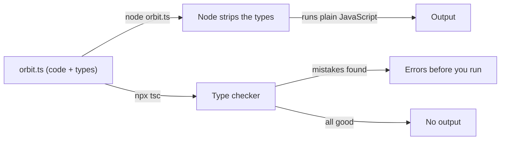
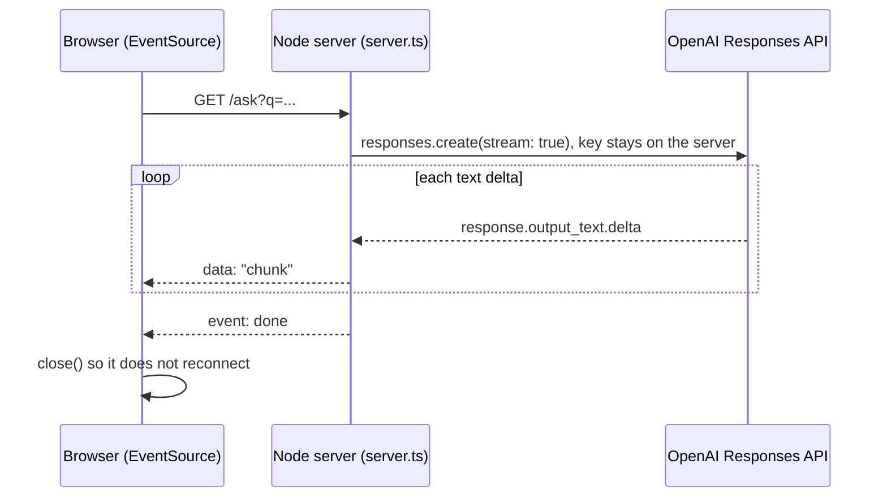
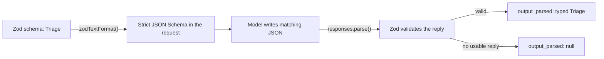

# TypeScript for AI Engineers (Optional)

AI SDK docs show TypeScript next to Python, and many teams ship their chat front end and API layer
in TypeScript. This optional primer teaches enough of it to read those docs, call the OpenAI
Responses API from Node.js, stream an answer into a browser, and get typed structured output with
Zod, a validation library. The 100 days stay in Python.

## Who this is for

You have done [Day 2: Setup & Your First LLM Call](../Phase_0_Start_Here/Day_002_setup_first_call/setup_first_call.md)
and can read Python type hints, but TypeScript looks like noise. Read it alongside
[Day 79: Chat UIs & Streaming Transports](../Phase_9_Production/Day_079_chat_uis_streaming/chat_uis_streaming.md)
if you want a browser client instead of Gradio, or when a job post asks for TypeScript. It assumes
`await` from [Async Python I](A04a_async_python_basics.md) and SSE from
[HTTP, JSON & APIs](A05_http_json_apis.md). Allow 30–40 minutes.

**Skip if** you write TypeScript at work and can answer the Self-Check without looking.

**You need:** Node.js 22.18 or newer (`node --version`). The `openai` npm package requires Node 22+,
and 22.18 runs `.ts` files without a flag. The API sections need `OPENAI_API_KEY` in `.env`, as in
[Project setup & secrets](A02_project_setup_secrets.md). Each script costs a fraction of a cent on
`gpt-6-luna` ($0.10 per 1M input tokens, $0.50 per 1M output, as of 2026-11,
[verify](https://developers.openai.com/api/docs/pricing)).

**New terms:** TypeScript, npm, type stripping, Promise, Zod schema.

> **Coming from Software Engineering?** TypeScript is JavaScript plus a static type checker, like
> Python plus mypy, except the whole ecosystem runs the checker. Types are erased before the code
> runs, so they never validate network data; Zod does that, as Pydantic does in Python. The two OpenAI SDKs mirror each other: Python's keyword arguments become
> one object literal, and response fields keep their snake_case names (`output_text`,
> `input_tokens`). Typing is structural: any object with the right fields fits a type, with no
> `implements` needed.

## TypeScript from Python

**The problem.** You open the OpenAI docs, click the JavaScript tab, and see `const`, `await`,
`{ ... }` and `z.infer<typeof Triage>`. You can guess most of it, but guessing won't make it run.

**The intuition.** TypeScript (TS) is JavaScript with labels on every box. Python type hints are
labels too, but nothing enforces them unless you run mypy. TS teams run the checker on every save
and in CI; then the labels are peeled off and plain JavaScript runs.

**A tiny example.** Most of the syntax maps line for line:

| Python | TypeScript | Note |
|---|---|---|
| `x = 3` | `const x = 3;` | `const` can't be reassigned; use `let` when it must change |
| `None` | `null`, `undefined` | `undefined` means "never set", such as a missing key |
| `def f(n: int) -> str:` | `function f(n: number): string { ... }` | one `number` type covers ints and floats |
| `lambda i: i.id` | `(i) => i.id` | an arrow function |
| `f"#{n}"` | `` `#${n}` `` | a template literal, in backticks |
| `list[str]`, `dict[str, int]` | `string[]`, `Record<string, number>` | |
| `TypedDict`, dataclass | `interface`, `type` | describe the shape of an object |
| `a == b` | `a === b` | `==` converts types first (`"1" == 1` is true), so avoid it |
| `x if x is not None else "-"` | `x ?? "-"` | `??` falls back only on `null`/`undefined` |
| `async def`, `await` | `async function`, `await` | `await` also works at the top level of a module |
| `from x import y` | `import { y } from "x";` | ES modules, the standard JavaScript module system |
| `uv add`, `pyproject.toml`, `.venv` | `npm install`, `package.json`, `node_modules/` | |

**Naming the parts.**

- **npm** (Node Package Manager): installs packages into `node_modules/` and records them in
  `package.json`. Add `node_modules/` to `.gitignore`, like `.venv`.
- **Type stripping:** since 22.18, `node file.ts` deletes the type annotations and runs what's left.
  There is no build step, and no type checking either.
- **tsc** (the TypeScript compiler): with `noEmit`, it only checks types and reports errors.
- **Promise:** JavaScript's awaitable value. An `async function` returns a `Promise<T>`, and `await`
  unwraps it into a `T`.



Set up a project once. Every script in this primer lives in it:

```bash
mkdir atlas-ts && cd atlas-ts
npm init -y
npm pkg set type=module                      # ES modules: import/export and top-level await
npm install openai zod
npm install --save-dev typescript @types/node
printf "node_modules/\n.env\n" >> .gitignore
```

Then save this as `tsconfig.json`. These are the settings the Node.js docs recommend for type
stripping, plus `skipLibCheck`, which stops `tsc` reporting type errors inside libraries' own files:

```json
{
  "compilerOptions": {
    "noEmit": true,
    "target": "esnext",
    "module": "nodenext",
    "rewriteRelativeImportExtensions": true,
    "erasableSyntaxOnly": true,
    "verbatimModuleSyntax": true,
    "skipLibCheck": true
  }
}
```

Now a first script over three Orbit issues:

```ts
// orbit.ts: run with `node orbit.ts` (Node 22.18+ strips the types; no build step)
type Severity = "S1" | "S2" | "S3" | "S4"; // a union of literals, like Literal["S1", ...]

interface Issue {
  id: number;
  title: string;
  severity: Severity;
  errorCodes: string[];
  duplicateOf?: number; // "?" means the key may be absent
}

const issues: Issue[] = [
  { id: 101, title: "Redis reconnect storm after failover", severity: "S1", errorCodes: ["ORB-1001"] },
  { id: 102, title: "Job ran twice after lease expired", severity: "S2", errorCodes: ["ORB-1101"] },
  { id: 103, title: "Dashboard redirect loop behind proxy", severity: "S3", errorCodes: [], duplicateOf: 88 },
];

function urgent(items: Issue[], worst: Severity = "S2"): string[] {
  return items
    .filter((issue) => issue.severity <= worst) // "S1" < "S2" as strings
    .map((issue) => `#${issue.id} [${issue.severity}] ${issue.title}`);
}

console.log(urgent(issues));
console.log(issues[2].duplicateOf ?? "not a duplicate", issues[0].duplicateOf ?? "not a duplicate");
```

```text
[
  '#101 [S1] Redis reconnect storm after failover',
  '#102 [S2] Job ran twice after lease expired'
]
88 not a duplicate
```

**Break it.** Change issue 103's severity to `"S5"`. `node orbit.ts` still prints the same output,
because Node only strips types. Run the checker and it fails:

```text
$ npx tsc
orbit.ts(15,61): error TS2322: Type '"S5"' is not assignable to type 'Severity'.
```

Make `npx tsc` part of your loop, the way you'd run pytest. Type stripping also rejects the few TS
features that generate code, such as `enum`, with
`SyntaxError [ERR_UNSUPPORTED_TYPESCRIPT_SYNTAX]: TypeScript enum is not supported in strip-only mode`.
Use a union of string literals instead, as `Severity` does.

**Common mistake: treating types as checks.** A type annotation is a promise you make to the
compiler, not a check on real data. `const issue: Issue = JSON.parse(text)` compiles even when
`text` holds garbage, because `JSON.parse` returns `any` (TypeScript's "trust me" type). That gap is
why the Zod section exists.

## Calling the Responses API from TypeScript

**The problem.** Your team's API layer is in TypeScript, and it needs the same call you made in
Python on Day 2.

**The intuition.** Same SDK, different language: the method names, parameters and response fields
match the Python SDK.

**The code.** Put your key in `.env` (`OPENAI_API_KEY=sk-...`). Node's `--env-file` flag loads it, so
you don't need a dotenv package.

```ts
// ask.ts: npm install openai; put OPENAI_API_KEY in .env; run `node --env-file=.env ask.ts`
import OpenAI from "openai";

const MODEL = process.env.ATLAS_MODEL ?? "gpt-6-luna"; // cheapest current model
const client = new OpenAI(); // reads OPENAI_API_KEY from the environment

const response = await client.responses.create({
  model: MODEL,
  instructions: "You are Atlas, a terse assistant for Orbit maintainers.",
  input: "In one sentence: why can an Orbit job run twice after its lease expires?",
});

console.log(response.output_text);
console.log("tokens:", response.usage?.input_tokens, "in,", response.usage?.output_tokens, "out");
```

```text
Because the job outlived its lease (ORB-1101), Orbit hands it to another worker; raise lease_seconds or send heartbeats.
tokens: 41 in, 29 out
```

Your wording and token counts will differ. Here is the Python twin, for reading side by side:

```python
# script_id: primer_a13/first_call_python
# The Python twin of ask.ts, for side-by-side reading.
# Install: uv add "openai>=3.46,<4". Env: OPENAI_API_KEY (optional ATLAS_MODEL). Services: none.
import os

from openai import OpenAI

MODEL = os.environ.get("ATLAS_MODEL", "gpt-6-luna")  # cheapest current model
client = OpenAI()  # reads OPENAI_API_KEY from the environment

response = client.responses.create(
    model=MODEL,
    instructions="You are Atlas, a terse assistant for Orbit maintainers.",
    input="In one sentence: why can an Orbit job run twice after its lease expires?",
)

print(response.output_text)
print("tokens:", response.usage.input_tokens, "in,", response.usage.output_tokens, "out")
```

```text
Because the job outlived its lease (ORB-1101), Orbit hands it to another worker; raise lease_seconds or send heartbeats.
tokens: 41 in, 29 out
```

**Naming the parts.**

- `client.responses.create(body, options)`: the first argument is the request body, with the same
  snake_case names as the HTTP API (`model`, `instructions`, `input`, `previous_response_id`). The
  optional second argument holds per-request options in camelCase: `timeout` (in milliseconds),
  `maxRetries` and `signal`.
- `process.env.ATLAS_MODEL ?? "gpt-6-luna"` is the TS form of `os.environ.get("ATLAS_MODEL", ...)`.
- `response.usage?.input_tokens`: the SDK types `usage` as possibly missing, so the checker makes you
  handle that case. `?.` returns `undefined` instead of throwing.

**Break it: forget the `await`.** Delete `await` and the script prints `undefined` twice, because
`response` is now a pending Promise, not a response. `npx tsc` catches it:

```text
ask.ts(13,22): error TS2339: Property 'output_text' does not exist on type 'APIPromise<Response>'.
```

**Handling failures.** The SDK throws a subclass of `OpenAI.APIError` for every 4xx and 5xx, and
retries connection errors, 408, 409, 429 and 5xx twice by default:

```ts
// ask_safe.ts: run `node --env-file=.env ask_safe.ts`
import OpenAI from "openai";

const MODEL = process.env.ATLAS_MODEL ?? "gpt-6-luna";
const client = new OpenAI({ timeout: 30_000, maxRetries: 2 }); // milliseconds, not seconds

try {
  const response = await client.responses.create({ model: MODEL, input: "Say hi to the Orbit team." });
  console.log(response.output_text);
} catch (err) {
  if (err instanceof OpenAI.AuthenticationError) {
    console.error("401: check OPENAI_API_KEY in .env");
  } else if (err instanceof OpenAI.RateLimitError) {
    console.error("429: slow down, or check your billing limits");
  } else if (err instanceof OpenAI.APIError) {
    console.error(`API error ${err.status}: ${err.message}`);
  } else {
    throw err; // not an API problem: a bug in our code
  }
}
```

Without the `try`, a wrong key crashes with
`AuthenticationError: 401 Incorrect API key provided: sk-...`. Forgetting `--env-file=.env` fails
before any request is sent: ``OpenAIError: Missing credentials. Please pass an `apiKey`, ...``.

## Streaming tokens to a browser

**The problem.** A 10-second answer that appears all at once feels broken. You want tokens on screen
as they arrive, the way [Day 13: Streaming Responses](../Phase_2_Building_with_LLM_APIs/Day_013_streaming/streaming.md)
does in a terminal. You also can't call OpenAI from the browser: anyone could read your key from the
page. The SDK refuses by default, with `It looks like you're running in a browser-like environment`,
unless you pass `dangerouslyAllowBrowser: true`. Leave it off.

**The intuition.** Your Node server is a relay. It holds the key, asks OpenAI for a stream, and passes
each piece of text to the browser the moment it lands, like a waiter carrying each dish out as the
kitchen finishes it.

**A tiny example.** This is what the browser receives, using SSE (Server-Sent Events: one long HTTP
response made of `data:` lines, with a blank line ending each message):

```text
data: "Because "

data: "the "

data: "job "

event: done
data: {}
```

Each `data:` line holds one JSON-encoded chunk; the final `done` event says "finished".

**Naming the parts.**

- **Stream events:** with `stream: true`, `create` returns an async iterable of typed events.
  Text arrives in events whose `type` is `"response.output_text.delta"`, with the text in `.delta`.
- **`for await (const event of stream)`:** the TS form of Python's `async for`.
- **`EventSource`:** the browser's built-in SSE client. It calls `onmessage` once per message.
- **`AbortController`:** a cancel button for a request. Its `signal` goes into the SDK's options.



**The code.** The server uses only Node's built-in `http` module:

```ts
// server.ts: run `node --env-file=.env server.ts`, then open http://localhost:3000
import { readFile } from "node:fs/promises";
import { createServer } from "node:http";
import OpenAI from "openai";

const MODEL = process.env.ATLAS_MODEL ?? "gpt-6-luna";
const PORT = Number(process.env.PORT ?? 3000);
const client = new OpenAI(); // the key stays here, on the server

createServer(async (req, res) => {
  const url = new URL(req.url ?? "/", "http://localhost");
  if (url.pathname !== "/ask") {
    res.writeHead(200, { "Content-Type": "text/html; charset=utf-8" });
    res.end(await readFile(new URL("./index.html", import.meta.url)));
    return;
  }
  res.writeHead(200, { "Content-Type": "text/event-stream", "Cache-Control": "no-cache" });
  const abort = new AbortController();
  res.on("close", () => abort.abort()); // tab closed: stop generating (and paying)
  try {
    const stream = await client.responses.create(
      { model: MODEL, input: url.searchParams.get("q") ?? "Hello", stream: true },
      { signal: abort.signal },
    );
    for await (const event of stream) {
      if (event.type === "response.output_text.delta") {
        res.write(`data: ${JSON.stringify(event.delta)}\n\n`); // one SSE message per chunk
      }
    }
    res.write("event: done\ndata: {}\n\n");
  } catch (err) {
    if (!abort.signal.aborted) res.write(`event: failed\ndata: ${JSON.stringify(String(err))}\n\n`);
  }
  res.end();
}).listen(PORT, () => console.log(`Atlas listening on http://localhost:${PORT}`));
```

Save the page next to it as `index.html`. Browsers run JavaScript, not TypeScript, so it's plain JS:

```html
<!doctype html>
<meta charset="utf-8" />
<title>Atlas</title>
<form id="ask"><input id="q" size="60" value="Why did my Orbit job run twice?" /> <button>Ask</button></form>
<pre id="out" style="white-space: pre-wrap"></pre>
<script>
  const out = document.getElementById("out");
  document.getElementById("ask").addEventListener("submit", (e) => {
    e.preventDefault();
    out.textContent = "";
    const q = document.getElementById("q").value;
    const source = new EventSource("/ask?q=" + encodeURIComponent(q));
    source.onmessage = (msg) => (out.textContent += JSON.parse(msg.data));
    source.addEventListener("done", () => source.close()); // stop the auto-reconnect
    source.addEventListener("failed", (msg) => { out.textContent += "\n[error] " + msg.data; source.close(); });
    source.onerror = () => source.close();
  });
</script>
```

```text
$ node --env-file=.env server.ts
Atlas listening on http://localhost:3000
```

Open the page and click **Ask**: the answer grows word by word. With `curl -N "http://localhost:3000/ask?q=hi"`
you can watch the raw `data:` lines.

**Break it: delete the `done` listener.** `EventSource` treats a closed stream as a dropped
connection and reconnects after a few seconds, which sends the question again. In our test the page
asked three times in eight seconds; the answer repeated and each repeat was billed. Always send an
end event and call `close()`.

**Two more errors you'll meet.** `Error: listen EADDRINUSE: address already in use :::3000` means
another dev server owns the port, so run `PORT=3001 node --env-file=.env server.ts`. If you port a
Chat Completions handler, `chunk.choices[0].delta` fails `tsc` with
`Property 'choices' does not exist on type 'ResponseStreamEvent'`, because Responses events have a
`type` and a `delta` instead.

## Structured output with Zod

**The problem.** You ask the model for triage JSON and write
`const triage: Triage = JSON.parse(response.output_text)`. It compiles. Then the model returns
`"severity": "S9"`, and your code files a ticket with a severity that doesn't exist. TypeScript
believed you, because its types are gone at run time.

**The intuition.** Zod is Pydantic for TypeScript. One schema gives you a runtime check on real
data and a static type for the checker, so the two never drift apart:

| Pydantic (Python) | Zod (TypeScript) |
|---|---|
| `class Triage(BaseModel): ...` | `const Triage = z.object({ ... })` |
| `Literal["bug", "docs"]` | `z.enum(["bug", "docs"])` |
| `str \| None` (required, may be null) | `z.string().nullable()` |
| `Triage.model_validate(data)` | `Triage.parse(data)` throws a `ZodError` |
| catching `ValidationError` | `Triage.safeParse(data)` returns `{ success, data }` or `{ success, error }` |
| the class is the type | `type Triage = z.infer<typeof Triage>` |

**A tiny example**, offline, with a bad severity and a missing field:

```ts
// zod_basics.ts: npm install zod; run `node zod_basics.ts` (no API key needed)
import { z } from "zod";

const Triage = z.object({
  type: z.enum(["bug", "feature", "question", "docs"]),
  severity: z.enum(["S1", "S2", "S3", "S4"]).nullable(), // null for non-bugs
  error_codes: z.array(z.string()),
  summary: z.string(),
});
type Triage = z.infer<typeof Triage>; // the static type, derived from the runtime schema

const fromModel: unknown = JSON.parse('{"type":"bug","severity":"S9","error_codes":["ORB-1101"]}');

const result = Triage.safeParse(fromModel);
if (result.success) {
  const triage: Triage = result.data; // typed from here on
  console.log(triage.severity);
} else {
  console.log(z.prettifyError(result.error));
}
```

```text
✖ Invalid option: expected one of "S1"|"S2"|"S3"|"S4"
  → at severity
✖ Invalid input: expected string, received undefined
  → at summary
```

`unknown` is the safe opposite of `any`: TypeScript won't let you use the value until something
like `safeParse` has checked it. A schema and its type may share a name, because TS keeps values and
types apart.

**Naming the parts.** The OpenAI SDK turns a Zod schema into a strict JSON Schema for the request,
then validates the reply with the same schema:

- `zodTextFormat(Triage, "triage")` builds the `text.format` setting (strict JSON Schema plus a name).
- `client.responses.parse(...)` sends it and parses the reply.
- `response.output_parsed` holds the typed result, or `null` if nothing parsed (a refusal, or a
  reply cut off early).



**The code**, on a realistic Orbit issue:

```ts
// triage.ts: npm install openai zod; run `node --env-file=.env triage.ts`
import OpenAI from "openai";
import { zodTextFormat } from "openai/helpers/zod";
import { z } from "zod";

const MODEL = process.env.ATLAS_MODEL ?? "gpt-6-luna";
const client = new OpenAI();

const Component = z.enum(["core", "scheduler", "flows", "broker-redis", "broker-postgres",
  "broker-sqs", "cli", "dashboard", "retries", "results", "observability", "auth", "docs"]);
const Triage = z.object({
  type: z.enum(["bug", "feature", "question", "docs"]),
  components: z.array(Component),
  severity: z.enum(["S1", "S2", "S3", "S4"]).nullable(), // null for non-bugs
  error_codes: z.array(z.string()),
  summary: z.string(),
});

const issue = `Job ran twice after lease expired.
Our 20-minute export job runs twice on Orbit 3.2.1 with the Redis broker.
Worker log: ORB-1101 LeaseExpired job_id=exp_77`;

const response = await client.responses.parse({
  model: MODEL,
  instructions: "Triage this Orbit issue. Use only facts stated in the text.",
  input: issue,
  text: { format: zodTextFormat(Triage, "triage") },
});

const triage = response.output_parsed; // type: z.infer<typeof Triage> | null
if (!triage) throw new Error(`no parsed output (status: ${response.status})`);
console.log(triage.severity, triage.components, triage.error_codes);
console.log(triage.summary);
```

```text
S2 [ 'core', 'broker-redis' ] [ 'ORB-1101' ]
A 20-minute export job runs twice because its lease expires.
```

Your summary may differ. In your editor, `triage` is fully typed, with no cast.

**Break it: use `.optional()`.** Strict structured outputs require every field to be present, so a
field that may be empty must be `.nullable()`. Change `severity` to `.optional()` and the SDK stops
before sending anything:

```text
Error: Schema field at `properties/severity` uses `.optional()` without `.nullable()` which is not supported by the API.
```

The same rule, with Pydantic, is on [Day 16: Structured Outputs: Native JSON Schema & Extraction](../Phase_2_Building_with_LLM_APIs/Day_016_structured_outputs/structured_outputs.md).

## Where the OpenAI Agents SDK for JS fits

**The problem.** Once a model calls tools in a loop, you write the same plumbing every time: send the
tools, run the one the model picked, send the result back, repeat.

**The pointer.** The OpenAI Agents SDK for TypeScript (`npm install @openai/agents zod`) runs that
loop for you, with the same ideas as the Python SDK in
[Day 56: The OpenAI Agents SDK](../Phase_6_Agents/Day_056_openai_agents_sdk/openai_agents_sdk.md):
an `Agent` with instructions and tools, `run()` to execute it, and `result.finalOutput` for the
answer. Tool parameters are Zod schemas, so everything above carries over:

```ts
// agent.ts: npm install @openai/agents zod; run `node --env-file=.env agent.ts`
import { Agent, run, tool } from "@openai/agents";
import { z } from "zod";

const ERROR_CODES: Record<string, string> = {
  "ORB-1101": "LeaseExpired: the job outlived its lease, so it may run twice.",
  "ORB-1301": "RetryExhausted: the job moved to the dead-letter queue.",
};

const lookupErrorCode = tool({
  name: "lookup_error_code",
  description: "Explain an Orbit error code such as ORB-1101.",
  parameters: z.object({ code: z.string() }),
  execute: async ({ code }) => ERROR_CODES[code] ?? `Unknown code ${code}.`,
});

const atlas = new Agent({
  name: "Atlas",
  model: process.env.ATLAS_MODEL ?? "gpt-6-luna", // the SDK's own default is a different model
  instructions: "Answer questions about Orbit. Look up every ORB code before explaining it.",
  tools: [lookupErrorCode],
});

const result = await run(atlas, "My worker logged ORB-1101. What happened?");
console.log(result.finalOutput);
```

```text
ORB-1101 is LeaseExpired: your job ran longer than its lease, so Orbit gave it to another worker and it may run twice. Raise lease_seconds or send heartbeats.
```

Your wording will differ. The package is pre-1.0 (version 0.21 as of 2026-11), so pin the version
you test with and check its docs before relying on newer features such as handoffs or sessions.

## Self-Check

1. `node orbit.ts` runs fine, but `npx tsc` reports an error. How can both be true, and which one
   should block a merge?

<details>
<summary>Answer</summary>

Node's type stripping deletes the annotations and runs the JavaScript without checking anything.
`tsc` is the only step that checks the types. Treat its errors like failing tests and run it in CI.

</details>

2. Your script prints `undefined` where the model's answer should be. What is the most likely bug?

<details>
<summary>Answer</summary>

A missing `await`. `client.responses.create(...)` returns a Promise, and a Promise has no
`output_text` field. `tsc` reports `Property 'output_text' does not exist on type 'APIPromise<Response>'`.

</details>

3. Why does the browser talk to your Node server instead of calling OpenAI directly, and what stops
   the page from asking the same question again after the answer ends?

<details>
<summary>Answer</summary>

Browser code is visible to every user, so the key must stay on the server. The server sends a final
`done` event and the page calls `source.close()`; otherwise `EventSource` reconnects and the question
is sent, and billed, again.

</details>

4. The model returns `{"severity": "S9"}`, and your code has `const t: Triage = JSON.parse(text)`.
   What catches the bad value: TypeScript or Zod? Why?

<details>
<summary>Answer</summary>

Only Zod. TypeScript types are erased before the code runs, and `JSON.parse` returns `any`, so the
compiler trusts the annotation. `Triage.parse()` or `safeParse()` checks the real value at run
time, and `responses.parse` with `zodTextFormat` does that for you.

</details>

5. Your schema has `orbit_version: z.string().optional()`, and `zodTextFormat` throws. What do you
   change, and why?

<details>
<summary>Answer</summary>

Use `z.string().nullable()`. Strict structured outputs require every field to be present, so "no
value" must be an explicit `null` rather than a missing key. Then handle `null` in your code.

</details>

## Learn More

- [openai-node on GitHub](https://github.com/openai/openai-node): the official TypeScript SDK's
  README, covering the Responses API, streaming, errors, retries and timeouts.
- [Node.js: Modules: TypeScript](https://nodejs.org/api/typescript.html): how type stripping works,
  what it can't run, and the recommended `tsconfig.json`.
- [OpenAI: Structured model outputs](https://developers.openai.com/api/docs/guides/structured-outputs):
  the strict-schema rules; its JavaScript examples use Zod and `zodTextFormat`.
- [OpenAI Agents SDK for TypeScript](https://openai.github.io/openai-agents-js/): guides to agents,
  tools, handoffs and tracing.
