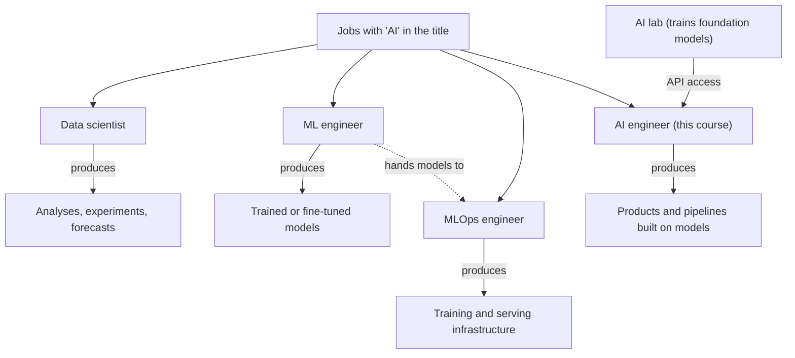
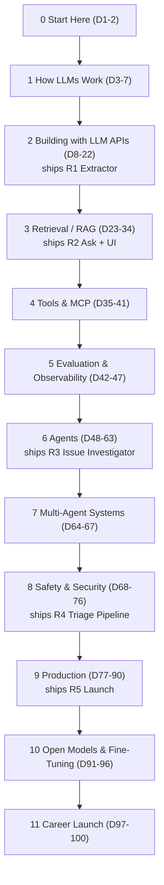
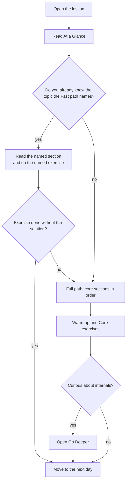

# The AI Engineer: Role, Skills & How to Use This Course

"AI engineer" job postings ask for evals, agents, RAG and TypeScript in the same breath, and a new
graduate reads that list very differently from a backend engineer with ten years behind them.
Before any code, you need to know what the job is, what you already bring, and how these 100 days
get you there. Today: the map, a baseline score and a study plan, with no code.

## At a Glance

- **Time:** ~2 h core (+ optional Go Deeper) · **Depth:** intro
- **Prerequisites:** none. If the terminal or Git is new to you, read
  [A1: Terminal, Git & GitHub](../../Appendix_Primers/A01_terminal_git_github.md) before Day 2.
- **You'll build:** `skills_audit.md`, a self-scored baseline (20 items, 100 points max) that you
  re-score on Day 63 and Day 100, plus a weekly study plan
- **Stops at:** no code
- **Fast path:** Already work with LLM APIs? Skim the role table in §What AI Engineers Actually
  Build, read §How to Read a Lesson, then do Exercise 1 (about 30 min).
- **Cost:** $0. No API calls today.
- **New terms:** AI engineer, foundation model, eval, agent, RAG

> **Coming from Software Engineering?** AI engineering is backend engineering with a new kind of
> dependency: one that is probabilistic, so the same request can return different answers. Most of
> what you do today transfers directly: API integration, testing, observability, deployment, code
> review and on-call habits. What's new is a short list of patterns that wrap the model: prompting,
> retrieval, evals (automated checks of model behaviour), agents, and budgeting cost per token. You
> are not starting over; you're learning one new kind of component and the engineering around it.

## What AI Engineers Actually Build

Search a job board for "AI" and you get four different jobs behind similar titles. Applying to the
wrong one wastes months, and studying for the wrong one is worse. Start by separating them.

The plain version: **an AI engineer builds products that call a model the way an app calls a
payment service. Someone else builds the model.** That model is a **foundation model**: a large
model trained by an AI lab on broad data and used by everyone else through an API. You don't train
it. You decide what to send it, check what comes back, connect it to your data and tools, measure
whether it works, and run it in production at a sensible cost.



| Role | Main focus | Typical tools | What they ship | Background that helps most |
|---|---|---|---|---|
| Data scientist | Answering questions with data | SQL, notebooks, statistics libraries | Analyses, experiments, forecasts | Statistics, domain knowledge |
| ML engineer | Training and improving models | Training frameworks, GPUs, datasets | Trained or fine-tuned models | Math, ML theory, research reading |
| MLOps engineer | Infrastructure for training and serving models | Containers, orchestration, model registries | Pipelines that train, version and serve models | DevOps, distributed systems |
| **AI engineer** | **Products built on foundation models** | **Model APIs, retrieval, evals, agent frameworks** | **Assistants, extractors, agents, AI features** | **Software engineering** |

Roles blur at small companies. The test: does the job *train* models or *build with* them? This
course builds with them; training appears only in Phase 10.
Three more terms show up constantly in postings:

- **RAG** (retrieval-augmented generation): look the relevant documents up first, then have the
  model answer from them. Phase 3 builds one.
- **Agent:** a loop in which the model picks the next step (call a tool, read a result, decide
  again) until the task is done. Phase 6 builds one.
- **Eval:** an automated check of the model's behaviour, run on a fixed set of examples, so you can
  tell whether a change made things better or worse. You write your first on
  [Day 20: Your First Eval Set](../../Phase_2_Building_with_LLM_APIs/Day_020_first_eval_set/first_eval_set.md).

## A Week on the Atlas Team

Throughout the course you build **Atlas**, an AI assistant for the maintainers of **Orbit**, a
fictional open-source Python library for background jobs. Here is a week as Atlas's AI engineer;
each tag says which day teaches the task.

- **Monday: the extractor emits bad labels.** Atlas turns new Orbit issues into typed records, and
  overnight some came back with components that don't exist. You tighten the schema and add a
  bounded re-ask for valid-but-wrong answers. *([Day 16](../../Phase_2_Building_with_LLM_APIs/Day_016_structured_outputs/structured_outputs.md),
  [Day 17](../../Phase_2_Building_with_LLM_APIs/Day_017_semantic_failures/semantic_failures.md))*
- **Tuesday: a wrong citation.** Asked about Orbit 3.2 config, Atlas cites the 2.x page on
  `orbit.ini`, which 3.0 replaced with `orbit.toml`. You fix retrieval before touching the prompt.
  *([Day 28](../../Phase_3_RAG/Day_028_rag_pipeline/rag_pipeline.md))*
- **Wednesday: is the new prompt better?** Instead of eyeballing five outputs of a teammate's new
  triage prompt, you score it against 30 hand-checked issues and compare with the old one. *([Day 20](../../Phase_2_Building_with_LLM_APIs/Day_020_first_eval_set/first_eval_set.md))*
- **Thursday: the bill doubled.** Whole doc pages started going into every request. You
  measure tokens per call, reorder the prompt so the provider's cache can reuse it, and add an alert.
  *([Day 18](../../Phase_2_Building_with_LLM_APIs/Day_018_cost_latency_caching/cost_latency_caching.md))*
- **Friday: review an agent's diff.** A coding agent opened a pull request. You review it like
  any contributor's: tests, the eval gate, and the repo's `AGENTS.md` rules.
  *([Day 60](../../Phase_6_Agents/Day_060_coding_agents_skills/coding_agents_skills.md))*

No equations, no training, no GPU code: most of the week is ordinary engineering around one model
component.

## What Employers Ask For (2026 Signal)

Course research counted keywords in **320 public AI-engineer, applied-AI and
forward-deployed-engineer postings**, taken from the job boards of nine companies on 2026-11-06.
Read it as a signal, not a census: the sample leans heavily toward AI vendors (companies that sell
models or AI tools), so it over-represents their stacks, and a keyword showing up in a posting
doesn't tell you how much the job uses it.

| Skill (share of postings mentioning it) | Where this course teaches it |
|---|---|
| Evals: 52% | Seeded on Day 20; full discipline in Phase 5 (Days 42–47); gates every release after |
| Python: 41% | Every day; [A3: Python for this course](../../Appendix_Primers/A03_python_for_this_course.md) fills gaps |
| Agents: 36% | Phase 6 (Days 48–63), then multi-agent in Phase 7 |
| TypeScript / JavaScript: 32% | Optional primer [A13](../../Appendix_Primers/A13_typescript_for_ai_engineers.md); chat UIs in Phase 9 |
| Coding agents (Codex, Claude Code, Cursor): 20% | `AGENTS.md` from Day 2; [Day 60](../../Phase_6_Agents/Day_060_coding_agents_skills/coding_agents_skills.md) |
| RAG / retrieval: 17% | Phase 3 (Days 23–34) |
| *(rows from 13% down to 5%: see Go Deeper)* | |
| CrewAI, LlamaIndex: 0% | One comparison row each on [Day 57](../../Phase_6_Agents/Day_057_agent_frameworks/agent_frameworks.md) |

Three readings of this table shape the whole course:

1. **Evals lead.** Proving a feature works is the top ask, so evals arrive early and Phase 5
   comes *before* agents: you can't show an agent improved without a measurement.
2. **Patterns beat frameworks.** Named frameworks score in single digits or zero. Learn the loop,
   the retrieval and the measurement; any team's framework is then quick to pick up.
3. **Python first, TypeScript useful.** A third of postings mention TS/JS, mostly for UI work;
   the primer is there when you need it.

## Two Tracks: Switching Roles vs First Role

The same course serves two kinds of learner, and the advice differs. Pick the track that fits now; you can change later.

| | **Switching roles** (working engineer) | **First role** (fresher or new grad) |
|---|---|---|
| Your edge | Production experience: on-call, reviews, systems that stay up | Time, fresh habits, nothing to unlearn |
| What to emphasize | Evals, cost, reliability, security: the parts that look like your current job | Fundamentals and finished, working projects |
| Use fast paths? | Often, in Phases 2 and 9 | Rarely; take the full path and the primers |
| Portfolio expectation | Two or three releases you can defend in a design review | All five releases, each with a clear README |
| Interview loops | System design for AI features plus a practical coding round ([Day 97](../../Phase_11_Career_Launch/Day_097_system_design_interviews/system_design_interviews.md)) | Data structures and algorithms (DSA) rounds plus project deep-dives ([Day 98](../../Phase_11_Career_Launch/Day_098_practical_interviews/practical_interviews.md)) |
| When to start applying | After R3 (Day 62), with R1–R3 on GitHub | Start your DSA plan on Day 63; apply from about R4 (Day 76) |

Freshers: entry-level loops lean on coding and on explaining a project you built end to end, not
on senior system design. DSA practice takes months, so it starts on Day 63 and runs to Day 98.

## How This Course Works

The 100 days form 12 phases, and five of them ship a release of Atlas. For the day-by-day list,
see the [course index](../../index.md).



**Atlas, in five releases.** Each reuses the one before: one product, not five demos. Unfamiliar
terms in this table (eval gate, p95, SLOs) are defined on the days that teach them.

| Release | Day | What it adds | Proof in its README |
|---|---|---|---|
| R1 Extractor | [D22](../../Phase_2_Building_with_LLM_APIs/Day_022_capstone_r1_extractor/capstone_r1_extractor.md) | Docs and issues → typed records; tests; an eval gate | Field accuracy, $ per 1k docs, p95 latency |
| R2 Ask | [D34](../../Phase_3_RAG/Day_034_capstone_r2_ask/capstone_r2_ask.md) | RAG with citations, hybrid search and reranking, evals, a Gradio UI on free hosting | Retrieval scores before and after, access-control demo, demo URL |
| R3 Issue Investigator | [D61–62](../../Phase_6_Agents/Day_061_capstone_r3_investigator/capstone_r3_investigator.md) | A LangGraph agent: new issue → cited diagnosis; durable; human-in-the-loop; trajectory evals | Crash-resume demo, trajectory pass rate, $ per issue |
| R4 Triage Pipeline | [D76](../../Phase_8_Safety_and_Security/Day_076_capstone_r4_triage/capstone_r4_triage.md) | A multi-agent pipeline that *acts* (label, dedupe, draft a reply) behind approval; guardrails; red-team CI | Single- vs multi-agent justification, red-team pass rate |
| R5 Launch | [D89–90](../../Phase_9_Production/Day_089_capstone_r5_integrate/capstone_r5_integrate.md) | API, UI, auth and quotas, deploy, monitoring, eval-gated releases, runbooks | Load test, chaos drill, SLOs, $ per request |

**Orbit, the data.** Orbit is fictional, written for this course so every lesson uses the same
realistic, legally clean corpus (CC0, public domain). `datasets/orbit/` holds 45 docs pages (plus
messy HTML copies and two poisoned pages for the security days), 240 issues with 504 comments, a
SQLite copy of the tracker, and small gold sets for grading. The issues include duplicates, fake
personal data, non-English text and injection attempts on purpose, because real trackers do.

**Primers** are short refreshers outside the 100 days (terminal, Python, async, HTTP, SQL,
Docker, testing, model vocabulary and more). Read one when a lesson's At a Glance names it. Before Day 2 you need only A1, A2 and A5; the full
reading order is in Go Deeper below.

## How to Read a Lesson

Every day has the same layout, so you can decide in two minutes what to read closely and what to
skip. The markers at the top are the tools for that decision.

| Marker | Where | What it tells you |
|---|---|---|
| **Time** and **Depth** | At a Glance | Core-path length, and how deep the day goes: *intro* (orientation), *working* (build it yourself), *advanced* (optional depth) |
| **Stops at** | At a Glance | What the day deliberately leaves out, so you don't go looking for it |
| **Fast path** | At a Glance | "Already know X? Read §Y and do Exercise Z": a 30–60 minute route for people who know the basics |
| **Cost** | At a Glance | Expected API spend for running the day's code, with the date the price was checked |
| **Coming from Software Engineering?** | Callout | The analogy to something you know. Freshers can skip it; the main text never depends on it |
| **Under the hood** / **Go Deeper** | Collapsible blocks | Math, internals and extra variants. Optional; nothing later depends on them |
| **Where we stop** | Box near the end | One sentence on what isn't covered and where to find it |



Two habits make the course work: **run the code** (most AI bugs appear only when the model
answers), and **try each exercise before opening its solution**.

## Your Baseline Skills Audit

You can't measure progress without a starting point. The audit below has 20 items in 8 groups that
follow the phases. Score each from 0 to 5 using these anchors, total them (100 is the maximum), and
save the file as `skills_audit.md`. You'll re-score the same file on Day 63 and Day 100, so be
honest: a low score now makes the progress visible later.

| Score | Meaning |
|---|---|
| 0 | Never heard of it |
| 1 | Heard the term; couldn't explain it |
| 2 | Could explain it; haven't built it |
| 3 | Built it once, by following a guide |
| 4 | Built it on my own and debugged it |
| 5 | Could teach it, including when not to use it |

```markdown
# Skills audit: baseline (Day 1), date: ____
Scores 0-5. Re-score on Day 63 and Day 100.

| # | Group | Skill | D1 | D63 | D100 |
|---|---|---|---|---|---|
| 1 | APIs & prompting | Call an LLM API from code and read its usage and cost | | | |
| 2 | APIs & prompting | Write clear prompts: instructions, examples, output format | | | |
| 3 | APIs & prompting | Reason about tokens, context windows and choosing a model | | | |
| 4 | Structured output | Get typed, schema-valid JSON out of a model | | | |
| 5 | Structured output | Handle valid-but-wrong outputs (validate, re-ask, bound retries) | | | |
| 6 | Retrieval | Embeddings and vector search | | | |
| 7 | Retrieval | Chunking, hybrid search and reranking | | | |
| 8 | Retrieval | A RAG pipeline with citations, and measuring its retrieval | | | |
| 9 | Tools & MCP | Function calling and designing tools a model can use well | | | |
| 10 | Tools & MCP | MCP: use an MCP server and build one | | | |
| 11 | Evals & observability | Build an eval set and run it on every change | | | |
| 12 | Evals & observability | LLM-as-judge, checked against human labels | | | |
| 13 | Evals & observability | Tracing and error analysis (from traces to failure modes) | | | |
| 14 | Agents | An agent loop with stop conditions, budgets and context management | | | |
| 15 | Agents | Durable agents with human approval (e.g. a graph framework) | | | |
| 16 | Agents | Working safely with coding agents (AGENTS.md, reviewing their diffs) | | | |
| 17 | Safety | Prompt injection and threat-modelling an AI feature | | | |
| 18 | Safety | Guardrails, safe output handling and personal data (PII) | | | |
| 19 | Production & ops | Serve an AI feature: API, streaming, background jobs, deploy | | | |
| 20 | Production & ops | Run it: reliability, cost control, monitoring, safe releases | | | |

Total (max 100): D1 ___  D63 ___  D100 ___
Top 3 gaps: 1. ____  2. ____  3. ____
```

Score what you can *do*, not what you've read about; when unsure, take the lower number.

## The Mindset Shift

Engineers are trained on deterministic systems, where a passing test stays passing. Models break
that in three ways, and teams adapt in three matching ways.

- **Outputs are probabilistic, so teams measure instead of eyeballing.** One good answer proves
  little; a prompt tweak that fixes one case often breaks two others, so every change is scored.
- **Changes are experiments, so teams work eval-first.** Hypothesis, change, measure, keep or
  revert: performance tuning with a benchmark, applied to behaviour.
- **Tools churn, so teams learn patterns.** Model names, SDKs and frameworks change within
  months; patterns (structured output, retrieval, tools, the agent loop, evals) last.

**When AI isn't the answer.** A model is the costly, slow, sometimes-wrong option; use it when
input is messy language or the rules are too many to write down.

| Situation | Better choice |
|---|---|
| The rule fits in an `if` statement or a regex (e.g. "issue title starts with `[bug]`") | Plain code: free, fast, testable |
| Exact lookups ("which release fixed issue 812?") | A database query |
| Messy free text to structured fields, or answering from documents | A model, with an eval set |
| Open-ended multi-step tasks | An agent, only after a fixed workflow has proved too rigid |

### In production

- Teams wrap every model call in their own module, because model IDs and SDKs change fast.
- Teams track cost per request from the first prototype; token bills grow with traffic and
  prompt length.
- Teams treat prompts as code (versioned, reviewed, tested) because a one-word edit can change
  behaviour across thousands of requests.
- Teams gate releases on evals the way they gate on unit tests.
- Teams require human approval before a model acts on users' behalf.

## Go Deeper (optional)

<details><summary>Go deeper: the primers and when to read them</summary>

Each primer is about one page and ends with a five-question self-check.

| Primer | Read before |
|---|---|
| [A1 Terminal, Git & GitHub](../../Appendix_Primers/A01_terminal_git_github.md) | Day 2 |
| [A2 Project setup & secrets](../../Appendix_Primers/A02_project_setup_secrets.md) | Day 2 |
| [A3 Python for this course](../../Appendix_Primers/A03_python_for_this_course.md) | Day 12 (and Day 53) |
| [A4a Async Python I](../../Appendix_Primers/A04a_async_python_basics.md) · [A4b Async Python II](../../Appendix_Primers/A04b_async_python_concurrency.md) | Day 12 (optional) and Day 22 · Days 37 and 77 |
| [A5 HTTP, JSON & APIs](../../Appendix_Primers/A05_http_json_apis.md) | Day 2 (status codes), Days 13 and 39 |
| [A6 NumPy & vectors](../../Appendix_Primers/A06_numpy_vectors.md) | Day 23 |
| [A7 SQL & Postgres](../../Appendix_Primers/A07_sql_postgres.md) | During Days 23–25 |
| [A8 Docker & compose](../../Appendix_Primers/A08_docker_compose.md) | The day before Day 26 |
| [A9 pytest & CI](../../Appendix_Primers/A09_pytest_and_ci.md) | Day 19 |
| [A10 Backend & production vocabulary](../../Appendix_Primers/A10_backend_production_vocabulary.md) | Day 17 |
| [A11a Model words](../../Appendix_Primers/A11a_model_words.md) · [A11b Training vocabulary](../../Appendix_Primers/A11b_training_vocabulary.md) | Day 3 · Day 91 |
| [A12 Eval metrics basics](../../Appendix_Primers/A12_eval_metrics_basics.md) | Day 10 |
| [A13 TypeScript for AI engineers](../../Appendix_Primers/A13_typescript_for_ai_engineers.md) (optional) | Day 79 |

</details>

<details><summary>Go deeper: reading a job posting like a spec</summary>

A posting is a requirements document written by several people, so read it the way you'd read a
vague ticket: separate the must-haves from the wish list, and translate the vocabulary.

1. **Find the verbs.** "Build and evaluate", "ship to customers" and "own the reliability of" tell
   you more than the list of tools. "Train", "pretrain" or "research" point to an ML engineer or
   researcher role, not this one.
2. **Map nouns to phases.** "Evals", "golden sets", "LLM-as-judge" → Phase 5. "Retrieval",
   "search", "embeddings" → Phase 3. "Tool use", "MCP", "function calling" → Phase 4. "Agents",
   "orchestration", "workflows" → Phase 6. "Latency", "cost", "SLOs" → Phase 9. A posting that
   leans on two phases tells you where to go deep.
3. **Spot the role variant.** *Applied AI engineer* usually means building AI features inside a
   product team. *Forward-deployed engineer* usually means working directly with a customer's team
   to get the product running on their data, so communication and debugging under ambiguity matter
   as much as code. *LLM engineer* is mostly a synonym for AI engineer.
4. **Treat named frameworks as "or equivalent".** A team using LangGraph will hire someone who
   understands durable agent graphs and can learn their library in a week. Say that in your cover
   letter or interview, with a project that shows it.
5. **Read the company type.** AI vendors (labs and tool makers) ask more about evals, research
   awareness and their own products. Product companies ask more about shipping, cost and user
   impact. Both want working software.

Keep the 10 postings you collect in Exercise 2. You'll re-read them on Day 63 and see
how much more of each one you can claim.

</details>

<details><summary>Go deeper: what the job-signal numbers can and can't tell you</summary>

The percentages in §What Employers Ask For come from a keyword count over 320 postings on
2026-11-06. Four limits matter when you use them.

- **Sampling bias.** The postings come from nine companies' public job boards, most of them AI
  vendors. Vendors mention evals and their own tooling more often than, say, a bank's internal AI
  team would.
- **Mention is not usage.** A keyword in a posting means someone thought it worth writing down.
  It says nothing about hours per week. "Kubernetes" in 5% of postings doesn't mean 5% of the work.
- **Synonyms split counts.** "Retrieval", "search" and "RAG" describe overlapping work, and a
  keyword tally can undercount a skill that goes by many names.
- **It's a snapshot.** Terms like "context engineering" (5%) were rare a year or two earlier.
  Expect the long tail of the table to move first.

The rest of the table, for completeness: multimodal 13% (Day 14), observability 11%
([Day 42](../../Phase_5_Evaluation_and_Observability/Day_042_tracing_observability/tracing_observability.md)), voice/realtime 7% (Day 81), fine-tuning 6% (Phase 10), MCP
(Model Context Protocol) 6% (Days 39–40), LangChain/LangGraph 6% (Days 53–55), context engineering
5% (Day 49), Kubernetes 5%, DSPy 3%.

What the numbers *do* support: the ordering at the top (evals, Python, agents) is stable enough to
plan around, and the near-zero rows for specific frameworks are a good reason to learn patterns
first. Your own tally in Exercise 2, on postings in your city or target industry, is the better
guide for your search.

</details>

<details><summary>Go deeper: why the course is built on one main provider</summary>

Most code in this course calls the OpenAI Responses API. That isn't a claim that one provider is
best; it's a teaching choice. One SDK means one set of error types, one way to read usage and one
place to look things up, so your attention goes to the patterns rather than to translating between
APIs. Anthropic's API appears on Day 2 and Day 7 for comparison, so you see that the shapes are
similar. Phase 10 runs open-weight models on your own hardware.

The habits that keep you portable are taught from the start: model IDs come from configuration
rather than being hard-coded, every call goes through one wrapper module (`atlas/llm.py`, built on
[Day 12](../../Phase_2_Building_with_LLM_APIs/Day_012_openai_sdk_production/openai_sdk_production.md)),
and evals let you check a different model against the same examples before you switch. That last
habit is the one employers mean when they ask for "model-agnostic" experience.

</details>

## Common Pitfalls

- **Tool-chasing.** *Symptom:* twenty bookmarked frameworks, no finished project. *Fix:* learn the
  pattern once; CrewAI and LlamaIndex appear in 0 of 320 sampled postings (one row each on Day 57).
- **Skipping evals because they feel like QA.** *Symptom:* "it looked fine in the demo", with no
  proof a change helped. *Fix:* they're the top skill (52%); the habit starts on Day 20.
- **Freshers measuring themselves against senior loops.** *Symptom:* anxiety about distributed
  systems design before the first project works. *Fix:* follow the First-role track: finished
  projects plus a DSA plan from Day 63.
- **No baseline.** *Symptom:* on Day 63 you can't say what you've learned. *Fix:* fill in today's
  audit, even roughly, and commit it.
- **Spending before budgeting.** *Symptom:* a surprise bill or unused subscription. *Fix:* buy
  nothing until Day 2 sets a spend limit and estimates the course's total cost.

> **Where we stop:** today has no code, no salary data and no interview preparation; interviews and
> the job search get four full days at the end, starting with
> [Day 97: AI System Design Interviews](../../Phase_11_Career_Launch/Day_097_system_design_interviews/system_design_interviews.md).

## Key Takeaways

- An AI engineer builds products on foundation models through APIs; ML engineers train models,
  MLOps engineers run the infrastructure, and data scientists answer questions with data.
- Most of the job is software engineering around one probabilistic component: schemas, retrieval,
  measurement, cost control and review.
- In the 2026 sample, evals (52%), Python (41%) and agents (36%) lead the list, and specific
  frameworks barely register, so the course teaches patterns first and measures everything.
- Pick a track (Switching roles or First role) and use each lesson's Fast path, Stops at and Where
  we stop markers to decide what to read closely and what to skip.
- Your 20-item, 100-point baseline audit is the yardstick you re-score on Day 63 and Day 100.

## Quick Reference

| Item | What it is | When you use it | Gotcha |
|---|---|---|---|
| Role test | Train models, or build with them? | Reading any AI posting | Small companies blend roles |
| Job signal | Keyword shares from 320 postings (2026-11-06) | Prioritizing what to learn | Vendor-heavy sample; mention ≠ usage |
| Tracks | Switching roles vs First role | Planning study and applications | Re-decide at Day 63 |
| Fast path | "Know X? Read §Y, do Exercise Z" | Skipping material you already know | Do the exercise; if it fails, take the full path |
| `skills_audit.md` | 20 items × 0–5 = 100 max | Today, Day 63, Day 100 | When unsure between two scores, take the lower |
| Atlas releases | R1 D22 · R2 D34 · R3 D61–62 · R4 D76 · R5 D89–90 | Portfolio planning | Each release reuses the previous one |

## Exercises

1. **Warm-up: take the audit.** Copy the audit template into `skills_audit.md`, score all 20
   items, total them, and write down your three weakest groups (lowest score as a share of the
   group's maximum).

<details><summary>Solution</summary>

A sample from a backend engineer with some ChatGPT use and no API work:

| Group | Items | Score |
|---|---|---|
| APIs & prompting | 1–3 | 2 + 2 + 1 = 5 |
| Structured output | 4–5 | 1 + 1 = 2 |
| Retrieval | 6–8 | 1 + 0 + 1 = 2 |
| Tools & MCP | 9–10 | 1 + 0 = 1 |
| Evals & observability | 11–13 | 0 + 0 + 2 = 2 |
| Agents | 14–16 | 1 + 0 + 2 = 3 |
| Safety | 17–18 | 1 + 1 = 2 |
| Production & ops | 19–20 | 4 + 3 = 7 |
| **Total** | | **24 / 100** |

How to read your total:

- **0–30: starting fresh on the AI side.** Normal on Day 1. Take the full path; your existing
  engineering skills (like the 7 in Production & ops above) will speed up Phase 9.
- **31–65: you've built some of this.** Use fast paths where your group scores are 4 or more, and
  slow down in your three weakest groups.
- **66–100: experienced.** Use the course to fill specific gaps and to produce portfolio releases;
  fast paths will cover a lot of it.

The three weakest groups here by share of maximum (Tools & MCP 10%, Retrieval 13%, Evals &
observability 13%) become this learner's
focus list. Commit the file so the Day 63 re-score has a diff to compare.

</details>

2. **Core: tally 10 real postings.** Collect 10 AI-engineer postings in your target market, mark
   which of the 8 audit groups each asks for, and list your top 3 gaps (most asked for, lowest
   score).

<details><summary>Solution</summary>

A sample tally (count of postings mentioning each group, out of 10):

| Audit group | Postings | My audit score (max) | Gap? |
|---|---|---|---|
| Evals & observability | 7 | 2 (15) | **yes** |
| Agents | 6 | 3 (15) | **yes** |
| APIs & prompting | 6 | 5 (15) | |
| Retrieval | 5 | 2 (15) | **yes** |
| Production & ops | 5 | 7 (10) | |
| Tools & MCP | 3 | 1 (10) | |
| Structured output | 2 | 2 (10) | |
| Safety | 2 | 2 (10) | |

Turning gaps into a focus list:

1. Rank groups by *postings × (max − score)*, not by score alone. Evals: 7 × 13 = 91, Agents:
   6 × 12 = 72, Retrieval: 5 × 13 = 65.
2. Write the phase next to each gap: Evals → Phase 5 (plus Day 20), Agents → Phase 6,
   Retrieval → Phase 3.
3. Plan to take the full path, not the fast path, in those phases.

Save the 10 postings; you'll re-read them on Day 63.

</details>

3. **Core: choose a track and write a weekly plan.** Hours per day, which weekdays, which primers
   and when, where you expect fast paths, and one rule for falling behind.

<details><summary>Solution</summary>

**Switching roles** (full-time job, about 8 h/week):

| Day | Time | Plan |
|---|---|---|
| Mon, Wed | 1 h each | Read the core sections |
| Sat | 4 h | Run the code, do the exercises, commit |
| Sun | 2 h | Catch-up or Go Deeper |

- Primers: A2 before Day 2; A3 and A4a before Day 12.
- Fast paths: likely in Phase 9 (production), where work experience applies.
- Pace: roughly one lesson per 2 hours of study, so about four lessons a week, taking the full
  path in your gap phases.
- Behind-schedule rule: skip Go Deeper and stretch exercises, never the core exercises.

**First role** (studying or job-hunting, about 20 h/week):

| Day | Time | Plan |
|---|---|---|
| Mon–Fri | 3 h | One lesson per day, full path |
| Sat | 4 h | Primers, plus redo one exercise from memory |
| Sun | off | Rest; breaks help retention |

- Primers: A1, A2 and A5 before Day 2; A11a before Day 3; A12 before Day 10.
- Fast paths: rarely. Take the full path and finish every exercise.
- From Day 63: add 30 min of DSA practice per weekday.
- Behind-schedule rule: finish the current release before moving on; a working R1 beats half of
  R1 and R2.

</details>

4. **Stretch (optional): swap Orbit for your own domain.** In one paragraph, plan how you'd replace
   Orbit with docs and tickets from your own field, then list three risks: licence, personal data,
   size.

<details><summary>Solution</summary>

*Plan:* "I'll build Atlas over the public docs and GitHub issues of an open-source library I use at
work. The docs replace `docs/`, a few hundred recent issues replace `issues/issues.jsonl`, and I'll
hand-write 30 question-and-answer pairs as my gold set, as Orbit does in `eval/`."

| Risk | What could go wrong | Mitigation |
|---|---|---|
| Licence | Docs or issue text may not allow redistribution in a public repo | Check the licence; commit only scripts that download the data, not the data |
| Personal data | Issues contain names, emails and logs with secrets | Strip or mask them before indexing; Day 73 (Privacy & PII) covers this properly |
| Size | Too small to show retrieval problems, or too big to index cheaply | Aim for tens of docs and a few hundred tickets, like Orbit |

Keep Orbit for the course exercises anyway; expected outputs in each lesson come from Orbit, so a
swap is best done as a parallel project.

</details>

## References & Further Reading

- [Building effective agents (Anthropic)](https://www.anthropic.com/research/building-effective-agents):
  a clear picture of what teams build with models, and why simple workflows often beat agents.
- [LLM evals FAQ (Hamel Husain)](https://hamel.dev/blog/posts/evals-faq/): a practitioner's view of
  why evals are central and how teams start.
- [OpenAI models overview](https://developers.openai.com/api/docs/models): the model catalog for
  the course's main provider; skim it to see how tiers are presented.
- [AGENTS.md](https://agents.md/): the convention for instructing coding agents, which you start
  using on Day 2.
- [CS50's Introduction to Programming with Python](https://cs50.harvard.edu/python/): a free course
  if you need to reach the entry bar for Python.
- [The Python Tutorial](https://docs.python.org/3/tutorial/): the official tutorial, for filling
  specific gaps quickly.

## What's Next

Tomorrow you set up a safe environment (Python, a project, uncommitted API keys, a spend limit),
make your first model call and work out what it cost.
Continue with [Day 2: Setup & Your First LLM Call](../../Phase_0_Start_Here/Day_002_setup_first_call/setup_first_call.md).
