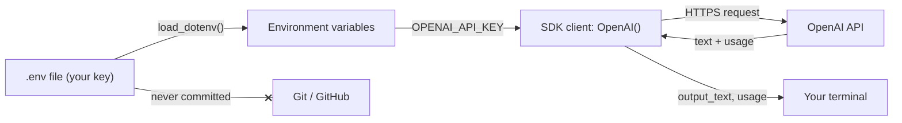
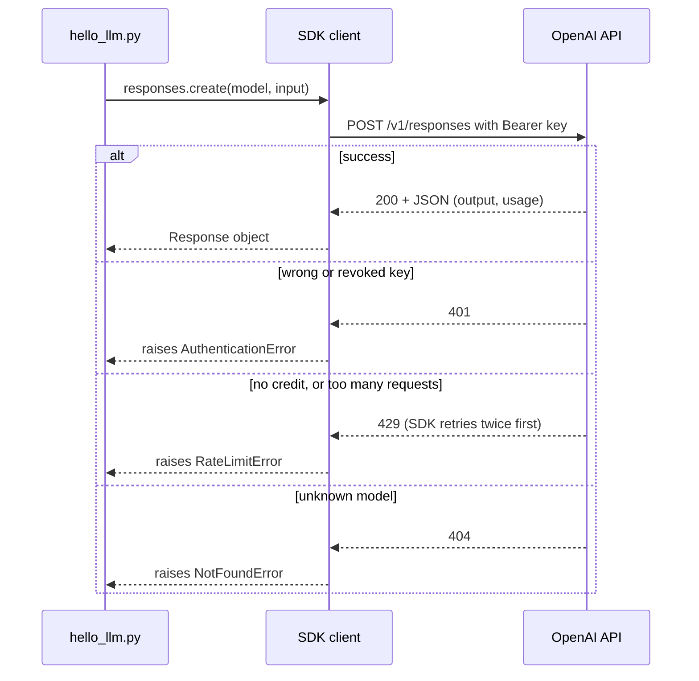
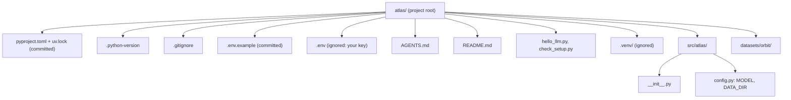

# Setup & Your First LLM Call

Every later day in this course runs code that costs money and reads a secret. A key committed to a public repo, or an account with no spend limit, is the most expensive beginner mistake in this field, and it is completely avoidable. Today you build a safe, reproducible setup, make one working call, and learn to read the receipt that comes back with it.

## At a Glance

- **Time:** ~2 h core (+ optional Go Deeper) · **Depth:** intro
- **Prerequisites:** [Day 1: The AI Engineer: Role, Skills & How to Use This Course](../Day_001_ai_engineer_role/ai_engineer_role.md); primers [Terminal, Git & GitHub](../../Appendix_Primers/A01_terminal_git_github.md), [Project Setup & Secrets](../../Appendix_Primers/A02_project_setup_secrets.md), [HTTP, JSON & APIs](../../Appendix_Primers/A05_http_json_apis.md) (status codes)
- **You'll build:** the Atlas project skeleton (uv project, `.env` handling, `config.py`, `AGENTS.md`) and `hello_llm.py`, a first call that prints its own cost
- **Stops at:** SDK internals, retries, timeouts and async ([Day 12](../../Phase_2_Building_with_LLM_APIs/Day_012_openai_sdk_production/openai_sdk_production.md)); conversation state ([Day 8](../../Phase_2_Building_with_LLM_APIs/Day_008_messages_and_state/messages_and_state.md))
- **Fast path:** Already use uv and have a funded API key? Read §Your First Call and §What Did That Cost?, then do Exercise 2 (about 30 min).
- **Cost:** < $0.01 on `gpt-6-luna` (prices as of 2026-11, [verify](https://developers.openai.com/api/docs/pricing))
- **New terms:** API key, environment variable, SDK, Responses API, usage

> **Coming from Software Engineering?** The OpenAI SDK is a typed REST client, the same shape as the Stripe or Twilio SDKs: you build a client (it reads its key from the environment), call a method, and get back a typed response object. The `usage` block on that response is your billing meter, the way Stripe returns an invoice line. `.env` is plain twelve-factor config (settings come from the environment, never from code), and `uv.lock` plays the role of `package-lock.json` or `Cargo.lock`. Everything you know about secrets hygiene and reproducible builds transfers unchanged; the one new habit is reading the meter on every call.

## Why Setup Is a Safety Step

Here is the naive start: paste the key into `hello.py`, `pip install openai` into whatever Python is on your machine, push to GitHub to show a friend. Three things go wrong. Automated scanners crawl public repos for keys, so a pushed key can be found and abused before you notice. A global install drifts, so the code that worked today breaks after an unrelated upgrade. And with no spend limit, a leaked key or a runaway loop has no ceiling.

The fix is a short checklist you do once and reuse for 100 days:

1. One project with **pinned, locked dependencies**, so every run uses the same versions.
2. The key lives in an **environment variable** (a named setting the operating system hands to your program), loaded from a `.env` file that git ignores.
3. A **monthly spend limit** on your account before the first call.
4. A habit: every call prints what it cost.

## The Toolchain in One Picture

Think of it in plain terms: **you send text to a web service; it sends text back plus a receipt saying how much reading and writing it did.** Everything else today is plumbing around that sentence.

- **uv** is your shopping list plus the exact receipt of what was bought. `pyproject.toml` says "openai, version 3.something"; `uv.lock` records the exact version of every package, including dependencies of dependencies (that file is a **lockfile**).
- **`.env`** is a locked drawer for secrets. It sits next to your code but never travels with it.
- The **SDK** (software development kit: the official Python library for the API) turns a Python method call into an HTTPS request and the JSON reply into a typed object.
- The **API key** is a long secret string that identifies your account and project; whoever holds it spends your money.



The crossed edge is the rule for the whole course: the key flows into your program at runtime and never into version control.

## Create the Atlas Project with uv

Atlas is the assistant you build across the course, for the maintainers of Orbit, a fictional Python background-jobs library ([Day 1](../Day_001_ai_engineer_role/ai_engineer_role.md) introduced both). Today it gets its home.

You need a terminal and git (see the [Terminal, Git & GitHub primer](../../Appendix_Primers/A01_terminal_git_github.md); on Windows, the primer's WSL notes are the smoothest route). Then install uv and create the project:

```bash
# macOS / Linux / WSL
curl -LsSf https://astral.sh/uv/install.sh | sh
# Windows PowerShell instead:
#   powershell -ExecutionPolicy ByPass -c "irm https://astral.sh/uv/install.ps1 | iex"

uv init --package atlas && cd atlas   # pyproject.toml, .python-version, README.md, src/atlas/, a git repo
cat .python-version                  # any 3.11+ is fine
# If it shows something older:  uv python install 3.12 && uv python pin 3.12
uv add "openai>=3.46,<4" python-dotenv
uv run python -c "import openai; print(openai.__version__)"
```

```text
3.46.0
```

What each piece does:

- `uv init --package atlas` creates the project and initialises a git repository. The `--package` flag gives it a `src/atlas/` layout and installs it into the environment, which is exactly where `config.py` will live. (Plain `uv init` makes a single `main.py` app instead, and `from atlas.config import ...` would not work.)
- `uv add` writes the requirement into `pyproject.toml`, resolves every transitive dependency, writes `uv.lock`, and creates `.venv/` on first use.
- `"openai>=3.46,<4"` allows bug-fix and feature releases but blocks the next major version, which may break your code (the 3.0 release swapped the SDK's HTTP library, for example).
- `uv run` runs a command inside the project's environment, so you never "activate" anything and never hit the wrong Python.

Commit `pyproject.toml` and `uv.lock`; never commit `.venv/`.

## Your API Key, Kept Safe

**Get a key.** In the OpenAI platform dashboard, create a project for this course and an API key inside it (a *project key*, so its spend and permissions are scoped to that project). The key is shown once; copy it straight into the file below. OpenAI bills API usage against credit you add on the Billing page; with no credit, calls fail with a 429 error (you will meet it shortly).

**Set a spend limit now, before the first call.** In your organization or project settings, set a monthly spend limit and turn on hard enforcement. OpenAI's own key-safety guide notes that spend alerts alone don't stop API traffic, and enforcement isn't instantaneous, so spend can slightly exceed the limit. A limit of $25–30 covers the whole course with room for reruns (budget below).

**Wire it into the project.** Create `.env.example` (committed, documents the settings) and `.env` (ignored, holds real values):

```text
# .env.example: copy to .env and fill in. Never put real values in this file.
OPENAI_API_KEY=
ATLAS_MODEL=gpt-6-luna
ORBIT_DATA=datasets/orbit
# ANTHROPIC_API_KEY=        (optional: only for today's comparison section)
```

```bash
cat >> .gitignore <<'EOF'
.env
.venv/
__pycache__/
EOF
cp .env.example .env          # now paste your key after OPENAI_API_KEY= in .env
git status --short            # .env must NOT be listed; .env.example should be
git check-ignore -v .env      # prints the .gitignore rule that hides .env
```

```text
?? .env.example
?? .gitignore
?? pyproject.toml
...
.gitignore:12:.env	.env
```

(On PowerShell, edit `.gitignore` in your editor instead of the `cat >>` heredoc. The line number in the last output depends on what uv already wrote.)

Now prove the setup without ever printing the secret. This script reports Python and SDK versions, whether a key is present (a `True`/`False`, never the key itself), and asks git whether `.env` is ignored:

```python
# script_id: day_002_setup_first_call/check_setup
# check_setup.py: run from the project root with `uv run python check_setup.py`
# Install: uv add "openai>=3.46,<4" python-dotenv · Env: OPENAI_API_KEY (via .env) · Services: none
import os
import subprocess
import sys
from importlib.metadata import PackageNotFoundError, version

from dotenv import load_dotenv


def package_version(name: str) -> str:
    try:
        return version(name)
    except PackageNotFoundError:
        return "missing"


def env_is_ignored() -> bool:
    """Ask git itself: `git check-ignore -q .env` exits 0 only when .env is ignored."""
    try:
        result = subprocess.run(["git", "check-ignore", "-q", ".env"], capture_output=True)
    except FileNotFoundError:  # git isn't installed
        return False
    return result.returncode == 0


load_dotenv()  # copies .env into os.environ; existing variables win (override=False)
oa = package_version("openai")
checks = {
    f"python {sys.version.split()[0]}": sys.version_info >= (3, 11),
    f"openai {oa}": oa.split(".")[0] == "3",
    "key present": bool(os.environ.get("OPENAI_API_KEY")),  # a bool only: never print the key
    ".env ignored": env_is_ignored(),
}
for label, ok in checks.items():
    print(f"{label}: {'OK' if ok else 'FIX ME'}")
print("all good" if all(checks.values()) else "fix the FIX ME lines before Day 3")
```

```text
python 3.12.8: OK
openai 3.46.0: OK
key present: OK
.env ignored: OK
all good
```

If `key present` says `FIX ME`, the key isn't in `.env` or you ran the script from outside the project. If `.env ignored` says `FIX ME`, stop and fix `.gitignore` before you commit anything.

## Your First Call

The **Responses API** is OpenAI's current endpoint for generating text: you send `input`, it returns a response object with the text and a `usage` block. Here is the smallest useful version:

```python
# script_id: day_002_setup_first_call/hello_llm
# hello_llm.py: your first call. Install: uv add "openai>=3.46,<4" python-dotenv
# Env: OPENAI_API_KEY (in .env), optional ATLAS_MODEL · Cost: well under $0.01
import os

from dotenv import load_dotenv
from openai import OpenAI

load_dotenv()                                   # .env -> environment variables
MODEL = os.environ.get("ATLAS_MODEL", "gpt-6-luna")
client = OpenAI()                               # reads OPENAI_API_KEY from the environment

resp = client.responses.create(
    model=MODEL,
    input="In one sentence, what does a background job queue do?",
)
print(resp.output_text)
print("input tokens:", resp.usage.input_tokens, "| output tokens:", resp.usage.output_tokens)
```

```text
A background job queue lets an application hand off slow or deferred work to separate worker processes, so requests return quickly while the work runs reliably elsewhere.
input tokens: 20 | output tokens: 150
```

(Your text and numbers will differ; models are not deterministic, and [Day 6](../../Phase_1_How_LLMs_Work/Day_006_sampling_reasoning_effort/sampling_reasoning_effort.md) explains why.)

Three things to notice:

- **`MODEL` comes from the environment, with a default.** To try another model you set `ATLAS_MODEL`; you don't edit code. Model IDs change ([Day 7](../../Phase_1_How_LLMs_Work/Day_007_choosing_a_model/choosing_a_model.md) covers their lifecycle), so they belong in config.
- **`output_text`** is a convenience property that joins all the text the model produced. The full `resp.output` is a list of typed items; you won't need it until [Day 8](../../Phase_2_Building_with_LLM_APIs/Day_008_messages_and_state/messages_and_state.md).
- **`usage`** is the receipt. A **token** is a word-piece the model reads and bills by ([Day 4](../../Phase_1_How_LLMs_Work/Day_004_tokens/tokens.md)); `input_tokens` is what you sent, `output_tokens` is what it wrote.

Why 150 output tokens for one sentence? `gpt-6-luna` is a reasoning model: before answering, it can spend **reasoning tokens**, hidden thinking you never see but do pay for. They are counted inside `output_tokens` and billed at the output rate.

## What Did That Cost?

Work it out by hand first, so the code holds no surprises. Prices are quoted **per 1 million tokens**, with separate input and output rates. For `gpt-6-luna` (as of 2026-11, [verify at the pricing page](https://developers.openai.com/api/docs/pricing)):

| | Tokens | Rate per 1M | Cost |
|---|---|---|---|
| Input | 20 | $0.10 | 20 × 0.10 / 1,000,000 = $0.000002 |
| Output (reasoning included) | 150 | $0.50 | 150 × 0.50 / 1,000,000 = $0.000075 |
| **One call** | | | **$0.000077** |

Less than a hundredth of a cent. Now multiply: at 10,000 calls a day that is about **$0.77/day**, or about $23 a month. Two lessons hide in that arithmetic. Output tokens cost five times more than input here, so long answers and heavy reasoning dominate the bill. And per-call costs that look like rounding errors become real line items at production volume.

The same arithmetic as code, which runs offline:

```python
# script_id: day_002_setup_first_call/cost_by_hand
# cost_by_hand.py: stdlib only, no key needed.
# Prices: gpt-6-luna, USD per 1M tokens, as of 2026-11; verify at https://developers.openai.com/api/docs/pricing
PRICE_PER_1M = {"input": 0.10, "output": 0.50}


def call_cost(input_tokens: int, output_tokens: int) -> float:
    """Reasoning tokens are already inside output_tokens and bill at the output rate."""
    return (input_tokens * PRICE_PER_1M["input"]
            + output_tokens * PRICE_PER_1M["output"]) / 1_000_000


one = call_cost(20, 150)
print(f"one call: ${one:.6f}")
for per_day in (1_000, 10_000, 100_000):
    print(f"{per_day:>7,} calls/day: ${one * per_day:7.2f}/day  ${one * per_day * 30:8.2f}/month")
```

```text
one call: $0.000077
  1,000 calls/day: $   0.08/day  $    2.31/month
 10,000 calls/day: $   0.77/day  $   23.10/month
100,000 calls/day: $   7.70/day  $  231.00/month
```

Now make `hello_llm.py` print its own receipt. This block continues the same script:

```python
# script_id: day_002_setup_first_call/hello_llm
# Receipt. These prices match the default model; if you change ATLAS_MODEL, change them too
# (Day 4 turns this into a per-model price table). As of 2026-11, verify at the pricing page.
PRICE_PER_1M = {"input": 0.10, "output": 0.50}

u = resp.usage
reasoning = u.output_tokens_details.reasoning_tokens   # hidden thinking, already inside output_tokens
cost = (u.input_tokens * PRICE_PER_1M["input"] + u.output_tokens * PRICE_PER_1M["output"]) / 1_000_000
print(f"in {u.input_tokens} · out {u.output_tokens} (reasoning {reasoning}) · ${cost:.6f}"
      f" · ≈${cost * 10_000:.2f}/day at 10k calls")
```

```text
in 20 · out 150 (reasoning 96) · $0.000077 · ≈$0.77/day at 10k calls
```

(Your numbers will differ.)

### Your whole-course budget

Each lesson's At a Glance lists its cost. Summing those lines for all 100 days, at list prices as of 2026-11 ([verify](https://developers.openai.com/api/docs/pricing)):

| Phase | Days | Estimated API cost |
|---|---|---|
| 0 Start Here | 1–2 | < $0.01 |
| 1 How LLMs Work | 3–7 | ≈ $0.21 |
| 2 Building with LLM APIs | 8–22 | ≈ $1.20 |
| 3 Retrieval (RAG) | 23–34 | ≈ $1.70 |
| 4 Tools & MCP | 35–41 | ≈ $0.60 |
| 5 Evaluation & Observability | 42–47 | ≈ $0.75 |
| 6 Agents | 48–63 | ≈ $2.50 |
| 7 Multi-Agent Systems | 64–67 | ≈ $1.10 |
| 8 Safety & Security | 68–76 | ≈ $1.65 |
| 9 Production | 77–90 | ≈ $3.30–7.30 (plus $0–5 hosting on Day 82) |
| 10 Open Models & Fine-Tuning | 91–96 | ≈ $0.50 (free Colab GPUs where available) |
| 11 Career Launch | 97–100 | ≈ $0.10 |
| **Total** | | **≈ $13.6–17.6** (plus $0–5 hosting) |

A few days (eval suites on Days 20, 47, 59 and 75) cost a little more each time you rerun them, and the late production days carry most of the spend. Plan for **$25–30** of credit with a matching monthly limit, and you have margin for reruns and experiments.

## Break It: Bad Key, No Credit, Wrong Model

Every API failure arrives as an HTTP status code (see the [HTTP primer](../../Appendix_Primers/A05_http_json_apis.md)), and the SDK turns each one into a specific Python exception class. Learning to read them now saves hours later.



One failure never reaches the network: if no key is set at all, `OpenAI()` raises `openai.OpenAIError` on construction. The script below triggers each case on purpose and handles it **by exception class**, not by matching strings:

```python
# script_id: day_002_setup_first_call/break_it
# break_it.py: trigger common failures on purpose. Install: uv add "openai>=3.46,<4" python-dotenv
# Env: OPENAI_API_KEY (the "wrong model" case needs a real key) · Cost: $0 (every case fails before any text is generated)
import os
from collections.abc import Callable

import openai
from dotenv import load_dotenv
from openai import OpenAI

load_dotenv()
MODEL = os.environ.get("ATLAS_MODEL", "gpt-6-luna")


def try_call(label: str, make_client: Callable[[], OpenAI], model: str = MODEL) -> None:
    try:
        make_client().responses.create(model=model, input="ping")
        print(f"{label}: OK")
    except openai.AuthenticationError:            # 401: wrong, revoked or mistyped key
        print(f"{label}: 401, check OPENAI_API_KEY in .env")
    except openai.NotFoundError:                  # 404: typo in the model ID, or no access
        print(f"{label}: 404, check ATLAS_MODEL")
    except openai.RateLimitError as e:            # 429 has two very different causes
        if e.code == "insufficient_quota":
            print(f"{label}: 429 no credit, add credit; retrying won't help")
        else:
            print(f"{label}: 429 too many requests, slow down")
    except openai.OpenAIError as e:               # base class: catches the missing-key error
        print(f"{label}: {type(e).__name__}: {e}")


# max_retries=0 so failures surface immediately instead of after the SDK's 2 retries
try_call("bad key", lambda: OpenAI(api_key="sk-invalid", max_retries=0))
try_call("wrong model", lambda: OpenAI(max_retries=0), model="gpt-6-lunar")
saved = os.environ.pop("OPENAI_API_KEY", None)    # simulate a missing key, then restore it
try_call("no key", lambda: OpenAI(max_retries=0))
if saved is not None:
    os.environ["OPENAI_API_KEY"] = saved
```

```text
bad key: 401, check OPENAI_API_KEY in .env
wrong model: 404, check ATLAS_MODEL
no key: OpenAIError: Missing credentials. Please pass an `api_key`, `workload_identity`, `admin_api_key`, or set the `OPENAI_API_KEY` or `OPENAI_ADMIN_KEY` environment variable.
```

The order of the `except` clauses matters: `AuthenticationError`, `NotFoundError` and `RateLimitError` are all subclasses of `openai.OpenAIError`, so the general class goes last. If you print the exception itself (`print(e)`), you see the server's message, abridged here:

- 401: `Error code: 401 - {'error': {'message': 'Incorrect API key provided: sk-inval***...', ...}}`
- 404: `Error code: 404 - {'error': {'message': "The model 'gpt-6-lunar' does not exist or you do not have access to it.", ...}}`
- 429: `Error code: 429 - {'error': {'message': 'You exceeded your current quota, ...', 'code': 'insufficient_quota', ...}}`

The 429 case is the trap. The SDK automatically retries 429s twice with backoff, so an account with no credit fails *slowly*, and retrying never fixes it. Read `e.code`: `insufficient_quota` means billing; anything else means you are sending too fast. Retries, timeouts and backoff are [Day 12](../../Phase_2_Building_with_LLM_APIs/Day_012_openai_sdk_production/openai_sdk_production.md)'s job, and production-grade reliability is [Day 84](../../Phase_9_Production/Day_084_reliability_fallbacks/reliability_fallbacks.md)'s.

## The Atlas Skeleton

Now give Atlas the files every later day builds on. First, `src/atlas/config.py`, the one place model IDs and data paths live:

```python
# script_id: day_002_setup_first_call/config
# src/atlas/config.py: model IDs and data paths live here and nowhere else.
# Install: uv add python-dotenv · Env (optional): ATLAS_MODEL, ORBIT_DATA · Services: none
import os
from pathlib import Path

from dotenv import load_dotenv

load_dotenv()  # importing config is enough to pick up .env

MODEL = os.environ.get("ATLAS_MODEL", "gpt-6-luna")  # cheapest current model, as of 2026-11
DATA_DIR = Path(os.environ.get("ORBIT_DATA", "datasets/orbit"))

if __name__ == "__main__":
    print(f"MODEL={MODEL} DATA_DIR={DATA_DIR}")
```

```text
MODEL=gpt-6-luna DATA_DIR=datasets/orbit
```

Because uv installed your project as a package, any script in the project can write `from atlas.config import MODEL, DATA_DIR`. Copy the course's Orbit dataset into `datasets/orbit/` (or point `ORBIT_DATA` at wherever you keep it); [Day 3](../../Phase_1_How_LLMs_Work/Day_003_what_is_an_llm/what_is_an_llm.md) reads it for the first time.

Second, an `AGENTS.md` at the project root. Many coding assistants read this file for project rules (the [AGENTS.md](https://github.com/agentsmd/agents.md) project lists which), so you set the boundaries before you ever ask one for help. Keep it short; [Day 60](../../Phase_6_Agents/Day_060_coding_agents_skills/coding_agents_skills.md) goes much further.

```markdown
# AGENTS.md: rules for coding assistants working on Atlas
- Run everything with `uv run ...`. Add dependencies only with `uv add`, and ask first.
- Never open, print, copy or commit `.env`. Secrets come from environment variables only.
- Model IDs live in `src/atlas/config.py` (`MODEL`). Never hard-code one anywhere else.
- Orbit data lives under `DATA_DIR` (env `ORBIT_DATA`). Treat it as read-only.
- Use the default (cheapest) model unless the task says otherwise; never loop over the API without asking.
- Before finishing: run `uv run python check_setup.py` and `uv run pytest` (once tests exist).
```

Finally, replace uv's README stub with three lines: what Atlas is, `cp .env.example .env`, and `uv run python hello_llm.py`. Commit:

```bash
git add .
git status --short     # last check: no .env in the list
git commit -m "Atlas skeleton: uv project, config, AGENTS.md, first call"
```



## Same Call, Another Provider (optional)

Skip this section if you have no Anthropic key; nothing later depends on it. Seeing a second provider once shows you which parts of today's code are universal and which are OpenAI-specific. Add the SDK with `uv add "anthropic>=2.6"` and put `ANTHROPIC_API_KEY` in `.env`.

```python
# script_id: day_002_setup_first_call/hello_claude
# hello_claude.py: optional comparison. Install: uv add "anthropic>=2.6" python-dotenv
# Env: ANTHROPIC_API_KEY (in .env) · Cost: well under $0.01
import os

import anthropic
from dotenv import load_dotenv

load_dotenv()
CLAUDE_MODEL = os.environ.get("ATLAS_CLAUDE_MODEL", "claude-haiku-5-5")
client = anthropic.Anthropic()                    # reads ANTHROPIC_API_KEY

msg = client.messages.create(
    model=CLAUDE_MODEL,
    max_tokens=1024,                              # REQUIRED here, unlike OpenAI
    system="You are a concise assistant.",        # a top-level parameter, not a message
    messages=[{"role": "user", "content": "In one sentence, what does a background job queue do?"}],
)
# content is a LIST of typed blocks; other block types can come before the text, so filter
print("".join(block.text for block in msg.content if block.type == "text"))
print("in", msg.usage.input_tokens, "| out", msg.usage.output_tokens, "| stop:", msg.stop_reason)
```

```text
A background job queue stores tasks so separate worker processes can run them asynchronously, outside the request that created them.
in 24 | out 31 | stop: end_turn
```

(Your text and numbers will differ.)

| Concern | OpenAI Responses API | Anthropic Messages API |
|---|---|---|
| Call | `client.responses.create(...)` | `client.messages.create(...)` |
| System-level instructions | `instructions=` (optional) | `system=` (optional) |
| User content | `input=` (a string or a list of items) | `messages=[{"role": "user", ...}]` |
| Output length cap | `max_output_tokens=` (optional) | `max_tokens=` (**required**) |
| Reading the text | `resp.output_text` | join the `text` blocks in `msg.content` |
| Did it finish? | `resp.status` | `msg.stop_reason` (`end_turn`, `max_tokens`, ...) |
| Usage | `usage.input_tokens`, `usage.output_tokens` | `usage.input_tokens`, `usage.output_tokens` |

The concepts (client, model ID, instructions, receipt) are identical; the field names and required parameters differ. Also note that this SDK's `messages.create` takes no `temperature` or `top_p`, so don't copy sampling settings across providers. `claude-haiku-5-5` lists at $0.10 / $0.50 per 1M input/output tokens for prompts up to 100K tokens (⚠ verify at [claude.com/pricing](https://claude.com/pricing)). The rest of the course uses OpenAI; [Day 7](../../Phase_1_How_LLMs_Work/Day_007_choosing_a_model/choosing_a_model.md) compares providers once more.

## Trade-offs and When Not to Use This Setup

| Choice | Use it when | Avoid it when |
|---|---|---|
| uv project + `uv.lock` | Any code you'll rerun, share, or deploy (this course) | A throwaway one-off in a notebook (uv still works there) |
| `pip` + `venv` + `requirements.txt` | Your team or platform already standardises on it | You need exact, cross-platform locks without extra tooling |
| `.env` + python-dotenv | Local development | Production servers: use the platform's secret store |
| `export OPENAI_API_KEY=...` in your shell profile | One machine, one project | Several projects or keys: it leaks into every program you run |

### In production

- Teams use **one project key per environment** (dev, staging, prod) so a leak is contained and spend is visible per environment.
- Keys are **rotated** on a schedule and immediately after any suspected leak; prod keys live in a **secret manager**, never in `.env` ([Day 74](../../Phase_8_Safety_and_Security/Day_074_least_privilege_mcp_security/least_privilege_mcp_security.md)).
- **Org-level budgets with hard enforcement** back up per-project limits.
- The Responses API **stores responses by default**; what that means for user data, and `store=False`, is [Day 73](../../Phase_8_Safety_and_Security/Day_073_privacy_pii/privacy_pii.md)'s topic.
- CI installs with `uv sync --locked`, so a build fails instead of silently picking up new versions.

## Go Deeper (optional)

<details><summary>Go deeper: what the SDK sends over the wire</summary>

The SDK is a convenience, not magic. Underneath, `responses.create` is one HTTPS `POST` to `https://api.openai.com/v1/responses` with your key in an `Authorization: Bearer ...` header and a JSON body. Doing it once by hand with the standard library makes the error codes and the `usage` block concrete:

```python
# script_id: day_002_setup_first_call/raw_http
# raw_http.py: the same call with no SDK. Install: uv add python-dotenv · Env: OPENAI_API_KEY
import json
import os
import urllib.error
import urllib.request

from dotenv import load_dotenv

load_dotenv()
key = os.environ.get("OPENAI_API_KEY")
if not key:
    print("OPENAI_API_KEY not set: read the code and the output below instead.")
    raise SystemExit(0)

body = {"model": os.environ.get("ATLAS_MODEL", "gpt-6-luna"), "input": "Say hi in five words."}
req = urllib.request.Request(
    "https://api.openai.com/v1/responses",
    data=json.dumps(body).encode(),
    headers={"Authorization": f"Bearer {key}", "Content-Type": "application/json"},
    method="POST",
)
try:
    with urllib.request.urlopen(req, timeout=60) as r:
        data = json.load(r)
except urllib.error.HTTPError as e:          # 401 / 404 / 429 land here as plain HTTP
    err = json.load(e).get("error", {})
    raise SystemExit(f"HTTP {e.code}: {err.get('code')}: {err.get('message')}")

# What output_text does for you: collect the text parts of every message item
texts = [part["text"] for item in data["output"] if item["type"] == "message"
         for part in item["content"] if part["type"] == "output_text"]
print("".join(texts))
print(json.dumps(data["usage"], indent=2))
```

```text
Hello there, nice to meet!
{
  "input_tokens": 12,
  "input_tokens_details": {"cached_tokens": 0, ...},
  "output_tokens": 70,
  "output_tokens_details": {"reasoning_tokens": 64},
  "total_tokens": 82
}
```

(Abridged; your numbers will differ.) Three things the SDK adds on top of this: typed objects instead of dicts, automatic retries (two by default, for connection errors, 408, 409, 429 and 5xx), and a default timeout of 600 seconds. Notice that `output` is a *list*: a reasoning item can come before the message item, which is why `output_text` exists and why code like `output[0].content[0].text` breaks ([Day 8](../../Phase_2_Building_with_LLM_APIs/Day_008_messages_and_state/messages_and_state.md)). When you contact support about a failed call, include the request ID: the SDK exposes it as `resp._request_id`, and exceptions carry `e.request_id`.

</details>

<details><summary>Go deeper: uv beyond day one</summary>

A few commands cover almost everything you will do with uv in this course:

| Command | What it does | When |
|---|---|---|
| `uv sync --locked` | Install exactly what `uv.lock` says; fail if the lock is out of date | CI, Docker, a fresh clone |
| `uv lock --upgrade-package openai` | Move one package to the newest version your constraints allow | A deliberate SDK upgrade |
| `uv add -r requirements.txt` | Import an existing pip project | Migrating old code |
| `uv run pytest` | Run tests inside the project environment | From [Day 19](../../Phase_2_Building_with_LLM_APIs/Day_019_testing_llm_code/testing_llm_code.md) on |

Why the upper bound in `"openai>=3.46,<4"`? Major versions are where breaking changes go. The 3.0.0 release replaced the SDK's HTTP library with `httpx2`, so any code that built a custom `httpx.Client` broke. With `<4` in `pyproject.toml` and `uv.lock` in git, an upgrade only happens when you ask for one, in a commit you can review and revert.

A related corporate-network gotcha: because `httpx2` uses your operating system's certificate store, machines behind a TLS-inspecting proxy can see an `APIConnectionError` caused by a certificate failure. Point `SSL_CERT_FILE` at your company's CA bundle (ask IT for it) and rerun ([httpx2 notes](https://github.com/openai/openai-python/blob/main/httpx2.md)).

</details>

<details><summary>Go deeper: key hygiene teams actually use</summary>

`.env` plus `.gitignore` is the floor, not the ceiling. OpenAI's [key-safety guide](https://help.openai.com/en/articles/5112595-best-practices-for-api-key-safety) recommends several layers that cost minutes to set up:

- **Expiring project keys.** Project keys can be created with an expiration date, after which requests are rejected. Organizations can cap key lifetime, so nobody leaves a key valid forever.
- **Spend limits with hard enforcement.** Alerts tell you; enforcement stops traffic. Enforcement can block legitimate requests at the limit, so set production limits with headroom.
- **Rotation as a drill, not an emergency.** If a key was ever pushed, deleting the commit is not enough: forks, caches and scanners may already have it. Revoke the key from the API Keys page, create a new one, update `.env`. Practise this once on your course key so the real event is routine.
- **No long-lived keys where you can avoid them.** For supported cloud workloads the guide points to workload identity federation instead of storing a key at all. That is a production concern; [Day 74](../../Phase_8_Safety_and_Security/Day_074_least_privilege_mcp_security/least_privilege_mcp_security.md) covers secrets and least privilege properly.

A pre-commit secret scan (this lesson's stretch exercise) catches the most common leak, a staged `.env`, before it ever leaves your machine.

</details>

## Common Pitfalls

- **`openai.OpenAIError: Missing credentials. Please pass an api_key ... or set the OPENAI_API_KEY ... environment variable.`** `load_dotenv()` was never called, `.env` isn't in the project folder, or the variable name is misspelled. Run `check_setup.py`; it tells you which.
- **`Error code: 401 ... Incorrect API key provided`.** The key was revoked, belongs to another project, or the paste picked up extra characters. Create a fresh key and paste it again; never "fix" it by editing code.
- **`Error code: 429 ... You exceeded your current quota ... 'code': 'insufficient_quota'`.** No credit on the account. It fails slowly because the SDK retries 429s twice first, and retrying never helps: add credit on the Billing page.
- **`Error code: 404 ... The model 'gpt-6-lunar' does not exist or you do not have access to it`.** A typo or a model your project can't use. Set `ATLAS_MODEL` in `.env` rather than editing code.
- **`.env` appears in `git status`.** Add it to `.gitignore` *before* the first commit. If it was ever pushed, **revoke the key**; rewriting history is not enough.
- **`ModuleNotFoundError: No module named 'openai'`.** You ran `python` outside the project environment. Use `uv run python ...` from the project folder.

> **Where we stop:** today covers one synchronous call and its receipt, not SDK internals, retries, timeouts or async; those are [Day 12](../../Phase_2_Building_with_LLM_APIs/Day_012_openai_sdk_production/openai_sdk_production.md), and if you have no card yet, run `check_setup.py`, `cost_by_hand.py` and `config.py` offline today; a free local model arrives in [Day 91](../../Phase_10_Open_Models_and_Fine_Tuning/Day_091_open_weight_local/open_weight_local.md).

## Key Takeaways

- A leaked key or an account with no spend limit is the costliest beginner mistake; set the limit and the `.gitignore` *before* the first call.
- uv gives you one reproducible environment: `pyproject.toml` states intent, `uv.lock` pins every version, `uv run` uses them.
- A call is `client.responses.create(model=MODEL, input=...)`; read `output_text` for the text and `usage` for the receipt, with `MODEL` coming from config.
- Cost = input tokens × input rate + output tokens × output rate (per 1M); reasoning tokens sit inside `output_tokens`, and tiny per-call costs multiply fast at volume.
- Handle failures by exception class: 401 is the key, 404 is the model, and 429 with `insufficient_quota` is billing, which no retry will fix.

## Quick Reference

| API / pattern | What it does | When to use | Gotcha |
|---|---|---|---|
| `uv init --package atlas` / `uv add "openai>=3.46,<4"` | Create the project; add a pinned dependency | Day 2, once | Commit `uv.lock`, never `.venv/` |
| `uv run python file.py` | Run inside the project env | Every script | Plain `python` may pick the wrong interpreter |
| `load_dotenv()` | Copy `.env` into `os.environ` | Local dev | Doesn't override variables already set |
| `OpenAI()` | Build a client from `OPENAI_API_KEY` | Once per program | Raises `OpenAIError` immediately if no key |
| `client.responses.create(model=, input=)` | One model call | Every generation | Always pass `model` |
| `resp.output_text` | All generated text, joined | Reading the answer | Don't index `resp.output[0]` |
| `resp.usage.input_tokens` / `.output_tokens` | The receipt | Pricing every call | Reasoning tokens are inside `output_tokens` |
| `openai.RateLimitError` + `e.code` | 429 handling | Billing vs throttling | `insufficient_quota` won't fix itself |
| `git check-ignore -v .env` | Prove `.env` is ignored | Before the first commit | Pushed once means revoke |

## Exercises

1. **Warm-up.** Change `hello_llm.py` to ask "In two sentences, what is a job lease in Orbit, the Python background-jobs library?" Record `input_tokens`, `output_tokens`, reasoning tokens and the cost. Keep the answer: the model has never seen Orbit, and [Day 3](../../Phase_1_How_LLMs_Work/Day_003_what_is_an_llm/what_is_an_llm.md) explains what it did instead.

<details><summary>Solution</summary>

```python
# script_id: day_002_setup_first_call/solution_ex1
# Install: uv add "openai>=3.46,<4" python-dotenv · Env: OPENAI_API_KEY
import os

from dotenv import load_dotenv
from openai import OpenAI

load_dotenv()
MODEL = os.environ.get("ATLAS_MODEL", "gpt-6-luna")
PRICE_PER_1M = {"input": 0.10, "output": 0.50}  # gpt-6-luna, as of 2026-11; verify at the pricing page

resp = OpenAI().responses.create(
    model=MODEL,
    input="In two sentences, what is a job lease in Orbit, the Python background-jobs library?",
)
u = resp.usage
cost = (u.input_tokens * PRICE_PER_1M["input"] + u.output_tokens * PRICE_PER_1M["output"]) / 1_000_000
print(resp.output_text)
print(f"in {u.input_tokens} · out {u.output_tokens} "
      f"(reasoning {u.output_tokens_details.reasoning_tokens}) · ${cost:.6f}")
```

Expect a fluent answer that may be partly invented (Orbit's real docs say a lease expiring mid-run is logged as `ORB-1101 LeaseExpired`; the model can't know that). The cost stays far below a cent.

</details>

2. **Core.** Write `cost_of(usage) -> float` that prices any `usage` object, plus `project(cost, per_day)` that prints daily and monthly spend for 1k, 10k and 100k calls a day. Make it testable without a key by passing a stand-in object that has `input_tokens` and `output_tokens`.

<details><summary>Solution</summary>

```python
# script_id: day_002_setup_first_call/solution_ex2
# Stdlib only; runs offline. Prices as of 2026-11, verify at https://developers.openai.com/api/docs/pricing
from types import SimpleNamespace
from typing import Any

PRICE_PER_1M = {"input": 0.10, "output": 0.50}  # gpt-6-luna


def cost_of(usage: Any) -> float:
    """Works on resp.usage or any object with input_tokens / output_tokens."""
    return (usage.input_tokens * PRICE_PER_1M["input"]
            + usage.output_tokens * PRICE_PER_1M["output"]) / 1_000_000


def project(cost: float, per_day: int) -> str:
    return f"{per_day:>7,}/day: ${cost * per_day:7.2f}/day  ${cost * per_day * 30:8.2f}/month"


fake_usage = SimpleNamespace(input_tokens=20, output_tokens=150)  # swap in resp.usage for real
c = cost_of(fake_usage)
print(f"one call: ${c:.6f}")
for n in (1_000, 10_000, 100_000):
    print(project(c, n))
```

Duck typing is the point: the function never imports the SDK, so it is cheap to test, and [Day 4](../../Phase_1_How_LLMs_Work/Day_004_tokens/tokens.md) generalises it to a per-model price table.

</details>

3. **Core.** Trigger three failures on purpose (a bad key, a misspelled model, an unset key) and print one friendly, actionable message for each. Branch on the exception class, never on the message text.

<details><summary>Solution</summary>

```python
# script_id: day_002_setup_first_call/solution_ex3
# Install: uv add "openai>=3.46,<4" python-dotenv · Env: OPENAI_API_KEY (for the 404 case)
import os

import openai
from dotenv import load_dotenv
from openai import OpenAI

load_dotenv()
FRIENDLY = {
    openai.AuthenticationError: "Your API key was rejected. Create a new key and update .env.",
    openai.NotFoundError: "That model doesn't exist for your project. Check ATLAS_MODEL.",
    openai.RateLimitError: "Out of credit or sending too fast. Check Billing, then e.code.",
}


def friendly(e: Exception) -> str:
    for cls, msg in FRIENDLY.items():
        if isinstance(e, cls):
            return msg
    return f"No API key found. Add OPENAI_API_KEY to .env. ({type(e).__name__})"


cases = [("bad key", {"api_key": "sk-invalid"}, "gpt-6-luna"),
         ("bad model", {}, "gpt-6-lunar"),
         ("no key", {"api_key": None}, "gpt-6-luna")]
for label, kwargs, model in cases:
    saved = os.environ.pop("OPENAI_API_KEY", None) if label == "no key" else None
    try:
        OpenAI(max_retries=0, **kwargs).responses.create(model=model, input="ping")
    except openai.OpenAIError as e:
        print(f"{label}: {friendly(e)}")
    finally:
        if saved is not None:
            os.environ["OPENAI_API_KEY"] = saved
```

A dict from class to message keeps the mapping in one place. `isinstance` respects the class hierarchy, so a future subclass still gets the right message.

</details>

4. **Stretch (optional).** Write `scan_secrets.py` (stdlib only, about 15–25 lines): exit with status 1 if any staged file is named `.env`, or contains something shaped like an OpenAI key. Use `git diff --cached --name-only` to list staged files. Try it by staging a test file containing `sk-` followed by 30 letters, then unstage it.

<details><summary>Solution</summary>

```python
# script_id: day_002_setup_first_call/solution_ex4
# scan_secrets.py: run before committing (later, wire it into a pre-commit hook). Stdlib only.
import re
import subprocess
import sys
from pathlib import Path

KEY_SHAPE = re.compile(r"sk-[A-Za-z0-9_\-]{20,}")  # also flags Orbit's fake sk-test-FAKE keys


def staged_files() -> list[str]:
    out = subprocess.run(["git", "diff", "--cached", "--name-only"],
                         capture_output=True, text=True)
    return [line for line in out.stdout.splitlines() if line]


problems = []
for name in staged_files():
    path = Path(name)
    if path.name == ".env":
        problems.append(f"{name}: .env is staged")
    elif path.is_file() and KEY_SHAPE.search(path.read_text(errors="ignore")):
        problems.append(f"{name}: looks like it contains an API key")

for p in problems:
    print("BLOCKED:", p)
print("no secrets found in staged files" if not problems else "unstage with: git restore --staged <file>")
sys.exit(1 if problems else 0)
```

The regex never matches its own source, because the character after `sk-` there is `[`. Real teams use dedicated scanners in pre-commit hooks and CI; [Day 74](../../Phase_8_Safety_and_Security/Day_074_least_privilege_mcp_security/least_privilege_mcp_security.md) returns to this.

</details>

## References & Further Reading

- [OpenAI developer quickstart](https://developers.openai.com/api/docs/quickstart): the official first-call walkthrough, including key setup and adding credits.
- [OpenAI text generation guide](https://developers.openai.com/api/docs/guides/text): `instructions` vs `input`, `output_text`, and why `output` holds several items.
- [OpenAI error codes](https://developers.openai.com/api/docs/guides/error-codes): what each status code means and what to do about it.
- [OpenAI pricing](https://developers.openai.com/api/docs/pricing): the source for every price in this lesson; check it before you trust a number.
- [Best practices for API key safety](https://help.openai.com/en/articles/5112595-best-practices-for-api-key-safety): project keys, expiry, spend limits with hard enforcement, rotation.
- [uv: working on projects](https://raw.githubusercontent.com/astral-sh/uv/main/docs/guides/projects.md): what `uv init`, `uv add`, `uv run` and `uv.lock` do.
- [python-dotenv on PyPI](https://pypi.org/project/python-dotenv/): how `.env` files are parsed and loaded.
- [AGENTS.md](https://github.com/agentsmd/agents.md): the open format for giving coding agents project instructions.

## What's Next

You can now make a call and price it, but what exactly did you call? Tomorrow, [Day 3: What an LLM Is (and Isn't)](../../Phase_1_How_LLMs_Work/Day_003_what_is_an_llm/what_is_an_llm.md) builds the mental model of a stateless next-token predictor and probes Atlas's first real limitation: the model has never read Orbit's docs.
