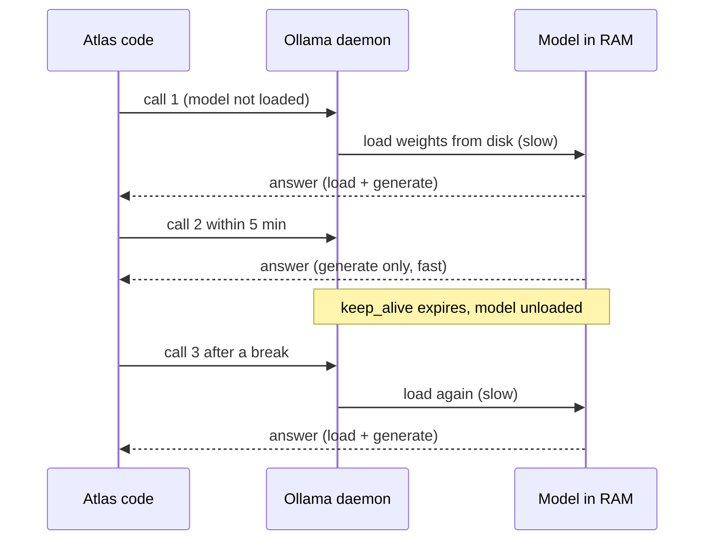
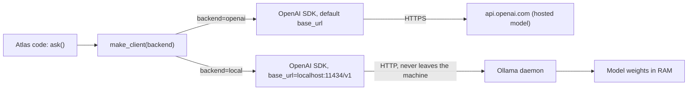
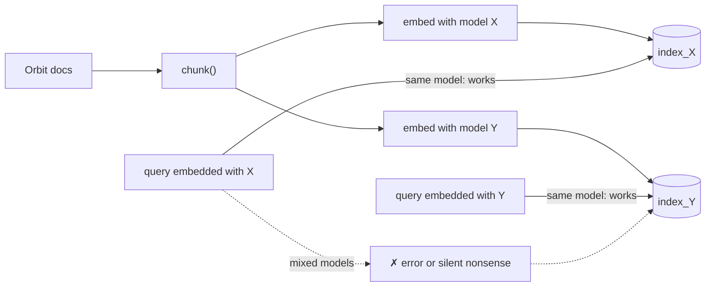

# Open-Weight Models & Local Inference

Orbit's security reviewer asks a fair question: "Can Atlas answer questions without sending our issue text to a third party?" Right now your R2 assistant calls OpenAI for both embeddings and answers. Today you run the same pipeline on your laptop, with no API key and no metered tokens, and you measure exactly what that costs you in quality and speed.

## At a Glance

- **Time:** ~2 h core (+ optional Go Deeper) · **Depth:** working
- **Prerequisites:** [Day 12: The OpenAI SDK in Production Code](../../Phase_2_Building_with_LLM_APIs/Day_012_openai_sdk_production/openai_sdk_production.md), [Day 28: Building the RAG Pipeline](../../Phase_3_RAG/Day_028_rag_pipeline/rag_pipeline.md), [Day 29: Evaluating Retrieval](../../Phase_3_RAG/Day_029_retrieval_evaluation/retrieval_evaluation.md), [Day 34: Capstone R2](../../Phase_3_RAG/Day_034_capstone_r2_ask/capstone_r2_ask.md); primer [A11b: Training Vocabulary](../../Appendix_Primers/A11b_training_vocabulary.md) if "parameters" and "weights" are fuzzy
- **You'll build:** `make_client(backend)`, a local embedding index, and a compact R2 `ask()` that runs on Ollama, plus a local-vs-cloud table (recall@5, citation hit rate, p50/p95 latency, $)
- **Stops at:** architecture differences between model families (mixture-of-experts vs dense, attention variants)
- **Fast path:** Already call OpenAI from Python? Read [The base_url Swap](#the-base_url-swap-same-sdk-different-server) and [Local Embeddings and Why You Must Re-index](#local-embeddings-and-why-you-must-re-index), then do Core 1 (≈45 min)
- **Cost:** $0 locally. The optional cloud row is ≈ $0.02 or less on `gpt-6-luna` (prices as of 2026-11, [verify](https://developers.openai.com/api/docs/pricing))
- **New terms:** open-weight model, model tag, OpenAI-compatible endpoint, local embedding model, re-indexing

> **Coming from Software Engineering?** Ollama works like Docker for models: you `pull` a tag, `run` it, and a daemon (a program that keeps running in the background) serves it on a port. Pointing the OpenAI SDK at Ollama with `base_url` is like pointing an S3 client at MinIO (a self-hosted store that speaks the S3 API): same SDK, same wire format, different server. What transfers is config-driven endpoints and local-dev parity. What doesn't transfer: "same interface" never means "same behaviour". A 4-billion-parameter model on your laptop is a different engine behind the same API, and only your evals can tell you how different.

## Why Run a Model Yourself?

Teams run models on their own hardware for four reasons: **privacy** (sensitive text never leaves the machine), **offline use** (a plane, an air-gapped network, a CI runner with no secrets), **cost shape** (you pay for hardware, not per token) and **control** (nobody retires your model for you; see [Day 7: Choosing a Model](../../Phase_1_How_LLMs_Work/Day_007_choosing_a_model/choosing_a_model.md)).

The naive attempt is to change one string: `MODEL = "llama3.2:3b"` on your existing `OpenAI()` client. That request still goes to `api.openai.com`, which has never heard of that name, so you get a 404. The model name and the server address travel together, and today you change both in one place.

## Open Weights in Plain Words

A hosted model is a service: you send text to someone else's server and they bill you per token. An **open-weight model** is a file: the trained numbers (the *weights*) are published, you download them once, and any compatible program on your machine can run them. Nobody meters your tokens, and nobody sees your prompts.

Size is quoted in **billions of parameters** (`4b`, `20b`): how many numbers the file holds. More parameters usually means better answers, more memory and slower output. "Open weights" isn't "open source" either: you often get no training data or code, and the **licence** on the model card decides what you may do. Read it before you ship.

| Family | Publisher | Ollama tags (download size) | Licence |
|---|---|---|---|
| gpt-oss | OpenAI | `gpt-oss:20b` (13.8 GB), `gpt-oss:120b` (65.4 GB) | Apache-2.0, ungated on Hugging Face |
| Qwen 3 / 3.5 | Alibaba | `qwen3:0.6b` … `qwen3:8b` (0.5–5.2 GB), `qwen3.5:0.8b/2b/4b` | Apache-2.0 |
| Gemma 3 / 4 | Google | `gemma3:270m/1b/4b` (0.29–3.4 GB), `gemma4:e2b` (4.6 GB) | Gemma 3: Gemma terms, gated; Gemma 4: Apache-2.0 |
| Llama 3.x | Meta | `llama3.2:1b/3b` (1.3/2.0 GB), `llama3.1:8b` (4.9 GB) | Llama 3.1 / 3.2 Community License, gated |
| Phi | Microsoft | `phi4-mini` (2.5 GB) | MIT |
| Mistral | Mistral AI | `mistral:7b` and other sizes | Apache-2.0 for Mistral 7B; other models vary |

*Download sizes from the Ollama registry; licences from each model's Hugging Face card ("gated" means you accept the terms before downloading there). Both as of 2026-11 and can differ per size: `ollama pull` prints the real size; check the card of the exact model you ship.*

A **model tag** is the `name:variant` string you pull, like a Docker image tag: `qwen3:4b-instruct-2507-q4_K_M` and `qwen3:8b` are different files with different memory needs and quality. A rough first mapping from cloud tiers is "cheapest tier → a 4–8B local model, mid tier → gpt-oss:20b". Treat it as a hypothesis to measure on your evals.

## Will It Fit? Picking a Tag

The model has to fit in memory with room left for everything else. On a Mac the GPU shares system RAM; with an NVIDIA card, VRAM counts. Three rows are enough to start:

| Your machine | Start with | Why |
|---|---|---|
| 8 GB RAM | `qwen3:4b-instruct-2507-q4_K_M` (2.5 GB) or `llama3.2:3b` (2.0 GB) | leaves room for the OS and an embedding model |
| 16 GB RAM | `qwen3:8b` (5.2 GB); `gpt-oss:20b` (13.8 GB) is tight | 8B models are comfortable; 20B needs ≥16 GB (rule of thumb ⚠ verify) |
| 32 GB+ RAM | `gpt-oss:20b` | room for the model, a long context and your other apps |

Worked example: a 16 GB laptop with 6 GB in use by the OS, browser and editor has about 10 GB free. `qwen3:8b` (5.2 GB, a bit more once loaded) fits; `gpt-oss:20b` (13.8 GB) doesn't, and the machine starts swapping to disk. The memory rule of thumb behind the table is [Day 92's](../../Phase_10_Open_Models_and_Fine_Tuning/Day_092_quantization_hardware/quantization_hardware.md) topic. This script reads your RAM and picks a row:

```python
# script_id: day_091_open_weight_local/fit_check
# Pick a starting Ollama tag for this machine's RAM.
# Install: none (stdlib only) · Env: none · Services: none
# Usage: python fit_check.py [RAM_GB]   (pass RAM_GB on Windows, where sysconf is missing)
import os
import sys

# (min RAM GB, tag, download GB). Ollama registry sizes as of 2026-11; verify with `ollama pull`
FIT_TABLE = [
    (32, "gpt-oss:20b", 13.8),
    (16, "qwen3:8b", 5.2),
    (8, "qwen3:4b-instruct-2507-q4_K_M", 2.5),
    (0, "qwen3:1.7b", 1.4),  # under 8 GB: the small fallback
]


def total_ram_gb() -> float:
    """Physical RAM via POSIX sysconf (macOS and Linux)."""
    return os.sysconf("SC_PAGE_SIZE") * os.sysconf("SC_PHYS_PAGES") / 1024**3


def pick_tag(ram_gb: float) -> tuple[str, float]:
    return next((tag, size) for min_gb, tag, size in FIT_TABLE if ram_gb >= min_gb)


ram = float(sys.argv[1]) if len(sys.argv) > 1 else total_ram_gb()
tag, size = pick_tag(ram)
print(f"RAM {ram:.0f} GB -> start with {tag} ({size} GB download)")
print(f"next: ollama pull {tag} && export ATLAS_LOCAL_MODEL={tag}")
```

```text
RAM 16 GB -> start with qwen3:8b (5.2 GB download)
next: ollama pull qwen3:8b && export ATLAS_LOCAL_MODEL=qwen3:8b
```

(Your RAM will differ.) The lesson defaults to `qwen3:4b-instruct-2507-q4_K_M` so it runs on the 8 GB row; this is the same base model we fine-tune on Day 95; set `ATLAS_LOCAL_MODEL` for a bigger tag.

## Talk to Ollama

**Ollama** is a free program that downloads model files, loads them into memory and serves them over HTTP on port 11434. Install it once:

```bash
# macOS / Linux (macOS can also use the Ollama.dmg app or `brew install ollama`)
curl -fsSL https://ollama.com/install.sh | sh
# Windows (PowerShell): irm https://ollama.com/install.ps1 | iex

ollama pull qwen3:4b-instruct-2507-q4_K_M          # download once (2.5 GB)
ollama pull nomic-embed-text  # the local embedding model used later (0.27 GB)
ollama run qwen3:4b-instruct-2507-q4_K_M "Say hi"  # one-off prompt from the terminal
ollama list                   # what's on disk
ollama ps                     # what's loaded in memory right now, and until when
```

The desktop app starts the daemon; on a headless Linux box, run `ollama serve`. It binds to `127.0.0.1:11434`, so only your machine can reach it. Now call it from Python with the native `ollama` library, asking about Orbit with no retrieval yet:

```python
# script_id: day_091_open_weight_local/first_local_call
# One Orbit question to a local model through the native ollama library. $0.
# Install: uv add "ollama>=0.6.3" · Env: ATLAS_LOCAL_MODEL (optional)
# Services: Ollama on localhost:11434, plus `ollama pull qwen3:4b-instruct-2507-q4_K_M`
import os

import ollama

LOCAL_MODEL = os.environ.get("ATLAS_LOCAL_MODEL", "qwen3:4b-instruct-2507-q4_K_M")

resp = ollama.chat(
    model=LOCAL_MODEL,
    messages=[{"role": "user", "content": "In the Orbit jobs library, what does error ORB-1101 mean?"}],
)
print(resp.message.content)
# Durations come back in nanoseconds; eval_* covers generated tokens (including any "thinking").
tok_s = resp.eval_count / (resp.eval_duration / 1e9)
print(f"\n{resp.eval_count} tokens at {tok_s:.1f} tokens/s · load {resp.load_duration / 1e9:.1f} s")
```

```text
ORB-1101 is a configuration error raised when Orbit can't find a valid broker URL ...

412 tokens at 38.2 tokens/s · load 6.8 s
```

(Your numbers and wording will differ.) The answer is fluent, confident and wrong: in Orbit's docs, ORB-1101 is `LeaseExpired`, the error behind duplicate job runs. Small models make things up readily, which is why everything below runs *with* retrieval. Thinking models such as `qwen3` may return their reasoning separately in `resp.message.thinking`.

### Break it: the cold load

Run the script twice. The first call includes `load_duration`, the time to read gigabytes from disk into memory; the second is much faster. Ollama keeps a model loaded for 5 minutes after the last request (the `keep_alive` default), so a call after a coffee break is cold again.



```python
# script_id: day_091_open_weight_local/warm_vs_cold
# Time a cold call, a warm call, then unload and time a cold call again. $0.
# Install: uv add "ollama>=0.6.3" · Env: ATLAS_LOCAL_MODEL
# Services: Ollama on localhost:11434 with the tag pulled
import os
import time

import ollama

LOCAL_MODEL = os.environ.get("ATLAS_LOCAL_MODEL", "qwen3:4b-instruct-2507-q4_K_M")
MSG = [{"role": "user", "content": "Reply with the single word: ready"}]


def timed(label: str) -> None:
    start = time.perf_counter()
    r = ollama.chat(model=LOCAL_MODEL, messages=MSG)
    print(f"{label:<10} {time.perf_counter() - start:5.1f} s total, {r.load_duration / 1e9:4.1f} s loading")


def unload() -> None:
    # An empty messages list with keep_alive=0 unloads the model (Ollama API docs)
    ollama.chat(model=LOCAL_MODEL, messages=[], keep_alive=0)


unload()
timed("cold")
timed("warm")
unload()
timed("cold again")
```

```text
cold         9.4 s total,  6.9 s loading
warm         1.6 s total,  0.0 s loading
cold again   8.8 s total,  6.5 s loading
```

(Your numbers will differ.) Send one warm-up request before timing, or your p95 measures your disk. Pass `keep_alive="30m"` (or `-1`, never unload) to keep a model resident.

## The base_url Swap: Same SDK, Different Server

Atlas is written against the OpenAI SDK, not the `ollama` library. Ollama also serves an **OpenAI-compatible endpoint**: URLs under `/v1` that accept the same requests and return the same JSON shapes as OpenAI's API, including Responses (`/v1/responses`, added in Ollama v0.13.3). You keep your code and change two settings: the server address (`base_url`) and the model name. [Day 12](../../Phase_2_Building_with_LLM_APIs/Day_012_openai_sdk_production/openai_sdk_production.md) pointed here; this is where the course teaches it.



`make_client()` hides the choice behind one function, so the rest of Atlas never branches on the backend:

```python
# script_id: day_091_open_weight_local/base_url_swap
# The same Responses call against local Ollama and OpenAI. Only config changes.
# Install: uv add "openai>=3.46,<4"
# Env: ATLAS_LOCAL_BASE_URL, ATLAS_LOCAL_MODEL; OPENAI_API_KEY + ATLAS_MODEL for the openai backend
# Services: Ollama on localhost:11434 for the local backend
# Usage: python base_url_swap.py [local] [openai]   (no args = both)
import os
import sys
import time
from typing import Literal

from openai import APIConnectionError, NotFoundError, OpenAI

MODEL = os.environ.get("ATLAS_MODEL", "gpt-6-luna")
LOCAL_BASE_URL = os.environ.get("ATLAS_LOCAL_BASE_URL", "http://localhost:11434/v1/")
LOCAL_MODEL = os.environ.get("ATLAS_LOCAL_MODEL", "qwen3:4b-instruct-2507-q4_K_M")
Backend = Literal["openai", "local"]


def make_client(backend: Backend = "openai") -> tuple[OpenAI, str]:
    """Return (client, model id). Callers pass both along and never branch on the backend."""
    if backend == "local":
        # The SDK refuses to start without a key; Ollama ignores it. No retries: a stopped
        # daemon won't come back in 2 seconds, so fail fast with a clear message instead.
        return OpenAI(base_url=LOCAL_BASE_URL, api_key="ollama", max_retries=0), LOCAL_MODEL
    return OpenAI(), MODEL  # reads OPENAI_API_KEY


QUESTION = "In one sentence: what is a job lease in a background-jobs library?"
for backend in sys.argv[1:] or ["local", "openai"]:
    client, model = make_client(backend)
    start = time.perf_counter()
    try:
        resp = client.responses.create(model=model, input=QUESTION, max_output_tokens=300,
                                       reasoning={"effort": "none"})  # Ollama: thinking off
    except APIConnectionError:
        print(f"{backend:>6}: server unreachable. Start the Ollama app or run `ollama serve`.")
        continue
    except NotFoundError:
        print(f"{backend:>6}: model {model!r} not found. Local? Run `ollama pull {model}`.")
        continue
    print(f"{backend:>6} {time.perf_counter() - start:5.1f} s  {resp.output_text.strip()[:110]}")
```

```text
 local   7.9 s  A job lease is a time-limited claim a worker holds on a job; if it isn't renewed or acknowledged ...
openai   1.2 s  A job lease is a time-limited lock a worker takes on a job so no other worker runs it, which ...
```

(Your numbers will differ; the local time includes a cold load.) `gpt-6-luna` accepts `effort: "none"`, and Ollama maps it to "thinking off". A tag that can't think (`llama3.2`) supports only "off", which `"none"` requests ([Ollama thinking docs](https://raw.githubusercontent.com/ollama/ollama/main/docs/capabilities/thinking.mdx); ⚠ verify on your tag). No API key? Run `python base_url_swap.py local`. The interface is the same; the feature set is not:

| Feature you may rely on | OpenAI | Ollama `/v1` | What to do locally |
|---|---|---|---|
| `previous_response_id`, `conversation`, `store` | yes ([Day 8](../../Phase_2_Building_with_LLM_APIs/Day_008_messages_and_state/messages_and_state.md)) | no: stateless only | keep history client-side and re-send it |
| Structured outputs (`text.format`, `responses.parse`) | yes | not in the supported-fields list | ask for JSON and validate it with Pydantic (below), or use native `format=` (Go Deeper) |
| Hosted tools (`file_search`, web search) | yes | no | run your own retrieval (that's today's R2) |
| Function tools | yes | yes | test them: small models call tools less reliably |
| Reasoning effort names | `none`…`max` | model-defined, with aliases | check `ollama show <tag>` |
| Provider prompt-caching prices ([Day 18](../../Phase_2_Building_with_LLM_APIs/Day_018_cost_latency_caching/cost_latency_caching.md)) | yes | n/a: no per-token bill | the cost model is hardware, not tokens |

## Local Embeddings and Why You Must Re-index

Answers can now come from your laptop, but retrieval still embeds every query in the cloud, so the question text still leaves the machine. A **local embedding model** such as `nomic-embed-text` (0.27 GB) or `embeddinggemma` (0.62 GB) makes vectors on your hardware instead ([Day 23](../../Phase_3_RAG/Day_023_embeddings/embeddings.md) covers embeddings).

The catch: each embedding model is its own map projection, placing texts at coordinates that only mean something on *that* map. `text-embedding-3-small` gives 1,536 numbers per text; `nomic-embed-text` gives 768. You can't compare points across maps:

- **Different dimensions** fail loudly: the arithmetic doesn't line up.
- **Same dimensions from different models** fail silently: the numbers line up, the scores look normal, and the ranking is garbage.

So the rule is: **one index per embedding model**. Switching embedders means **re-indexing**, re-embedding every document with the new model into a new index, and embedding every query with that same model.



Here are both failures with toy vectors, so you can see them without installing anything:

```python
# script_id: day_091_open_weight_local/dimension_mismatch
# Why vectors from different embedding models can't share an index. Toy vectors, no services.
# Install: uv add numpy · Env: none · Services: none
import numpy as np

rng = np.random.default_rng(0)
docs_cloud = rng.normal(size=(3, 1536))  # stand-in: 3 chunks embedded by a 1,536-d cloud model
query_local = rng.normal(size=768)       # stand-in: a query embedded by a 768-d local model
try:
    docs_cloud @ query_local
except ValueError as e:
    print("mixed dimensions ->", e)


def cosine(m: np.ndarray, v: np.ndarray) -> np.ndarray:  # built on Day 23
    return (m @ v) / (np.linalg.norm(m, axis=1) * np.linalg.norm(v))


# Same size is no rescue. Simulate "model B" as a random rotation of model A's space:
# B keeps the same geometry internally, but its coordinates mean something else.
docs_a = rng.normal(size=(3, 768))
rotation, _ = np.linalg.qr(rng.normal(size=(768, 768)))
docs_b = docs_a @ rotation                          # the same 3 texts as model B embeds them
query_a = docs_a[1] + 0.5 * rng.normal(size=768)    # a query about chunk 1, embedded by A
print("query A vs index A:", np.round(cosine(docs_a, query_a), 2), "<- chunk 1 wins")
print("query A vs index B:", np.round(cosine(docs_b, query_a), 2), "<- no clear winner")
```

```text
mixed dimensions -> matmul: Input operand 1 has a mismatch in its core dimension 0, with gufunc signature (n?,k),(k,m?)->(n?,m?) (size 768 is different from 1536)
query A vs index A: [0.   0.89 0.01] <- chunk 1 wins
query A vs index B: [ 0.02 -0.03 -0.05] <- no clear winner
```

pgvector's version of the first error is `expected 1536 dimensions, not 768`. The second case raises nothing, which makes it the dangerous one. Now embed three real Orbit chunks locally, in one batched `ollama.embed()` call:

```python
# script_id: day_091_open_weight_local/local_embeddings
# Batch-embed 3 Orbit chunks locally with the native ollama library, then rank them for a query.
# Install: uv add "ollama>=0.6.3" numpy · Env: ORBIT_DATA, ATLAS_LOCAL_EMBED_MODEL
# Services: Ollama on localhost:11434, plus `ollama pull nomic-embed-text`
import os
import re
from pathlib import Path

import numpy as np
import ollama

DATA_DIR = Path(os.environ.get("ORBIT_DATA", "datasets/orbit"))
LOCAL_EMBED_MODEL = os.environ.get("ATLAS_LOCAL_EMBED_MODEL", "nomic-embed-text")


def embed_local(texts: list[str]) -> np.ndarray:
    """One batched call (input=list); unit-length rows, so a dot product is the cosine."""
    m = np.asarray(ollama.embed(model=LOCAL_EMBED_MODEL, input=texts).embeddings, dtype=np.float32)
    return m / np.linalg.norm(m, axis=1, keepdims=True)


body = (DATA_DIR / "docs" / "leases-and-heartbeats.md").read_text(encoding="utf-8").split("---\n", 2)[2]
chunks = [p.strip() for p in re.split(r"(?m)^(?=## )", body) if p.strip()][:3]  # Day 25, compact
# nomic-embed-text's model card asks for task prefixes; drop them for other embedding models.
docs = embed_local([f"search_document: {c}" for c in chunks])
query = embed_local(["search_query: why did my job run twice?"])[0]
print(f"dim={docs.shape[1]}  (a 1,536-d cloud index can't hold these)")
for score, c in sorted(zip(docs @ query, chunks), reverse=True):
    print(f"{score:.3f}  {c.splitlines()[0][:60]}")
```

```text
dim=768  (a 1,536-d cloud index can't hold these)
0.712  ## What a lease is
0.655  ## Heartbeats
0.583  # Leases and heartbeats
```

(Your scores will differ.) The prefixes are required by [Nomic's model card](https://huggingface.co/nomic-ai/nomic-embed-text-v1.5); other embedders have their own rules. Switch embedders later and nothing warns you, so put the model name into the index name, as the next section does. Zero-downtime embedding migrations are [Day 88's](../../Phase_9_Production/Day_088_operating_ai_systems/operating_ai_systems.md) topic.

## R2 on Your Laptop

Now a **compact R2**: vector-only retrieval plus a cited answer, running unchanged on either backend. It's smaller than the [Day 34](../../Phase_3_RAG/Day_034_capstone_r2_ask/capstone_r2_ask.md) capstone (no hybrid search, reranking or ACLs), so the comparison is like for like: same chunks, prompt and scoring; only the backend changes. Helpers are compact copies marked `# built on Day N`.

The first block holds config, `make_client()` from above, and Day 28's answer schema:

```python
# script_id: day_091_open_weight_local/local_rag
# Compact R2 (vector-only) that runs on either backend, then scores it. Local run: $0.
# Install: uv add "openai>=3.46,<4" numpy pydantic
# Env: ORBIT_DATA; ATLAS_LOCAL_* for local; OPENAI_API_KEY, ATLAS_MODEL, ATLAS_EMBED_MODEL for openai
# Services: Ollama on localhost:11434 with ATLAS_LOCAL_MODEL and ATLAS_LOCAL_EMBED_MODEL pulled
# Usage: python local_rag.py --backend local [--limit 10]
import argparse
import hashlib
import json
import math
import os
import re
import statistics
import time
from pathlib import Path
from typing import Literal

import numpy as np
from openai import OpenAI
from pydantic import BaseModel, ValidationError

DATA_DIR = Path(os.environ.get("ORBIT_DATA", "datasets/orbit"))
MODEL = os.environ.get("ATLAS_MODEL", "gpt-6-luna")
EMBED_MODEL = os.environ.get("ATLAS_EMBED_MODEL", "text-embedding-3-small")
LOCAL_BASE_URL = os.environ.get("ATLAS_LOCAL_BASE_URL", "http://localhost:11434/v1/")
LOCAL_MODEL = os.environ.get("ATLAS_LOCAL_MODEL", "qwen3:4b-instruct-2507-q4_K_M")
LOCAL_EMBED_MODEL = os.environ.get("ATLAS_LOCAL_EMBED_MODEL", "nomic-embed-text")
Backend = Literal["openai", "local"]
EMBEDDERS: dict[str, str] = {"openai": EMBED_MODEL, "local": LOCAL_EMBED_MODEL}


def make_client(backend: Backend = "openai") -> tuple[OpenAI, str]:  # from base_url_swap above
    if backend == "local":
        return OpenAI(base_url=LOCAL_BASE_URL, api_key="ollama", max_retries=0), LOCAL_MODEL
    return OpenAI(), MODEL


class Citation(BaseModel):  # built on Day 28
    doc_id: str
    quote: str


class Answer(BaseModel):  # built on Day 28
    text: str
    citations: list[Citation]
```

Block two chunks the docs and builds the index. Ollama serves `/v1/embeddings`, so one `embed()` covers both backends. The cache file name holds the embedding model and a hash of the chunks, turning the re-index rule into a naming rule: a different embedder can never load the wrong vectors.

```python
# script_id: day_091_open_weight_local/local_rag
PREFIXES = {"nomic-embed-text": ("search_query: ", "search_document: ")}  # from its model card


def load_chunks(folder: Path) -> list[tuple[str, str]]:
    """Built on Day 25, compact: one (doc_id, text) chunk per H2 section of each page."""
    chunks: list[tuple[str, str]] = []
    for path in sorted(folder.glob("*.md")):
        _, head, body = path.read_text(encoding="utf-8").split("---\n", 2)
        doc_id = re.search(r"(?m)^id:\s*(\S+)", head).group(1)
        chunks += [(doc_id, p.strip()) for p in re.split(r"(?m)^(?=## )", body) if p.strip()]
    return chunks


def embed(client: OpenAI, model: str, texts: list[str], *, kind: Literal["query", "doc"]) -> np.ndarray:
    q_prefix, d_prefix = PREFIXES.get(model.split(":")[0], ("", ""))
    texts = [(q_prefix if kind == "query" else d_prefix) + t for t in texts]
    rows: list[list[float]] = []
    for i in range(0, len(texts), 64):  # batches of 64 texts per request
        rows += [d.embedding for d in client.embeddings.create(model=model, input=texts[i:i + 64]).data]
    m = np.asarray(rows, dtype=np.float32)
    return m / np.linalg.norm(m, axis=1, keepdims=True)  # unit length: dot product = cosine


class Index:
    """Built on Day 26, as an in-memory stand-in: one index per embedding model, cached to .npz."""

    def __init__(self, client: OpenAI, embed_model: str, chunks: list[tuple[str, str]]) -> None:
        self.client, self.embed_model, self.chunks = client, embed_model, chunks
        digest = hashlib.sha256("\n".join(t for _, t in chunks).encode()).hexdigest()[:12]
        safe_name = re.sub(r"[^\w.-]", "_", embed_model)
        cache = Path("indexes") / f"{safe_name}-{digest}.npz"
        if cache.exists():
            self.matrix = np.load(cache)["m"]
        else:
            self.matrix = embed(client, embed_model, [t for _, t in chunks], kind="doc")
            cache.parent.mkdir(exist_ok=True)
            np.savez(cache, m=self.matrix)

    def search(self, query: str, k: int = 5) -> list[tuple[str, str, float]]:
        q = embed(self.client, self.embed_model, [query], kind="query")[0]
        sims = self.matrix @ q  # raises ValueError if someone mixed embedders
        return [(*self.chunks[i], float(sims[i])) for i in np.argsort(-sims)[:k]]
```

Block three is Day 28's `ask()` with the client injected. Ollama's Responses endpoint doesn't list `text.format`, so instead of `responses.parse` the prompt asks for JSON and Pydantic validates it; invalid JSON becomes an abstention, never a crash. Citations to unretrieved documents are dropped: an invented source is worse than none.

```python
# script_id: day_091_open_weight_local/local_rag
INSTRUCTIONS = """Answer questions about Orbit using ONLY the sources below.
Reply with JSON only: {"text": "...", "citations": [{"doc_id": "...", "quote": "..."}]}
Each quote is at most 25 words copied exactly from that source. If the sources don't
answer the question, reply {"text": "I don't know.", "citations": []}"""
PRICES = {"gpt-6-luna": (0.10, 0.50)}  # USD per 1M in/out, as of 2026-11; verify at the pricing page
SPEND = {"usd": 0.0}  # local models aren't in PRICES, so they cost $0 here


def parse_answer(raw: str) -> Answer:
    match = re.search(r"\{.*\}", raw, re.S)  # small models often wrap JSON in ``` fences
    try:
        return Answer.model_validate_json(match.group(0) if match else "")  # "" fails validation
    except ValidationError:
        return Answer(text="I don't know.", citations=[])


def ask(question: str, *, client: OpenAI, model: str, index: Index, k: int = 5) -> Answer:
    """Built on Day 28: retrieve, answer with citations, keep only citations we retrieved."""
    hits = index.search(question, k)
    context = "\n\n".join(f"[{doc_id}]\n{text}" for doc_id, text, _ in hits)
    resp = client.responses.create(model=model, instructions=INSTRUCTIONS,
                                   input=f"{context}\n\nQuestion: {question}",
                                   reasoning={"effort": "none"}, max_output_tokens=800)
    if resp.usage and model in PRICES:
        p_in, p_out = PRICES[model]
        SPEND["usd"] += (resp.usage.input_tokens * p_in + resp.usage.output_tokens * p_out) / 1e6
    answer = parse_answer(resp.output_text)
    retrieved = {doc_id for doc_id, _, _ in hits}
    answer.citations = [c for c in answer.citations if c.doc_id in retrieved]
    return answer
```

Block four scores one backend: recall@5 on the 40 retrieval queries ([Day 29](../../Phase_3_RAG/Day_029_retrieval_evaluation/retrieval_evaluation.md)), then citation hit rate (did at least one citation name a gold source?) and latency on the 30 gold Q&A pairs, with p50/p95 as in [Day 42](../../Phase_5_Evaluation_and_Observability/Day_042_tracing_observability/tracing_observability.md). Note the warm-up call before the timer starts.

```python
# script_id: day_091_open_weight_local/local_rag
def read_jsonl(name: str, limit: int) -> list[dict]:
    lines = (DATA_DIR / "eval" / name).read_text(encoding="utf-8").splitlines()
    return [json.loads(line) for line in lines if line.strip()][:limit]


def pct(xs: list[float], p: float) -> float:
    """Nearest-rank percentile (built on Day 42)."""
    s = sorted(xs)
    return s[max(0, math.ceil(p / 100 * len(s)) - 1)]


def evaluate(backend: Backend, limit: int) -> dict:
    client, model = make_client(backend)
    index = Index(client, EMBEDDERS[backend], load_chunks(DATA_DIR / "docs"))
    recalls = []
    for q in read_jsonl("retrieval_queries.jsonl", limit):
        ranked = list(dict.fromkeys(d for d, _, _ in index.search(q["query"], k=20)))  # pages, once
        relevant = set(q["relevant_doc_ids"])
        recalls.append(len(set(ranked[:5]) & relevant) / len(relevant))  # Day 29's recall@5
    ask("warm-up", client=client, model=model, index=index)  # keep the cold load out of p95
    hits, secs = [], []
    for item in read_jsonl("qa_gold.jsonl", limit):
        start = time.perf_counter()
        answer = ask(item["question"], client=client, model=model, index=index)
        secs.append(time.perf_counter() - start)
        hits.append(any(c.doc_id in item["citations"] for c in answer.citations))
    return {"backend": backend, "model": model, "embed": EMBEDDERS[backend],
            "recall@5": statistics.mean(recalls), "citation_hit": statistics.mean(hits),
            "p50_s": pct(secs, 50), "p95_s": pct(secs, 95), "usd": SPEND["usd"], "n": len(secs)}
```

The last block appends each run to a JSONL file and prints every run so far as one table, so running both backends builds the comparison:

```python
# script_id: day_091_open_weight_local/local_rag
if __name__ == "__main__":
    ap = argparse.ArgumentParser()
    ap.add_argument("--backend", choices=["local", "openai"], default="local")
    ap.add_argument("--limit", type=int, default=40, help="cases per eval file (10 = quick run)")
    args = ap.parse_args()
    row = evaluate(args.backend, args.limit)
    out = Path("reports/local_vs_cloud.jsonl")
    out.parent.mkdir(exist_ok=True)
    with out.open("a", encoding="utf-8") as f:
        f.write(json.dumps(row) + "\n")
    print("| backend | model | embed | recall@5 | citation hit | p50 s | p95 s | $ |")
    print("|---|---|---|---|---|---|---|---|")
    for r in map(json.loads, out.read_text(encoding="utf-8").splitlines()):
        print(f"| {r['backend']} | {r['model']} | {r['embed']} | {r['recall@5']:.2f} "
              f"| {r['citation_hit']:.2f} | {r['p50_s']:.1f} | {r['p95_s']:.1f} | {r['usd']:.3f} |")
```

```text
| backend | model | embed | recall@5 | citation hit | p50 s | p95 s | $ |
|---|---|---|---|---|---|---|---|
| local | qwen3:4b-instruct-2507-q4_K_M | nomic-embed-text | 0.71 | 0.63 | 6.8 | 14.9 | 0.000 |
| openai | gpt-6-luna | text-embedding-3-small | 0.79 | 0.87 | 1.9 | 3.6 | 0.006 |
```

(Illustrative; your numbers will differ. `$` ignores the sub-cent cloud embedding calls.) Read one column at a time. **Recall@5** compares the embedders: if it drops, a bigger generator won't fix it. **Citation hit** compares the whole pipeline: a small model may get the right sources and still fail to produce valid, cited JSON. **p50/p95** measure your hardware, not "local models" in general. **$** shows only what a provider bills; your hardware and electricity are paid differently.

## Local vs Cloud: Reading the Comparison

The table answers "how much worse?"; your requirements answer "is that acceptable?":

| Concern | Local (Ollama on your hardware) | Cloud API |
|---|---|---|
| Privacy / data residency | text never leaves the machine | provider sees it (retention options: [Day 73](../../Phase_8_Safety_and_Security/Day_073_privacy_pii/privacy_pii.md)) |
| Answer quality | smaller models, measurably weaker on hard questions | strongest models available |
| Latency | depends on your hardware; cold loads | fast, steady, network-bound |
| Many users at once | one laptop serves one user well; serving many is [Day 93](../../Phase_10_Open_Models_and_Fine_Tuning/Day_093_vllm_serving/vllm_serving.md) | scales on demand |
| Cost | $0 per token; you own the hardware and ops | pay per token, no hardware |
| Ops burden | you pin, update and monitor models | provider does it |

Local is the **wrong** choice when (1) the task needs frontier-level reasoning and your eval shows a gap you can't accept, (2) you must serve many concurrent users without GPU servers, or (3) nobody can own model updates, hardware and monitoring. It's a strong choice for dev and CI (no keys, no bills), offline work, and regulated data that may not leave your network.

### In production

- Put the backend behind config (`make_client()`), never behind `if` statements scattered through the code.
- Pin tags, and record which tag produced each eval run; `qwen3:4b-instruct-2507-q4_K_M` today may not be the same file next year.
- Keep one index per embedding model, with the model name in the index or table name.
- Warm models up at startup and set `keep_alive` so the first user request isn't a cold load.
- Keep a cloud fallback for requests the local model can't handle ([Day 84](../../Phase_9_Production/Day_084_reliability_fallbacks/reliability_fallbacks.md) owns fallbacks), and re-run this comparison whenever either side changes.

## Go Deeper (optional)

<details><summary>Go deeper: what a pull actually downloads (GGUF + Modelfile)</summary>

An Ollama tag is two things: a **GGUF** file (a single-file format for model weights, usually compressed by quantization, which [Day 92](../../Phase_10_Open_Models_and_Fine_Tuning/Day_092_quantization_hardware/quantization_hardware.md) explains) and a **Modelfile**, a small recipe that says which weights to load, which chat template turns your messages into the exact text the model was trained on, and which default parameters apply. `ollama show --modelfile qwen3:4b-instruct-2507-q4_K_M` prints it from the terminal; the library exposes the same data:

```python
# script_id: day_091_open_weight_local/inspect_tag
# Look inside a pulled tag, and at what's loaded right now. $0.
# Install: uv add "ollama>=0.6.3" · Env: ATLAS_LOCAL_MODEL · Services: Ollama, tag pulled
import os

import ollama

LOCAL_MODEL = os.environ.get("ATLAS_LOCAL_MODEL", "qwen3:4b-instruct-2507-q4_K_M")

info = ollama.show(LOCAL_MODEL)
print("details:", info.details)              # family, parameter size, quantization level
print("capabilities:", info.capabilities)    # e.g. completion, tools, thinking
print("parameters:\n", info.parameters)      # defaults baked in by the Modelfile
print("template (first 300 chars):\n", (info.template or "")[:300])

for m in ollama.ps().models:                 # loaded models: RAM/VRAM use and unload time
    print(f"{m.model}: {m.size / 1e9:.1f} GB total, {m.size_vram / 1e9:.1f} GB on GPU, until {m.expires_at}")
```

Why cold loads are slow: the GGUF file (gigabytes) has to be read from disk and copied into RAM or VRAM before the first token. `size_vram` smaller than `size` means part of the model didn't fit on the GPU and runs on the CPU, which is much slower; that's the "laptop got sluggish" symptom. On [Day 95](../../Phase_10_Open_Models_and_Fine_Tuning/Day_095_lora_finetuning/lora_finetuning.md) you write your own Modelfile to serve a fine-tuned model.

</details>

<details><summary>Go deeper: native structured outputs with the ollama library</summary>

The compact R2 asks for JSON in the prompt because the OpenAI-compatible Responses endpoint doesn't list `text.format`. The native `ollama.chat()` does accept a JSON schema in its `format` parameter, which constrains the model's output to that schema. You lose the "same SDK for both backends" property, so use this when a code path is local-only:

```python
# script_id: day_091_open_weight_local/native_structured
# Schema-constrained output from a local model via ollama.chat(format=...). $0.
# Install: uv add "ollama>=0.6.3" pydantic · Env: ATLAS_LOCAL_MODEL · Services: Ollama, tag pulled
import os

import ollama
from pydantic import BaseModel

LOCAL_MODEL = os.environ.get("ATLAS_LOCAL_MODEL", "qwen3:4b-instruct-2507-q4_K_M")


class ErrorInfo(BaseModel):
    code: str
    name: str
    likely_cause: str


SOURCE = "ORB-1101 LeaseExpired: a job outlived its lease, so a second worker may run it."
resp = ollama.chat(
    model=LOCAL_MODEL,
    messages=[{"role": "user", "content": f"Extract the error from this text:\n{SOURCE}"}],
    format=ErrorInfo.model_json_schema(),  # the server constrains output to this schema
)
print(ErrorInfo.model_validate_json(resp.message.content))  # still validate: trust, but verify
```

```text
code='ORB-1101' name='LeaseExpired' likely_cause='The job ran longer than its lease, so a second worker may run it.'
```

(Your wording will differ.) Constrained output guarantees *shape*, not *truth*: the fields will parse, and a small model can still fill them with wrong values. Your evals remain the judge.

</details>

<details><summary>Go deeper: other local servers and running Ollama on another machine</summary>

Ollama isn't the only OpenAI-compatible local server. **llama.cpp's `llama-server`** runs a GGUF file directly and serves `/v1/chat/completions`, `/v1/responses`, `/v1/embeddings` and `/health`. Its default port is now 9931 (not the 8080 older tutorials show), so pass `--port` explicitly:

```bash
brew install llama.cpp                         # or: winget install llama.cpp
llama-server -m my-model-Q4_K_M.gguf --port 8080
export ATLAS_LOCAL_BASE_URL=http://localhost:8080/v1/
```

`make_client("local")` now talks to llama-server instead of Ollama with no code change; that's the payoff of config-driven endpoints. For many concurrent users on a GPU server, **vLLM** is the usual choice; that's [Day 93](../../Phase_10_Open_Models_and_Fine_Tuning/Day_093_vllm_serving/vllm_serving.md).

To share one Ollama box with your team, set `OLLAMA_HOST=0.0.0.0:11434` on the server so it listens beyond localhost. Ollama ignores the API key you pass (the `base_url` section above), so anyone who can reach that port can use your GPU and read what it's sent. Put it behind a VPN or an authenticating reverse proxy; never expose it to the internet.

</details>

## Common Pitfalls

- **`openai.APIConnectionError: Connection error.`** (or, from the native library, `ConnectionError: Failed to connect to Ollama. Please check that Ollama is downloaded, running and accessible.`). The daemon isn't running. Start the Ollama app or run `ollama serve`, then check with `ollama list`.
- **HTTP 404 saying the model wasn't found.** You never pulled that tag, or you mistyped it (`qwen3:4B` vs `qwen3:4b-instruct-2507-q4_K_M`). Run `ollama pull <tag>` and copy the name from `ollama list`.
- **`ValueError: matmul: ... (size 768 is different from 1536)`, or pgvector `expected 1536 dimensions, not 768`.** You mixed embedding models. Keep one index per embedding model and embed queries with the same model as the documents. The silent version (same dimensions, different models) raises nothing; only a drop in recall@5 reveals it.
- **The first call takes 10–30 s, or p95 looks terrible.** That's a cold load. Send a warm-up request before timing and set `keep_alive`. If the whole laptop freezes or swaps, the tag is too big for your RAM: move down a row in the fit table and check `ollama ps`.
- **`previous_response_id`, `store` or hosted tools ignored or rejected.** Ollama's Responses endpoint is stateless. Keep conversation history client-side and re-send it each turn ([Day 8](../../Phase_2_Building_with_LLM_APIs/Day_008_messages_and_state/messages_and_state.md)).

> **Where we stop:** we don't compare model architectures (mixture-of-experts vs dense, attention variants), because picking a model is an eval question, not an architecture one; the curious can read the gpt-oss model card, and [Day 92](../../Phase_10_Open_Models_and_Fine_Tuning/Day_092_quantization_hardware/quantization_hardware.md) covers how model size maps to memory.

## Key Takeaways

- An open-weight model is a file you download and run yourself; its licence, not the word "open", decides what you may do with it, and the tag (`name:variant`) decides size, speed and quality.
- Ollama serves models on `localhost:11434`, and its OpenAI-compatible `/v1` endpoint lets the same SDK code run locally by changing only `base_url` and the model name, which `make_client()` keeps in one place.
- Same interface isn't same behaviour: stateful Responses, structured-output enforcement and hosted tools don't carry over, and cold loads make the first call slow.
- Vectors from different embedding models (different dimensions, or the same dimensions from different models) can't share an index; switching embedders means re-indexing everything.
- Run both backends through the same compact pipeline and compare recall@5, citation hit rate, p50/p95 and $; local wins on privacy and per-token cost, and is the wrong choice for frontier-level tasks, many concurrent users without GPUs, or teams that can't own the ops.

## Quick Reference

| API / pattern | When to use | Gotcha |
|---|---|---|
| `ollama pull <tag>` / `ollama ps` | download a model / see what's loaded | tags are exact strings; `ps` shows RAM vs GPU split |
| `ollama.chat(model=, messages=)` | local-only scripts, timing via `eval_count`/`eval_duration` | durations are nanoseconds |
| `OpenAI(base_url="http://localhost:11434/v1/", api_key="ollama")` | run existing SDK code locally | key is required but ignored; set `max_retries=0` to fail fast |
| `client.responses.create(...)` on Ollama | same calls on both backends | stateless only; no `text.format` in the supported list |
| `ollama.embed(model=, input=[...]).embeddings` | batch local embeddings | `nomic-embed-text` wants `search_query:` / `search_document:` prefixes |
| One index per embedding model | any change of embedder | same-dimension mixes fail silently |
| Warm-up call + `keep_alive` | benchmarks and first user requests | default keep-alive is 5 minutes |

## Exercises

1. **Warm-up.** Pull a second tag (for example `llama3.2:3b`) and compare tokens per second against `qwen3:4b-instruct-2507-q4_K_M` on the same prompt, excluding the cold load.

<details><summary>Solution</summary>

```python
# script_id: day_091_open_weight_local/solution_ex1
# Compare generation speed across tags on one prompt. $0.
# Install: uv add "ollama>=0.6.3" · Services: Ollama with every tag pulled
# Usage: python solution_ex1.py qwen3:4b-instruct-2507-q4_K_M llama3.2:3b
import sys

import ollama

TAGS = sys.argv[1:] or ["qwen3:4b-instruct-2507-q4_K_M", "llama3.2:3b"]
PROMPT = [{"role": "user", "content": "Explain a job lease in two sentences."}]

for tag in TAGS:
    ollama.chat(model=tag, messages=PROMPT)  # warm-up, so the cold load isn't measured
    r = ollama.chat(model=tag, messages=PROMPT)
    print(f"{tag:<14} {r.eval_count / (r.eval_duration / 1e9):6.1f} tokens/s  ({r.eval_count} tokens)")
```

The smaller tag is usually faster. Tags are variants of a model, and size trades against speed (and quality, which Exercise 2 measures).

</details>

2. **Core.** Run `local_rag` with an 8 GB-row tag and a 16 GB-row tag (and, optionally, the cloud backend), and fill in the comparison table. Which column changes between the two local runs, and which one can't change? Why?

<details><summary>Solution</summary>

```bash
export ATLAS_LOCAL_MODEL=qwen3:4b-instruct-2507-q4_K_M
python local_rag.py --backend local
ollama pull qwen3:8b && export ATLAS_LOCAL_MODEL=qwen3:8b
python local_rag.py --backend local
python local_rag.py --backend openai   # optional cloud row; needs OPENAI_API_KEY
```

Recall@5 is identical across the two local rows: both use `nomic-embed-text`, and the second run loads the same cached index. Only citation hit rate and latency move, because only the generator changed. That separation tells you where to spend: if recall@5 is the weak number, a bigger chat model won't help; a better embedder (and a re-index) might.

</details>

3. **Core.** Embed documents with the local model and a query with the cloud model, observe the failure, then fix it by re-indexing so documents and queries share one model.

<details><summary>Solution</summary>

```python
# script_id: day_091_open_weight_local/solution_ex3
# Mixed embedders fail; re-indexing with one model fixes it. ≈ $0.000001 (as of 2026-11, verify).
# Install: uv add "openai>=3.46,<4" numpy · Env: OPENAI_API_KEY
# Services: Ollama with nomic-embed-text pulled
import numpy as np
from openai import OpenAI

cloud = OpenAI()
local = OpenAI(base_url="http://localhost:11434/v1/", api_key="ollama")
DOCS = ["Leases let Orbit recover jobs from workers that crash.", "Cron schedules run jobs at set times."]
QUERY = "why did my job run twice?"


def vecs(client: OpenAI, model: str, texts: list[str]) -> np.ndarray:
    m = np.asarray([d.embedding for d in client.embeddings.create(model=model, input=texts).data])
    return m / np.linalg.norm(m, axis=1, keepdims=True)


local_index = vecs(local, "nomic-embed-text", [f"search_document: {d}" for d in DOCS])
cloud_query = vecs(cloud, "text-embedding-3-small", [QUERY])[0]
try:
    local_index @ cloud_query
except ValueError as e:
    print("mixed embedders ->", str(e)[:80])

# The fix: one model for both sides. Here the query is re-embedded with the docs' local model.
local_query = vecs(local, "nomic-embed-text", [f"search_query: {QUERY}"])[0]
print("re-indexed scores:", np.round(local_index @ local_query, 3))  # the lease doc should win
```

</details>

4. **Stretch (optional).** Store the local index in Postgres: a pgvector table named after the embedder (`chunks_nomic_embed_text`) with a `vector(768)` column, and query it. This is what Day 26's `Index` looks like after a re-index.

<details><summary>Solution</summary>

```python
# script_id: day_091_open_weight_local/solution_ex4
# Re-index Orbit docs into a pgvector table named after the local embedder.
# Install: uv add "psycopg[binary]" pgvector numpy "ollama>=0.6.3"
# Env: DATABASE_URL, ORBIT_DATA · Services: Postgres + pgvector (Day 26's compose.yaml), Ollama
import os
import re
from pathlib import Path

import numpy as np
import ollama
import psycopg
from pgvector.psycopg import register_vector

DATA_DIR = Path(os.environ.get("ORBIT_DATA", "datasets/orbit"))
EMBED = os.environ.get("ATLAS_LOCAL_EMBED_MODEL", "nomic-embed-text")
TABLE = "chunks_" + re.sub(r"\W", "_", EMBED)  # sanitized identifier: chunks_nomic_embed_text


def embed(texts: list[str]) -> np.ndarray:
    m = np.asarray(ollama.embed(model=EMBED, input=texts).embeddings, dtype=np.float32)
    return m / np.linalg.norm(m, axis=1, keepdims=True)


chunks = []
for path in sorted((DATA_DIR / "docs").glob("*.md")):
    parts = re.split(r"(?m)^(?=## )", path.read_text(encoding="utf-8").split("---\n", 2)[2])
    chunks += [(f"{path.stem}#{n}", p.strip()) for n, p in enumerate(parts) if p.strip()]
vectors = np.vstack([embed([f"search_document: {t}" for _, t in chunks[i:i + 64]])
                     for i in range(0, len(chunks), 64)])
conn = psycopg.connect(os.environ["DATABASE_URL"], autocommit=True)
conn.execute("CREATE EXTENSION IF NOT EXISTS vector")  # before register_vector
register_vector(conn)
conn.execute(f"CREATE TABLE IF NOT EXISTS {TABLE} (id text PRIMARY KEY, body text NOT NULL, "
             f"embedding vector({vectors.shape[1]}))")  # size read from the model, not hard-coded
conn.cursor().executemany(f"INSERT INTO {TABLE} VALUES (%s, %s, %s) ON CONFLICT (id) DO UPDATE "
                          "SET body = EXCLUDED.body, embedding = EXCLUDED.embedding",
                          [(cid, body, vec) for (cid, body), vec in zip(chunks, vectors)])
q = embed(["search_query: why did my job run twice?"])[0]
for cid, dist in conn.execute(f"SELECT id, embedding <=> %s AS d FROM {TABLE} ORDER BY d LIMIT 3", (q,)):
    print(f"{1 - dist:.3f}  {cid}")
```

The table name carries the embedder, so a future model gets a new table instead of corrupting this one. Swapping a live system to the new table without downtime is [Day 88](../../Phase_9_Production/Day_088_operating_ai_systems/operating_ai_systems.md).

</details>

## References & Further Reading

- [Ollama: OpenAI compatibility](https://raw.githubusercontent.com/ollama/ollama/main/docs/api/openai-compatibility.mdx): the authoritative list of supported `/v1` endpoints and request fields, including what Responses doesn't support.
- [Ollama README](https://raw.githubusercontent.com/ollama/ollama/main/README.md): install commands for every OS and the core CLI.
- [Ollama API reference](https://raw.githubusercontent.com/ollama/ollama/main/docs/api.md): native endpoints, response timing fields (in nanoseconds) and `keep_alive`, including how to unload a model.
- [Ollama FAQ](https://raw.githubusercontent.com/ollama/ollama/main/docs/faq.mdx): keep-alive defaults, `OLLAMA_HOST` and exposing the server on a network.
- [ollama-python](https://github.com/ollama/ollama-python): the native Python library used here (`chat`, `embed`, `show`, `ps`).
- [openai-python](https://github.com/openai/openai-python): the SDK README, including how to set `base_url`.
- [gpt-oss-20b model card](https://huggingface.co/openai/gpt-oss-20b): an open-weight model from OpenAI, with its Apache-2.0 licence and usage policy.
- [nomic-embed-text-v1.5 model card](https://huggingface.co/nomic-ai/nomic-embed-text-v1.5): why the `search_query:` / `search_document:` prefixes matter.
- [Ollama: Thinking](https://raw.githubusercontent.com/ollama/ollama/main/docs/capabilities/thinking.mdx): per-model thinking controls, and what `false` (effort `"none"`) means on models that can't think.

## What's Next

You now have a measured gap between `qwen3:4b-instruct-2507-q4_K_M` and the cloud, and the next question is whether a bigger model fits on your machine at all. [Day 92: Quantization & Hardware Sizing](../../Phase_10_Open_Models_and_Fine_Tuning/Day_092_quantization_hardware/quantization_hardware.md) explains how quantization shrinks models, gives you the memory rule of thumb behind today's fit table, and measures what Q4 vs Q8 costs in accuracy on the R1 extraction task.
