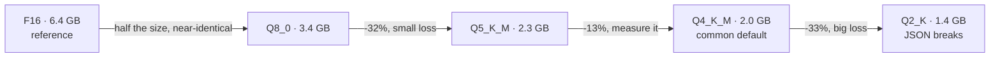
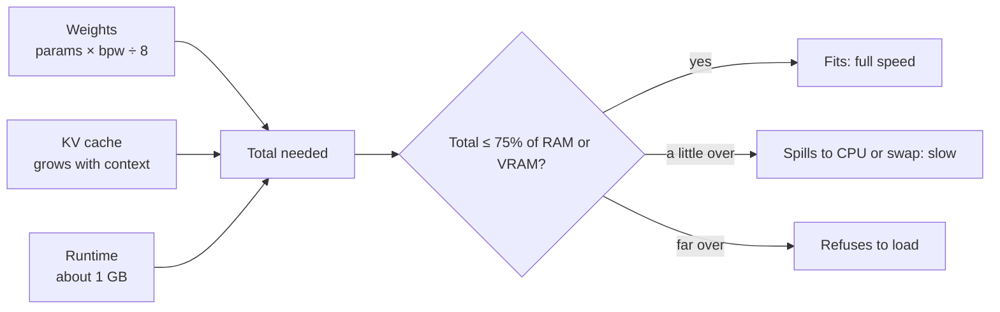
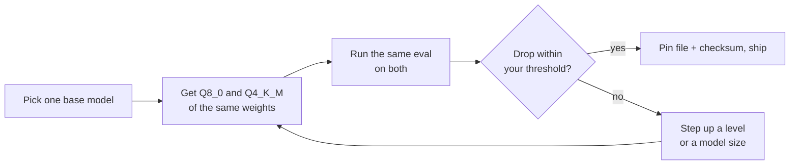
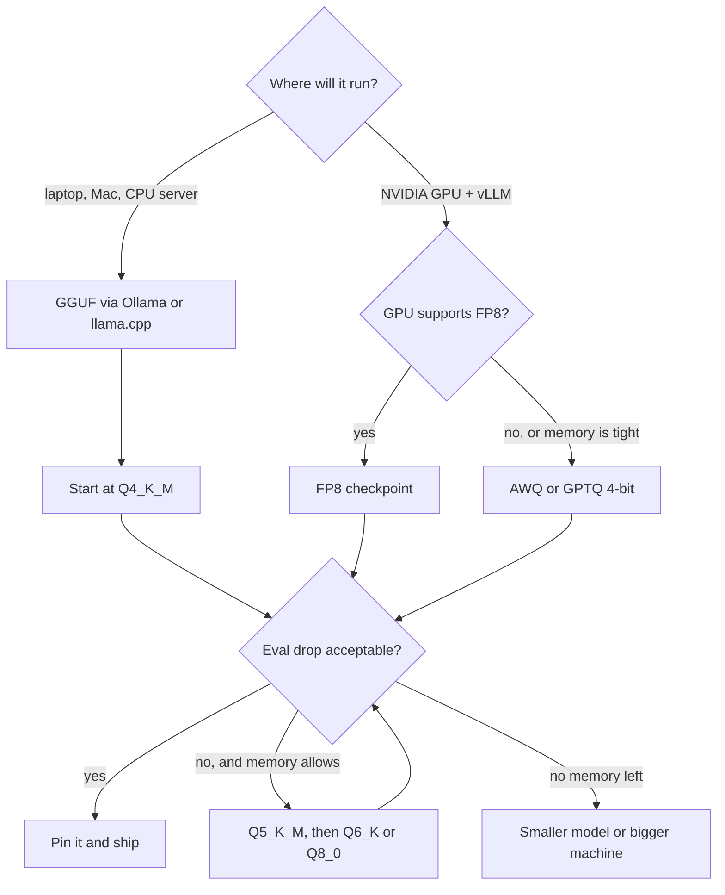

# Quantization & Hardware Sizing

The model you ran on [Day 91](../../Phase_10_Open_Models_and_Fine_Tuning/Day_091_open_weight_local/open_weight_local.md) loads fine on your 16 GB machine, then a teammate tries it on an 8 GB laptop and it either refuses to load or crawls. A smaller file of the *same* model loads instantly. But is the smaller file still good at turning Orbit issues into `IssueRecord`s? Quantization decides what fits; your eval decides whether it's still good enough.

## At a Glance

- **Time:** ~2 h core (+ optional Go Deeper) · **Depth:** working
- **Prerequisites:** [Day 91: Open-Weight Models & Local Inference](../../Phase_10_Open_Models_and_Fine_Tuning/Day_091_open_weight_local/open_weight_local.md), [Day 22: Capstone R1: The Extractor](../../Phase_2_Building_with_LLM_APIs/Day_022_capstone_r1_extractor/capstone_r1_extractor.md); primer [A11b: Training vocabulary](../../Appendix_Primers/A11b_training_vocabulary.md) for "weights" and "VRAM"
- **You'll build:** a sizing calculator (`estimate_memory_gb()`), a quant-comparison eval (`eval_variant()` over `QUANT_VARIANTS`) that reports JSON validity, field accuracy, tokens/s and p95 latency, and your own `Q4_K_M` file made with llama.cpp
- **Stops at:** quantization algorithms (GPTQ/AWQ math, K-quant internals)
- **Fast path:** Already know quantization? Read [Will It Fit? The Sizing Rule](#will-it-fit-the-sizing-rule) and do Exercise 2 (~40 min)
- **Cost:** $0. Everything runs locally; no API calls
- **New terms:** quantization, GGUF, quant level, bits per weight, VRAM

> **Coming from Software Engineering?** Quantization is the JPEG quality slider, or a downcast from `double` to `float` to `int8`, applied to model weights. The first steps down are nearly free; push too far and artefacts appear, in this case broken JSON and invented error codes. Two habits transfer directly from image and media pipelines: measure the quality cost on *your* inputs, not on someone's benchmark, and pin the exact artefact you ship (file name plus checksum), the way you pin a Docker image by digest.

## The Model That Didn't Fit

A model is billions of numbers called **weights**. Stored at 16 bits each, a 3-billion-parameter model is about 6.4 GB (Ollama's `llama3.2:3b-instruct-fp16` is 6.43 GB), plus working space. On an 8 GB laptop running a browser and an IDE, one of three things happens:

- Ollama refuses to load it, saying it needs more system memory than is available (wording varies by version; ⚠ verify).
- It loads, part of it spills to slower memory, and generation crawls.
- The OS starts **swapping** (moving memory pages to disk) and the machine freezes.

The fix isn't a bigger laptop. Ollama ships several sizes of the *same* weights: `llama3.2:3b-instruct-q4_K_M` is 2.02 GB, about a third of the 16-bit file.

## Rounding Numbers to Save Space

**Quantization** means storing each weight with fewer bits (a **bit** is one 0/1 digit; 8 bits make a byte) by rounding it to the nearest of a small set of allowed values. It works like rounding prices to the nearest 5 cents: you lose a little precision on every number, the totals barely move, and the receipts get shorter.

Here's a tiny example you can check by hand. Take four weights: `0.12, -0.53, 0.91, -0.07`.

- **4-bit** gives you 16 levels. We use the integers −7…7 so that zero stays exact. The largest weight, 0.91, maps to 7, so each step is `0.91 / 7 = 0.13`. Now round: `0.12 → 1 step = 0.13`, `-0.53 → -4 steps = -0.52`, `0.91 → 7 steps = 0.91`, `-0.07 → -1 step = -0.13`.
- **8-bit** gives 256 levels (−127…127), so each step is `0.91 / 127 ≈ 0.0072`, and every weight lands within 0.004 of where it started.

At 4 bits, the small weight −0.07 became −0.13, nearly double. Small weights suffer most, because the step size is set by the *largest* weight in the group. The script below repeats this for a block of 256 realistic weights (small, bell-shaped numbers):

```python
# script_id: day_092_quantization_hardware/rounding_toy
# rounding_toy.py: what quantization does to numbers, with no ML library at all.
# Install: nothing (stdlib only). Env: none. Services: none.
import random


def quantize(weights: list[float], bits: int) -> list[float]:
    """Symmetric 'absmax' rounding: map each weight to one of 2**bits levels and back."""
    qmax = 2 ** (bits - 1) - 1                    # 4 bits -> integers -7..7, 8 bits -> -127..127
    scale = max(abs(w) for w in weights) / qmax   # one scale per block, stored next to the integers
    return [round(w / scale) * scale for w in weights]


def mean_abs_error(a: list[float], b: list[float]) -> float:
    return sum(abs(x - y) for x, y in zip(a, b)) / len(a)


tiny = [0.12, -0.53, 0.91, -0.07]                 # the hand-worked example from the text
print("4-bit:", [round(x, 3) for x in quantize(tiny, 4)])
print("8-bit:", [round(x, 3) for x in quantize(tiny, 8)])

random.seed(0)
block = [random.gauss(0, 0.02) for _ in range(256)]   # real weights are small and bell-shaped
for bits in (8, 4, 2):
    err = mean_abs_error(block, quantize(block, bits))
    print(f"{bits}-bit  levels={2 ** bits:>3}  mean error={err:.5f}  ({err / 0.02:.0%} of a typical weight)")
```

```text
4-bit: [0.13, -0.52, 0.91, -0.13]
8-bit: [0.122, -0.53, 0.91, -0.072]
8-bit  levels=256  mean error=0.00014  (1% of a typical weight)
4-bit  levels= 16  mean error=0.00257  (13% of a typical weight)
2-bit  levels=  4  mean error=0.01473  (74% of a typical weight)
```

Halving from 8 to 4 bits multiplies the error by about 18. Halving again to 2 bits multiplies it by another 6, and the error is now most of the weight itself. That curve is the whole story of today: gentle at first, then a cliff.

## Reading a GGUF Name

**GGUF** is the single-file model format used by llama.cpp and Ollama: weights, tokenizer and metadata in one file. Its file names tell you what's inside. Take the model you'll quantize yourself later today:

```text
Qwen3-4B-Instruct-2507-Q4_K_M.gguf
│     │  │        │    │  │ └─ M = medium mix (S/M/L trade a little size for a little quality)
│     │  │        │    │  └─── K = K-quant, the current rounding scheme
│     │  │        │    └────── Q4 = about 4 bits per weight
│     │  │        └─────────── release tag
│     │  └──────────────────── instruction-tuned (chat), not a base model
│     └─────────────────────── 4 billion parameters
└───────────────────────────── model family
```

Ollama tags carry the same information in lowercase: `llama3.2:3b-instruct-q4_K_M`. The part after the last hyphen is the **quant level**, the name of the rounding recipe. A **K-quant** is a newer rounding scheme that keeps more precision where it matters most: it stores small blocks of weights, each with its own scale, and gives the most sensitive tensors more bits. That mixing is why the real **bits per weight** (bpw, the average storage cost of one weight, including the scales) is higher than the number in the name.

| Level | Bits per weight | Size vs F16 | Typical use |
|---|---|---|---|
| `F16` / `BF16` | 16.0 | 100% | The source you quantize from; reference quality |
| `Q8_0` | 8.50 | 53% | "Nearly lossless" baseline when memory allows |
| `Q6_K` | 6.56 | 41% | Quality-first on a roomy machine |
| `Q5_K_M` | 5.70 | 36% | Step up from Q4 when your eval shows a drop |
| `Q4_K_M` | 4.89 | 31% | The common default for laptops |
| `Q3_K_M` | 4.00 | 25% | Tight memory; measure carefully |
| `Q2_K` | 3.16 | 20% | Last resort; structured output often breaks |

Bits per weight are as measured on Llama 3.1 8B in [llama.cpp's quantize README](https://raw.githubusercontent.com/ggml-org/llama.cpp/master/tools/quantize/README.md); other models land within a few percent. Note that "Q2" costs about 3.2 bits, not 2. The README also reports perplexity, a generic quality score that can't tell you whether *your* JSON still parses.



*Sizes are Ollama's download sizes for `llama3.2:3b-instruct-*` (as of 2026-11, verify on the model's Ollama page).*

## Will It Fit? The Sizing Rule

This lesson owns the sizing rule; later days link back. Memory needed is three parts:

1. **Weights:** `params (billions) × bits per weight ÷ 8` GB. At 8 bits, one billion parameters take one gigabyte.
2. **KV cache:** the per-token attention memory from [Day 5](../../Phase_1_How_LLMs_Work/Day_005_transformers_attention/transformers_attention.md). It grows with context length. For a typical 3–8B model it's about 0.15 GB per 1,000 tokens at 16 bits.
3. **Runtime:** about 1–2 GB of compute buffers and runtime overhead.

Leave about 25% of RAM for the OS and other apps. On a GPU machine the budget is **VRAM** (the GPU's own memory); on Apple Silicon, RAM is shared with the GPU and macOS keeps part of it.

Here's a worked row, done by hand: a 4B model at `Q4_K_M` with an 8K context needs `4 × 4.89 ÷ 8 = 2.4` GB of weights, plus `8.2 × 0.15 = 1.2` GB of KV cache, plus 1 GB of runtime, for about 4.7 GB in total. That fits in 75% of 8 GB (6 GB).



```python
# script_id: day_092_quantization_hardware/fits
# fits.py: the sizing rule of thumb as code. Install: nothing (stdlib). Env: none. Services: none.
import re

# Bits per weight as measured on Llama 3.1 8B in llama.cpp's tools/quantize/README.md.
# K-quants mix widths, so "Q4" stores ~4.9 bits/weight, not 4. Other models land within a few %.
BITS_PER_WEIGHT = {"F16": 16.0, "Q8_0": 8.50, "Q6_K": 6.56, "Q5_K_M": 5.70,
                   "Q4_K_M": 4.89, "Q4_K_S": 4.67, "Q3_K_M": 4.00, "Q2_K": 3.16}
KV_GB_PER_1K_TOKENS = 0.15   # F16 KV cache of a typical 3-8B model with grouped-query attention
RUNTIME_GB = 1.0             # compute buffers, runtime, tokenizer: rule of thumb
HEADROOM = 0.75              # leave ~25% of RAM for the OS, browser and IDE


def decode_quant(name: str) -> str:
    """'Qwen3-4B-Instruct-2507-Q4_K_M.gguf' or 'llama3.2:3b-instruct-q4_K_M' -> 'Q4_K_M'."""
    m = re.search(r"(BF16|F16|FP16|Q\d_K(?:_[SML])?|Q\d_\d)", name, re.IGNORECASE)
    if not m:
        raise ValueError(f"no quant level in {name!r}")
    level = m.group(1).upper()
    return "F16" if level in ("BF16", "FP16") else level   # BF16 and F16 are both 16 bits


def estimate_memory_gb(params_b: float, bits: float, ctx_tokens: int = 8192, *,
                       kv_gb_per_1k: float = KV_GB_PER_1K_TOKENS, runtime_gb: float = RUNTIME_GB) -> float:
    """weights + KV cache + runtime, in GB (10**9 bytes)."""
    weights = params_b * bits / 8          # 1B params at 8 bits = 1 GB
    kv_cache = ctx_tokens / 1000 * kv_gb_per_1k
    return weights + kv_cache + runtime_gb


if __name__ == "__main__":
    print(decode_quant("Qwen3-4B-Instruct-2507-Q4_K_M.gguf"), decode_quant("llama3.2:3b-instruct-q8_0"))
    machines = (8, 16, 24)
    print(f"{'model':<12}{'needs GB':>9}" + "".join(f"{f'{ram} GB':>7}" for ram in machines))
    for params_b in (4, 8, 20):
        for level in ("Q4_K_M", "Q8_0"):
            need = estimate_memory_gb(params_b, BITS_PER_WEIGHT[level])
            marks = "".join(f"{'yes' if need <= ram * HEADROOM else 'no':>7}" for ram in machines)
            print(f"{params_b:>2}B {level:<8}{need:>9.1f}{marks}")
```

```text
Q4_K_M Q8_0
model        needs GB   8 GB  16 GB  24 GB
 4B Q4_K_M        4.7    yes    yes    yes
 4B Q8_0          6.5     no    yes    yes
 8B Q4_K_M        7.1     no    yes    yes
 8B Q8_0         10.7     no    yes    yes
20B Q4_K_M       14.5     no     no    yes
20B Q8_0         23.5     no     no     no
```

Sanity check: `llama3.2:3b` has 3.2B parameters, `3.2 × 4.89 ÷ 8 = 1.96` GB, and Ollama's `q4_K_M` download is 2.02 GB. Now compare the full estimate with what Ollama loaded. `ollama ps` (or `ollama.ps()` in Python) reports the loaded size, the GPU share and the context length:

```python
# script_id: day_092_quantization_hardware/ollama_ps
# ollama_ps.py: check the rule of thumb against what Ollama actually loaded.
# Install: uv add ollama   Env: none
# Services: Ollama running with a model loaded (e.g. `ollama run llama3.2:3b-instruct-q4_K_M "hi"`).
import ollama

from fits import BITS_PER_WEIGHT, decode_quant, estimate_memory_gb


def params_billions(size: str) -> float:
    """Ollama reports '3.2B' or '268.10M'."""
    return float(size[:-1]) / (1000 if size.endswith("M") else 1)


try:
    loaded = ollama.ps().models
except ConnectionError as err:           # the ollama library raises the builtin ConnectionError
    loaded = []
    print(f"{err}\nEstimate only: 3.2B at Q4_K_M, 8K context ≈ "
          f"{estimate_memory_gb(3.2, BITS_PER_WEIGHT['Q4_K_M']):.1f} GB")

for m in loaded:
    level = decode_quant(m.details.quantization_level)
    if level not in BITS_PER_WEIGHT:         # e.g. Q4_0: add its bits-per-weight to the table first
        print(f"{m.model}: no bits-per-weight entry for {level}")
        continue
    ctx = m.context_length or 8192
    est = estimate_memory_gb(params_billions(m.details.parameter_size), BITS_PER_WEIGHT[level], ctx)
    on_gpu = m.size_vram / m.size if m.size else 0.0
    print(f"{m.model}: estimate {est:.1f} GB · loaded {m.size / 1e9:.1f} GB · "
          f"{on_gpu:.0%} on GPU · context {ctx}")
```

```text
llama3.2:3b-instruct-q4_K_M: estimate 4.2 GB · loaded 3.9 GB · 100% on GPU · context 8192
```

*(Illustrative; your numbers will differ. Without Ollama running, the script prints the connection error and the estimate only.)* If "on GPU" is below 100%, part of the model is running on the CPU, and that's where the slowdown comes from. The usual fixes are one quant level down, a shorter context, or one model size down.

## Q4 vs Q8 on the R1 Eval

A smaller file is only a win if it still does the job. The job here is R1 from [Day 22](../../Phase_2_Building_with_LLM_APIs/Day_022_capstone_r1_extractor/capstone_r1_extractor.md): turn an Orbit issue into an `IssueRecord`, scored against the 30 gold records from [Day 20](../../Phase_2_Building_with_LLM_APIs/Day_020_first_eval_set/first_eval_set.md). The habit to build is simple: compare quants of *one* model, on *one* eval, and only then decide.



Pull both builds. They're the same Llama 3.2 3B weights, rounded differently, and both fit on an 8 GB machine:

```bash
ollama pull llama3.2:3b-instruct-q8_0      # 3.42 GB
ollama pull llama3.2:3b-instruct-q4_K_M    # 2.02 GB
ollama list                                # confirm both tags are present
```

First, the schema and the prompt. `IssueRecord` is Day 20's compact copy of the Day 15 schema. `SYSTEM_PROMPT_EXTRACT` is Day 16's extraction instructions plus one paragraph that spells out the JSON shape. That paragraph is needed because Ollama's `/v1/responses` endpoint doesn't list `text.format` among its supported fields (as of 2026-11, [verify](https://raw.githubusercontent.com/ollama/ollama/main/docs/api/openai-compatibility.mdx)), so the shape goes in the prompt and Pydantic checks the result. **Days 94–96 reuse this prompt byte for byte**, so treat it as frozen.

```python
# script_id: day_092_quantization_hardware/schemas
# schemas.py: IssueRecord (compact copy of Day 15/20) + the frozen extraction prompt.
# Install: uv add pydantic   Env: ORBIT_DATA (optional, path to datasets/orbit). Services: none.
import json
import os
from pathlib import Path
from typing import Literal

from pydantic import BaseModel, ConfigDict, Field, ValidationError

DATA_DIR = Path(os.environ.get("ORBIT_DATA", "datasets/orbit"))
Component = Literal["core", "scheduler", "flows", "broker-redis", "broker-postgres", "broker-sqs",
                    "cli", "dashboard", "retries", "results", "observability", "auth", "docs"]


class IssueRecord(BaseModel):
    """The facts Atlas extracts from one issue. Fields mirror eval/extraction_gold.jsonl."""
    model_config = ConfigDict(extra="forbid")
    type: Literal["bug", "feature", "question", "docs"]
    components: list[Component]
    severity: Literal["S1", "S2", "S3", "S4"] | None
    orbit_version: str | None
    python_version: str | None
    error_codes: list[str]
    summary: str = Field(min_length=1)


def parse_record(text: str) -> IssueRecord:
    """Small models often wrap JSON in ``` fences; strip them, then let Pydantic judge."""
    body = text.strip().removeprefix("```json").removeprefix("```").removesuffix("```")
    return IssueRecord.model_validate_json(body)


def format_errors(err: ValidationError) -> str:
    """Day 15's helper: one short line per failing field."""
    return "; ".join(f"{'.'.join(map(str, e['loc'])) or '(root)'}: {e['msg']}" for e in err.errors())
```

```python
# script_id: day_092_quantization_hardware/schemas
# Frozen here; Days 94-96 copy it verbatim. Day 16's instructions + the JSON-shape paragraph.
SYSTEM_PROMPT_EXTRACT = """You extract facts from GitHub issues filed against Orbit, an open-source
Python background-jobs library. Fill every field of the schema from the issue text only.

Rules:
- Use null when a fact is not stated. Never guess a version from dates or context.
- severity is for bugs only; use null for features, questions and docs.
- error_codes: every ORB-NNNN code that appears anywhere, including logs and comments. [] if none.
- components: usually one; list two only when the issue really spans both.
- summary: one or two sentences in English, even when the issue is in another language.

Component glossary:
core = queues, workers, leases, job execution | scheduler = cron schedules and delays
flows = Flows, steps and step state | broker-redis, broker-postgres, broker-sqs = that broker
cli = the orbit command | dashboard = the web UI | retries = retry policy and backoff
results = the result backend | observability = metrics and tracing
auth = dashboard login and OIDC | docs = the documentation itself

Reply with one JSON object and nothing else: no prose, no code fences. Use exactly these keys:
type ("bug", "feature", "question" or "docs"), components (list of glossary names),
severity ("S1" outage or data loss, "S2" major breakage, "S3" has a workaround, "S4" cosmetic, or null),
orbit_version (string or null), python_version (string or null), error_codes (list of strings),
summary (string)."""

if __name__ == "__main__":
    gold = [json.loads(line) for line in (DATA_DIR / "eval" / "extraction_gold.jsonl").open(encoding="utf-8")]
    records = [IssueRecord.model_validate({k: v for k, v in g.items() if k != "issue_id"}) for g in gold]
    print(f"{len(records)} gold records validate · prompt is {len(SYSTEM_PROMPT_EXTRACT)} chars")
```

```text
30 gold records validate · prompt is 1405 chars
```

One rule from today on: these 30 gold issues are **eval-only**. Never paste them into a prompt as few-shot examples, and never train on them. [Day 94](../../Phase_10_Open_Models_and_Fine_Tuning/Day_094_should_you_finetune/should_you_finetune.md) builds training data that excludes them. If they leak into training, your eval measures memory, not skill.

Now the minimal comparison: one issue, both tags, through the same OpenAI client you pointed at Ollama on Day 91.

```python
# script_id: day_092_quantization_hardware/first_compare
# first_compare.py: one Orbit issue through two quant builds of the same model.
# Install: uv add "openai>=3.46,<4" pydantic   Env: ORBIT_DATA (optional)
# Services: Ollama running, both llama3.2 tags pulled (bash block above). Imports schemas.py.
import json

from openai import OpenAI

from schemas import DATA_DIR, SYSTEM_PROMPT_EXTRACT, parse_record

client = OpenAI(base_url="http://localhost:11434/v1", api_key="ollama")   # key required but ignored
issue = json.loads((DATA_DIR / "issues" / "issues.jsonl").open(encoding="utf-8").readline())
text = f"# {issue['title']}\n\n{issue['body']}"

for tag in ("llama3.2:3b-instruct-q8_0", "llama3.2:3b-instruct-q4_K_M"):
    resp = client.responses.create(model=tag, instructions=SYSTEM_PROMPT_EXTRACT, input=text, temperature=0)
    record = parse_record(resp.output_text)          # raises ValidationError if the JSON is broken
    print(tag, record.model_dump(exclude={"summary"}))
```

```text
llama3.2:3b-instruct-q8_0 {'type': 'bug', 'components': ['cli'], 'severity': 'S3', 'orbit_version': '2.8.0', 'python_version': None, 'error_codes': []}
llama3.2:3b-instruct-q4_K_M {'type': 'bug', 'components': ['cli', 'core'], 'severity': 'S3', 'orbit_version': '2.8.0', 'python_version': None, 'error_codes': []}
```

*(Illustrative; your output will differ.)* One issue tells you almost nothing, so the realistic version adds three concerns: a list of variants, per-field scoring, and honest timing.

The first block defines `QuantVariant` (one build you might ship) and the case loader. `QUANT_VARIANTS` holds two quants of the same model: compare Llama Q4 with Qwen Q8 and you can't tell whether the gap comes from the rounding or the model.

```python
# script_id: day_092_quantization_hardware/quant_eval
# quant_eval.py: run the R1 extraction eval on several quant builds of ONE model.
# Install: uv add "openai>=3.46,<4" pydantic   Env: ORBIT_DATA, ATLAS_LOCAL_BASE_URL (optional)
# Services: Ollama on :11434 with the QUANT_VARIANTS tags pulled. Imports schemas.py.
# Compact versions of Day 20's runner and Day 91's make_client() (no cross-lesson imports).
import json, math, os, time
from dataclasses import dataclass

from openai import OpenAI

from schemas import DATA_DIR, SYSTEM_PROMPT_EXTRACT, IssueRecord, ValidationError, parse_record

LOCAL_BASE_URL = os.environ.get("ATLAS_LOCAL_BASE_URL", "http://localhost:11434/v1")
FIELDS = ("type", "components", "severity", "orbit_version", "python_version", "error_codes")


@dataclass(frozen=True)
class QuantVariant:
    name: str        # label for the report
    model: str       # the exact tag or file you would ship
    base_url: str
    size_gb: float   # download size, for the table


QUANT_VARIANTS = [
    QuantVariant("Q8_0", "llama3.2:3b-instruct-q8_0", LOCAL_BASE_URL, 3.42),
    QuantVariant("Q4_K_M", "llama3.2:3b-instruct-q4_K_M", LOCAL_BASE_URL, 2.02),
]


def read_jsonl(path) -> list[dict]:
    return [json.loads(line) for line in path.read_text(encoding="utf-8").splitlines() if line.strip()]


def load_cases() -> list[dict]:
    """The 30 gold records joined to their issues. Eval-only: never few-shot, never training data."""
    issues = {i["id"]: i for i in read_jsonl(DATA_DIR / "issues" / "issues.jsonl")}
    return [{"issue": issues[g["issue_id"]], "gold": g} for g in read_jsonl(DATA_DIR / "eval" / "extraction_gold.jsonl")]
```

The second block makes one timed call and scores it. Lists compare as sets (`["cli", "core"]` equals `["core", "cli"]`). It also counts **invented codes**: `ORB-` codes in the output that appear nowhere in the issue.

```python
# script_id: day_092_quantization_hardware/quant_eval
_clients: dict[str, OpenAI] = {}


def client_for(base_url: str) -> OpenAI:
    """Day 91's make_client("local"), cached per server. Local servers ignore the key; the SDK needs one."""
    if base_url not in _clients:
        _clients[base_url] = OpenAI(base_url=base_url, api_key="local", timeout=300, max_retries=0)
    return _clients[base_url]


def issue_to_input(issue: dict, max_chars: int = 12_000) -> str:
    """Title, body and comments; never the labels (they're the answer key). Same as Day 20."""
    parts = [f"# {issue['title']}", issue["body"]]
    parts += [f"--- comment by {c['author']} ---\n{c['body']}" for c in issue["comments"]]
    return "\n\n".join(parts)[:max_chars]


def run_one(v: QuantVariant, issue: dict) -> tuple[str, float, int]:
    """One extraction call -> (raw text, seconds, output tokens)."""
    start = time.perf_counter()
    resp = client_for(v.base_url).responses.create(
        model=v.model, instructions=SYSTEM_PROMPT_EXTRACT, input=issue_to_input(issue),
        temperature=0, max_output_tokens=800)          # temperature 0: compare quants, not luck
    return resp.output_text, time.perf_counter() - start, resp.usage.output_tokens if resp.usage else 0


def score(record: IssueRecord | None, gold: dict, issue_text: str) -> tuple[dict[str, bool], int]:
    """Per-field match (lists as sets) + the number of ORB codes that aren't in the issue."""
    if record is None:                                  # invalid JSON scores zero on every field
        return {f: False for f in FIELDS}, 0
    got = record.model_dump()
    hits = {f: set(got[f]) == set(gold[f]) if isinstance(gold[f], list) else got[f] == gold[f]
            for f in FIELDS}
    return hits, sum(code not in issue_text for code in record.error_codes)
```

The third block warms up first (the first call pays the model load), runs every case, and reports per-field accuracy beside the average, plus tokens per second (**tok/s**) and **p95**, the latency that 95% of calls beat (the slow tail, not the average). `summary` is skipped because free text needs a judge ([Day 45](../../Phase_5_Evaluation_and_Observability/Day_045_llm_as_judge/llm_as_judge.md)).

```python
# script_id: day_092_quantization_hardware/quant_eval
@dataclass
class VariantReport:
    variant: QuantVariant
    valid_json_rate: float
    field_accuracy: float          # mean over FIELDS
    per_field: dict[str, float]
    invented_codes: int
    tokens_per_s: float            # end to end, including prompt processing
    p95_s: float


def p95(xs: list[float]) -> float:
    return sorted(xs)[max(0, math.ceil(0.95 * len(xs)) - 1)]     # nearest-rank percentile


def eval_variant(v: QuantVariant, cases: list[dict]) -> VariantReport:
    run_one(v, cases[0]["issue"])                  # warm-up: don't time the model load
    valid = invented = tokens = 0
    secs: list[float] = []
    hits = dict.fromkeys(FIELDS, 0)
    for case in cases:
        text, seconds, n_tokens = run_one(v, case["issue"])
        secs.append(seconds)
        tokens += n_tokens
        try:
            record = parse_record(text)
            valid += 1
        except ValidationError:
            record = None
        field_hits, bad_codes = score(record, case["gold"], issue_to_input(case["issue"]))
        invented += bad_codes
        for f in FIELDS:
            hits[f] += field_hits[f]
    per_field = {f: hits[f] / len(cases) for f in FIELDS}
    return VariantReport(v, valid / len(cases), sum(per_field.values()) / len(FIELDS), per_field,
                         invented, tokens / sum(secs), p95(secs))
```

```python
# script_id: day_092_quantization_hardware/quant_eval
def print_table(reports: list[VariantReport]) -> None:
    print(f"{'variant':<8}{'GB':>6}{'valid JSON':>12}{'field acc':>11}{'invented':>10}{'tok/s':>8}{'p95 s':>7}")
    for r in reports:
        print(f"{r.variant.name:<8}{r.variant.size_gb:>6.2f}{r.valid_json_rate:>12.0%}"
              f"{r.field_accuracy:>11.0%}{r.invented_codes:>10}{r.tokens_per_s:>8.1f}{r.p95_s:>7.1f}")
    for r in reports:
        print(f"  {r.variant.name}: " + " · ".join(f"{f} {a:.2f}" for f, a in r.per_field.items()))


if __name__ == "__main__":
    cases = load_cases()
    print_table([eval_variant(v, cases) for v in QUANT_VARIANTS])
```

```text
variant     GB  valid JSON  field acc  invented   tok/s  p95 s
Q8_0      3.42         97%        71%         0    24.8    6.9
Q4_K_M    2.02         93%        67%         1    38.5    4.6
  Q8_0: type 0.83 · components 0.63 · severity 0.53 · orbit_version 0.80 · python_version 0.87 · error_codes 0.60
  Q4_K_M: type 0.80 · components 0.57 · severity 0.50 · orbit_version 0.77 · python_version 0.87 · error_codes 0.53
```

*(Illustrative; your numbers will differ. A 30-case run takes a few minutes on a laptop.)* Q4 is about 40% smaller and faster, and loses a few points spread across fields. With 30 cases one issue is 3.3 points, so a 4-point gap is one or two issues: run it twice before you trust it. Whether that's acceptable is a product decision you write down *before* you look, e.g. "ship Q4 if field accuracy drops under 5 points and valid JSON stays ≥ 90%".

## Break It: Q2 and the JSON Cliff

Turn the knob all the way down. Pull the 2-bit build and add it to `QUANT_VARIANTS`:

```bash
ollama pull llama3.2:3b-instruct-q2_K      # 1.36 GB
```

```python
# fragment
QUANT_VARIANTS.append(QuantVariant("Q2_K", "llama3.2:3b-instruct-q2_K", LOCAL_BASE_URL, 1.36))
```

At about 3 bits per weight, exact strings degrade first. This script reproduces the three kinds of damage offline, using outputs typical of a Q2 build, so you see the real error text without running a model:

```python
# script_id: day_092_quantization_hardware/break_it
# break_it.py: the three ways a heavily quantized model breaks R1, with real Pydantic errors.
# Install: uv add pydantic   Env: ORBIT_DATA (optional). Services: none. Imports schemas.py.
import json

from schemas import DATA_DIR, ValidationError, format_errors, parse_record

issue = next(i for i in map(json.loads, (DATA_DIR / "issues" / "issues.jsonl").open(encoding="utf-8"))
             if i["id"] == 25)                     # Spanish issue quoting ORB-1202
issue_text = issue["title"] + issue["body"] + "".join(c["body"] for c in issue["comments"])

q2_outputs = [   # typical Q2_K replies: cut-off JSON, made-up labels, an invented code
    '{"type": "question", "components": ["core"], "severity": null, "orbit_version": "2.8.0", '
    '"python_version": "3.11.9", "error_codes": ["ORB-1202"], "summary": "Payload too large',
    '{"type": "question", "components": ["payloads"], "severity": "low", "orbit_version": "2.8.0", '
    '"python_version": "3.11.9", "error_codes": ["ORB-1202"], "summary": "Asks about the limit."}',
    '```json\n{"type": "question", "components": ["core"], "severity": null, "orbit_version": "2.8.0", '
    '"python_version": "3.11.9", "error_codes": ["ORB-1202", "ORB-1203"], "summary": "Asks about the limit."}\n```',
]
for n, text in enumerate(q2_outputs, 1):
    try:
        record = parse_record(text)
    except ValidationError as err:
        print(f"output {n}: INVALID  {format_errors(err)}")
        continue
    invented = [code for code in record.error_codes if code not in issue_text]
    print(f"output {n}: valid JSON · invented codes: {invented or 'none'}")
```

```text
output 1: INVALID  (root): Invalid JSON: EOF while parsing a string at line 1 column 175
output 2: INVALID  components.0: Input should be 'core', 'scheduler', 'flows', 'broker-redis', 'broker-postgres', 'broker-sqs', 'cli', 'dashboard', 'retries', 'results', 'observability', 'auth' or 'docs'; severity: Input should be 'S1', 'S2', 'S3' or 'S4'
output 3: valid JSON · invented codes: ['ORB-1203']
```

1. **Broken JSON:** the model stops mid-string or rambles past the closing brace.
2. **Made-up labels:** `"payloads"` isn't a component and `"low"` isn't a severity. The schema catches it.
3. **Plausible lies:** perfect JSON, but `ORB-1203` appears nowhere in the issue. Only the grounding check (`invented_codes`) catches this, and it's the dangerous one, because nothing crashes.

When you run the real Q2 build through `quant_eval`, expect a table like this (illustrative; measure your own):

```text
variant     GB  valid JSON  field acc  invented   tok/s  p95 s
Q8_0      3.42         97%        71%         0    24.8    6.9
Q4_K_M    2.02         93%        67%         1    38.5    4.6
Q2_K      1.36         70%        44%         6    45.1    5.2
```

Q2 saves another 0.7 GB and loses a third of the accuracy: the cliff. Ollama's native API can constrain output to a schema (`ollama.chat(..., format=IssueRecord.model_json_schema())`), which pushes validity towards 100%, but a constrained Q2 model still writes well-shaped wrong answers. Keep the field-level eval.

## llama.cpp: Make and Benchmark Your Own Quant

Sometimes you need your own quant: a model Ollama doesn't carry, a level it doesn't publish, or your own fine-tune ([Day 95](../../Phase_10_Open_Models_and_Fine_Tuning/Day_095_lora_finetuning/lora_finetuning.md)). **llama.cpp**, the C++ engine under many local tools, ships the converter, quantizer, a benchmark and an OpenAI-compatible server.

You'll use `Qwen/Qwen3-4B-Instruct-2507`: it's Apache-2.0 and ungated on Hugging Face, while Meta's Llama 3.2 weights need a manual access request. Disk: about 8 GB for the 16-bit file plus 7 GB for two quants.

```bash
# 1. Tools: llama-quantize, llama-bench, llama-server (Windows: winget install llama.cpp)
brew install llama.cpp

# 2. The converter lives in the repo, not in the brew package
git clone https://github.com/ggml-org/llama.cpp
cd llama.cpp && uv venv && source .venv/bin/activate
uv pip install -r requirements.txt --index-strategy unsafe-best-match

# 3. Download from Hugging Face and convert to a 16-bit GGUF in one step
python convert_hf_to_gguf.py --remote Qwen/Qwen3-4B-Instruct-2507 \
    --outtype bf16 --outfile Qwen3-4B-Instruct-2507-BF16.gguf

# 4. Quantize, always from the 16-bit file, never from another quant
llama-quantize Qwen3-4B-Instruct-2507-BF16.gguf Qwen3-4B-Instruct-2507-Q8_0.gguf Q8_0
llama-quantize Qwen3-4B-Instruct-2507-BF16.gguf Qwen3-4B-Instruct-2507-Q4_K_M.gguf Q4_K_M
ls -lh *.gguf && shasum -a 256 *Q4_K_M.gguf     # size check + the checksum you'll pin

# 5. Benchmark: prompt processing (pp512) and generation (tg128), 5 repetitions each
llama-bench -m Qwen3-4B-Instruct-2507-Q8_0.gguf -m Qwen3-4B-Instruct-2507-Q4_K_M.gguf -p 512 -n 128

# 6. Serve one file at a time on an explicit port (current builds default to 9931, not 8080)
llama-server -m Qwen3-4B-Instruct-2507-Q4_K_M.gguf --port 8080 -c 8192
```

`llama-bench` prints one row per model and test, in tokens per second (t/s). Expect generation (`tg128`) to speed up as files shrink while prompt processing (`pp512`) barely moves; Go Deeper explains why.

With the server running, point the same eval at it. `QuantVariant` only needs a different `base_url`:

```python
# script_id: day_092_quantization_hardware/llamacpp_eval
# llamacpp_eval.py: the same R1 eval against YOUR quants, served by llama-server.
# Install: uv add "openai>=3.46,<4" pydantic   Env: ORBIT_DATA (optional). Imports quant_eval.py.
# Services: llama-server -m <file>.gguf --port 8080 (one file at a time; bash block above).
# Usage: python llamacpp_eval.py Q4_K_M, then restart the server with the Q8_0 file and pass Q8_0.
import sys
import urllib.request

from quant_eval import QuantVariant, eval_variant, load_cases, print_table

URL = "http://localhost:8080"
SIZES_GB = {"Q4_K_M": 2.5, "Q8_0": 4.3}     # approximate; use your `ls -lh` numbers

level = sys.argv[1] if len(sys.argv) > 1 else "Q4_K_M"
try:
    urllib.request.urlopen(f"{URL}/health", timeout=5)
except OSError as err:
    raise SystemExit(f"llama-server isn't answering on {URL} ({err}). Start it first.")

# llama-server answers with the one model it loaded; the name is for your report (⚠ verify on your build)
variant = QuantVariant(level, f"Qwen3-4B-Instruct-2507-{level}.gguf", f"{URL}/v1", SIZES_GB[level])
print_table([eval_variant(variant, load_cases())])
```

```text
variant     GB  valid JSON  field acc  invented   tok/s  p95 s
Q4_K_M    2.50         97%        72%         0    31.0    5.3
```

*(Illustrative.)* Cross-check: Ollama publishes the same model as `qwen3:4b-instruct-2507-q4_K_M` (2.5 GB) and `-q8_0` (4.28 GB). Your homemade Q4 should score within noise of Ollama's; if not, check you quantized from the BF16 file.

## Choosing a Format and a Level

On NVIDIA GPUs, serving engines such as vLLM ([Day 93](../../Phase_10_Open_Models_and_Fine_Tuning/Day_093_vllm_serving/vllm_serving.md)) use GPU-native formats: **AWQ** and **GPTQ** (4-bit weights tuned on calibration data) and **FP8** (8-bit floats recent GPUs compute with directly). Hardware decides the format; the eval decides the level:



| Situation | Start with | Move when |
|---|---|---|
| 8 GB laptop | 3–4B model at `Q4_K_M` | Eval drop too big → `Q5_K_M` if it fits, else a different model |
| 16–24 GB Mac or PC | 8B at `Q4_K_M`, or 4B at `Q8_0` | Compare both on *your* eval; bigger-at-Q4 often beats smaller-at-Q8 |
| NVIDIA GPU, many users | FP8 or AWQ in vLLM (Day 93) | Throughput or memory limits |

### In production

- Pin the exact artefact: Ollama tag plus ID (`ollama list`), or GGUF file name plus SHA-256. A bare `llama3.2:3b` can change under you.
- Treat a quant change as a model change. It goes through the same eval gate and canary as a new model ([Day 87](../../Phase_9_Production/Day_087_shipping_changes_safely/shipping_changes_safely.md)).
- Log the quant level and context size with every request.
- Size for the context you actually allow, not the default: an 8K → 32K bump can cost more memory than the Q8 → Q4 saving.
- Keep the 16-bit source file (or its Hugging Face revision) so you can re-quantize without compounding loss.

## Go Deeper (optional)

<details><summary>Go deeper: VRAM math and the KV cache</summary>

The sizing rule used a flat 0.15 GB per 1,000 tokens for the KV cache. Here's where that comes from. For every token in the context, every layer stores one key vector and one value vector per **KV head**. Modern models use grouped-query attention, so several query heads share one KV head, which shrinks this a lot.

In words: per-token bytes = 2 (K and V) × layers × KV heads × head size × bytes per number. With toy numbers: 2 layers × 1 KV head × 4 numbers × 2 bytes × 2 = 32 bytes per token. For Qwen3-4B-Instruct-2507, the config on Hugging Face says 36 layers, 8 KV heads and a head size of 128:

```python
# script_id: day_092_quantization_hardware/kv_math
# kv_math.py: KV-cache size from a model's config. Install: nothing (stdlib). Env/services: none.
# Numbers from Qwen/Qwen3-4B-Instruct-2507's config.json on Hugging Face.
LAYERS, KV_HEADS, HEAD_DIM = 36, 8, 128


def kv_cache_gb(ctx_tokens: int, bytes_per_value: float = 2.0) -> float:
    """2 (K and V) x layers x KV heads x head size x bytes, per token, times the context length."""
    per_token = 2 * LAYERS * KV_HEADS * HEAD_DIM * bytes_per_value
    return per_token * ctx_tokens / 1e9


print(f"per token: {kv_cache_gb(1) * 1e6:.0f} KB at F16")
for ctx in (8_192, 32_768, 262_144):
    print(f"{ctx:>7} tokens: F16 {kv_cache_gb(ctx):5.2f} GB · q8_0 cache {kv_cache_gb(ctx, 1.0625):5.2f} GB")
```

```text
per token: 147 KB at F16
   8192 tokens: F16  1.21 GB · q8_0 cache  0.64 GB
  32768 tokens: F16  4.83 GB · q8_0 cache  2.57 GB
 262144 tokens: F16 38.65 GB · q8_0 cache 20.54 GB
```

At the model's full 262K context, the cache alone is 15 times the Q4 weights. That's why servers cap context, and why llama-server can quantize the cache itself (`-ctk q8_0 -ctv q8_0`, documented in its README). The 1.0625 bytes for q8_0 assumes 8.5 bits per value, like `Q8_0` weights. Measure the quality effect of a quantized cache the same way you measure weight quants.

</details>

<details><summary>Go deeper: why smaller files generate faster</summary>

The llama.cpp README's numbers for Llama 3.1 8B on its test machine show the pattern: generation at about 29 t/s for F16, 51 for Q8_0 and 72 for Q4_K_M, while prompt processing stays between roughly 820 and 920 t/s. Generating one token means reading every weight from memory once, so generation is limited by memory bandwidth: fewer bytes per weight means more tokens per second. Prompt processing handles many tokens per weight read, so it's limited by compute, and quantization helps it little (dequantizing even costs a bit). This is also why a model that spills partly to CPU memory slows down so sharply: that memory is slower.

</details>

<details><summary>Go deeper: why K-quants mix bit widths, and what an imatrix is</summary>

The rounding toy used one scale for 256 weights. One outlier then stretches the step size for everyone, and the small weights get rounded to zero. K-quants fix this in two ways. They use small blocks, each with its own scale (the scales themselves are stored compactly), which is part of why `Q4_K_M` costs 4.89 bits rather than 4. And they don't treat all tensors equally: the `_M` and `_L` mixes give some sensitive tensors (attention values, parts of the feed-forward layers, the output layer) more bits than the rest. `--pure` turns the mixing off, which is handy if you want to see how much it helps.

An **importance matrix** (`--imatrix file`) goes one step further. You run the 16-bit model over some sample text, record which weights matter most for the activations, and let the quantizer protect them. It matters most at 2–3 bits. Use calibration text that resembles your workload, and never your eval set.

</details>

<details><summary>Go deeper: GPU formats (AWQ, GPTQ, FP8) and llm-compressor</summary>

GPTQ and AWQ both use calibration data. GPTQ rounds weights one column at a time and adjusts the rest to cancel the error it introduced. AWQ finds the small fraction of weights that see the largest activations and scales them up before rounding, so they lose less. FP8 is simpler: it stores weights as 8-bit floating-point numbers, which recent NVIDIA GPUs compute with natively, so quality is close to 16-bit at half the memory.

The standalone `autoawq` project is archived. The maintained path is **llm-compressor** from the vLLM project, which writes checkpoints in a format vLLM loads directly. It needs a CUDA GPU, so here's the shape only, taken from its README (0.15.0 as of 2026-11; ⚠ verify against current docs):

```python
# fragment
# Needs: an NVIDIA GPU, uv pip install llmcompressor transformers. Not runnable on a laptop.
from llmcompressor import oneshot
from llmcompressor.modifiers.quantization import QuantizationModifier   # also GPTQModifier, AWQModifier

model = ...  # a Hugging Face AutoModelForCausalLM, loaded as usual
oneshot(model=model, recipe=QuantizationModifier(targets="Linear", scheme="FP8_BLOCK", ignore=["lm_head"]))
model.save_pretrained("Qwen3-4B-Instruct-2507-FP8")   # then: vllm serve Qwen3-4B-Instruct-2507-FP8
```

Other schemes include `W4A16` (4-bit weights, GPTQ/AWQ style) and `W8A8` (int8 or FP8 weights and activations). Many popular models already have FP8 or AWQ checkpoints on Hugging Face, so check before you make your own. Whatever the format, the rule from the core path still holds: same base model, same eval, then decide.

</details>

## Common Pitfalls

- **"Requires more system memory than is available" from Ollama** (wording varies by version, ⚠ verify): the weights plus KV cache don't fit. Drop one quant level, shorten the context, or drop one model size. Then check `ollama ps`.
- **Comparing two different models instead of two quants of one.** "Qwen Q4 beat Llama Q8" says nothing about quantization. Fix: the same base model, with tags or digests pinned.
- **Timing the cold load, or trusting the average.** The first call loads gigabytes from disk, so warm up first. An average hides one collapsed field (error codes break first), so score per field.
- **Re-quantizing a quant.** `llama-quantize` on a Q8 file is refused unless you pass `--allow-requantize`, and the README warns that this "can severely reduce quality". Fix: always start from the F16/BF16 file.
- **Old command names from old tutorials:** `./main`, `quantize`, `convert.py` and `make` are gone. Use `llama-cli`, `llama-quantize`, `convert_hf_to_gguf.py`, and brew/winget or CMake. (Newer builds add a unified `llama serve`/`llama cli` app; the hyphenated tools still work.)
- **Connecting to `localhost:8080` and getting "connection refused".** Current llama-server builds listen on 9931 by default. Pass `--port` explicitly.

> **Where we stop:** we don't cover how the quantization algorithms work inside (GPTQ/AWQ math, K-quant internals) because you choose and measure quants, you don't invent them. For the details, see the [llama.cpp quantize README](https://raw.githubusercontent.com/ggml-org/llama.cpp/master/tools/quantize/README.md) and its linked pull requests.

## Key Takeaways

- A model that doesn't fit either refuses to load, spills to slow memory, or swaps. A smaller quant of the same weights is the first fix to try.
- Quantization rounds each weight to fewer bits. Error grows slowly from 16 to 8 to 4 bits, then falls off a cliff at 2–3 bits.
- Memory ≈ params × bits per weight ÷ 8 + KV cache (grows with context) + ~1 GB of runtime, kept under about 75% of RAM or VRAM. Verify the estimate with `ollama ps`.
- Compare quants of one model on your own eval: valid JSON, per-field accuracy, invented codes, tokens/s and p95 latency, with a threshold written down beforehand.
- Default to GGUF `Q4_K_M` on laptops and CPUs, step up only if the eval demands it, use FP8/AWQ on NVIDIA serving stacks, and pin the exact file you ship.

## Quick Reference

| API / pattern | What it does | When to use | Gotcha |
|---|---|---|---|
| `ollama pull <model>:<size>-instruct-q4_K_M` | Fetch a specific quant | Comparing levels of one model | The bare tag hides which quant you got |
| `ollama ps` / `ollama.ps().models` | Loaded size, GPU share, context | Checking the sizing estimate | Under 100% GPU means a CPU spill |
| `estimate_memory_gb(params_b, bits, ctx)` | Rule-of-thumb sizing | Before downloading anything | KV cache varies by architecture |
| `eval_variant(QuantVariant(...), cases)` | Accuracy, validity, speed, p95 per build | The ship decision | 30 cases: ±1 issue is 3.3 points |
| `convert_hf_to_gguf.py --remote <repo> --outtype bf16` | HF weights → 16-bit GGUF | Making your own quants | Needs the repo's Python requirements |
| `llama-quantize in.gguf out.gguf Q4_K_M` | Make a quant | Levels Ollama doesn't ship; fine-tunes | Start from 16-bit, never from a quant |
| `llama-bench -m a.gguf -m b.gguf -p 512 -n 128` | Raw prompt and generation t/s | Speed comparison without the HTTP layer | Doesn't measure quality |
| `llama-server -m f.gguf --port 8080 -c 8192` | OpenAI-compatible server | Running your GGUF from the SDK | Default port is 9931 |

## Exercises

1. **Warm-up: more bits, fewer bits.** Change `rounding_toy` to try 3 and 6 bits as well as 8, 4 and 2. How does the error grow as you remove each bit?

<details><summary>Solution</summary>

```python
# script_id: day_092_quantization_hardware/solution_ex1
# Install: nothing (stdlib). Same quantize() as rounding_toy, more bit widths.
import random


def quantize(weights: list[float], bits: int) -> list[float]:
    qmax = 2 ** (bits - 1) - 1
    scale = max(abs(w) for w in weights) / qmax
    return [round(w / scale) * scale for w in weights]


random.seed(0)
block = [random.gauss(0, 0.02) for _ in range(256)]
previous = None
for bits in (8, 6, 4, 3, 2):
    err = sum(abs(a - b) for a, b in zip(block, quantize(block, bits))) / len(block)
    growth = f"x{err / previous:.1f} vs one step up" if previous else ""
    print(f"{bits}-bit  mean error {err:.5f}  {growth}")
    previous = err
```

Each bit you remove roughly doubles the error (8→6 and 6→4 remove two bits each, so ×4). Doubling compounds: 2-bit has about 100× the error of 8-bit. And 2 bits leaves only three values (−1, 0, 1) times the scale, so most small weights become zero.

</details>

2. **Core: make a ship decision.** Run `quant_eval` for `Q8_0` vs `Q4_K_M`. Before looking at the results, write your threshold. Then write a 3-sentence ship decision: what you'd ship, the evidence, and the risk you're accepting.

<details><summary>Solution</summary>

```python
# script_id: day_092_quantization_hardware/solution_ex2
# Install: nothing (stdlib). Paste your own numbers from quant_eval's table.
def ship_decision(base: dict, cand: dict, max_drop: float = 0.05, min_valid: float = 0.90) -> str:
    drop = base["field_acc"] - cand["field_acc"]
    if cand["valid_json"] < min_valid:
        return f"NO: valid JSON {cand['valid_json']:.0%} < {min_valid:.0%}"
    if cand["invented"] > base["invented"]:
        return f"NO: invents codes ({cand['invented']} vs {base['invented']})"
    if drop > max_drop:
        return f"NO: field accuracy drops {drop:.0%} (> {max_drop:.0%})"
    return f"YES: {drop:.0%} drop, {cand['gb']} GB vs {base['gb']} GB, {cand['tok_s'] / base['tok_s']:.1f}x speed"


q8 = {"gb": 3.42, "valid_json": 0.97, "field_acc": 0.71, "invented": 0, "tok_s": 24.8}
q4 = {"gb": 2.02, "valid_json": 0.93, "field_acc": 0.67, "invented": 1, "tok_s": 38.5}
print(ship_decision(q8, q4))
```

With the illustrative numbers, this prints `NO: invents codes (1 vs 0)`. That's the point: one invented code may be noise on 30 cases, so rerun before deciding. A good 3-sentence decision reads: "Ship `llama3.2:3b-instruct-q4_K_M` (digest …) on 8 GB machines. It scored 67% vs 71% field accuracy with 93% valid JSON across two runs of the 30-case set, at 1.6x the speed. We accept weaker severity accuracy and will route S1/S2 candidates to review."

</details>

3. **Core: size your own machine.** Use `estimate_memory_gb` to find the largest model size and quant level that fits your RAM at 8K and at 32K context. Load your pick in Ollama and compare the estimate with `ollama ps`.

<details><summary>Solution</summary>

```python
# script_id: day_092_quantization_hardware/solution_ex3
# Install: nothing (stdlib). Imports fits.py from this lesson. Set MY_RAM_GB to your machine.
from fits import BITS_PER_WEIGHT, HEADROOM, estimate_memory_gb

MY_RAM_GB = 16
SIZES_B = (1, 3, 4, 8, 14, 20, 32)
LEVELS = ("Q8_0", "Q5_K_M", "Q4_K_M")            # best quality first

for ctx in (8_192, 32_768):
    best = None
    for params_b in SIZES_B:                       # larger model wins if it fits at any level
        for level in LEVELS:
            need = estimate_memory_gb(params_b, BITS_PER_WEIGHT[level], ctx)
            if need <= MY_RAM_GB * HEADROOM:
                best = (params_b, level, need)
                break
    if best is None:
        print(f"ctx {ctx}: nothing in SIZES_B fits")
        continue
    kv_share = ctx / 1000 * 0.15 / best[2]
    print(f"ctx {ctx}: {best[0]}B at {best[1]} needs {best[2]:.1f} GB · KV cache is {kv_share:.0%} of it")
```

```text
ctx 8192: 14B at Q4_K_M needs 10.8 GB · KV cache is 11% of it
ctx 32768: 8B at Q5_K_M needs 11.6 GB · KV cache is 42% of it
```

Quadrupling the context costs a model size. `ollama ps` usually lands within about 1 GB of the estimate. The gap comes from the runtime buffers and the real KV-cache shape of your model (see Go Deeper).

</details>

4. **Stretch (optional): your own quant, end to end.** Follow the llama.cpp section to make `Q8_0` and `Q4_K_M` of Qwen3-4B-Instruct-2507. Compare their `llama-bench` generation speed, then run `llamacpp_eval` on both and decide which one you'd ship.

<details><summary>Solution</summary>

```bash
# From the llama.cpp checkout, venv active, BF16 file already converted (steps 1-3)
for q in Q8_0 Q4_K_M; do
  llama-quantize Qwen3-4B-Instruct-2507-BF16.gguf Qwen3-4B-Instruct-2507-$q.gguf $q
done
llama-bench -m Qwen3-4B-Instruct-2507-Q8_0.gguf -m Qwen3-4B-Instruct-2507-Q4_K_M.gguf -p 512 -n 128 -o md

# Quality, one server at a time
llama-server -m Qwen3-4B-Instruct-2507-Q4_K_M.gguf --port 8080 -c 8192 &
SERVER=$!; sleep 20; python llamacpp_eval.py Q4_K_M; kill $SERVER
llama-server -m Qwen3-4B-Instruct-2507-Q8_0.gguf --port 8080 -c 8192 &
SERVER=$!; sleep 20; python llamacpp_eval.py Q8_0; kill $SERVER
```

Expect `tg128` for Q4_K_M to be clearly higher than Q8_0, and `pp512` to be similar. If the accuracy gap is within your threshold, ship Q4_K_M and record its SHA-256. If `sleep 20` is too short on your machine, poll `curl -s localhost:8080/health` instead.

</details>

## References & Further Reading

- [llama.cpp: tools/quantize README](https://raw.githubusercontent.com/ggml-org/llama.cpp/master/tools/quantize/README.md): conversion, `llama-quantize` options and the bits-per-weight/speed tables used today.
- [llama.cpp: llama-server README](https://raw.githubusercontent.com/ggml-org/llama.cpp/master/tools/server/README.md): every server flag (`--port`, `-c`, KV-cache types).
- [llama.cpp: llama-bench README](https://raw.githubusercontent.com/ggml-org/llama.cpp/master/tools/llama-bench/README.md): how to read `pp`/`tg` results and compare models.
- [Ollama: OpenAI compatibility](https://raw.githubusercontent.com/ollama/ollama/main/docs/api/openai-compatibility.mdx): exactly which `/v1/responses` fields Ollama supports.
- [Ollama FAQ](https://raw.githubusercontent.com/ollama/ollama/main/docs/faq.mdx): `ollama ps` and how models load and unload.
- [Hugging Face: GGUF](https://huggingface.co/docs/hub/gguf): the file format and how to find GGUF files on the Hub.
- [llm-compressor README](https://raw.githubusercontent.com/vllm-project/llm-compressor/main/README.md): the maintained route to FP8/AWQ/GPTQ checkpoints for vLLM.
- [Primer A11b: Training vocabulary](../../Appendix_Primers/A11b_training_vocabulary.md): weights, precision and VRAM, if any of today's words were new.

## What's Next

You can now make a model fit a machine and prove what that cost in quality. [Day 93: Serving Open Models with vLLM (elective)](../../Phase_10_Open_Models_and_Fine_Tuning/Day_093_vllm_serving/vllm_serving.md) takes the next step for teams with GPUs: serving many users at once and turning throughput into a cost per token. It's optional; if you skip it, [Day 94: Should You Fine-Tune? Decision & Data](../../Phase_10_Open_Models_and_Fine_Tuning/Day_094_should_you_finetune/should_you_finetune.md) starts from today's Q4 accuracy gap.
