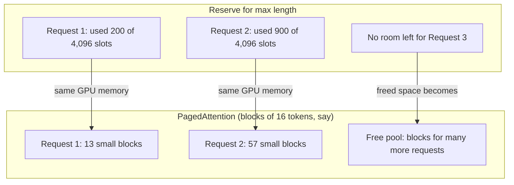
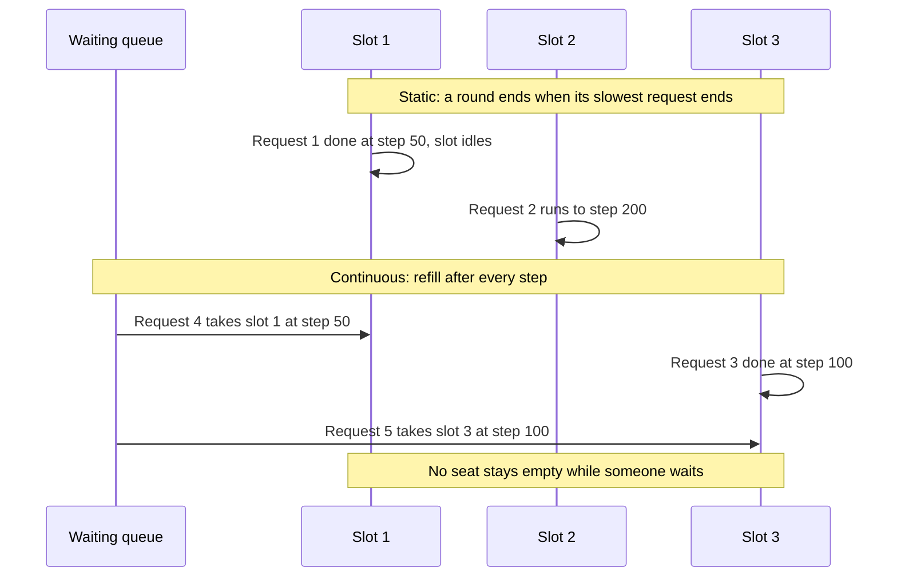
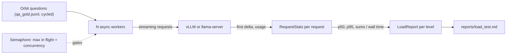
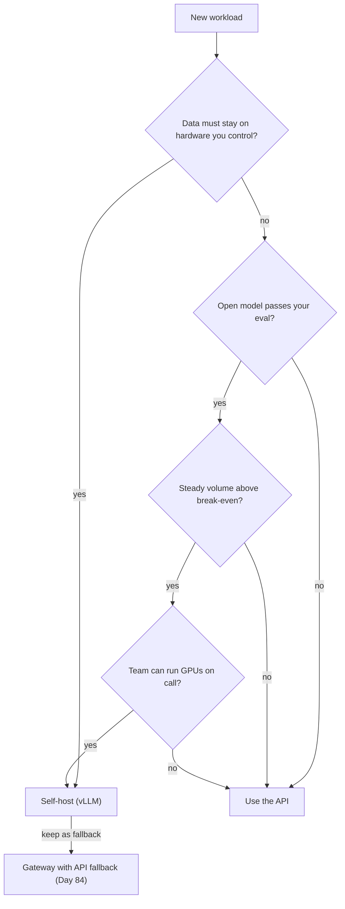

# Serving Open Models with vLLM (elective)

Atlas running on one laptop serves one maintainer well. When Orbit's 20-person support rota hits it at the same moment, every answer slows to a crawl. Before anyone buys a GPU, measure what a real serving engine does under load and what one token would cost you to produce yourself.

## At a Glance

- **Time:** ~2 h core (+ optional Go Deeper) · **Depth:** intro
- **Prerequisites:** [Day 91: Open-Weight Models & Local Inference](../Day_091_open_weight_local/open_weight_local.md) (the `base_url` swap and `make_client`), [Day 92: Quantization & Hardware Sizing](../Day_092_quantization_hardware/quantization_hardware.md) (your Q4 GGUF and memory sizing), plus [Day 13: Streaming Responses](../../Phase_2_Building_with_LLM_APIs/Day_013_streaming/streaming.md) for TTFT and the [Async Python II primer](../../Appendix_Primers/A04b_async_python_concurrency.md) for `gather` + `Semaphore`
- **You'll build:** a concurrency-sweep load tester (`load_test.py`) that writes `reports/load_test.md`, plus a self-host vs API cost calculator
- **Stops at:** multi-node and tensor-parallel serving (also multi-adapter LoRA serving and quantized-kernel tuning)
- **Fast path:** Already load-test services for a living? Read §"Self-Hosting vs API: The Cost Math", run `cost_compare` with the sample numbers, then do Exercise 3 (~30 min)
- **Cost:** $0 in API fees: everything runs against your own server. vLLM needs an NVIDIA GPU: free Colab GPUs (typically a T4) when available, quotas vary (⚠ verify), otherwise a few Colab compute units. On a Mac or CPU, use `llama-server` instead
- **New terms:** throughput, PagedAttention, continuous batching, concurrency sweep, utilization

> **Coming from Software Engineering?** vLLM is nginx for LLMs. nginx is a web server that juggles thousands of connections with one event loop; vLLM is a scheduler that keeps one expensive resource, the GPU, busy across many requests. PagedAttention is OS virtual memory (the OS hands out memory in fixed-size pages, so no program needs one big contiguous block) applied to each request's scratchpad. Continuous batching is a connection pool that reuses a slot the moment it frees, unlike a nightly batch job that waits for its slowest member. What transfers directly: load-test before you capacity-plan, report p95 and not the mean, and remember that utilization drives unit cost.

## One User Is Fine; Twenty Are Not

On [Day 91](../Day_091_open_weight_local/open_weight_local.md) you timed one question at a time against Ollama. That number is **latency**: how long one user waits. It says nothing about **throughput**, the amount of work the server finishes per second when many users share it. The two diverge as soon as requests overlap.

Run the same eight Orbit questions twice: one after another, then all at once.

```python
# script_id: day_093_vllm_serving/naive_parallel
"""One user vs eight users: the same 8 Orbit questions, sequential then concurrent.
Install: uv add openai
Env: ATLAS_LOCAL_BASE_URL (default Ollama), ATLAS_LOCAL_MODEL, ORBIT_DATA
Needs: Ollama running with the model pulled (Day 91). Calls no paid API."""
import asyncio, json, os, time
from pathlib import Path
from openai import AsyncOpenAI

DATA_DIR = Path(os.environ.get("ORBIT_DATA", "datasets/orbit"))
BASE = os.environ.get("ATLAS_LOCAL_BASE_URL", "http://localhost:11434/v1")
LOCAL_MODEL = os.environ.get("ATLAS_LOCAL_MODEL", "qwen3:4b-instruct-2507-q4_K_M")
rows = (DATA_DIR / "eval" / "qa_gold.jsonl").read_text().splitlines()[:8]
QUESTIONS = [json.loads(r)["question"] + " Answer in one sentence." for r in rows]

async def timed(client: AsyncOpenAI, q: str) -> float:
    t0 = time.perf_counter()
    await client.responses.create(model=LOCAL_MODEL, input=q)
    return time.perf_counter() - t0

async def main() -> None:
    client = AsyncOpenAI(base_url=BASE, api_key="ollama")          # key required but ignored
    seq = [await timed(client, q) for q in QUESTIONS]              # one user at a time
    t0 = time.perf_counter()
    par = await asyncio.gather(*(timed(client, q) for q in QUESTIONS))  # eight users at once
    wall = time.perf_counter() - t0
    print(f"sequential: mean wait {sum(seq) / len(seq):5.1f}s, all 8 done in {sum(seq):5.1f}s")
    print(f"concurrent: mean wait {sum(par) / len(par):5.1f}s, all 8 done in {wall:5.1f}s")

asyncio.run(main())
```

```text
sequential: mean wait   2.3s, all 8 done in  18.4s
concurrent: mean wait   9.8s, all 8 done in  16.9s
(illustrative; your numbers will differ)
```

The total time barely improved, but each user now waits about four times longer. A desktop runner like Ollama is tuned for one person, so it mostly queues the extra requests. A sequential benchmark would have said "2.3 s, great" and hidden the problem. Capacity only shows under concurrent load, so that is what you measure today.

## A Restaurant with Smart Seating

Picture a restaurant. The tables are GPU memory. Every party at a table keeps a notepad of everything said so far, so the waiter never has to ask again; that notepad is the **KV cache** from [Day 5](../../Phase_1_How_LLMs_Work/Day_005_transformers_attention/transformers_attention.md), the saved attention work for every earlier token. Notepads grow by one line per generated token.

A naive restaurant reserves a huge table for every party "in case they order a lot", and seats parties in rounds: nobody new sits down until the slowest party of the round has paid. A smart restaurant hands out notepad space a few pages at a time, as each party needs it, and seats a waiting party the instant a spot opens. Same kitchen, far more meals per hour. That is vLLM's whole trick.

## Static vs Continuous Batching by Hand

GPUs generate tokens in steps: on each step, every request in the batch gets one more token. Take a server with **3 slots** and three requests that need 50, 200 and 100 output tokens.

**Static batching** runs all three together until the longest one ends: 200 steps. Slot-steps available: 3 × 200 = 600. Slot-steps doing work: 50 + 200 + 100 = 350. The GPU is busy 350 / 600 ≈ **58%** of the time; the first slot sits idle for 150 steps after its request finishes.

With nothing waiting, those idle slots go unused anyway. Now queue three more requests (150, 50 and 100 tokens):

- Static: round one takes 200 steps, round two takes 150. Total 350 steps.
- Continuous: request 4 takes slot 1 at step 50 (ends at 200). Request 5 takes slot 3 at step 100 (ends at 150). Request 6 takes slot 3 again at step 150 (ends at 250). Everything finishes at step 250.

Check the arithmetic with a simulation:

```python
# script_id: day_093_vllm_serving/batching_by_hand
"""Static vs continuous batching on toy numbers. No GPU, no server.
Install: nothing (stdlib). Env: none."""
import heapq

def static_batching(lengths: list[int], slots: int) -> tuple[int, int]:
    """Each round runs until its longest request ends; freed slots stay idle."""
    steps = busy = 0
    for i in range(0, len(lengths), slots):
        batch = lengths[i:i + slots]
        steps += max(batch)
        busy += sum(batch)
    return steps, busy

def continuous_batching(lengths: list[int], slots: int) -> tuple[int, int]:
    """A waiting request takes whichever slot frees up first."""
    free_at = [0] * slots                 # min-heap: step at which each slot is free
    for n in lengths:
        start = heapq.heappop(free_at)
        heapq.heappush(free_at, start + n)
    return max(free_at), sum(lengths)

for name, lengths in {"3 requests": [50, 200, 100],
                      "6 requests": [50, 200, 100, 150, 50, 100]}.items():
    for fn in (static_batching, continuous_batching):
        steps, busy = fn(lengths, slots=3)
        print(f"{name}  {fn.__name__:<20} steps={steps:<4} GPU busy={busy / (steps * 3):.0%}")
```

```text
3 requests  static_batching      steps=200  GPU busy=58%
3 requests  continuous_batching  steps=200  GPU busy=58%
6 requests  static_batching      steps=350  GPU busy=62%
6 requests  continuous_batching  steps=250  GPU busy=87%
```

Continuous batching helps only when there is a queue: with three requests and three slots, both schedulers are identical. With a queue, the same six requests finish in 250 steps instead of 350, a 40% throughput gain from scheduling alone. Short requests win on latency too: under static batching, request 5 can't start until step 200.

## Name the Parts

A serving engine loads model weights onto the GPU, accepts HTTP requests and schedules token generation. vLLM is a widely used open-source one for NVIDIA GPUs, with an OpenAI-compatible API, so your Day 91 client code keeps working. Three parts matter today.

**The KV cache** (recap from Day 5): per-request memory that grows with every token. On a GPU, the weights take a fixed amount of memory and the KV cache takes the rest. That means **memory, not compute, usually caps how many requests run at once.**

**PagedAttention** is vLLM's KV-cache allocator, introduced in the vLLM paper (Kwon et al., SOSP 2023). Without it, a server reserves one contiguous block per request sized for the maximum length: reserve room for 4,096 tokens, the answer stops at 200, and the other ~3,900 token slots sit locked the whole time. PagedAttention splits the cache into small fixed-size blocks handed out on demand, like OS pages. A request's blocks can live anywhere in physical memory; a block table maps them back to logical order.



**Continuous batching** is the scheduler you simulated: after every generation step, finished requests leave and waiting ones join.



You will also hear **tensor parallelism**: splitting one model across several GPUs. Today stays on one GPU, so that is a name only (see Go Deeper).

## Start a Server

vLLM runs on Linux with an NVIDIA GPU. It does not run on a regular Mac setup, so pick your path:

- **GPU path (Colab):** `vllm serve` on a free or paid Colab GPU. vLLM needs compute capability 7.5 or higher, which a T4 meets, but a T4 has no bf16 support (bfloat16, the 16-bit number format most newer models ship in), so you pass `--dtype half`.
- **Mac / CPU path:** `llama-server` with your Day 92 Q4 GGUF. It batches across a fixed number of slots, so every measurement below still works, at smaller numbers.

The GPU path serves `Qwen/Qwen3-0.6B`: small enough to leave a 16 GB T4 plenty of KV-cache room, and ungated on Hugging Face (no access token).

```bash
# Colab: Runtime → Change runtime type → T4 GPU. In a cell, prefix each line with "!".
# Install line per the vLLM quickstart (vLLM 0.33, as of 2026-11; ⚠ verify against the quickstart).
pip install -q uv openai
uv venv --python 3.12 --seed /content/vllm-env      # keeps vLLM's pinned torch out of Colab's own env
uv pip install --python /content/vllm-env/bin/python vllm --torch-backend=auto
# Start in the background and log to a file: a foreground server would block the notebook.
nohup /content/vllm-env/bin/vllm serve Qwen/Qwen3-0.6B --dtype half --max-model-len 4096 \
  > vllm.log 2>&1 &
tail -n 5 vllm.log    # re-run until the log shows "Application startup complete" (first start downloads weights)
```

`--max-model-len` caps prompt plus output tokens per request; 4,096 fits Orbit questions and leaves memory for more parallel requests. The server listens on `http://localhost:8000/v1`. Colab's VM isn't reachable from the internet, so this skips `--api-key`; on a shared machine, add `--api-key "$VLLM_API_KEY"` and export the same variable for the client.

```bash
# Mac / CPU: llama-server with the Q4_K_M GGUF you built on Day 92.
brew install llama.cpp
# 4 slots = up to 4 requests decoded together. The -c context is shared across slots (⚠ verify with llama-server --help).
llama-server -m "$ATLAS_GGUF" --port 9931 --parallel 4 -c 16384
export ATLAS_SERVE_BASE_URL=http://localhost:9931/v1   # llama-server's default port is 9931, not 8080
```

Now call it through Day 91's `make_client`, extended with a third backend. The model ID comes from the server's `/v1/models` list, because vLLM serves under the Hugging Face repo ID.

```python
# script_id: day_093_vllm_serving/first_call
"""First call to a self-hosted OpenAI-compatible server (vLLM or llama-server).
Install: uv add openai
Env: ATLAS_SERVE_BASE_URL (default http://localhost:8000/v1, vLLM's default),
     VLLM_API_KEY (only if the server was started with --api-key), ATLAS_SERVE_MODEL (optional)
Needs: a running `vllm serve` or `llama-server`. Calls no paid API."""
import os
import time
from typing import Literal
from openai import OpenAI

MODEL = os.environ.get("ATLAS_MODEL", "gpt-6-luna")
LOCAL_BASE_URL = os.environ.get("ATLAS_LOCAL_BASE_URL", "http://localhost:11434/v1")
LOCAL_MODEL = os.environ.get("ATLAS_LOCAL_MODEL", "qwen3:4b-instruct-2507-q4_K_M")
SERVE_BASE_URL = os.environ.get("ATLAS_SERVE_BASE_URL", "http://localhost:8000/v1")

def make_client(backend: Literal["openai", "local", "serve"] = "openai") -> tuple[OpenAI, str]:
    """Day 91's make_client (compact) plus a "serve" backend. Returns (client, model id)."""
    if backend == "openai":
        return OpenAI(), MODEL
    if backend == "local":
        return OpenAI(base_url=LOCAL_BASE_URL, api_key="ollama"), LOCAL_MODEL
    client = OpenAI(base_url=SERVE_BASE_URL, api_key=os.environ.get("VLLM_API_KEY", "EMPTY"))
    # Ask the server what it serves instead of guessing the name.
    model = os.environ.get("ATLAS_SERVE_MODEL") or client.models.list().data[0].id
    return client, model

client, model = make_client("serve")
t0 = time.perf_counter()
resp = client.responses.create(
    model=model, max_output_tokens=512,
    input="What are the default values of lease_seconds and heartbeat_seconds in orbit.toml?")
out = resp.usage.output_tokens if resp.usage else "?"
print(f"served model: {model}  ({time.perf_counter() - t0:.2f}s, {out} output tokens)")
print(resp.output_text[:300])
```

```text
served model: Qwen/Qwen3-0.6B  (1.84s, 287 output tokens)
<think>
Okay, the user is asking about orbit.toml ...
(illustrative; your numbers and text will differ)
```

Qwen3 models may open with a `<think>…</think>` section that counts as output tokens, hence the generous `max_output_tokens`. The answer is probably wrong, since a 0.6B model has never seen Orbit's docs. Today measures speed and cost; Day 91 measured quality.

### Break it: wrong names and startup errors

The most common first error is asking for a model name the server doesn't serve.

```python
# script_id: day_093_vllm_serving/model_not_found
"""Break it: request a model name the server does not serve, then list what it does serve.
Install: uv add openai · Env: ATLAS_SERVE_BASE_URL, VLLM_API_KEY · Needs: a running vLLM server."""
import os
import openai
from openai import OpenAI

client = OpenAI(base_url=os.environ.get("ATLAS_SERVE_BASE_URL", "http://localhost:8000/v1"),
                api_key=os.environ.get("VLLM_API_KEY", "EMPTY"), max_retries=0)
try:
    client.responses.create(model="qwen3-0.6b", input="hi")   # Ollama-style tag, not the HF repo id
except openai.NotFoundError as e:
    served = [m.id for m in client.models.list().data]
    print(f"{e.message}\nserver offers: {served}")
```

```text
Error code: 404 - The model `qwen3-0.6b` does not exist.
server offers: ['Qwen/Qwen3-0.6B']
(message text paraphrased from vLLM; ⚠ verify the exact wording on your version)
```

Pass the listed ID, or start the server with `--served-model-name atlas-small` (⚠ verify with `vllm serve --help`) so clients get a stable name that survives a model swap. `llama-server` is lenient about names, so this mostly bites on vLLM.

Startup errors show up in `vllm.log`, not in your client:

| You did | Log says (gist) | Fix |
|---|---|---|
| Forgot `--dtype half` on a T4 | `Bfloat16 is only supported on GPUs with compute capability of at least 8.0 … --dtype=half` | Add `--dtype half` |
| `--max-model-len` larger than the KV cache can hold, e.g. a 4B model with its full context on a T4 | A `ValueError` saying the max sequence length is larger than the KV cache can store, suggesting you raise `gpu_memory_utilization` or lower `max_model_len` (⚠ verify wording) | Lower `--max-model-len`, raise `--gpu-memory-utilization` (the share of GPU memory vLLM may claim), or pick a smaller/quantized model |
| A model too big for the card | `torch.OutOfMemoryError: CUDA out of memory` | A smaller model or a quantized checkpoint ([Day 92](../Day_092_quantization_hardware/quantization_hardware.md)) |

## Turn the Knob: A Concurrency Sweep

A **concurrency sweep** is a load test run at several fixed levels of in-flight requests (1, 4, 16, 32), recording the same metrics at each level, so you can see where throughput stops growing. For each level you want:

- **req/s:** successful requests per second.
- **output tok/s:** total generated tokens per second across all requests. This is the number that drives cost.
- **TTFT p50 / p95:** time to first token, the latency users feel with streaming ([Day 13](../../Phase_2_Building_with_LLM_APIs/Day_013_streaming/streaming.md)). p95 means 95% of requests were at least this fast ([Day 42](../../Phase_5_Evaluation_and_Observability/Day_042_tracing_observability/tracing_observability.md)).
- **errors:** timeouts and HTTP errors. A sweep that "gets faster" by failing half its requests is lying.



Async patterns come from the [Async Python II primer](../../Appendix_Primers/A04b_async_python_concurrency.md), and the API-side load test belongs to [Day 90](../../Phase_9_Production/Day_090_capstone_r5_launch/capstone_r5_launch.md). What's new is pointing it at your own server.

The first block holds the setup and helpers:

```python
# script_id: day_093_vllm_serving/load_test
"""Concurrency sweep against an OpenAI-compatible server: req/s, output tok/s, TTFT p50/p95, errors.
Install: uv add openai
Env: ATLAS_SERVE_BASE_URL (default http://localhost:8000/v1), VLLM_API_KEY (if the server uses one),
     ATLAS_SERVE_MODEL (optional; else the first id from /v1/models), ORBIT_DATA
Needs: a running vLLM (Colab GPU) or llama-server (Mac/CPU). Calls no paid API."""
import asyncio
import json
import math
import os
import time
from dataclasses import dataclass
from pathlib import Path
import openai
from openai import AsyncOpenAI

DATA_DIR = Path(os.environ.get("ORBIT_DATA", "datasets/orbit"))
SERVE_BASE_URL = os.environ.get("ATLAS_SERVE_BASE_URL", "http://localhost:8000/v1")
API_KEY = os.environ.get("VLLM_API_KEY", "EMPTY")

@dataclass
class RequestStats:
    ok: bool
    ttft_s: float | None      # time to the first streamed delta (text or reasoning)
    total_s: float
    out_tokens: int
    error: str = ""

def load_prompts() -> list[str]:
    rows = (DATA_DIR / "eval" / "qa_gold.jsonl").read_text().splitlines()
    return [json.loads(r)["question"] + " Answer in two sentences." for r in rows if r.strip()]

def percentile(xs: list[float], p: float) -> float:
    """Nearest-rank percentile (Day 42's helper, compact). NaN when there is no data."""
    if not xs:
        return float("nan")
    s = sorted(xs)
    return s[max(0, math.ceil(p / 100 * len(s)) - 1)]
```

`one_request()` streams one answer and records when the first delta arrives. It prefers the server's own token count from the final `response.completed` event, and falls back to counting deltas (roughly one token each) if a server omits usage.

```python
# script_id: day_093_vllm_serving/load_test
async def one_request(client: AsyncOpenAI, model: str, prompt: str,
                      max_tokens: int = 256, timeout_s: float = 60.0) -> RequestStats:
    t0 = time.perf_counter()
    ttft, deltas, usage_out = None, 0, None
    try:
        async with asyncio.timeout(timeout_s):         # caps the whole request, not one socket read
            stream = await client.responses.create(
                model=model, input=prompt, max_output_tokens=max_tokens, stream=True)
            async for ev in stream:
                if ev.type.endswith(".delta"):         # output_text.delta, or a reasoning delta
                    if ttft is None:
                        ttft = time.perf_counter() - t0
                    deltas += 1
                elif ev.type == "response.completed" and ev.response.usage:
                    usage_out = ev.response.usage.output_tokens
    except TimeoutError:
        return RequestStats(False, ttft, time.perf_counter() - t0, deltas, "timeout")
    except openai.APIError as e:                       # HTTP 4xx/5xx and connection errors
        return RequestStats(False, ttft, time.perf_counter() - t0, deltas, type(e).__name__)
    return RequestStats(True, ttft, time.perf_counter() - t0, usage_out or deltas)
```

`run_level()` holds `concurrency` requests in flight with a semaphore and turns raw stats into one `LoadReport`. `load_test()` is the sync entry point the exercises call. The client is built with `max_retries=0` because the SDK's automatic retries would hide exactly the overload errors you are trying to see.

```python
# script_id: day_093_vllm_serving/load_test
@dataclass
class LoadReport:
    concurrency: int
    rps: float            # successful requests per second
    out_tok_s: float      # output tokens per second, summed over all requests
    ttft_p50: float
    ttft_p95: float
    errors: int
    n: int = 0

async def run_level(client: AsyncOpenAI, model: str, prompts: list[str], concurrency: int,
                    n_requests: int, timeout_s: float = 60.0) -> LoadReport:
    sem = asyncio.Semaphore(concurrency)              # at most `concurrency` requests in flight

    async def worker(i: int) -> RequestStats:
        async with sem:
            return await one_request(client, model, prompts[i % len(prompts)], timeout_s=timeout_s)

    t0 = time.perf_counter()
    stats = await asyncio.gather(*(worker(i) for i in range(n_requests)))
    wall = time.perf_counter() - t0
    ok = [s for s in stats if s.ok]
    ttfts = [s.ttft_s for s in ok if s.ttft_s is not None]
    return LoadReport(concurrency, len(ok) / wall, sum(s.out_tokens for s in ok) / wall,
                      percentile(ttfts, 50), percentile(ttfts, 95), len(stats) - len(ok), len(stats))

def load_test(base_url: str, model: str, concurrency: int, n_requests: int,
              timeout_s: float = 60.0) -> LoadReport:
    async def _go() -> LoadReport:
        async with AsyncOpenAI(base_url=base_url, api_key=API_KEY, max_retries=0) as client:
            return await run_level(client, model, load_prompts(), concurrency, n_requests, timeout_s)
    return asyncio.run(_go())
```

## A Realistic Load-Test Report

The last block runs the sweep, sends two warm-up requests first (early calls are slow), and writes a Markdown report to commit next to the code.

```python
# script_id: day_093_vllm_serving/load_test
def served_model(base_url: str) -> str:
    if name := os.environ.get("ATLAS_SERVE_MODEL"):
        return name
    return openai.OpenAI(base_url=base_url, api_key=API_KEY).models.list().data[0].id

def sweep(model: str, levels: tuple[int, ...] = (1, 4, 16, 32), per_level: int = 4) -> list[LoadReport]:
    load_test(SERVE_BASE_URL, model, concurrency=1, n_requests=2)        # warm-up, discarded
    reports = []
    for c in levels:
        r = load_test(SERVE_BASE_URL, model, concurrency=c, n_requests=max(16, per_level * c))
        print(f"c={c:>3}  {r.rps:6.2f} req/s  {r.out_tok_s:7.0f} out tok/s  "
              f"TTFT p50 {r.ttft_p50:5.2f}s p95 {r.ttft_p95:5.2f}s  errors {r.errors}/{r.n}")
        reports.append(r)
    return reports

def write_report(reports: list[LoadReport], model: str, path: Path = Path("reports/load_test.md")) -> Path:
    lines = [f"# Load test: `{model}` at {SERVE_BASE_URL}", "",
             "| concurrency | req/s | out tok/s | TTFT p50 (s) | TTFT p95 (s) | errors |",
             "|---|---|---|---|---|---|"]
    lines += [f"| {r.concurrency} | {r.rps:.2f} | {r.out_tok_s:.0f} | {r.ttft_p50:.2f} "
              f"| {r.ttft_p95:.2f} | {r.errors}/{r.n} |" for r in reports]
    best = max(reports, key=lambda r: r.out_tok_s)
    lines += ["", f"Peak: {best.out_tok_s:.0f} output tok/s at concurrency {best.concurrency}."]
    path.parent.mkdir(parents=True, exist_ok=True)
    path.write_text("\n".join(lines) + "\n")
    return path

if __name__ == "__main__":
    model = served_model(SERVE_BASE_URL)
    print("wrote", write_report(sweep(model), model))
```

```text
c=  1    0.62 req/s       98 out tok/s  TTFT p50  0.03s p95  0.04s  errors 0/16
c=  4    2.31 req/s      371 out tok/s  TTFT p50  0.04s p95  0.06s  errors 0/16
c= 16    7.90 req/s     1262 out tok/s  TTFT p50  0.07s p95  0.12s  errors 0/64
c= 32   10.40 req/s     1655 out tok/s  TTFT p50  0.15s p95  0.31s  errors 0/128
wrote reports/load_test.md
(illustrative shape for a 0.6B model on a T4; your numbers will differ)
```

How to read your own table:

- **Throughput climbs almost linearly at first.** One request leaves the GPU mostly idle; one step for four sequences costs barely more than for one. That's batching paying off.
- **Then it bends.** The knee, where tok/s grows much less than concurrency, is your capacity. Past it you add only queueing, so TTFT p95 climbs.
- **Errors appear last,** as timeouts once the queue gets long.

On `llama-server --parallel 4`, the curve flattens at concurrency 4: request five waits for a slot. The slot count, not raw speed, sets the ceiling.

### From one report to a fleet size

Capacity planning turns one report row into "how many servers?": take the highest level that met your **SLO** (service-level objective: a latency target such as "p95 TTFT under 2 s"), keep headroom for spikes, and divide peak traffic by it. The same numbers give **utilization**, the share of paid GPU time doing useful work.

```python
# script_id: day_093_vllm_serving/capacity_plan
"""From one load-test row to a fleet size and an average utilization. Stdlib only.
Install: nothing. Env: none. Replace the sample values with rows from reports/load_test.md."""
import math

LEVEL_RPS = 7.90   # req/s at the highest concurrency that met the SLO (sample row: c=16)
PEAK_RPS = 2.0     # Orbit's rota at its busiest (an assumption; measure it from your logs)
AVG_RPS = 0.3      # average over 24 hours, nights and weekends included
HEADROOM = 0.7     # plan to run each replica at <=70% of measured capacity

def replicas_needed(peak_rps: float, rps_per_replica: float, headroom: float = HEADROOM) -> int:
    return max(1, math.ceil(peak_rps / (rps_per_replica * headroom)))

n = replicas_needed(PEAK_RPS, LEVEL_RPS)
utilization = AVG_RPS / (n * LEVEL_RPS)
print(f"replicas for peak: {n}")
print(f"average utilization: {utilization:.0%} of the capacity you pay for")
```

```text
replicas for peak: 1
average utilization: 4% of the capacity you pay for
```

One small GPU covers Orbit's peak and sits idle 96% of the time. That number decides the next section.

## Self-Hosting vs API: The Cost Math

An API bills per token; a GPU bills per hour, busy or idle. To compare, convert the hourly price into dollars per million output tokens:

`$/1M tokens = GPU $/hour ÷ (tokens/second × 3,600 × utilization) × 1,000,000`

Round inputs: a GPU at $1.00/hour (a placeholder, not a quote) producing 1,000 tok/s at full load makes 3.6M tokens an hour: $0.28 per 1M. At 10% utilization the same dollar buys 0.36M useful tokens: $2.78 per 1M. Same hardware, 10× the price.

The **break-even volume** is the daily token count where an always-on GPU costs the same as the API: GPU $/day ÷ API $/token. At $24/day against `gpt-6-luna`'s $0.50 per 1M output tokens (as of 2026-11, [verify](https://developers.openai.com/api/docs/pricing)), that is 48M output tokens a day.

```python
# script_id: day_093_vllm_serving/cost_compare
"""Self-hosted $/1M output tokens vs an API price, and the break-even daily volume. Stdlib only.
Install: nothing. Env: ATLAS_GPU_USD_PER_HR (your provider's on-demand price),
     ATLAS_OUT_TOK_S (output tok/s from reports/load_test.md at your SLO level)."""
import os

def cost_per_million(gpu_usd_per_hr: float, out_tok_s: float, utilization: float = 1.0) -> float:
    """$ per 1M output tokens; utilization = share of paid GPU hours doing useful work."""
    return gpu_usd_per_hr / (out_tok_s * 3600 * utilization) * 1_000_000

def breakeven_tokens_per_day(gpu_usd_per_hr: float, api_usd_per_m: float, hours: float = 24) -> float:
    """Daily output tokens above which an always-on GPU is cheaper than the API."""
    return gpu_usd_per_hr * hours / api_usd_per_m * 1_000_000

# PLACEHOLDER inputs: set both env vars to your own numbers before deciding anything.
GPU_USD_PER_HR = float(os.environ.get("ATLAS_GPU_USD_PER_HR", "1.00"))
OUT_TOK_S = float(os.environ.get("ATLAS_OUT_TOK_S", "1262"))     # sample report, c=16
API_OUT_USD_PER_M = 0.50   # gpt-6-luna output, as of 2026-11; verify at the pricing page

if __name__ == "__main__":
    for u in (0.04, 0.50, 1.00):
        usd = cost_per_million(GPU_USD_PER_HR, OUT_TOK_S, u)
        print(f"self-host at {u:>4.0%} utilization: ${usd:.3f} per 1M output tokens")
    print(f"API (gpt-6-luna):              ${API_OUT_USD_PER_M:.3f} per 1M output tokens")
    be = breakeven_tokens_per_day(GPU_USD_PER_HR, API_OUT_USD_PER_M)
    cap = OUT_TOK_S * 86_400
    print(f"break-even: {be / 1e6:.0f}M output tokens/day = {be / cap:.0%} of this GPU's "
          f"daily capacity ({cap / 1e6:.1f}M)")
```

```text
self-host at   4% utilization: $5.503 per 1M output tokens
self-host at  50% utilization: $0.440 per 1M output tokens
self-host at 100% utilization: $0.220 per 1M output tokens
API (gpt-6-luna):              $0.500 per 1M output tokens
break-even: 48M output tokens/day = 44% of this GPU's daily capacity (109.0M)
```

At Orbit's 4% utilization, self-hosting costs about 11× the API per token. It only wins if the GPU stays above roughly 44% busy around the clock. Three honest corrections before you trust any such table:

- **Quality must match first.** A 0.6B model replaces `gpt-6-luna` only if it passes your eval ([Day 91](../Day_091_open_weight_local/open_weight_local.md); [Day 96](../Day_096_evaluating_distilling_small_models/evaluating_distilling_small_models.md) for fine-tuned models).
- **Input tokens cost on both sides.** The API bills them; on your GPU, long RAG prompts eat prefill time and lower output tok/s. Load-test with realistic prompt lengths.
- **People cost money.** Someone patches drivers and answers the 3 a.m. page; no $/token table shows that.



| Situation | Choose | Why |
|---|---|---|
| Spiky or low volume (most internal tools) | API | You pay only for tokens used; idle GPUs are pure cost |
| Data may not leave your network | Self-host | A compliance rule overrides the cost table |
| Steady high volume, open model passes eval | Self-host | Utilization stays high, so $/token drops below the API |
| Need the strongest model available | API | Frontier models aren't open-weight |

### In production

- **Cold starts take minutes.** Keep one warm replica and store weights on a persistent volume instead of re-downloading them.
- **Put a gateway in front** and keep the API as a fallback route, so a GPU outage degrades cost, not availability (owner: [Day 84](../../Phase_9_Production/Day_084_reliability_fallbacks/reliability_fallbacks.md); cost routing: [Day 85](../../Phase_9_Production/Day_085_caching_cost_scale/caching_cost_scale.md)).
- **Monitor queue depth, KV-cache usage and TTFT p95**, not only GPU utilization; vLLM exposes server metrics for Prometheus (⚠ verify the endpoint in the docs). Alerting lives in [Day 86](../../Phase_9_Production/Day_086_monitoring_feedback/monitoring_feedback.md).
- **Autoscale on queue length or TTFT;** scale-to-zero saves money but makes the first user wait out a cold start.
- **Never expose the port without `--api-key`** and network rules; an open server is free GPU time for strangers.

## Go Deeper (optional)

<details><summary>Go deeper: how much KV memory one token costs</summary>

Every layer stores one key vector and one value vector per token, for each KV head. So bytes per token = 2 × layers × KV heads × head size × bytes per number. Read the real values from the model's `config.json` (`num_hidden_layers`, `num_key_value_heads`, `head_dim`); the numbers below describe a hypothetical small model. Day 92's sizing rule covers the weights; this covers the part that grows with traffic.

```python
# script_id: day_093_vllm_serving/kv_capacity
"""How many sequences fit in KV-cache memory: reserve-for-max vs paged. Stdlib only."""

def kv_bytes_per_token(layers: int, kv_heads: int, head_dim: int, bytes_per_value: int = 2) -> int:
    return 2 * layers * kv_heads * head_dim * bytes_per_value   # 2 = one key + one value

per_tok = kv_bytes_per_token(layers=28, kv_heads=8, head_dim=128)   # hypothetical model, fp16
kv_budget = 8 * 1024**3          # say 8 GiB of GPU memory is left after loading the weights
max_len, avg_len = 4096, 600     # what you'd reserve vs what requests actually use
print(f"{per_tok / 1024:.0f} KiB per token")
print(f"reserve max_len per request: {kv_budget // (per_tok * max_len)} concurrent sequences")
print(f"allocate as you go (avg {avg_len}): {kv_budget // (per_tok * avg_len)} concurrent sequences")
```

```text
112 KiB per token
reserve max_len per request: 18 concurrent sequences
allocate as you go (avg 600): 124 concurrent sequences
```

The 7× gap is why paged allocation matters and why `--max-model-len` is a capacity knob: it bounds how much any one request can claim. Long-context RAG prompts shrink the second number fast.

</details>

<details><summary>Go deeper: prefix caching, the self-hosted cousin of prompt caching</summary>

[Day 18](../../Phase_2_Building_with_LLM_APIs/Day_018_cost_latency_caching/cost_latency_caching.md) showed provider prompt caching: a repeated prompt prefix is billed at a discount and answered faster. vLLM's automatic prefix caching does the same inside your server: when two requests start with identical tokens (a shared system prompt, the same retrieved doc), their KV blocks are reused instead of recomputed. It is enabled by default in recent versions; the switch is `--enable-prefix-caching` / `--no-enable-prefix-caching` (⚠ verify both against `vllm serve --help` for your version).

The design rule is the one from Day 18: stable content first, variable content last. The payoff differs, though. There is no discount line on a bill; you get lower TTFT and spare KV memory, which shows up as more capacity in your sweep. The Stretch exercise measures it.

</details>

<details><summary>Go deeper: tensor parallelism, prefill vs decode, and what experts measure</summary>

**Tensor parallelism** splits each layer's weight matrices across several GPUs in one machine, so a model too big for one card can still be served; the GPUs exchange partial results on every layer, which needs fast links between them. vLLM sets it with a tensor-parallel-size option (⚠ verify the flag). Pipeline parallelism (layers split across GPUs) and multi-node serving go further. All of it is past today's stop line: reach for it when the model doesn't fit, not to go faster on a model that does.

**Prefill vs decode.** Each request has two phases: prefill reads the whole prompt in one parallel pass (this sets TTFT), and decode generates tokens one step at a time (this sets tok/s). Short prompts make decode dominate; RAG prompts with thousands of context tokens shift the cost to prefill and move your knee to a lower concurrency. Experts load-test with a realistic mix of prompt and output lengths taken from production logs, and report input and output throughput separately.

**Cross-check with vLLM's own benchmark.** vLLM ships a benchmark command (`vllm bench serve`, ⚠ verify the name and flags in the benchmarking docs for your version). Use it to sanity-check your numbers, and keep your own harness for questions only you can ask, such as "with Orbit's prompts, at our SLO".

**What else experts tune:** request priority and per-tenant limits at the gateway, the maximum number of sequences batched at once, and quantized checkpoints made with llm-compressor (Day 92). Each one is a knob to sweep the same way you swept concurrency: change one thing, rerun the report, compare.

</details>

## Common Pitfalls

- **vLLM won't install or run on your Mac.** It targets Linux with NVIDIA CUDA. Use Colab, or `llama-server` / Ollama locally; the load tester works against all of them.
- **`torch.OutOfMemoryError: CUDA out of memory`, or a KV-cache capacity error at startup.** Weights plus the KV cache for `--max-model-len` don't fit; see the startup-error table above.
- **`404 … The model 'qwen3-0.6b' does not exist`.** vLLM serves under the Hugging Face repo ID. Use the ID from `client.models.list()`, or start with `--served-model-name`.
- **Your load generator is the bottleneck.** A sync client, no semaphore, or printing every token makes the server look slow. Use one `AsyncOpenAI` client and a semaphore, and count tokens silently.
- **T4 and Colab quirks.** No bf16 on a T4, so pass `--dtype half`. A Colab disconnect kills the background server: keep `vllm.log`, restart, and rerun the warm-up.
- **Costing at 100% utilization.** It flatters self-hosting by up to 10× or more. Use the utilization your real traffic produces.

> **Where we stop:** one GPU, one model. Multi-node and tensor-parallel serving, Kubernetes deployments, multi-adapter LoRA serving and kernel tuning are out of scope; the [vLLM docs](https://raw.githubusercontent.com/vllm-project/vllm/main/docs/getting_started/quickstart.md) are the next stop for the curious.

## Key Takeaways

- A sequential benchmark measures latency; capacity only shows under concurrent load, where one-user tools queue requests and each user's wait grows.
- The KV cache, not compute, usually caps concurrency. PagedAttention hands out cache memory in small blocks on demand, so no request reserves space it never uses.
- Continuous batching refills a slot the moment a request finishes; it helps only when requests are waiting, and then it raises throughput and cuts latency for short requests.
- A concurrency sweep with req/s, output tok/s, TTFT p50/p95 and errors per level finds the knee where throughput flattens and p95 climbs; plan capacity at the highest level that meets your SLO.
- Self-hosted $/token = GPU $/hour ÷ (tok/s × 3,600 × utilization); low utilization makes an idle GPU far pricier than the API, so compare at your real traffic and only after quality passes.

## Quick Reference

| API / pattern | When to use | Gotcha |
|---|---|---|
| `vllm serve <hf-repo-id> --dtype half --max-model-len 4096` | GPU serving on Colab / Linux + NVIDIA | T4 needs `--dtype half`; default port 8000 |
| `llama-server -m model.gguf --port 9931 --parallel 4` | Mac / CPU serving with N slots | Default port is 9931; slots cap concurrency |
| `OpenAI(base_url=SERVE_BASE_URL, api_key=...)` | Any OpenAI-compatible server | `api_key` must be set; `"EMPTY"` if the server has none |
| `responses.create(..., stream=True)` + first `.delta` | TTFT per request | Read usage from `response.completed`; fall back to counting deltas |
| `asyncio.Semaphore(c)` + `gather` | Hold exactly `c` requests in flight | Use `max_retries=0` so retries don't hide overload |
| `cost_per_million(gpu_usd_per_hr, out_tok_s, utilization)` | Self-host vs API decision | Never cost at 100% utilization |

## Exercises

1. **Warm-up.** Change the sweep levels to `(1, 2, 8, 64)` and print how much output tok/s grows from each level to the next. Mark the knee where the gain drops below about 1.2×.

<details><summary>Solution</summary>

```python
# script_id: day_093_vllm_serving/solution_ex1
"""Needs a running server; reuses load_test.py from this lesson (same folder)."""
from load_test import SERVE_BASE_URL, served_model, sweep

reports = sweep(served_model(SERVE_BASE_URL), levels=(1, 2, 8, 64))
for prev, cur in zip(reports, reports[1:]):
    gain = cur.out_tok_s / prev.out_tok_s
    flag = "  <- knee: more users, little more throughput" if gain < 1.2 else ""
    print(f"c={prev.concurrency}->{cur.concurrency}: {gain:.1f}x tok/s, "
          f"TTFT p95 {cur.ttft_p95:.2f}s{flag}")
```

Throughput has a knee: past it, extra concurrency only adds queueing, which shows up as rising TTFT p95.

</details>

2. **Core.** Run the sweep against `llama-server --parallel 1`, then restart with `--parallel 4` (or compare vLLM with Ollama on the same box). Save each run under a label and print them side by side.

<details><summary>Solution</summary>

```python
# script_id: day_093_vllm_serving/solution_ex2
"""Run once per server config: ATLAS_RUN_LABEL=np1 python solution_ex2.py, restart, then np4."""
import json
import os
from dataclasses import asdict
from pathlib import Path
from load_test import SERVE_BASE_URL, served_model, sweep

label = os.environ.get("ATLAS_RUN_LABEL", "run")
out = Path("reports") / f"sweep_{label}.json"
out.parent.mkdir(exist_ok=True)
reports = sweep(served_model(SERVE_BASE_URL), levels=(1, 4, 8))
out.write_text(json.dumps([asdict(r) for r in reports], indent=2))

for path in sorted(Path("reports").glob("sweep_*.json")):
    rows = json.loads(path.read_text())
    print(f"{path.stem:<12}", " | ".join(f"c={r['concurrency']}: {r['out_tok_s']:.0f} tok/s"
                                       for r in rows))
```

With one slot, tok/s stays flat as concurrency grows; with four slots it rises until concurrency 4. Same model, same hardware: batching, not raw speed, raised throughput.

</details>

3. **Core.** Find your SLO capacity and its cost. Sweep with a 10 s timeout, stop at the first level that misses "p95 TTFT < 2 s with zero errors", then price the last passing level with a real GPU price from your provider and find the break-even volume against `gpt-6-luna`.

<details><summary>Solution</summary>

```python
# script_id: day_093_vllm_serving/solution_ex3
"""Needs a running server and ATLAS_GPU_USD_PER_HR set to a real on-demand price."""
import os
from cost_compare import API_OUT_USD_PER_M, breakeven_tokens_per_day, cost_per_million
from load_test import SERVE_BASE_URL, load_test, served_model

SLO_TTFT_P95_S = 2.0
gpu_usd_per_hr = float(os.environ["ATLAS_GPU_USD_PER_HR"])   # no default on purpose
model = served_model(SERVE_BASE_URL)
best = None
for c in (1, 2, 4, 8, 16, 32, 64):
    r = load_test(SERVE_BASE_URL, model, concurrency=c, n_requests=max(16, 4 * c), timeout_s=10.0)
    meets = r.ttft_p95 < SLO_TTFT_P95_S and r.errors == 0    # NaN p95 (all failed) never meets
    print(f"c={c:>2}: p95 {r.ttft_p95:.2f}s, errors {r.errors}/{r.n} -> {'meets' if meets else 'misses'}")
    if not meets:
        break
    best = r

if best:
    print(f"SLO capacity: c={best.concurrency}, {best.out_tok_s:.0f} out tok/s")
    for u in (0.1, 0.5, 1.0):
        print(f"  {u:.0%} utilization: ${cost_per_million(gpu_usd_per_hr, best.out_tok_s, u):.3f}/1M")
    be = breakeven_tokens_per_day(gpu_usd_per_hr, API_OUT_USD_PER_M)
    print(f"break-even vs API: {be / 1e6:.1f}M output tokens/day")
```

Capacity is defined by your SLO, not by the peak of the throughput curve, and its cost depends on how busy you keep it.

</details>

4. **Stretch (optional, uses Go Deeper).** Put the same long Orbit doc in front of every question, and compare TTFT with prefix caching on and off (restart `vllm serve` with each setting).

<details><summary>Solution</summary>

```python
# script_id: day_093_vllm_serving/solution_ex4
"""Run once per server setting (prefix caching on, then off) and compare the two lines."""
import asyncio
from openai import AsyncOpenAI
from load_test import (API_KEY, DATA_DIR, SERVE_BASE_URL, load_prompts, one_request,
                       percentile, served_model)

DOC = sorted((DATA_DIR / "docs").rglob("*.md"))[0].read_text()[:6000]   # shared prefix, ~1.5k tokens

async def main() -> None:
    model = served_model(SERVE_BASE_URL)
    prompts = [f"Orbit docs:\n{DOC}\n\nQuestion: {q}" for q in load_prompts()[:12]]
    async with AsyncOpenAI(base_url=SERVE_BASE_URL, api_key=API_KEY, max_retries=0) as client:
        await one_request(client, model, prompts[0], max_tokens=16)    # fills the cache once
        stats = [await one_request(client, model, p, max_tokens=16) for p in prompts[1:]]
    ttfts = [s.ttft_s for s in stats if s.ttft_s is not None]
    print(f"TTFT p50 {percentile(ttfts, 50):.3f}s  p95 {percentile(ttfts, 95):.3f}s")

asyncio.run(main())
```

With caching on, the shared prefix is computed once and TTFT drops: Day 18's prompt caching, paid in KV memory, not on an invoice.

</details>

## References & Further Reading

- [vLLM quickstart](https://raw.githubusercontent.com/vllm-project/vllm/main/docs/getting_started/quickstart.md): the install line, `vllm serve`, and the OpenAI-compatible server; check here before trusting any flag in this lesson.
- [vLLM online serving overview](https://raw.githubusercontent.com/vllm-project/vllm/main/docs/serving/online_serving/README.md): which OpenAI-style endpoints the server exposes.
- *Efficient Memory Management for Large Language Model Serving with PagedAttention* (Kwon et al., SOSP 2023): the vLLM paper. Search its title on arXiv (link unverified, ⚠ verify).
- [llama.cpp server README](https://raw.githubusercontent.com/ggml-org/llama.cpp/master/tools/server/README.md): `llama-server` flags, slots and its default port.
- [Ollama OpenAI compatibility](https://raw.githubusercontent.com/ollama/ollama/main/docs/api/openai-compatibility.mdx): what the desktop runner from the first section supports.
- [OpenAI API pricing](https://developers.openai.com/api/docs/pricing): the API side of the cost comparison; prices drift, so recheck before you decide.

## What's Next

You can now serve an open model to many users and say what a token costs. Next, [Day 94: Should You Fine-Tune? Decision & Data](../Day_094_should_you_finetune/should_you_finetune.md) asks the harder question: when a small model falls short on Atlas's extraction task, is fine-tuning the fix, and how do you build training data clean enough to find out?
