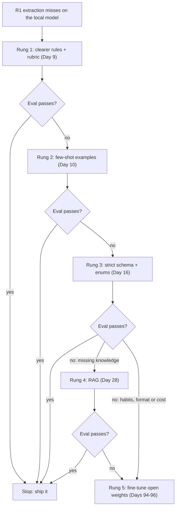
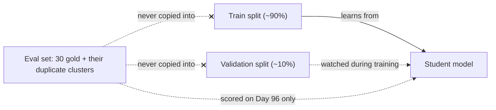
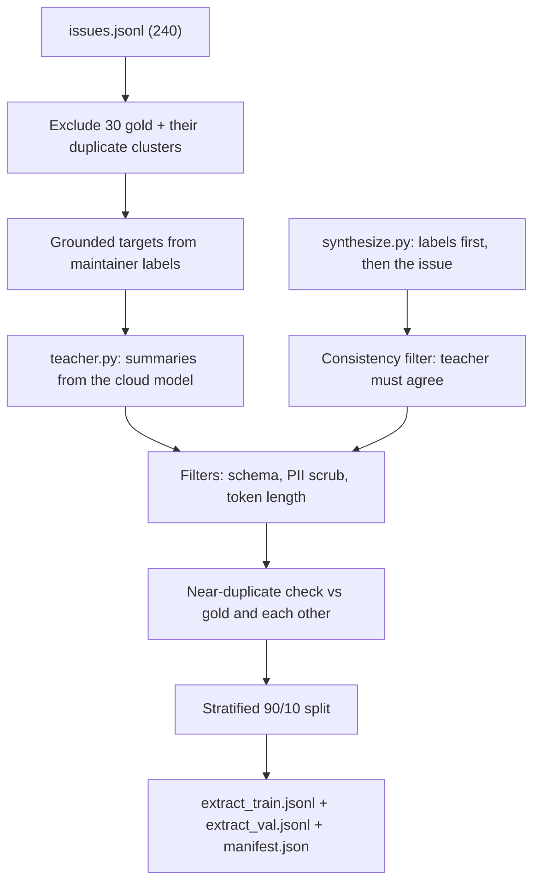

# Should You Fine-Tune? Decision & Data

On [Day 92](../../Phase_10_Open_Models_and_Fine_Tuning/Day_092_quantization_hardware/quantization_hardware.md) the small local model scored well below the cloud model on R1 extraction, so "let's fine-tune it" is tempting. Teams that jump straight to training often should have fixed the prompt or the schema first. And the teams that really do need fine-tuning usually fail on the data, not on the training code. Today you decide whether Atlas should fine-tune, and then you build the clean dataset that tomorrow's training run needs.

## At a Glance

- **Time:** ~2 h core (+ optional Go Deeper) · **Depth:** working
- **Prerequisites:** [Day 43: Building Eval Datasets](../../Phase_5_Evaluation_and_Observability/Day_043_eval_datasets/eval_datasets.md), [Day 91: Open-Weight Models & Local Inference](../../Phase_10_Open_Models_and_Fine_Tuning/Day_091_open_weight_local/open_weight_local.md), [Day 92: Quantization & Hardware Sizing](../../Phase_10_Open_Models_and_Fine_Tuning/Day_092_quantization_hardware/quantization_hardware.md), [Day 22: Capstone R1: The Extractor](../../Phase_2_Building_with_LLM_APIs/Day_022_capstone_r1_extractor/capstone_r1_extractor.md); primer [A11b: Training Vocabulary](../../Appendix_Primers/A11b_training_vocabulary.md) if "epoch" and "loss" are fuzzy
- **You'll build:** a filtered chat-format JSONL training set for the R1 issue → `IssueRecord` task (`data/extract_train.jsonl`, `data/extract_val.jsonl`) plus a `manifest.json` that proves zero train/eval leakage
- **Stops at:** RLHF/DPO math and preference data
- **Fast path:** Already know when to fine-tune? Read [The Decision Ladder](#the-decision-ladder), do Exercise 2, then run `build_dataset` as-is (≈45 min)
- **Cost:** ≈ $0.30 on `gpt-6-luna` for teacher summaries and ~400 synthetic issues (estimate; prices as of 2026-11, [verify](https://developers.openai.com/api/docs/pricing)). $0 on the no-credit path
- **New terms:** supervised fine-tuning (SFT), training example (chat format), validation split, data contamination, teacher model

> **Coming from Software Engineering?** A training set is a fixture suite that *becomes the spec*: the model copies whatever the fixtures do, bugs included. Generating it from a description of valid inputs is property-based testing (Hypothesis, a Python library that generates many test inputs from a description of valid ones). If fixtures leak into the test set, the build passes because it has seen the answers. And training too hard on narrow data is a global find-and-replace: it fixes the file you were looking at and quietly corrupts others (the ML name is *catastrophic forgetting*). What transfers directly: fixture hygiene, versioned inputs, and CI gates that fail loudly.

## The Tempting Fix

Day 92 left you with a gap: the quantized local model gets fewer `IssueRecord` fields right than `gpt-6-luna` on the 30 gold issues. The naive plan writes itself: "we have 240 labelled issues, dump them all into a JSONL file, train, done."

That plan has two bugs you'll find today. First, 30 of those 240 issues *are* the eval set, and 16 more are duplicates of eval issues, so the fine-tuned model would be graded on questions it memorized. Second, the labels aren't what you think: in the usable pool, 49% of the `orbit_version` labels and 90% of the `python_version` labels come from the issue template's metadata, not from anything written in the text. Train on them and you teach the model to invent versions.

## What Fine-Tuning Actually Changes

**Fine-tuning** shows a model hundreds of worked examples until the habit sticks. Think of practice drills versus a reference book. Drills change *how* you answer: the format, the tone, the judgment calls you make without thinking. A reference book changes *what you know*. Fine-tuning is drills. For new or changing facts you hand the model a reference book at question time, which is RAG ([Day 28](../../Phase_3_RAG/Day_028_rag_pipeline/rag_pipeline.md)).

| Fine-tuning is good at | Fine-tuning is bad at |
|---|---|
| Output format and schema habits (always valid `IssueRecord` JSON) | Facts that change ("what changed in 3.2.1?") → RAG |
| Narrow judgment calls (Orbit's S1–S4 severity rubric) | Facts the model never saw, at reliable quality → RAG |
| A smaller, cheaper model doing one job the big model does | Broad new skills on a few hundred examples |
| Shorter prompts (the habit replaces pages of instructions) | Fixing a task you can't evaluate (you won't know if it worked) |

The form you'll use is **supervised fine-tuning (SFT)**: training on input → desired-output pairs, so the model learns to produce the output when it sees the input. It also copies any mistakes in those pairs, faithfully.

## The Decision Ladder

Each rung is cheaper and faster to try than the next, so you climb only when an eval number says the current rung isn't enough. The fine-tune leaf points at open weights for a practical reason: OpenAI's hosted fine-tuning has been closed to new organizations since 2026-05-07 and closes for everyone on 2027-01-06 (as of 2026-11, verify on the [deprecations page](https://developers.openai.com/api/docs/deprecations)). This course fine-tunes an open-weight model you own.



A worked walk for Atlas. Say most misses on the local model are severity (S3 labelled S2) and invented `orbit_version`s:

1. **Rung 1, rules.** Day 16's prompt already has a severity rubric and a null rule. Tightening the wording is free, so try it and rerun the 30 gold issues.
2. **Rung 2, few-shot.** Add three worked examples ([Day 10](../../Phase_2_Building_with_LLM_APIs/Day_010_few_shot_prompting/few_shot_prompting.md)) picked from *non-gold* issues. Exercise 2 measures this.
3. **Rung 3, schema.** `IssueRecord` already uses `Literal` enums, so the strict schema rung is done. If the local server can't enforce the schema, you'll see invalid JSON in the failures.
4. **Rung 4, RAG** doesn't apply: the misses are judgment and format, not missing knowledge.
5. **Rung 5.** If the local model is still short of your threshold *and* you need it local (privacy, cost or offline), fine-tuning is justified. If the cloud model with few-shot clears the bar and privacy isn't a constraint, stop and ship that.

Write the decision down with the numbers; Exercise 2 shows the shape reviewers ask for.

## Anatomy of a Training Example

One **training example** is one conversation in chat format: a system message (the frozen instructions), a user message (the input exactly as inference will send it) and an assistant message (the answer you want, here `IssueRecord` JSON). TRL, the Hugging Face training library Day 95 uses, calls this the *conversational* format: one JSON object per line with a `messages` key.

```text
{"messages": [
  {"role": "system",    "content": "You extract facts from GitHub issues filed against Orbit, ..."},
  {"role": "user",      "content": "# ORB-1402 ScheduleDrift logged every minute ...\n\nOn 3.2.0 ..."},
  {"role": "assistant", "content": "{\"type\":\"bug\",\"components\":[\"core\"],\"severity\":\"S2\",...}"}
]}
```

Shown on several lines for reading; the real file has the whole object on **one** line. Older tutorials also show Alpaca (`instruction`/`input`/`output`) and ShareGPT (`conversations` with `from`/`value`) shapes; those are legacy layouts, and "ChatML" is a token template a model uses internally, not a file format. Use `messages`.

Three sets, three jobs:

- **Train split:** the examples the model learns from.
- **Validation split:** a slice of the same distribution held out *during* training, so you can watch for overfitting (doing better on training data while getting worse on unseen data).
- **Eval set:** the 30 gold issues. Walled off from both. The model never sees them, not even their duplicates.



The shared module holds the frozen prompt and the schemas. `SYSTEM_PROMPT_EXTRACT` is the text Day 92 froze (Day 16's rules, word for word); Days 95 and 96 use the identical string, because a different system prompt at inference time means the trained habit may not fire.

```python
# script_id: day_094_should_you_finetune/ftdata
# ftdata.py: shared pieces for today's scripts: config, the frozen prompt, schemas, loaders.
# Install: uv add "openai>=3.46,<4" pydantic tiktoken numpy
# Env: ORBIT_DATA (default datasets/orbit), ATLAS_FT_DIR (default data). No API key, no services.
import json
import os
import re
import zlib
from pathlib import Path
from typing import Literal

import numpy as np
from pydantic import BaseModel, ConfigDict, Field

MODEL = os.environ.get("ATLAS_MODEL", "gpt-6-luna")          # cloud baseline and teacher
DATA_DIR = Path(os.environ.get("ORBIT_DATA", "datasets/orbit"))
OUT_DIR = Path(os.environ.get("ATLAS_FT_DIR", "data"))

# Frozen on Day 92 from Day 16. Days 94-96 must send this exact string (train AND inference).
SYSTEM_PROMPT_EXTRACT = """You extract facts from GitHub issues filed against Orbit, an open-source
Python background-jobs library. Fill every field of the schema from the issue text only.

Rules:
- Use null when a fact is not stated. Never guess a version from dates or context.
- severity is for bugs only; use null for features, questions and docs.
- error_codes: every ORB-NNNN code that appears anywhere, including logs and comments. [] if none.
- components: usually one; list two only when the issue really spans both.
- summary: one or two sentences in English, even when the issue is in another language.

Component glossary:
core = queues, workers, leases, job execution | scheduler = cron schedules and delays
flows = Flows, steps and step state | broker-redis, broker-postgres, broker-sqs = that broker
cli = the orbit command | dashboard = the web UI | retries = retry policy and backoff
results = the result backend | observability = metrics and tracing
auth = dashboard login and OIDC | docs = the documentation itself"""
```

```python
# script_id: day_094_should_you_finetune/ftdata
Component = Literal["core", "scheduler", "flows", "broker-redis", "broker-postgres", "broker-sqs",
                    "cli", "dashboard", "retries", "results", "observability", "auth", "docs"]


class IssueRecord(BaseModel):
    """Day 15's target schema (compact). Fields mirror eval/extraction_gold.jsonl."""
    model_config = ConfigDict(extra="forbid")
    type: Literal["bug", "feature", "question", "docs"]
    components: list[Component]
    severity: Literal["S1", "S2", "S3", "S4"] | None = Field(
        description="Bugs only: S1 outage or data loss, S2 major breakage, S3 has a workaround, S4 cosmetic")
    orbit_version: str | None = Field(description="Full Orbit version, e.g. 3.1.2. null when not stated")
    python_version: str | None = Field(description="Python version as written. null when not stated")
    error_codes: list[str]
    summary: str = Field(description="One or two English sentences: symptom, trigger, version")


class ChatMessage(BaseModel):
    role: Literal["system", "user", "assistant"]
    content: str


class TrainExample(BaseModel):
    """One line of the training file, in TRL's conversational format."""
    messages: list[ChatMessage]


def load_jsonl(path: Path) -> list[dict]:
    return [json.loads(line) for line in path.read_text(encoding="utf-8").splitlines() if line.strip()]


def load_issues() -> list[dict]:
    return load_jsonl(DATA_DIR / "issues" / "issues.jsonl")


def gold_ids() -> set[int]:
    return {row["issue_id"] for row in load_jsonl(DATA_DIR / "eval" / "extraction_gold.jsonl")}
```

Now the two functions that turn an issue into an example. Notice `grounded_target()`: it keeps a version or error code only if it actually appears in the text the model will read. The gold set follows the prompt's rule "use null when a fact is not stated", so training labels must follow it too, or you'd be teaching the opposite of what you grade.

```python
# script_id: day_094_should_you_finetune/ftdata
def issue_to_input(issue: dict, max_chars: int = 12_000) -> str:
    """Day 20's input: title, body, comments. Never the labels: they're the answer key."""
    parts = [f"# {issue['title']}", issue["body"]]
    parts += [f"--- comment by {c['author']} ---\n{c['body']}" for c in issue.get("comments", [])]
    return "\n\n".join(parts)[:max_chars]


def grounded_target(issue: dict, summary: str) -> dict:
    """Maintainer labels -> an IssueRecord-shaped dict. Facts the text doesn't state become null/[]."""
    text, labels = issue_to_input(issue), issue["labels"]

    def pick(prefix: str) -> list[str]:
        return [label.split(":", 1)[1] for label in labels if label.startswith(prefix)]

    def stated(value: str | None) -> str | None:
        return value if value and value in text else None    # template metadata isn't evidence

    return {"type": (pick("type:") or [None])[0], "components": sorted(pick("comp:")),
            "severity": (pick("severity:") or [None])[0],
            "orbit_version": stated(issue["orbit_version"]), "python_version": stated(issue["python_version"]),
            "error_codes": [code for code in issue["error_codes"] if code in text], "summary": summary}


def to_example(issue: dict, record: IssueRecord) -> TrainExample:
    return TrainExample(messages=[
        ChatMessage(role="system", content=SYSTEM_PROMPT_EXTRACT),
        ChatMessage(role="user", content=issue_to_input(issue)),       # exactly what inference sends
        ChatMessage(role="assistant", content=record.model_dump_json()),
    ])
```

## Minimal: Labelled History → One Example

The smallest useful step: take one labelled issue, build its target from the labels, validate it, and print the line you'd write to the file. The summary is a placeholder (the title) until the teacher model writes real ones later today.

```python
# script_id: day_094_should_you_finetune/one_example
# one_example.py: one labelled Orbit issue -> one training line. $0, no API key.
# Run next to ftdata.py:  python one_example.py [issue_id]
import sys

from ftdata import IssueRecord, grounded_target, load_issues, to_example

issue_id = int(sys.argv[1]) if len(sys.argv) > 1 else 211      # a non-gold bug with an ORB-1402 log
issue = next(i for i in load_issues() if i["id"] == issue_id)
record = IssueRecord.model_validate(grounded_target(issue, summary=issue["title"]))
line = to_example(issue, record).model_dump_json()             # ONE line: never pretty-print JSONL
print(f"metadata versions: orbit={issue['orbit_version']} python={issue['python_version']}")
print("assistant target:", record.model_dump_json())
print(f"JSONL line ({len(line)} chars): {line[:160]}...")
```

```text
metadata versions: orbit=3.2.0 python=3.11
assistant target: {"type":"bug","components":["scheduler"],"severity":"S4","orbit_version":"3.2.0","python_version":"3.11","error_codes":["ORB-1402"],"summary":"ORB-1402 ScheduleDrift logged every minute for runs that are only milliseconds late"}
JSONL line (2736 chars): {"messages":[{"role":"system","content":"You extract facts from GitHub issues filed against Orbit, an open-source\nPython background-jobs library. Fill every fi...
```

Here both versions appear in the text, so they survive grounding; the severity (`S4`) and component come straight from the maintainers' labels. Try `python one_example.py 2`: its metadata says Orbit 2.8.0 and Python 3.11.9, the text states neither, and both targets become `null`.

## Break It: Leakage

**Data contamination** (leakage) means eval items, or near-copies of them, end up in the training data. The model then scores well on Day 96 because it memorized the answers, and you ship a model that is worse than its report says. Excluding the 30 gold ids isn't enough: Orbit has 15 duplicate clusters, and a duplicate of a gold issue describes the same bug in different words, often with the same logs.

The fix walks each `duplicate_of` link to its cluster root and excludes every issue whose root is a gold issue's root:

```python
# script_id: day_094_should_you_finetune/ftdata
def eval_exclusions(issues: list[dict], gold: set[int]) -> set[int]:
    """Gold ids plus every issue in the same duplicate cluster (links followed to the root)."""
    parent = {i["id"]: i["duplicate_of"] for i in issues if i["duplicate_of"]}

    def root(issue_id: int) -> int:
        for _ in range(len(parent) + 1):        # bounded: a bad link cycle can't hang the build
            if issue_id not in parent:
                break
            issue_id = parent[issue_id]
        return issue_id

    bad_roots = {root(g) for g in gold}
    return {i["id"] for i in issues if root(i["id"]) in bad_roots} | gold
```

Now run the naive plan and count what it leaks:

```python
# script_id: day_094_should_you_finetune/leakage_check
# leakage_check.py: what "dump all 240 issues into JSONL" leaks into training. $0, no API key.
# Run next to ftdata.py. Env: ORBIT_DATA.
from ftdata import eval_exclusions, gold_ids, load_issues

issues, gold = load_issues(), gold_ids()
by_id = {i["id"]: i for i in issues}
naive = set(by_id)                                     # the tempting plan: train on everything
excluded = eval_exclusions(issues, gold)
dupes_of_gold = excluded - gold

print(f"naive train set: {len(naive)} issues")
print(f"  gold issues inside:          {len(naive & gold)}")
print(f"  duplicates of gold inside:   {len(naive & dupes_of_gold)}")
sneaky = min(i for i in dupes_of_gold if by_id[i]["duplicate_of"])
print(f"  e.g. issue {sneaky} (duplicate_of={by_id[sneaky]['duplicate_of']}) is in a gold issue's cluster")

clean = naive - excluded
print(f"clean pool: {len(clean)} issues · gold inside: {len(clean & gold)} · "
      f"duplicates of gold inside: {len(clean & dupes_of_gold)}")
```

```text
naive train set: 240 issues
  gold issues inside:          30
  duplicates of gold inside:   16
  e.g. issue 61 (duplicate_of=59) is in a gold issue's cluster
clean pool: 194 issues · gold inside: 0 · duplicates of gold inside: 0
```

Issue 61 never mentions a gold id; it reaches the eval set only through issue 59's cluster, which also holds gold issue 62. Ids and links catch the leaks you know about. Unlinked duplicates and synthetic issues that copy a gold issue too closely need a content check, which the pipeline adds next.

## The Realistic Pipeline

Every stage below writes a file, so a rerun only pays for what changed, the way a build system caches steps. The two stages that call the API (teacher summaries and synthetic issues) are optional: without them, `build_dataset` falls back to titles as summaries and history only.



### Teacher summaries

Labels give you every field except `summary`. A **teacher model** is a stronger model whose outputs become training targets for a smaller one; here it's `MODEL`, running Day 16's extraction with the same frozen prompt. Only its summary is used; the other fields stay with the maintainers' labels. Text is scrubbed before it leaves your machine ([Day 73](../../Phase_8_Safety_and_Security/Day_073_privacy_pii/privacy_pii.md) owns PII; you reuse its compact regex here).

```python
# script_id: day_094_should_you_finetune/teacher
# teacher.py: the cloud model writes summaries for history issues. ≈ $0.05 (estimate).
# Install: uv add "openai>=3.46,<4" pydantic numpy. Env: OPENAI_API_KEY, ATLAS_MODEL, ATLAS_EFFORT.
# Run next to ftdata.py. Writes data/teacher_summaries.jsonl, a cache: reruns skip finished ids.
import json
import os

from openai import OpenAI

from ftdata import (MODEL, OUT_DIR, SYSTEM_PROMPT_EXTRACT, IssueRecord, eval_exclusions, gold_ids,
                    issue_to_input, load_issues, scrub_issue)

EFFORT = os.environ.get("ATLAS_EFFORT", "low")            # explicit: the model default is "medium"
# USD per 1M tokens, as of 2026-11; verify at https://developers.openai.com/api/docs/pricing
PRICES_PER_1M = {"gpt-6-luna": {"input": 0.10, "cached_input": 0.01, "output": 0.50},
                 "gpt-6.1-terra": {"input": 1.00, "cached_input": 0.05, "output": 5.00}}
client = OpenAI(timeout=60, max_retries=3)


class CostTracker:
    """Day 12's tracker, reduced to a running total."""
    def __init__(self) -> None:
        self.calls, self.total_usd = 0, 0.0

    def record(self, usage, model: str = MODEL) -> float:
        p, cached = PRICES_PER_1M[model], usage.input_tokens_details.cached_tokens
        cost = ((usage.input_tokens - cached) * p["input"] + cached * p["cached_input"]
                + usage.output_tokens * p["output"]) / 1_000_000    # reasoning is inside output_tokens
        self.calls, self.total_usd = self.calls + 1, self.total_usd + cost
        return cost


tracker = CostTracker()
```

```python
# script_id: day_094_should_you_finetune/teacher
def extract_issue(text: str, *, model: str = MODEL) -> IssueRecord | None:
    """Day 16's extract_issue(), compact. Same prompt the student will see."""
    resp = client.responses.parse(model=model, instructions=SYSTEM_PROMPT_EXTRACT, input=text,
                                  text_format=IssueRecord, reasoning={"effort": EFFORT},
                                  max_output_tokens=25_000)
    tracker.record(resp.usage, model)              # billed even when the result is unusable
    if resp.status == "incomplete" or resp.output_parsed is None:
        return None                                # truncated or refused: skip it, never guess
    return resp.output_parsed


def label_history() -> None:
    issues, path = load_issues(), OUT_DIR / "teacher_summaries.jsonl"
    excluded = eval_exclusions(issues, gold_ids())   # gold never goes through the labelling run
    done = {json.loads(line)["id"] for line in path.read_text().splitlines()} if path.exists() else set()
    OUT_DIR.mkdir(parents=True, exist_ok=True)
    with path.open("a", encoding="utf-8") as f:
        for issue in issues:
            if issue["id"] in excluded or issue["id"] in done:
                continue
            record = extract_issue(issue_to_input(scrub_issue(issue)))
            if record is not None:                 # keep the full record: disagreements = spot-check queue
                f.write(json.dumps({"id": issue["id"], "summary": record.summary,
                                    "teacher": record.model_dump(), "model": MODEL}) + "\n")
    print(f"{tracker.calls} calls · ${tracker.total_usd:.3f} · wrote {path}")


if __name__ == "__main__":
    label_history()
```

```text
194 calls · $0.0xx · wrote data/teacher_summaries.jsonl     (illustrative shape, not a recorded run: the call count is exact, the cost depends on your tokens and current prices)
```

### Synthetic issues with labels by construction

194 history examples is thin, and the mix is ~45% bugs. [Day 43](../../Phase_5_Evaluation_and_Observability/Day_043_eval_datasets/eval_datasets.md) owns synthetic generation (dimensions × personas); the training delta is the order of operations. You pick the labels *first*, ask the model to write an issue that states exactly those facts, then have the teacher re-extract it. If the teacher doesn't get the labels back, the text is ambiguous, and you drop it. That **consistency filter** is property-based testing for data: generate from a spec, keep only what round-trips.

```python
# script_id: day_094_should_you_finetune/synthesize
# synthesize.py: synthetic issues with labels by construction, kept only if the teacher agrees.
# ≈ $0.20 for 400 (estimate). Env: OPENAI_API_KEY, FT_SYNTH_N. Run next to ftdata.py and teacher.py.
import json
import os
import random

from pydantic import BaseModel

from ftdata import OUT_DIR, IssueRecord, issue_to_input
from teacher import EFFORT, MODEL, client, extract_issue, tracker

DIMS = {   # Day 43's dimensions x personas, re-aimed at extraction; edit freely
    "type": ["bug", "bug", "question", "feature", "docs"],
    "component": ["core", "scheduler", "flows", "broker-redis", "broker-postgres", "broker-sqs",
                  "cli", "dashboard", "retries", "results", "observability", "auth"],
    "persona": ["new user unsure of the terms", "SRE paged at 3am, terse",
                "non-native English speaker", "maintainer of a large deployment, very detailed"],
    "evidence": ["a log excerpt", "a config snippet", "no logs at all"],
}
VERSIONS = ["2.8.0", "2.9.0", "3.0.0", "3.0.3", "3.1.0", "3.1.2", "3.2.0", "3.2.1", None]
CODES = ["ORB-1001", "ORB-1101", "ORB-1201", "ORB-1202", "ORB-1301", "ORB-1402", "ORB-1601", "ORB-1901"]
WRITER = ("Write a realistic GitHub issue for Orbit, a Python background-jobs library. State exactly the "
          "facts in the JSON input and no other versions or ORB codes; omit any fact that is null. Convey "
          "severity only through impact (S1 outage or data loss, S2 major breakage, S3 workaround exists, "
          "S4 cosmetic); never write the label itself. Write as: {persona}. Include {evidence}.")


class SyntheticIssue(BaseModel):
    title: str
    body: str
```

```python
# script_id: day_094_should_you_finetune/synthesize
def make_spec(rng: random.Random, dims: dict) -> dict:
    """Labels first; the issue is written to match them."""
    kind = rng.choice(dims["type"])
    return {"type": kind, "components": [rng.choice(dims["component"])],
            "severity": rng.choice(["S1", "S2", "S3", "S4"]) if kind == "bug" else None,
            "orbit_version": rng.choice(VERSIONS), "python_version": rng.choice(["3.11.9", "3.12", None]),
            "error_codes": [rng.choice(CODES)] if kind == "bug" and rng.random() < 0.6 else [],
            "persona": rng.choice(dims["persona"]), "evidence": rng.choice(dims["evidence"])}


def write_issue(spec: dict) -> SyntheticIssue | None:
    facts = {k: v for k, v in spec.items() if k not in ("persona", "evidence")}
    resp = client.responses.parse(model=MODEL, instructions=WRITER.format(**spec), input=json.dumps(facts),
                                  text_format=SyntheticIssue, reasoning={"effort": EFFORT})
    tracker.record(resp.usage)
    return resp.output_parsed


def synthesize_issues(n: int, dims: dict = DIMS, seed: int = 94) -> list[dict]:
    rng, kept = random.Random(seed), []
    for k in range(n):
        spec = make_spec(rng, dims)
        draft = write_issue(spec)
        if draft is None:
            continue
        issue = {"id": f"syn-{k:04d}", "title": draft.title, "body": draft.body, "comments": []}
        rec = extract_issue(issue_to_input(issue))
        fields = ("type", "components", "severity", "orbit_version", "python_version", "error_codes")
        if rec is None or any(getattr(rec, f) != spec[f] for f in fields):
            continue                                   # the teacher read it differently: ambiguous text
        issue["record"] = IssueRecord(**{f: spec[f] for f in fields}, summary=rec.summary).model_dump()
        kept.append(issue)
    return kept


if __name__ == "__main__":
    n = int(os.environ.get("FT_SYNTH_N", "400"))
    rows = synthesize_issues(n)
    OUT_DIR.mkdir(parents=True, exist_ok=True)
    (OUT_DIR / "synthetic.jsonl").write_text("".join(json.dumps(r) + "\n" for r in rows), encoding="utf-8")
    print(f"kept {len(rows)}/{n} after the consistency filter · ${tracker.total_usd:.3f}")
```

```text
kept NNN/400 after the consistency filter · $0.xxx     (illustrative shape, not a recorded run: keep rate and cost depend on the model and current prices)
```

A keep rate near 100% means your specs are too easy to be useful; a rate under ~50% usually means the writer prompt is fighting the spec (check a few drops by hand).

### Filters: PII, length, near-duplicates

Three more helpers go into `ftdata.py`. The near-duplicate check takes a pluggable `embed` function. The default is a hashed character-trigram vector so the script runs offline at $0; it catches copy-paste reposts, not paraphrases. On Orbit's data, linked duplicates score anywhere from 0.18 to 0.85 with it, overlapping unrelated pairs, which is exactly why the explicit cluster links come first. Pass [Day 91's](../../Phase_10_Open_Models_and_Fine_Tuning/Day_091_open_weight_local/open_weight_local.md) `embed_local()` (and re-tune the threshold) to catch paraphrases.

```python
# script_id: day_094_should_you_finetune/ftdata
# Day 73's regex redaction, compact: the fixture patterns in issues.jsonl (fake emails, phones, keys).
PII = [("API_KEY", re.compile(r"\bsk-[A-Za-z0-9_-]{8,}")),
       ("EMAIL", re.compile(r"[\w.+-]+@[\w-]+(?:\.[\w-]+)+")),
       ("PHONE", re.compile(r"(?<![\w-])(?:\+?1[-. ])?(?:\(?\d{3}\)?[-. ])?\d{3}[-. ]\d{4}(?![\w-])")),
       ("ADDRESS", re.compile(r"\b\d{1,5} (?:[A-Z][a-z]+ )+(?:Street|Avenue|Road|Lane|Parkway|Way|Drive)\b"))]


def scrub(text: str) -> tuple[str, int]:
    hits = 0
    for kind, pattern in PII:
        text, n = pattern.subn(f"<{kind}>", text)
        hits += n
    return text, hits


def scrub_issue(issue: dict) -> dict:
    """Redact every free-text field. Versions and ORB codes survive, so targets stay grounded."""
    return {**issue, "title": scrub(issue["title"])[0], "body": scrub(issue["body"])[0],
            "comments": [{**c, "body": scrub(c["body"])[0]} for c in issue.get("comments", [])]}


def embed_ngrams(texts: list[str], dim: int = 4096, n: int = 3) -> np.ndarray:
    """Offline stand-in for an embedding model: hashed character trigrams, unit-length rows."""
    out = np.zeros((len(texts), dim))
    for row, text in enumerate(texts):
        t = " ".join(text.lower().split())
        for i in range(len(t) - n + 1):
            out[row, zlib.crc32(t[i:i + n].encode()) % dim] += 1
    return out / np.maximum(np.linalg.norm(out, axis=1, keepdims=True), 1e-9)


def near_dups(texts: list[str], against: list[str], threshold: float = 0.9, embed=embed_ngrams) -> list[int]:
    """Indexes in `texts` within `threshold` cosine of an `against` text or an earlier kept text."""
    if not texts:
        return []
    vecs = embed(against + texts)
    sims, kept, dropped = vecs @ vecs.T, list(range(len(against))), []   # hundreds of rows: one matrix is fine
    for k in range(len(against), len(vecs)):
        if kept and sims[k, kept].max() >= threshold:
            dropped.append(k - len(against))
        else:
            kept.append(k)
    return dropped
```

### Build, split, write the manifest

`build_dataset.py` stitches it together. A **stratified split** keeps each issue type's share the same in train and validation, so a 10% validation slice doesn't end up with zero `docs` issues by chance. The token count uses tiktoken's `o200k_base`, which is only an approximation of the student model's tokenizer, so the limit leaves a margin below Day 95's 2,048-token training length.

```python
# script_id: day_094_should_you_finetune/build_dataset
# build_dataset.py: candidates -> filters -> stratified split -> JSONL + manifest. $0, offline.
# Install: uv add pydantic tiktoken numpy. Run next to ftdata.py. Env: ORBIT_DATA, ATLAS_FT_DIR,
# FT_VAL_FRAC (0.1), FT_MAX_TOKENS (1800). Uses data/teacher_summaries.jsonl and data/synthetic.jsonl
# when present; otherwise issue titles stand in for summaries (the no-credit path).
import hashlib
import os
import random
from collections import Counter, defaultdict
from dataclasses import dataclass
from datetime import date

import tiktoken
from pydantic import BaseModel, ValidationError

from ftdata import (OUT_DIR, SYSTEM_PROMPT_EXTRACT, IssueRecord, TrainExample, eval_exclusions, gold_ids,
                    grounded_target, issue_to_input, load_issues, load_jsonl, near_dups, scrub,
                    scrub_issue, to_example)

VAL_FRAC = float(os.environ.get("FT_VAL_FRAC", "0.1"))
MAX_TOKENS = int(os.environ.get("FT_MAX_TOKENS", "1800"))   # Day 95 trains at 2,048: keep a margin
ENC = tiktoken.get_encoding("o200k_base")                    # approximate for the student's tokenizer


@dataclass
class Row:
    id: str
    source: str                          # "history" or "synthetic"
    issue: dict
    target: dict                         # IssueRecord-shaped, not yet validated
    example: TrainExample | None = None
```

```python
# script_id: day_094_should_you_finetune/build_dataset
def candidates(issues: list[dict], excluded: set[int]) -> tuple[list[Row], str | None]:
    """History issues outside the eval exclusions, plus synthetic issues if synthesize.py ran."""
    teacher_path, syn_path = OUT_DIR / "teacher_summaries.jsonl", OUT_DIR / "synthetic.jsonl"
    teacher = {r["id"]: r for r in load_jsonl(teacher_path)} if teacher_path.exists() else {}
    rows = [Row(str(i["id"]), "history", i,
                grounded_target(i, teacher.get(i["id"], {}).get("summary", i["title"])))  # title = weak fallback
            for i in issues if i["id"] not in excluded]
    rows += [Row(s["id"], "synthetic", s, s["record"]) for s in (load_jsonl(syn_path) if syn_path.exists() else [])]
    return rows, next(iter(teacher.values()), {}).get("model")


def apply_filters(rows: list[Row], gold_texts: list[str]) -> tuple[list[Row], Counter]:
    """Cheap checks first. Every drop is counted by reason, so the manifest explains the numbers."""
    stats, kept = Counter(candidates=len(rows), dropped_schema=0, dropped_too_long=0), []
    for row in rows:
        try:
            record = IssueRecord.model_validate(row.target)     # bad enums never reach training
        except ValidationError:
            stats["dropped_schema"] += 1
            continue
        record.summary = scrub(record.summary)[0]
        row.example = to_example(scrub_issue(row.issue), record)
        stats["pii_scrubbed_kept"] += row.example.messages[1].content != issue_to_input(row.issue)
        if sum(len(ENC.encode(m.content)) for m in row.example.messages) + 16 > MAX_TOKENS:
            stats["dropped_too_long"] += 1                      # +16 ≈ chat-template overhead
            continue
        kept.append(row)
    dup = set(near_dups([r.example.messages[1].content for r in kept], against=gold_texts))
    stats["dropped_near_duplicate"] = len(dup)
    return [r for k, r in enumerate(kept) if k not in dup], stats
```

```python
# script_id: day_094_should_you_finetune/build_dataset
class Manifest(BaseModel):
    """Day 43's manifest shape, extended for training data. Days 95-96 read it."""
    name: str
    version: str
    created: str
    teacher_model: str | None
    system_prompt_sha256: str
    counts: dict[str, dict[str, int]]
    excluded_ids: list[int]
    train_ids: list[str]
    val_ids: list[str]
    contamination: int
    sha256: dict[str, str]


def stratified_split(rows: list[Row], val_frac: float = VAL_FRAC, seed: int = 94) -> tuple[list[Row], list[Row]]:
    by_type, rng, train, val = defaultdict(list), random.Random(seed), [], []
    for row in rows:
        by_type[row.target["type"]].append(row)
    for _, group in sorted(by_type.items()):
        rng.shuffle(group)
        n_val = max(1, round(len(group) * val_frac))
        val, train = val + group[:n_val], train + group[n_val:]
    return train, val


def write_jsonl(rows: list[Row], split: str) -> str:
    data = "".join(r.example.model_dump_json() + "\n" for r in rows).encode("utf-8")  # one object per line
    (OUT_DIR / f"extract_{split}.jsonl").write_bytes(data)
    return hashlib.sha256(data).hexdigest()
```

```python
# script_id: day_094_should_you_finetune/build_dataset
def build_dataset() -> Manifest:
    issues, gold = load_issues(), gold_ids()
    excluded = eval_exclusions(issues, gold)
    gold_texts = [issue_to_input(scrub_issue(i)) for i in issues if i["id"] in gold]
    rows, teacher_model = candidates(issues, excluded)
    kept, stats = apply_filters(rows, gold_texts)
    train, val = stratified_split(kept)
    OUT_DIR.mkdir(parents=True, exist_ok=True)
    sha = {"train": write_jsonl(train, "train"), "val": write_jsonl(val, "val")}
    leaked = {int(r.id) for r in kept if r.id.isdigit()} & excluded          # re-check, don't trust
    contamination = len(leaked) + len(near_dups([r.example.messages[1].content for r in kept], gold_texts))
    manifest = Manifest(
        name="extract", version="v1", created=date.today().isoformat(), teacher_model=teacher_model,
        system_prompt_sha256=hashlib.sha256(SYSTEM_PROMPT_EXTRACT.encode()).hexdigest(),
        counts={"filters": dict(stats), "source": dict(Counter(r.source for r in kept)),
                "train_type": dict(Counter(r.target["type"] for r in train)),
                "val_type": dict(Counter(r.target["type"] for r in val))},
        excluded_ids=sorted(excluded), train_ids=[r.id for r in train], val_ids=[r.id for r in val],
        contamination=contamination, sha256=sha)
    (OUT_DIR / "manifest.json").write_text(manifest.model_dump_json(indent=2), encoding="utf-8")
    return manifest


if __name__ == "__main__":
    m = build_dataset()
    for key, value in m.counts.items():
        print(f"{key:>10}: {value}")
    print(f"excluded for eval: {len(m.excluded_ids)} · train {len(m.train_ids)} · val {len(m.val_ids)}")
    print(f"contamination: {m.contamination} · teacher: {m.teacher_model or 'none (titles as summaries)'}")
```

```text
   filters: {'candidates': 194, 'dropped_schema': 0, 'dropped_too_long': 0, 'pii_scrubbed_kept': 15, 'dropped_near_duplicate': 0}
    source: {'history': 194}
train_type: {'bug': 67, 'docs': 22, 'feature': 37, 'question': 49}
  val_type: {'bug': 7, 'docs': 2, 'feature': 4, 'question': 6}
excluded for eval: 46 · train 175 · val 19
contamination: 0 · teacher: none (titles as summaries)
```

That run is the no-credit path (titles as summaries, history only), so the numbers are exact on any machine. With `teacher_summaries.jsonl` and `synthetic.jsonl` present, `source` gains a `synthetic` count and your totals will differ. Two things must not change: `contamination: 0`, and a non-empty `val_type` for every class.

### A CI gate for the files

Day 95 will train on whatever is in `data/`. Before it does, a check that fails loudly is cheaper than a wasted GPU hour. It re-reads the files from disk, so it catches hand edits, pretty-printed lines and a drifted prompt.

```python
# script_id: day_094_should_you_finetune/check_dataset
# check_dataset.py: refuse to train on bad files. $0. Run after build_dataset.py, next to ftdata.py.
import hashlib
import json

from ftdata import OUT_DIR, SYSTEM_PROMPT_EXTRACT, IssueRecord, TrainExample, eval_exclusions, gold_ids, load_issues


def check(split: str, manifest: dict, excluded: set[int]) -> int:
    raw = (OUT_DIR / f"extract_{split}.jsonl").read_bytes()
    if hashlib.sha256(raw).hexdigest() != manifest["sha256"][split]:
        raise SystemExit(f"{split}: file changed since the manifest was written")
    lines = raw.decode("utf-8").splitlines()
    for n, line in enumerate(lines, 1):
        ex = TrainExample.model_validate_json(line)            # pretty-printed JSONL fails right here
        if [m.role for m in ex.messages] != ["system", "user", "assistant"]:
            raise SystemExit(f"{split}:{n}: roles must be system, user, assistant")
        if ex.messages[0].content != SYSTEM_PROMPT_EXTRACT:
            raise SystemExit(f"{split}:{n}: system prompt drifted from SYSTEM_PROMPT_EXTRACT")
        IssueRecord.model_validate_json(ex.messages[2].content)
    leaked = {int(i) for i in manifest[f"{split}_ids"] if i.isdigit()} & excluded
    if leaked:
        raise SystemExit(f"{split}: eval-excluded ids inside: {sorted(leaked)}")
    return len(lines)


if __name__ == "__main__":
    manifest = json.loads((OUT_DIR / "manifest.json").read_text(encoding="utf-8"))
    excluded = eval_exclusions(load_issues(), gold_ids())
    counts = {split: check(split, manifest, excluded) for split in ("train", "val")}
    print(f"OK {counts} · contamination={manifest['contamination']} · prompt {manifest['system_prompt_sha256'][:12]}")
```

```text
OK {'train': 175, 'val': 19} · contamination=0 · prompt 6a2f10b6af31
```

## How Much Data, and Is It Good?

There's no official minimum. A common practitioner rule of thumb for a narrow task like R1 extraction is *hundreds to low thousands* of clean examples, and quality beats quantity: 300 consistent examples teach a habit, while 3,000 noisy ones teach the noise. Treat the number as a hypothesis that Day 96's eval confirms or rejects (the Go Deeper section shows how a learning curve answers it properly).

Quality is three questions you can check:

1. **Is the mix right?** Look at `counts.train_type` in the manifest. Bugs are 45% of all 240 issues and 38% of the clean pool; a model trained on a skewed mix leans toward predicting the majority class. Synthetic issues let you rebalance; Exercise 4 caps bugs directly.
2. **Are the labels right?** Read 30 random training rows by hand, Day 44-style ([Error Analysis](../../Phase_5_Evaluation_and_Observability/Day_044_error_analysis/error_analysis.md)): does the summary match the issue, is the severity defensible? `teacher.py` keeps the teacher's full record, so rows where the teacher disagrees with the maintainers' labels make a ready-made review queue.
3. **Do inputs match inference?** Same `SYSTEM_PROMPT_EXTRACT`, same `issue_to_input()`, same truncation. `check_dataset.py` enforces the prompt; the shared module enforces the rest.

### In production

- **Version every dataset** like Day 43: immutable `v1`, `v2` files, a manifest with sha256 and a `parent`, never overwrite in place.
- **Refresh on a cadence.** New releases drift the distribution: rebuild per release, and re-run the eval exclusions whenever the gold set changes.
- **Check licences and terms for teacher outputs.** OpenAI's Terms of Use prohibit using output "to develop models that compete with OpenAI" (as of 2026-11, ⚠ verify the current wording and have legal review your use). Also read the student model's licence on its model card.
- **PII and retention.** Scrub before text leaves your machine and before it's baked into weights: a model can repeat training text, and you can't delete one row from trained weights ([Day 73](../../Phase_8_Safety_and_Security/Day_073_privacy_pii/privacy_pii.md)).
- **Gate in CI.** Run `check_dataset.py` before any training job, the same way you'd gate a deploy on tests.

## Go Deeper (optional)

<details><summary>Go deeper: what SFT actually optimizes</summary>

In words: training shows the model the conversation and asks it to predict each next token; wherever its prediction is wrong, the weights are nudged so that the right token becomes a little more likely. Repeat over every example for a few passes (epochs) and the habit sticks.

Toy numbers: if the assistant's first token is `{"type":"bug"` and the model gives `bug` a probability of 0.30, the loss for that token is −ln(0.30) ≈ 1.20. After training, if it gives 0.90, the loss is ≈ 0.11. The training loss you'll watch tomorrow is that number averaged over tokens.

Which tokens? By default a conversational dataset trains on every token, including the system prompt and the issue text, which the model never has to *produce*. TRL's `SFTConfig(assistant_only_loss=True)` computes the loss on assistant messages only (⚠ verify in [TRL's SFT Trainer docs](https://huggingface.co/docs/trl/sft_trainer) that your student model's chat template supports it before relying on it). For this dataset that matters, because most tokens are input. Measure it:

```python
# script_id: day_094_should_you_finetune/token_share
# token_share.py: share of system / user / assistant tokens in the train file. $0. Run after build_dataset.py.
import tiktoken

from ftdata import OUT_DIR, TrainExample, load_jsonl

enc = tiktoken.get_encoding("o200k_base")       # approximate for the student's tokenizer
totals = {"system": 0, "user": 0, "assistant": 0}
for row in load_jsonl(OUT_DIR / "extract_train.jsonl"):
    for message in TrainExample.model_validate(row).messages:
        totals[message.role] += len(enc.encode(message.content))
grand = sum(totals.values())
for role, n in totals.items():
    print(f"{role:>9}: {n:>7} tokens ({n / grand:.0%})")
```

```text
   system:   38675 tokens (36%)
     user:   61090 tokens (56%)
assistant:    8992 tokens (8%)
```

Only about 8% of the tokens are the answer. Without `assistant_only_loss`, most of the loss is spent on predicting issue text and a system prompt the model will never have to write.

Why the system prompt must match: the model learns "after *this* system text and an issue, produce `IssueRecord` JSON". A different system prompt at inference is a different context, and the learned habit may only partly transfer. That's why the manifest stores the prompt's sha256 and Day 96 checks it.

**RLHF and DPO in one paragraph.** SFT teaches from correct answers. Preference methods teach from *comparisons*: show the model two answers, tell it which one people preferred, and push it toward the preferred kind. RLHF (reinforcement learning from human feedback) trains a separate reward model on those comparisons and then optimizes against it; DPO (direct preference optimization) skips the reward model and learns from the pairs directly. They matter for tone and helpfulness; for a schema-extraction task with a right answer, SFT is the right tool. The math is where this course stops.

</details>

<details><summary>Go deeper: a learning curve instead of a guess</summary>

"How much data?" has a measurable answer. Build three nested training sets from the same manifest (say 25%, 50% and 100% of `train_ids`, each subset containing the previous one), train each with identical settings on Day 95, and score each on the 30 gold issues on Day 96. Plot field accuracy against training size.

- **Still climbing at 100%:** more data will help, so generate more synthetic issues or label more history.
- **Flat from 50%:** you're past the point where quantity helps. Spend effort on label quality, or the gap is in the base model's capacity.
- **Worse at 100%:** something in the extra data is noisy or skewed. Diff the class balance of the subsets first.

Keep the validation split fixed across the three runs, and record each subset's ids in its own manifest so the comparison is reproducible. Three small training runs on Colab cost GPU time, not API money.

</details>

## Common Pitfalls

- **Inflated Day 96 scores.** Gold issues or their duplicates sit in training. Cause: excluding by id only. Fix: `eval_exclusions()` (ids *and* clusters), then the near-duplicate check, then `check_dataset.py` in CI.
- **The model invents versions.** Cause: targets built from issue metadata that the text never states. Fix: `grounded_target()`; a label the input doesn't support teaches guessing.
- **The habit doesn't fire at inference.** Cause: a different system prompt at train and inference time. Fix: one frozen `SYSTEM_PROMPT_EXTRACT`, checked by sha256.
- **Synthetic labels fail validation:** `ValidationError: 1 validation error for IssueRecord` / `severity` / `Input should be 'S1', 'S2', 'S3' or 'S4' [type=literal_error, input_value='high', input_type=str]`. Cause: a spec that says `"high"`. Fix: take enums from `IssueRecord`/DATASET_SPEC, and validate every target before writing.
- **The trainer can't read the file:** `json.decoder.JSONDecodeError: Expecting property name enclosed in double quotes: line 1 column 2 (char 1)`, because the first "line" is a lone `{`. Cause: pretty-printed JSONL. Fix: one `model_dump_json()` per line, no `indent`.
- **Silent truncation.** A long log issue (Orbit has one over 6k words; it's in the gold set, so excluded here) gets cut at the training length, so the model learns from a target whose evidence was chopped off. Fix: filter by tokens with a margin; the o200k count is only an approximation for other tokenizers.

> **Where we stop:** preference tuning (RLHF/DPO) and its math are out of scope; a schema-extraction task has right answers, so SFT is the tool. For the curious, TRL's docs cover preference datasets in their [dataset formats](https://huggingface.co/docs/trl/dataset_formats) page.

## Key Takeaways

- Fine-tuning changes habits (format, narrow judgment, a cheaper model doing one job), not knowledge; changing facts belong in RAG.
- Climb the ladder (rules → few-shot → strict schema → RAG → fine-tune) and stop at the first rung whose eval number clears your threshold.
- A training example is one `messages` conversation per JSONL line, with the exact system prompt and input that inference will use.
- Leakage hides in duplicates: exclude gold ids *and* their clusters, check content similarity, and record the proof in a manifest.
- Training data is a spec the model copies: ground every target in the text, filter by schema, PII and length, and spot-check what the teacher wrote.

## Quick Reference

| Pattern | When to use | Gotcha |
|---|---|---|
| `{"messages": [system, user, assistant]}` per line | TRL conversational SFT data | One object per line; never `indent` |
| `eval_exclusions(issues, gold)` | Before building any training pool | Follow `duplicate_of` to the cluster root |
| `grounded_target(issue, summary)` | Turning labels into targets | Metadata the text doesn't state → null |
| Labels by construction + consistency filter | Synthetic training issues | Keep rate ~100% means specs are too easy |
| `near_dups(texts, against=gold_texts)` | Content-level leakage and dedup | Trigram default catches copies, not paraphrases |
| Stratified split | Small or imbalanced datasets | Split per class, then concatenate |
| `manifest.json` with sha256 + ids | Every dataset version | Re-verify from disk before training |

## Exercises

1. **Warm-up: grounding.** Run `one_example.py 2` and compare the metadata `python_version` with the target. Then count, across the clean pool, how many version labels `grounded_target()` nulls.

<details><summary>Solution</summary>

```python
# script_id: day_094_should_you_finetune/solution_ex1
# How often does grounding null a metadata version? $0. Run next to ftdata.py:  python solution_ex1.py [issue_id]
import sys

from ftdata import eval_exclusions, gold_ids, grounded_target, load_issues

issues = load_issues()
excluded = eval_exclusions(issues, gold_ids())
pool = [i for i in issues if i["id"] not in excluded]
issue_id = int(sys.argv[1]) if len(sys.argv) > 1 else 2
issue = next(i for i in pool if i["id"] == issue_id)
target = grounded_target(issue, summary=issue["title"])
print(f"issue {issue_id}: metadata python={issue['python_version']} -> target python={target['python_version']}")
for field in ("orbit_version", "python_version"):
    labelled = [i for i in pool if i[field]]
    nulled = sum(1 for i in labelled if grounded_target(i, "")[field] is None)
    print(f"{field}: {len(labelled)} labelled, {nulled} nulled by grounding ({nulled / len(labelled):.0%})")
```

A null target says "unknown" explicitly. The model learns that missing evidence means `null`, which is what the gold set rewards.

</details>

2. **Core: climb the ladder with numbers.** Score the cloud model on the 30 gold issues with instructions + enum schema, then with 3 few-shot examples taken from *non-gold* issues. Write your fine-tune decision in 3 lines (≈ $0.02). To test the local model instead, build the client with Day 91's `make_client("local")`.

<details><summary>Solution</summary>

```python
# script_id: day_094_should_you_finetune/solution_ex2
# ladder_check.py: rungs 1-3 on the 30 gold issues, without and with 3 few-shot examples. ≈ $0.02.
# Env: OPENAI_API_KEY, ATLAS_MODEL. Run next to ftdata.py.
from openai import OpenAI

from ftdata import (DATA_DIR, MODEL, SYSTEM_PROMPT_EXTRACT, IssueRecord, eval_exclusions, gold_ids,
                    grounded_target, issue_to_input, load_issues, load_jsonl)

client = OpenAI(timeout=60, max_retries=3)
FIELDS = ("type", "components", "severity", "orbit_version", "python_version", "error_codes")
issues = {i["id"]: i for i in load_issues()}
gold = load_jsonl(DATA_DIR / "eval" / "extraction_gold.jsonl")
excluded = eval_exclusions(list(issues.values()), gold_ids())
shots = []
for kind in ("bug", "question", "feature"):          # few-shot from NON-eval issues only
    ex = next(i for i in issues.values() if i["id"] not in excluded and f"type:{kind}" in i["labels"])
    target = IssueRecord.model_validate(grounded_target(ex, ex["title"]))
    shots += [{"role": "user", "content": issue_to_input(ex)},
              {"role": "assistant", "content": target.model_dump_json()}]


def norm(value):
    return sorted(value) if isinstance(value, list) else value


def field_accuracy(few_shot: bool) -> float:
    right = 0
    for g in gold:
        msgs = (shots if few_shot else []) + [{"role": "user", "content": issue_to_input(issues[g["issue_id"]])}]
        resp = client.responses.parse(model=MODEL, instructions=SYSTEM_PROMPT_EXTRACT, input=msgs,
                                      text_format=IssueRecord, reasoning={"effort": "low"})
        rec = resp.output_parsed
        right += sum(rec is not None and norm(getattr(rec, f)) == norm(g[f]) for f in FIELDS)
    return right / (len(gold) * len(FIELDS))


print(f"rungs 1+3: {field_accuracy(False):.1%} · + few-shot: {field_accuracy(True):.1%}")
```

A decision reads like: "Few-shot moved the cloud model from X% to Y%; the local Q4 model is at Z% with the same prompt; we need it local, the gap is format and severity habits, so we fine-tune." If few-shot closes the gap on the model you're allowed to use, stop.

</details>

3. **Core: prove zero leakage.** List every way eval data could reach training (ids, clusters, unlinked near-copies, few-shot examples, a stale manifest, train/val overlap). Then write a check that proves 0 from the files on disk, not from the code that wrote them.

<details><summary>Solution</summary>

```python
# script_id: day_094_should_you_finetune/solution_ex3
# Prove zero leakage from the files on disk. $0. Run after build_dataset.py, next to ftdata.py.
import json

from ftdata import (OUT_DIR, TrainExample, embed_ngrams, eval_exclusions, gold_ids, issue_to_input,
                    load_issues, load_jsonl, scrub_issue)

issues, gold = load_issues(), gold_ids()
manifest = json.loads((OUT_DIR / "manifest.json").read_text(encoding="utf-8"))
excluded = eval_exclusions(issues, gold)
ids = {int(i) for i in manifest["train_ids"] + manifest["val_ids"] if i.isdigit()}
texts = [TrainExample.model_validate(r).messages[1].content
         for split in ("train", "val") for r in load_jsonl(OUT_DIR / f"extract_{split}.jsonl")]
gold_issues = [i for i in issues if i["id"] in gold]
sims = embed_ngrams(texts) @ embed_ngrams([issue_to_input(scrub_issue(g)) for g in gold_issues]).T
checks = {
    "gold id in train/val": len(ids & gold),
    "duplicate of gold in train/val": len(ids & (excluded - gold)),
    "gold title copied verbatim": sum(any(f"# {g['title']}\n" in t for t in texts) for g in gold_issues),
    "near-copy of gold (cosine >= 0.9)": int((sims >= 0.9).sum()),
    "val id also in train": len(set(manifest["train_ids"]) & set(manifest["val_ids"])),
    "manifest exclusions stale": len(excluded ^ set(manifest["excluded_ids"])),
}
for name, n in checks.items():
    print(f"{'PASS' if n == 0 else 'FAIL'}  {name}: {n}")
print(f"closest training text to any gold issue: cosine {sims.max():.2f}")
```

Few-shot leakage is a code-review check rather than a file check: Exercise 2 picks its shots with `eval_exclusions()`, and so must any prompt you compare against the fine-tune on Day 96.

</details>

4. **Stretch (optional): cap the majority class.** Downsample bugs to at most 30% of the train split and print the per-class counts before and after. Would you rather cap, or generate more non-bug synthetic issues? Why?

<details><summary>Solution</summary>

```python
# script_id: day_094_should_you_finetune/solution_ex4
# Cap bugs at FT_BUG_CAP (default 30%) of train; report per-class counts. $0. Run after build_dataset.py.
import json
import os
import random
from collections import Counter

from ftdata import OUT_DIR, TrainExample, load_jsonl

CAP = float(os.environ.get("FT_BUG_CAP", "0.3"))
rows = [TrainExample.model_validate(r) for r in load_jsonl(OUT_DIR / "extract_train.jsonl")]


def kind(ex: TrainExample) -> str:
    return json.loads(ex.messages[2].content)["type"]


bugs, others = [ex for ex in rows if kind(ex) == "bug"], [ex for ex in rows if kind(ex) != "bug"]
random.Random(94).shuffle(bugs)
capped = others + bugs[:int(CAP / (1 - CAP) * len(others))]   # bugs / total <= CAP
for name, group in (("before", rows), ("after", capped)):
    c = Counter(kind(ex) for ex in group)
    print(f"{name:>6}: {len(group)} rows · " + " · ".join(f"{k} {v} ({v / len(group):.0%})" for k, v in sorted(c.items())))
out = OUT_DIR / "extract_train_capped.jsonl"
out.write_text("".join(ex.model_dump_json() + "\n" for ex in capped), encoding="utf-8")
print(f"wrote {out} (record it as a new dataset version in the manifest before training on it)")
```

Capping throws away real examples, which hurts when you only have a few hundred. Generating more non-bug synthetic issues keeps every bug and fixes the ratio, at an API cost and with the usual synthetic-quality risk. With small data, prefer generating; with plenty, capping is fine.

</details>

## References & Further Reading

- [TRL: Dataset formats](https://huggingface.co/docs/trl/dataset_formats): the official `messages` conversational format and the prompt-completion alternative.
- [TRL: SFT Trainer](https://huggingface.co/docs/trl/sft_trainer): `assistant_only_loss`, `completion_only_loss` and how SFTTrainer reads datasets; Day 95 uses it.
- [OpenAI: Deprecations](https://developers.openai.com/api/docs/deprecations): the hosted fine-tuning closure dates behind the open-weights choice.
- [OpenAI: Terms of Use](https://openai.com/policies/terms-of-use/): what you may and may not do with model output, including training other models.
- [OpenAI: Structured outputs](https://developers.openai.com/api/docs/guides/structured-outputs): `responses.parse(text_format=...)`, which the teacher and the synthetic writer use.
- [Unsloth README](https://raw.githubusercontent.com/unslothai/unsloth/main/README.md): install notes and the free notebooks Day 95 builds on.

## What's Next

You have a clean, versioned training set and a written reason to use it. In [Day 95: Hands-On LoRA Fine-Tuning](../../Phase_10_Open_Models_and_Fine_Tuning/Day_095_lora_finetuning/lora_finetuning.md) you train a LoRA adapter on `data/extract_train.jsonl` on a free Colab GPU, export it to GGUF and serve it in Ollama as `atlas-extract`.
