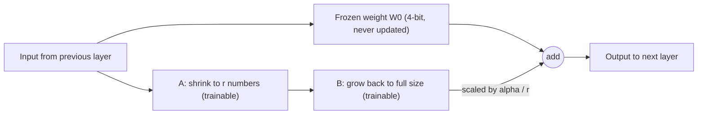
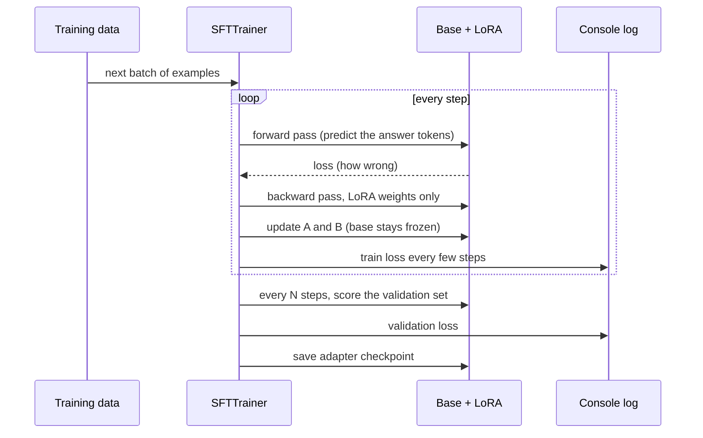
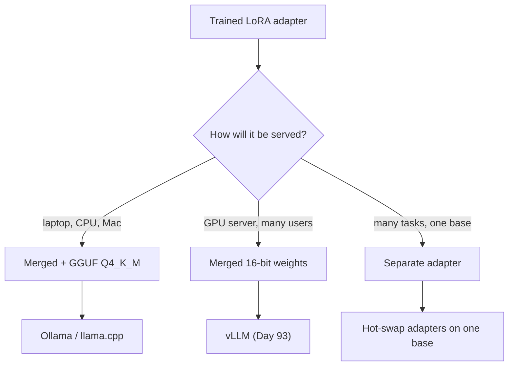

# Hands-On LoRA Fine-Tuning

You have about 600 clean extraction examples from Day 94. One Colab session from now, `atlas-extract`, a small model trained on Orbit issues, will be running in Ollama on your laptop. Today you do every stage once: load, train, watch the loss, export, serve. After one full pass, most of the mystery around fine-tuning goes away.

## At a Glance

- **Time:** ~2 h core (+ optional Go Deeper) · **Depth:** working
- **Prerequisites:** [Day 92: Quantization & Hardware Sizing](../../Phase_10_Open_Models_and_Fine_Tuning/Day_092_quantization_hardware/quantization_hardware.md), [Day 94: Should You Fine-Tune? Decision & Data](../../Phase_10_Open_Models_and_Fine_Tuning/Day_094_should_you_finetune/should_you_finetune.md), [Day 91: Open-Weight Models & Local Inference](../../Phase_10_Open_Models_and_Fine_Tuning/Day_091_open_weight_local/open_weight_local.md) (for `make_client`), primer [A11b: Training Vocabulary](../../Appendix_Primers/A11b_training_vocabulary.md) (loss, learning rate, epochs, VRAM)
- **You'll build:** `atlas-extract`, a LoRA fine-tune of a 4B open model on the Orbit issue → `IssueRecord` task, exported as a Q4_K_M GGUF and served by Ollama
- **Stops at:** multi-GPU training (and full fine-tuning, DeepSpeed/FSDP, RLHF/DPO)
- **Fast path:** Already know what LoRA is? Read §Turn the Knobs and §Reading Loss Curves, paste the `train` blocks into Colab and run them, then do Exercise 2 (~60 min, mostly waiting on the GPU).
- **Cost:** $0 on a free Colab GPU (typically a T4) when one is available; quotas vary (as of 2026-11, ⚠ verify in Colab). The laptop side runs on Ollama, also $0.
- **New terms:** LoRA (low-rank adaptation), adapter, QLoRA, chat template, validation loss

> **Coming from Software Engineering?** LoRA is monkey-patching (replacing a function at runtime without editing the library's source) a frozen library. The patch file is tiny, the library is never edited, and you can swap one patch for another. QLoRA runs that library from a compressed, read-only image while the patches stay at full precision. Unsloth is `gcc -O3` versus `-O0` (a compiler optimization flag: the same code, built and run faster): same result, faster build. What transfers from your day job: version the patch together with the exact base it applies to, and test after applying it.

## Why Not Train the Whole Model?

Full fine-tuning updates every weight in the model. For a 4-billion-parameter model that means storing the weights, a gradient for every weight, and the optimizer's running statistics for every weight. Primer [A11b](../../Appendix_Primers/A11b_training_vocabulary.md) works through the arithmetic: it comes to several times the model's own size, tens of gigabytes for a 4B model. A free Colab T4 has 16 GB of VRAM (about 15 GB usable, ⚠ verify in `nvidia-smi`). It doesn't fit.

Rewriting every weight on 600 narrow examples also risks the model forgetting skills it had (Day 94's warning). You want to teach one habit, Orbit issue in and `IssueRecord` JSON out, and leave the rest alone.

Today's base is `unsloth/Qwen3-4B-Instruct-2507`: Apache-2.0, not gated, small enough for a T4 in 4-bit, and already good at following instructions. You only need to sharpen it on one task.

## Sticky Notes on a Textbook

Think of the base model as a printed textbook. Full fine-tuning reprints the whole book. LoRA leaves the book untouched and adds sticky notes to a few pages: "when you read this page, also apply this correction." Three things follow, and all are true of LoRA:

- **The book never changes.** Peel the notes off and you have the original model back.
- **Notes are small.** You can keep several sets (extraction, triage) and swap them.
- **You can print a new edition.** Folding the notes into the text is *merging*, which you'll do before exporting to Ollama.

## Count the Parameters by Hand

A model is mostly big grids of numbers called weight matrices. Take one layer whose matrix is 4096 × 4096:

- Full fine-tuning trains all of it: 4096 × 4096 = **16,777,216** numbers.
- LoRA with rank `r = 16` adds two skinny grids beside it, one 4096 × 16 and one 16 × 4096. That's 2 × 4096 × 16 = **131,072** numbers.
- 131,072 ÷ 16,777,216 ≈ **0.78%**. You train under 1% of that layer, and the other 99% stays frozen.

The rank `r` is the width of the skinny grids. Doubling `r` doubles the adapter. The script below runs the same sum over every layer that Qwen3-4B's LoRA touches, using the layer sizes from the model's published `config.json`. It needs nothing but Python, so run it on your laptop.

```python
# script_id: day_095_lora_finetuning/count_params
# Count LoRA's trainable parameters by hand: one toy layer, then every target layer of Qwen3-4B.
# Install: none (stdlib only) · Env: none · Services: none
# Usage: python count_params.py [RANK]
import sys

# Qwen3-4B shapes from its config.json: hidden 2560, 32 query heads + 8 KV heads of 128, MLP 9728.
HIDDEN, Q_DIM, KV_DIM, MLP, LAYERS = 2560, 32 * 128, 8 * 128, 9728, 36
BASE_PARAMS = 4_022_795_776  # bf16 checkpoint size (8.05 GB) / 2 bytes per weight
SHAPES = {  # (inputs, outputs) of each matrix LoRA can patch, per transformer layer
    "q_proj": (HIDDEN, Q_DIM), "k_proj": (HIDDEN, KV_DIM), "v_proj": (HIDDEN, KV_DIM),
    "o_proj": (Q_DIM, HIDDEN), "gate_proj": (HIDDEN, MLP), "up_proj": (HIDDEN, MLP),
    "down_proj": (MLP, HIDDEN),
}


def lora_params(d_in: int, d_out: int, r: int) -> int:
    return r * (d_in + d_out)  # A is d_in x r, B is r x d_out


def trainable(r: int, modules: list[str]) -> int:
    return LAYERS * sum(lora_params(*SHAPES[m], r) for m in modules)


r = int(sys.argv[1]) if len(sys.argv) > 1 else 16
toy = lora_params(4096, 4096, r)
print(f"toy 4096x4096 layer: full {4096 * 4096:,} vs LoRA r={r} {toy:,} ({toy / 4096**2:.2%})")
for label, mods in [("attention only", ["q_proj", "k_proj", "v_proj", "o_proj"]),
                    ("all linear", list(SHAPES))]:
    n = trainable(r, mods)
    print(f"Qwen3-4B {label:<14} r={r}: {n:>12,} trainable ({n / (BASE_PARAMS + n):.2%} of all)")
```

```text
toy 4096x4096 layer: full 16,777,216 vs LoRA r=16 131,072 (0.78%)
Qwen3-4B attention only r=16:   11,796,480 trainable (0.29% of all)
Qwen3-4B all linear     r=16:   33,030,144 trainable (0.81% of all)
```

Hold on to the 33,030,144 figure. In a few minutes PEFT (Hugging Face's parameter-efficient fine-tuning library) prints its own count, and the two should match.

## Name the Parts

The five terms you'll use for the rest of the day:

| Term | Plain meaning |
|---|---|
| **LoRA** (low-rank adaptation) | Train two skinny matrices beside a frozen weight matrix, add their output to the frozen output |
| **Adapter** | The saved set of those skinny matrices: a folder of tens of MB, useless without its base model |
| **QLoRA** | LoRA on top of a base loaded in 4-bit, so the frozen part takes about a quarter of the memory |
| **Chat template** | The model's own rules for turning `[system, user, assistant]` messages into one string of special tokens |
| **Validation loss** | Loss measured on held-out examples the model never trains on; it tells you whether learning generalizes |

**Target modules** are the names of the matrices that get an adapter (`q_proj`, `down_proj`, and so on). Here's one patched layer. Data flows through the frozen weight and through the small side path, and the two results are added:



Training repeats the same loop over and over. The only difference from the primer's toy loop is that the backward pass updates the adapter and nothing else:



In plain words: run a few examples through the model, measure how wrong the answer was, work out which way to nudge each adapter number (the "gradients"), apply the nudge. Logging goes to the console; dashboards such as Weights & Biases are optional.

## Set Up Colab and Attach an Adapter

Training needs an NVIDIA GPU. The course path uses a free Google Colab notebook:

1. Open Unsloth's free Qwen3 Colab notebook, linked from the [Unsloth README](https://github.com/unslothai/unsloth). Choose **Runtime → Change runtime type → T4 GPU**.
2. Run the notebook's **own install cell** unchanged. As of 2026-11 it pins its stack (`transformers==4.57.6`, `trl==0.22.2`) and installs a matching Unsloth. Running `pip install -U` on top of it is the fastest way to break it.
3. Delete the notebook's remaining cells and paste today's blocks into new cells instead. Upload Day 94's `data/extract_train.jsonl` and `data/extract_val.jsonl` into `/content/data/`.

Check that you really have a GPU before going further:

```bash
nvidia-smi --query-gpu=name,memory.total --format=csv
# name, memory.total [MiB]
# Tesla T4, 15360 MiB
```

The minimal script loads the base in 4-bit (that's the "Q" in QLoRA), attaches an adapter and prints how much of the model will train:

```python
# script_id: day_095_lora_finetuning/attach_lora
# Load a 4-bit base, attach a LoRA adapter, print the trainable share.
# Runs on: Colab GPU runtime (T4 is enough). Not on CPU; on a Mac Unsloth uses MLX (see Go Deeper).
# Install: the Unsloth notebook's install cell · Env: ATLAS_FT_BASE_MODEL (optional)
from unsloth import FastLanguageModel  # import before trl/transformers: Unsloth patches them

import os

FT_BASE_MODEL = os.environ.get("ATLAS_FT_BASE_MODEL", "unsloth/Qwen3-4B-Instruct-2507")
MAX_SEQ_LEN = 2048
LORA_ARGS = {"r": 16, "lora_alpha": 16, "lora_dropout": 0,
             "target_modules": ["q_proj", "k_proj", "v_proj", "o_proj",
                                "gate_proj", "up_proj", "down_proj"]}

model, tokenizer = FastLanguageModel.from_pretrained(
    model_name=FT_BASE_MODEL, max_seq_length=MAX_SEQ_LEN, load_in_4bit=True)
model = FastLanguageModel.get_peft_model(
    model, **LORA_ARGS, use_gradient_checkpointing="unsloth", random_state=3407)
model.print_trainable_parameters()
```

```text
trainable params: 33,030,144 || all params: 4,055,825,920 || trainable%: 0.8144
```

The trainable count matches your hand count. The "all params" total can vary slightly by library version. If you see `NotImplementedError: Unsloth cannot find any torch accelerator? You need a GPU.`, the runtime is still CPU-only.

## Turn the Knobs: Hyperparameters That Matter

A hyperparameter is a setting you choose before training; the model doesn't learn it. These decide most outcomes. Start from these values and change one at a time.

| Knob | Today's value | What it does | Symptom when wrong |
|---|---|---|---|
| `r` (rank) | 16 | Adapter width, so its capacity | Too low: plateaus early on hard tasks. Too high: more VRAM, overfits small data |
| `lora_alpha` | 16 (= r) | Strength of the adapter's correction (scale = alpha / r) | Too high acts like a too-high learning rate. `alpha = r` and `alpha = 2r` are both common starting points |
| `target_modules` | all 7 linear layers | Which matrices get patched | Attention-only (q/k/v/o) is cheaper but learns formats less reliably |
| `learning_rate` | 2e-4 | Size of each update step | 2e-3: loss spikes, output turns to garbage. 2e-5: loss barely moves |
| `num_train_epochs` | 2 | Passes over the training set | Too many: train loss → 0 while validation loss climbs (overfitting) |
| `max_length` | 2048 tokens | Longest example kept | Too short: examples get truncated, JSON is cut off. Too long: CUDA OOM |
| batch × grad accumulation | 2 × 4 = 8 | Examples per update; accumulation adds up gradients over 4 small batches before updating | Batch too big: OOM. Effective batch too small: noisy, spiky loss |

Two ways to break it, so you recognize them when they happen by accident:

- **Set `learning_rate=2e-3`.** Within a few dozen steps the train loss jumps instead of falling, and outputs turn into repetitive junk: steps ten times too large overshoot good values.
- **Set `MAX_SEQ_LEN = 8192` and `per_device_train_batch_size=8`.** The first step dies with `torch.OutOfMemoryError: CUDA out of memory. Tried to allocate …`. Activations (the intermediate values kept for the backward pass) grow with both batch size and sequence length.

`lora_dropout=0` and `use_gradient_checkpointing="unsloth"` are Unsloth's recommended speed and memory settings (Go Deeper explains checkpointing).

## The Full Run

The full `train` script is four blocks that share one `script_id`. Paste them into consecutive Colab cells. The first block repeats `attach_lora`'s setup so the script stands alone.

```python
# script_id: day_095_lora_finetuning/train
# One LoRA SFT run that produces the atlas-extract adapter.
# Runs on: Colab GPU runtime (T4 is enough); needs an NVIDIA GPU. Not on CPU or Mac.
# Install: the Unsloth notebook's install cell (pins transformers/trl); don't pip -U on top of it
# Env: ATLAS_FT_BASE_MODEL (optional). Gated bases also need HF_TOKEN from Colab secrets, never inline.
# Inputs: data/extract_train.jsonl and data/extract_val.jsonl from Day 94
from unsloth import FastLanguageModel  # import first: it patches trl and transformers
from unsloth.chat_templates import train_on_responses_only

import json
import os
import time
from pathlib import Path

from datasets import Dataset
from trl import SFTConfig, SFTTrainer

FT_BASE_MODEL = os.environ.get("ATLAS_FT_BASE_MODEL", "unsloth/Qwen3-4B-Instruct-2507")
FT_MODEL_NAME = "atlas-extract"
MAX_SEQ_LEN = 2048
LORA_ARGS = {"r": 16, "lora_alpha": 16, "lora_dropout": 0,
             "target_modules": ["q_proj", "k_proj", "v_proj", "o_proj",
                                "gate_proj", "up_proj", "down_proj"]}
DATA = Path("data")
OUT = Path("outputs/atlas-extract-lora")  # copy to Google Drive after training (see below)

model, tokenizer = FastLanguageModel.from_pretrained(
    model_name=FT_BASE_MODEL, max_seq_length=MAX_SEQ_LEN, load_in_4bit=True)
model = FastLanguageModel.get_peft_model(
    model, **LORA_ARGS, use_gradient_checkpointing="unsloth", random_state=3407)
```

The second block loads Day 94's files and renders each example with the base model's chat template. It reads `SYSTEM_PROMPT_EXTRACT` back out of the data instead of retyping it. That way training and inference can't drift by even one byte, and an `assert` confirms that every row carries the same prompt.

```python
# script_id: day_095_lora_finetuning/train
def read_jsonl(path: Path) -> list[dict]:
    return [json.loads(line) for line in path.read_text(encoding="utf-8").splitlines() if line.strip()]


train_rows = read_jsonl(DATA / "extract_train.jsonl")
val_rows = read_jsonl(DATA / "extract_val.jsonl")
SYSTEM_PROMPT_EXTRACT = train_rows[0]["messages"][0]["content"]  # frozen in Day 92, written by Day 94
assert all(r["messages"][0]["content"] == SYSTEM_PROMPT_EXTRACT for r in train_rows + val_rows)


def format_example(ex: dict) -> str:
    """One Day 94 example as the exact text the model trains on: its own chat template."""
    return tokenizer.apply_chat_template(ex["messages"], tokenize=False)


def to_dataset(rows: list[dict]) -> Dataset:
    texts = [format_example(r) for r in rows]
    # Drop over-long rows instead of truncating them: a cut-off label teaches broken JSON.
    keep = [t for t in texts if len(tokenizer(t)["input_ids"]) <= MAX_SEQ_LEN]
    print(f"kept {len(keep)}/{len(texts)} examples within {MAX_SEQ_LEN} tokens")
    return Dataset.from_list([{"text": t} for t in keep])


train_ds, val_ds = to_dataset(train_rows), to_dataset(val_rows)
print(format_example(val_rows[0])[-400:])  # the tail: end of the issue, then the JSON answer
```

```text
kept 538/541 examples within 2048 tokens
kept 60/60 examples within 2048 tokens
…--- comment by devon-li ---
Thanks, reproduced on 2.8.0 …<|im_end|>
<|im_start|>assistant
{"type": "bug", "components": ["cli"], "severity": "S3", "orbit_version": "2.8.0", …}<|im_end|>
```

Your counts depend on your Day 94 build. In the tail, `<|im_start|>assistant` and `<|im_end|>` are Qwen's chat-template markers: the model learns to emit JSON after the first and stop at the second. If Ollama later uses a different template, the habit never fires, the most common cause of garbage after export.

The third block configures the trainer. `train_on_responses_only` masks everything before the assistant marker, so the loss counts only the JSON answer. Without it, most of each example's loss comes from predicting the issue text, which you never asked the model to learn.

```python
# script_id: day_095_lora_finetuning/train
args = SFTConfig(
    output_dir=str(OUT), dataset_text_field="text", max_length=MAX_SEQ_LEN,  # not max_seq_length
    per_device_train_batch_size=2, gradient_accumulation_steps=4, per_device_eval_batch_size=2,
    num_train_epochs=2, learning_rate=2e-4, warmup_steps=5, optim="adamw_8bit",
    logging_steps=5, eval_strategy="steps", eval_steps=20,      # validation loss every 20 steps
    save_strategy="steps", save_steps=20, seed=3407, report_to="none",
)
trainer = SFTTrainer(model=model, processing_class=tokenizer,       # not tokenizer=
                     train_dataset=train_ds, eval_dataset=val_ds, args=args)
trainer = train_on_responses_only(trainer, instruction_part="<|im_start|>user\n",
                                  response_part="<|im_start|>assistant\n")
```

The fourth block trains, prints the loss table, saves the adapter and writes the loss history to JSON for `loss_reader` (next section).

```python
# script_id: day_095_lora_finetuning/train
start = time.perf_counter()
trainer.train()
minutes = (time.perf_counter() - start) / 60

history = trainer.state.log_history  # list of dicts: {"step", "loss"} and {"step", "eval_loss"}
train_loss = {h["step"]: h["loss"] for h in history if "loss" in h}
print(f"{'step':>5} | {'train loss':>10} | {'val loss':>8}")
for h in (h for h in history if "eval_loss" in h):
    nearest = max((s for s in train_loss if s <= h["step"]), default=None)
    print(f"{h['step']:>5} | {train_loss.get(nearest, float('nan')):>10.3f} | {h['eval_loss']:>8.3f}")
val_loss = [h["eval_loss"] for h in history if "eval_loss" in h]
print(f"done in {minutes:.0f} min · final val loss {val_loss[-1]:.3f}")

model.save_pretrained(str(OUT))      # the adapter only: tens of MB
tokenizer.save_pretrained(str(OUT))
(OUT / "loss_history.json").write_text(json.dumps(history))
```

```text
 step | train loss | val loss
   20 |      0.412 |    0.398
   40 |      0.221 |    0.236
   60 |      0.174 |    0.201
  ...
  120 |      0.118 |    0.187
  136 |      0.109 |    0.189
done in 31 min · final val loss 0.189
```

Illustrative; your numbers and time will differ (the progress bar shows an ETA).

A Colab disconnect wipes `/content`, so copy the adapter to Google Drive (Files panel → Mount Drive):

```bash
cp -r outputs/atlas-extract-lora /content/drive/MyDrive/atlas-extract-lora
```

### Smoke test: base vs fine-tuned on five validation issues

Before exporting, check that training moved behaviour the right way. The smoke test reloads the adapter and answers five validation prompts twice, with the adapter off (the base) and on. Same weights, prompt and precision, so the adapter is the only difference. Validation rows only: the 30 gold issues are reserved for [Day 96](../../Phase_10_Open_Models_and_Fine_Tuning/Day_096_evaluating_distilling_small_models/evaluating_distilling_small_models.md). Five rows is a sanity check, not a score.

```python
# script_id: day_095_lora_finetuning/smoke_test
# Base vs fine-tuned on 5 validation examples: valid IssueRecord JSON, and fields equal to the label.
# Runs on: Colab GPU runtime, after `train` saved outputs/atlas-extract-lora. Install: notebook cell.
from unsloth import FastLanguageModel

import json
from pathlib import Path

from pydantic import BaseModel, ValidationError

FIELDS = ("type", "components", "severity", "orbit_version", "python_version", "error_codes")


class IssueRecord(BaseModel):  # Day 15/16's schema, compact: enough to check validity here
    type: str
    components: list[str]
    severity: str | None
    orbit_version: str | None
    python_version: str | None
    error_codes: list[str]
    summary: str


model, tokenizer = FastLanguageModel.from_pretrained(
    model_name="outputs/atlas-extract-lora", max_seq_length=2048, load_in_4bit=True)
FastLanguageModel.for_inference(model)  # Unsloth's faster generation mode


def generate(messages: list[dict]) -> str:
    text = tokenizer.apply_chat_template(messages, tokenize=False, add_generation_prompt=True)
    inputs = tokenizer(text, return_tensors="pt").to("cuda")
    out = model.generate(**inputs, max_new_tokens=400, do_sample=False)
    return tokenizer.decode(out[0][inputs["input_ids"].shape[1]:], skip_special_tokens=True)
```

The second block scores both replies, and warns you if the adapter-off and adapter-on answers never differ.

```python
# script_id: day_095_lora_finetuning/smoke_test
def score(reply: str, label: dict) -> tuple[int, int]:
    try:
        rec = IssueRecord.model_validate_json(reply).model_dump()
    except ValidationError:
        return 0, 0
    return 1, sum(rec[f] == label[f] for f in FIELDS)


rows = [json.loads(line) for line in Path("data/extract_val.jsonl").read_text().splitlines()[:5]]
totals, same = {"base": [0, 0], "FT": [0, 0]}, 0
for ex in rows:
    prompt, label = ex["messages"][:2], json.loads(ex["messages"][2]["content"])
    # PEFT context manager: run the frozen base alone. Unsloth 2026.11's fast LoRA kernels and
    # decode graphs check the disable flag, so this really is the base (a guard follows anyway).
    with model.disable_adapter():
        base_reply = generate(prompt)
    ft_reply = generate(prompt)
    same += base_reply == ft_reply
    for name, (ok, eq) in (("base", score(base_reply, label)), ("FT", score(ft_reply, label))):
        totals[name][0] += ok
        totals[name][1] += eq
for name, (ok, eq) in totals.items():
    print(f"{name:>4}: {ok}/5 valid JSON · {eq}/{5 * len(FIELDS)} fields equal to the label")
if same == len(rows):  # identical everywhere: the adapter was never switched off (or never on)
    print("warning: base and FT replies are identical on every row; check the adapter loaded")
```

```text
base: 2/5 valid JSON · 9/30 fields equal to the label
  FT: 5/5 valid JSON · 26/30 fields equal to the label
```

Illustrative; your numbers will differ. The base often wraps its JSON in prose or a code fence, which counts as invalid. If FT isn't clearly better, read the loss table before exporting.

### Export to GGUF and serve with Ollama

The export uses [Day 92](../../Phase_10_Open_Models_and_Fine_Tuning/Day_092_quantization_hardware/quantization_hardware.md)'s laptop default, Q4_K_M. Unsloth merges the adapter into a 16-bit copy of the base (the "new edition"), converts and quantizes it with llama.cpp, and writes an Ollama `Modelfile` carrying the base model's chat template, so you never hand-write one.

```python
# script_id: day_095_lora_finetuning/export
# Merge the adapter, export a Q4_K_M GGUF plus an Ollama Modelfile, list what was written.
# Runs on: Colab GPU runtime, after `train`. Needs several GB of free disk for the merge.
from unsloth import FastLanguageModel

from pathlib import Path

FT_MODEL_NAME = "atlas-extract"
model, tokenizer = FastLanguageModel.from_pretrained(
    model_name="outputs/atlas-extract-lora", max_seq_length=2048, load_in_4bit=True)

# Writes into the SIBLING folder "atlas-extract_gguf/", not into "atlas-extract/".
model.save_pretrained_gguf(FT_MODEL_NAME, tokenizer, quantization_method="q4_k_m")

gguf_dir = Path(f"{FT_MODEL_NAME}_gguf")
for f in sorted(gguf_dir.iterdir()):
    print(f"{f.name:<45} {f.stat().st_size / 1e9:6.2f} GB")
print(next(l for l in (gguf_dir / "Modelfile").read_text().splitlines() if l.strip()))  # the FROM line
```

```text
Modelfile                                       0.00 GB
Qwen3-4B-Instruct-2507.Q4_K_M.gguf              2.50 GB
FROM Qwen3-4B-Instruct-2507.Q4_K_M.gguf
```

The GGUF is named after the base model. Copy `atlas-extract_gguf/` to Drive, download it, and register it from *inside* that folder (the `FROM` line is a relative path):

```bash
cd atlas-extract_gguf
ollama create atlas-extract -f Modelfile
ollama run atlas-extract "Say hi in five words."   # a quick check that it loads and stops
```

Atlas reaches it like any local model: Day 91's `make_client("local")` plus the model name. This runs on your laptop.

```python
# script_id: day_095_lora_finetuning/call_local
# Call atlas-extract in Ollama through the OpenAI SDK and parse one issue into an IssueRecord.
# Install: uv add "openai>=3.46,<4" pydantic · Env: ATLAS_LOCAL_BASE_URL (optional), ORBIT_DATA
# Services: Ollama on localhost:11434 with `ollama create atlas-extract` done. Inputs: Day 94 data/
import json
import os
from pathlib import Path
from typing import Literal

from openai import NotFoundError, OpenAI
from pydantic import BaseModel, ConfigDict

DATA_DIR = Path(os.environ.get("ORBIT_DATA", "datasets/orbit"))
LOCAL_BASE_URL = os.environ.get("ATLAS_LOCAL_BASE_URL", "http://localhost:11434/v1/")
LOCAL_MODEL = os.environ.get("ATLAS_LOCAL_MODEL", "qwen3:4b-instruct-2507-q4_K_M")  # same base as FT_BASE_MODEL (Qwen3-4B-Instruct-2507); plain qwen3:4b is a different model
FT_MODEL_NAME = "atlas-extract"


def make_client(backend: Literal["openai", "local"] = "openai") -> tuple[OpenAI, str]:
    """Compact copy of Day 91's helper: (client, default model id)."""
    if backend == "local":
        return OpenAI(base_url=LOCAL_BASE_URL, api_key="ollama", max_retries=0), LOCAL_MODEL
    return OpenAI(), os.environ.get("ATLAS_MODEL", "gpt-6-luna")


class IssueRecord(BaseModel):  # Day 16's schema, descriptions dropped
    model_config = ConfigDict(extra="forbid")
    type: Literal["bug", "feature", "question", "docs"]
    components: list[str]
    severity: Literal["S1", "S2", "S3", "S4"] | None
    orbit_version: str | None
    python_version: str | None
    error_codes: list[str]
    summary: str
```

The second block must build the user message exactly the way Day 94 built its training rows, including its 12,000-character cap. If your Day 94 used a different helper, copy that one instead.

```python
# script_id: day_095_lora_finetuning/call_local
def issue_to_input(issue: dict, max_chars: int = 12_000) -> str:
    """Copy of Day 94's helper (from Day 20): it must match what the training rows used."""
    parts = [f"# {issue['title']}", issue["body"]]  # never the labels: they are the answer key
    parts += [f"--- comment by {c['author']} ---\n{c['body']}" for c in issue.get("comments", [])]
    return "\n\n".join(parts)[:max_chars]


first_val = json.loads(Path("data/extract_val.jsonl").read_text().splitlines()[0])
SYSTEM_PROMPT_EXTRACT = first_val["messages"][0]["content"]  # byte-identical to training
gold_ids = {json.loads(line)["issue_id"] for line in (DATA_DIR / "eval/extraction_gold.jsonl").open()}
issues = [json.loads(line) for line in (DATA_DIR / "issues/issues.jsonl").open()]
issue = next(i for i in issues if i["id"] not in gold_ids)  # gold stays eval-only (Day 96)

client, _ = make_client("local")
try:
    resp = client.responses.create(model=FT_MODEL_NAME, instructions=SYSTEM_PROMPT_EXTRACT,
                                   input=issue_to_input(issue), max_output_tokens=600)
except NotFoundError:
    raise SystemExit("atlas-extract not found: run `ollama create atlas-extract -f Modelfile`")
print(IssueRecord.model_validate_json(resp.output_text).model_dump_json(indent=2))
```

```text
{
  "type": "bug",
  "components": ["cli"],
  "severity": "S3",
  "orbit_version": "2.8.0",
  "python_version": "3.11.9",
  "error_codes": [],
  "summary": "On 2.8.0 the --concurrency flag no longer overrides ORBIT_CONCURRENCY …"
}
```

Your summary wording will differ. Here's the whole path you've just walked:


## Reading Loss Curves and Choosing How to Deploy

The *shape* of the train and validation curves together tells you more than any single number. Three patterns:

- **Both fall, then flatten close together.** Good. The model learned the task and generalizes to unseen rows.
- **Train keeps falling while validation turns upward.** Overfitting: the model is memorizing the training rows. Use fewer epochs, pick the checkpoint at the validation minimum, or get more varied data (and re-check Day 94's dedup).
- **Both stay flat.** It isn't learning. The learning rate may be too low, the loss mask may be hiding the answer, or the labels may be inconsistent.

A sudden spike usually means a too-high learning rate or a bad example. The checker below codifies these rules; run it on your saved `loss_history.json`, or with no argument for the three patterns:

```python
# script_id: day_095_lora_finetuning/loss_reader
# Diagnose a trainer log history: good fit, overfitting, or not learning.
# Install: none (stdlib only) · Env: none · Services: none
# Usage: python loss_reader.py [outputs/atlas-extract-lora/loss_history.json]
import json
import sys


def diagnose(history: list[dict]) -> str:
    train = [h["loss"] for h in history if "loss" in h]
    val = [h["eval_loss"] for h in history if "eval_loss" in h]
    if len(train) < 2 or len(val) < 2:
        return "too few points: log and evaluate more often"
    best = min(range(len(val)), key=val.__getitem__)
    if train[-1] > 0.9 * train[0]:
        return "flat: not learning (learning rate, loss mask or labels)"
    if val[-1] > 1.1 * val[best]:
        return f"overfitting: val loss bottomed at eval #{best + 1}, then rose; use fewer epochs"
    return f"good: train {train[0]:.2f} -> {train[-1]:.2f}, val {val[0]:.2f} -> {val[-1]:.2f}"


def fake(train: list[float], val: list[float]) -> list[dict]:
    return [{"loss": t} for t in train] + [{"eval_loss": v} for v in val]


if len(sys.argv) > 1:
    print(diagnose(json.loads(open(sys.argv[1], encoding="utf-8").read())))
else:
    print(diagnose(fake([1.2, 0.6, 0.35, 0.3], [1.1, 0.6, 0.42, 0.41])))
    print(diagnose(fake([1.2, 0.5, 0.15, 0.03], [1.1, 0.55, 0.62, 0.81])))
    print(diagnose(fake([1.2, 1.19, 1.18, 1.18], [1.1, 1.1, 1.09, 1.1])))
```

```text
good: train 1.20 -> 0.30, val 1.10 -> 0.41
overfitting: val loss bottomed at eval #2, then rose; use fewer epochs
flat: not learning (learning rate, loss mask or labels)
```

Once the loss looks good, decide how the model ships (Go Deeper compares the options):



### In production

- Version three things together: the adapter, the exact base model ID and revision, and the training data's sha256 from Day 94's `manifest.json`. An adapter on the wrong base is silent garbage.
- Check the base model's licence before you ship (Qwen3-4B-Instruct-2507 is Apache-2.0; others differ, and some are gated).
- Fix `random_state` and `seed`, and keep the loss history, so a run can be compared and roughly reproduced.
- Save checkpoints to durable storage (Drive or a private Hugging Face repo) during the run, not only at the end.
- Never ship on a smoke test. The baseline-vs-candidate evaluation and the go/no-go decision belong to Day 96.

## Go Deeper (optional)

<details><summary>Go deeper: the maths under LoRA and QLoRA</summary>

**In words.** A frozen weight matrix `W0` turns an input into an output. LoRA learns a *correction* to `W0`, but forces that correction to be the product of two thin matrices, so it can only change the layer in a few directions (`r` of them). Fine-tuning for one narrow task tends to need only a few directions, which is why a tiny rank works.

**Toy numbers.** With `W0` 64 × 64 and `r = 4`, the correction `B·A` is also 64 × 64. But it's built from `B` (64 × 4) and `A` (4 × 64): 512 trainable numbers instead of 4,096.

**Formula.** `W = W0 + (alpha / r) · B · A`, where `B` is d × r and `A` is r × k. `B` starts at zero, so at step 0 the adapter changes nothing and training begins from the base model's exact behaviour. The `alpha / r` factor keeps the adapter's strength roughly stable when you change `r`. Merging means computing `W0 + (alpha / r)·B·A` once and saving the result. The script checks both claims numerically:

```python
# script_id: day_095_lora_finetuning/lora_math
# LoRA in 15 lines of NumPy: B starts at zero (no-op), and merging equals the side path.
# Install: uv add numpy · Env: none · Services: none
import numpy as np

rng = np.random.default_rng(0)
d, k, r, alpha = 64, 64, 4, 8
W0 = rng.normal(size=(d, k))            # frozen base weight
A = rng.normal(scale=0.01, size=(r, k))  # r x k, small random start
B = np.zeros((d, r))                     # d x r, zero start
x = rng.normal(size=k)
scale = alpha / r

print("step 0, adapter's effect on output:", np.abs(scale * B @ (A @ x)).max())
B = rng.normal(scale=0.1, size=(d, r))   # pretend training moved B
side_path = W0 @ x + scale * (B @ (A @ x))
merged = (W0 + scale * B @ A) @ x
print("side path == merged weights:", np.allclose(side_path, merged))
print(f"trainable: {r * (d + k):,} of {d * k:,} ({r * (d + k) / (d * k):.1%})")
```

```text
step 0, adapter's effect on output: 0.0
side path == merged weights: True
trainable: 512 of 4,096 (12.5%)
```

**QLoRA's 4-bit base.** NF4 ("4-bit NormalFloat") stores each frozen weight as one of 16 levels. The levels are spaced to match the bell-curve shape that trained weights usually have, plus one scale number per small block of weights. Toy version: a block of 64 weights between −0.8 and 0.8 is stored as 64 four-bit codes plus one scale, about 4.5 bits per weight instead of 16. At each forward pass the weights are expanded back to 16-bit on the fly. The adapter itself trains at higher precision, and that's why quality holds up. [Day 92](../../Phase_10_Open_Models_and_Fine_Tuning/Day_092_quantization_hardware/quantization_hardware.md) covers quantization in general.

**Gradient checkpointing.** Normally the forward pass keeps every layer's intermediate values for the backward pass. Checkpointing keeps only some of them and recomputes the rest when needed. You trade roughly a third more compute (⚠ rule of thumb) for much less activation memory, and that's what lets 2,048-token examples fit on a T4. `use_gradient_checkpointing="unsloth"` is Unsloth's variant of it.

</details>

<details><summary>Go deeper: the same run without Unsloth (plain PEFT + TRL)</summary>

Unsloth is a speed and memory layer over the standard Hugging Face stack. To see what it's wrapping, or for a stack your team already standardizes on, here is the same recipe on current transformers v5 + PEFT + TRL 1.x. Two differences matter:

- In transformers v5, 4-bit loading goes through `BitsAndBytesConfig`. The old `load_in_4bit=` keyword on `from_pretrained` is gone.
- The data is reshaped into prompt/completion pairs. TRL then computes the loss on the completion only (the default for that format), so you don't need `train_on_responses_only`.

```python
# script_id: day_095_lora_finetuning/peft_only
# Same LoRA SFT without Unsloth: transformers v5 4-bit + PEFT LoraConfig + TRL 1.x.
# Runs on: an NVIDIA GPU. bfloat16 needs compute capability 8.0+; on a T4 use torch.float16.
# Install: uv add "transformers>=5.22" "trl>=1.17" "peft>=0.21" bitsandbytes datasets
import torch
from datasets import load_dataset
from peft import LoraConfig
from transformers import AutoModelForCausalLM, AutoTokenizer, BitsAndBytesConfig
from trl import SFTConfig, SFTTrainer

BASE = "Qwen/Qwen3-4B-Instruct-2507"
bnb = BitsAndBytesConfig(load_in_4bit=True, bnb_4bit_quant_type="nf4",
                         bnb_4bit_compute_dtype=torch.bfloat16, bnb_4bit_use_double_quant=True)
model = AutoModelForCausalLM.from_pretrained(BASE, quantization_config=bnb, dtype="auto",
                                             device_map="auto")
tokenizer = AutoTokenizer.from_pretrained(BASE)

ds = load_dataset("json", data_files={"train": "data/extract_train.jsonl",
                                      "validation": "data/extract_val.jsonl"})
ds = ds.map(lambda ex: {"prompt": ex["messages"][:-1], "completion": ex["messages"][-1:]},
            remove_columns=["messages"])  # prompt/completion => loss on the answer only

trainer = SFTTrainer(
    model=model, processing_class=tokenizer, train_dataset=ds["train"],
    eval_dataset=ds["validation"],
    peft_config=LoraConfig(r=16, lora_alpha=32, lora_dropout=0.05, target_modules="all-linear",
                           task_type="CAUSAL_LM"),
    args=SFTConfig(output_dir="outputs/peft-only", max_length=2048, num_train_epochs=2,
                   per_device_train_batch_size=2, gradient_accumulation_steps=4,
                   learning_rate=2e-4, eval_strategy="steps", eval_steps=20, report_to="none"),
)
trainer.train()
trainer.save_model("outputs/peft-only")  # the adapter; convert with llama.cpp (Day 92) to serve
```

Expect it to run slower and use more memory than the Unsloth version; how much depends on the GPU. Measure it rather than trusting published charts.

</details>

<details><summary>Go deeper: other hardware and serving the adapter alone</summary>

- **Apple Silicon.** Unsloth now runs on macOS through Apple's MLX framework. `FastLanguageModel.from_pretrained` dispatches to a separate MLX code path, so the same script *may* run on a Mac, but don't expect identical behaviour, speed or export options (⚠ verify against the Unsloth README for your version). Apple's own MLX-LM project also has a LoRA trainer (⚠ verify its current CLI).
- **Kaggle.** Kaggle notebooks offer free GPU quotas too (⚠ verify current limits). Unsloth's source warns that Kaggle has a 20 GB disk limit, which the GGUF merge can hit. Export from `/tmp` or use a smaller base.

The three serving options from the core decision diagram, side by side:

| Option | Pros | Cons |
|---|---|---|
| Merged GGUF (today) | One file, runs anywhere Ollama runs, no LoRA support needed | ~2.5 GB per task, re-export on every retrain |
| Merged 16-bit | Full quality on a GPU server ([Day 93](../../Phase_10_Open_Models_and_Fine_Tuning/Day_093_vllm_serving/vllm_serving.md), elective) | Large (≈8 GB for 4B), needs a GPU |
| Separate adapter | Tens of MB; one base serves many tasks | The server must support LoRA adapters; the base must match exactly |

- **Serving the adapter separately.** vLLM ([Day 93](../../Phase_10_Open_Models_and_Fine_Tuning/Day_093_vllm_serving/vllm_serving.md)) and llama.cpp can apply LoRA adapters at serving time, so one base can serve several tasks. Ollama's Modelfile also has an `ADAPTER` instruction. Support varies by architecture and version, so check each server's docs before designing around it (⚠ verify).
- **What experts also do.** They sweep only one or two knobs (usually learning rate and epochs), keep the best checkpoint by validation loss instead of the last one, and add a slice of general instruction data when they notice the model forgetting other skills.

</details>

## Common Pitfalls

- **`torch.OutOfMemoryError: CUDA out of memory. Tried to allocate …`** The batch size or `max_length` is too big for the GPU. Lower `per_device_train_batch_size` (and raise `gradient_accumulation_steps` to keep the effective batch), shorten `MAX_SEQ_LEN`, and keep `load_in_4bit=True` plus gradient checkpointing.
- **Garbage or never-ending output after export.** The chat template at inference doesn't match the one used in training. Use the `Modelfile` that `save_pretrained_gguf` writes, which carries the base model's template, and never hand-write a `TEMPLATE`. Also send the same `SYSTEM_PROMPT_EXTRACT`, read from the data.
- **Train loss heads toward 0 while validation loss rises.** Overfitting, often from near-duplicates. Use fewer epochs or the checkpoint at the validation minimum, and re-run Day 94's dedup.
- **`NotImplementedError: Unsloth cannot find any torch accelerator? You need a GPU.`** You're on a CPU runtime. Go to Runtime → Change runtime type → T4 GPU. If Colab disconnects mid-run, `/content` is lost, so copy checkpoints to Drive and read any `HF_TOKEN` from Colab secrets, never from a notebook cell.
- **`TypeError: SFTConfig.__init__() got an unexpected keyword argument 'max_seq_length'`** (or `SFTTrainer` rejecting `tokenizer=`). The code was written for older TRL. Use `max_length=` and `processing_class=`. Unsloth's own `from_pretrained` still uses `max_seq_length`, which is correct there.
- **401/403 or `Cannot access gated repo` when loading a base.** The model is gated. Accept its licence on Hugging Face and use a token from Colab secrets, or pick an ungated base such as today's.

> **Where we stop:** single-GPU LoRA/QLoRA only. Multi-GPU training, full fine-tuning, DeepSpeed/FSDP and preference tuning (RLHF/DPO) are out of scope, because they need hardware and data most teams don't have for a single task; the [TRL docs](https://huggingface.co/docs/trl/sft_trainer) are the place to start if you're curious.

## Key Takeaways

- Full fine-tuning doesn't fit a free GPU and risks forgetting. LoRA freezes the base and trains two skinny matrices per target layer: under 1% of the weights (33M of ~4B today, which you can check by hand as `r × (d_in + d_out)` per matrix).
- QLoRA loads the frozen base in 4-bit, so a 4B model trains on a 16 GB T4. Unsloth's `FastLanguageModel` plus TRL's `SFTTrainer` (with `max_length=` and `processing_class=`) is the current Colab path.
- A few knobs decide most outcomes: `r`, `lora_alpha`, learning rate, epochs, max length and the effective batch. A 10× learning rate shows up as loss spikes and garbage; a too-long max length shows up as CUDA OOM.
- Read train and validation loss together. Both flattening is good; validation rising while train falls is overfitting; both flat means it isn't learning. Check behaviour with a small base-vs-FT smoke test on validation rows, never on gold.
- The train/inference contract is the chat template plus the system prompt. Export a merged Q4_K_M GGUF with the Modelfile Unsloth writes, `ollama create atlas-extract`, then call it through `make_client("local")` with the same `SYSTEM_PROMPT_EXTRACT`.

## Quick Reference

| API / pattern | What it does | When to use | Gotcha |
|---|---|---|---|
| `FastLanguageModel.from_pretrained(model_name=, max_seq_length=, load_in_4bit=True)` | Loads a base (or a saved adapter) in 4-bit | First cell of every Colab script | `import unsloth` before trl/transformers |
| `FastLanguageModel.get_peft_model(model, r=, lora_alpha=, lora_dropout=, target_modules=, use_gradient_checkpointing="unsloth")` | Attaches LoRA | Right after loading the base | Defaults are r=16, alpha=16 |
| `tokenizer.apply_chat_template(messages, tokenize=False)` | Renders messages in the model's own template | Building training text; debugging | Add `add_generation_prompt=True` at inference |
| `SFTConfig(max_length=, eval_strategy="steps", eval_steps=, …)` | Training settings | Every run | `max_seq_length` and `warmup_ratio` raise TypeError in current TRL |
| `SFTTrainer(model=, processing_class=, train_dataset=, eval_dataset=, args=)` | The training loop | Every run | No `tokenizer=` |
| `train_on_responses_only(trainer, instruction_part=, response_part=)` | Loss on the answer only | Text datasets with long prompts | Markers are template-specific (Qwen: `<\|im_start\|>assistant\n`) |
| `model.save_pretrained_gguf(dir, tokenizer, quantization_method="q4_k_m")` | Merge + GGUF + Modelfile | Shipping to Ollama / llama.cpp | Writes to `<dir>_gguf/` |
| `ollama create atlas-extract -f Modelfile` | Registers the GGUF with Ollama | Once per export | Run inside the folder: `FROM` is relative |

## Exercises

1. **Warm-up: rank sets adapter size.** Recompute the trainable count and the adapter file size for `r = 8`, `16` and `32`. If you have Colab open, set `LORA_ARGS["r"]` in `attach_lora` and confirm that `print_trainable_parameters()` agrees.

<details><summary>Solution</summary>

```python
# script_id: day_095_lora_finetuning/solution_ex1
# Adapter size vs rank for Qwen3-4B, all 7 linear layers. Install: none (stdlib only)
HIDDEN, Q_DIM, KV_DIM, MLP, LAYERS = 2560, 4096, 1024, 9728, 36
BASE_PARAMS = 4_022_795_776
SHAPES = [(HIDDEN, Q_DIM), (HIDDEN, KV_DIM), (HIDDEN, KV_DIM), (Q_DIM, HIDDEN),
          (HIDDEN, MLP), (HIDDEN, MLP), (MLP, HIDDEN)]

for r in (8, 16, 32):
    n = LAYERS * sum(r * (d_in + d_out) for d_in, d_out in SHAPES)
    print(f"r={r:>2}: {n:>11,} trainable ({n / (BASE_PARAMS + n):.2%}) "
          f"≈ {n * 2 / 1e6:.0f} MB at 16-bit (32-bit doubles it)")
```

```text
r= 8:  16,515,072 trainable (0.41%) ≈ 33 MB at 16-bit (32-bit doubles it)
r=16:  33,030,144 trainable (0.81%) ≈ 66 MB at 16-bit (32-bit doubles it)
r=32:  66,060,288 trainable (1.62%) ≈ 132 MB at 16-bit (32-bit doubles it)
```

The size is linear in `r`. Doubling the rank doubles the adapter and its optimizer memory, but leaves the 4-bit base unchanged.

</details>

2. **Core: one epoch vs three.** Train twice, with `num_train_epochs=1` and then `3`, giving each run its own `OUT` folder. Compare the validation curves and the smoke test, then decide which run you'd hand to Day 96.

<details><summary>Solution</summary>

```python
# script_id: day_095_lora_finetuning/solution_ex2
# Compare loss histories from two runs. Install: none (stdlib only)
# Usage: python solution_ex2.py runs/epochs1/loss_history.json runs/epochs3/loss_history.json
import json
import sys
from pathlib import Path

paths = sys.argv[1:] or ["runs/epochs1/loss_history.json", "runs/epochs3/loss_history.json"]
for p in map(Path, paths):
    if not p.exists():
        print(f"{p}: not found (download it from each Colab run's OUT folder)")
        continue
    hist = json.loads(p.read_text(encoding="utf-8"))
    train = [h["loss"] for h in hist if "loss" in h]
    val = [h["eval_loss"] for h in hist if "eval_loss" in h]
    best = min(range(len(val)), key=val.__getitem__)
    print(f"{p.parent.name}: final train {train[-1]:.3f} · best val {val[best]:.3f} at eval "
          f"#{best + 1}/{len(val)} · final val {val[-1]:.3f}")
```

A typical result: the 3-epoch run reaches a lower *train* loss, but its validation loss bottoms out around the end of epoch 1–2 and then creeps up. That's the overfitting pattern, and the smoke test usually shows no gain, or a loss, over the shorter run. Ship the run (or checkpoint) with the lowest validation loss, not the lowest train loss.

</details>

3. **Core: the prompt contract.** On your laptop, run five validation rows through `atlas-extract` twice: once with the frozen `SYSTEM_PROMPT_EXTRACT`, and once with a paraphrase that means the same thing. Count the valid `IssueRecord`s each time.

<details><summary>Solution</summary>

```python
# script_id: day_095_lora_finetuning/solution_ex3
# Same model, two system prompts. Install: uv add "openai>=3.46,<4" pydantic
# Services: Ollama with atlas-extract created. Inputs: Day 94 data/extract_val.jsonl
import json
from pathlib import Path

from openai import OpenAI
from pydantic import BaseModel, ValidationError


class IssueRecord(BaseModel):  # compact copy of Day 16's schema
    type: str
    components: list[str]
    severity: str | None
    orbit_version: str | None
    python_version: str | None
    error_codes: list[str]
    summary: str


client = OpenAI(base_url="http://localhost:11434/v1/", api_key="ollama", max_retries=0)
rows = [json.loads(line) for line in Path("data/extract_val.jsonl").read_text().splitlines()[:5]]
frozen = rows[0]["messages"][0]["content"]
paraphrase = "Read this GitHub issue about Orbit and give me the key facts as JSON."
for label, prompt in (("frozen", frozen), ("paraphrase", paraphrase)):
    valid = 0
    for ex in rows:
        resp = client.responses.create(model="atlas-extract", instructions=prompt,
                                       input=ex["messages"][1]["content"], max_output_tokens=600)
        try:
            IssueRecord.model_validate_json(resp.output_text)
            valid += 1
        except ValidationError:
            pass
    print(f"{label:>10}: {valid}/5 valid")
```

Expect the paraphrase to score lower. Fine-tuning taught a habit that's triggered by the exact training context. That's why the prompt is frozen (Day 92), stored with the data (Day 94) and read back from it today.

</details>

4. **Stretch (optional): bigger base, same recipe.** Unsloth's free Colab notebooks include **gpt-oss-20b** loaded in 4-bit on a T4. Run today's data through that notebook and compare validation loss and training time with your 4B run.

<details><summary>Solution</summary>

```python
# script_id: day_095_lora_finetuning/solution_ex4
# fragment
# The lines that change, inside Unsloth's own gpt-oss Colab notebook (use its install cell).
FT_BASE_MODEL = "unsloth/gpt-oss-20b"  # Apache-2.0, ungated; MXFP4 weights
model, tokenizer = FastLanguageModel.from_pretrained(
    model_name=FT_BASE_MODEL, max_seq_length=MAX_SEQ_LEN, load_in_4bit=True)
# gpt-oss uses a different chat template, so its instruction/response markers differ from
# Qwen's: copy the masking settings from the gpt-oss notebook rather than reusing ours.
# Keep everything else the same (data, LORA_ARGS, SFTConfig) so the comparison is fair.
```

What you should find: training takes noticeably longer and the batch may need to shrink to fit. The validation loss may or may not beat the 4B model's. Day 96's evaluation decides whether the bigger model is worth roughly 5× the laptop memory (Ollama `gpt-oss:20b` is 13.8 GB versus about 2.5 GB, as of 2026-11, ⚠ verify).

</details>

## References & Further Reading

- [Unsloth README](https://github.com/unslothai/unsloth): install, the free Colab notebooks (Qwen3, gpt-oss) and supported hardware.
- [TRL `SFTTrainer` docs](https://huggingface.co/docs/trl/sft_trainer): dataset formats, `SFTConfig` fields and loss masking, for when you leave Unsloth's defaults.
- [PEFT LoRA developer guide](https://huggingface.co/docs/peft/main/en/developer_guides/lora): every `LoraConfig` option, plus merging and serving adapters.
- [Ollama: importing a model](https://raw.githubusercontent.com/ollama/ollama/main/docs/import.mdx): `FROM` a GGUF and `ollama create`.
- [Ollama Modelfile reference](https://raw.githubusercontent.com/ollama/ollama/main/docs/modelfile.mdx): what each line of the exported Modelfile means (`TEMPLATE`, `PARAMETER`, `ADAPTER`).
- [LoRA paper (Hu et al., 2021)](https://huggingface.co/papers/2106.09685): the original idea and why low rank is enough; read the intro and figure 1.
- [QLoRA paper (Dettmers et al., 2023)](https://huggingface.co/papers/2305.14314): NF4, double quantization and paged optimizers, the reason a 4B model trains on a T4.

## What's Next

You now have a candidate, `atlas-extract`, and a smoke test that says it's probably better. "Probably" isn't a shipping criterion. [Day 96: Evaluating, Shipping & Distilling Small Models](../../Phase_10_Open_Models_and_Fine_Tuning/Day_096_evaluating_distilling_small_models/evaluating_distilling_small_models.md) races the base model and `atlas-extract` on the 30 gold issues at the same quantization and with the same prompt, then makes the go/no-go call and works out when distillation pays for itself.
