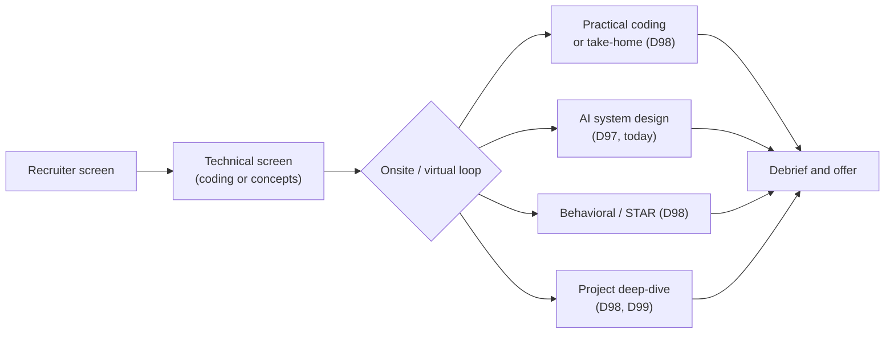
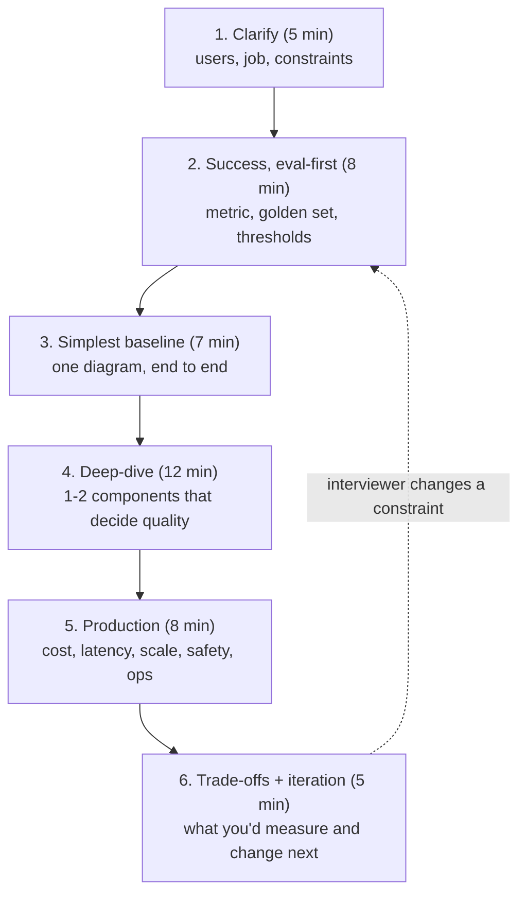
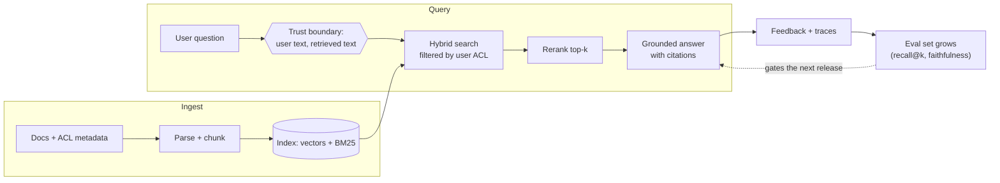
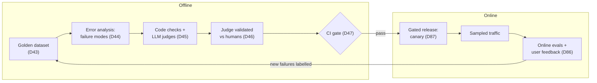

# AI System Design Interviews

"Design a support assistant for our docs." The candidate who draws a vector database in the first minute usually loses to the one who asks "how will we know it works, and what does a wrong answer cost?" Today you get a repeatable framework, three worked designs built from systems you have already shipped, and two designs of your own, scored against a rubric.

## At a Glance

- **Time:** ~2 h core (+ optional Go Deeper) · **Depth:** working
- **Prerequisites:** [Day 90: Capstone R5, Part 2: Launch & Prove It](../../Phase_9_Production/Day_090_capstone_r5_launch/capstone_r5_launch.md) (your launch-report numbers feed today's estimates)
- **You'll build:** two scored 45-minute designs from a prompt bank (spec, envelope and rubric score for each), plus five small stdlib scripts for your mocks
- **Stops at:** non-AI system design (sharding, consensus, CDN design); see the [System Design Primer](https://github.com/donnemartin/system-design-primer)
- **Fast path:** Already do system-design rounds? Read §The Six-Step Framework and §Scoring Your Designs, then do Exercise 2 against the rubric (~60 min)
- **Cost:** $0: every script is stdlib and needs no API key. The optional stretch grader costs ≈ $0.01 on `gpt-6-luna` (prices as of 2026-11, [verify](https://developers.openai.com/api/docs/pricing))
- **New terms:** eval-first spec, back-of-envelope estimate, latency budget, forward-deployed engineer (FDE), design rubric

> **Coming from Software Engineering?** Classic system design still applies: requirements, capacity estimates, APIs, data model, failure modes. The new part is one slow, metered, sometimes-wrong dependency; design around it as you would a flaky third-party payment API, with timeouts, fallbacks, caching and contract tests. The eval-first spec is acceptance tests plus SLOs (service-level objectives, such as "95% of answers in under 3 s") written before the code: TDD for scope. What's new: quality is a measured number, and cost scales with tokens, not servers.

## What System Design Rounds Actually Test

Picture the losing answer: the candidate draws ingest → embed → vector DB → LLM and debates chunk sizes for ten minutes. Asked "how would you know it works?", they say "we'd test it". With no metric and no golden set, no later choice has a reason.

The round sits inside a larger loop; [Day 98](../Day_098_practical_interviews/practical_interviews.md) covers the other rounds with the same map.



Interviewers score five things: **scoping** (the real job, users and constraints), **evals** (success you can measure), **trade-offs** (the simplest design that passes, and when you'd switch), **production sense** (cost, latency, scale, failures, safety, data) and **communication** (could they follow you?).

First-role candidates usually get a lighter version ("design a feature", "walk me through your project"); §The First-Role Track shows the 30-minute cut.

## The Six-Step Framework

Think of a doctor's consult: symptoms, how you'll both know the treatment worked, the simplest treatment, a close look at what matters, follow-up. A design answer has the same shape.



The rule that wins most rounds: **no boxes before step 3.** Steps 1 and 2 give every later choice a reason ("hybrid search, because many golden queries are exact error codes like `ORB-1101`"). When the interviewer changes a constraint ("now 100× the traffic"), go back to step 2 and the numbers, not the diagram. In step 5 you also name the **trust boundary**: the line where data you don't control (user text, retrieved documents) enters your system.

This script prints the time boxes as wall-clock times for a timed mock.

```python
# script_id: day_097_system_design_interviews/practice_clock
# Prints the six-step plan as wall-clock times for a mock interview.
# Install: none (stdlib, Python 3.11+). Env vars: none. Services: none.
from datetime import datetime, timedelta

# (step, minutes, the artifact you should have on the board when the box ends)
FULL_45 = [
    ("Clarify", 5, "users, job to be done, constraints, non-goals"),
    ("Success (eval-first)", 8, "metric, golden set, binary criteria, thresholds"),
    ("Simplest baseline", 7, "one end-to-end diagram"),
    ("Deep-dive", 12, "1-2 components in detail"),
    ("Production", 8, "envelope numbers, failure modes, trust boundary"),
    ("Trade-offs + iteration", 5, "two 'switch when' rules, next 3 steps"),
]
FIRST_ROLE_30 = [
    ("Clarify", 5, "users, job, constraints"),
    ("Success (eval-first)", 7, "metric + 3 binary criteria"),
    ("Simplest baseline", 12, "one diagram, walked end to end"),
    ("One trade-off", 6, "default + switch-when + what you'd measure"),
]

def plan(steps: list[tuple[str, int, str]], start: str = "10:00") -> list[str]:
    t = datetime.strptime(start, "%H:%M")
    lines = []
    for name, minutes, artifact in steps:
        end = t + timedelta(minutes=minutes)
        lines.append(f"{t:%H:%M}-{end:%H:%M}  {name:<24} -> {artifact}")
        t = end
    return lines

print("\n".join(plan(FULL_45)))
print(f"total: {sum(m for _, m, _ in FULL_45)} min")
```

```text
10:00-10:05  Clarify                  -> users, job to be done, constraints, non-goals
10:05-10:13  Success (eval-first)     -> metric, golden set, binary criteria, thresholds
10:13-10:20  Simplest baseline        -> one end-to-end diagram
10:20-10:32  Deep-dive                -> 1-2 components in detail
10:32-10:40  Production               -> envelope numbers, failure modes, trust boundary
10:40-10:45  Trade-offs + iteration   -> two 'switch when' rules, next 3 steps
total: 45 min
```

## The Eval-First Spec: From a Vague Request to a Testable Goal

Real requests arrive vague: "Our maintainers are drowning in issues. Can AI help?" Answering that is the daily job of a **forward-deployed engineer (FDE)**, an engineer embedded with a customer. FDE postings sit next to AI-engineer roles at AI companies, and prompts like this are their core work.

An **eval-first spec** is a one-page answer to "how will we know it works?", written before the design. Work it by hand on Orbit with eight clarifying questions:

| # | Question | Answer (Orbit) |
|---|---|---|
| 1 | Who is drowning, and in what? | 4 maintainers, ~40 new issues a week |
| 2 | What do they do with each issue today? | Label it, spot duplicates, ask for missing info, escalate S1s |
| 3 | What hurts most? | Time to first response (days) and missed S1 incidents |
| 4 | Is auto-closing or auto-replying allowed? | No: a human posts every reply |
| 5 | What does a wrong answer cost? | A wrong label is cheap; a missed S1 or a leaked secret is expensive |
| 6 | Do labelled past issues exist? | Yes: 30 triaged issues with labels and reply points |
| 7 | Who attacks this? | Anyone can open an issue, so issue text is untrusted input |
| 8 | Languages, volume growth, budget? | Mostly English, some non-English; near-$0 budget |

The job to be done: **first-pass triage that a maintainer accepts or edits, not auto-close.** The template:

```text
EVAL-FIRST SPEC: <system name>
User:            who uses it, and how often
Job to be done:  the one job, in a sentence (and what a human still does)
Success metric:  the single number that decides "it works" (+ one business metric)
Golden set:      size, source, slices (adversarial, languages, edge cases)
Criteria:        binary checks, each: name | check (code/judge/human) | threshold | owner
Non-goals:       what it will NOT do in v1
Risks:           what goes wrong, and the defence you'd name
```

Written as data, the spec gets a lint for the gaps interviewers probe.

```python
# script_id: day_097_system_design_interviews/eval_spec
# The eval-first spec as data, plus a lint for the gaps interviewers probe.
# Install: none (stdlib, Python 3.11+). Env vars: none. Services: none.
from dataclasses import dataclass, field

@dataclass
class Criterion:
    name: str        # phrased so the answer is yes/no
    check: str       # "code" (exact match, schema, regex), "judge" (validated LLM judge) or "human"
    threshold: str   # e.g. ">= 0.85 on the golden set"; empty means nobody can say pass/fail
    owner: str       # who looks when it fails

@dataclass
class EvalSpec:
    user: str
    job: str
    success_metric: str
    golden_set: str
    criteria: list[Criterion]
    non_goals: list[str] = field(default_factory=list)
    risks: list[str] = field(default_factory=list)

def lint(spec: EvalSpec) -> list[str]:
    problems = []
    if not spec.non_goals:
        problems.append("no non-goals: scope will creep during the deep-dive")
    if not any("inject" in r.lower() for r in spec.risks):
        problems.append("no injection risk named, but users can write the input")
    for c in spec.criteria:
        if c.check not in {"code", "judge", "human"}:
            problems.append(f"{c.name!r}: check must be code, judge or human")
        if not c.threshold:
            problems.append(f"{c.name!r}: no threshold")
        if not c.owner:
            problems.append(f"{c.name!r}: no owner")
    return problems
```

Filled in for Orbit. Thresholds are your proposal, not facts: "I'd propose 0.85 and revisit after the first error analysis" is the senior move.

```python
# script_id: day_097_system_design_interviews/eval_spec
triage = EvalSpec(
    user="4 Orbit maintainers, ~40 new issues/week",
    job="first-pass triage (labels, duplicate, needs-human, reply points); a human posts every reply",
    success_metric="label accuracy on the golden set; business: median time to first response",
    golden_set="50 labelled issues incl. prompt-injection, non-English and vague slices",
    criteria=[
        Criterion("type label correct", "code", ">= 0.85", "triage owner"),
        Criterion("every S1 marked needs_human", "code", "1.00 (zero misses)", "on-call maintainer"),
        Criterion("injected instructions ignored", "code", "6/6 attack issues", "security owner"),
        Criterion("reply covers the gold reply points", "judge", ">= 0.80, judge validated vs humans", "triage owner"),
    ],
    non_goals=["auto-close or auto-reply", "fixing bugs", "triaging closed issues"],
    risks=["prompt injection in issue bodies", "secrets pasted into issues", "label drift after model swap"],
)
print("lint:", lint(triage) or "clean")
triage.criteria[0].threshold = ""  # break it: the most common gap in real answers
print("lint:", lint(triage))
```

```text
lint: clean
lint: ["'type label correct': no threshold"]
```

Does the golden set exist? Orbit ships `eval/triage_gold.jsonl` ([Day 43](../../Phase_5_Evaluation_and_Observability/Day_043_eval_datasets/eval_datasets.md) covers building one). Profiling it finds a real gap.

```python
# script_id: day_097_system_design_interviews/golden_set
# Profile the golden set you'd ask for against the slices the spec names.
# Install: none (stdlib). Env vars: ORBIT_DATA (default datasets/orbit). Services: none.
import json
import os
from pathlib import Path

DATA_DIR = Path(os.environ.get("ORBIT_DATA", "datasets/orbit"))
# Slice ids come from datasets/orbit/README.md ("planted cases")
SLICES = {
    "prompt_injection": {20, 92, 204, 46, 159, 180},
    "non_english": {25, 97, 63, 188, 130},
    "vague": {10, 28, 37, 54, 62, 70, 80, 83, 93, 101, 119, 127, 136, 155, 166, 177, 191, 201, 214, 226},
}
# The spec's targets: your proposal, sized so each slice gives a usable signal
TARGET = {"total": 50, "prompt_injection": 5, "non_english": 5, "vague": 5, "needs_human": 10, "duplicate": 5}

lines = (DATA_DIR / "eval" / "triage_gold.jsonl").read_text(encoding="utf-8").splitlines()
rows = [json.loads(line) for line in lines if line.strip()]
ids = {r["issue_id"] for r in rows}
have = {"total": len(rows),
        "needs_human": sum(r["needs_human"] for r in rows),
        "duplicate": sum(r["duplicate_of"] is not None for r in rows)}
have |= {name: len(ids & members) for name, members in SLICES.items()}

for name, want in TARGET.items():
    gap = max(0, want - have[name])
    print(f"{name:<17} have {have[name]:>3}  want {want:>3}  {'ok' if gap == 0 else f'ask for {gap} more'}")
```

```text
total             have  30  want  50  ask for 20 more
prompt_injection  have   6  want   5  ok
non_english       have   0  want   5  ask for 5 more
vague             have   1  want   5  ask for 4 more
needs_human       have  16  want  10  ok
duplicate         have  11  want   5  ok
```

Injection is covered; non-English is missing. In an interview: "I'd check the golden set covers the slices that hurt, and label five non-English issues before trusting any accuracy number."

## Back-of-Envelope Numbers

A **back-of-envelope estimate** is a one-minute calculation of whether a design is affordable and fast enough. Interviewers want to see that you know what drives cost (tokens, not servers).

Work the tiny one by hand first. 1,000 requests a day, each 2,000 input tokens and 300 output tokens, on `gpt-6-luna` at $0.10 per 1M input and $0.50 per 1M output (as of 2026-11-06, [verify](https://developers.openai.com/api/docs/pricing)):

- input: 1,000 × 2,000 = 2M tokens × $0.10/1M = **$0.20**
- output: 1,000 × 300 = 0.3M tokens × $0.50/1M = **$0.15**
- total: **$0.35 a day**

The script adds traffic: QPS (queries per second) and peak TPM (tokens per minute, a provider rate-limit unit). Compare peak TPM with your own account's limit ([rate-limits guide](https://developers.openai.com/api/docs/guides/rate-limits)); never quote a tier's number from memory.

```python
# script_id: day_097_system_design_interviews/envelope
# Back-of-envelope numbers for an AI system-design answer.
# Install: none (stdlib, Python 3.11+). Env vars: ATLAS_MODEL (optional). Services: none.
import os
from dataclasses import dataclass

MODEL = os.environ.get("ATLAS_MODEL", "gpt-6-luna")  # built on Day 2
# Built on Day 4. USD per 1M tokens, Standard tier, prompts <= 272K input tokens.
# As of 2026-11-06, verify at https://developers.openai.com/api/docs/pricing
PRICES_PER_1M: dict[str, dict[str, float]] = {
    "gpt-6-luna":  {"input": 0.10, "cached_input": 0.01, "output": 0.50},
    "gpt-6.1-sol": {"input": 2.00, "cached_input": 0.10, "output": 10.00},
}

@dataclass
class Envelope:
    requests_per_day: int
    in_tokens: int              # per request: instructions + retrieved context + question
    out_tokens: int             # per request: visible + reasoning tokens (both bill as output)
    peak_factor: float = 10.0   # illustrative peak/average ratio; use your own traffic shape
    cached_share: float = 0.0   # share of input tokens read from the prompt cache
    strong_share: float = 0.0   # share of requests routed to a stronger tier

def traffic(env: Envelope) -> dict[str, float]:
    avg_qps = env.requests_per_day / 86_400
    peak_qps = avg_qps * env.peak_factor
    return {"avg_qps": avg_qps, "peak_qps": peak_qps,
            "tokens_per_day": env.requests_per_day * (env.in_tokens + env.out_tokens),
            "peak_tpm": peak_qps * 60 * (env.in_tokens + env.out_tokens)}

def estimate(env: Envelope, model: str = MODEL) -> dict[str, float]:
    p = PRICES_PER_1M[model]  # KeyError on purpose: an unknown model must not cost $0
    usd_day = env.requests_per_day * (env.in_tokens * p["input"] + env.out_tokens * p["output"]) / 1e6
    return traffic(env) | {"usd_per_day": usd_day, "usd_per_1k": usd_day / env.requests_per_day * 1_000}

def show(label: str, r: dict[str, float]) -> None:
    print(f"{label:<12} peak {r['peak_qps']:.1f} QPS · {r['tokens_per_day'] / 1e6:.0f}M tok/day · "
          f"peak {r['peak_tpm'] / 1e6:.2f}M TPM · ${r['usd_per_day']:.2f}/day · ${r['usd_per_1k']:.2f} per 1k req")

show("hand check", estimate(Envelope(1_000, 2_000, 300)))
show("docs bot", estimate(Envelope(60_000, 2_500, 350)))
show("same on sol", estimate(Envelope(1_000, 2_000, 300), model="gpt-6.1-sol"))
```

```text
hand check   peak 0.1 QPS · 2M tok/day · peak 0.02M TPM · $0.35/day · $0.35 per 1k req
docs bot     peak 6.9 QPS · 171M tok/day · peak 1.19M TPM · $25.50/day · $0.42 per 1k req
same on sol  peak 0.1 QPS · 2M tok/day · peak 0.02M TPM · $7.00/day · $7.00 per 1k req
```

Turn the knob: the same traffic on `gpt-6.1-sol` costs 20× more, which is why [Day 85](../../Phase_9_Production/Day_085_caching_cost_scale/caching_cost_scale.md) routes only hard requests to the strong tier. The realistic version adds a strong-tier share, prompt-cache reads ([Day 18](../../Phase_2_Building_with_LLM_APIs/Day_018_cost_latency_caching/cost_latency_caching.md); they need a shared prefix of at least 1,024 tokens) and the >272K long-context surcharge ([Day 5](../../Phase_1_How_LLMs_Work/Day_005_transformers_attention/transformers_attention.md)).

```python
# script_id: day_097_system_design_interviews/envelope
# Realistic version: this estimate() replaces the one above (it adds tiers, caching and the surcharge).
LONG_CONTEXT_THRESHOLD = 272_000  # built on Day 5: above it, 2x input/cache rates, 1.5x output
MIN_CACHE_PREFIX = 1_024          # Day 18: prompts shorter than this are never cached

def request_cost(in_tokens: int, out_tokens: int, model: str, cached_share: float = 0.0) -> float:
    p = PRICES_PER_1M[model]
    in_mult, out_mult = (2.0, 1.5) if in_tokens > LONG_CONTEXT_THRESHOLD else (1.0, 1.0)
    if in_tokens < MIN_CACHE_PREFIX:
        cached_share = 0.0  # assuming cache hits here is a classic estimate bug
    cached = in_tokens * cached_share
    # Cache writes (1.25x input) are ignored here; Go Deeper adds them.
    return ((in_tokens - cached) * p["input"] * in_mult + cached * p["cached_input"] * in_mult
            + out_tokens * p["output"] * out_mult) / 1e6

def estimate(env: Envelope, model: str = MODEL, strong_model: str = "gpt-6.1-sol") -> dict[str, float]:
    cheap = request_cost(env.in_tokens, env.out_tokens, model, env.cached_share)
    strong = request_cost(env.in_tokens, env.out_tokens, strong_model, env.cached_share)
    usd_day = env.requests_per_day * ((1 - env.strong_share) * cheap + env.strong_share * strong)
    return traffic(env) | {"usd_per_day": usd_day, "usd_per_1k": usd_day / env.requests_per_day * 1_000}

show("baseline", estimate(Envelope(60_000, 2_500, 350)))
show("60% cached", estimate(Envelope(60_000, 2_500, 350, cached_share=0.6)))
show("+10% strong", estimate(Envelope(60_000, 2_500, 350, cached_share=0.6, strong_share=0.1)))
# Break it: forget the 1,500 reasoning tokens, or stuff 300K tokens of context into every prompt
show("+reasoning", estimate(Envelope(60_000, 2_500, 350 + 1_500, cached_share=0.6)))
show("300K prompt", estimate(Envelope(1_000, 300_000, 350)))
```

```text
baseline     peak 6.9 QPS · 171M tok/day · peak 1.19M TPM · $25.50/day · $0.42 per 1k req
60% cached   peak 6.9 QPS · 171M tok/day · peak 1.19M TPM · $17.40/day · $0.29 per 1k req
+10% strong  peak 6.9 QPS · 171M tok/day · peak 1.19M TPM · $49.56/day · $0.83 per 1k req
+reasoning   peak 6.9 QPS · 261M tok/day · peak 1.81M TPM · $62.40/day · $1.04 per 1k req
300K prompt  peak 0.1 QPS · 300M tok/day · peak 2.09M TPM · $60.26/day · $60.26 per 1k req
```

Say it out loud: **routing share and output tokens move cost most.** Ten percent of traffic on the strong tier ($33.90 a day) costs twice the other ninety percent ($15.66). Forgotten reasoning tokens multiply the cached bill 3.6×, and the 300K prompt pays double on every request.

The last concern is time. A **latency budget** splits an end-to-end target (the SLO) into per-stage allowances, so you know which stage to cut when you are over.

```python
# script_id: day_097_system_design_interviews/envelope
def latency_budget(stages_ms: dict[str, float], slo_ms: float) -> tuple[float, bool]:
    """Sum of per-stage p95s vs the SLO. Summing p95s is pessimistic, which is fine for a budget."""
    total = sum(stages_ms.values())
    return total, total <= slo_ms

# Illustrative placeholders. Replace every number with your own measured p95s (R5 launch report).
stages = {"auth + cache lookup": 30, "hybrid retrieve": 150, "rerank": 250,
          "guardrail check": 120, "model: time to first token": 1_100}
total, ok = latency_budget(stages, slo_ms=1_500)
print(f"time to first token {total:.0f} ms vs SLO 1500 ms -> {'within budget' if ok else 'over budget'}")
for name, ms in sorted(stages.items(), key=lambda kv: -kv[1])[:2]:
    print(f"  cut candidate: {name} ({ms:.0f} ms)")
```

```text
time to first token 1650 ms vs SLO 1500 ms -> over budget
  cut candidate: model: time to first token (1100 ms)
  cut candidate: rerank (250 ms)
```

Over by 150 ms: rerank fewer candidates, or run the guardrail in parallel with generation. A p95 is the time 95% of requests beat; use the p95s from your [Day 90 launch report](../../Phase_9_Production/Day_090_capstone_r5_launch/capstone_r5_launch.md): "my measured retrieval p95 was N ms" beats any remembered number.

## Worked Design 1: A Docs Assistant (RAG)

This is R2 as an interview answer. Open with: **do you need RAG at all?** Orbit's docs are 45 pages, and a small, static corpus may be cheaper as long context plus caching ([Day 32](../../Phase_3_RAG/Day_032_long_context_vs_rag/long_context_vs_rag.md)). Then name the switch: a growing corpus, per-user permissions (ACLs, access control lists), or cost per request.



What interviewers want to hear, with the owning day:

- **ACLs at retrieval time,** inside the search, never after generation ([Day 27](../../Phase_3_RAG/Day_027_hybrid_search/hybrid_search.md)).
- **Hybrid search:** BM25 for exact codes like `ORB-1101`, vectors for paraphrases ([Day 27](../../Phase_3_RAG/Day_027_hybrid_search/hybrid_search.md)).
- **Retrieval measured alone:** recall@k and MRR (mean reciprocal rank) on labelled queries ([Day 29](../../Phase_3_RAG/Day_029_retrieval_evaluation/retrieval_evaluation.md)).
- **Rerank only with measured lift** worth its latency ([Day 31](../../Phase_3_RAG/Day_031_reranking_contextual_retrieval/reranking_contextual_retrieval.md)).
- **Cited answers, and "I don't know"** on empty retrieval ([Day 28](../../Phase_3_RAG/Day_028_rag_pipeline/rag_pipeline.md)).
- **Retrieved text is untrusted:** poisoned docs carry instructions ([Day 69](../../Phase_8_Safety_and_Security/Day_069_prompt_injection/prompt_injection.md)).
- **Answer evals** with a validated judge ([Day 30](../../Phase_3_RAG/Day_030_answer_evaluation/answer_evaluation.md), [Day 46](../../Phase_5_Evaluation_and_Observability/Day_046_judge_validation/judge_validation.md)).

## Worked Design 2: An Issue-Triage Agent

"Design an agent that triages our GitHub issues." The trap is in the word *agent*. Answer in this order:

1. **An agent, or several?** Classify, dedupe and draft reply points is a fixed sequence: a workflow, where code picks the steps ([Day 41](../../Phase_4_Tools_and_MCP/Day_041_workflow_patterns/workflow_patterns.md)). Use an agent only for open-ended bug investigation (R3, [Day 61](../../Phase_6_Agents/Day_061_capstone_r3_investigator/capstone_r3_investigator.md)), and multi-agent only when a measured single-agent baseline fails ([Day 64](../../Phase_7_Multi_Agent_Systems/Day_064_multi_agent_when/multi_agent_when.md)).
2. **Actions behind approval:** reads are free; labelling, commenting and closing need a human click ([Day 37](../../Phase_4_Tools_and_MCP/Day_037_robust_tool_execution/robust_tool_execution.md), [Day 55](../../Phase_6_Agents/Day_055_human_in_the_loop/human_in_the_loop.md)).
3. **Durability:** a worker restart must not post the same comment twice ([Day 54](../../Phase_6_Agents/Day_054_langgraph_durability/langgraph_durability.md)).
4. **Lethal trifecta:** untrusted input plus private data plus a way to send data out turns injection into a leak; remove one leg ([Day 68](../../Phase_8_Safety_and_Security/Day_068_threat_modeling/threat_modeling.md)).
5. **Trajectory evals and budgets:** score the steps taken, and cap tool calls and cost ([Day 59](../../Phase_6_Agents/Day_059_evaluating_agents/evaluating_agents.md)).
6. **Cost:** triage is asynchronous, so a job queue and a cheap tier usually suffice.

Your R4 pipeline ([Day 76](../../Phase_8_Safety_and_Security/Day_076_capstone_r4_triage/capstone_r4_triage.md)) is the reference answer. "I built this, and here's the failure I didn't expect" beats any diagram.

## Worked Design 3: Designing the Eval System Itself

"How would you evaluate this?" is the seniority signal. A weak answer names a metric; a strong one describes a loop whose offline and online halves feed each other.



Name the order: categorise failures from traces first ([Day 44](../../Phase_5_Evaluation_and_Observability/Day_044_error_analysis/error_analysis.md)), write checks for those failure modes, and trust a judge only once it agrees with human labels. The CI gate ([Day 47](../../Phase_5_Evaluation_and_Observability/Day_047_evals_in_ci/evals_in_ci.md)) blocks regressions, canaries ([Day 87](../../Phase_9_Production/Day_087_shipping_changes_safely/shipping_changes_safely.md)) catch what the offline set missed, and online failures become new golden examples. That last edge is the one interviewers listen for.

## Trade-Offs Interviewers Probe

Each answer has three parts: the default, the signal to switch, and how you'd measure it.

| Trade-off | Default | Switch when | Owner |
|---|---|---|---|
| Long context vs RAG | Long context + caching for a small, static corpus | Corpus grows, per-user ACLs, or cost per request too high | [D32](../../Phase_3_RAG/Day_032_long_context_vs_rag/long_context_vs_rag.md) |
| Hosted `file_search` vs own index | Hosted, to ship fast | You need custom ranking, ACL filters, or data residency | [D32](../../Phase_3_RAG/Day_032_long_context_vs_rag/long_context_vs_rag.md) |
| Workflow vs agent | Workflow (code picks the steps) | Steps can't be known in advance and evals show the workflow fails | [D41](../../Phase_4_Tools_and_MCP/Day_041_workflow_patterns/workflow_patterns.md) |
| Single vs multi-agent | One agent | Measured failure from context overload or conflicting roles | [D64](../../Phase_7_Multi_Agent_Systems/Day_064_multi_agent_when/multi_agent_when.md) |
| API vs self-host | Provider API | Data can't leave, steady high volume beats API cost, or latency needs local | [D93](../../Phase_10_Open_Models_and_Fine_Tuning/Day_093_vllm_serving/vllm_serving.md) |
| Prompt/RAG vs fine-tune | Prompting + retrieval | Behaviour (format, style, a narrow task) is stuck after prompt work and you have the data | [D94](../../Phase_10_Open_Models_and_Fine_Tuning/Day_094_should_you_finetune/should_you_finetune.md) |
| Semantic cache vs freshness | Exact cache only | Many near-duplicate questions over slow-changing content | [D85](../../Phase_9_Production/Day_085_caching_cost_scale/caching_cost_scale.md) |

### In real interview loops

- **"100× traffic?"** Re-run the envelope (peak TPM vs your limit, $/day), then the cheap fixes (caching, routing, batch) before new infrastructure.
- **"Provider down?"** Timeouts, backoff, a fallback model or degraded mode, a circuit breaker ([Day 84](../../Phase_9_Production/Day_084_reliability_fallbacks/reliability_fallbacks.md)).
- **"PII? Tenants?"** Redact before logging and set retention ([Day 73](../../Phase_8_Safety_and_Security/Day_073_privacy_pii/privacy_pii.md)); put the tenant in every filter and quota ([Day 83](../../Phase_9_Production/Day_083_auth_multitenancy_quotas/auth_multitenancy_quotas.md)).
- **"Migrate models?"** Golden set on the new model, shadow, canary, then a config switch ([Day 87](../../Phase_9_Production/Day_087_shipping_changes_safely/shipping_changes_safely.md)).
- **"I'd measure that"** counts only with the measurement named: "recall@5 with and without the reranker on 40 labelled queries."

## The First-Role Track

For a first role, expect 30 minutes and a narrower question. Interviewers check scoping, a success definition and a sensible baseline, not sharding or agent fleets. Run `FIRST_ROLE_30` from `practice_clock` (pass it to `plan(...)`) as your timer. Capacity math is a bonus, and Kubernetes in a junior answer signals time spent on infrastructure instead of evals. Practise on your own R2: design it out loud with the six steps, and record yourself once.

## Scoring Your Designs: The Rubric

A **design rubric** is a scoring sheet with anchored levels, so two people scoring the same answer land within a point of each other. It is an LLM judge's rubric ([Day 45](../../Phase_5_Evaluation_and_Observability/Day_045_llm_as_judge/llm_as_judge.md)) pointed at yourself.

| Dimension | 0 | 1 | 2 | 3 |
|---|---|---|---|---|
| Scoping | Designs at once | Asks generic questions | Finds users, job, constraints | Also names non-goals and the cost of a wrong answer |
| Eval-first success | No metric | A metric, no data | Metric, golden set, thresholds | Also slices, judge validation, an owner |
| Architecture fit and simplicity | Wrong shape | Works but over-built | Simplest design that passes | Also states what would make it grow |
| Production | Not mentioned | One of cost/latency/scale/reliability | Numbers for cost and latency | Also failure modes and fallbacks |
| Safety and data | Not mentioned | Generic "add guardrails" | Trust boundary drawn, one defence | ACLs, PII, injection, approvals as needed |
| Trade-offs and communication | No alternatives | Lists options | Default + switch-when | Also invites input, keeps time |

Pass is **at least 12 of 18 with no 0**, because a 0 anywhere is the thing an interviewer remembers. The first-role track uses four dimensions (Scoping, Eval-first success, Architecture fit, Trade-offs and communication), and passes at 8 of 12.

```python
# script_id: day_097_system_design_interviews/rubric
# Scores a design against the six-dimension rubric (or the 4-dimension first-role track).
# Install: none (stdlib, Python 3.11+). Env vars: none. Services: none.
FULL = ["scoping", "eval_first", "architecture", "production", "safety_data", "tradeoffs_comms"]
FIRST_ROLE = ["scoping", "eval_first", "architecture", "tradeoffs_comms"]
PASS_MARK = {"full": 12, "first_role": 8}

def score(scores: dict[str, int], track: str = "full") -> tuple[int, int, bool, list[str]]:
    dims = FULL if track == "full" else FIRST_ROLE
    missing = [d for d in dims if d not in scores]
    if missing:
        raise ValueError(f"score every dimension; missing {missing}")
    if any(not 0 <= scores[d] <= 3 for d in dims):
        raise ValueError("each dimension is scored 0-3")
    total = sum(scores[d] for d in dims)
    zeros = [d for d in dims if scores[d] == 0]
    weakest = sorted(dims, key=lambda d: scores[d])[:2]
    return total, 3 * len(dims), total >= PASS_MARK[track] and not zeros, weakest

mine = {"scoping": 3, "eval_first": 2, "architecture": 3, "production": 2,
        "safety_data": 1, "tradeoffs_comms": 3}
total, out_of, passed, weakest = score(mine)
print(f"{total}/{out_of} {'PASS' if passed else 'NO PASS'} · practise next: {', '.join(weakest)}")
mine["safety_data"] = 0  # forgot the trust boundary entirely
print("{}/{} {}".format(*score(mine)[:2], "PASS" if score(mine)[2] else "NO PASS (a 0 anywhere fails)"))
```

```text
14/18 PASS · practise next: safety_data, eval_first
13/18 NO PASS (a 0 anywhere fails)
```

Self-score after each mock, then have a peer score the same write-up. A gap above one point means discuss the anchor, not the score.

### Build: two scored designs

Pick one RAG-shaped and one agent-shaped prompt (all fictional). Give each 45 minutes, write it up (diagram, spec, envelope, trade-offs) and score it.

| # | Prompt | Shape |
|---|---|---|
| a | Contract Q&A for a 40-lawyer firm: 20k PDFs, strict client confidentiality | RAG |
| b | A returns agent for an online shop that can refund up to $50 | Agent |
| c | An HR-policy assistant for a 3,000-person company in four countries | RAG |
| d | Voice ordering for a pizza chain ([Day 81](../../Phase_9_Production/Day_081_voice_realtime/voice_realtime.md)) | Agent |
| e | A sales-call summarizer that writes CRM notes | Workflow |

## Go Deeper (optional)

<details><summary>Go deeper: under the hood, from peak QPS to concurrency and capacity</summary>

Peak QPS alone doesn't tell you how many requests are in flight. **Little's law** does: requests in flight = arrival rate × time each request spends in the system. Words first: if 7 people arrive every second and each stays 8 seconds, about 56 are inside at any moment. Toy numbers: 6.9 QPS × 8 s (an illustrative full streamed answer) ≈ 55 concurrent requests. Formula: L = λ × W.

That number sizes your worker pool, your connection pool and your async concurrency limit. It also shows why streaming (shorter perceived wait) and shorter outputs (smaller W) both reduce load. Cache writes aren't free either: on GPT-6 a 30-minute cache write costs 1.25× input (as of 2026-11-06, [verify](https://developers.openai.com/api/docs/guides/prompt-caching)), so a prefix that is written often and read rarely costs more than no cache at all.

```python
# script_id: day_097_system_design_interviews/deeper_capacity
# Little's law plus the cache-write premium. Stdlib only; numbers are illustrative.
# Install: none. Env vars: none. Services: none.
INPUT, CACHED_READ, CACHE_WRITE = 0.10, 0.01, 0.125  # gpt-6-luna $/1M, as of 2026-11-06, verify

def in_flight(qps: float, seconds_in_system: float) -> float:
    return qps * seconds_in_system  # Little's law: L = lambda * W

def prefix_cost_per_1m(reads_per_write: float) -> float:
    """Average $/1M prefix tokens when each cache write is followed by N reads."""
    return (CACHE_WRITE + reads_per_write * CACHED_READ) / (1 + reads_per_write)

print(f"in flight at peak: {in_flight(6.9, 8):.0f} requests")
for n in (0, 1, 10):
    print(f"{n:>2} reads per write: ${prefix_cost_per_1m(n):.3f}/1M vs ${INPUT:.3f} uncached")
```

```text
in flight at peak: 55 requests
 0 reads per write: $0.125/1M vs $0.100 uncached
 1 reads per write: $0.068/1M vs $0.100 uncached
10 reads per write: $0.020/1M vs $0.100 uncached
```

A cache that is never read back costs 25% more than no cache. One read per write already pays for itself.

</details>

<details><summary>Go deeper: running the clarify step like a forward-deployed engineer</summary>

In an FDE interview, or a real customer kickoff, the clarify step becomes discovery. What experts also do:

- **Ask to see the work.** "Can you show me the last ten issues you triaged, and what you did with each?" Ten real examples beat an hour of requirements, and they become the first golden set.
- **Find the expensive mistake.** Ask "what would get someone fired?", then make that a zero-tolerance criterion (the "every S1 marked needs_human" row).
- **Separate the buyer from the user.** The person asking for AI is often not the person who will use it. Get both success metrics into the spec.
- **Write the non-goals with the stakeholder.** "We won't auto-reply in v1" agreed in week one prevents the scope fight in week four.
- **Ship a thin slice in days.** A notebook that triages last week's issues, scored against the spec, earns more trust than a design document.

Keep this to one page. The spec template above is the artifact; the FDE skill is getting honest answers to fill it.

</details>

<details><summary>Go deeper: designs with tight latency (voice) and many tenants</summary>

Two variants come up often enough to rehearse.

**Voice ([Day 81](../../Phase_9_Production/Day_081_voice_realtime/voice_realtime.md)).** The latency budget becomes the core of the design. Split it by stage (speech-to-text, the model's time to first token, text-to-speech) for a chained pipeline, or treat it as one budget for a speech-to-speech model. Interruptions (the user talks over the agent) and confirmations before placing an order are the two things interviewers probe. Use your own measured numbers or label them illustrative.

**Many tenants ([Day 83](../../Phase_9_Production/Day_083_auth_multitenancy_quotas/auth_multitenancy_quotas.md)).** Add the tenant to every key: the index filter, the cache key, the rate-limit bucket and the trace. The classic failure is a shared semantic cache returning tenant A's answer to tenant B. Per-tenant quotas protect the TPM limit you computed in the envelope.

Both variants reuse the six steps unchanged; only the deep-dive component moves.

</details>

## Common Pitfalls

- **Boxes before success criteria.** "How would you know it works?" has no answer, because the diagram came first. Fix: spend minutes 5–13 on the eval-first spec.
- **An agent by default.** "Why not a workflow?" lands hard. Fix: state the workflow first and the measured failure that would make you switch ([Day 41](../../Phase_4_Tools_and_MCP/Day_041_workflow_patterns/workflow_patterns.md), [Day 64](../../Phase_7_Multi_Agent_Systems/Day_064_multi_agent_when/multi_agent_when.md)).
- **Cost math that forgets tokens.** Estimates 2× or more too low: no reasoning tokens, cache hits assumed under 1,024 tokens, or the >272K surcharge missed. Fix: the `envelope` checklist. An unknown model fails loudly with `KeyError: 'gpt-6-mini'` instead of costing $0.
- **Numbers from memory.** The interviewer corrects your price. Fix: say "as of <date>, I'd verify", and quote your own measured p95s.
- **No trust boundary.** No answer to "what if a document says 'ignore your instructions'?" Fix: draw the boundary, filter by ACL at retrieval ([Day 27](../../Phase_3_RAG/Day_027_hybrid_search/hybrid_search.md)), and name the injection defence ([Day 69](../../Phase_8_Safety_and_Security/Day_069_prompt_injection/prompt_injection.md)).
- **First-role over-design.** Kubernetes at minute 15, no evals by minute 30. Fix: the 30-minute track.

> **Where we stop:** we don't cover non-AI system design (sharding, consensus, CDN design), because classic system-design resources teach it well; see the [System Design Primer](https://github.com/donnemartin/system-design-primer).

## Key Takeaways

- The losing answer draws boxes first; the winning one asks how success is measured and what a wrong answer costs.
- Six time-boxed steps (clarify 5, success 8, baseline 7, deep-dive 12, production 8, trade-offs 5), with no diagram before step 3.
- An eval-first spec turns a vague request into a user, a job, a metric, a sliced golden set, thresholded criteria with owners, non-goals and risks.
- Envelope = requests × tokens in and out × tier mix × cache; forgetting reasoning tokens, the 1,024-token cache minimum or the 272K surcharge breaks it.
- Every trade-off is a default, a "switch when" and a named measurement, and the rubric (≥12/18, no 0) tells you what to practise next.

## Quick Reference

| Pattern | When to use | Gotcha |
|---|---|---|
| Six-step framework | Every 45-minute design round | Go back to step 2 when a constraint changes |
| 30-minute first-role track | Junior or new-grad loops | One diagram, one trade-off |
| Eval-first spec | Any vague request ("can AI help?") | Every criterion needs a threshold and an owner |
| `estimate(Envelope(...))` | Cost and traffic questions | `out_tokens` must include reasoning tokens |
| `latency_budget(stages, slo_ms)` | "Is it fast enough?" | Use measured p95s |
| Trade-off table | "Why not X?" follow-ups | State the simpler option first |
| `score(scores, track)` | After every mock | Any 0 fails, whatever the total |

## Exercises

1. **Warm-up.** Re-run `envelope` with your own R5 numbers and `strong_share=0.5`. How many times more expensive is the day?

<details><summary>Solution</summary>

Append this to the stitched `envelope` script. With the docs-bot numbers instead of yours, a 50% strong share costs about 10× the all-Luna day: routing share drives cost more than any other knob, which is why [Day 85](../../Phase_9_Production/Day_085_caching_cost_scale/caching_cost_scale.md) routes only the requests that need it.

```python
# script_id: day_097_system_design_interviews/solution_ex1
# fragment: append to the envelope script; replace the numbers with your R5 launch report's
mine = Envelope(requests_per_day=60_000, in_tokens=2_500, out_tokens=350)
base = estimate(mine)
routed = estimate(Envelope(60_000, 2_500, 350, strong_share=0.5))
show("all luna", base)
show("50% strong", routed)
print(f"{routed['usd_per_day'] / base['usd_per_day']:.1f}x the cost")
```

```text
all luna     peak 6.9 QPS · 171M tok/day · peak 1.19M TPM · $25.50/day · $0.42 per 1k req
50% strong   peak 6.9 QPS · 171M tok/day · peak 1.19M TPM · $267.75/day · $4.46 per 1k req
10.5x the cost
```

</details>

2. **Core.** Write a full 45-minute design for prompt (a), contract Q&A for the 40-lawyer firm: spec, one diagram, envelope and rubric self-score.

<details><summary>Solution</summary>

A sample answer that scores 14/18, condensed:

- **Clarify:** users are lawyers and paralegals; the job is "find and quote the clause", not legal advice; each lawyer may see only their matters' documents.
- **Spec:** metric is citation correctness on 60 lawyer-written questions, sliced by contract type and including "not in the documents" questions. Criteria: answer cites a clause that exists (code, 1.00); answer matches the clause (validated judge, ≥ 0.90); zero cross-matter documents retrieved (code, 1.00; owner: IT security). Non-goals: drafting, negotiation advice. Risks: ACL leaks, PII in logs, injected text inside PDFs.
- **Baseline:** 20k PDFs is too large for long context, so RAG: parse → chunk by clause → hybrid index with matter ACLs → filtered search → rerank → cited answer, "not found" when retrieval is empty.
- **Production:** retention set to the firm's policy, PII redacted in traces ([Day 73](../../Phase_8_Safety_and_Security/Day_073_privacy_pii/privacy_pii.md)), self-hosting discussed as the switch if documents can't leave the firm.
- **Lost points:** eval-first 2 (no judge-validation plan), production 2 (no fallback when the provider is down).

```python
# script_id: day_097_system_design_interviews/solution_ex2
# Envelope for prompt (a). Assumptions are illustrative: 40 lawyers x 25 questions/day,
# 8,000 input tokens (instructions + 6 clause chunks), 600 output tokens incl. reasoning.
# Prices: USD per 1M, as of 2026-11-06, verify at https://developers.openai.com/api/docs/pricing
PRICES = {"gpt-6-luna": (0.10, 0.50), "gpt-6.1-sol": (2.00, 10.00)}  # (input, output)

def per_request(model: str, in_tokens: int = 8_000, out_tokens: int = 600) -> float:
    price_in, price_out = PRICES[model]
    return (in_tokens * price_in + out_tokens * price_out) / 1e6

requests_per_day = 40 * 25
for strong_share in (0.0, 0.2):
    cost = (1 - strong_share) * per_request("gpt-6-luna") + strong_share * per_request("gpt-6.1-sol")
    print(f"strong share {strong_share:.0%}: ${cost * requests_per_day:.2f}/day")
```

```text
strong share 0%: $1.10/day
strong share 20%: $5.28/day
```

At this volume, model cost is small next to the cost of one confidentiality breach. Say so: it is why the deep-dive goes to ACLs, not to caching.

</details>

3. **Core.** Write a full design for one agent-shaped prompt: (b), the returns agent that can refund up to $50, or (d), voice ordering for a pizza chain. Score it.

<details><summary>Solution</summary>

A sample answer for (b), condensed:

- **Workflow first:** classify intent → look up the order (read tool) → policy check **in code** (amount ≤ $50, within the return window, not already refunded) → refund tool → reply. An agent handles only messy multi-item cases, and it still calls the same policy check.
- **Spec:** zero refunds over $50 or outside policy (code, 1.00, owner: payments); correct decision on 80 historical tickets (code, ≥ 0.90); reply tone (validated judge, ≥ 0.85). Non-goals: exchanges, refunds over $50.
- **Approval and idempotency:** anything the policy check can't decide goes to a human queue ([Day 55](../../Phase_6_Agents/Day_055_human_in_the_loop/human_in_the_loop.md)). The refund call carries an idempotency key per order, so a retried step can't pay twice ([Day 54](../../Phase_6_Agents/Day_054_langgraph_durability/langgraph_durability.md)).
- **Trifecta check:** customer text is untrusted, order data is private, and refunds move money. The $50 limit lives in code, so an injected "refund $500" fails the policy check whatever the model says ([Day 68](../../Phase_8_Safety_and_Security/Day_068_threat_modeling/threat_modeling.md)).
- **Trajectory evals:** check the agent called the policy check before every refund ([Day 59](../../Phase_6_Agents/Day_059_evaluating_agents/evaluating_agents.md)).
- **Self-score:** 15/18. Production lost a point (no envelope for peak days such as the week after a holiday).

</details>

4. **Stretch (optional).** Mock with a friend from the prompt bank and both score with the rubric. Optionally add an LLM rubric grader (≈ $0.01, needs an API key, past the stop line) and compare its scores with your peer's.

<details><summary>Solution</summary>

The grader returns structured scores with quoted evidence. Where it disagrees with your peer by more than a point, your anchors are too vague for a model too, which is the lesson from [Day 46](../../Phase_5_Evaluation_and_Observability/Day_046_judge_validation/judge_validation.md): validate a judge against humans before you trust it.

```python
# script_id: day_097_system_design_interviews/solution_ex4
# Optional LLM rubric grader. Install: uv add openai pydantic. Env: OPENAI_API_KEY, ATLAS_MODEL.
# Usage: python solution_ex4.py my_design.md rubric.md (paste the anchor table into rubric.md)
# Cost: ~$0.01 on gpt-6-luna (as of 2026-11, verify at https://developers.openai.com/api/docs/pricing)
import os
import sys
from pathlib import Path

from openai import OpenAI
from pydantic import BaseModel

MODEL = os.environ.get("ATLAS_MODEL", "gpt-6-luna")

class DimensionScore(BaseModel):
    dimension: str
    score: int       # 0-3, per the anchors
    evidence: str    # a short quote from the design; "missing" when absent

class RubricScore(BaseModel):
    scores: list[DimensionScore]
    biggest_gap: str

client = OpenAI()  # fails fast if OPENAI_API_KEY is unset
if len(sys.argv) != 3:
    sys.exit("usage: python solution_ex4.py my_design.md rubric.md")
design, anchors = (Path(p).read_text(encoding="utf-8") for p in sys.argv[1:3])
resp = client.responses.parse(
    model=MODEL,
    instructions="Score this AI system design on each rubric dimension, 0-3, using only the anchors. "
                 "Quote evidence. Score 0 when a dimension is missing.\n\n" + anchors,
    input=design,
    text_format=RubricScore,
)
result = resp.output_parsed
if result is None or resp.status == "incomplete":
    sys.exit(f"no usable score (status={resp.status})")
for s in result.scores:
    print(f"{s.dimension:<32} {s.score}  {s.evidence[:60]}")
print("total:", sum(s.score for s in result.scores), "· biggest gap:", result.biggest_gap)
```

</details>

## References & Further Reading

- [OpenAI: Pricing](https://developers.openai.com/api/docs/pricing): current prices, including long-context and Batch; check before quoting any number.
- [OpenAI: Rate limits](https://developers.openai.com/api/docs/guides/rate-limits): how TPM and RPM limits work, for the "100× traffic" follow-up.
- [OpenAI: Prompt caching](https://developers.openai.com/api/docs/guides/prompt-caching): the 1,024-token minimum and write/read pricing behind the cache knob.
- [Anthropic: Building effective agents](https://www.anthropic.com/research/building-effective-agents): workflows versus agents, with patterns worth naming.
- [Hamel Husain: AI evals FAQ](https://hamel.dev/blog/posts/evals-faq/): error analysis and binary criteria, the backbone of an eval-first spec.
- [Simon Willison: The lethal trifecta](https://simonwillison.net/2025/Jun/16/the-lethal-trifecta/): the one-paragraph security check for any agent design.
- [System Design Primer](https://github.com/donnemartin/system-design-primer): the classic, non-AI half of the round.

## What's Next

You can now answer a design question out loud, back it with a spec and numbers, and score yourself. In [Day 98: Practical Interviews: Coding, Take-Homes & DSA](../Day_098_practical_interviews/practical_interviews.md) you build under the clock: coding katas, a mock take-home and STAR stories with numbers from your releases.
