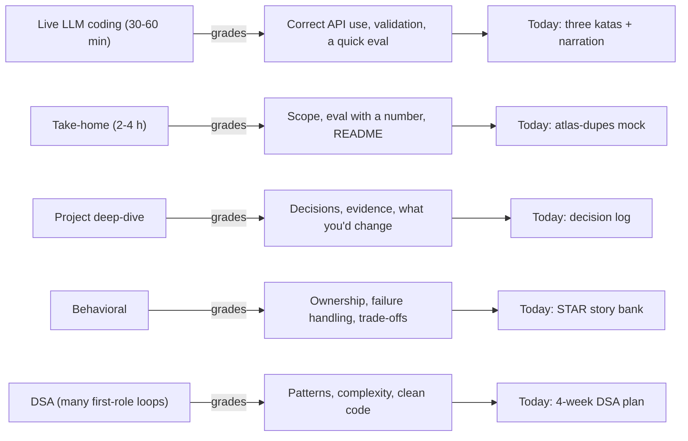
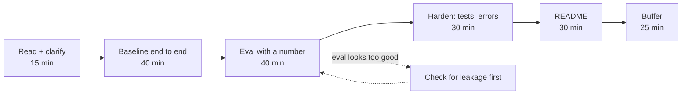
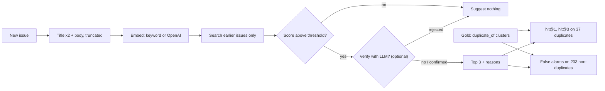
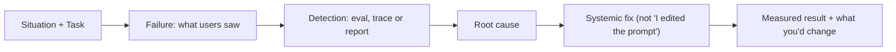

# Practical Interviews: Coding, Take-Homes & DSA

You have shipped five releases, but every one started from an existing repo. In a 30-minute live round you get a blank file and someone watching, and engineers who built a full agent freeze on the tool loop because the scaffolding was always there. Today you drill three katas cold, rehearse a timed take-home, turn R1–R5 into stories, and (first-role track) plan DSA practice.

## At a Glance

- **Time:** ~2 h core (+ optional Go Deeper) · **Depth:** working (the 3-hour timed take-home, Exercise 2, is a separate session)
- **Prerequisites:** [Day 97: AI System Design Interviews](../../Phase_11_Career_Launch/Day_097_system_design_interviews/system_design_interviews.md), [Day 63: Career Checkpoint](../../Phase_6_Agents/Day_063_career_checkpoint/career_checkpoint.md) (first-role track: the DSA schedule); recaps of [Day 16](../../Phase_2_Building_with_LLM_APIs/Day_016_structured_outputs/structured_outputs.md), [Day 35](../../Phase_4_Tools_and_MCP/Day_035_function_calling/function_calling.md) and [Day 28](../../Phase_3_RAG/Day_028_rag_pipeline/rag_pipeline.md)
- **You'll build:** three from-scratch katas; `atlas-dupes`, a mock take-home with tests and a two-sided eval; three STAR stories with numbers
- **Stops at:** a full DSA course (linked) and salary benchmarks
- **Fast path:** Know the APIs? Do Exercise 1 cold with a timer, read §The Timed Mock Take-Home, then do Exercise 2 (~3.5 h; the take-home is the point)
- **Cost:** ≈ $0.05 on `gpt-6-luna` + `text-embedding-3-small`; the take-home's default keyword backend is $0. Prices as of 2026-11, [verify](https://developers.openai.com/api/docs/pricing)
- **New terms:** kata, take-home time box, STAR story, hit@k (recap of Day 29), project deep-dive

> **Coming from Software Engineering?** Practical rounds are the AI version of "implement an LRU cache" plus "build a small service over a weekend". What transfers: narrating while you code, test-first habits, and scoping a take-home like a sprint with a fixed deadline. What's new: graders check that you treat model output as untrusted (validate it, don't assume it), that you measure quality with a tiny eval instead of eyeballing two examples, and that you know what your code costs per call. A take-home README is a PR description for a reviewer who has 10 minutes.

## What Practical Rounds Test

Picture the naive preparation: you reread your capstone code, feel fluent, then open an empty `main.py` in front of an interviewer and can't remember whether the tool result goes in a `function_call_output` item or a user message. Recognition isn't recall. The fix is a **kata**: a short exercise you repeat until it's automatic, the way a pianist drills scales.

In plain words, interviewers want to see you build something small that works, prove it works, and explain what you'd do next. Each round type grades a different slice of that. [Day 97](../../Phase_11_Career_Launch/Day_097_system_design_interviews/system_design_interviews.md#what-system-design-rounds-actually-test) mapped the whole loop; here are the hands-on rounds and where today prepares each one.



The three katas below cover the live-coding prompts teams ask for most: structured extraction with an eval, a tool loop, and a minimal RAG with citations. Each is a recall of an owner day, rewritten at interview size. Practise each with a 20-minute timer and no notes until you can write it twice in a row without looking anything up.

## Kata 1: Extract, Then Measure

The prompt: *"Turn this issue into a typed record and tell me how good it is."* Most candidates stop after the first half; the per-field score on labelled cases is what separates a demo from evidence ([Day 20](../../Phase_2_Building_with_LLM_APIs/Day_020_first_eval_set/first_eval_set.md)). The schema is `QuickTriage`, deliberately smaller than Atlas's `IssueRecord` from [Day 15](../../Phase_2_Building_with_LLM_APIs/Day_015_pydantic_for_llms/pydantic_for_llms.md), because in an interview four fields you can defend beat twelve you can't.

```python
# script_id: day_098_practical_interviews/kata_extract
# Kata 1: turn one Orbit issue into a typed record, then score 10 gold cases per field.
# Install: uv add "openai>=3.46,<4" pydantic
# Env: OPENAI_API_KEY; ORBIT_DATA (default datasets/orbit). Services: none.
import json
import os
from pathlib import Path
from typing import Literal

from openai import OpenAI
from pydantic import BaseModel

MODEL = os.environ.get("ATLAS_MODEL", "gpt-6-luna")
DATA_DIR = Path(os.environ.get("ORBIT_DATA", "datasets/orbit"))
COMPONENTS = ("core scheduler flows broker-redis broker-postgres broker-sqs cli "
              "dashboard retries results observability auth docs")
client = OpenAI()


class QuickTriage(BaseModel):  # interview-sized; Atlas's full IssueRecord is Day 15's
    type: Literal["bug", "feature", "question", "docs"]
    components: list[str]
    severity: Literal["S1", "S2", "S3", "S4"] | None  # nullable so "not a bug" is expressible
    summary: str


def extract(issue: dict) -> QuickTriage | None:
    resp = client.responses.parse(
        model=MODEL,
        instructions=f"Triage this Orbit issue. components: one or more of: {COMPONENTS}. "
                     "severity only for bugs (S1 is worst), else null. summary: one English sentence.",
        input=f"# {issue['title']}\n\n{issue['body'][:6000]}",  # one issue is ~8,600 words
        text_format=QuickTriage,
    )
    if resp.status != "completed" or resp.output_parsed is None:
        return None  # refusal or truncation: validate, don't trust
    return resp.output_parsed


with open(DATA_DIR / "issues/issues.jsonl", encoding="utf-8") as f:
    ISSUES = {(row := json.loads(line))["id"]: row for line in f}
record = extract(ISSUES[4])
print(record.model_dump_json(indent=2) if record else "no record")
```

Now the half that earns the points. A failed extraction counts as a miss on every field, never as a skipped case, otherwise a model that refuses hard cases looks more accurate.

```python
# script_id: day_098_practical_interviews/kata_extract
FIELDS = ("type", "components", "severity")


def field_accuracy(cases: list[dict], predict) -> dict[str, float]:
    """Share of cases where each field matches gold exactly (components compared as sets)."""
    hits = dict.fromkeys(FIELDS, 0)
    for case in cases:
        pred = predict(case)
        if pred is None:  # still in the denominator: refusals must cost you
            continue
        for field in FIELDS:
            want, got = case[field], getattr(pred, field)
            if field == "components":
                want, got = set(want), set(got)
            hits[field] += want == got
    return {f: round(hits[f] / len(cases), 2) for f in FIELDS}


with open(DATA_DIR / "eval/extraction_gold.jsonl", encoding="utf-8") as f:
    gold = [json.loads(line) for line in f][:10]
print(field_accuracy(gold, lambda case: extract(ISSUES[case["issue_id"]])))
```

```text
{
  "type": "bug",
  "components": ["core"],
  "severity": "S2",
  "summary": "A long-running statement job runs on two workers, so customers get two emails."
}
{'type': 0.9, 'components': 0.7, 'severity': 0.6}
```

(Illustrative; your numbers will differ.) Issue 4's dataset labels are `type:bug`, `comp:core`, `severity:S2`, which the record above matches. Say out loud what the weakest field tells you: severity is a judgement call, so the next step is a rubric in the prompt plus more gold cases, not a bigger model.

## Kata 2: The Tool Loop from Memory

The prompt: *"Give the model a `get_issue` tool and answer: is issue 145 a duplicate, and what is the original's state?"* This is [Day 35](../../Phase_4_Tools_and_MCP/Day_035_function_calling/function_calling.md)'s loop with [Day 36](../../Phase_4_Tools_and_MCP/Day_036_tool_design/tool_design.md)'s strict, flat schema. Four details get graded: arguments arrive as a JSON *string*, every `call_id` gets an answer, tool errors go back to the model as data, and a `max_rounds` stop exists.

```python
# script_id: day_098_practical_interviews/kata_tool_loop
# Kata 2: a strict tool, a dispatcher and a bounded loop over the Responses API.
# Install: uv add "openai>=3.46,<4" · Env: OPENAI_API_KEY; ORBIT_DATA. Services: none.
import json
import os
from dataclasses import dataclass
from pathlib import Path

from openai import OpenAI

MODEL = os.environ.get("ATLAS_MODEL", "gpt-6-luna")
DATA_DIR = Path(os.environ.get("ORBIT_DATA", "datasets/orbit"))
client = OpenAI()
with open(DATA_DIR / "issues/issues.jsonl", encoding="utf-8") as f:
    ISSUES = {(row := json.loads(line))["id"]: row for line in f}


def get_issue(issue_id: int) -> dict:
    issue = ISSUES.get(issue_id)
    if issue is None:
        return {"error": f"no issue {issue_id}"}  # an error is data the model can act on
    return {k: issue[k] for k in ("id", "title", "state", "labels", "duplicate_of")}


TOOLS = [{"type": "function", "name": "get_issue", "strict": True,
          "description": "Fetch one Orbit issue by its numeric id.",
          "parameters": {"type": "object", "properties": {"issue_id": {"type": "integer"}},
                         "required": ["issue_id"], "additionalProperties": False}}]
REGISTRY = {"get_issue": get_issue}


def dispatch(name: str, arguments: str) -> str:
    try:
        result = REGISTRY[name](**json.loads(arguments))  # arguments is a JSON string
    except Exception as e:  # unknown tool, bad args: report, don't crash the loop
        result = {"error": f"{type(e).__name__}: {e}"}
    return json.dumps(result)
```

```python
# script_id: day_098_practical_interviews/kata_tool_loop
@dataclass
class LoopResult:
    text: str
    rounds: int
    stop_reason: str  # "done" | "max_rounds"


def run_tool_loop(question: str, *, max_rounds: int = 5) -> LoopResult:
    items: list = [{"role": "user", "content": question}]
    for rnd in range(1, max_rounds + 1):
        resp = client.responses.create(model=MODEL, input=items, tools=TOOLS)
        calls = [item for item in resp.output if item.type == "function_call"]
        if not calls:
            return LoopResult(resp.output_text, rnd, "done")
        items += resp.output  # keep the call items (and any reasoning) in the history
        for call in calls:    # answer EVERY call; parallel calls are on by default
            items.append({"type": "function_call_output", "call_id": call.call_id,
                          "output": dispatch(call.name, call.arguments)})
    return LoopResult("", max_rounds, "max_rounds")


result = run_tool_loop("Is issue 145 a duplicate? If so, give the original's title and state.")
print(result.text)
print(f"rounds={result.rounds} stop={result.stop_reason}")
```

```text
Yes. #145 is a duplicate of #143, "3.1.0: reconnect storm after Redis failover, thousands of
connections and an ORB-1001 flood take Redis down again", which is closed.
rounds=3 stop=done
```

(Your wording and round count will differ.) Now break it, because interviewers ask "what happens if…": answer only the first call.

```python
# script_id: day_098_practical_interviews/kata_tool_loop_broken
# fragment: the one-line bug; drop it into run_tool_loop above to see the failure
        for call in calls[:1]:  # BUG: a parallel second call never gets an output
            items.append({"type": "function_call_output", "call_id": call.call_id,
                          "output": dispatch(call.name, call.arguments)})
```

With two parallel calls, the next request fails with a 400 `BadRequestError`: one `function_call` has no output. The [migration guide](https://developers.openai.com/api/docs/guides/migrate-to-responses) lists mismatched `call_id`s as a common error (⚠ wording varies). The other classic slip: `call.arguments["issue_id"]` raises `TypeError: string indices must be integers, not 'str'` until you `json.loads` the string.

## Kata 3: Minimal RAG with Citations

The prompt: *"Answer questions over these 45 docs, with citations."* At interview size you skip chunking and a vector database: embed each page (truncated), rank by cosine similarity, and ask for a typed `Answer` ([Day 23](../../Phase_3_RAG/Day_023_embeddings/embeddings.md), [Day 28](../../Phase_3_RAG/Day_028_rag_pipeline/rag_pipeline.md)). The graded detail is the last check: drop any citation that points at a page you didn't retrieve.

```python
# script_id: day_098_practical_interviews/kata_rag
# Kata 3: embed 45 pages, cosine top-3, typed answer, reject citations you never retrieved.
# Install: uv add "openai>=3.46,<4" pydantic numpy · Env: OPENAI_API_KEY; ORBIT_DATA.
import os
from pathlib import Path

import numpy as np
from openai import OpenAI
from pydantic import BaseModel

MODEL = os.environ.get("ATLAS_MODEL", "gpt-6-luna")
EMBED_MODEL = os.environ.get("ATLAS_EMBED_MODEL", "text-embedding-3-small")
DATA_DIR = Path(os.environ.get("ORBIT_DATA", "datasets/orbit"))
client = OpenAI()
DOCS = {p.stem: p.read_text(encoding="utf-8") for p in sorted((DATA_DIR / "docs").glob("*.md"))}
IDS = list(DOCS)


class Citation(BaseModel):
    doc_id: str
    quote: str


class Answer(BaseModel):
    text: str
    citations: list[Citation]


def embed(texts: list[str]) -> np.ndarray:
    resp = client.embeddings.create(model=EMBED_MODEL, input=texts)
    vecs = np.array([d.embedding for d in resp.data], dtype=np.float32)
    return vecs / np.linalg.norm(vecs, axis=1, keepdims=True)  # unit length: dot = cosine


DOC_VECS = embed([DOCS[i][:6000] for i in IDS])  # whole pages, well under the 8,192-token cap
```

Retrieval and the answer, with the citation check:

```python
# script_id: day_098_practical_interviews/kata_rag


def search_docs(query: str, k: int = 3) -> list[str]:
    return [IDS[i] for i in np.argsort(-(DOC_VECS @ embed([query])[0]))[:k]]


def ask(question: str) -> Answer:
    ids = search_docs(question)
    context = "\n\n".join(f"<doc id='{i}'>\n{DOCS[i][:4000]}\n</doc>" for i in ids)
    resp = client.responses.parse(model=MODEL, text_format=Answer, input=f"{context}\n\nQ: {question}",
                                  instructions="Answer only from the docs and cite their ids. "
                                               "If the docs don't say, say so.")
    if resp.output_parsed is None:
        raise RuntimeError(f"no parsed answer (status={resp.status})")
    answer = resp.output_parsed
    real = [c for c in answer.citations if c.doc_id in ids]
    print(f"rejected {len(answer.citations) - len(real)} fake citations")
    return answer.model_copy(update={"citations": real})


ans = ask("How long does Orbit wait between retry attempts by default?")
print(ans.text, "\ncitations:", [c.doc_id for c in ans.citations])
```

```text
rejected 0 fake citations
By default Orbit uses exponential backoff between attempts (3 attempts in total), with any single
delay capped at 600 seconds.
citations: ['retries-and-backoff']
```

(Your wording will differ.) "What next?" has a measured answer: chunking ([Day 25](../../Phase_3_RAG/Day_025_chunking/chunking.md)), hybrid search for exact terms such as `ORB-1101` ([Day 27](../../Phase_3_RAG/Day_027_hybrid_search/hybrid_search.md)), and recall@k on `eval/retrieval_queries.jsonl` ([Day 29](../../Phase_3_RAG/Day_029_retrieval_evaluation/retrieval_evaluation.md)).

## Talking While You Type

Silence reads as being stuck, even when you're thinking well. Graders write down what you say, so use one protocol for every live round:

1. **Restate** the task in one sentence and name the output ("a typed record per issue, plus a score").
2. **Ask two questions** that change the design: how many inputs, and what "good" means (a labelled set? latency?).
3. **Build the simplest version** that runs end to end, and say what you're leaving out.
4. **Run one example** and read the output aloud, including what looks wrong.
5. **Harden**: validation, the `None` check, a stop rule, one test.
6. **Name the next three improvements** with the metric each would move.

Ask whether an AI coding assistant is allowed. If it is, disclose when you use it and be ready to explain every line ([Day 60](../../Phase_6_Agents/Day_060_coding_agents_skills/coding_agents_skills.md)).

## The Timed Mock Take-Home

Here is a realistic prompt. Set a 3-hour timer before you read further than this paragraph:

> *Orbit maintainers want `atlas-dupes`: given a new issue, suggest up to 3 earlier issues it may duplicate, each with a reason. Include an evaluation. Time limit: 3 hours.*

R4 had a dedupe step ([Day 76](../../Phase_8_Safety_and_Security/Day_076_capstone_r4_triage/capstone_r4_triage.md)); this time you work alone, from an empty folder, against the clock. A **take-home time box** gives every phase a fixed slice of the timer and protects the parts graders read first:



The eval is a ranking metric you met on [Day 29](../../Phase_3_RAG/Day_029_retrieval_evaluation/retrieval_evaluation.md): **hit@k** asks "did a right answer appear in the top k?" Work one by hand. Issue 150 duplicates cluster #143 (earlier members: 143, 145). Your top 3 for 150 are `[145, 61, 143]`: hit@1 = 1 (145 is right), hit@3 = 1. If the top 3 were `[61, 209, 143]`, hit@1 = 0 and hit@3 = 1. Average over every query and you have the score.

The trap is **leakage**: answers sneaking into what the system can see, here the query issue itself or issues filed after it. Put the guard in the search filter, not the eval, so product and eval can't disagree:



The reference solution is one file in seven blocks. By default it runs offline with a keyword backend (hashed TF-IDF in NumPy, a stand-in for embeddings), so it costs nothing; `DUPES_BACKEND=openai` swaps in real embeddings. First, loading and the text you embed:

```python
# script_id: day_098_practical_interviews/mock_takehome
# atlas-dupes: suggest up to 3 EARLIER Orbit issues a new issue may duplicate, plus an eval.
# Install: uv add numpy pydantic  (OpenAI backend or --verify: uv add "openai>=3.46,<4")
# Env: ORBIT_DATA; DUPES_BACKEND=keyword (default: offline, $0) | openai (needs OPENAI_API_KEY);
#      DUPES_MIN_SCORE (default 0.25, tuned on the keyword backend; re-tune for any other).
# Run: python mock_takehome.py   |   python mock_takehome.py --title "..." --body "..."
import argparse
import json
import os
import re
import time
import zlib
from collections import Counter
from functools import cache
from pathlib import Path

import numpy as np
from pydantic import BaseModel

DATA_DIR = Path(os.environ.get("ORBIT_DATA", "datasets/orbit"))
BACKEND = os.environ.get("DUPES_BACKEND", "keyword")
MIN_SCORE = float(os.environ.get("DUPES_MIN_SCORE", "0.25"))
MODEL = os.environ.get("ATLAS_MODEL", "gpt-6-luna")
EMBED_MODEL = os.environ.get("ATLAS_EMBED_MODEL", "text-embedding-3-small")
MAX_CHARS = 6000  # issue 227 is ~8,600 words: over the 8,192-token embedding cap untruncated
USAGE: Counter = Counter()  # tokens by kind; only the OpenAI paths add to it


def load_issues() -> list[dict]:
    with open(DATA_DIR / "issues/issues.jsonl", encoding="utf-8") as f:
        return [json.loads(line) for line in f]


def issue_text(issue: dict) -> str:
    # The title is the densest signal, so it counts twice; long log tails mostly add noise.
    return f"{issue['title']}\n{issue['title']}\n{issue.get('body', '')}"[:MAX_CHARS]


ISSUES = load_issues()
BY_ID = {i["id"]: i for i in ISSUES}
```

Two embedders behind one name, so swapping is one line:

```python
# script_id: day_098_practical_interviews/mock_takehome
TOKEN = re.compile(r"[a-z0-9][a-z0-9_.\-]+")  # keeps ORB-1101, orbit.toml, lease_seconds whole
DF = Counter(t for i in ISSUES for t in set(TOKEN.findall(issue_text(i).lower())))


def keyword_embed(texts: list[str], dim: int = 4096) -> np.ndarray:
    """Offline fallback: hashed TF-IDF vectors, so the take-home runs without a key."""
    out = np.zeros((len(texts), dim), dtype=np.float32)
    for row, text in enumerate(texts):
        for tok, n in Counter(TOKEN.findall(text.lower())).items():
            idf = max(np.log(len(ISSUES) / (1 + DF[tok])), 0.0)  # rare terms weigh most
            out[row, zlib.crc32(tok.encode()) % dim] += (1 + np.log(n)) * idf
    return out / np.maximum(np.linalg.norm(out, axis=1, keepdims=True), 1e-9)


@cache
def llm():
    from openai import OpenAI  # lazy: the keyword path needs neither the package nor a key
    return OpenAI()


def openai_embed(texts: list[str]) -> np.ndarray:
    vecs = []
    for start in range(0, len(texts), 64):  # small batches keep each request modest
        resp = llm().embeddings.create(model=EMBED_MODEL, input=texts[start:start + 64])
        USAGE["embed"] += resp.usage.prompt_tokens
        vecs += [d.embedding for d in resp.data]
    v = np.array(vecs, dtype=np.float32)
    return v / np.linalg.norm(v, axis=1, keepdims=True)


EMBED = {"keyword": keyword_embed, "openai": openai_embed}[BACKEND]
```

An in-memory `Index` with the same `upsert`/`search` shape as [Day 26](../../Phase_3_RAG/Day_026_pgvector_search/pgvector_search.md)'s pgvector version. The `where` callable is the metadata filter that carries the leakage guard:

```python
# script_id: day_098_practical_interviews/mock_takehome
class Index:
    """In-memory vector index: the interview-sized stand-in for pgvector."""

    def __init__(self) -> None:
        self.ids: list[str] = []
        self.meta: list[dict] = []
        self.rows: list[np.ndarray] = []
        self.pos: dict[str, int] = {}

    def upsert(self, ids: list[str], vectors, meta: list[dict]) -> None:
        for id_, vec, m in zip(ids, vectors, meta):
            if id_ in self.pos:  # re-ingesting an issue replaces it, so reruns are idempotent
                self.rows[self.pos[id_]], self.meta[self.pos[id_]] = vec, m
                continue
            self.pos[id_] = len(self.ids)
            self.ids.append(id_)
            self.meta.append(m)
            self.rows.append(vec)

    def search(self, vector: np.ndarray, k: int, where=None) -> list[tuple[str, float]]:
        keep = [j for j, m in enumerate(self.meta) if where is None or where(m)]
        if not keep:
            return []
        scores = np.stack([self.rows[j] for j in keep]) @ vector
        return [(self.ids[keep[t]], float(scores[t])) for t in np.argsort(-scores)[:k]]


VECS = dict(zip((i["id"] for i in ISSUES), EMBED([issue_text(i) for i in ISSUES])))
INDEX = Index()
INDEX.upsert([str(i) for i in VECS], list(VECS.values()),
             [{"created_at": BY_ID[i]["created_at"]} for i in VECS])
```

The optional verify stage: one cheap structured call per candidate, cached so the eval never pays twice for the same pair.

```python
# script_id: day_098_practical_interviews/mock_takehome
class DupVerdict(BaseModel):
    is_duplicate: bool
    reason: str


VERDICTS: dict[tuple, DupVerdict | None] = {}


def verify_pair(new: dict, old: dict) -> DupVerdict | None:
    key = (new.get("id"), old["id"])
    if key[0] is not None and key in VERDICTS:
        return VERDICTS[key]
    resp = llm().responses.parse(
        model=MODEL, text_format=DupVerdict,
        instructions="Is NEW the same underlying problem or request as OLD? Same symptom and "
                     "cause = duplicate. Same component but a different bug = not a duplicate.",
        input=f"OLD #{old['id']}:\n{issue_text(old)[:1500]}\n\nNEW:\n{issue_text(new)[:1500]}")
    USAGE["in"] += resp.usage.input_tokens
    USAGE["out"] += resp.usage.output_tokens
    verdict = resp.output_parsed if resp.status == "completed" else None  # None = unconfirmed
    VERDICTS[key] = verdict
    return verdict
```

The product function. The threshold and the verifier are both parameters, so the eval can measure each knob separately:

```python
# script_id: day_098_practical_interviews/mock_takehome
def suggest_duplicates(issue: dict, k: int = 3, verify: bool = False,
                       min_score: float = MIN_SCORE) -> list[tuple[int, float, str]]:
    vec = VECS.get(issue.get("id"))
    if vec is None:  # a brand-new issue: embed it now
        vec = EMBED([issue_text(issue)])[0]
    cutoff = issue.get("created_at", "9999")  # strictly earlier: excludes itself and the future
    out = []
    for sid, score in INDEX.search(vec, k, where=lambda m: m["created_at"] < cutoff):
        old = BY_ID[int(sid)]
        if score < min_score:
            continue
        reason = f"similar wording to #{old['id']}: {old['title'][:60]}"
        if verify:
            verdict = verify_pair(issue, old)
            if verdict is None or not verdict.is_duplicate:
                continue
            reason = verdict.reason
        out.append((old["id"], round(score, 3), reason))
    return out


def gold_for(issue: dict) -> set[int]:
    """Earlier members of the issue's duplicate cluster: any of them is a correct suggestion."""
    root = issue["duplicate_of"]
    cluster = {root} | {i["id"] for i in ISSUES if i["duplicate_of"] == root}
    return {c for c in cluster if BY_ID[c]["created_at"] < issue["created_at"]}
```

The eval has two halves. Ranking quality on the 37 issues that have an earlier duplicate, and false alarms on the 203 that don't. A suggester that always returns three issues scores well on the first and annoys maintainers on the second.

```python
# script_id: day_098_practical_interviews/mock_takehome
def hit_at_k(k: int = 3, verify: bool = False, misses: list | None = None,
             min_score: float = 0.0) -> dict[str, float]:
    hits1 = hitsk = 0
    ms: list[float] = []
    queries = [i for i in ISSUES if i["duplicate_of"]]
    for q in queries:
        t0 = time.perf_counter()
        got = [sid for sid, _, _ in suggest_duplicates(q, k, verify, min_score)]
        ms.append((time.perf_counter() - t0) * 1000)
        gold = gold_for(q)
        hits1 += bool(got) and got[0] in gold
        hitsk += bool(set(got) & gold)
        if misses is not None and not set(got) & gold:
            misses.append(q["id"])
    n = len(queries)
    return {"n": n, "hit@1": round(hits1 / n, 2), f"hit@{k}": round(hitsk / n, 2),
            "p95_ms": round(float(np.percentile(ms, 95)), 1)}


def false_alarm_rate(min_score: float = MIN_SCORE, verify: bool = False) -> dict[str, float]:
    queries = [i for i in ISSUES if not i["duplicate_of"]]
    shown = sum(bool(suggest_duplicates(q, 3, verify, min_score)) for q in queries)
    return {"n": len(queries), "false_alarms": round(shown / len(queries), 2)}
```

Last, the run command and the cost line graders look for:

```python
# script_id: day_098_practical_interviews/mock_takehome
PRICE_PER_1M = {"embed": 0.02, "in": 0.10, "out": 0.50}  # USD; as of 2026-11, verify at pricing


def cost_usd() -> float:
    return sum(USAGE[kind] * price for kind, price in PRICE_PER_1M.items()) / 1e6


def main(argv: list[str] | None = None) -> None:
    ap = argparse.ArgumentParser(description="Suggest earlier Orbit issues a new one may duplicate.")
    ap.add_argument("--verify", action="store_true", help="LLM check per suggestion (needs a key)")
    ap.add_argument("--issue", type=int, help="suggest for an existing issue id")
    ap.add_argument("--title", default="", help="suggest for a new issue")
    ap.add_argument("--body", default="")
    args = ap.parse_args(argv)
    if args.issue or args.title:  # suggestion mode
        issue = BY_ID[args.issue] if args.issue else {"title": args.title, "body": args.body}
        for sid, score, reason in suggest_duplicates(issue, verify=args.verify):
            print(f"#{sid}  score={score:.3f}  {reason}")
    else:  # eval mode (the default, so a grader's first run shows the numbers)
        misses: list[int] = []
        ranking = hit_at_k(3, args.verify, misses=misses)
        shown = hit_at_k(3, args.verify, min_score=MIN_SCORE)
        alarms = false_alarm_rate(MIN_SCORE, args.verify)
        print(f"ranking: {ranking} misses={misses}")
        print(f"at threshold {MIN_SCORE}: hit@3 {shown['hit@3']} · false alarms {alarms}")
    print(f"backend={BACKEND} verify={args.verify} cost=${cost_usd():.4f}")


if __name__ == "__main__":
    main()
```

```text
ranking: {'n': 37, 'hit@1': 0.97, 'hit@3': 1.0, 'p95_ms': 0.2} misses=[]
at threshold 0.25: hit@3 0.68 · false alarms {'n': 203, 'false_alarms': 0.29}
backend=keyword verify=False cost=$0.0000
```

(Keyword backend; your latency will differ, and other backends give other scores.) A perfect ranking is the moment to suspect leakage; the first test below proves the guard holds. Without the `where` filter, scoring against the whole cluster, hit@1 is 1.00 and every non-duplicate "matches" itself.

The real finding is the second line. Sweep the threshold and the trade-off appears:

| `DUPES_MIN_SCORE` | hit@3 (n=37) | false alarms (n=203) |
|---|---|---|
| 0.20 | 0.81 | 0.42 |
| 0.25 | 0.68 | 0.29 |
| 0.30 | 0.41 | 0.16 |

Scores rank candidates well *within* one query but don't separate "has a duplicate" from "doesn't" *across* queries. That is the argument for the verify stage, and stating it with this table is what moves a submission from Good to Great.

Untested take-homes read as unfinished. Three offline tests cover the guard, a new issue and a regression gate:

```python
# script_id: day_098_practical_interviews/test_takehome
# pytest for atlas-dupes, offline on the keyword backend. Save next to mock_takehome.py.
# Install: uv add pytest numpy pydantic · Run: pytest -q test_takehome.py
import os

os.environ.setdefault("DUPES_BACKEND", "keyword")  # tests must not spend money or need a key

from mock_takehome import BY_ID, ISSUES, hit_at_k, suggest_duplicates  # noqa: E402


def test_never_suggests_itself_or_the_future():
    for issue in ISSUES:
        for sid, _, _ in suggest_duplicates(issue, min_score=0.0):
            assert sid != issue["id"]
            assert BY_ID[sid]["created_at"] < issue["created_at"]


def test_new_issue_without_an_id():
    got = suggest_duplicates({"title": "Reconnect storm after Redis Sentinel failover",
                              "body": "ORB-1001 flood, Redis CPU at 100%"}, min_score=0.0)
    assert [sid for sid, _, _ in got][:3] and 143 in {sid for sid, _, _ in got}


def test_ranking_does_not_regress():
    assert hit_at_k(3)["hit@3"] >= 0.9  # set below today's baseline: n is only 37


if __name__ == "__main__":
    import pytest
    raise SystemExit(pytest.main([__file__, "-q"]))
```

What graders look for:

| Tier | What it shows |
|---|---|
| Baseline (everyone) | It runs from one command; the README says what it does |
| Good (most miss this) | **An eval with a number**; error handling; a few tests; cost and latency stated |
| Great (stands out) | Decisions and trade-offs explained; known failures listed; "what I'd do with more time"; code a team could maintain |

The README is a PR description, not an essay. Keep it to one screen (the full release README is [Day 99](../../Phase_11_Career_Launch/Day_099_portfolio/portfolio.md)'s topic):

````markdown
# atlas-dupes
Suggests up to 3 earlier Orbit issues a new issue may duplicate, with a reason each.

## Run
uv sync && python mock_takehome.py                  # eval (keyword backend, offline, $0)
DUPES_BACKEND=openai python mock_takehome.py --verify   # needs OPENAI_API_KEY

## Results (n=37 duplicate queries, 203 non-duplicates; small sample)
| Config | hit@1 | hit@3 | false alarms | $/run | p95 |
| keyword, no threshold | … | … | … | $0 | … ms |

## Decisions
- Search only earlier issues (leakage guard in the filter, tested).
- Truncate to 6,000 chars: one issue exceeds the embedding input cap.

## Known failures
- …three concrete ones, with issue ids…

## With more time
- …the next three improvements and the metric each would move…
````

## Take-Home Trade-Offs

Three hours disappear fast, so decide up front what you will cut and what you never cut.

| Cut first | Never cut |
|---|---|
| A UI, Docker, a database, an agent framework | An eval with a number and its `n` |
| A second backend before the first is measured | A one-command run that works on a fresh clone |
| Clever prompt tuning | The README: decisions, known failures, next steps |

Email a clarifying question only if the answer changes the design, and proceed on a stated assumption meanwhile. If something is broken at the deadline, submit anyway and list it under Known failures.

### In production: real hiring loops

- Graders usually open the README first, and many run your code, so the default command must work on a clean machine.
- Stay inside the time box and say how long you spent.
- Expect an "extend it live" follow-up on your own code (see Go Deeper).
- Your eval numbers become interview questions ("why 0.25?"), so only report numbers you can explain.
- Keep the repo private unless told otherwise.

## STAR Stories from R1–R5

A **STAR story** is a four-part answer to a behavioral question: Situation, Task, Action, Result. AI roles probe a sharper variant, because the best stories are about systems that failed in ways tests didn't catch:



Two rules make it land: say "I" for your actions, and quote one number from a README you can show. Build the story bank once:

| Likely question | Release to draw on | Number to quote (from your README) |
|---|---|---|
| "A model failed in production." | R2 ([Day 34](../../Phase_3_RAG/Day_034_capstone_r2_ask/capstone_r2_ask.md)): vectors missed `ORB-1101` | recall@k on exact-term queries, before → after hybrid search |
| "Agent reliability?" | R3 ([Day 61](../../Phase_6_Agents/Day_061_capstone_r3_investigator/capstone_r3_investigator.md)): crash and resume | runs resumed from a checkpoint vs restarted |
| "Security?" | R4 ([Day 76](../../Phase_8_Safety_and_Security/Day_076_capstone_r4_triage/capstone_r4_triage.md)): injection blocked in CI | injection fixtures blocked out of the total |
| "Describe an incident." | R5 ([Day 90](../../Phase_9_Production/Day_090_capstone_r5_launch/capstone_r5_launch.md)): the outage drill | time to detect and recover in the drill |
| "A time you said no." | [Day 96](../../Phase_10_Open_Models_and_Fine_Tuning/Day_096_evaluating_distilling_small_models/evaluating_distilling_small_models.md): a NO-GO on a fine-tune | the gate it failed and by how much |
| "A trade-off." | Today's take-home | false alarms vs hit@3 at a threshold |

AI-specific standard questions are in Go Deeper. Your longer "career journey" story is a separate drill in [Day 100](../../Phase_11_Career_Launch/Day_100_next_90_days/next_90_days.md).

## The First-Role Track: DSA + Project Deep-Dive

Many first-role loops include a **DSA** round (data structures and algorithms questions). [Day 63](../../Phase_6_Agents/Day_063_career_checkpoint/career_checkpoint.md#freshers-start-the-dsa-plan-now) started a 12-week topic plan; the next four weeks shift from learning topics to timed practice. Each day: 1–2 problems on a 25-minute timer, talking aloud, redoing yesterday's miss first. Each week: two mock interviews (a friend or a recorded self-mock) and a review of every miss.

| Week | Patterns |
|---|---|
| 1 | Hashing, two pointers |
| 2 | Stacks and queues, binary search |
| 3 | BFS/DFS on trees and graphs, heaps |
| 4 | Intro dynamic programming; unseen mixed problems |

These patterns already live inside AI code, which makes good interview talk. Duplicate clusters are connected components (BFS), and "top 3 suggestions" is a heap problem:

```python
# script_id: day_098_practical_interviews/dsa_clusters
# Two DSA patterns inside AI code: BFS over a graph (duplicate clusters) and a heap (top-k).
# Install: none (stdlib, Python 3.11+). Env: ORBIT_DATA. Services: none.
import heapq
import json
import os
from collections import defaultdict, deque
from pathlib import Path

DATA_DIR = Path(os.environ.get("ORBIT_DATA", "datasets/orbit"))
with open(DATA_DIR / "issues/issues.jsonl", encoding="utf-8") as f:
    issues = [json.loads(line) for line in f]

graph: dict[int, set[int]] = defaultdict(set)  # undirected: duplicate <-> original
for issue in issues:
    if issue["duplicate_of"]:
        graph[issue["id"]].add(issue["duplicate_of"])
        graph[issue["duplicate_of"]].add(issue["id"])

seen: set[int] = set()
clusters: list[list[int]] = []
for start in sorted(graph):  # BFS from each unvisited node: O(V + E) overall
    if start in seen:
        continue
    queue, members = deque([start]), []
    seen.add(start)
    while queue:
        node = queue.popleft()
        members.append(node)
        for nxt in graph[node] - seen:
            seen.add(nxt)
            queue.append(nxt)
    clusters.append(sorted(members))

print(f"{len(clusters)} clusters, {sum(map(len, clusters))} issues, first: {clusters[0]}")
scores = {143: 0.41, 145: 0.38, 61: 0.12, 209: 0.09, 161: 0.35}  # toy similarity scores
print("top 3 via heap:", heapq.nlargest(3, scores, key=scores.get))  # O(n log k), no full sort
```

```text
15 clusters, 52 issues, first: [4, 22, 41, 67]
top 3 via heap: [143, 145, 161]
```

The **project deep-dive** ("walk me through something you built", then "why?" until you run out) is the other first-role staple. Keep a decision log for one release and drill each row through three levels of why:

| Decision | Alternative | Evidence | Number | What I'd change |
|---|---|---|---|---|
| Hybrid search in R2 | Vectors only | Exact-term queries failed | recall@k before → after | Tune the fusion weight per query type |
| Leakage guard in the search filter | Filter in the eval only | Product and eval can't disagree | test passes on all 240 issues | Compute IDF per cutoff too |

The spoken version of this walkthrough is drilled in Day 100.

## Negotiation Basics

Five habits, no salary figures needed:

1. **Research ranges for your market and level** on [levels.fyi](https://www.levels.fyi/) or similar, and ask the recruiter for the band.
2. **Negotiate total compensation**: base, bonus, equity, and for AI roles the API and compute budget you'd have to experiment with.
3. **Ask how they evaluate their AI systems.** It signals seniority, and "we don't" tells you what your first project will be.
4. **Get the offer in writing** before you accept or resign anywhere.
5. **First-role levers** when the band is fixed: start date, learning budget, team choice, a review at six months.

The [Tech Interview Handbook's negotiation guide](https://www.techinterviewhandbook.org/negotiation/) goes deeper.

## Go Deeper (optional)

<details><summary>Go deeper: how sure is "hit@3 = 1.00"?</summary>

With 37 queries, a perfect score still leaves room for a real miss rate of several percent. A Wilson score interval (a confidence interval that behaves well near 0 and 1) makes that concrete; [Day 46](../../Phase_5_Evaluation_and_Observability/Day_046_judge_validation/judge_validation.md) covers small-sample caution for judges.

```python
# script_id: day_098_practical_interviews/wilson_ci
# Wilson 95% interval for a rate measured on a small eval set. Stdlib only.
from math import sqrt


def wilson(successes: int, n: int, z: float = 1.96) -> tuple[float, float]:
    p = successes / n
    centre = (p + z * z / (2 * n)) / (1 + z * z / n)
    half = z * sqrt(p * (1 - p) / n + z * z / (4 * n * n)) / (1 + z * z / n)
    return round(centre - half, 2), round(centre + half, 2)


print("hit@3, 37/37:", wilson(37, 37))
print("false alarms, 58/203:", wilson(58, 203))
```

```text
hit@3, 37/37: (0.91, 1.0)
false alarms, 58/203: (0.23, 0.35)
```

Put the interval in your README next to the point estimate. It answers "is this good enough to ship?" more honestly than two decimal places.

</details>

<details><summary>Go deeper: fusing two backends with reciprocal rank fusion</summary>

Keyword and embedding scores live on different scales, so you can't add them. Reciprocal rank fusion (RRF) adds `1 / (k + rank)` per list instead, where `k = 60` is the customary constant ([Day 27](../../Phase_3_RAG/Day_027_hybrid_search/hybrid_search.md) owns hybrid search). It's a natural "with more time" item for `atlas-dupes`.

```python
# script_id: day_098_practical_interviews/rrf_fuse
# Reciprocal rank fusion over two rankings. Stdlib only.
def rrf(rankings: list[list[int]], k: int = 60) -> list[int]:
    score: dict[int, float] = {}
    for ranking in rankings:
        for rank, doc in enumerate(ranking, start=1):
            score[doc] = score.get(doc, 0.0) + 1 / (k + rank)
    return sorted(score, key=score.get, reverse=True)


keyword = [161, 145, 61]  # toy rankings for issue 150
embedding = [145, 143, 209]
print(rrf([keyword, embedding]))
```

```text
[145, 161, 143, 61, 209]
```

145 is second in one list and first in the other, so it wins even though neither list's raw score was compared.

</details>

<details><summary>Go deeper: AI-specific behavioral questions</summary>

Beyond the story bank, AI roles ask a few standard questions. Each has an answer shape graders listen for:

- **"How do you evaluate an AI system?"** Offline evals on a fixed set before shipping, plus monitoring of live traffic after, plus human review of a sample. Not "I tested it manually."
- **"How do you choose a model?"** Quality, cost and latency measured on your own eval, and the task's needs (context length, structured output, reasoning), not leaderboard numbers alone.
- **"How do you handle non-determinism?"** Validate every output, use structural tests with mocks, and run evals that tolerate variance instead of exact-match snapshots.

</details>

<details><summary>Go deeper: the "extend it live" follow-up</summary>

Many take-homes end with a 45–60 minute call where you extend your own code. Common asks, and the move that scores:

- **"Make reruns cheaper."** Cache vectors to disk keyed by a hash of `issue_text` and the model name, so a model change invalidates the cache.
- **"It's too slow for 100k issues."** Name the step that grows: the brute-force `@` over every row. Swap the `Index` for pgvector or an approximate index without changing `suggest_duplicates`.
- **"Maintainers say it suggests junk."** That's the false-alarm metric. Show the threshold table, then the verify stage's delta and cost.
- **"Add a language."** Measure first: no non-English issue is in a duplicate cluster, so you'd need new gold before claiming anything.
- **"What would you monitor?"** Share of new issues with any suggestion, maintainer accept rate, cost per issue.

Narrate the same way as in a kata: restate, simplest change, run the eval, report the number.

</details>

## Common Pitfalls

- **Unanswered `function_call`.** `openai.BadRequestError` (400) on a call with no output, because only the first of parallel calls got a reply. Fix: loop over every call item.
- **`call.arguments` used as a dict.** `TypeError: string indices must be integers, not 'str'`: it's a JSON string. Fix: `json.loads` it first.
- **Embedding a whole long issue.** A 400 `BadRequestError` about input length on issue 227 (~8,600 words, over the 8,192-token cap). Fix: truncate, and say so in the README.
- **Self-match leakage.** hit@1 = 1.00 and every non-duplicate "matches" at 1.00, because the query is in its own results. Fix: search strictly earlier issues, and test it.
- **Trusting `output_parsed`.** `AttributeError: 'NoneType' object has no attribute 'is_duplicate'` after a refusal or an `incomplete` response. Fix: check `None` and `resp.status`.
- **Overbuilding, under-telling.** A UI and Docker but no eval at the deadline; STAR answers full of "we" and no number. Fix: follow the time box; say "I" and quote one metric.

> **Where we stop:** this day is a practice plan, not a DSA course or salary data; for the full pattern curriculum see the [NeetCode roadmap](https://neetcode.io/roadmap) and the [Tech Interview Handbook](https://www.techinterviewhandbook.org/coding-interview-prep/).

## Key Takeaways

- Live rounds test recall, not recognition: drill extraction-plus-eval, the tool loop and cited RAG from a blank file until each takes under 20 minutes.
- Every kata has a graded detail: count failed extractions as misses, answer every `call_id`, and reject citations you never retrieved.
- A take-home eval needs both halves: ranking (hit@k on real duplicates) and false alarms on non-duplicates, with `n` stated and leakage guarded in the search filter.
- Protect the eval, the one-command run and the README; cut UI, Docker and frameworks first, and list known failures honestly.
- STAR stories land with "I", a systemic fix and one number from a README you can show; negotiate total compensation and get offers in writing.

## Quick Reference

| Pattern | API / shape | When | Gotcha |
|---|---|---|---|
| Typed extraction | `client.responses.parse(..., text_format=Model)` → `.output_parsed` | Kata 1, verify | `None` on refusal; check `resp.status` |
| Tool loop | flat strict tool; reply `function_call_output` + `call_id` | Kata 2 | `arguments` is a string; answer every call |
| Embeddings | `client.embeddings.create(model="text-embedding-3-small", input=[...])` | Kata 3, take-home | 8,192 tokens per input; normalise for cosine |
| hit@k | share of queries with a gold item in the top k | Ranking evals | Exclude self and later items |
| False alarms | share of non-duplicates that get any suggestion | Abstention | Threshold is backend-specific |
| STAR | Situation, Task, Action, Result | Behavioral | "I" + a number |

## Exercises

1. **Warm-up: two katas cold (35 min).** No notes. Write Kata 1 for a new schema, `DocsGap(question, missing_topic, suggested_page)`, on an Orbit `question` issue (15 min), then Kata 2 from a blank file (20 min). Diff against today's code on six checks: call ids, stop rule, validation, citations or eval, cost, run command.

<details><summary>Solution</summary>

```python
# script_id: day_098_practical_interviews/solution_ex1
# Kata 1 with a new schema. Install: uv add "openai>=3.46,<4" pydantic · Env: OPENAI_API_KEY.
import json
import os
from pathlib import Path

from openai import OpenAI
from pydantic import BaseModel

MODEL = os.environ.get("ATLAS_MODEL", "gpt-6-luna")
DATA_DIR = Path(os.environ.get("ORBIT_DATA", "datasets/orbit"))
DOC_IDS = sorted(p.stem for p in (DATA_DIR / "docs").glob("*.md"))
client = OpenAI()


class DocsGap(BaseModel):
    question: str
    missing_topic: str
    suggested_page: str | None  # an existing doc id to extend, or null for a new page


def find_gap(issue: dict) -> DocsGap | None:
    resp = client.responses.parse(
        model=MODEL, text_format=DocsGap,
        instructions=f"State the user's question, the topic the docs miss, and which page to "
                     f"extend (one of: {', '.join(DOC_IDS)}) or null.",
        input=f"# {issue['title']}\n\n{issue['body'][:6000]}")
    if resp.status != "completed" or resp.output_parsed is None:
        return None
    gap = resp.output_parsed
    if gap.suggested_page not in DOC_IDS:  # validate: a made-up page id becomes "new page"
        gap.suggested_page = None
    return gap


with open(DATA_DIR / "issues/issues.jsonl", encoding="utf-8") as f:
    first_question = next(row for line in f if "type:question" in (row := json.loads(line))["labels"])
print(find_gap(first_question))
```

The check after the call is the point: the schema guarantees a string, not a real doc id.

</details>

2. **Core: the 3-hour timed take-home.** Build `atlas-dupes` from an empty folder under the time box: a README, tests and one run command. Open the reference only after the timer ends.

<details><summary>Solution</summary>

A sample README "Results" and "Known failures" section, using the reference solution's real offline numbers:

```text
## Results (keyword backend, offline, $0; n=37 duplicate queries, 203 non-duplicates)
| Config          | hit@1 | hit@3 | false alarms | p95    |
| no threshold    | 0.97  | 1.00  | 1.00         | 0.2 ms |
| threshold 0.25  |   -   | 0.68  | 0.29         | 0.2 ms |
hit@3 37/37 has a 95% Wilson interval of [0.91, 1.00]: small sample.

## Known failures
1. Scores don't separate duplicates from non-duplicates: at 0.25, a third of real
   duplicates get no suggestion and 58 of 203 non-duplicates get one.
2. IDF is computed over all 240 issues, including ones filed after the query: a mild
   vocabulary leak. Production would recompute it per cutoff.
3. Multilingual behaviour is unmeasured: none of the 5 non-English issues is in a
   duplicate cluster, and keyword matching can't link Spanish text to English.
```

If your hit@3 is far above or below the reference, check two things first: whether you search only earlier issues, and whether you score against the whole cluster or `duplicate_of` alone.

</details>

3. **Core: three STAR stories.** A failure, a trade-off and a "time I said no", each under 2 minutes spoken, each with one number from your R1–R5 or Day 96 READMEs. Record one and count the "we"s.

<details><summary>Solution</summary>

A before/after for the trade-off story, using today's take-home:

- **Before:** "We built a duplicate finder and it worked really well, like 100%."
- **After:** "**S/T:** Maintainers wanted duplicate suggestions on new issues; I had three hours. **A:** I built a keyword baseline and measured two things: hit@3 on 37 known duplicates, and how often it flagged issues with no duplicate. Ranking was perfect, 37 of 37, but at a 0.25 threshold it still flagged 29% of non-duplicates while losing a third of real ones. **R:** I shipped it with suggestions labelled 'possible', listed the threshold trade-off as a known failure, and proposed an LLM verify stage with a cost estimate."

A failure-story skeleton from R2: "Users asking about `ORB-1101` got generic answers (**failure**). My retrieval eval's exact-term slice showed recall@k of [your before number] (**detection**): embeddings blur error codes (**root cause**). I added hybrid search and an exact-term regression test in CI (**systemic fix**); recall@k went to [your after number] (**result**)."

</details>

4. **Stretch (optional): measure the verify stage, or plan a DSA sprint.** Run `DUPES_BACKEND=openai python mock_takehome.py` with and without `--verify` (re-tune `DUPES_MIN_SCORE` first) and report hit@3, false-alarm and cost deltas. Or (first-role track) write a 2-week DSA sprint with two mocks, tracking solve time.

<details><summary>Solution</summary>

For the verify stage, report a table like this and decide from it:

```text
config                    hit@3   false alarms   $/run    decision
openai, threshold only    x.xx    x.xx (n=203)   $0.00x   baseline
openai + verify           x.xx    x.xx (n=203)   $0.0xx   ship if false alarms drop a lot and hit@3 holds
```

The verify stage pays off when false alarms fall substantially while hit@3 stays within a point or two; if hit@3 drops, the verifier is rejecting real duplicates, so read its `reason` strings on the misses before changing the prompt. Typical cost is a few cents per full eval run on `gpt-6-luna` (as of 2026-11, verify at the pricing page).

For the DSA sprint: 10 sessions of 2 timed problems drawn from weeks 1–2 of the plan above, two mocks (days 5 and 10), and a log with problem, pattern, minutes and "solved cold?". Success is median solve time falling and fewer hints in the second mock.

</details>

## References & Further Reading

- [OpenAI function calling guide](https://developers.openai.com/api/docs/guides/function-calling): tool shapes and `call_id` pairing (Kata 2).
- [OpenAI structured outputs guide](https://developers.openai.com/api/docs/guides/structured-outputs): `responses.parse`, refusals, schema limits (Kata 1).
- [OpenAI embeddings guide](https://developers.openai.com/api/docs/guides/embeddings): models, dimensions, the input cap.
- [OpenAI pricing](https://developers.openai.com/api/docs/pricing): check prices before quoting a $/query.
- [Tech Interview Handbook: behavioral interviews](https://www.techinterviewhandbook.org/behavioral-interview/): general question lists and STAR practice.
- [NeetCode roadmap](https://neetcode.io/roadmap): a pattern-ordered DSA problem list.
- [levels.fyi](https://www.levels.fyi/): compensation data for your own research.

## What's Next

Next you make today's proof visible to strangers: [Day 99: Building Your Portfolio](../../Phase_11_Career_Launch/Day_099_portfolio/portfolio.md) packages Atlas and one or two standalone repos (this take-home is a good candidate) with numbers-first READMEs.
