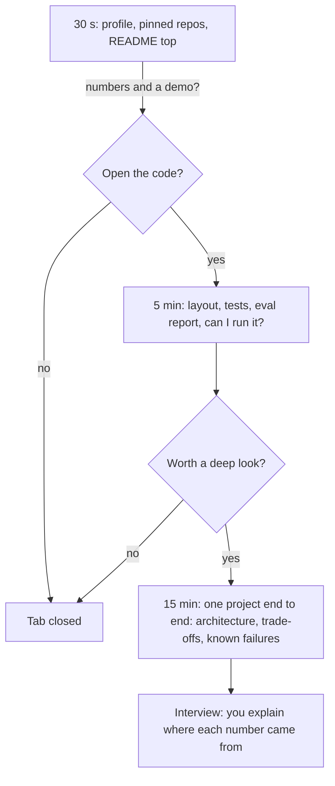
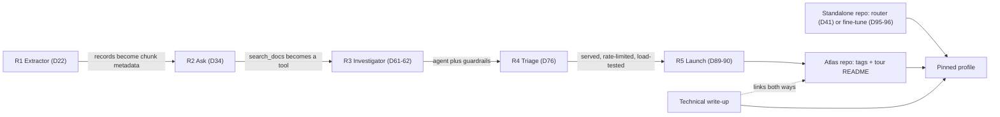
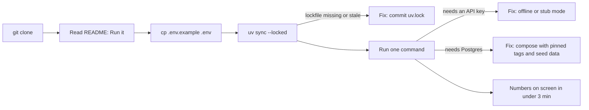

# Building Your Portfolio

"Chat with your docs" sits in nearly every bootcamp portfolio, so the project alone doesn't set you apart. A reviewer skims your GitHub for seconds before deciding whether to open any code, and what they find in that window is numbers, a demo and a README, or nothing. Today you turn Atlas into proof that survives that skim and a cold clone.

## At a Glance

- **Time:** ~2 h core (+ optional Go Deeper) · **Depth:** intro
- **Prerequisites:** [Day 90: Capstone R5, Part 2: Launch & Prove It](../../Phase_9_Production/Day_090_capstone_r5_launch/capstone_r5_launch.md); optionally [Day 96: Evaluating, Shipping & Distilling Small Models](../../Phase_10_Open_Models_and_Fine_Tuning/Day_096_evaluating_distilling_small_models/evaluating_distilling_small_models.md) for the fine-tune repo
- **You'll build:** a tagged Atlas repo with a tour README that passes `portfolio_check` and a cold clone, one standalone repo, a profile README and one published write-up
- **Stops at:** personal branding (audience growth, posting strategy, social platforms)
- **Fast path:** Already keep tidy repos? Read §The Numbers-First README, run `portfolio_check` on your Atlas repo, then do Exercise 2 (~60 min)
- **Cost:** $0. Every script is stdlib and needs no API key
- **New terms:** numbers-first README, cold-clone check, standalone repo, technical write-up, pinned repos

> **Coming from Software Engineering?** A portfolio repo is a product release for one demanding user: the reviewer. The README is the landing page plus release notes with benchmarks. The cold-clone check is a smoke test in CI (a quick "does it start at all?" test). "Known failures" is the known-issues section every honest changelog has. Your habits (tests, CI, pinned dependencies) are the differentiator, because many AI portfolios are notebooks nobody can run. What's new is the evidence: in AI work, "it works" means a measured score on a named dataset, so every claim needs a number and a source file.

## Proof Beats Claims

Two portfolios both have a RAG chatbot, an agent and a deployed API. One README opens with "A RAG chatbot built with LangGraph and pgvector, featuring hybrid search and semantic caching." The other opens with "Answers Orbit maintainers' questions with cited docs: recall@5 0.88 on 60 gold questions, $0.002 per answer, p95 2.4 s (measured 2026-11-02, `reports/r2_eval.json`)." The projects might be identical. The second gets opened.

The plain-language rule for today: **show what it does, prove it works with numbers, and make it easy to try.**

How a reviewer reads (a heuristic from hiring practice, not a study): a 30-second glance, a 5-minute look if that went well, a 15-minute deep dive for the one project that earned it.



| Moment | Green flags | Red flags |
|---|---|---|
| 30 s | One-sentence purpose, demo link or GIF, a Results table | No README, "TODO", a wall of badges, a list of frameworks |
| 5 min | `tests/`, an eval report, one run command, a lockfile | A single notebook, API keys in the tree, no error handling |
| 15 min | Architecture diagram, decisions with reasons, known failures | Numbers with no method, "in progress" with nothing running |

So the README's top screen carries the purpose, the demo and the numbers; everything below is for the reviewer who stayed.

## One System, Five Releases

You built one system in five releases, not five toy projects, and each release reused the one before:



The release capstones were [Day 22: Capstone R1: The Extractor](../../Phase_2_Building_with_LLM_APIs/Day_022_capstone_r1_extractor/capstone_r1_extractor.md), [Day 34: Capstone R2: Ask, a RAG Assistant with a UI](../../Phase_3_RAG/Day_034_capstone_r2_ask/capstone_r2_ask.md), [Day 62: Capstone R3, Part 2](../../Phase_6_Agents/Day_062_capstone_r3_ship/capstone_r3_ship.md), [Day 76: Capstone R4: The Atlas Triage Pipeline](../../Phase_8_Safety_and_Security/Day_076_capstone_r4_triage/capstone_r4_triage.md) and [Day 90](../../Phase_9_Production/Day_090_capstone_r5_launch/capstone_r5_launch.md). Each one already shipped a numbers-first README. Today's job is the layer above them.

**Rule of thumb:** one Atlas repo with a release tag per capstone, a top-level **tour README** that links each tag and aggregates the numbers, plus 1–2 **standalone repos** (a small project extracted into its own repository so it reads as a separate piece of work). Five look-alike repos dilute the story; one repo with no tour hides it.

This lesson uses tags `r1-v1.0` … `r5-v1.0`; if your capstones used other names, keep them. What matters is that every tag in the tour README exists, runs, and lets a reviewer browse exactly what that release was.

**Retag first.** Earlier days created different names: [Day 22](../../Phase_2_Building_with_LLM_APIs/Day_022_capstone_r1_extractor/capstone_r1_extractor.md) tags `r1`, [Day 61](../../Phase_6_Agents/Day_061_capstone_r3_investigator/capstone_r3_investigator.md) tags `r3-part1` (Day 62 ends with `r3-v1.0`), and the R2, R4 and R5 capstones don't prescribe a tag. Before you build the README, give every release its `vX.0` name, pointing at the commit that shipped it (find it with `git log --oneline`):

```bash
git tag r1-v1.0 r1                    # Day 22's tag, same commit
git tag r2-v1.0 <commit-of-Day-34>    # no earlier tag: use the commit that shipped R2
git tag -l 'r3*'                      # r3-v1.0 exists from Day 62; if not: git tag r3-v1.0 <Day-62-commit>
git tag r4-v1.0 <commit-of-Day-76>
git tag r5-v1.0 <commit-of-Day-90>
git push origin --tags                # tags only reach GitHub when pushed
```

Then check that a cold clone sees them: `git ls-remote --tags origin | grep -c 'v1.0'` should print 5. An old tag stays as an alias; never move a pushed tag.

## The Numbers-First README

A **numbers-first README** puts measured results, each with its sample size, date and source file, in the first screen. [Day 22](../../Phase_2_Building_with_LLM_APIs/Day_022_capstone_r1_extractor/capstone_r1_extractor.md) owns the template and `build_report()`; here is the portfolio delta: a worked rewrite, a check, and cross-release provenance.

**Tiny worked example.** The vague top first:

```markdown
# Atlas Ask
A RAG chatbot built with LangGraph and pgvector, featuring hybrid search,
reranking and a Gradio UI. Highly accurate and cost-efficient.
```

Ask of each phrase "measured how?": "highly accurate" has no number, "cost-efficient" no unit, and the framework list says what you used, not what it does. The rewrite:

```markdown
# Atlas Ask: cited answers for Orbit maintainers
Ask a question about Orbit's docs and get an answer with links to the exact sections.
**Demo:** [2-minute video](docs/demo.mp4) · [live Space](https://huggingface.co/spaces/you/atlas-ask) (may be asleep)

## Results
| Metric | Vector | Hybrid | Hybrid + rerank | n | Measured | Source |
|---|---|---|---|---|---|---|
| recall@5 | 0.71 | 0.82 | 0.88 | 60 | 2026-11-02 | `reports/r2_retrieval.json` |
| answer pass rate | | | 0.83 | 60 | 2026-11-02 | `reports/r2_answers.json` |
| $/request · p95 | | | $0.0021 · 2.4 s | 60 | 2026-11-02 | `reports/r2_cost.json` |

**Known failures:** questions that need two docs at once (cases `q17`, `q42`); non-English issues.
```

> Every number above is a placeholder. Replace each with a value from your own report. Never quote a figure you can't reproduce in an interview.

The full section order, top to bottom: **What it does → Demo → Results → Architecture (Mermaid) → Decisions & trade-offs → Run it → Known failures & next steps.** GitHub renders Mermaid natively, so the diagram stays as diffable text.

A 20-line section scan catches the most common gap, a README with no Results or Known failures:

```python
# script_id: day_099_portfolio/readme_check
# Minimal README section check. Install: none (stdlib). Env: none. Services: none.
# Usage: python readme_check.py [path/to/README.md]   (no path: checks a vague sample)
import re
import sys
from pathlib import Path

REQUIRED = ("What it does", "Demo", "Results", "Architecture",
            "Decisions & trade-offs", "Run it", "Known failures")
SAMPLE = "# Atlas Ask\nA RAG chatbot.\n## Features\n## Installation\n## Results\n"

path = Path(sys.argv[1]) if len(sys.argv) > 1 else None
text = path.read_text(encoding="utf-8") if path else SAMPLE
titles = [t.strip().lower() for t in re.findall(r"^##\s+(.+)$", text, re.M)]
missing = [s for s in REQUIRED if not any(t.startswith(s.lower()) for t in titles)]
print(f"{len(REQUIRED) - len(missing)}/{len(REQUIRED)} sections present")
for s in missing:
    print(f"MISSING: ## {s}")
```

```text
1/7 sections present
MISSING: ## What it does
MISSING: ## Demo
MISSING: ## Architecture
MISSING: ## Decisions & trade-offs
MISSING: ## Run it
MISSING: ## Known failures
```

`startswith` lets "Run it locally" pass. Edit `REQUIRED` to encode *your* template, so drift gets caught.

### Provenance across releases

The tour README needs one Results table across five releases, and hand-copied numbers are how "~40% cheaper" ends up with no file behind it. Keep a `metrics.json` with one row per number (`release, metric, value, n, measured_on, source`) and render from it; the renderer refuses rows without a source or sample size:

```python
# script_id: day_099_portfolio/metrics_table
"""Render metrics.json rows into a Results table and a tour README; refuse unsourced numbers."""
# Install: none (stdlib). Env: none.
# Usage: python metrics_table.py [metrics.json] [--repo-url URL] [--out TOUR.md]
import argparse
import json
from pathlib import Path

SAMPLE_ROWS = [  # EXAMPLE values only: replace with rows read from your own reports
    {"release": "R1", "metric": "field accuracy (held-out)", "value": "0.91", "n": 40,
     "measured_on": "2026-10-01", "source": "reports/r1_eval.json"},
    {"release": "R2", "metric": "recall@5 (hybrid + rerank)", "value": "0.88", "n": 60,
     "measured_on": "2026-11-02", "source": "reports/r2_retrieval.json"},
    {"release": "R3", "metric": "task pass rate (all criteria)", "value": "0.75", "n": 24,
     "measured_on": "2026-11-03", "source": "reports/r3_agent_evals.json"},
    {"release": "R4", "metric": "label accuracy (triage_gold)", "value": "0.86", "n": 50,
     "measured_on": "2026-11-04", "source": "reports/r4_triage.json"},
    {"release": "R5", "metric": "p95 latency, staging (s)", "value": "2.4", "n": 600,
     "measured_on": "2026-11-05", "source": "reports/r5_load.json"},
]


def render_metrics_table(rows: list[dict]) -> str:
    """Markdown table with provenance; raises ValueError on any unsourced row."""
    bad = [r.get("metric", "?") for r in rows
           if not str(r.get("source") or "").strip() or not r.get("n")]
    if bad:
        raise ValueError(f"{len(bad)} row(s) have no source or n: {bad}")
    out = ["| Release | Metric | Value | n | Measured | Source |",
           "|---|---|---|---|---|---|"]
    out += [f"| {r['release']} | {r['metric']} | {r['value']} | {r['n']} "
            f"| {r['measured_on']} | [`{r['source']}`]({r['source']}) |" for r in rows]
    return "\n".join(out)
```

The second block turns the same rows into the tour README, with one link per release tag:

```python
# script_id: day_099_portfolio/metrics_table
RELEASES = [  # (release, tag, title, what it adds); use the tags your capstones used
    ("R1", "r1-v1.0", "Extractor", "issues to validated records, with an eval"),
    ("R2", "r2-v1.0", "Ask", "cited RAG answers over Orbit docs, with a UI"),
    ("R3", "r3-v1.0", "Investigator", "a durable agent with approvals and trajectory evals"),
    ("R4", "r4-v1.0", "Triage", "a guarded triage pipeline with a red-team suite"),
    ("R5", "r5-v1.0", "Launch", "served, rate-limited, load-tested and monitored"),
]


def render_tour(rows: list[dict], repo_url: str) -> str:
    lines = ["# Atlas: an AI assistant for Orbit maintainers", "",
             "One system in five releases. Each tag runs on its own.", "",
             "| Release | Tag | What it adds |", "|---|---|---|"]
    lines += [f"| {r} {title} | [`{tag}`]({repo_url}/tree/{tag}) | {adds} |"
              for r, tag, title, adds in RELEASES]
    return "\n".join(lines + ["", "## Results", "", render_metrics_table(rows)])


def main() -> None:
    ap = argparse.ArgumentParser(description=__doc__)
    ap.add_argument("metrics", nargs="?", help="metrics.json (default: example rows)")
    ap.add_argument("--repo-url", default="https://github.com/you/atlas")
    ap.add_argument("--out", help="write the tour README here instead of stdout")
    args = ap.parse_args()
    rows = json.loads(Path(args.metrics).read_text()) if args.metrics else SAMPLE_ROWS
    tour = render_tour(rows, args.repo_url)
    Path(args.out).write_text(tour + "\n") if args.out else print(tour)
    try:  # the claim that started this section, with nothing behind it
        render_metrics_table([{"release": "R5", "metric": "~40% cheaper", "value": "?"}])
    except ValueError as err:
        print(f"\nREJECTED: {err}")


if __name__ == "__main__":
    main()
```

```text
# Atlas: an AI assistant for Orbit maintainers

One system in five releases. Each tag runs on its own.

| Release | Tag | What it adds |
|---|---|---|
| R1 Extractor | [`r1-v1.0`](https://github.com/you/atlas/tree/r1-v1.0) | issues to validated records, with an eval |
...
## Results

| Release | Metric | Value | n | Measured | Source |
|---|---|---|---|---|---|
| R1 | field accuracy (held-out) | 0.91 | 40 | 2026-10-01 | [`reports/r1_eval.json`](reports/r1_eval.json) |
...

REJECTED: 1 row(s) have no source or n: ['~40% cheaper']
```

Each source is a relative link: one click from the number to the report that produced it.

## Make It Run from a Cold Clone

A **cold-clone check** means cloning your repo onto a fresh machine and running it using only the README. Past about three minutes, most reviewers stop. Your laptop hides the problems: an old `.env`, a globally installed package, a Postgres container already running.



The checklist:

- **`.env.example`** with every variable and empty values, plus `.env` in `.gitignore` ([Day 2: Setup & Your First LLM Call](../../Phase_0_Start_Here/Day_002_setup_first_call/setup_first_call.md)).
- **A lockfile** (a file pinning exact dependency versions): `uv.lock`. `uv sync --locked` errors if it no longer matches `pyproject.toml`.
- **Compose with no `version:` key and pinned image tags.** Compose warns that the `version` attribute is obsolete, and `:latest` may pull a different image from the one you tested. Pin it, e.g. `pgvector/pgvector:0.8.7-pg18-trixie` ([Day 82: Containerize & Deploy with CI/CD](../../Phase_9_Production/Day_082_containerize_deploy/containerize_deploy.md)).
- **Seed data.** Orbit is CC0-1.0 (public domain), so ship it.
- **An offline mode** for reviewers without a key (R4 has one; Go Deeper shows the pattern).
- **No secrets in tracked files** ([Day 74: Least Privilege, Secrets & Securing MCP](../../Phase_8_Safety_and_Security/Day_074_least_privilege_mcp_security/least_privilege_mcp_security.md) owns secret hygiene).

### Automating the checklist: `portfolio_check`

Checklists rot; checks don't. `portfolio_check` runs every item above and prints PASS/FAIL. With no arguments it builds a deliberately flawed demo repo in a temp directory. The first block defines the result type and the README check:

```python
# script_id: day_099_portfolio/portfolio_check
"""Portfolio hygiene check: README sections and numbers, secrets, cold-clone basics, compose."""
# Install: none (stdlib, Python 3.11+). Needs git on PATH to list tracked files
# (falls back to walking the tree). Env: ORBIT_DATA (optional, for the demo fixture),
# PORTFOLIO_ALLOW (optional, default "FAKE"). Services: none.
# Usage: python portfolio_check.py PATH [--allow FAKE,example]  |  python portfolio_check.py --demo
import argparse
import os
import re
import subprocess
import tempfile
from dataclasses import dataclass
from pathlib import Path

REQUIRED_SECTIONS: tuple[str, ...] = (
    "What it does", "Demo", "Results", "Architecture",
    "Decisions & trade-offs", "Run it", "Known failures",
)


@dataclass
class Finding:
    check: str
    passed: bool
    detail: str = ""  # the fix hint, printed only on FAIL


def sections(text: str) -> dict[str, str]:
    """Map each lower-cased H2 title to the text under it."""
    parts = re.split(r"^##\s+(.+?)\s*$", text, flags=re.M)
    return {t.lower(): body for t, body in zip(parts[1::2], parts[2::2])}


def check_readme(path: Path, required: tuple[str, ...] = REQUIRED_SECTIONS) -> list[Finding]:
    if not path.exists():
        return [Finding("readme sections", False, f"no {path.name} at the repo root")]
    found = sections(path.read_text(encoding="utf-8"))
    missing = [s for s in required if not any(t.startswith(s.lower()) for t in found)]
    return [Finding("readme sections", not missing,
                    "missing " + ", ".join(f'"{m}"' for m in missing))]
```

The secret scan reads only files git tracks (what a reviewer clones), walking the tree if the folder isn't a repo. The `allow` tuple handles fixtures: Orbit deliberately contains fake keys like `sk-test-FAKE-…` for the PII lessons ([Day 73](../../Phase_8_Safety_and_Security/Day_073_privacy_pii/privacy_pii.md)), and a scanner that flags those gets switched off.

```python
# script_id: day_099_portfolio/portfolio_check
SECRET_PATTERNS = {  # common shapes, not exhaustive: GitHub secret scanning knows far more
    "sk- style API key": re.compile(r"\bsk-[A-Za-z0-9_-]{8,}"),
    "AWS access key id": re.compile(r"\bAKIA[0-9A-Z]{16}\b"),
    "GitHub token": re.compile(r"\bgh[pousr]_[A-Za-z0-9]{30,}"),
    "private key block": re.compile(r"-----BEGIN [A-Z ]*PRIVATE KEY-----"),
}
SKIP_DIRS = {".git", ".venv", "node_modules", "__pycache__"}


def tracked_files(root: Path) -> list[Path]:
    """Files git tracks (what a reviewer clones); walk the tree if that fails."""
    try:
        out = subprocess.run(["git", "-C", str(root), "ls-files", "-z"],
                             capture_output=True, text=True, check=True).stdout
        files = [root / p for p in out.split("\0") if p]
    except (OSError, subprocess.CalledProcessError):
        files = []  # not a git repo, or git missing
    return files or [p for p in root.rglob("*") if p.is_file()
                     and not SKIP_DIRS & set(p.relative_to(root).parts)]


def scan_secrets(files: list[Path], allow: tuple[str, ...] = ("FAKE",)) -> list[Finding]:
    """Flag secret-shaped strings; `allow` lists markers of known-fake fixtures."""
    hits = []
    for f in files:
        try:
            lines = f.read_text(encoding="utf-8").splitlines()
        except (UnicodeDecodeError, OSError):
            continue  # binary or unreadable file
        for n, line in enumerate(lines, 1):
            for kind, pat in SECRET_PATTERNS.items():
                for m in pat.finditer(line):
                    if not any(a in m.group() for a in allow):
                        hits.append(f"{f.name}:{n} {kind} ({m.group()[:7]}…)")  # never print a key
    return [Finding("no secrets", not hits, "; ".join(hits))]
```

Next come the hygiene files, compose rules and README content checks:

```python
# script_id: day_099_portfolio/portfolio_check
LOCKFILES = ("uv.lock", "poetry.lock", "package-lock.json")
LICENSES = ("LICENSE", "LICENSE.md", "LICENSE.txt")
FENCE = "`" * 3  # built at runtime so this lesson's own code fences stay balanced


def check_hygiene(root: Path, files: list[Path]) -> list[Finding]:
    rel = {p.relative_to(root).as_posix() for p in files}
    return [
        Finding(".env not committed", ".env" not in rel, "delete it, rotate any key it held"),
        Finding(".env.example", (root / ".env.example").exists(), "add one with empty values"),
        Finding("lockfile", any((root / n).exists() for n in LOCKFILES), "commit uv.lock"),
        Finding("LICENSE", any((root / n).exists() for n in LICENSES), "add a licence file"),
        Finding("tests/", (root / "tests").is_dir(), "add at least one test"),
    ]


def check_compose(root: Path) -> list[Finding]:
    found = [p for p in (root / "compose.yaml", root / "docker-compose.yml") if p.exists()]
    if not found:
        return []  # no compose file, nothing to check
    text = found[0].read_text(encoding="utf-8")
    problems = ["obsolete `version:` key"] if re.search(r"^version\s*:", text, re.M) else []
    for image in re.findall(r"^\s*image:\s*[\"']?([^\s\"']+)", text, re.M):
        if image.endswith(":latest") or ":" not in image.rsplit("/", 1)[-1]:
            problems.append(f"unpinned image {image}")
    return [Finding("compose pinned", not problems, "; ".join(problems))]


def check_readme_content(path: Path) -> list[Finding]:
    if not path.exists():
        return []
    text = path.read_text(encoding="utf-8")
    results = next((b for t, b in sections(text).items() if t.startswith("results")), "")
    has_number = re.search(r"\d+\.\d+|\d+\s*%|\$\s*\d", results) is not None
    placeholder = re.search(r"\b(TODO|TBD)\b|\?\?", results) is not None
    return [Finding("numbers in Results", has_number and not placeholder,
                    "measured values with n, date and source; no TODO"),
            Finding("mermaid diagram", FENCE + "mermaid" in text, "add an architecture diagram")]
```

The demo fixture copies a real Orbit `sk-test-FAKE-…` line from `docs/security.md`; the CLI exits 1 on any failure so CI can gate on it:

```python
# script_id: day_099_portfolio/portfolio_check
def check_repo(root: Path, allow: tuple[str, ...] = ("FAKE",)) -> list[Finding]:
    files, readme = tracked_files(root), root / "README.md"
    return (check_readme(readme) + check_readme_content(readme) + scan_secrets(files, allow)
            + check_hygiene(root, files) + check_compose(root))


def build_demo_fixture() -> Path:
    """A deliberately flawed Atlas repo in a temp dir. Fix it until every check passes."""
    root = Path(tempfile.mkdtemp(prefix="atlas_portfolio_"))
    (root / "tests").mkdir()
    (root / "README.md").write_text(
        "# Atlas Ask\n## What it does\nCited answers over Orbit docs.\n## Demo\n"
        "[2-minute video](demo.mp4)\n## Results\n| metric | value |\n|---|---|\n"
        "| recall@5 | TODO |\n## Architecture\n" + FENCE + "mermaid\nflowchart LR\n"
        "  Q[question] --> A[answer]\n" + FENCE + "\n## Decisions & trade-offs\n"
        "Hybrid search, because exact ORB codes broke vector-only.\n## Run it\n"
        "uv run python app.py\n", encoding="utf-8")
    sec = Path(os.environ.get("ORBIT_DATA", "datasets/orbit")) / "docs" / "security.md"
    lines = sec.read_text(encoding="utf-8").splitlines() if sec.exists() else []
    fixture = next((x for x in lines if "sk-test-FAKE-" in x), 'api_key="sk-test-FAKE-0000"')
    (root / "tests" / "fixture_pii.txt").write_text(fixture.strip() + "\n", encoding="utf-8")
    planted = "sk-" + "proj-" + "a1B2c3D4" * 3  # assembled at runtime: not a real key
    (root / "config.py").write_text(f'API_KEY = "{planted}"\n', encoding="utf-8")
    (root / ".env").write_text("OPENAI_API_KEY=\n", encoding="utf-8")
    (root / ".env.example").write_text("OPENAI_API_KEY=\n", encoding="utf-8")
    (root / "uv.lock").write_text("version = 1\n", encoding="utf-8")
    (root / "compose.yaml").write_text(
        'version: "3.8"\nservices:\n  db:\n    image: pgvector/pgvector:latest\n',
        encoding="utf-8")
    return root
```

```python
# script_id: day_099_portfolio/portfolio_check
def main() -> int:
    ap = argparse.ArgumentParser(description=__doc__)
    ap.add_argument("path", nargs="?", help="repo root; omit (or --demo) for the flawed fixture")
    ap.add_argument("--demo", action="store_true", help="check a generated, flawed fixture")
    ap.add_argument("--allow", default=os.environ.get("PORTFOLIO_ALLOW", "FAKE"),
                    help="comma list of substrings that mark known-fake secrets ('' = none)")
    args = ap.parse_args()
    demo = args.demo or not args.path
    root = build_demo_fixture() if demo else Path(args.path).resolve()
    findings = check_repo(root, tuple(a for a in args.allow.split(",") if a))
    for f in findings:
        print(f"{'PASS' if f.passed else 'FAIL'}  {f.check:<19} {'' if f.passed else f.detail}")
    passed = sum(f.passed for f in findings)
    print(f"{passed}/{len(findings)} checks passed  ({root})")
    return 0 if passed == len(findings) or demo else 1  # the demo always exits 0


if __name__ == "__main__":
    raise SystemExit(main())
```

```text
FAIL  readme sections     missing "Known failures"
FAIL  numbers in Results  measured values with n, date and source; no TODO
PASS  mermaid diagram
FAIL  no secrets          config.py:1 sk- style API key (sk-proj…)
FAIL  .env not committed  delete it, rotate any key it held
PASS  .env.example
PASS  lockfile
FAIL  LICENSE             add a licence file
PASS  tests/
FAIL  compose pinned      obsolete `version:` key; unpinned image pgvector/pgvector:latest
4/10 checks passed  (/tmp/atlas_portfolio_k2j9x1)
```

Your temp path will differ. Notice what *didn't* fail: the allowlist let Orbit's `sk-test-FAKE-0000` fixture through.

**Break it.** `python portfolio_check.py --demo --allow ""` switches the allowlist off, and a new failure appears: `fixture_pii.txt:1 sk- style API key (sk-test…)`. Teams are tempted to delete the scan here. Instead, keep the allowlist with a comment saying why `FAKE` is allowed. One honest limit: this checks the *current tree only*; a deleted key still lives in git history (Go Deeper).

### Timing the cold clone

`portfolio_check` can't tell you the repo *starts*. `cold_clone` clones into an empty temp directory, copies `.env.example`, runs `uv sync --locked` and your smoke command, and times each step against the 3-minute budget.

```python
# script_id: day_099_portfolio/cold_clone
"""Time a cold clone: clone -> .env -> uv sync -> one smoke command, step by step."""
# Install: none (stdlib). Needs git; uv is optional (the sync step is skipped without it).
# Usage: python cold_clone.py REPO_URL_OR_PATH --run "uv run python -m atlas.demo"
#        python cold_clone.py          (demo: builds and clones a tiny local repo)
import argparse
import shlex
import shutil
import subprocess
import sys
import tempfile
import time
from pathlib import Path

BUDGET_S = 180.0  # the 3-minute bar


def timed(name: str, cmd: list[str], cwd: Path, log: list[tuple]) -> bool:
    t0 = time.perf_counter()
    try:
        r = subprocess.run(cmd, cwd=cwd, capture_output=True, text=True)
        ok, tail = r.returncode == 0, (r.stdout + r.stderr).strip().splitlines()[-1:]
    except OSError as err:  # command not found
        ok, tail = False, [str(err)]
    log.append((name, ok, time.perf_counter() - t0, (tail or [""])[0][:60]))
    return ok


def make_demo_repo() -> str:
    src = Path(tempfile.mkdtemp(prefix="atlas_src_"))
    (src / "app.py").write_text('print("Atlas offline demo: 3 answers, 0 API calls")\n')
    (src / ".env.example").write_text("OPENAI_API_KEY=\nATLAS_BACKEND=stub\n")
    commit = ["git", "-c", "user.name=demo", "-c", "user.email=demo@example.com", "commit", "-qm", "init"]
    for cmd in (["git", "init", "-q"], ["git", "add", "."], commit):
        subprocess.run(cmd, cwd=src, check=True, capture_output=True)
    return str(src)
```

```python
# script_id: day_099_portfolio/cold_clone
def cold_clone(repo: str, run_cmd: list[str]) -> list[tuple]:
    log: list[tuple] = []
    work = Path(tempfile.mkdtemp(prefix="cold_clone_"))
    if not timed("git clone", ["git", "clone", "-q", repo, "repo"], work, log):
        return log
    dest = work / "repo"
    has_example = (dest / ".env.example").exists()
    if has_example:
        shutil.copy(dest / ".env.example", dest / ".env")
    log.append(("cp .env.example .env", has_example, 0.0, "" if has_example else "no .env.example"))
    if shutil.which("uv") and (dest / "pyproject.toml").exists():
        timed("uv sync --locked", ["uv", "sync", "--locked"], dest, log)
    else:
        log.append(("uv sync --locked", True, 0.0, "skipped (no uv or no pyproject.toml)"))
    timed("smoke command", run_cmd, dest, log)
    return log


def main() -> int:
    ap = argparse.ArgumentParser(description=__doc__)
    ap.add_argument("repo", nargs="?", help="git URL or local path; omit for the demo")
    ap.add_argument("--run", help='smoke command, e.g. "uv run python -m atlas.demo"')
    args = ap.parse_args()
    repo = args.repo or make_demo_repo()
    log = cold_clone(repo, shlex.split(args.run) if args.run else [sys.executable, "app.py"])
    for name, ok, secs, tail in log:
        print(f"{'ok  ' if ok else 'FAIL'} {secs:5.1f}s  {name:<22} {tail}")
    total = sum(step[2] for step in log)
    verdict = "PASS" if all(step[1] for step in log) and total <= BUDGET_S else "FAIL"
    print(f"{verdict}: {total:.1f}s total (budget {BUDGET_S:.0f}s)")
    return 0 if verdict == "PASS" else 1


if __name__ == "__main__":
    raise SystemExit(main())
```

```text
ok     0.2s  git clone
ok     0.0s  cp .env.example .env
ok     0.0s  uv sync --locked       skipped (no uv or no pyproject.toml)
ok     0.1s  smoke command          Atlas offline demo: 3 answers, 0 API calls
PASS: 0.2s total (budget 180s)
```

Your timings will differ. Your machine still has warm caches, so a PASS is necessary, not sufficient; the truest test is a fresh container or a friend's laptop.

## Demos That Survive a Sleeping Server

A live demo is the strongest green flag and the most fragile: free hosting sleeps, and demo keys run out of credit.

**Hosting** reuses the Hugging Face Space from [Day 34](../../Phase_3_RAG/Day_034_capstone_r2_ask/capstone_r2_ask.md) and the staging deploy from [Day 82](../../Phase_9_Production/Day_082_containerize_deploy/containerize_deploy.md). As of 2026-11, a free personal Hugging Face account can host up to two Gradio Spaces on ZeroGPU (verified email, account older than 30 days), CPU Gradio Spaces need a paid plan, and free hardware sleeps when idle ([verify at the Spaces overview](https://huggingface.co/docs/hub/spaces-overview)).

**Always keep a recorded backup:** a 2-minute video or GIF from your real app, linked at the top of the README.

**Protect the demo key:** a project spend limit ([Day 2](../../Phase_0_Start_Here/Day_002_setup_first_call/setup_first_call.md)), a demo tenant with tight quotas ([Day 83: Auth, Multi-Tenancy & Usage Quotas](../../Phase_9_Production/Day_083_auth_multitenancy_quotas/auth_multitenancy_quotas.md)), and the key only on the server (a Space secret), never in client code.

**The 2-minute demo script**, for the video, live demos and the deep-dive:

```markdown
1. Problem (15 s): "Orbit's tracker holds 240 issues; finding the right doc takes minutes."
2. Live run (45 s): ask one real question; show the cited answer and click a citation.
3. Numbers (30 s): the Results table: recall@5, answer pass rate, $/request, p95, with n.
4. One failure (20 s): a known failure case and why it happens.
5. Next step (10 s): what you'd fix first and how you'd measure it.
```

Showing a failure on purpose proves you measured honestly. [Day 100](../Day_100_next_90_days/next_90_days.md) has you write and record a 2-minute Atlas story, which is good rehearsal for this.

## Standalone Repos: Breaking Out of One Domain

Everything in Atlas is about Orbit, so it reads as one project. One or two **standalone repos** (small projects extracted into their own repository, with their own README, eval and licence) show range. Candidates:

- **The issue router** from [Day 41: Workflow Patterns](../../Phase_4_Tools_and_MCP/Day_041_workflow_patterns/workflow_patterns.md), generalised to any ticket queue, with Orbit as sample data.
- **The fine-tune** from [Day 95: Hands-On LoRA Fine-Tuning](../../Phase_10_Open_Models_and_Fine_Tuning/Day_095_lora_finetuning/lora_finetuning.md), with the [Day 96](../../Phase_10_Open_Models_and_Fine_Tuning/Day_096_evaluating_distilling_small_models/evaluating_distilling_small_models.md) eval report as proof (licence and model card: Go Deeper).
- **Atlas on your own domain**, if you did the [Day 1](../../Phase_0_Start_Here/Day_001_ai_engineer_role/ai_engineer_role.md) stretch: same architecture, your data, your numbers.

The rule is **copy, don't import**: a repo that needs Atlas installed isn't standalone. `standalone_extract` copies the files you name, renames the package in imports, scaffolds the README skeleton and a smoke test, and warns about imports of modules you didn't copy:

```python
# script_id: day_099_portfolio/standalone_extract
"""Scaffold a standalone repo by COPYING files out of a bigger project (never importing)."""
# Install: none (stdlib). Env: none.
# Usage: python standalone_extract.py SRC DEST --files atlas/workflows.py atlas/schemas.py \
#            --rename atlas=router        (no arguments: runs on a tiny fake Atlas tree)
import argparse
import re
import tempfile
from pathlib import Path

IMPORT = re.compile(r"^(\s*(?:from|import)\s+)(\w+)((?:\.\w+)*)", re.M)
SKELETON = ("What it does", "Demo", "Results", "Architecture",
            "Decisions & trade-offs", "Run it", "Known failures")


def extract(src: Path, dest: Path, files: list[str], old: str, new: str) -> list[str]:
    """Copy files, rename `old` to `new` in import lines, return leftover-import warnings."""
    for rel in files:
        parts = Path(rel).parts
        target = dest.joinpath(new if parts[0] == old else parts[0], *parts[1:])
        target.parent.mkdir(parents=True, exist_ok=True)
        text = IMPORT.sub(lambda m: m[1] + (new if m[2] == old else m[2]) + m[3],
                          (src / rel).read_text(encoding="utf-8"))
        target.write_text(text, encoding="utf-8")
    warnings = []
    for py in sorted(dest.rglob("*.py")):
        for m in IMPORT.finditer(py.read_text(encoding="utf-8")):
            mod = dest.joinpath(m[2], *m[3].lstrip(".").split(".")) if m[3] else None
            if m[2] == new and mod and not (mod.with_suffix(".py").exists() or mod.is_dir()):
                warnings.append(f"{py.relative_to(dest)} imports {m[2]}{m[3]}: not copied")
    return warnings


def scaffold(dest: Path, pkg: str) -> None:
    (dest / pkg).mkdir(parents=True, exist_ok=True)
    (dest / pkg / "__init__.py").touch()
    body = "\n\n".join(f"## {s}\nTODO" for s in SKELETON)
    (dest / "README.md").write_text(f"# {pkg}\n\n{body}\n\nSample data: Orbit (CC0-1.0).\n")
    (dest / ".env.example").write_text("OPENAI_API_KEY=\n")
    (dest / ".gitignore").write_text(".env\n.venv/\n__pycache__/\n")
    (dest / "tests").mkdir(exist_ok=True)
    (dest / "tests" / "test_smoke.py").write_text(f"import {pkg}\n\n\ndef test_import():\n    assert {pkg}\n")
```

```python
# script_id: day_099_portfolio/standalone_extract
def demo_source() -> Path:
    src = Path(tempfile.mkdtemp(prefix="atlas_tree_"))
    (src / "atlas").mkdir()
    (src / "atlas" / "schemas.py").write_text("from pydantic import BaseModel\n\n\nclass Issue(BaseModel):\n    title: str\n")
    (src / "atlas" / "llm.py").write_text("def complete(prompt: str) -> str: ...\n")
    (src / "atlas" / "workflows.py").write_text(
        "from atlas.schemas import Issue\nfrom atlas.llm import complete\n\n\n"
        "def route_issue(issue: Issue) -> str:\n    return complete(issue.title)\n")
    return src


def main() -> None:
    ap = argparse.ArgumentParser(description=__doc__)
    ap.add_argument("src", nargs="?")
    ap.add_argument("dest", nargs="?")
    ap.add_argument("--files", nargs="+", default=["atlas/workflows.py", "atlas/schemas.py"])
    ap.add_argument("--rename", default="atlas=router", help="OLD=NEW package name")
    args = ap.parse_args()
    src = Path(args.src) if args.src else demo_source()
    dest = Path(args.dest) if args.dest else Path(tempfile.mkdtemp(prefix="standalone_"))
    old, new = args.rename.split("=")
    scaffold(dest, new)
    for w in extract(src, dest, args.files, old, new):
        print("WARN", w)
    print("created:", ", ".join(sorted(p.relative_to(dest).as_posix()
                                       for p in dest.rglob("*") if p.is_file())))
    print("TODO: add a LICENSE, real Results numbers and an eval, then run portfolio_check")


if __name__ == "__main__":
    main()
```

```text
WARN router/workflows.py imports router.llm: not copied
created: .env.example, .gitignore, README.md, router/__init__.py, router/schemas.py, router/workflows.py, tests/test_smoke.py
TODO: add a LICENSE, real Results numbers and an eval, then run portfolio_check
```

The warning matters: the router still calls Atlas's `complete()`, so copy a compact `llm.py` or inline the call. The script doesn't write a `LICENSE`, because choosing one is your decision ([GitHub's licensing guide](https://docs.github.com/en/repositories/managing-your-repositorys-settings-and-features/customizing-your-repository/licensing-a-repository)); without one, others have no explicit permission to reuse your code.

## Writing About Your Work

A **technical write-up** is an 800–1,500-word post about one measured result. It shows you can explain a decision and gives a reviewer a reason to open the repo. Pick your **biggest measured delta** or your **most surprising failure**. A typical Atlas example: "Exact ORB error codes broke my vector search; hybrid search fixed it", with your own before/after recall@5 and the failing queries.

The structure that works:

```markdown
1. Hook: the problem or the surprising finding (1 paragraph)
2. Why it matters: who hit it and what it cost (1 paragraph)
3. What I tried first, and how I knew it failed (the number)
4. What worked: one diagram, one code snippet
5. Results: before/after table with n, date, method
6. What I'd do differently
7. TL;DR: 3 bullets, plus a link to the repo and the exact tag
```

Publish anywhere you can link, and cross-link post and README both ways. `writeup_lint` checks the draft's length, numbers, diagram, snippet, repo link and "differently" section, and flags comparative claims ("faster", "cheaper") with no number:

```python
# script_id: day_099_portfolio/writeup_lint
"""Pre-publish checks for a technical write-up in Markdown."""
# Install: none (stdlib). Env: none.
# Usage: python writeup_lint.py post.md [--min 800] [--max 1500] [--repo github.com/you/atlas]
#        (no file: lints a short sample draft)
import argparse
import re
from pathlib import Path

FENCE = "`" * 3  # built at runtime so this lesson's own fences stay balanced
VAGUE = re.compile(r"\b(faster|cheaper|better|improved|significantly|dramatically)\b", re.I)
SAMPLE = ("# Hybrid search fixed my ORB-code queries\n\nVector search missed exact codes. "
          "Hybrid search was much better and significantly cheaper.\n\n" + FENCE +
          "python\nhits = hybrid_search(query, k=5)\n" + FENCE + "\n")


def lint(text: str, lo: int, hi: int, repo: str) -> list[tuple[str, bool, str]]:
    prose = re.sub(FENCE + r".*?" + FENCE, " ", text, flags=re.S)
    words = len(re.findall(r"\b\w+\b", prose))
    numbers = re.findall(r"\d+(?:\.\d+)?\s*%|\$\s*\d+(?:\.\d+)?|\b\d+\.\d+\b", prose)
    vague = [s.strip()[:50] for s in re.split(r"(?<=[.!?])\s+", prose)
             if VAGUE.search(s) and not re.search(r"\d", s)]
    return [
        ("length", lo <= words <= hi, f"{words} words, target {lo}-{hi}"),
        ("before/after numbers", len(numbers) >= 2, f"{len(numbers)} measured values"),
        ("diagram", FENCE + "mermaid" in text or "![" in text, "add a Mermaid block or image"),
        ("code snippet", re.search("^" + FENCE + r"(?!mermaid)\w+", text, re.M) is not None,
         "show the line that mattered"),
        ("links the repo", repo in text, f"link {repo} and the tag"),
        ("what I'd do differently", re.search(r"^#+ .*differently", text, re.I | re.M) is not None,
         "add the section"),
        ("claims have numbers", not vague, " | ".join(vague)),
    ]


if __name__ == "__main__":
    ap = argparse.ArgumentParser(description=__doc__)
    ap.add_argument("post", nargs="?")
    ap.add_argument("--min", type=int, default=800)
    ap.add_argument("--max", type=int, default=1500)
    ap.add_argument("--repo", default="github.com/you/atlas")
    a = ap.parse_args()
    results = lint(Path(a.post).read_text(encoding="utf-8") if a.post else SAMPLE, a.min, a.max, a.repo)
    for name, ok, hint in results:
        print(f"{'PASS' if ok else 'FAIL'}  {name:<24} {'' if ok else hint}")
    raise SystemExit(0 if a.post is None or all(ok for _, ok, _ in results) else 1)
```

```text
FAIL  length                   20 words, target 800-1500
FAIL  before/after numbers     0 measured values
FAIL  diagram                  add a Mermaid block or image
PASS  code snippet
FAIL  links the repo           link github.com/you/atlas and the tag
FAIL  what I'd do differently  add the section
FAIL  claims have numbers      Hybrid search was much better and significantly ch
```

The last line is the one to take seriously. "Significantly cheaper" invites "measured how?"; "$0.0031 → $0.0021 per request on 60 questions" ends the conversation in your favour.

## GitHub and LinkedIn: The Delta from Day 63

Your resume and LinkedIn bullets were written in [Day 63: Career Checkpoint](../../Phase_6_Agents/Day_063_career_checkpoint/career_checkpoint.md); update them with R4 and R5 numbers, but the method lives there. Today adds three surfaces:

- **Profile README.** GitHub shows a profile README at the top of your profile when you create a public repository whose name matches your username, with a `README.md` at its root ([GitHub docs](https://docs.github.com/en/account-and-profile/setting-up-and-managing-your-github-profile/customizing-your-profile/managing-your-profile-readme)).
- **Pinned repos**, the repositories GitHub shows at the top of your profile. You can pin up to six repositories and gists combined ([GitHub docs](https://docs.github.com/en/account-and-profile/setting-up-and-managing-your-github-profile/customizing-your-profile/pinning-items-to-your-profile)). Order them by strength of proof: Atlas first, then the standalone repos, then the write-up repo if it has one.
- **LinkedIn Featured:** demo video first, write-up second, Atlas repo third. That way a non-technical recruiter sees it working before reading code.

`profile_readme` renders the profile README from one dictionary, keeps the pinned list within GitHub's limit and prints your Featured order:

```python
# script_id: day_099_portfolio/profile_readme
"""Render a GitHub profile README (a public repo named after your username) from one dict."""
# Install: none (stdlib). Usage: python profile_readme.py [profile.json] > README.md
import json
import sys
from pathlib import Path

MAX_PINS = 6  # GitHub: up to six repositories and gists combined
PROFILE = {  # replace every value; every number must come from your own reports
    "name": "Your Name", "headline": "Software engineer building evaluated LLM systems.",
    "demo": "docs/demo.mp4", "post": {"title": "Exact ORB codes broke my vector search", "url": "#"},
    "pinned": [
        {"repo": "atlas", "url": "#", "proof": "one system, 5 tagged releases, eval report per release"},
        {"repo": "ticket-router", "url": "#", "proof": "routes any ticket queue; label accuracy in README"},
    ],
    "now": "Specialising in evals (see Day 100).",
}


def render_profile(p: dict) -> str:
    if len(p["pinned"]) > MAX_PINS:
        raise ValueError(f"GitHub pins at most {MAX_PINS}; you listed {len(p['pinned'])}")
    lines = [f"# Hi, I'm {p['name']}", "", p["headline"], "", "## Start here"]
    lines += [f"- [{x['repo']}]({x['url']}): {x['proof']}" for x in p["pinned"]]
    lines += ["", "## Writing", f"- [{p['post']['title']}]({p['post']['url']})"]
    return "\n".join(lines + ["", "## Currently", p["now"]])


if __name__ == "__main__":
    prof = json.loads(Path(sys.argv[1]).read_text()) if len(sys.argv) > 1 else PROFILE
    print(render_profile(prof))
    featured = [prof["demo"], prof["post"]["url"], prof["pinned"][0]["url"]]
    print("\nLinkedIn Featured order:", " -> ".join(featured), file=sys.stderr)
```

```text
# Hi, I'm Your Name

Software engineer building evaluated LLM systems.

## Start here
- [atlas](#): one system, 5 tagged releases, eval report per release
- [ticket-router](#): routes any ticket queue; label accuracy in README

## Writing
- [Exact ORB codes broke my vector search](#)

## Currently
Specialising in evals (see Day 100).

LinkedIn Featured order: docs/demo.mp4 -> # -> #
```

The Featured line goes to stderr, so `> README.md` captures only the profile.

## Trade-offs: What to Polish First

Spend polish time where the reviewer's attention goes:

| If you have… | Do this | Skip for now |
|---|---|---|
| 1 hour | Tour README top screen + Results table + demo video | Standalone repos, the write-up |
| 1 day | Above + `portfolio_check` green + a cold clone on a fresh machine | Polishing old release READMEs line by line |
| 1 week | Above + one standalone repo + the write-up + profile README | A personal website, a second write-up |

Don't spin out a standalone repo that has no eval of its own; a section inside Atlas with numbers is a stronger signal.

### In real hiring loops

- Reviewers open the README and eval report before the code; the code gets read in the deep-dive ([Day 98](../Day_098_practical_interviews/practical_interviews.md)).
- Don't publish a company's take-home prompt or solution without asking; many are reused.
- Employer code and anything under an NDA (non-disclosure agreement) stays out; describe the pattern in your own words.
- If coding agents ([Day 60](../../Phase_6_Agents/Day_060_coding_agents_skills/coding_agents_skills.md)) wrote part of the code, say so, and be ready to defend every line.
- Keep repos alive: a dependency or model retirement can break a cold clone months later. [Day 100](../Day_100_next_90_days/next_90_days.md) sets up a drift check.

## Go Deeper (optional)

<details><summary>Go deeper: secrets already in git history</summary>

`portfolio_check` reads the current tree. If you ever committed a key and deleted it in a later commit, it is still in every clone's history, and anyone can find it with `git log -p`. The order of operations matters:

1. **Rotate the key first.** Revoke it at the provider and issue a new one. Once a secret has been pushed to a public repo, treat it as leaked; cleaning history doesn't un-leak it.
2. **Then rewrite history** with the tool GitHub recommends (`git filter-repo`), force-push, and ask collaborators to re-clone. GitHub's [removing sensitive data guide](https://docs.github.com/en/authentication/keeping-your-account-and-data-secure/removing-sensitive-data-from-a-repository) walks through it, including cached views and forks.
3. **Turn the guard on.** **Push protection** is GitHub blocking a push that contains a recognised secret. Per GitHub's docs, push protection for users is enabled by default and stops you pushing secrets to public repositories ([about push protection](https://docs.github.com/en/code-security/secret-scanning/introduction/about-push-protection)); repository-level push protection adds alerts on bypass.

To find out whether you have a problem, scan every added line in every commit:

```python
# script_id: day_099_portfolio/history_scan
"""Find secret-shaped strings in ANY commit, including ones later deleted from the tree."""
# Install: none (stdlib); needs git. Usage: python history_scan.py [REPO] [--allow FAKE]
#   (no REPO: builds a temp repo where a key was committed, then removed)
import argparse
import re
import subprocess
import tempfile
from pathlib import Path

PATTERN = re.compile(r"\bsk-[A-Za-z0-9_-]{8,}|\bAKIA[0-9A-Z]{16}\b|\bgh[pousr]_[A-Za-z0-9]{30,}"
                     r"|-----BEGIN [A-Z ]*PRIVATE KEY-----")


def scan_history(repo: str, allow: tuple[str, ...] = ("FAKE",)) -> list[str]:
    log = subprocess.run(["git", "-C", repo, "log", "--all", "-p", "--no-color", "--format=commit %h"],
                         capture_output=True, text=True, check=True).stdout
    hits, commit, path = [], "", ""
    for line in log.splitlines():
        if line.startswith("commit "):
            commit = line.split()[1]
        elif line.startswith("+++ b/"):
            path = line[6:]
        elif line.startswith("+") and not line.startswith("+++"):  # added lines only
            hits += [f"{commit} {path}: {m.group()[:7]}…" for m in PATTERN.finditer(line)
                     if not any(a in m.group() for a in allow)]
    return hits


def demo_repo() -> str:
    repo = Path(tempfile.mkdtemp(prefix="leaky_"))
    git = ["git", "-c", "user.name=demo", "-c", "user.email=demo@example.com"]
    subprocess.run(["git", "init", "-q"], cwd=repo, check=True, capture_output=True)
    planted = "sk-" + "proj-" + "Zz9" * 8  # assembled at runtime: not a real key
    for content, msg in ((f'KEY = "{planted}"\n', "add config"),
                         ('import os\nKEY = os.environ["OPENAI_API_KEY"]\n', "read key from env")):
        (repo / "config.py").write_text(content)
        subprocess.run(["git", "add", "config.py"], cwd=repo, check=True)
        subprocess.run(git + ["commit", "-qm", msg], cwd=repo, check=True)
    return str(repo)


if __name__ == "__main__":
    ap = argparse.ArgumentParser(description=__doc__)
    ap.add_argument("repo", nargs="?")
    ap.add_argument("--allow", default="FAKE")
    a = ap.parse_args()
    hits = scan_history(a.repo or demo_repo(), tuple(x for x in a.allow.split(",") if x))
    print("\n".join(hits) or "no secret-shaped strings in history")
    print(f"{len(hits)} hit(s). If any is real: rotate first, then rewrite history.")
```

```text
3f2a9c1 config.py: sk-proj…
1 hit(s). If any is real: rotate first, then rewrite history.
```

The current tree is clean (the second commit reads the key from the environment), yet the history scan still finds it. That gap is the one `portfolio_check` can't see.

</details>

<details><summary>Go deeper: a demo mode that works with no API key</summary>

Many reviewers won't paste their own API key into a stranger's project, and your demo key shouldn't ship in the repo. The fix is a backend switch: live calls when a key is present, recorded answers otherwise. R4 already has one; this is the minimal pattern to add to the other releases. Record the answers from one real run so the offline output is honest, and label it as recorded.

```python
# script_id: day_099_portfolio/offline_mode
"""Reviewer-friendly backend switch: live model with a key, recorded answers without one."""
# Install: uv add "openai>=3.46" (only for the live path). Services: none.
# Env: ATLAS_BACKEND=stub|openai (optional), OPENAI_API_KEY (live only), ATLAS_MODEL.
import os

MODEL = os.environ.get("ATLAS_MODEL", "gpt-6-luna")
RECORDED = {  # in a real repo: fixtures/recorded_answers.json, captured from one live run
    "how do i retry a failed job?": (
        "Set a per-job policy with @app.job(retries=...) or the global [retries] table. "
        "After the last attempt the job goes to the dead-letter queue with ORB-1301 "
        "RetryExhausted. [docs/retries-and-backoff.md] (recorded answer, offline mode)"),
}


def backend() -> str:
    """An explicit setting wins; otherwise go live only when a key is present."""
    explicit = os.environ.get("ATLAS_BACKEND")
    return explicit or ("openai" if os.environ.get("OPENAI_API_KEY") else "stub")


def answer(question: str) -> str:
    if backend() == "stub":
        return RECORDED.get(question.strip().lower(),
                            "(offline mode) no recorded answer; set OPENAI_API_KEY for live answers")
    from openai import OpenAI  # imported lazily: offline mode needs no SDK installed
    resp = OpenAI().responses.create(  # in Atlas, call R2's ask() here instead
        model=MODEL, instructions="You are Atlas. Answer from Orbit's docs and cite them.",
        input=question)
    return resp.output_text


if __name__ == "__main__":
    print(f"backend={backend()}")
    print(answer("How do I retry a failed job?"))
```

```text
backend=stub
Set a per-job policy with @app.job(retries=...) or the global [retries] table. After the last attempt the job goes to the dead-letter queue with ORB-1301 RetryExhausted. [docs/retries-and-backoff.md] (recorded answer, offline mode)
```

Put the switch in the README's "Run it" section: "No key? `ATLAS_BACKEND=stub uv run python -m atlas.demo` replays recorded answers." Your cold-clone smoke command should use stub mode, so the check never needs a secret.

</details>

<details><summary>Go deeper: packaging the fine-tune repo (licence and model card)</summary>

A fine-tuned model repo has two licences to think about: the licence on *your code*, and the licence on the *base model* you adapted. Your LoRA adapter or merged weights are derived from the base model, so its licence terms (use restrictions, attribution, naming rules) travel with them. Read the base model's licence on its model page before you publish, and state it in your README. ⚠ Verify the exact terms against the base model's current licence; they vary by model family and change between releases.

On the Hugging Face Hub, the model repo's `README.md` is its **model card**: a short document saying what the model is for, what it was trained on, how it was evaluated and where it fails. For a portfolio, the card should mirror your GitHub README's numbers-first top: the task, the base model, the eval from Day 96 against the base model and against the large-model baseline (with n, date and source), and the known failures. Link the card and the GitHub repo to each other.

Keep the training data honest too. If you trained on Orbit's synthetic data, say so; CC0 means you can redistribute it. If you used any other data, check its licence before you ship a model trained on it.

</details>

## Common Pitfalls

- **Numbers nobody can reproduce.** Symptom: "~40% cheaper", then "measured how?" in the interview. Fix: every number gets n, a date and a source file; `metrics_table` refuses rows without them.
- **The demo is asleep or out of credit mid-interview.** Fix: a recorded video, a spend limit and demo-tenant quotas.
- **A key deleted from the tree but still in history.** `portfolio_check` passes, yet `git log -p` shows the key. Fix: rotate the key first, then rewrite history; keep push protection on.
- **Fake fixture keys flagged.** Symptom: `fixture_pii.txt:1 sk- style API key (sk-test…)`. Cause: Orbit's deliberate `sk-test-FAKE-…` fixtures. Fix: allowlist the `FAKE` marker with a comment saying why; never switch the scan off.
- **Compose drift.** Symptom: ``the attribute `version` is obsolete, it will be ignored, please remove it to avoid potential confusion``, or a `:latest` image that changed under you. Fix: delete the `version:` key and pin every image tag.
- **Five look-alike repos, or one repo with no tour.** Fix: one tagged Atlas repo with a tour README, plus 1–2 standalone repos with their own evals.

> **Where we stop:** personal branding (audience growth, posting strategy, choosing social platforms) is out of scope, because the proof in your repos matters more than reach; your resume and LinkedIn bullets live in [Day 63](../../Phase_6_Agents/Day_063_career_checkpoint/career_checkpoint.md).

## Key Takeaways

- Reviewers decide in about 30 seconds whether to open your code, so the top screen of every README carries the purpose, a demo and measured results.
- A numbers-first README gives every number a sample size, a date and a source file; a renderer that refuses unsourced rows keeps it that way across all five releases.
- One tagged Atlas repo with a tour README tells a stronger story than five separate projects; 1–2 standalone repos, copied rather than imported, show range beyond one domain.
- A repo is portfolio-ready only when it runs from a cold clone in about three minutes: `.env.example`, a lockfile, pinned images, seed data, an offline mode and no secrets in tracked files.
- A technical write-up built around one measured before/after, cross-linked with the repo, turns a skim into a conversation; vague comparative claims without numbers weaken it.

## Quick Reference

| Tool / pattern | When to use | Gotcha |
|---|---|---|
| Numbers-first README | Every release and the tour README | Placeholder numbers left in; no n/date/source |
| `metrics_table` (`render_metrics_table`) | Aggregating results across releases | Rows without `source` or `n` raise `ValueError` by design |
| `portfolio_check PATH` | Before pinning a repo; in CI on every PR | Scans the current tree only; allowlist fixtures, don't disable |
| `cold_clone URL --run "..."` | Before sharing any repo link | Warm caches flatter you; retest in a fresh container |
| `uv sync --locked` | Reviewer machines, CI, Docker | Fails if `uv.lock` is stale: commit it after every dependency change |
| Compose file | Repos that need Postgres/Redis | No `version:` key; no `:latest` images |
| `standalone_extract` | Spinning out the router or fine-tune | Fix every "not copied" warning; add a LICENSE yourself |
| `writeup_lint post.md` | Before publishing the write-up | Comparative words with no number get flagged |
| Profile README + pins | Your GitHub landing page | Repo name must match your username and be public; max 6 pins |

## Exercises

1. **Warm-up.** Run `python portfolio_check.py --demo`, then fix the fixture directory it printed until `python portfolio_check.py <that path>` reports `10/10 checks passed`. For each fix, write one line on what that check protects.

<details><summary>Solution</summary>

| Check | What it protects | Fix in the fixture |
|---|---|---|
| readme sections | The reviewer finds limits without asking | Add `## Known failures` with 1–2 real cases |
| numbers in Results | Claims are measured, not hoped | Replace `TODO` with a value, e.g. `0.88 (n=60, 2026-11-02)` |
| no secrets | Your provider account and bill | Read the key from the environment |
| .env not committed | Local secrets stay local | Delete `.env`; keep `.env.example` |
| LICENSE | Others know what they may reuse | Add a licence file |
| compose pinned | The reviewer runs what you tested | Remove `version:`; pin the image tag |

```bash
cd /tmp/atlas_portfolio_XXXX            # the path the demo printed
printf '\n## Known failures\n- q17: needs two docs at once\n' >> README.md
python3 - <<'PY'
from pathlib import Path
p = Path("README.md"); p.write_text(p.read_text().replace("TODO", "0.88 (n=60, 2026-11-02)"))
Path("config.py").write_text('import os\nAPI_KEY = os.environ["OPENAI_API_KEY"]\n')
Path("compose.yaml").write_text("services:\n  db:\n    image: pgvector/pgvector:0.8.7-pg18-trixie\n")
PY
rm .env && touch LICENSE                # then paste your chosen licence text into LICENSE
python portfolio_check.py .             # 10/10 checks passed
```

</details>

2. **Core.** Rewrite the README of your R2 or R5 release numbers-first. Put every number into a `metrics.json`, render the Results table and the tour README with `metrics_table`, then cold-clone the repo with `cold_clone` and fix the slowest or failing step until both `cold_clone` and `portfolio_check` pass.

<details><summary>Solution</summary>

A sample `metrics.json` row and the commands (your values come from your own reports):

```bash
cat > metrics.json <<'JSON'
[{"release": "R2", "metric": "recall@5 (hybrid + rerank)", "value": "0.88", "n": 60,
  "measured_on": "2026-11-02", "source": "reports/r2_retrieval.json"}]
JSON
python metrics_table.py metrics.json --repo-url https://github.com/you/atlas --out TOUR.md
python cold_clone.py https://github.com/you/atlas --run "uv run python -m atlas.demo"
python portfolio_check.py .
```

A typical first cold clone and the fixes:

```text
FAIL   0.4s  uv sync --locked       error: The lockfile at `uv.lock` needs to be updated
  fix: run `uv lock`, commit uv.lock
FAIL   3.1s  smoke command          KeyError: 'OPENAI_API_KEY'
  fix: default to stub mode when no key is set (Go Deeper: offline mode)
ok    41.8s  uv sync --locked
ok     2.2s  smoke command          Atlas offline demo: 3 answers, 0 API calls
PASS: 44.6s total (budget 180s)
```

Before/after top: the vague "A RAG chatbot built with…" paragraph becomes one sentence of purpose, a demo link and the rendered Results table, exactly as in §The Numbers-First README.

</details>

3. **Core.** Write and publish a technical write-up (800–1,500 words) on your biggest measured delta or most surprising failure. Run `writeup_lint` on the draft until every check passes, then cross-link the post and the README.

<details><summary>Solution</summary>

A sample outline and an annotated opening:

```markdown
# Exact ORB codes broke my vector search; hybrid search fixed it
1. Hook: "ORB-1301" queries returned retry docs at rank 9, not 1.
2. Why it matters: maintainers search by error code first.
3. First try: vector-only, recall@5 0.71 on 60 gold questions.
4. What worked: BM25 + vectors with RRF (reciprocal rank fusion; diagram + 10-line snippet).
5. Results: 0.71 -> 0.82 -> 0.88 with rerank; $/request and p95 alongside.
6. What I'd do differently: build the code-query slice into the gold set on day one.
7. TL;DR + link to github.com/you/atlas at tag r2-v1.0.
```

Annotated opening: "When a maintainer pastes `ORB-1301` into Atlas, they want the retries doc. My vector search ranked it ninth (problem, concrete). On 60 gold questions, recall@5 was 0.71 (the number, with n). Here's what moved it to 0.88, and the one query type that still fails (promise of a result and an honest failure)."

</details>

4. **Stretch (optional).** Extract one standalone repo (the D41 router or the D95/D96 fine-tune) with `standalone_extract`, give it its own eval and licence, and add a GitHub Actions job that runs the tests and `portfolio_check` on every pull request ([Day 47: Evals in CI](../../Phase_5_Evaluation_and_Observability/Day_047_evals_in_ci/evals_in_ci.md), [A09: pytest & CI](../../Appendix_Primers/A09_pytest_and_ci.md)).

<details><summary>Solution</summary>

`.github/workflows/portfolio.yml`, with action versions as of 2026-11 (verify the latest releases; `setup-uv` has no floating major tag, so pin the full version):

```yaml
name: portfolio
on: [pull_request]
jobs:
  check:
    runs-on: ubuntu-latest
    steps:
      - uses: actions/checkout@v7
      - uses: astral-sh/setup-uv@v10.3.3
        with: { enable-cache: true }
      - run: uv sync --locked --all-extras --dev
      - run: uv run pytest tests
      # FAKE is allowlisted for Orbit's CC0 PII fixtures used by the redaction tests
      - run: uv run python tools/portfolio_check.py . --allow FAKE
```

Commit `portfolio_check.py` under `tools/` in the standalone repo (copied, not imported). A red check on a PR that adds a `:latest` image or an unsourced number is the hygiene gate working.

</details>

## References & Further Reading

- [GitHub: Managing your profile README](https://docs.github.com/en/account-and-profile/setting-up-and-managing-your-github-profile/customizing-your-profile/managing-your-profile-readme): rules for the username-named repo.
- [GitHub: Pinning items to your profile](https://docs.github.com/en/account-and-profile/setting-up-and-managing-your-github-profile/customizing-your-profile/pinning-items-to-your-profile): the six-item limit.
- [GitHub: Creating diagrams](https://docs.github.com/en/get-started/writing-on-github/working-with-advanced-formatting/creating-diagrams): Mermaid in READMEs.
- [GitHub: About push protection](https://docs.github.com/en/code-security/secret-scanning/introduction/about-push-protection): defaults and bypasses.
- [GitHub: Removing sensitive data from a repository](https://docs.github.com/en/authentication/keeping-your-account-and-data-secure/removing-sensitive-data-from-a-repository): the history rewrite, after you rotate.
- [Hugging Face: Spaces overview](https://huggingface.co/docs/hub/spaces-overview): hardware, sleep and plans.
- [Docker: Compose `version` and `name`](https://docs.docker.com/reference/compose-file/version-and-name/): the obsolete `version` key.
- [uv: Locking and syncing](https://github.com/astral-sh/uv/blob/main/docs/concepts/projects/sync.md): what `--locked` and `--frozen` guarantee.

## What's Next

Your proof is packaged. In [Day 100: Launch: Your Next 90 Days](../Day_100_next_90_days/next_90_days.md) you run the final audit against Day 1 and Day 63, choose a specialization, set up the drift check that keeps these repos alive, and write the 90-day plan that turns this portfolio into a job.
