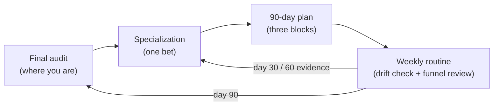
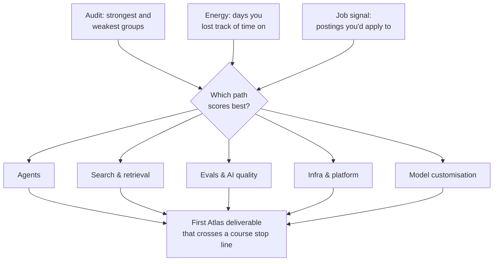
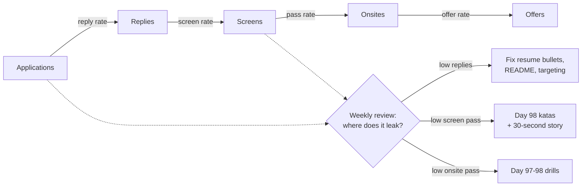
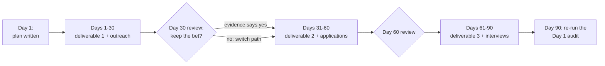

# Launch: Your Next 90 Days

While this course ran, its own tools moved. OpenAI's reusable prompt objects and its Evals platform close on 2026-11-30, and `gpt-4o` retires on 2027-01-14. What you keep isn't an API; it's the loop of measure → update → ship. Today you measure how far you've come, pick where to go deep, set up a routine that keeps you current, and write the next 90 days.

## At a Glance

- **Time:** ~2 h core (+ optional Go Deeper) · **Depth:** intro
- **Prerequisites:** [Day 99: Building Your Portfolio](../Day_099_portfolio/portfolio.md), plus your audit files from [Day 1](../../Phase_0_Start_Here/Day_001_ai_engineer_role/ai_engineer_role.md) and [Day 63](../../Phase_6_Agents/Day_063_career_checkpoint/career_checkpoint.md)
- **You'll build:** `skills_audit_v3.md` (the final re-score), a written specialization choice, a 2-minute Atlas story, a job-search tracker, and `next_90_days.md` (three 30-day blocks), plus seven small scripts that check them
- **Stops at:** career coaching, salary data, and roles outside LLM-application engineering
- **Fast path:** Everyone does this day. The minimum is §The Final Skills Audit and §Your Next 90 Days, then Exercise 3 (~45 min)
- **Cost:** $0. Every script is stdlib except `drift_check`, whose model listing reads metadata and generates no tokens (as of 2026-11, [verify](https://developers.openai.com/api/docs/pricing))
- **New terms:** specialization path, T-shaped skills, drift check, job-search funnel, 90-day plan

> **Coming from Software Engineering?** Run your career like a product roadmap. The audit is a baseline metric, the specialization is a bet, the 90-day plan is a release plan, and the weekly review is a retro. The job search is a funnel (applications → replies → screens → onsites → offers) whose conversion rates you check the way you'd check a pipeline dashboard. What transfers: planning in increments, measuring, cutting scope. What's new: a field whose dependencies deprecate on a months-long clock, so "staying current" becomes scheduled work instead of a hobby.

## Day 100 Is a Checkpoint

Every fact in this course has an expiry date: the model IDs and prices in [Day 7](../../Phase_1_How_LLMs_Work/Day_007_choosing_a_model/choosing_a_model.md) were correct on 2026-11-06, and some will be wrong within a year. A list of tools decays; a routine keeps working. So today isn't a recap. Your proof already lives in the [Day 99](../Day_099_portfolio/portfolio.md) tour README: R1 Extractor ([Day 22](../../Phase_2_Building_with_LLM_APIs/Day_022_capstone_r1_extractor/capstone_r1_extractor.md)), R2 Ask ([Day 34](../../Phase_3_RAG/Day_034_capstone_r2_ask/capstone_r2_ask.md)), R3 Issue Investigator ([Day 62](../../Phase_6_Agents/Day_062_capstone_r3_ship/capstone_r3_ship.md)), R4 Triage Pipeline ([Day 76](../../Phase_8_Safety_and_Security/Day_076_capstone_r4_triage/capstone_r4_triage.md)) and R5 Launch ([Day 90](../../Phase_9_Production/Day_090_capstone_r5_launch/capstone_r5_launch.md)). Today turns that proof into a direction.



## The Final Skills Audit

On Day 1 you scored 20 skills in 8 groups (0–5 each, 100 max) and re-scored them on Day 63. Copy `skills_audit_v2.md` to `skills_audit_v3.md` and fill the `D100` column with the same anchors:

| Score | Meaning |
|---|---|
| 0 | Never heard of it |
| 1 | Heard the term; couldn't explain it |
| 2 | Could explain it; haven't built it |
| 3 | Built it once, by following a guide |
| 4 | Built it on my own and debugged it |
| 5 | Could teach it, including when not to use it |

One honesty test for every 4 or 5: **could I build it from a blank file today?** The [Day 98](../Day_098_practical_interviews/practical_interviews.md) katas are the proof: if you needed to reopen Day 28 for the cited-RAG kata, the retrieval items are 3s.

A tiny worked example by hand. The sample learner Day 63 followed scored the three Retrieval items 1, 1, 0 on Day 1, then 3, 3, 3, and 4, 4, 4 today: 2 → 9 → 12 out of 15. That's +10 since Day 1 but only +3 since Day 63, because Phases 7–10 barely touched retrieval. A per-group view shows that; a total hides it.

`load_audit` reads the Day 1 table format and picks one score column by its header, so your three scores can sit in one file or three.

```python
# script_id: day_100_next_90_days/audit_diff
# Final skills audit: read Day 1-format audit tables and diff them per group.
# Install: none (stdlib, Python 3.11+). Env vars: none. Services: none.
# Usage: python audit_diff.py skills_audit.md:D1 skills_audit_v2.md:D63 skills_audit_v3.md:D100
import sys
from pathlib import Path

GROUP_MAX = {"APIs & prompting": 15, "Structured output": 10, "Retrieval": 15, "Tools & MCP": 10,
             "Evals & observability": 15, "Agents": 15, "Safety": 10, "Production & ops": 10}

def parse_audit(text: str, column: str = "D100") -> dict[str, int]:
    """Sum one score column of the audit table into {group: points}."""
    points: dict[str, int] = {}
    header: list[str] = []
    for line in text.splitlines():
        cells = [c.strip() for c in line.strip().strip("|").split("|")]
        if "Group" in cells and column in cells:
            header = cells                      # found the table, by its column names
        elif header and len(cells) == len(header) and cells[0].isdigit():
            row = dict(zip(header, cells))
            score = int(row[column] or 0)       # a blank cell counts as 0
            if not 0 <= score <= 5:
                raise ValueError(f"item {cells[0]}: score {score} is outside 0-5")
            points[row["Group"]] = points.get(row["Group"], 0) + score
    if not header:
        raise ValueError(f"no audit table with a {column!r} column")
    return points

def load_audit(path: Path, column: str = "D100") -> dict[str, int]:
    return parse_audit(path.read_text(encoding="utf-8"), column)
```

Next, line the audits up and find the weakest groups. "Weakest" means lowest *share of the group's maximum*, since 6 out of 10 is weaker than 10 out of 15.

```python
# script_id: day_100_next_90_days/audit_diff
def audit_diff(audits: dict[str, dict[str, int]]) -> list[tuple[str, list[int]]]:
    """(group, [score in each audit, in order]) rows, then a 'total' row."""
    rows = [(g, [a.get(g, 0) for a in audits.values()]) for g in GROUP_MAX]
    return rows + [("total", [sum(a.values()) for a in audits.values()])]

def weakest(audit: dict[str, int], n: int = 3) -> list[str]:
    return sorted(GROUP_MAX, key=lambda g: audit.get(g, 0) / GROUP_MAX[g])[:n]

# The Day 63 sample learner, item by item: (group, D1, D63, D100). Used when you pass no files.
_ITEMS = [("APIs & prompting", 2, 4, 5), ("APIs & prompting", 2, 4, 4), ("APIs & prompting", 1, 3, 4),
          ("Structured output", 1, 4, 5), ("Structured output", 1, 3, 4),
          ("Retrieval", 1, 3, 4), ("Retrieval", 1, 3, 4), ("Retrieval", 0, 3, 4),
          ("Tools & MCP", 1, 3, 5), ("Tools & MCP", 0, 3, 4),
          ("Evals & observability", 1, 3, 5), ("Evals & observability", 1, 3, 4),
          ("Evals & observability", 0, 3, 4), ("Agents", 1, 3, 4), ("Agents", 0, 2, 3),
          ("Agents", 2, 3, 4), ("Safety", 1, 2, 4), ("Safety", 1, 1, 3),
          ("Production & ops", 4, 4, 5), ("Production & ops", 3, 4, 4)]
SAMPLE = "| # | Group | Skill | D1 | D63 | D100 |\n|---|---|---|---|---|---|\n" + "\n".join(
    f"| {i} | {g} | (skill {i}) | {a} | {b} | {c} |" for i, (g, a, b, c) in enumerate(_ITEMS, 1))

if __name__ == "__main__":
    if sys.argv[1:]:   # each argument is FILE:COLUMN
        audits = {col: load_audit(Path(p), col) for p, _, col in (a.rpartition(":") for a in sys.argv[1:])}
    else:
        audits = {col: parse_audit(SAMPLE, col) for col in ("D1", "D63", "D100")}
    print(f"{'group':<22}" + "".join(f"{c:>6}" for c in audits) + "  change")
    for group, scores in audit_diff(audits):
        cap = 100 if group == "total" else GROUP_MAX[group]
        print(f"{group:<22}" + "".join(f"{s:>6}" for s in scores) + f"  {scores[-1] - scores[0]:+4d} /{cap}")
    print("weakest now:", ", ".join(weakest(list(audits.values())[-1])))
```

```text
$ python audit_diff.py
group                     D1   D63  D100  change
APIs & prompting           5    11    13    +8 /15
Structured output          2     7     9    +7 /10
Retrieval                  2     9    12   +10 /15
Tools & MCP                1     6     9    +8 /10
Evals & observability      2     9    13   +11 /15
Agents                     3     8    11    +8 /15
Safety                     2     3     7    +5 /10
Production & ops           7     8     9    +2 /10
total                     24    61    83   +59 /100
weakest now: Safety, Agents, Retrieval
```

The **total** gives the band (Day 1's 66–100 means you build and debug on your own). The **weakest groups** give a choice: fix one as a 30-day item, or accept it and specialise elsewhere. Safety at 7/10 matters on an evals path (eval suites need red-team cases); on infra it might not.

Turn a knob: skipped Day 63? Pass two files and the change column still works. The common break is a header typo: `ValueError: no audit table with a 'D100 ' column`.

## Telling the Atlas Story

Outreach, recruiter screens and deep-dives all open with the story of what you built. Answer four questions per project:

1. **What problem does it solve?** One sentence.
2. **What's the architecture?** The main components and how they connect.
3. **What was the hardest decision?** Where you made a real engineering call, with the number that justified it.
4. **What would you improve?** This shows you think past the demo.

You need two lengths. The **30-second version** (the first sentence of each answer) is for messages and recruiter screens. The **2-minute version** answers "tell me about a project" and opens Day 98's deep-dive. Write it, time it, record it out loud, cut. Three recorded takes separate a polished answer from a rambling one.

```python
# script_id: day_100_next_90_days/story_drill
# Time the four-question Atlas story at speaking pace, and cut a 30-second version.
# Install: none (stdlib). Env vars: none. Services: none.
WPM = 130   # a common conversational pace; read 130 words aloud, time it, and set your own
SHARE = {"problem": 0.2, "architecture": 0.3, "hardest decision": 0.3, "improve": 0.2}
# Sample numbers: replace every one with a number from your own release READMEs.
STORY = {
    "problem": "Orbit's four maintainers were spending days on first responses to about forty new "
               "issues a week, and they missed the occasional severity-one incident.",
    "architecture": "Atlas reads each new issue, extracts a typed record, searches the docs and past "
                    "issues with hybrid search and a reranker, and hands an investigator agent the "
                    "evidence. A triage step drafts labels, duplicates and a reply, and a maintainer "
                    "approves every action. Underneath, documents live in Postgres with pgvector, the "
                    "agent is a LangGraph graph with a checkpointer so a crashed run resumes, and every "
                    "model call goes through one client with retries and a cost tracker. It runs behind a FastAPI service with tracing, quotas and "
                    "an eval gate in CI, so a prompt change that drops accuracy can't ship.",
    "hardest decision": "The hardest call was keeping one agent instead of three. The multi-agent "
                        "version looked better in demos, but on our sixty-case golden set it was two "
                        "points more accurate at three times the cost per issue, and its traces were "
                        "much harder to debug, so I shipped the single agent and kept the multi-agent "
                        "branch for the duplicate-detection step only.",
    "improve": "Next I'd grow the golden set from real maintainer edits, because sixty cases is too "
               "few to trust a two-point difference, and I'd add a cheaper model route for routine issues.",
}

def seconds(text: str, wpm: int = WPM) -> float:
    return len(text.split()) / wpm * 60

def report(story: dict[str, str], budget_s: int = 120) -> None:
    for part, text in story.items():
        took, target = seconds(text), SHARE[part] * budget_s
        print(f"{part:<17}{took:5.0f}s  (aim ~{target:.0f}s){'  <- cut' if took > target * 1.25 else ''}")
    print(f"{'total':<17}{sum(map(seconds, story.values())):5.0f}s  of {budget_s}s")

def thirty_second(story: dict[str, str]) -> str:
    """First sentence of each answer: the recruiter-screen version."""
    return " ".join(t.split(". ")[0].rstrip(".") + "." for t in story.values())

if __name__ == "__main__":
    report(STORY)
    short = thirty_second(STORY)
    over = "  <- over 30s: trim the longest sentence" if seconds(short) > 30 else ""
    print(f"\n30-second version ({seconds(short):.0f}s){over}:\n{short}")
```

```text
$ python story_drill.py
problem             11s  (aim ~24s)
architecture        47s  (aim ~36s)  <- cut
hardest decision    28s  (aim ~36s)
improve             14s  (aim ~24s)
total              100s  of 120s

30-second version (42s)  <- over 30s: trim the longest sentence:
Orbit's four maintainers were spending days on first responses to about forty new issues a week, and they missed the occasional severity-one incident. Atlas reads each new issue, extracts a typed record, searches the docs and past issues with hybrid search and a reranker, and hands an investigator agent the evidence. The hardest call was keeping one agent instead of three. Next I'd grow the golden set from real maintainer edits, because sixty cases is too few to trust a two-point difference, and I'd add a cheaper model route for routine issues.
```

The flags show where you ramble: here the architecture runs long, and the 30-second cut is 12 seconds over, so trim its longest sentences. Interviewers remember the hardest decision, so spend your seconds there. Do it now: write your own `STORY`, run it, record one take, and keep it for the outreach below.

## Choosing a Specialization

Every audit group has moved, so you have breadth. Engineers who advance fastest add depth in one area: **T-shaped skills** (deep in one area, competent across the rest). A **specialization path** is the area you pick for the vertical bar, plus a first deliverable that proves it. Choose with three inputs:

- **Your audit:** strong groups are cheaper to deepen; a weak one might be a 30-day fix instead.
- **Energy:** the days you lost track of time on predict what you'll still be doing on day 60.
- **Job signal:** course research counted keywords in 320 public AI-engineer postings (as of 2026-11-06). The sample leans toward AI vendors: a rough signal, not a survey.



Each path starts where this course stopped, and its first deliverable builds on Atlas, so it extends your portfolio.

| Path | Go deep on | The stop line you'd now cross | Job-sample signal | First Atlas deliverable |
|---|---|---|---|---|
| **Agents** ([Days 48–62](../../Phase_6_Agents/Day_048_first_agent/first_agent.md)) | Long-horizon tasks, planning, tool reliability | Planning research beyond plan-and-replan ([Day 51](../../Phase_6_Agents/Day_051_planning_replanning/planning_replanning.md)) | agents 36% | R3 investigator handles multi-issue investigations; trajectory pass rate on a new 30-case set |
| **Search & retrieval** ([Days 23–34](../../Phase_3_RAG/Day_023_embeddings/embeddings.md)) | Index internals, rerankers, retrieval evals | ANN internals ([Day 26](../../Phase_3_RAG/Day_026_pgvector_search/pgvector_search.md)), training rerankers ([Day 31](../../Phase_3_RAG/Day_031_reranking_contextual_retrieval/reranking_contextual_retrieval.md)) | RAG/retrieval 17% | A domain-tuned reranker for R2; recall@5 and MRR before/after, cost per query |
| **Evals & AI quality** ([Days 42–47](../../Phase_5_Evaluation_and_Observability/Day_042_tracing_observability/tracing_observability.md), [Day 86](../../Phase_9_Production/Day_086_monitoring_feedback/monitoring_feedback.md)) | Error analysis, judges, eval infrastructure | "Building an eval platform" ([Day 47](../../Phase_5_Evaluation_and_Observability/Day_047_evals_in_ci/evals_in_ci.md)) | evals 52% | A run-over-run eval dashboard for Atlas; judge–human agreement reported per release |
| **Infra & platform** ([Days 77–90](../../Phase_9_Production/Day_077_fastapi_serving/fastapi_serving.md)) | Serving, gateways, cost, scale | Running Kubernetes ([Day 82](../../Phase_9_Production/Day_082_containerize_deploy/containerize_deploy.md)), multi-node serving ([Day 93](../../Phase_10_Open_Models_and_Fine_Tuning/Day_093_vllm_serving/vllm_serving.md)) | observability 11%, Kubernetes 5% | An LLM gateway in front of R5 with per-tenant cost; p95 and $/request under a load test |
| **Model customisation** ([Days 91–96](../../Phase_10_Open_Models_and_Fine_Tuning/Day_091_open_weight_local/open_weight_local.md)) | Fine-tuning, distillation, preference tuning | RLHF/DPO ([Day 94](../../Phase_10_Open_Models_and_Fine_Tuning/Day_094_should_you_finetune/should_you_finetune.md); vocabulary in [A11b](../../Appendix_Primers/A11b_training_vocabulary.md)) | fine-tuning 6% | A distilled triage model; accuracy and $/1k issues vs the R4 baseline |

Two honest notes. Fine-tuning appears in 6% of the sample and evals in 52%: model customisation is real, but it's the narrowest door. And TypeScript/JavaScript appears in 32% across every path, so if your targets ship web products, the [TypeScript primer (A13)](../../Appendix_Primers/A13_typescript_for_ai_engineers.md) is a cross-cutting 30-day item. The script below shows which input is doing the deciding.

```python
# script_id: day_100_next_90_days/path_picker
# Rank the five specialization paths from audit strength, energy and job signal.
# Install: none (stdlib). Env vars: none. Services: none.
GROUP_MAX = {"APIs & prompting": 15, "Structured output": 10, "Retrieval": 15, "Tools & MCP": 10,
             "Evals & observability": 15, "Agents": 15, "Safety": 10, "Production & ops": 10}
# Keyword share of 320 AI-engineer postings (course research, 2026-11-06, vendor-skewed sample).
SIGNAL = {"Agents": 0.36, "Search & retrieval": 0.17, "Evals & AI quality": 0.52,
          "Infra & platform": 0.11, "Model customisation": 0.06}   # infra uses "observability"
GROUPS = {"Agents": ["Agents", "Tools & MCP"], "Search & retrieval": ["Retrieval"],
          "Evals & AI quality": ["Evals & observability"], "Infra & platform": ["Production & ops"],
          "Model customisation": []}   # no audit item covers fine-tuning: energy decides
WEIGHTS = {"strength": 0.4, "energy": 0.4, "signal": 0.2}

def strength(audit: dict[str, int], groups: list[str]) -> float:
    if not groups:
        return 0.5   # neutral when the audit can't tell
    return sum(audit.get(g, 0) for g in groups) / sum(GROUP_MAX[g] for g in groups)

def rank_paths(audit: dict[str, int], energy: dict[str, int],
               weights: dict[str, float] = WEIGHTS) -> list[tuple[str, float]]:
    top = max(SIGNAL.values())
    scores = {p: weights["strength"] * strength(audit, GROUPS[p]) + weights["energy"] * energy[p] / 5
                 + weights["signal"] * SIGNAL[p] / top for p in SIGNAL}
    return sorted(scores.items(), key=lambda kv: kv[1], reverse=True)

if __name__ == "__main__":
    audit = {"APIs & prompting": 13, "Structured output": 9, "Retrieval": 12, "Tools & MCP": 9,
             "Evals & observability": 13, "Agents": 11, "Safety": 7, "Production & ops": 9}
    energy = {"Agents": 3, "Search & retrieval": 5, "Evals & AI quality": 4,   # 0-5, your call
              "Infra & platform": 2, "Model customisation": 2}
    for path, score in rank_paths(audit, energy):
        print(f"{path:<22}{score:.2f}")
    print("without job signal:", rank_paths(audit, energy, {"strength": 0.4, "energy": 0.4, "signal": 0}
                                            )[0][0])
```

```text
$ python path_picker.py
Evals & AI quality    0.87
Search & retrieval    0.79
Agents                0.70
Infra & platform      0.56
Model customisation   0.38
without job signal: Search & retrieval
```

Turn the knob: with the signal weight at zero, Search & retrieval wins, because this learner loved the retrieval days. Ask yourself: am I picking evals for the market, or because I want it? Either answer is fine once it's written down: one paragraph in `next_90_days.md` with the path, the three inputs and the first deliverable.

**First role?** Breadth plus one deep project beats an early niche. Pick a path for your *project*, and keep applying broadly.

## Staying Current Without Drowning

The fix for a fast field isn't reading more; it's reading in order, on a schedule. **Drift** is what changes under you: model IDs, shutdown dates, SDK versions, spec revisions. A **drift check** is a short, scheduled look at exactly those. Source order:

1. **Official changelogs and deprecation pages:** [OpenAI deprecations](https://developers.openai.com/api/docs/deprecations), the [openai-python changelog](https://github.com/openai/openai-python/blob/main/CHANGELOG.md), the [MCP spec changelog](https://modelcontextprotocol.io/specification/2026-07-28/changelog).
2. **Lab engineering blogs**, such as [Anthropic Engineering](https://www.anthropic.com/engineering/effective-context-engineering-for-ai-agents), for patterns that reach SDKs later.
3. **Two or three practitioners** who test claims, such as [Simon Willison](https://simonwillison.net/2025/Jun/16/the-lethal-trifecta/) and [Hamel Husain](https://hamel.dev/blog/posts/evals-faq/). Stop there.

Then put three habits on a calendar:

| Cadence | Habit | Course tool it reuses |
|---|---|---|
| Weekly, 30 min | Run `drift_check`, skim the changelogs above, log one line of what changed | [Day 7](../../Phase_1_How_LLMs_Work/Day_007_choosing_a_model/choosing_a_model.md) `shutdown_date()` |
| Monthly | Rebuild one small thing from scratch with the newest SDK (a kata) | [Day 98](../Day_098_practical_interviews/practical_interviews.md) katas |
| Quarterly | Re-run your Atlas evals on a newer or cheaper model | [Day 21](../../Phase_2_Building_with_LLM_APIs/Day_021_prompts_as_code/prompts_as_code.md) drill, [Day 87](../../Phase_9_Production/Day_087_shipping_changes_safely/shipping_changes_safely.md) playbook |

**Learn the pattern, not the tool:** structured output, retrieval, tool calls, the agent loop and evals survived every SDK change in this course. The weekly check makes tool changes arrive as calendar items, not outages. Its first block reads every `shutdown_date` with one `client.models.list()` call (metadata only, no tokens), using Day 7's `TIERS` idea.

```python
# script_id: day_100_next_90_days/drift_check
# Weekly drift check: model shutdown dates + installed vs latest SDK versions.
# Install: uv add "openai>=3.46,<4"   (the package check itself is stdlib)
# Env vars: OPENAI_API_KEY (skip the model check with --no-api); optional ATLAS_MODEL, ATLAS_TIER_*
# Services: none. Network: api.openai.com and pypi.org.
import argparse
import datetime as dt
import json
import os
import sys
import urllib.request
from importlib import metadata

MODEL = os.environ.get("ATLAS_MODEL", "gpt-6-luna")          # Day 2
_DEFAULT_TIERS = {"cheap": MODEL, "mid": "gpt-6.1-terra", "strong": "gpt-6.1-sol", "flagship": "gpt-6-astra"}
TIERS = {t: os.environ.get(f"ATLAS_TIER_{t.upper()}", m) for t, m in _DEFAULT_TIERS.items()}  # Day 7
PACKAGES = ["openai", "pydantic", "langgraph", "gradio"]

def shutdown_dates(models: list[str]) -> dict[str, str | None]:
    """{model: 'YYYY-MM-DD' | None}, or 'MISSING' when this key can't see the model."""
    from openai import OpenAI   # imported here so --no-api runs without the SDK or a key
    visible = {m.id: m.shutdown_date for m in OpenAI().models.list()}  # iterating fetches all pages
    return {m: visible.get(m, "MISSING") for m in models}
```

The second block compares installed versions with PyPI's JSON API (`info.version` is the newest release) and exits non-zero on any shutdown inside the horizon, so CI can act on it.

```python
# script_id: day_100_next_90_days/drift_check
def pypi_latest(package: str) -> str:
    with urllib.request.urlopen(f"https://pypi.org/pypi/{package}/json", timeout=10) as resp:
        return json.load(resp)["info"]["version"]

def drift_check(models: list[str], packages: list[str], *, horizon_days: int = 90,
                use_api: bool = True) -> list[str]:
    """Print a drift report; return the problems that need planned work."""
    problems: list[str] = []
    if use_api:
        for model, date in shutdown_dates(models).items():
            if date is None:
                print(f"{model}: no shutdown date")
                continue
            if date == "MISSING":
                print(f"{model}: MISSING for this key")
                problems.append(f"{model} is not visible to this key")
                continue
            days = (dt.date.fromisoformat(date) - dt.date.today()).days
            print(f"{model}: shuts down {date} ({days} days)")
            if days <= horizon_days:
                problems.append(f"{model} shuts down in {days} days: plan the migration (Day 88)")
    for pkg in packages:
        try:
            installed = metadata.version(pkg)
        except metadata.PackageNotFoundError:
            installed = "not installed"
        try:
            latest = pypi_latest(pkg)
        except OSError as exc:              # URLError and timeouts are both OSError
            print(f"{pkg}: PyPI unreachable ({exc})")
            continue
        print(f"{pkg} {installed} (latest {latest}): {'current' if installed == latest else 'behind'}")
    return problems

if __name__ == "__main__":
    ap = argparse.ArgumentParser(description="Weekly drift check")
    ap.add_argument("--no-api", action="store_true", help="skip the model check (no key needed)")
    ap.add_argument("--horizon", type=int, default=90, help="flag shutdowns within N days")
    args = ap.parse_args()
    found = drift_check(sorted(set(TIERS.values())), PACKAGES, horizon_days=args.horizon,
                        use_api=not args.no_api)
    for p in found:
        print("ACTION:", p)
    sys.exit(1 if found else 0)
```

```text
$ python drift_check.py --no-api    # your output will differ
openai 3.46.0 (latest 3.46.0): current
pydantic 2.14.3 (latest 2.14.3): current
langgraph 1.2.20 (latest 1.2.20): current
gradio 6.31.0 (latest 6.31.0): current
```

"Behind" isn't an alarm: read the changelog, then upgrade on a branch with your evals running.

Turn the knob: set `ATLAS_TIER_MID=gpt-4o` and run with a key. The deprecations page lists its shutdown as 2027-01-14, which on 2026-11-07 is 68 days out, so expect `ACTION: gpt-4o shuts down in 68 days: plan the migration (Day 88)` and exit code 1. That's how [Day 88](../../Phase_9_Production/Day_088_operating_ai_systems/operating_ai_systems.md) treats deprecations: planned work with a ticket. Without a key you get `openai.OpenAIError: Missing credentials…`; use `--no-api`.

## The Job-Search Plan

Start applying now if you haven't; [Day 63](../../Phase_6_Agents/Day_063_career_checkpoint/career_checkpoint.md) covers when to apply and resume bullets, and Day 98 covers negotiation. The search is a **job-search funnel**: stages where each holds fewer items than the last (applications → replies → screens → onsites → offers), and each leaks for a different reason. Your first 30 days:

| Days | Focus | What you do |
|---|---|---|
| 1–7 | Publish | Tag the Atlas release, finish the tour README and write-up ([Day 99](../Day_099_portfolio/portfolio.md)), pin the repo, update your profile with the 30-second story |
| 8–14 | Warm outreach | Message 5–10 people at companies hiring AI engineers. Ask for an **informational chat** (a short call about their work, not a job ask): "I've spent 100 days building LLM systems [one Atlas number]. Could I have 15 minutes on how your team does evals?" |
| 15–21 | Targeted applications | 5–10 a week. For each job description (JD), map its top three skills to a release, and lead your note with that release's number |
| 22–30 | Interviews | Drill the design round ([Day 97](../Day_097_system_design_interviews/system_design_interviews.md)), katas and STAR stories ([Day 98](../Day_098_practical_interviews/practical_interviews.md)), and the 2-minute story |

By track:

- **Switching roles:** start inside. An internal AI project or a transfer is often the shortest path, because your employer already trusts your engineering. Apply externally in parallel.
- **First role:** volume plus referrals. Keep the data-structures-and-algorithms (DSA) cadence from Days 63 and 98, apply to new-grad programs, and turn informational chats into referrals.

Track every application (company, role, source, date, stage, next action, contact) and review the funnel weekly.



```python
# script_id: day_100_next_90_days/funnel_review
# Weekly job-search funnel review from a tracker CSV.
# Install: none (stdlib). Env vars: none. Services: none.
# Usage: python funnel_review.py tracker.csv   (no argument: runs on the sample below)
import csv
import io
import sys
from collections import Counter

STAGES = ["applied", "replied", "screen", "onsite", "offer"]   # stage = the furthest one reached
# Example targets: set your own. There's no reliable public benchmark for these rates.
TARGETS = {"replied": 0.30, "screen": 0.50, "onsite": 0.50, "offer": 0.30}
FIX = {"replied": "few replies: sharpen resume bullets (Day 63) and README (Day 99); target JDs a release matches",
       "screen": "replies but few screens: lead with the 30-second story; ask contacts for referrals",
       "onsite": "screens but few onsites: katas and the project deep-dive (Day 98)",
       "offer": "onsites but no offers: mock design rounds (Day 97) and STAR stories (Day 98)"}
SAMPLE = """company,role,source,date,stage,next_action,contact
Acme AI,AI Engineer,cold,2026-11-10,applied,none,
Borealis,Applied AI Engineer,cold,2026-11-10,applied,none,
Cobalt,LLM Engineer,cold,2026-11-11,applied,none,
Dune Labs,AI Engineer,cold,2026-11-11,replied,send availability,recruiter
Ember,Applied AI Engineer,cold,2026-11-12,applied,none,
Fjord,AI Platform Engineer,cold,2026-11-12,applied,none,
Garnet,AI Engineer,cold,2026-11-13,applied,none,
Helix,LLM Engineer,cold,2026-11-13,applied,none,
Iris,AI Engineer,cold,2026-11-14,applied,none,
Juniper,Applied AI Engineer,cold,2026-11-14,applied,none,
Kestrel,AI Engineer,cold,2026-11-17,applied,none,
Lumen,AI Engineer,cold,2026-11-17,applied,none,
Mosaic,Evals Engineer,referral,2026-11-18,screen,prep kata,Priya
Nimbus,AI Engineer,referral,2026-11-19,onsite,design drill,Sam
Opal,Applied AI Engineer,referral,2026-11-20,replied,book screen,Lee
"""
```

```python
# script_id: day_100_next_90_days/funnel_review
def funnel(rows: list[dict[str, str]]) -> dict[str, int]:
    """How many applications reached each stage or beyond."""
    furthest = Counter(STAGES.index(r["stage"]) for r in rows)
    return {s: sum(n for i, n in furthest.items() if i >= k) for k, s in enumerate(STAGES)}

def review(rows: list[dict[str, str]], min_n: int = 5) -> None:
    counts = funnel(rows)
    for prev, stage in zip(STAGES, STAGES[1:]):
        if counts[prev] < min_n:   # tiny samples are noise (the Day 46 lesson)
            print(f"{prev:>8} -> {stage:<8} {counts[stage]}/{counts[prev]}  too few to judge")
            continue
        rate = counts[stage] / counts[prev]
        flag = f"  <- {FIX[stage]}" if rate < TARGETS[stage] else ""
        print(f"{prev:>8} -> {stage:<8} {counts[stage]}/{counts[prev]} = {rate:.0%}{flag}")
    for source in sorted({r["source"] for r in rows}):
        sub = [r for r in rows if r["source"] == source]
        print(f"reply rate from {source}: {funnel(sub)['replied']}/{len(sub)}")

if __name__ == "__main__":
    text = open(sys.argv[1], encoding="utf-8").read() if sys.argv[1:] else SAMPLE
    review(list(csv.DictReader(io.StringIO(text))))
```

```text
$ python funnel_review.py
 applied -> replied  4/15 = 27%  <- few replies: sharpen resume bullets (Day 63) and README (Day 99); target JDs a release matches
 replied -> screen   2/4  too few to judge
  screen -> onsite   1/2  too few to judge
  onsite -> offer    0/1  too few to judge
reply rate from cold: 1/12
reply rate from referral: 3/3
```

Read the source lines first: referrals always replied; cold applications rarely did. This learner's fix isn't a better resume; it's moving effort to warm outreach. Review every Friday and change one thing a week, so you know which change helped.

## Your Next 90 Days

A **90-day plan** is three 30-day blocks, each with one public deliverable with a number, search targets, one habit and a review question for the block's last day. Public matters: hiring managers can't see a private deliverable, and a private deadline slips.



The template, which `plan_check` reads:

```markdown
# My next 90 days: <path>
## Days 1-30
- Deliverable: <public thing with a number: "recall@5 from 0.71 to 0.80, in the R2 README">
- Search: <targets: "8 informational chats, 10 applications">
- Habit: <one: "Friday drift check + funnel review">
- Review question: <answer on day 30: "did anyone ask about the reranker post?">
## Days 31-60
...
## Days 61-90
...
```

```python
# script_id: day_100_next_90_days/plan_check
# Lint a 90-day plan: three blocks, each with a measured deliverable, numeric
# search targets, one habit and a review question.
# Install: none (stdlib). Env vars: none. Services: none.
# Usage: python plan_check.py next_90_days.md   (no argument: checks the sample below)
import re
import sys
from pathlib import Path

REQUIRED = ("Deliverable", "Search", "Habit", "Review")
SAMPLE_PLAN = """# My next 90 days: Evals & AI quality
## Days 1-30
- Deliverable: Atlas eval dashboard, 3 releases compared, linked from the tour README
- Search: 8 informational chats, 10 applications
- Habit: Friday drift check + funnel review
- Review question: Did any chat or screen ask about the dashboard?
## Days 31-60
- Deliverable: judge-human agreement on 60 labelled triage cases, reported in a blog post
- Search: 10 applications, 2 referrals asked for
- Habit: one kata a week
- Review question: Is the reply rate above my 30% target?
## Days 61-90
- Deliverable: learn more about eval research
- Search: keep applying
- Habit: read papers
"""

def parse_plan(text: str) -> dict[str, dict[str, str]]:
    blocks: dict[str, dict[str, str]] = {}
    current = None
    for line in text.splitlines():
        if line.startswith("## "):
            current = line[3:].strip()
            blocks[current] = {}
        elif current and (m := re.match(r"-\s*(\w+)[^:]*:\s*(.+)", line)):
            blocks[current][m.group(1)] = m.group(2).strip()
    return blocks
```

```python
# script_id: day_100_next_90_days/plan_check
def lint_plan(blocks: dict[str, dict[str, str]]) -> list[str]:
    problems = [] if len(blocks) == 3 else [f"{len(blocks)} blocks; expected three 30-day blocks"]
    for name, fields in blocks.items():
        problems += [f"{name}: no '{key}' line" for key in REQUIRED if key not in fields]
        if not re.search(r"\d", fields.get("Deliverable", "")):
            problems.append(f"{name}: the deliverable has no number, so nobody can measure it")
        if "Search" in fields and not re.search(r"\d", fields["Search"]):
            problems.append(f"{name}: search targets need counts")
        if "Review" in fields and not fields["Review"].endswith("?"):
            problems.append(f"{name}: write the review as a question")
    return problems

if __name__ == "__main__":
    text = Path(sys.argv[1]).read_text(encoding="utf-8") if sys.argv[1:] else SAMPLE_PLAN
    found = lint_plan(parse_plan(text))
    print("\n".join(found) or "plan ok: 3 blocks, every deliverable measured")
    sys.exit(1 if found and sys.argv[1:] else 0)   # the sample fails on purpose; your file gates CI
```

```text
$ python plan_check.py
Days 61-90: no 'Review' line
Days 61-90: the deliverable has no number, so nobody can measure it
Days 61-90: search targets need counts
```

Block 3 is the classic failure: learning goals. "Learn more about eval research" can't be checked on day 90; "a write-up comparing two judge prompts on 60 cases" can. Last, put the rhythm on your calendar: this script writes an iCalendar (`.ics`) file with the weekly check, a monthly rebuild and the three review gates.

```python
# script_id: day_100_next_90_days/review_calendar
# Write next_90_days.ics: weekly drift check, monthly rebuild, day-30/60/90 reviews.
# Install: none (stdlib). Env vars: none. Services: none.
# Usage: python review_calendar.py 2026-11-09   (start date; default today)
import datetime as dt
import sys
from pathlib import Path

def event(uid: str, day: dt.date, summary: str, rrule: str = "") -> list[str]:
    stamp = dt.datetime.now(dt.UTC).strftime("%Y%m%dT%H%M%SZ")
    lines = ["BEGIN:VEVENT", f"UID:{uid}-{day:%Y%m%d}@next-90-days", f"DTSTAMP:{stamp}",
             f"DTSTART;VALUE=DATE:{day:%Y%m%d}", f"SUMMARY:{summary}"]
    return lines + ([f"RRULE:{rrule}"] if rrule else []) + ["END:VEVENT"]

def build_calendar(start: dt.date) -> str:
    day = lambda n: start + dt.timedelta(days=n - 1)   # day 1 is the start date
    events = [event("drift", day(5), "Drift check + funnel review (30 min)", "FREQ=WEEKLY;COUNT=13"),
              event("rebuild", day(14), "Rebuild one small thing with the newest SDK", "FREQ=MONTHLY;COUNT=3"),
              event("review30", day(30), "Day 30 review: answer the block-1 question; keep or switch path"),
              event("review60", day(60), "Day 60 review: answer the block-2 question"),
              event("review90", day(90), "Day 90: re-run the Day 1 audit; re-run evals on a newer model")]
    lines = ["BEGIN:VCALENDAR", "VERSION:2.0", "PRODID:-//ai-engineering-course//next-90-days//EN"]
    lines += [line for e in events for line in e] + ["END:VCALENDAR"]
    return "\r\n".join(lines) + "\r\n"   # iCalendar (RFC 5545) wants CRLF line endings

if __name__ == "__main__":
    start = dt.date.fromisoformat(sys.argv[1]) if sys.argv[1:] else dt.date.today()
    Path("next_90_days.ics").write_text(build_calendar(start), encoding="utf-8", newline="")
    print(f"wrote next_90_days.ics: day 30 = {start + dt.timedelta(29)}, "
          f"day 60 = {start + dt.timedelta(59)}, day 90 = {start + dt.timedelta(89)}")
```

```text
$ python review_calendar.py 2026-11-09
wrote next_90_days.ics: day 30 = 2026-12-08, day 60 = 2027-01-07, day 90 = 2027-02-06
```

### Trade-offs: how plans fail

| Failure mode | What it looks like | The counter |
|---|---|---|
| Tool-chasing | A new framework weekly, nothing finished | Tools enter only through the weekly drift check |
| Endless courses | Another course instead of a deliverable | Every block ships something public, with a number |
| Never shipping | "Almost done" on day 30 | Cut scope and ship the smaller version |
| Burnout | Every evening, then a month of nothing | One habit per block; plan 5–8 hours a week, not 20 |
| Path-hopping | A new specialization every two weeks | One bet, re-decided only at day 30 or 60 |

### In practice

- Re-decide the path at day 30 on evidence (replies, interview questions, the audit), not mood.
- Tell someone block 1's deliverable.
- An offer on day 40 means the plan worked: rewrite the next block for the new role.
- Log one line every Friday; on day 90 it's your next STAR story.

## Go Deeper (optional)

<details><summary>Go deeper: build your own job signal from the JDs you'd apply to</summary>

The 320-posting sample behind the specialization table leans toward AI vendors. Your target market might be banks, health-tech or agencies, where the mix differs. The fix is the Day 1 exercise, scaled up: save 15–30 job descriptions you'd actually apply to as `.txt` files and count which skills they mention.

Keyword counting is crude. "Tool" matches "tooling"; "agent" matches "user agent". It's still better than a feed's impression of the market, because it's *your* market. Read the top three groups as "what to lead with" and the bottom ones as "what not to specialise in yet".

```python
# script_id: day_100_next_90_days/jd_signal
# Share of your saved job descriptions that mention each skill group.
# Install: none (stdlib). Env vars: none. Services: none.
# Usage: python jd_signal.py jds/   (a folder of .txt files; no argument: three samples)
import sys
from pathlib import Path

KEYWORDS = {"Evals & observability": ["eval", "observability", "tracing"], "Agents": ["agent"],
            "Retrieval": ["rag", "retrieval", "embedding", "search"], "Tools & MCP": ["mcp", "tool call"],
            "Safety": ["guardrail", "prompt injection", "pii", "safety"],
            "Production & ops": ["deploy", "latency", "kubernetes", "on-call"],
            "Model customisation": ["fine-tun", "lora", "distill"], "TS/JS": ["typescript", "javascript", "react"]}
SAMPLES = ["Build RAG features in Python, own evals and tracing, deploy to production, on-call.",
           "Applied AI engineer: agents with tool calls, MCP servers, TypeScript front end.",
           "Design evals for agent workflows; guardrails against prompt injection; fine-tuning a plus."]

def signal(jds: list[str]) -> list[tuple[str, float]]:
    lowered = [jd.lower() for jd in jds]
    shares = {g: sum(any(k in jd for k in kws) for jd in lowered) / len(jds) for g, kws in KEYWORDS.items()}
    return sorted(shares.items(), key=lambda kv: kv[1], reverse=True)

if __name__ == "__main__":
    folder = Path(sys.argv[1]) if sys.argv[1:] else None
    jds = [p.read_text(encoding="utf-8") for p in sorted(folder.glob("*.txt"))] if folder else SAMPLES
    for group, share in signal(jds):
        print(f"{group:<22}{share:>5.0%}  {'#' * round(share * 20)}")
```

```text
$ python jd_signal.py
Evals & observability   67%  #############
Agents                  67%  #############
Retrieval               33%  #######
Tools & MCP             33%  #######
Safety                  33%  #######
Production & ops        33%  #######
Model customisation     33%  #######
TS/JS                   33%  #######
```

With fewer than about 15 JDs, a one-posting difference swings a share by several points, so read the order, not the decimals.

</details>

<details><summary>Go deeper: where each path goes after the first deliverable</summary>

The first deliverable crosses one stop line. Here is what lies past it, so you can sketch blocks 2 and 3. Each path keeps the course's habit: measure first, then change one thing.

- **Agents.** Long-horizon work: tasks that run for hours, survive restarts and need context management beyond one window. Read Anthropic's [effective context engineering](https://www.anthropic.com/engineering/effective-context-engineering-for-ai-agents) post, then apply its ideas to R3 with the trajectory evals from Day 59. The stop line you're crossing is planning research (search over plans, learned planners); start by measuring how often your current replanner recovers.
- **Search & retrieval.** Index internals (why HNSW recall drops as you raise filters) and training a reranker on your own labelled pairs. Your Day 29 query set is the start of the training and test data. Measure recall@5 and MRR before touching a model.
- **Evals & AI quality.** Past the course's stop line, eval work becomes infrastructure: datasets versioned like code, run-over-run comparisons, judges re-validated when the model changes. Hamel Husain's evals FAQ, [AI Evals: Everything You Need to Know](https://hamel.dev/blog/posts/evals-faq/), is the best single practitioner reference. This is the path with the strongest job signal in the sample.
- **Infra & platform.** Gateways (one place for keys, quotas, routing and cost), autoscaling GPU serving, and multi-node inference. The Day 93 vLLM lesson is the jumping-off point; a load test with p95 and $/request is the deliverable that proves it.
- **Model customisation.** Preference tuning (DPO and relatives), larger distillation runs and evaluation of small models against the API baseline. Treat it as an add-on to evals, not a replacement: every fine-tune needs the eval suite you already have.

Whatever you pick, the order is the same as Atlas: a baseline number, a change, a new number, a README that shows both.

</details>

## Common Pitfalls

- **Inflated self-scores.** A +60 diff, but the Day 98 katas fail without notes. Fix: Day 1's anchors, the blank-file test, and the lower number when unsure.
- **Specialising on hype.** Model customisation is 6% of the sample, evals 52% (as of 2026-11-06, vendor-skewed). Fix: decide from your audit and your own JD signal, in writing.
- **Feeds instead of primary sources.** You repeat a rumoured API or last month's price. Fix: changelogs and deprecation pages first.
- **`drift_check` without a key or network.** `openai.OpenAIError: Missing credentials. Please pass an api_key…` → `--no-api`. A proxy blocking PyPI prints `PyPI unreachable (<urlopen error …>)` → run it from CI.
- **A plan of learning goals.** Nothing to show on day 30. Fix: `plan_check` fails any deliverable without a number.
- **No tracker.** You fix the resume when the interviews are the bottleneck. Fix: the CSV and a Friday review.

> **Where we stop:** this day doesn't cover career coaching, salary data or roles outside LLM-application engineering; for negotiation basics see [Day 98](../Day_098_practical_interviews/practical_interviews.md), and for salary data use your local market's public sources.

## Key Takeaways

- Every fact in this course has an expiry date; what lasts is the loop of measure → update → ship, run on a schedule.
- Re-score the audit with Day 1's anchors and the blank-file test, and read it per group: the weakest groups become a 30-day fix or a deliberate non-goal.
- Choose one specialization path from three written inputs (audit, energy, job signal), and make its first deliverable an Atlas change that crosses a course stop line, with a number.
- A weekly 30-minute drift check (shutdown dates, SDK versions, official changelogs first) turns deprecations into planned work instead of outages.
- A 90-day plan is three blocks, each with one public measured deliverable, search targets, one habit and a review question; the job search is a funnel you review weekly and fix at the leakiest stage.

## Quick Reference

| Tool / pattern | What it does | When to use it | Gotcha |
|---|---|---|---|
| `audit_diff FILE:COL …` | Per-group D1 → D63 → D100 table + 3 weakest | Today, then day 90 | The column header must match exactly |
| `path_picker` | Ranks five paths from audit, energy, job signal | Choosing a path; re-deciding at day 30 | Weights are yours; set the signal weight to 0 to see your preference |
| Four-question drill | Problem, architecture, hardest decision, improvement | Outreach, screens, deep-dives | Spend the seconds on the hardest decision |
| `drift_check [--no-api]` | Shutdown dates + installed vs PyPI versions; exit 1 if a shutdown is within 90 days | Weekly, or in CI | `models.list()` needs a key; PyPI needs the network |
| `funnel_review tracker.csv` | Stage conversion rates + reply rate by source | Every Friday | Fewer than 5 at a stage is noise |
| `plan_check next_90_days.md` | Lints the three blocks | When you write or change the plan | Say how each number is measured |
| `review_calendar START` | `.ics` with the routine and review gates | Once, on day 1 | Re-run it if you restart |

## Exercises

1. **Warm-up: the final audit.** Fill the `D100` column in `skills_audit_v3.md`, run `audit_diff` on your three files, then extend it so it also prints any group that went *down* since Day 63.

<details><summary>Solution</summary>

Run `python audit_diff.py skills_audit.md:D1 skills_audit_v2.md:D63 skills_audit_v3.md:D100`. Then add the regression check below to the `__main__` block (here with inline audits so it runs alone). A drop isn't a failure: skills you stopped using fade, and the honest score shows which ones to refresh with a kata.

```python
# script_id: day_100_next_90_days/solution_ex1
# Exercise 1: flag groups whose score fell between two audits.
# Install: none (stdlib). Env vars: none. Services: none.
GROUP_MAX = {"APIs & prompting": 15, "Structured output": 10, "Retrieval": 15, "Tools & MCP": 10,
             "Evals & observability": 15, "Agents": 15, "Safety": 10, "Production & ops": 10}

def regressions(before: dict[str, int], after: dict[str, int]) -> list[str]:
    return [f"{g}: {before.get(g, 0)} -> {after.get(g, 0)} (refresh with a kata)"
            for g in GROUP_MAX if after.get(g, 0) < before.get(g, 0)]

if __name__ == "__main__":
    d63 = {"APIs & prompting": 11, "Structured output": 7, "Retrieval": 9, "Tools & MCP": 6,
           "Evals & observability": 9, "Agents": 8, "Safety": 3, "Production & ops": 8}
    d100 = dict(d63, **{"Retrieval": 8, "Safety": 7, "Production & ops": 9})
    print("\n".join(regressions(d63, d100)) or "no group went down")
```

```text
Retrieval: 9 -> 8 (refresh with a kata)
```

</details>

2. **Core: choose a path and spec its first deliverable.** Run `path_picker` with your audit and energy scores, write one paragraph on the choice, and write the first deliverable as an eval-first spec using the [Day 97](../Day_097_system_design_interviews/system_design_interviews.md) template.

<details><summary>Solution</summary>

Two sample specs. Yours should name your own numbers.

```text
EVAL-FIRST SPEC: Atlas judge-agreement report (path: Evals & AI quality)
User:            Atlas maintainers, every release
Job to be done:  show whether the triage judge still agrees with humans after a model change
Success metric:  Cohen's kappa between judge and 2 human labellers, reported per release
Golden set:      60 triage cases from eval/triage_gold.jsonl, incl. 10 non-English, 10 adversarial
Criteria:        judge_valid | code | kappa >= 0.6 on 60 cases | me
                 report_in_ci | code | report generated on every tagged release | me
Non-goals:       a hosted eval platform; judging reply tone
Risks:           injected issue text steers the judge -> delimit untrusted input, adversarial slice

EVAL-FIRST SPEC: Atlas reranker upgrade (path: Search & retrieval)
User:            anyone using Atlas Ask, ~200 questions a week
Job to be done:  better top-5 evidence for docs questions; humans still read the answer
Success metric:  recall@5 on the Day 29 query set, +0.05 over the R2 baseline
Golden set:      the Day 29 labelled queries, sliced by doc section and query length
Criteria:        recall_gain | code | >= +0.05 recall@5 | me
                 cost_cap | code | <= +20% $/query vs R2 | me
Non-goals:       changing the chunker; a new vector DB
Risks:           poisoned docs ranked higher -> keep the docs_poisoned fixtures in the eval
```

</details>

3. **Core: write your 90-day plan.** Write `next_90_days.md` from the template for your track, run `plan_check` until it passes, then run `review_calendar` with your start date and import the `.ics` file.

<details><summary>Solution</summary>

Two sample plans in the template format; both pass `plan_check`. A switcher (Evals path):

```markdown
# My next 90 days: Evals & AI quality (switching roles)
## Days 1-30
- Deliverable: Atlas eval dashboard comparing 3 releases, linked from the tour README
- Search: 2 internal AI-team chats, 6 informational chats
- Habit: Friday drift check + funnel review
- Review question: Did the internal team offer a project or a transfer path?
## Days 31-60
- Deliverable: judge-human agreement on 60 cases, published as a write-up
- Search: 8 external applications, 2 referrals asked for
- Habit: one kata a week
- Review question: Is my reply rate above 30%?
## Days 61-90
- Deliverable: eval CI gate added to 1 internal or open-source project
- Search: 4 onsites prepared with Day 97 drills
- Habit: re-run the eval suite on a newer model
- Review question: What did onsite interviewers ask that the audit missed?
```

A first-role plan (Search & retrieval path) has the same shape with volume targets: block 1 "Deliverable: reranker upgrade, recall@5 +0.05 in the R2 README; Search: 15 applications, 5 referral chats; Habit: 3 DSA problems a week", and so on. The review questions stay questions, and every line has a count.

</details>

4. **Stretch (optional): automate the drift check.** Run `drift_check.py` weekly in GitHub Actions and open an issue when it exits 1. Uses the CI basics from [A9](../../Appendix_Primers/A09_pytest_and_ci.md) and [Day 47](../../Phase_5_Evaluation_and_Observability/Day_047_evals_in_ci/evals_in_ci.md).

<details><summary>Solution</summary>

Save as `.github/workflows/drift.yml` and add `OPENAI_API_KEY` as a repository secret. The `gh` CLI is preinstalled on GitHub-hosted runners; it needs `GH_TOKEN` and the `issues: write` permission to open the issue.

```yaml
name: weekly-drift-check
on:
  schedule:
    - cron: "0 8 * * 1"          # Mondays 08:00 UTC
  workflow_dispatch: {}
permissions:
  contents: read
  issues: write
jobs:
  drift:
    runs-on: ubuntu-latest
    steps:
      - uses: actions/checkout@v7
      - uses: actions/setup-python@v7
        with:
          python-version: "3.12"
      - run: pip install "openai>=3.46,<4" pydantic langgraph gradio
      - id: check
        run: python tools/drift_check.py > drift.txt || echo "failed=true" >> "$GITHUB_OUTPUT"
        env:
          OPENAI_API_KEY: ${{ secrets.OPENAI_API_KEY }}
      - if: steps.check.outputs.failed == 'true'
        run: gh issue create --title "Drift check: action needed" --body-file drift.txt
        env:
          GH_TOKEN: ${{ github.token }}
```

Installing the four packages makes the "installed vs latest" lines meaningful; pin them to your project's versions (for example from `uv.lock`) so the report shows *your* drift. This is staying current as automation: the deprecation reaches you as an issue in your own repo.

</details>

## References & Further Reading

- [OpenAI deprecations](https://developers.openai.com/api/docs/deprecations): shutdown dates and replacements; your drift check's primary source.
- [openai-python changelog](https://github.com/openai/openai-python/blob/main/CHANGELOG.md): every SDK release, including breaking changes.
- [PyPI JSON API example (openai)](https://pypi.org/pypi/openai/json): the endpoint `pypi_latest()` reads.
- [MCP specification changelog](https://modelcontextprotocol.io/specification/2026-07-28/changelog): what changed in the latest protocol revision.
- [Anthropic: effective context engineering for AI agents](https://www.anthropic.com/engineering/effective-context-engineering-for-ai-agents): a lab engineering post of the kind worth following.
- [Hamel Husain: evals FAQ](https://hamel.dev/blog/posts/evals-faq/): the best practitioner reference for the evals path.
- [Simon Willison: the lethal trifecta](https://simonwillison.net/2025/Jun/16/the-lethal-trifecta/): a practitioner who tests claims before writing them up.

## What's Next

There is no Day 101. Your next step is day 1 of your own plan: tag the release, send the first outreach message, and book the Friday review. The [course index](../../index.md) is your map back to any day a job description or interview question sends you to. On day 90, re-run your Day 1 audit and write the next 90.
