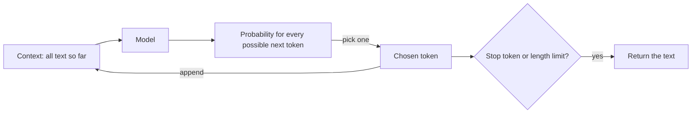
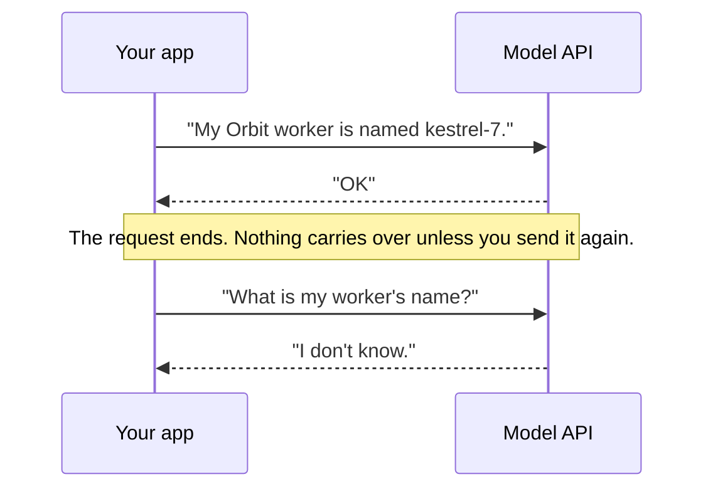
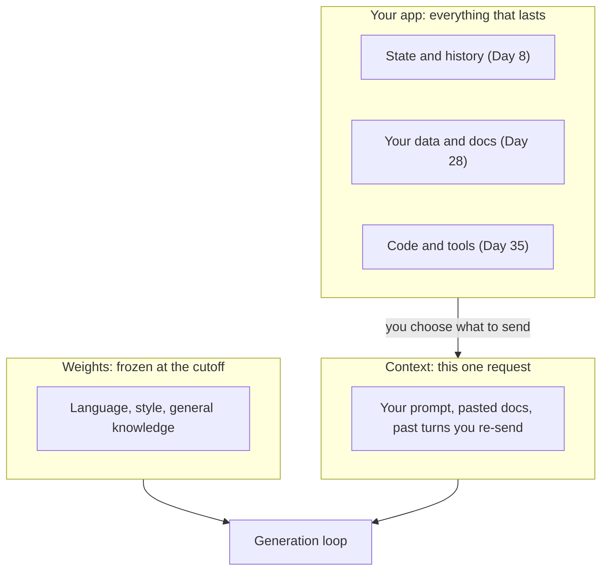

# What an LLM Is (and Isn't)

Ask a model what Orbit error ORB-1101 means and it may give you a fluent, confident answer. But
Orbit is fictional, and the model has never seen its docs. Most beginner bugs come from a wrong
mental model of what an LLM is: people expect it to know facts, give the same answer twice, or
remember the last request. Today you build the right mental model, plus a probe script that shows
each of those limits on a real model.

## At a Glance

- **Time:** ~2 h core (+ optional Go Deeper) · **Depth:** intro
- **Prerequisites:** [Day 2: Setup & Your First LLM Call](../../Phase_0_Start_Here/Day_002_setup_first_call/setup_first_call.md),
  primer [Model Words: Parameters, Training & Inference](../../Appendix_Primers/A11a_model_words.md)
- **You'll build:** a probe harness that tests a model for non-determinism, a knowledge cutoff,
  confident wrong answers and statelessness, plus a checklist that sorts tasks into "good fit",
  "needs help" and "poor fit"
- **Stops at:** training math; model architecture ([Day 5](../../Phase_1_How_LLMs_Work/Day_005_transformers_attention/transformers_attention.md))
- **Fast path:** Already shipped an LLM feature? Read §Probes 2–4 and §What LLMs Are Good and Bad
  At, run `probe_harness`, then do Exercise 1 (about 30 min).
- **Cost:** < $0.01 on `gpt-6-luna`, about 15 short calls in total (prices as of 2026-11,
  [verify](https://developers.openai.com/api/docs/pricing)). No key? Read the shown outputs; the
  offline scripts and the stretch exercise still run.
- **New terms:** next-token prediction, pretraining, post-training, hallucination, knowledge cutoff

> **Coming from Software Engineering?** Treat an LLM call as a stateless service running over a
> frozen build artifact: `generate(context) -> text`. The weights are a lossy, compressed snapshot
> of the training data, frozen at a cutoff date, like a binary built from last year's source tree.
> Nothing persists between requests; as with a stateless HTTP handler, session state lives in your
> app and you send it every time. The output is sampled, so treat it like a randomized algorithm:
> test properties, not exact strings. What transfers directly: input validation, ground-truth
> checks and "trust, then verify".

## The Confident Wrong Answer

Here is the question Atlas will hear on its first day: "What does ORB-1101 mean in Orbit?" Orbit's
docs have the answer in `docs/error-codes.md`:

> **ORB-1101 LeaseExpired.** A job outlived its lease, so it may run twice.

A model that has never read those docs can still produce something like "ORB-1101 indicates a
broker authentication failure; check your credentials." It reads well, it is formatted like a real
answer, and it is wrong. Newer models often say "I'm not familiar with that code" instead, which is
the safe outcome. You can't tell in advance which one you'll get, and the reason is in how the
model produces text at all.

## A Very Well-Read Autocomplete

Your phone keyboard suggests the next word as you type. After "see you", it offers "tomorrow" or
"soon", because those words often follow "see you" in the messages it has learned from. It has no
idea whether you'll actually meet tomorrow.

A large language model (LLM) is that same idea scaled up enormously. Instead of your messages, it
learned from a large share of the public web, books and code. Instead of three suggestions, it
weighs every token in its vocabulary (a **token** is a word or word piece; [Day 4](../../Phase_1_How_LLMs_Work/Day_004_tokens/tokens.md)
covers them). The **parameters**, or **weights**, are the billions of numbers it learned during
training; the primer [Model Words](../../Appendix_Primers/A11a_model_words.md) explains them
without math.

So the plain-language version is this: **an LLM is an extremely well-read autocomplete. It
continues text in the most plausible way, which is often, but not always, true.** Keep that
sentence in mind; every limit you probe today follows from it.

## Predicting One Token at a Time, by Hand

The core mechanism is **next-token prediction**: given all the text so far (the **context**), the
model outputs a probability for every possible next token. Then something picks one, appends it,
and the loop repeats until the model emits a special stop token (its way of saying "done") or hits
a length limit.

Let's do three steps by hand. The context is `Orbit retries failed jobs with exponential`. A
model might score the next token like this (toy numbers):

| Next token | Probability |
|---|---|
| `backoff` | 0.62 |
| `delay` | 0.18 |
| `retries` | 0.09 |
| everything else | 0.11 |

Pick the top one, `backoff`, and append it. Now the context is `… exponential backoff` and the
model scores again: `and` 0.41, `.` 0.33. Pick `and`. Score again: `jitter` 0.48, `a` 0.30. Pick
`jitter`. After three steps, you have `Orbit retries failed jobs with exponential backoff and
jitter`.

That sentence happens to be true: Orbit's `docs/retries-and-backoff.md` describes exponential
backoff with jitter. But nothing in the loop checked the docs. `jitter` won because it often
follows `backoff and` in text about retries. Here is the loop as a picture:



The same loop in code, with a hand-made table standing in for the model:

```python
# script_id: day_003_what_is_an_llm/toy_next_token
# Install: nothing (stdlib only). Env: none. Runs offline.
# A hand-made "model": for each context, the probability of some next words.
# A real model computes this distribution fresh at every step, over its whole vocabulary.
TOY_MODEL: dict[str, dict[str, float]] = {
    "Orbit retries failed jobs with exponential":
        {"backoff": 0.62, "delay": 0.18, "retries": 0.09},
    "Orbit retries failed jobs with exponential backoff":
        {"and": 0.41, ".": 0.33, "until": 0.06},
    "Orbit retries failed jobs with exponential backoff and":
        {"jitter": 0.48, "a": 0.30, "logs": 0.12},
}
STOP = "<stop>"


def next_token(context: str) -> str:
    """Pick the most likely next token. Day 6 shows the other ways to pick."""
    dist = TOY_MODEL.get(context)
    if dist is None:  # the toy only knows 3 contexts; a real model never runs out
        return STOP
    return max(dist, key=dist.get)


def generate(prompt: str, max_steps: int = 5) -> str:
    text = prompt
    for step in range(1, max_steps + 1):
        token = next_token(text)
        if token == STOP:
            break
        print(f"step {step}: picked {token!r} from {TOY_MODEL[text]}")
        text = f"{text} {token}"
    return text


print(generate("Orbit retries failed jobs with exponential"))
```

```text
step 1: picked 'backoff' from {'backoff': 0.62, 'delay': 0.18, 'retries': 0.09}
step 2: picked 'and' from {'and': 0.41, '.': 0.33, 'until': 0.06}
step 3: picked 'jitter' from {'jitter': 0.48, 'a': 0.3, 'logs': 0.12}
Orbit retries failed jobs with exponential backoff and jitter
```

Two details matter later. First, the toy always takes the top token; real APIs usually *sample*,
so a less likely token sometimes wins. How the pick is made is
[Day 6](../../Phase_1_How_LLMs_Work/Day_006_sampling_reasoning_effort/sampling_reasoning_effort.md)'s
topic; today you only observe its effect. Second, the model never "looks up" anything. It only
scores continuations, and the knowledge it seems to have lives in those scores.

## How Models Are Made: Pretraining, Then Post-Training

Where do the scores come from? Model labs build a model in two broad stages.

**Pretraining** is next-token prediction on a huge text collection. The model reads a passage,
predicts each next token, and its weights are nudged a little toward whatever actually came next.
Repeat that across trillions of tokens and you get a **base model**: fluent and very well-read,
but it only continues text. Ask a base model a question and it may continue with three more
questions, because that's what often follows a question on the web.

**Post-training** turns the base model into an assistant. It trains on example conversations
(instruction, then a good answer) and on **preference feedback**: people or other models rate
candidate answers, and training nudges the model toward the preferred ones. The result is an
**instruct** (assistant) model that answers the question you asked, follows formats and declines
some requests. That is the kind of model you call through an API.


Two consequences follow, and they explain most surprises.

1. **Knowledge is frozen.** The training data stops at a date called the **knowledge cutoff**.
   For `gpt-6-luna` it is 2026-05-18 (as of 2026-11, [verify on its model page](https://developers.openai.com/api/docs/models/gpt-6-luna)).
   Anything that happened later (a library release, a price change, today's date) isn't in the
   weights. Your calls don't update the weights either: using a model teaches it nothing.
2. **Fluent is not the same as true.** Training rewarded plausible continuations. Post-training
   rewards helpful-sounding answers. Neither stage checks every claim against a source. When the
   model lacks the fact, the most plausible continuation can be a made-up one. That is a
   **hallucination**: output that is fluent and confident but not supported by any source.

This is why a model is fluent but isn't a database. A database returns the stored row or nothing.
A model returns the most plausible text, whether or not it ever saw the fact.

## Probe 1: Same Prompt, Different Answers

Time to test the mental model on a real model. Each probe below is a small, standalone script, so
you can run any one of them on its own. They share a three-line `complete()` helper: a preview of
the one you build properly on
[Day 12](../../Phase_2_Building_with_LLM_APIs/Day_012_openai_sdk_production/openai_sdk_production.md).
It returns the full `Response`, and the probes read only `.output_text`, the reply as one string.

The first probe sends the same naming request three times:

```python
# script_id: day_003_what_is_an_llm/probe_variation
# Install: uv add "openai>=3.46,<4" python-dotenv
# Env:     OPENAI_API_KEY in .env (Day 2); optional ATLAS_MODEL. Cost: 3 short calls.
import os

from dotenv import load_dotenv
from openai import OpenAI
from openai.types.responses import Response

load_dotenv()  # reads .env, as on Day 2
MODEL = os.environ.get("ATLAS_MODEL", "gpt-6-luna")
client = OpenAI()


def complete(input: str | list, *, model: str = MODEL, **kwargs) -> Response:
    # preview of atlas/llm.py complete(), built properly on Day 12
    return client.responses.create(model=model, input=input, **kwargs)


PROMPT = ("Suggest a one-word name for a feature that raises the priority of jobs "
          "that have waited too long. Reply with the word only.")
for i in range(1, 4):
    print(i, complete(PROMPT).output_text.strip())
```

```text
1 Ripen
2 Escalate
3 Ripen
```

*Illustrative output: your words will differ, and you may get three different ones.*

Nothing is broken. At each step the model has a distribution over next tokens and one is picked
from it, so two runs can split at the very first token and never meet again. For your code, this
means a test like `assert reply == "Ripen"` will fail at random. Tests check properties instead
(one word? from an allowed list?), which [Day 19](../../Phase_2_Building_with_LLM_APIs/Day_019_testing_llm_code/testing_llm_code.md)
and [Day 20](../../Phase_2_Building_with_LLM_APIs/Day_020_first_eval_set/first_eval_set.md) build on.

## Probes 2–4: Cutoff, Hallucination, No Memory

Now break the three assumptions beginners make most: that the model knows recent facts, knows your
private facts, and remembers you.

**Probe 2: the knowledge cutoff.** Ask for the latest version of a package, then compare with the
version installed on your machine:

```python
# script_id: day_003_what_is_an_llm/probe_cutoff
# Install: uv add "openai>=3.46,<4" python-dotenv
# Env:     OPENAI_API_KEY in .env (Day 2). Cost: 1 short call.
import os
from importlib.metadata import version

from dotenv import load_dotenv
from openai import OpenAI

load_dotenv()
MODEL = os.environ.get("ATLAS_MODEL", "gpt-6-luna")
client = OpenAI()

installed = version("openai")  # ground truth from your own environment
reply = client.responses.create(
    model=MODEL,
    input="What is the latest released version of the openai Python package? Version number only.",
).output_text.strip()
print(f"model says: {reply}")
print(f"installed:  {installed}")
print("same" if installed in reply else "different: the answer stops at the knowledge cutoff")
```

```text
model says: 2.x.y        <- an older release; the exact number varies by run and model
installed:  3.46.0
different: the answer stops at the knowledge cutoff
```

*Illustrative output.* openai 3.0.0 shipped on 2026-08-12, after Luna's 2026-05-18 cutoff, so the
model can't know about it. It isn't lying; that data never reached it. The fix is to put fresh
facts in the prompt yourself. Don't ask the model for its own cutoff either: its self-report is
unreliable, so read the provider's model page.

**Probe 3: a confident wrong answer.** Ask about the fictional error code, and ask for a docs
link, which is a common way to trigger an invented URL. The script prints the real docs section
next to the reply, and copes with a missing dataset:

```python
# script_id: day_003_what_is_an_llm/probe_hallucination
# Install: uv add "openai>=3.46,<4" python-dotenv
# Env:     OPENAI_API_KEY in .env; ORBIT_DATA = Orbit dataset folder (Day 2). Cost: 1 call.
import os
from pathlib import Path

from dotenv import load_dotenv
from openai import OpenAI

load_dotenv()
MODEL = os.environ.get("ATLAS_MODEL", "gpt-6-luna")
DATA_DIR = Path(os.environ.get("ORBIT_DATA", "datasets/orbit"))
client = OpenAI()

question = ("In the Orbit Python background-jobs library, what does error ORB-1101 mean? "
            "Answer in two sentences and include the URL of the docs page.")
print("MODEL SAYS:\n" + client.responses.create(model=MODEL, input=question).output_text)

truth_file = DATA_DIR / "docs" / "error-codes.md"
if truth_file.exists():
    text = truth_file.read_text(encoding="utf-8")
    start = text.find("### ORB-1101")
    print("\nDOCS SAY:\n" + text[start : text.find("\n### ", start + 1)].strip())
else:
    print(f"\n(no ground truth: {truth_file} not found; set ORBIT_DATA, see Day 2)")
```

```text
MODEL SAYS:
ORB-1101 is raised when a worker cannot authenticate with the broker. Check your
credentials and see https://docs.orbit.example.org/errors#orb-1101.

DOCS SAY:
### ORB-1101 LeaseExpired
**Cause:** A job outlived its lease, so it may run twice. **Fix:** Make sure heartbeats can renew
the lease (`[worker] heartbeat_seconds`), or raise `[worker] lease_seconds` for long jobs. On 2.x,
use `ORBIT_LEASE`. See [troubleshooting-duplicates.md](troubleshooting-duplicates.md).
```

*Illustrative "MODEL SAYS" output; the URL is invented, which is the point (we show it on a reserved example domain so nobody clicks a real site). The "DOCS SAY" part is
the real file.* If your model replies "I'm not familiar with ORB-1101", that's a good result:
declining beats inventing. Results vary by model, and newer models hedge more often.

**Probe 4: no memory between calls.** Tell the model a fact in one call, then ask for it in the
next:

```python
# script_id: day_003_what_is_an_llm/probe_memory
# Install: uv add "openai>=3.46,<4" python-dotenv
# Env:     OPENAI_API_KEY in .env (Day 2). Cost: 2 short calls.
import os

from dotenv import load_dotenv
from openai import OpenAI

load_dotenv()
MODEL = os.environ.get("ATLAS_MODEL", "gpt-6-luna")
client = OpenAI()

first = client.responses.create(model=MODEL, input="My Orbit worker is named kestrel-7. Reply OK.")
second = client.responses.create(
    model=MODEL, input="What is my Orbit worker's name? If you don't know, say so.")
print("call 1:", first.output_text.strip())
print("call 2:", second.output_text.strip())
print("remembered" if "kestrel-7" in second.output_text else "forgot: nothing carried over")
```

```text
call 1: OK
call 2: I don't know your worker's name; you haven't told me in this conversation.
forgot: nothing carried over
```

*Illustrative output.* Each call is a fresh run of the generation loop over exactly the text you
sent. Chat apps feel like they remember because the app re-sends the whole conversation every
turn. Doing that yourself is
[Day 8](../../Phase_2_Building_with_LLM_APIs/Day_008_messages_and_state/messages_and_state.md)'s
topic.



One trap: the Responses API stores each response on the server by default (`store` defaults to
true, kept for 30 days). That's a log you can fetch later, not memory. A new call sees an earlier
one only if you link them explicitly, which Day 8 covers.

## A Reusable Probe Harness

Four separate scripts are fine for learning. When a new model comes out, though, you want one
command that re-runs every probe and prints a table. The harness below turns each probe into data:
a `Probe` has a name, a prompt, a check function and a run count. The check gets the answers and
returns a short verdict. Adding a probe means adding one line, not writing another script.

```python
# script_id: day_003_what_is_an_llm/probe_harness
# Install: uv add "openai>=3.46,<4" python-dotenv
# Env:     OPENAI_API_KEY in .env; ORBIT_DATA = Orbit dataset folder (Day 2). Cost: 7 short calls.
import os
from datetime import date
from importlib.metadata import version
from pathlib import Path
from typing import Callable, NamedTuple

import openai
from dotenv import load_dotenv
from openai import OpenAI
from openai.types.responses import Response

load_dotenv()
MODEL = os.environ.get("ATLAS_MODEL", "gpt-6-luna")
DATA_DIR = Path(os.environ.get("ORBIT_DATA", "datasets/orbit"))
client = OpenAI()


def complete(input: str | list, *, model: str = MODEL, **kwargs) -> Response:
    # preview of atlas/llm.py complete(), built properly on Day 12
    return client.responses.create(model=model, input=input, **kwargs)


class Probe(NamedTuple):
    name: str
    prompt: str
    check: Callable[[list[str]], str]  # all answers -> a short verdict
    runs: int = 1


HEDGES = ("don't know", "not aware", "not familiar", "no information", "can't find", "unable to")


def declined(text: str) -> bool:
    # Models often use a curly apostrophe; normalize it before matching.
    return any(h in text.lower().replace("’", "'") for h in HEDGES)
```

The ORB-1101 check needs ground truth. It reads Orbit's docs offline, and if the dataset is
missing it prints a hint and carries on instead of crashing:

```python
# script_id: day_003_what_is_an_llm/probe_harness
def orb_truth() -> str | None:
    """The ORB-1101 section of Orbit's docs, or None if the dataset isn't there."""
    path = DATA_DIR / "docs" / "error-codes.md"
    if not path.exists():
        print(f"hint: {path} not found. Set ORBIT_DATA to the Orbit dataset folder (Day 2).")
        return None
    text = path.read_text(encoding="utf-8")
    start = text.find("### ORB-1101")
    return text[start : text.find("\n### ", start + 1)] if start >= 0 else None


TRUTH = orb_truth()


def check_orb(answers: list[str]) -> str:
    answer = answers[0].lower()
    if declined(answer):
        return "declined (safe)"
    if TRUTH is None:
        return "answered; no docs to compare"
    return "matches docs: check by hand" if "lease" in answer else "invented an answer"


def check_url(answers: list[str]) -> str:
    if declined(answers[0]):
        return "declined (safe)"
    return "invented a URL" if "http" in answers[0] else "no URL given"
```

Now the probe table and the runner. One failing call (a timeout, a rate limit) prints `ERROR` for
that row and the rest still run:

```python
# script_id: day_003_what_is_an_llm/probe_harness
PROBES = [
    Probe("variation", "Suggest a one-word name for a feature that raises the priority of jobs "
          "that have waited too long. Reply with the word only.",
          lambda a: f"{len({x.lower() for x in a})} distinct of {len(a)}", runs=3),
    Probe("cutoff", "What is the latest released version of the openai Python package? "
          "Version number only.",
          lambda a: "matches installed" if version("openai") in a[0]
          else f"stale (installed {version('openai')})"),
    Probe("today", "What is today's date? Reply as YYYY-MM-DD only.",
          lambda a: "correct" if date.today().isoformat() in a[0] else "wrong or unknown"),
    Probe("orb_meaning", "In the Orbit Python background-jobs library, what does error "
          "ORB-1101 mean? Two sentences.", check_orb),
    Probe("orb_url", "Give the URL of the Orbit background-jobs library's docs page about "
          "leases. URL only.", check_url),
]


def run(probes: list[Probe]) -> None:
    print(f"model: {MODEL}\n{'probe':<12} {'verdict':<30} first answer")
    for p in probes:
        try:
            answers = [complete(p.prompt).output_text.strip() for _ in range(p.runs)]
        except openai.APIError as err:  # keep going: one bad call shouldn't hide the rest
            print(f"{p.name:<12} {'ERROR':<30} {type(err).__name__}")
            continue
        first = answers[0].replace("\n", " ")[:45]
        print(f"{p.name:<12} {p.check(answers):<30} {first}")


if __name__ == "__main__":
    run(PROBES)
```

```text
model: gpt-6-luna
probe        verdict                        first answer
variation    2 distinct of 3                Ripen
cutoff       stale (installed 3.46.0)       2.x.y
today        wrong or unknown               I don't have access to today's date...
orb_meaning  invented an answer             ORB-1101 is a broker authentication error...
orb_url      declined (safe)                I'm not aware of an official docs page fo...
```

*Illustrative output: your verdicts will differ by run and by model.* Two notes on reading it.
First, the checks are crude string matches, and that's fine for a probe; you'll build real
graders on [Day 20](../../Phase_2_Building_with_LLM_APIs/Day_020_first_eval_set/first_eval_set.md).
Second, "declined (safe)" is a good result, not a failure. Re-run the harness whenever you change
`ATLAS_MODEL`: different models fail in different places.

## What LLMs Are Good and Bad At

Everything above points to one picture of where each kind of information lives:



Recall that the **context** is all the text you send in one request. It's the only way to give the model
anything the weights don't have. That leads to a practical sorting rule:

| Fit | Tasks | Why |
|---|---|---|
| **Good fit** | rewrite, summarize, extract from text you provide, classify, draft code, translate | The answer depends on language skill and on text in the context |
| **Needs help** | fresh or private facts → retrieval ([Day 28](../../Phase_3_RAG/Day_028_rag_pipeline/rag_pipeline.md)); guaranteed format → structured outputs ([Day 16](../../Phase_2_Building_with_LLM_APIs/Day_016_structured_outputs/structured_outputs.md)); memory → your app ([Day 8](../../Phase_2_Building_with_LLM_APIs/Day_008_messages_and_state/messages_and_state.md)) | The weights lack the fact, or the output needs a guarantee |
| **Poor fit** | exact math, counting, aggregates over data, anything that must be correct every time without checking | Code gets it right every time; the model is guessing plausibly. Let code compute it, or give the model a tool ([Day 35](../../Phase_4_Tools_and_MCP/Day_035_function_calling/function_calling.md)) |

The same rule as a small checklist you can run on your own task list:

```python
# script_id: day_003_what_is_an_llm/fit_checklist
# Install: nothing (stdlib only). Env: none. Runs offline.
# Each "need" maps to the help a bare LLM call requires.
CHECKLIST = {
    "fresh_or_private_facts": "retrieval: put the source text in the prompt (Day 28)",
    "guaranteed_format": "structured outputs plus validation (Day 16)",
    "remembers_past_turns": "keep the history in your app and re-send it (Day 8)",
    "exact_computation": "compute it in code, or give the model a tool (Day 35)",
}


def assess(task: str, **needs: bool) -> str:
    unknown = set(needs) - set(CHECKLIST)
    if unknown:  # catch typos in need names instead of silently ignoring them
        raise ValueError(f"unknown need(s): {sorted(unknown)}")
    wanted = [k for k, v in needs.items() if v]
    if not wanted:
        return f"GOOD FIT    {task}"
    if wanted == ["exact_computation"]:
        return f"POOR FIT    {task}\n            -> {CHECKLIST['exact_computation']}"
    fixes = "\n".join(f"            -> {CHECKLIST[k]}" for k in wanted)
    return f"NEEDS HELP  {task}\n{fixes}"


TASKS: dict[str, dict[str, bool]] = {
    "Summarize a long issue thread": {},
    "Count open issues per label": {"exact_computation": True},
    "Answer 'what changed in Orbit 3.2.1?'": {"fresh_or_private_facts": True},
    "Extract component and severity into our DB": {"guaranteed_format": True},
}
for task, needs in TASKS.items():
    print(assess(task, **needs))
```

```text
GOOD FIT    Summarize a long issue thread
POOR FIT    Count open issues per label
            -> compute it in code, or give the model a tool (Day 35)
NEEDS HELP  Answer 'what changed in Orbit 3.2.1?'
            -> retrieval: put the source text in the prompt (Day 28)
NEEDS HELP  Extract component and severity into our DB
            -> structured outputs plus validation (Day 16)
```

"Good fit" doesn't mean "trust blindly". Even a summary can drop a key detail, which is why every
Atlas feature gets an eval.

### In production

- Teams **ground** answers in retrieved documents instead of trusting the weights for facts (Day 28).
- They **validate** output against a schema and reject what doesn't parse (Day 16).
- They **evaluate** on a fixed set of examples before every change ships (Day 20).
- They keep **state in the app**, never in the model (Day 8).
- They re-run probes like today's when switching models, because limits differ between models.

## Go Deeper (optional)

<details><summary>Go deeper: why "plausible" and "true" come apart</summary>

The generation loop is called **autoregressive**: each output token becomes part of the input for
the next one. Two things follow from training on "predict the next token".

First, the model learns what text *usually* says, weighted by how often it says it. If old blog
posts repeat a stale fact ten times and the current docs state the new fact once, the stale one
can win. Here is that effect in miniature, on an invented toy corpus (these are not Orbit's real
defaults):

```python
# script_id: day_003_what_is_an_llm/frequency_vs_truth
# Install: nothing (stdlib only). Env: none. Runs offline.
from collections import Counter

# Toy corpus: three old posts and one current doc page. Numbers are invented.
CORPUS = [
    "the default lease is 60 seconds",   # old blog post
    "the default lease is 60 seconds",   # copy of the old post
    "the default lease is 60 seconds",   # forum answer quoting it
    "the default lease is 300 seconds",  # current docs (the true one)
]
PREFIX = "the default lease is"
counts = Counter(line.removeprefix(PREFIX).split()[0] for line in CORPUS if line.startswith(PREFIX))
total = sum(counts.values())
for word, n in counts.most_common():
    print(f"{PREFIX} {word!r}: p = {n / total:.2f}")
print("most plausible:", counts.most_common(1)[0][0], "(the stale value)")
```

```text
the default lease is '60': p = 0.75
the default lease is '300': p = 0.25
most plausible: 60 (the stale value)
```

Real models are far richer than counting, and post-training pushes them to prefer reliable
sources and to hedge. But the pull toward "what text usually says" never disappears.

Second, the loop has no "I'm unsure" state built in. It always produces some next token. Saying
"I don't know" is itself a continuation that post-training made more likely in the right
situations. That's why hedging varies so much between models and prompts.

</details>

<details><summary>Go deeper: base models vs instruct models</summary>

A base model given `Q: What does ORB-1101 mean?\nA:` continues the pattern. It might write an
answer, then `Q: What does ORB-1102 mean?` and keep going, because FAQ pages look like that. It
has no idea it is meant to answer once and stop.

Post-training adds that behaviour. Instruction examples teach the "user asks, assistant answers,
then stops" shape. Preference feedback teaches which of several answers people prefer: clearer,
safer, better formatted. The model's knowledge comes mostly from pretraining, while its manners
come mostly from post-training. That's why prompting ([Day 9](../../Phase_2_Building_with_LLM_APIs/Day_009_effective_prompts/effective_prompts.md)) changes behaviour a lot but can't
add knowledge the weights lack.

Some providers publish base models of open-weight families (models whose weights you can download), and you'll run open-weight models in
[Day 91](../../Phase_10_Open_Models_and_Fine_Tuning/Day_091_open_weight_local/open_weight_local.md).
For API work you'll almost always call an instruct model.

</details>

<details><summary>Go deeper: what the API stores, and what it doesn't</summary>

Statelessness is about the *model*: the generation loop only sees the context you send. The API
*service* can still keep records. On the Responses API, `store` defaults to true, and stored
responses are kept for 30 days ([conversation state guide](https://developers.openai.com/api/docs/guides/conversation-state)).
A stored response doesn't change later calls unless you link them explicitly. Two ways to link
them (manual history and server-side chaining) are Day 8's subject, along with their billing:
earlier tokens are billed again as input on every turn.

If you handle sensitive data, you'll often want `store=False`. The privacy side of that, and what
retention means for your users, is owned by
[Day 73](../../Phase_8_Safety_and_Security/Day_073_privacy_pii/privacy_pii.md).

</details>

<details><summary>Go deeper: what experienced teams also do</summary>

- **Probe every candidate model.** Before adopting a model, teams run a probe set like today's,
  plus their own domain questions. It takes minutes and shows where the model invents facts.
- **Keep the probes in version control.** Today's `PROBES` list is the seed of an eval set. On
  Day 20 you replace the crude string checks with graded examples.
- **Separate "knows" from "can read".** A model that fails ORB-1101 cold often answers it
  perfectly once the docs section is in the prompt (Exercise 3). That gap tells you retrieval
  will pay off.
- **Never ask the model about itself.** Its cutoff, its context size and its price come from the
  provider's docs, not from a reply.

</details>

## Common Pitfalls

- **Treating fluent output as fact.** *Symptom:* Atlas explains ORB-1101 confidently and wrongly.
  *Cause:* the weights never held Orbit's docs. *Fix:* put the source in the prompt (Day 28) and
  check answers against it.
- **Expecting memory across calls.** *Symptom:* the second call doesn't know the worker name.
  *Cause:* each call only sees what you sent. *Fix:* keep history in your app and re-send it
  (Day 8). `store` keeps a server-side record, not memory.
- **Asserting exact strings in tests.** *Symptom:* a test passes, then fails with no code change.
  *Cause:* output is sampled. *Fix:* assert properties such as format or allowed values (Day 19).
- **Asking for "today" or "the latest version".** *Symptom:* a stale version or a wrong date.
  *Cause:* the knowledge cutoff, and the model has no clock. *Fix:* put the date and facts in the
  prompt.
- **No API key.** *Symptom:* `OpenAI()` raises `openai.OpenAIError: Missing credentials. Please
  pass an ...`, and the message goes on to list `OPENAI_API_KEY`. *Cause:*
  `.env` wasn't loaded or is missing the key. *Fix:* re-check Day 2's `.env` setup and
  `load_dotenv()`.

> **Where we stop:** we don't cover training math or how the model computes its scores; the
> architecture is [Day 5](../../Phase_1_How_LLMs_Work/Day_005_transformers_attention/transformers_attention.md),
> and the curious can watch [3Blue1Brown's lesson on GPT](https://www.3blue1brown.com/lessons/gpt).

## Key Takeaways

- An LLM generates text by repeating one step: score every possible next token, pick one, append
  it, until a stop token or a length limit.
- Pretraining gives fluency and broad knowledge frozen at a cutoff; post-training turns a base
  model into an assistant. Neither stage makes it a database of checked facts.
- Hallucinations are the plausible continuation winning when the fact is missing. Fix them with
  sources in the context and checks against ground truth, not by asking the model to be careful.
- Every call is stateless and sampled: send everything the model needs every time, and test
  properties rather than exact strings.
- Sort each task as good fit, needs help (retrieval, structured outputs, app state) or poor fit
  (use code or a tool), and re-probe whenever you change models.

## Quick Reference

| Concept / API | What it means | When it matters | Gotcha |
|---|---|---|---|
| Next-token prediction | Score next tokens, pick, append, repeat | Every call | The pick is sampled (Day 6) |
| Knowledge cutoff | Training data ends at a date (Luna: 2026-05-18) | Versions, dates, news | Read it from the model page, not the model |
| Hallucination | Fluent output with no supporting source | Private or rare facts, URLs | "I don't know" is the safe outcome |
| Statelessness | A call sees only what you send | Chat, multi-step flows | `store` is a log, not memory |
| `client.responses.create(model=, input=)` | One generation call | Every probe | Read `.output_text`, not `output[0]` |
| `importlib.metadata.version(pkg)` | Installed package version | Ground truth for cutoff probes | Raises `PackageNotFoundError` if absent |

## Exercises

1. **Warm-up: finish the fit table.** Add five more Atlas tasks to `TASKS` in `fit_checklist`,
   with the needs you think each one has: find duplicate issues, compute p95 job latency, draft a
   reply to an issue, spot ORB codes in a log file, translate a Spanish issue. Run it and check
   whether you agree with each verdict.
2. **Core: constrain the choice.** Run the variation prompt five times and count the distinct
   answers. Then restrict it to "one word from this list: […]" and count again. Does the
   constraint make the output deterministic?
3. **Core: ground the answer.** Paste the ORB-1101 section of `docs/error-codes.md` into the
   prompt and ask again. Compare with Probe 3. This is a preview of retrieval-augmented
   generation (RAG), which you build on Day 28.
4. **Stretch (optional, offline, past today's stop line):** in ≤20 lines of stdlib Python, build
   a bigram next-word predictor over Orbit's `docs/*.md` (for each word, record which words
   followed it) and generate 30 words. Why is the result fluent in places but meaningless overall?

<details><summary>Solution</summary>

Replace `TASKS` in `fit_checklist` with this, then re-run the script:

```python
# script_id: day_003_what_is_an_llm/solution_ex1
# fragment
TASKS: dict[str, dict[str, bool]] = {
    "Summarize a long issue thread": {},
    "Count open issues per label": {"exact_computation": True},
    "Answer 'what changed in Orbit 3.2.1?'": {"fresh_or_private_facts": True},
    "Extract component and severity into our DB": {"guaranteed_format": True},
    "Find duplicate issues": {"fresh_or_private_facts": True},  # the issues must be in context
    "Compute p95 job latency": {"exact_computation": True},
    "Draft a reply to an issue": {},
    "Spot ORB codes in a log file": {"exact_computation": True},  # a regex does it exactly
    "Translate a Spanish issue": {},
}
```

The debatable one is "find duplicates". An LLM can judge whether two issues match, but it can't
see 240 issues it was never given, so it needs them in the context. On Day 23 you'll use
embeddings (numeric vectors that capture meaning) to find candidates first. "Spot ORB codes" is
a poor fit because `re.findall(r"ORB-\d{4}", log)` is exact, free and instant.

</details>

<details><summary>Solution</summary>

```python
# script_id: day_003_what_is_an_llm/solution_ex2
# Install: uv add "openai>=3.46,<4" python-dotenv · Env: OPENAI_API_KEY · Cost: 10 short calls.
import os
from collections import Counter

from dotenv import load_dotenv
from openai import OpenAI

load_dotenv()
MODEL = os.environ.get("ATLAS_MODEL", "gpt-6-luna")
client = OpenAI()

TASK = "Suggest a one-word name for a feature that raises the priority of jobs that have waited too long."
CHOICES = ["Ripen", "Escalate", "Boost", "Age", "Promote"]
PROMPTS = {
    "open": f"{TASK} Reply with the word only.",
    "constrained": f"{TASK} Choose exactly one word from this list: {', '.join(CHOICES)}. "
                   "Reply with the word only.",
}


def tally(prompt: str, n: int = 5) -> Counter:
    return Counter(client.responses.create(model=MODEL, input=prompt).output_text.strip(" .\n")
                   for _ in range(n))


for label, prompt in PROMPTS.items():
    counts = tally(prompt)
    off_list = [w for w in counts if w not in CHOICES]
    print(f"{label:<12} {len(counts)} distinct {dict(counts)}  off-list: {off_list}")
```

```text
open         4 distinct {'Ripen': 2, 'Escalate': 1, 'Boost': 1, 'Uplift': 1}  off-list: ['Uplift']
constrained  2 distinct {'Escalate': 4, 'Promote': 1}  off-list: []
```

*Illustrative output.* The constraint cuts the variety, but it doesn't guarantee one answer, and
it doesn't guarantee the model stays on the list either. That's why the code checks `off_list`.
Guaranteed formats come with structured outputs on Day 16.

</details>

<details><summary>Solution</summary>

```python
# script_id: day_003_what_is_an_llm/solution_ex3
# Install: uv add "openai>=3.46,<4" python-dotenv
# Env:     OPENAI_API_KEY; ORBIT_DATA = Orbit dataset folder (Day 2). Cost: 1 call.
import os
from pathlib import Path

from dotenv import load_dotenv
from openai import OpenAI

load_dotenv()
MODEL = os.environ.get("ATLAS_MODEL", "gpt-6-luna")
DATA_DIR = Path(os.environ.get("ORBIT_DATA", "datasets/orbit"))
client = OpenAI()

path = DATA_DIR / "docs" / "error-codes.md"
if not path.exists():
    raise SystemExit(f"{path} not found; set ORBIT_DATA to the Orbit dataset folder (Day 2).")
text = path.read_text(encoding="utf-8")
start = text.find("### ORB-1101")
section = text[start : text.find("\n### ", start + 1)]

prompt = ("Answer using only the documentation below. If it doesn't contain the answer, say so.\n\n"
          f"<docs>\n{section}\n</docs>\n\n"
          "Question: In Orbit, what does error ORB-1101 mean, and how do I fix it?")
answer = client.responses.create(model=MODEL, input=prompt).output_text
print(answer)
print("\nmentions the lease: grounded" if "lease" in answer.lower() else "\ncheck by hand")
```

```text
ORB-1101 (LeaseExpired) means a job ran longer than its lease, so it may run twice. Make
sure heartbeats can renew the lease via [worker] heartbeat_seconds, or raise
[worker] lease_seconds for long jobs (ORBIT_LEASE on 2.x).

mentions the lease: grounded
```

*Illustrative output.* Same model, same question, a correct answer: the model was never missing
the *ability*, only the *fact*. Retrieval automates this step: find the right section and paste
it in.

</details>

<details><summary>Solution</summary>

```python
# script_id: day_003_what_is_an_llm/solution_ex4
# Install: nothing (stdlib only). Env: ORBIT_DATA (Day 2). Runs offline.
import os
import random
from collections import defaultdict
from pathlib import Path

DATA_DIR = Path(os.environ.get("ORBIT_DATA", "datasets/orbit"))
pages = sorted((DATA_DIR / "docs").glob("*.md"))
words = " ".join(p.read_text(encoding="utf-8") for p in pages).split()
if not words:
    raise SystemExit(f"No docs under {DATA_DIR / 'docs'}; set ORBIT_DATA (Day 2).")

following: dict[str, list[str]] = defaultdict(list)
for a, b in zip(words, words[1:]):
    following[a].append(b)  # keep duplicates: frequency becomes probability

rng = random.Random(3)  # fixed seed for a repeatable run; change it to see variation
word, out = "Orbit", ["Orbit"]
for _ in range(29):
    word = rng.choice(following[word] or words)  # dead end: restart from a random word
    out.append(word)
print(" ".join(out))
```

*Your real output with seed 3 on the course dataset; a different seed gives different words.*

```text
Orbit reads `orbit.toml` (ORB-1802) stops claiming new run state -> comp:broker-* retries/ results/ observability/ auth/ dashboard/ # Everything else; can be blocked** (case 2), not repeat side effects idempotent Guard
```

Each pair of neighbouring words is locally plausible, because every pair really occurred in the
docs. But the predictor sees only one word of context, so it can't hold a topic. LLMs follow the
same "predict what comes next" objective with thousands of tokens of context and billions of
parameters, which is why they stay on topic, and also why they're still optimizing for
plausible, not true.

</details>

## References & Further Reading

- [OpenAI: Text generation](https://developers.openai.com/api/docs/guides/text): the official
  guide to `responses.create`, `output_text` and why `output` can hold several items.
- [OpenAI: gpt-6-luna model page](https://developers.openai.com/api/docs/models/gpt-6-luna): the
  course default's knowledge cutoff, limits and price; the right place to check a cutoff.
- [OpenAI: Conversation state](https://developers.openai.com/api/docs/guides/conversation-state):
  how state works on the API, including `store` and 30-day retention (the basis for Day 8).
- [Model Words primer](../../Appendix_Primers/A11a_model_words.md): parameters, training vs
  inference, and base vs instruct models in plain words.
- [3Blue1Brown: Neural networks](https://www.3blue1brown.com/lessons/neural-networks): visual
  intuition for what "weights" and "training" mean, without assuming math.
- [3Blue1Brown: But what is a GPT?](https://www.3blue1brown.com/lessons/gpt): a visual
  walkthrough of next-token prediction inside a transformer; past today's stop line.
- [Hugging Face LLM Course: How do Transformers work?](https://huggingface.co/learn/llm-course/chapter1/4):
  a practitioner's overview of pretraining and fine-tuning stages.

## What's Next

You now know a model continues text one token at a time, and that it bills and limits you in
those same tokens. In
[Day 4: Tokens: How Models Read Text](../../Phase_1_How_LLMs_Work/Day_004_tokens/tokens.md) you'll
see exactly what a token is, why `ORB-1101` costs more tokens than `worker`, and how to count them
before you pay for them.
