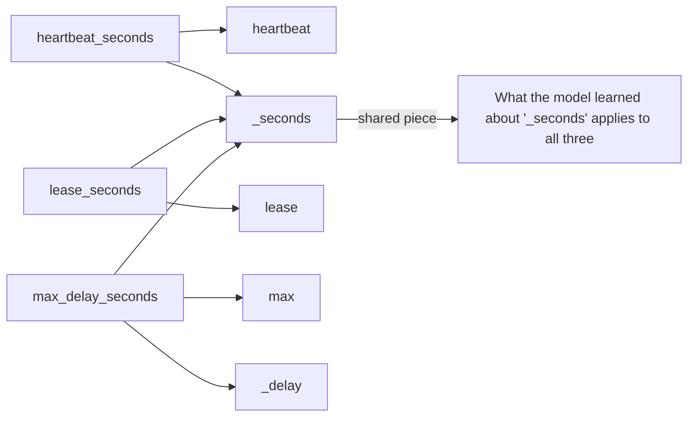
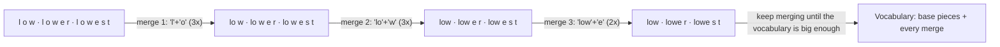
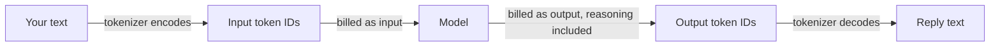
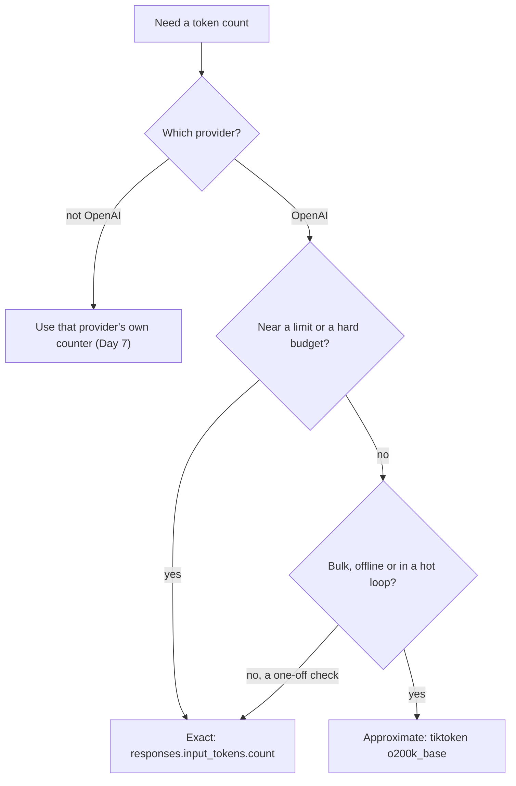

# Tokens: How Models Read Text

Orbit's tracker holds 240 issues and about 32,000 words. Estimate the cost of triaging them with
the usual rule of thumb and you'll be off by almost half, and by 3× on the Japanese issue. The
reason is **tokens**, the unit models read, bill by and set limits in. Today you learn to count
them before you pay for them.

## At a Glance

- **Time:** ~2 h core (+ optional Go Deeper) · **Depth:** working
- **Prerequisites:** [Day 2: Setup & Your First LLM Call](../../Phase_0_Start_Here/Day_002_setup_first_call/setup_first_call.md), [Day 3: What an LLM Is (and Isn't)](../../Phase_1_How_LLMs_Work/Day_003_what_is_an_llm/what_is_an_llm.md)
- **You'll build:** `atlas/tokens.py` with `count_tokens()`, `count_tokens_exact()` and
  `estimate_cost()`, plus a cost sheet for triaging every Orbit issue
- **Stops at:** implementing or training a tokenizer
- **Fast path:** Already know BPE and tiktoken? Read §Break It and §Exact Counts, then do
  Exercise 2 (about 45 min).
- **Cost:** ≈ $0 on `gpt-6-luna`: everything runs offline except `exact_count`, and the docs list
  no price for the token-count endpoint (as of 2026-11,
  [verify](https://developers.openai.com/api/docs/pricing)).
- **New terms:** token, tokenizer (encoding), BPE (byte-pair encoding), vocabulary, input vs
  output tokens

> **Coming from Software Engineering?** Tokenization works like character encoding. UTF-8 maps
> characters to bytes; a tokenizer maps text to integer IDs from a fixed vocabulary, and frequent
> chunks (whole words or word parts) each get one ID. One word isn't one token, just as one
> character isn't always one byte. Tokens are also the billing unit, like bytes on a CDN (content
> delivery network) bill, so estimating them is capacity planning: measure real payloads and watch
> the outliers.

## Your Bill Isn't Measured in Words

A maintainer asks what it would cost for Atlas to triage all 240 Orbit issues. From
[Day 2](../../Phase_0_Start_Here/Day_002_setup_first_call/setup_first_call.md) you know prices are
per million tokens. A common shortcut says a token is about three quarters of a word, so
tokens ≈ words × 1.33. Orbit's issues hold 32,001 words, so the guess is about 42,600 tokens.

The real count, which you'll measure later today, is 78,339: the guess is 46% short. Word counts
are the wrong ruler. You need the model's own.

## Texting Shorthand: The Intuition

Think about texting. Words you type all the time get a shortcut ("tmrw", "btw"), and rare words
get spelled out in full. A tokenizer works the same way: frequent chunks of text get one entry in
its list of shortcuts, and rarer text is built from smaller pieces.

The payoff is sharing. Orbit's config keys `heartbeat_seconds`, `lease_seconds` and
`max_delay_seconds` all end in the piece `_seconds`. Whatever the model learned about `_seconds`
in training ("a duration; the value is a number") applies to all three.



These are the real pieces the `o200k_base` tokenizer produces; you'll print them soon. The
consequence: common English words are cheap (`" worker"` is one token), while error codes,
versions, timestamps and paths split into many pieces, because they're too rare to earn a shortcut.

## BPE by Hand

Which chunks get a shortcut? Most tokenizers learn them with **BPE (byte-pair encoding)**: start
from single characters, then repeatedly glue together the pair of neighbours that appears most
often. The pieces it ends up with form the **vocabulary**, the fixed list of pieces the tokenizer
knows.

Try it on the toy corpus `low lower lowest` (real tokenizers split on spaces first, so pairs never
cross words). Split each word into characters, count every neighbouring pair (`l o` 3 times,
`o w` 3, `w e` 2, the rest once), and merge the most frequent pair; on a tie, take the pair seen
first. Repeat. Do three merges yourself, then check the table.

| Merge | Most frequent pair | Words afterwards | New vocabulary entry |
|---|---|---|---|
| start | (none) | `l o w` · `l o w e r` · `l o w e s t` | `l o w e r s t` |
| 1 | `l` + `o` (3×) | `lo w` · `lo w e r` · `lo w e s t` | `lo` |
| 2 | `lo` + `w` (3×) | `low` · `low e r` · `low e s t` | `low` |
| 3 | `low` + `e` (2×) | `low` · `lowe r` · `lowe s t` | `lowe` |



Look at merge 3. A linguist would split "lower" as `low` + `er`, but BPE produced `lowe` + `r`,
because it counts and knows nothing about grammar. That's why token boundaries look strange.

To tokenize new text, the tokenizer replays its merges in order; an unseen word still works,
because it can always fall back to single characters. Production tokenizers learn merges from a
huge corpus and stop at a chosen size: `o200k_base` has about 200,000 entries.

## Name the Parts: Tokenizer, Vocabulary, IDs

- A **token** is one vocabulary entry, such as `" lease"` or `"ORB"`. The model never sees
  letters, only a list of token IDs (plain integers).
- The **tokenizer** turns text into IDs and back. One specific vocabulary plus its merge rules is
  an **encoding**; `o200k_base` is the one OpenAI's GPT-5 family uses.
- **Input tokens** are everything you send: `instructions`, `input`, and a few tokens the API adds
  to mark roles and message boundaries. **Output tokens** are everything the model generates,
  including hidden reasoning tokens, which bill as output even though you never see them
  ([Day 6](../../Phase_1_How_LLMs_Work/Day_006_sampling_reasoning_effort/sampling_reasoning_effort.md)
  measures them).



Both sides cost money, and not equally. On `gpt-6-luna`, input is $0.10 and output $0.50 per
million tokens, so an output token costs five times as much (as of 2026-11,
[verify](https://developers.openai.com/api/docs/pricing)). Tokenizers also differ between
providers and model generations, so a count only means something next to the tokenizer's name.
[Day 7](../../Phase_1_How_LLMs_Work/Day_007_choosing_a_model/choosing_a_model.md) compares
providers.

## Count Tokens Locally

OpenAI publishes its tokenizers as the open-source library
[tiktoken](https://github.com/openai/tiktoken). It runs locally, needs no API key and counts
thousands of documents a second.

One catch: tiktoken 0.14.0 (latest as of 2026-11) has no `gpt-6` entry, and OpenAI hasn't said
which tokenizer GPT-6 uses. So the course uses `o200k_base`, the GPT-5 encoding, and treats every
local count as an **approximation**: good for planning, not for exact limits.

```python
# script_id: day_004_tokens/count_local
# Install: uv add tiktoken
# Env:     none for this block (ORBIT_DATA is read in the next one). No API key.
# Note:    the first run downloads the o200k_base file (a few MB), then it's cached.
import tiktoken

# Approximation: tiktoken has no gpt-6 entry, so we borrow GPT-5's encoding.
enc = tiktoken.get_encoding("o200k_base")

# Built from the ORB-1101 entry in Orbit's docs/error-codes.md
text = "ORB-1101 LeaseExpired: a job outlived its lease, so it may run twice."
ids = enc.encode(text)

print(f"{len(text)} chars, {len(text.split())} words -> {len(ids)} tokens")
print(ids[:6], "...")
print([enc.decode([i]) for i in ids])  # each ID turned back into its text piece
```

Expected output (IDs are fixed for `o200k_base`; other encodings differ):

```text
69 chars, 12 words -> 21 tokens
[154584, 12, 7920, 16, 87436, 64569] ...
['ORB', '-', '110', '1', ' Lease', 'Expired', ':', ' a', ' job', ' out', 'l', 'ived', ' its', ' lease', ',', ' so', ' it', ' may', ' run', ' twice', '.']
```

Three habits are already visible. Spaces attach to the *next* word (`' job'`, `' lease'`).
Rare words split ("outlived" becomes `' out'`, `'l'`, `'ived'`). And codes split badly: the model
sees `'110'` and `'1'`, never "1101". Twelve words became 21 tokens, well above "words × 1.33".

## Break It: Surprises at Token Boundaries

Now turn the knob: feed in the kinds of text Atlas reads every day. This block continues the same
script, so `enc` is already defined.

```python
# script_id: day_004_tokens/count_local
import json
import os
from pathlib import Path

DATA_DIR = Path(os.environ.get("ORBIT_DATA", "datasets/orbit"))  # as in atlas/config.py (Day 2)
ISSUES = {}
for line in (DATA_DIR / "issues" / "issues.jsonl").open(encoding="utf-8"):
    issue = json.loads(line)
    ISSUES[issue["id"]] = issue

def row(label: str, s: str) -> None:
    pieces = [enc.decode([i]) for i in enc.encode(s)]
    print(f"{label:<14}| {len(s):>5} | {len(s.split()):>5} | {len(pieces):>6} | {pieces[:8]}")

# A stack-trace line copied out of issue 25's body
trace = next(ln for ln in ISSUES[25]["body"].splitlines() if 'File "/app/.venv' in ln)

print(f"{'text':<14}| chars | words | tokens | first pieces")
row("error code", "ORB-1101")
row("config key", "heartbeat_seconds=30")
row("version", "3.2.1")
row("timestamp", "2026-10-20T08:14:03Z")
row("stack trace", trace)
row("no space", "Orbit")
row("leading space", " Orbit")
print("IDs differ:", enc.encode("Orbit"), "vs", enc.encode(" Orbit"))
```

Expected output:

```text
text          | chars | words | tokens | first pieces
error code    |     8 |     1 |      4 | ['ORB', '-', '110', '1']
config key    |    20 |     1 |      4 | ['heartbeat', '_seconds', '=', '30']
version       |     5 |     1 |      5 | ['3', '.', '2', '.', '1']
timestamp     |    20 |     1 |     13 | ['202', '6', '-', '10', '-', '20', 'T', '08']
stack trace   |    83 |     6 |     26 | [' ', ' File', ' "/', 'app', '/.', 'ven', 'v', '/lib']
no space      |     5 |     1 |      1 | ['Orbit']
leading space |     6 |     1 |      1 | [' Orbit']
IDs differ: [124738] vs [113977]
```

- **Codes and identifiers** split into fragments, one reason models sometimes garble a code
  when copying it: they predict several number pieces, not one unit.
- **Versions and timestamps** cost close to a token per character, so log lines are expensive.
- **Paths and stack traces** cost about a token per three characters.
- **Leading whitespace changes the token.** `"Orbit"` and `" Orbit"` are different IDs, so the
  model sees different inputs.

The next knob is language. Orbit has issues in Spanish (#25), Portuguese (#97), German (#130),
Hindi (#63) and Japanese (#188). A fair comparison needs the same meaning in each language, so the
block first counts one sentence in six languages, then the five real issues.

```python
# script_id: day_004_tokens/count_local
# The same sentence in six languages (our translations of the topic of issue 63)
SAME_SENTENCE = {
    "English": "The worker cannot connect to Redis when it starts in Docker Compose.",
    "Spanish": "El worker no puede conectarse a Redis cuando arranca en Docker Compose.",
    "Portuguese": "O worker não consegue se conectar ao Redis quando inicia no Docker Compose.",
    "German": "Der Worker kann sich beim Start in Docker Compose nicht mit Redis verbinden.",
    "Hindi": "Docker Compose में शुरू होने पर worker Redis से कनेक्ट नहीं हो पाता।",
    "Japanese": "Docker Compose で起動すると、ワーカーが Redis に接続できません。",
}
base = len(enc.encode(SAME_SENTENCE["English"]))
print(f"\n{'language':<11}| chars | words | tokens | vs English")
for lang, s in SAME_SENTENCE.items():
    n = len(enc.encode(s))
    print(f"{lang:<11}| {len(s):>5} | {len(s.split()):>5} | {n:>6} | {n / base:.2f}x")

# The five real non-English issues (ids from the dataset README)
print(f"\n{'issue':<11}| chars | words | tokens | tokens/word")
for issue_id in (25, 97, 130, 63, 188):
    s = f"{ISSUES[issue_id]['title']}\n\n{ISSUES[issue_id]['body']}"
    n, words = len(enc.encode(s)), len(s.split())
    print(f"#{issue_id:<10}| {len(s):>5} | {words:>5} | {n:>6} | {n / words:.2f}")
```

Expected output:

```text
language   | chars | words | tokens | vs English
English    |    68 |    12 |     13 | 1.00x
Spanish    |    71 |    12 |     15 | 1.15x
Portuguese |    75 |    13 |     14 | 1.08x
German     |    76 |    13 |     14 | 1.08x
Hindi      |    68 |    13 |     17 | 1.31x
Japanese   |    43 |     5 |     18 | 1.38x

issue      | chars | words | tokens | tokens/word
#25        |   997 |   119 |    280 | 2.35
#97        |   809 |   113 |    232 | 2.05
#130       |   959 |   113 |    278 | 2.46
#63        |   915 |   120 |    280 | 2.33
#188       |   641 |    67 |    280 | 4.18
```

Two lessons. First, the same meaning costs more outside English: 8–15% more for the European
languages, 30–40% for Hindi and Japanese. Older encodings were worse: with `cl100k_base`, the
GPT-4-era encoding with half the vocabulary, the Hindi sentence costs 3× the English one, so
re-measure whenever you change models. Second, "words" stops working as a unit. Japanese doesn't
put spaces between words, so issue 188 looks like 67 words but costs 280 tokens.

The last knob breaks most first scripts: ask tiktoken for the model you actually use.

```python
# script_id: day_004_tokens/count_local
# The most common first error: asking tiktoken for a model it doesn't know
try:
    tiktoken.encoding_for_model("gpt-6-luna")
except KeyError as err:
    print("\nKeyError:", err)

print("gpt-5 maps to:", tiktoken.encoding_for_model("gpt-5").name)  # the closest known entry
```

Expected output:

```text
KeyError: 'Could not automatically map gpt-6-luna to a tokeniser. Please use `tiktoken.get_encoding` to explicitly get the tokeniser you expect.'
gpt-5 maps to: o200k_base
```

The fix is what the first block already does: `tiktoken.get_encoding("o200k_base")` by name,
labelled approximate. Don't hide the error behind a silent fallback; the "approximate" label is
what stops a teammate from enforcing a hard limit with the number.

## Exact Counts from the API

Local counts have two blind spots: GPT-6's real tokenizer, and the extra tokens the API adds to
mark roles and message boundaries. When the number must be right, such as a prompt near the
context limit (the most tokens a model accepts in one request), ask the API.

The **token-count endpoint** takes the same arguments as `client.responses.create()` and returns
the input-token count instead of a response. Per the
[token-counting guide](https://developers.openai.com/api/docs/guides/token-counting), it "includes
formatting tokens used to represent request structure, such as message roles and boundaries".

```python
# script_id: day_004_tokens/exact_count
# Install: uv add "openai>=3.46,<4" tiktoken
# Env:     OPENAI_API_KEY (required), ATLAS_MODEL and ORBIT_DATA (optional)
import json
import os
from pathlib import Path

import tiktoken
from openai import OpenAI

MODEL = os.environ.get("ATLAS_MODEL", "gpt-6-luna")               # atlas/config.py (Day 2)
DATA_DIR = Path(os.environ.get("ORBIT_DATA", "datasets/orbit"))
client = OpenAI()                                                  # reads OPENAI_API_KEY
enc = tiktoken.get_encoding("o200k_base")

issues = {}
for line in (DATA_DIR / "issues" / "issues.jsonl").open(encoding="utf-8"):
    issue = json.loads(line)
    issues[issue["id"]] = f"{issue['title']}\n\n{issue['body']}"

for issue_id in (17, 63, 188):                     # English, Hindi, Japanese
    local = len(enc.encode(issues[issue_id]))
    exact = client.responses.input_tokens.count(model=MODEL, input=issues[issue_id]).input_tokens
    print(f"issue {issue_id:>3}: local {local} · exact {exact} · diff {exact - local:+d}")
```

Expected output shape. The local numbers are real; this lesson was written without an API key,
so the exact column is yours to fill in:

```text
issue  17: local 155 · exact <from the API> · diff <exact minus local>
issue  63: local 280 · exact <from the API> · diff <exact minus local>
issue 188: local 280 · exact <from the API> · diff <exact minus local>
```

Expect exact to be a little higher, because of framing. A large gap, or one that differs between
the English and Japanese issues, is evidence that GPT-6 doesn't use `o200k_base`, which is what
this comparison is for. Pass `instructions=` or `tools=` and they're counted too, as they'd be
billed.



| | Local (`tiktoken`) | Exact (count endpoint) |
|---|---|---|
| Needs network / key | No (after the first download) | Yes |
| Speed | Thousands of texts per second | One HTTP round trip per count |
| Accuracy for GPT-6 | Approximate (borrowed encoding, no framing) | What the model will receive |
| Counts tools, images, files | No | Yes |
| Best for | Bulk estimates, cost sheets, chunk sizing | Prompts near the limit, budgets you enforce |

## Realistic Version: `count_tokens()` and a Cost Sheet

Now turn the experiments into `atlas/tokens.py`, the module the rest of the course imports. Four
blocks share one `script_id`, each adding one concern: counting, prices, statistics, cost sheet.

The first block adds the two counters. The encoding loads once and is reused, because loading is
far slower than encoding. And user text can contain `<|endoftext|>`, a string tiktoken reserves as
a special token; `encode()` raises `ValueError` on it unless told to treat it as plain text.

```python
# script_id: day_004_tokens/tokens
"""atlas/tokens.py: count tokens and estimate cost before you send a request.

Install: uv add "openai>=3.46,<4" tiktoken
Env:     ATLAS_MODEL, ORBIT_DATA (both optional); OPENAI_API_KEY only for count_tokens_exact()
"""
import os
from functools import lru_cache
from pathlib import Path

import tiktoken
from openai import OpenAI

MODEL = os.environ.get("ATLAS_MODEL", "gpt-6-luna")               # atlas/config.py (Day 2)
DATA_DIR = Path(os.environ.get("ORBIT_DATA", "datasets/orbit"))

@lru_cache(maxsize=1)
def _encoding() -> tiktoken.Encoding:
    # tiktoken has no gpt-6 entry; o200k_base (GPT-5's encoding) is a stand-in, not the truth.
    return tiktoken.get_encoding("o200k_base")

def count_tokens(text: str) -> int:
    """Approximate token count, offline. Fine for bulk estimates; not for hard limits."""
    # disallowed_special=() treats "<|endoftext|>" in user text as plain text instead of raising
    return len(_encoding().encode(text, disallowed_special=()))

@lru_cache(maxsize=1)
def _client() -> OpenAI:
    return OpenAI()  # created on first use, so offline helpers work without a key

def count_tokens_exact(text: str, model: str = MODEL) -> int:
    """Exact input tokens for `text` sent as the input of one request, framing included."""
    return _client().responses.input_tokens.count(model=model, input=text).input_tokens
```

The second block replaces Day 2's single `PRICE_PER_1M` with a table per model, keeping the unit
in the name. `cached_input` stays unused until
[Day 18](../../Phase_2_Building_with_LLM_APIs/Day_018_cost_latency_caching/cost_latency_caching.md)
covers caching.

```python
# script_id: day_004_tokens/tokens
# USD per 1M tokens, Standard tier, prompts up to 272K input tokens.
# As of 2026-11, verify at https://developers.openai.com/api/docs/pricing
PRICES_PER_1M: dict[str, dict[str, float]] = {
    "gpt-6-luna":    {"input": 0.10, "cached_input": 0.01, "output": 0.50},
    "gpt-6.1-terra": {"input": 1.00, "cached_input": 0.05, "output": 5.00},
}

def estimate_cost(input_tokens: int, output_tokens: int, model: str = MODEL) -> float:
    """USD for one call. output_tokens must include reasoning tokens (they bill as output)."""
    if model not in PRICES_PER_1M:
        raise KeyError(f"no price for {model!r}; add it to PRICES_PER_1M")
    price = PRICES_PER_1M[model]
    # cached_input is unused until Day 18; the >272K surcharge arrives in Day 5
    return (input_tokens * price["input"] + output_tokens * price["output"]) / 1_000_000
```

Unknown models raise instead of costing $0, because a silent zero is how budgets get blown.

The third block measures real data. Averages hide outliers, so it also reports the median, the
p95 (the value 95% of issues fall below), the maximum and the largest issue.

```python
# script_id: day_004_tokens/tokens
import json
import statistics

def load_issue_texts() -> dict[int, str]:
    """Issue id -> title + body: the text a triage prompt would paste in."""
    texts = {}
    for line in (DATA_DIR / "issues" / "issues.jsonl").open(encoding="utf-8"):
        issue = json.loads(line)
        texts[issue["id"]] = f"{issue['title']}\n\n{issue['body']}"
    return texts

def print_token_stats(texts: dict[int, str]) -> dict[int, int]:
    tokens = {i: count_tokens(t) for i, t in texts.items()}
    counts = sorted(tokens.values())
    total, words = sum(counts), sum(len(t.split()) for t in texts.values())
    p95 = statistics.quantiles(counts, n=20)[-1]   # 19 cut points; the last one is p95
    biggest = max(tokens, key=tokens.get)

    print(f"{len(counts)} issues · {words:,} words · {total:,} tokens "
          f"(the 'words x 1.33' guess says {round(words * 1.33):,})")
    print(f"per issue: mean {statistics.mean(counts):,.0f} · median {statistics.median(counts):,.0f}"
          f" · p95 {p95:,.0f} · max {counts[-1]:,}")
    print(f"largest: issue {biggest} = {tokens[biggest]:,} tokens ({tokens[biggest] / total:.0%} of all input)")
    return tokens
```

The last block prices the job. Its assumptions are constants you can change: 150 output tokens
per issue covers a short label and reason, and reasoning tokens would come on top (Day 6).

```python
# script_id: day_004_tokens/tokens
OUTPUT_TOKENS = 150    # assumed: a short label + reason. Reasoning tokens would add more (Day 6)
ISSUES_PER_DAY = 500   # assumed future load

def print_cost_sheet(tokens: dict[int, int]) -> None:
    for model in PRICES_PER_1M:
        batch = sum(estimate_cost(n, OUTPUT_TOKENS, model) for n in tokens.values())
        output_part = estimate_cost(0, OUTPUT_TOKENS * len(tokens), model)
        monthly = batch / len(tokens) * ISSUES_PER_DAY * 30
        print(f"{model:<14} triage all {len(tokens)} ≈ ${batch:.3f} ({output_part / batch:.0%} output)"
              f" · {ISSUES_PER_DAY}/day ≈ ${monthly:.2f}/month")

if __name__ == "__main__":
    print_cost_sheet(print_token_stats(load_issue_texts()))
```

Expected output (token counts are real `o200k_base` counts; prices as of 2026-11):

```text
240 issues · 32,001 words · 78,339 tokens (the 'words x 1.33' guess says 42,561)
per issue: mean 326 · median 164 · p95 418 · max 32,444
largest: issue 227 = 32,444 tokens (41% of all input)
gpt-6-luna     triage all 240 ≈ $0.026 (70% output) · 500/day ≈ $1.61/month
gpt-6.1-terra  triage all 240 ≈ $0.258 (70% output) · 500/day ≈ $16.15/month
```

Read it like a reviewer:

- **The rule of thumb was 46% short**, because code, logs and paths cost far more per word than
  prose.
- **One issue dominates.** Issue 227, about 8,600 words of Postgres broker logs, holds 41% of all
  input tokens and doubles the mean over the median. Plan around p95 and the maximum.
- **Output is 70% of the bill**, although answers are far shorter than issues, because output
  tokens cost five times as much.
- **The model is the biggest lever:** `gpt-6.1-terra` costs ten times more. Whether the cheap model
  is good enough is a quality question for
  [Day 7](../../Phase_1_How_LLMs_Work/Day_007_choosing_a_model/choosing_a_model.md).

To price another job, such as a weekly summary of every issue at about 200 output tokens, change
`OUTPUT_TOKENS` and the multiplier and rerun: the ratio between models stays the same.

## Trade-offs: When to Count, and How

Counting has its own cost, so match the method to the situation:

| Situation | What to do | Why |
|---|---|---|
| Planning, budgets, "can we afford this?" | Local `count_tokens()` over a real sample | Fast and free; ±a few % doesn't change the decision |
| Sizing chunks for retrieval | Local `count_tokens()` | You'll call it millions of times ([Day 25](../../Phase_3_RAG/Day_025_chunking/chunking.md)) |
| A prompt near the context limit | `count_tokens_exact()` before sending | Being a few tokens over means a failed request |
| Enforcing a per-user or per-tenant token budget | Exact count before, `usage` after | A budget you enforce has to match the bill |
| A different provider's model | That provider's counter | tiktoken doesn't know its tokenizer |
| Short, fixed prompts far below every limit | Don't count; read `usage` afterwards | Counting adds work and tells you nothing new |

When **not** to count: don't put an exact count in front of every request "to be safe"; it
doubles round trips for prompts that were never at risk.

### In production

- **Count before sending, record after receiving.** Teams estimate up front to reject or trim
  oversized inputs, then log the real `usage` of every response and reconcile it against the
  invoice. That logger is the cost tracker in
  [Day 12](../../Phase_2_Building_with_LLM_APIs/Day_012_openai_sdk_production/openai_sdk_production.md).
- **Cap input size.** One pasted log file, like issue 227, costs as much as a hundred normal
  issues. Teams cap input and tell the user, rather than silently paying.
- **Re-measure on every model or provider change** by rerunning this cost sheet.
- **Keep prices in one table** with an as-of date, so a price change edits one dictionary.

## Go Deeper (optional)

<details><summary>Go deeper: bytes, vocabulary size, and why spelling is hard</summary>

**Byte-level BPE.** Modern tokenizers run BPE over UTF-8 bytes, not characters. A byte (8 bits)
has 256 possible values, so the 256 single bytes form the base vocabulary and *any* text encodes,
with no "unknown word" case. Rare scripts and emoji get fewer merges: 🚀 is 4 bytes and costs 2
tokens in `o200k_base`. Decoding one of them alone gives `'�'`, a partial character; inspect such
fragments with `enc.decode_single_token_bytes(token_id)`.

**Vocabulary size.** `enc.n_vocab` is 200,019 for `o200k_base`, including special tokens such as
`<|endoftext|>`. A bigger vocabulary gives more words and scripts their own tokens, so text costs
fewer tokens, at the price of a larger lookup table inside the model.

**Why spelling is hard.** The model receives `'st'`, `'raw'`, `'berry'` for "strawberry": three
IDs, no letters. Counting its r's, reversing a string or copying `ORB-1101` exactly all require
reasoning about the inside of tokens it never sees spelled out.

</details>

## Common Pitfalls

- **``KeyError: 'Could not automatically map gpt-6-luna to a tokeniser. Please use `tiktoken.get_encoding` to explicitly get the tokeniser you expect.'``**
  tiktoken 0.14.0 doesn't know GPT-6 IDs. Use `tiktoken.get_encoding("o200k_base")` and label the
  count approximate.
- **The first run hangs or fails offline or behind a proxy.** tiktoken downloads the encoding on
  first use and caches it in your temp directory. Run once online, or point `TIKTOKEN_CACHE_DIR` at
  a directory you pre-populate (for example during a Docker build).
- **Counting input only.** Output costs 5× per token on `gpt-6-luna`, reasoning counts as output,
  and output was 70% of the cost sheet. Estimate both sides.
- **"words × 1.33" on real data.** It was 46% short on Orbit's issues and 3× short on the Japanese
  one. Measure a sample of your own data.
- **`ValueError: Encountered text corresponding to disallowed special token '<|endoftext|>'.`**
  Input contains a reserved string. Pass `disallowed_special=()`, as `count_tokens()` does.
- **Using tiktoken for Claude or other providers.** Their tokenizers differ by an unknown amount.
  Use that provider's own counter (Day 7).

> **Where we stop:** we don't implement or train a tokenizer, because application engineers use
> the provider's as given; for the full algorithm see the
> [Hugging Face course chapter on BPE](https://huggingface.co/learn/llm-course/chapter6/5).

## Key Takeaways

- Models read, bill and limit in tokens, not words; "words × 1.33" was 46% short on Orbit, so
  measure your own text before quoting a cost.
- BPE works like learned texting shorthand: frequent chunks get one ID, while codes, versions,
  paths and non-English text are built from many pieces.
- `tiktoken.get_encoding("o200k_base")` counts offline but only approximates GPT-6;
  `client.responses.input_tokens.count()` is exact, framing included.
- `encoding_for_model("gpt-6-luna")` raises `KeyError`; leading spaces, special tokens and scripts
  without spaces change counts in ways a word count can't see.
- Estimate input *and* output (reasoning included) with `estimate_cost()`, plan on p95 and max,
  count exactly near limits, and log real `usage` in production.

## Quick Reference

| API / pattern | What it does | When to use | Gotcha |
|---|---|---|---|
| `tiktoken.get_encoding("o200k_base")` | Loads an encoding by name | All local counting in this course | Approximate for GPT-6; downloads on first use |
| `enc.encode(text)` / `enc.decode(ids)` | Text to IDs and back | Inspecting pieces, counting | Raises `ValueError` on `<\|endoftext\|>` unless `disallowed_special=()` |
| `tiktoken.encoding_for_model(name)` | Looks up a model's encoding | Older models tiktoken knows | `KeyError` for any `gpt-6*` ID |
| `enc.n_vocab` | Vocabulary size | Comparing encodings | 200,019 for `o200k_base` |
| `client.responses.input_tokens.count(model=, input=, instructions=, tools=)` | Exact input tokens, `.input_tokens` | Near limits, enforced budgets | Network call; counts framing tokens too |
| `count_tokens(text)` | Atlas helper, local count | Bulk estimates, chunking | An estimate, never a guarantee |
| `estimate_cost(input_tokens, output_tokens, model)` | USD for one call | Cost sheets, budgets | Include reasoning tokens in output; prices as of 2026-11 |
| `resp.usage.input_tokens` / `.output_tokens` | What you were billed for | Logging after every call | The ground truth; reconcile estimates against it |

## Exercises

1. **Warm-up.** Predict the token count of three `orbit.toml` lines: `[worker]`,
   `concurrency = 8`, `heartbeat_seconds = 30`. Then adapt the first `count_local` block to count
   them and print the pieces.

<details><summary>Solution</summary>

```python
# script_id: day_004_tokens/solution_ex1
# Install: uv add tiktoken · Env: none
import tiktoken

enc = tiktoken.get_encoding("o200k_base")  # approximate for GPT-6
LINES = ["[worker]", "concurrency = 8", "heartbeat_seconds = 30"]

for line in LINES:
    pieces = [enc.decode([i]) for i in enc.encode(line)]
    print(f"{line!r:<26} {len(pieces)} tokens {pieces}")
print("whole file:", len(enc.encode("\n".join(LINES))), "tokens")
```

```text
'[worker]'                 3 tokens ['[', 'worker', ']']
'concurrency = 8'          5 tokens ['con', 'currency', ' =', ' ', '8']
'heartbeat_seconds = 30'   5 tokens ['heartbeat', '_seconds', ' =', ' ', '30']
whole file: 14 tokens
```

The usual surprises: `concurrency` splits into `con` + `currency`, and the space before a number
is its own token.

</details>

2. **Core: the language multiplier.** For the 5 non-English issues, compare the measured count
   with the "words × 1.33" guess, against the same ratio for all English issues. Then price 10,000
   such issues a day on `gpt-6-luna` (input only), measured versus guessed.

<details><summary>Solution</summary>

```python
# script_id: day_004_tokens/solution_ex2
# Install: uv add tiktoken · Env: ORBIT_DATA (optional)
import json
import os
from pathlib import Path

import tiktoken

DATA_DIR = Path(os.environ.get("ORBIT_DATA", "datasets/orbit"))
enc = tiktoken.get_encoding("o200k_base")  # approximate for GPT-6
NON_ENGLISH = {25: "Spanish", 97: "Portuguese", 130: "German", 63: "Hindi", 188: "Japanese"}
INPUT_PRICE = 0.10  # gpt-6-luna, USD per 1M input tokens, as of 2026-11 (verify)

def per_day(tokens: int) -> float:
    return tokens * 10_000 * INPUT_PRICE / 1_000_000   # 10k issues like this one, per day

texts = {}
for line in (DATA_DIR / "issues" / "issues.jsonl").open(encoding="utf-8"):
    issue = json.loads(line)
    texts[issue["id"]] = f"{issue['title']}\n\n{issue['body']}"

english = [t for i, t in texts.items() if i not in NON_ENGLISH]
base = sum(len(enc.encode(t)) for t in english) / sum(len(t.split()) * 1.33 for t in english)
print(f"English issues overall: {base:.1f}x the 'words x 1.33' guess")
for issue_id, lang in NON_ENGLISH.items():
    measured, guessed = len(enc.encode(texts[issue_id])), round(len(texts[issue_id].split()) * 1.33)
    print(f"#{issue_id:<4}{lang:<11} measured {measured:>4} · guess {guessed:>4} · {measured / guessed:.1f}x"
          f" · ${per_day(measured):.2f}/day (guess said ${per_day(guessed):.2f})")
```

```text
English issues overall: 1.8x the 'words x 1.33' guess
#25  Spanish     measured  280 · guess  158 · 1.8x · $0.28/day (guess said $0.16)
#97  Portuguese  measured  232 · guess  150 · 1.5x · $0.23/day (guess said $0.15)
#130 German      measured  278 · guess  150 · 1.9x · $0.28/day (guess said $0.15)
#63  Hindi       measured  280 · guess  160 · 1.8x · $0.28/day (guess said $0.16)
#188 Japanese    measured  280 · guess   89 · 3.1x · $0.28/day (guess said $0.09)
```

Code and logs dominate whole issues, so most miss the guess about as much as English ones
(1.5–1.9×). Japanese is the outlier at 3.1×, because `text.split()` can't find its words. The
parallel-sentence table in §Break It isolates the pure language effect.

</details>

3. **Core: the most expensive issues.** Find the 3 issues with the most tokens per word and
   explain why. Hint: measure how much of each sits inside code fences.

<details><summary>Solution</summary>

```python
# script_id: day_004_tokens/solution_ex3
# Install: uv add tiktoken · Env: ORBIT_DATA (optional)
import json
import os
from pathlib import Path

import tiktoken

DATA_DIR = Path(os.environ.get("ORBIT_DATA", "datasets/orbit"))
enc = tiktoken.get_encoding("o200k_base")  # approximate for GPT-6

rows = []
for line in (DATA_DIR / "issues" / "issues.jsonl").open(encoding="utf-8"):
    issue = json.loads(line)
    text = f"{issue['title']}\n\n{issue['body']}"
    in_code = sum(len(part) for part in text.split("```")[1::2])  # odd parts sit inside fences
    rows.append((len(enc.encode(text)) / len(text.split()), issue["id"], in_code / len(text), issue["title"]))

for per_word, issue_id, code_share, title in sorted(rows, reverse=True)[:3]:
    print(f"#{issue_id:<4} {per_word:.2f} tokens/word · {code_share:.0%} inside code fences · {title[:50]}")
```

```text
#188  4.18 tokens/word · 48% inside code fences · cron式で ORB-1401 ScheduleParseError が発生します（秒フィールド付き
#227  3.76 tokens/word · 95% inside code fences · Postgres broker: ~5 s pickup latency spikes, NOTIF
#9    3.03 tokens/word · 57% inside code fences · SQS FIFO: constant ORB-1901 BrokerRateLimited duri
```

Issue 188 is Japanese, so "words" undercounts. Issues 227 and 9 are mostly log lines, where
timestamps and IDs cost nearly a token per character.

</details>

4. **Stretch (past the stop line).** In ≤20 lines of stdlib Python, run 3 BPE merges on
   `low lower lowest newest widest`, printing each chosen pair. Ties go to the pair seen first.

<details><summary>Solution</summary>

```python
# script_id: day_004_tokens/solution_ex4
# Stdlib only. Toy BPE: learn 3 merges; ties go to the pair seen first.
from collections import Counter

words = [list(w) for w in "low lower lowest newest widest".split()]  # pre-split on spaces

for step in range(1, 4):
    pairs = Counter(p for w in words for p in zip(w, w[1:]))
    (a, b), freq = pairs.most_common(1)[0]
    for w in words:                      # replace every a,b neighbour pair with "ab"
        i = 0
        while i < len(w) - 1:
            if (w[i], w[i + 1]) == (a, b):
                w[i:i + 2] = [a + b]
            i += 1
    print(f"merge {step}: {a!r} + {b!r} (seen {freq}x) -> {[' '.join(w) for w in words]}")
```

```text
merge 1: 'l' + 'o' (seen 3x) -> ['lo w', 'lo w e r', 'lo w e s t', 'n e w e s t', 'w i d e s t']
merge 2: 'lo' + 'w' (seen 3x) -> ['low', 'low e r', 'low e s t', 'n e w e s t', 'w i d e s t']
merge 3: 'e' + 's' (seen 3x) -> ['low', 'low e r', 'low es t', 'n e w es t', 'w i d es t']
```

`Counter.most_common` keeps first-seen order among ties. The extra words change merge 3 from
`low` + `e` to `e` + `s`: the vocabulary depends entirely on the corpus.

</details>

## References & Further Reading

- [OpenAI: Counting tokens](https://developers.openai.com/api/docs/guides/token-counting): the
  official guide to the token-count endpoint and what it counts that tiktoken can't.
- [OpenAI: Pricing](https://developers.openai.com/api/docs/pricing): current per-token prices for
  every model; check it before trusting any number here.
- [tiktoken on GitHub](https://github.com/openai/tiktoken): the library's README, with install
  notes and the encode/decode API.
- [tiktoken model map](https://github.com/openai/tiktoken/blob/main/tiktoken/model.py): which
  model names map to which encoding, and confirmation that GPT-6 isn't listed.
- [Hugging Face LLM Course: Byte-Pair Encoding tokenization](https://huggingface.co/learn/llm-course/chapter6/5):
  a step-by-step BPE walkthrough with code, past today's stop line.

## What's Next

You can now say what a prompt costs; next is whether it fits. In
[Day 5: Inside the Transformer: Attention & Context Windows](../../Phase_1_How_LLMs_Work/Day_005_transformers_attention/transformers_attention.md)
you'll see how the model attends over its tokens, how big the window is, and what happens to
accuracy and price as you fill it, using today's `count_tokens()`.
