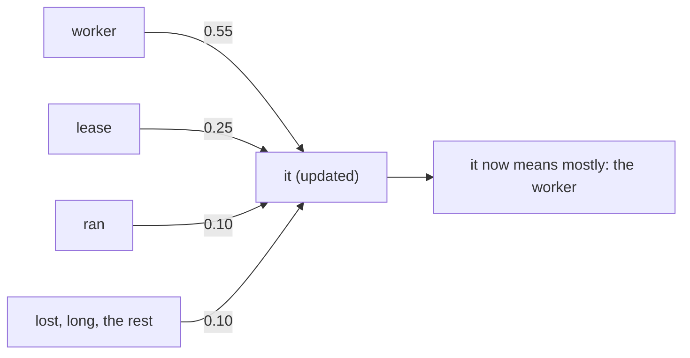
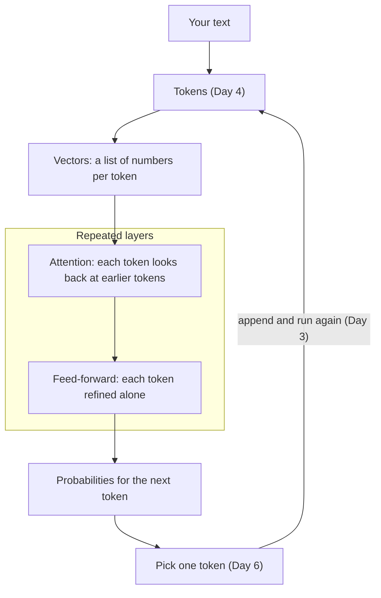
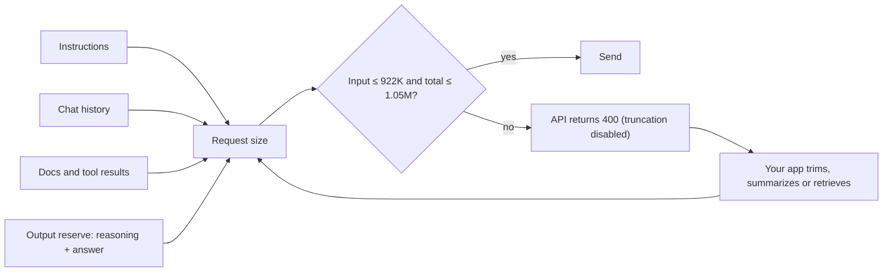
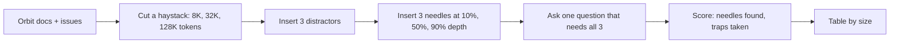

# Inside the Transformer: Attention & Context Windows

`gpt-6-luna` accepts about a million tokens, so why not paste every Orbit doc and issue into every
request? Because every token costs money and time, a request with more than 272K input tokens is
billed at a higher rate, and models get worse at finding the right fact as the input grows. Today
you learn the mechanism behind those limits and then measure them yourself.

## At a Glance

- **Time:** ~2 h core (+ optional Go Deeper) · **Depth:** intro
- **Prerequisites:** [Day 4: Tokens: How Models Read Text](../../Phase_1_How_LLMs_Work/Day_004_tokens/tokens.md)
  (and the generation loop from [Day 3: What an LLM Is (and Isn't)](../../Phase_1_How_LLMs_Work/Day_003_what_is_an_llm/what_is_an_llm.md)).
  Optional for Go Deeper: [Primer A06: NumPy & vectors](../../Appendix_Primers/A06_numpy_vectors.md)
- **You'll build:** a context-budget calculator (`context_budget()`), a long-context surcharge in
  `estimate_cost()`, and a multi-needle-with-distractors test over Orbit's docs
- **Stops at:** matrix math, positional-encoding math, training
- **Fast path:** Already know how transformers work? Read §The Context Window Is a Budget and
  §Realistic Version, run `needle_test`, then do Exercise 2 (about 45 min).
- **Cost:** ≈ $0.05 on `gpt-6-luna` (needle test plus stretch; the rest runs offline; prices as
  of 2026-11, [verify](https://developers.openai.com/api/docs/pricing))
- **New terms:** transformer, attention, context window, KV cache, context rot

> **Coming from Software Engineering?** Self-attention is a fuzzy self-join: every token in the
> input is joined against every earlier token, each pair gets a relevance score, and each token
> pulls in information from its best matches. You can also picture a dict lookup where every key
> matches a little and you get back a blend of values weighted by how well each key matched. The
> context window is the maximum request body size, and it is enforced by the server, not by the
> model. The KV cache is memoization: work done on the prefix is kept, so each new token doesn't
> redo it.

## Why Not Paste Everything?

The tempting design for Atlas, the assistant you're building for Orbit's maintainers, is to skip
search entirely: put all 45 doc pages and all 240 issues in the prompt and let the model sort it
out. Before you try it, count what that request would contain. The script below reuses Day 4's
offline counter.

```python
# script_id: day_005_transformers_attention/paste_everything
# Install: uv add tiktoken · Env: ORBIT_DATA (optional) · No API key: runs offline
import json
import os
from pathlib import Path

import tiktoken

DATA_DIR = Path(os.environ.get("ORBIT_DATA", "datasets/orbit"))  # atlas/config.py (Day 2)
ENC = tiktoken.get_encoding("o200k_base")  # approximate for GPT-6 (Day 4)
INPUT_PER_1M = 0.10  # gpt-6-luna USD, as of 2026-11, verify at https://developers.openai.com/api/docs/pricing

def count_tokens(text: str) -> int:
    return len(ENC.encode(text, disallowed_special=()))

docs = sum(count_tokens(p.read_text()) for p in sorted((DATA_DIR / "docs").glob("*.md")))
with open(DATA_DIR / "issues" / "issues.jsonl", encoding="utf-8") as f:
    issues = sum(count_tokens(f"{i['title']}\n\n{i['body']}") for i in map(json.loads, f))

total = docs + issues
per_request = total * INPUT_PER_1M / 1_000_000
print(f"docs {docs:,} + issues {issues:,} = {total:,} tokens per request")
print(f"input cost ${per_request:.4f}/request, ${per_request * 2_000:,.2f}/day at 2,000 questions")
```

```text
docs 65,308 + issues 78,339 = 143,647 tokens per request
input cost $0.0144/request, $28.73/day at 2,000 questions
```

A cent and a half per question doesn't sound like much, but it's paid on *every* question, even
"what does ORB-1101 mean?", whose answer is one paragraph in `docs/error-codes.md`. The model also
has to read all 143K tokens before it writes the first word of the reply, which makes you wait.
Orbit is small, too. A real product's docs and tickets are often 10–100× larger, which pushes you
past the 272K line, where the price per token goes up, and eventually past the hard limit. To
reason about any of this, you need to know what the model does with all those tokens.

## Linking Words: The Intuition

Read this line from an Orbit bug report:

> The worker lost its lease because it ran too long.

What does "it" refer to? The worker: workers run, leases don't. When you reached "it", you looked
back over the earlier words and linked it to the one that made sense. Change one word ("…because
it **expired**") and "it" becomes the lease, because leases expire. Same word, different link.

A next-token predictor (Day 3) needs that link constantly: to continue "…because it ran too long,
so the job was", it has to know what "it" is. **Attention** is the mechanism that lets each token
gather meaning from the other tokens in the input, weighted by how relevant they are.

## Attention by Hand

Let's run attention on the first sentence using toy numbers small enough to check in your head.
For the token "it", give every earlier word a relevance score, then scale the scores so they add
up to 1. These are the **attention weights**:

| Earlier word | Weight for "it" |
|---|---|
| worker | 0.55 |
| lease | 0.25 |
| ran | 0.10 |
| lost, long, the rest | 0.10 in total |

The new meaning of "it" is a blend: 55% worker, 25% lease, and a little of everything else. After
this step, the model's internal version of "it" mostly carries the meaning "the worker". That's
all attention is: a weighted average, where the weights say how much each word matters to this
one.



The same arithmetic in code. The scores are invented here; a real model learns them during
training.

```python
# script_id: day_005_transformers_attention/attention_by_hand
# Install: nothing (stdlib) · Env: none · Toy scores chosen by hand, not taken from a model
def show(sentence: str, scores: dict[str, float]) -> None:
    total = sum(scores.values())  # scale so the weights sum to 1
    weights = {word: s / total for word, s in scores.items()}
    print(sentence)
    for word, w in sorted(weights.items(), key=lambda kv: -kv[1]):
        print(f"  it -> {word:<8} {w:4.2f} {'#' * round(w * 40)}")
    print(f"  'it' now mostly means '{max(weights, key=weights.get)}'\n")

show("The worker lost its lease because it ran too long.",
     {"worker": 5.5, "lease": 2.5, "ran": 1.0, "long": 0.5, "lost": 0.5})
# Turn the knob: change one verb and the weights move
show("The worker lost its lease because it expired.",
     {"worker": 1.5, "lease": 6.5, "expired": 1.5, "lost": 0.5})
```

```text
The worker lost its lease because it ran too long.
  it -> worker   0.55 ######################
  it -> lease    0.25 ##########
  it -> ran      0.10 ####
  it -> long     0.05 ##
  it -> lost     0.05 ##
  'it' now mostly means 'worker'

The worker lost its lease because it expired.
  it -> lease    0.65 ##########################
  it -> worker   0.15 ######
  it -> expired  0.15 ######
  it -> lost     0.05 ##
  'it' now mostly means 'lease'
```

A real model does this for **every** token at once, not only for "it", and it does it many times
over. It also has to produce the scores itself, from what each token means. Go Deeper shows how
those scores are computed, but the main path doesn't need it.

## Name the Parts: The Transformer Pipeline

A **transformer** is the model design behind GPT, Claude and nearly every current LLM: a stack of
identical processing stages built around attention. Your prompt takes this path:

1. **Tokens.** Your text becomes token IDs (Day 4).
2. **Vectors.** Each ID becomes a **vector**, a list of numbers that stands for the token's
   meaning (Primer A06 explains vectors).
3. **Layers.** A **layer** is one processing stage, repeated many times. Each has two steps:
   **attention** (every token gathers meaning from earlier tokens, as in your hand example) and
   **feed-forward** (each token's vector is refined on its own).
4. **Next-token probabilities.** The model scores every vocabulary token as the possible next one.
5. **The loop.** One token is picked (Day 6), appended, and everything runs again (Day 3).



Each position attends to itself and every position before it, and "before it" means
**everything** in the request: instructions, history, pasted docs, and the tokens written so far.
Every token is compared with every earlier token, in every layer, so the work grows much faster
than the prompt:

```python
# script_id: day_005_transformers_attention/attention_pairs
# Install: uv add tiktoken · Env: none · Offline
import tiktoken

enc = tiktoken.get_encoding("o200k_base")  # approximate for GPT-6 (Day 4)
ids = enc.encode("The worker lost its lease because it ran too long.")
print(len(ids), "tokens:", [enc.decode([i]) for i in ids])

# Each position attends to itself and every earlier position: n*(n+1)/2 pairs, in every layer
for n in (len(ids), 1_000, 8_000, 128_000, 922_000):
    print(f"{n:>9,} tokens -> {n * (n + 1) // 2:>17,} attention pairs per layer")
```

```text
11 tokens: ['The', ' worker', ' lost', ' its', ' lease', ' because', ' it', ' ran', ' too', ' long', '.']
       11 tokens ->                66 attention pairs per layer
    1,000 tokens ->           500,500 attention pairs per layer
    8,000 tokens ->        32,004,000 attention pairs per layer
  128,000 tokens ->     8,192,064,000 attention pairs per layer
  922,000 tokens ->   425,042,461,000 attention pairs per layer
```

Providers have many tricks to make this affordable, but the shape remains: a 128K prompt has 16×
the tokens of an 8K prompt and about 256× the pairs. That's why long prompts are slower, and part
of why they cost more.

## The Context Window Is a Budget

The **context window** is the maximum number of tokens one request can use, input and output
together, including reasoning tokens, the hidden thinking a model does before answering
([OpenAI: managing the context window](https://developers.openai.com/api/docs/guides/conversation-state)).
Everything in the request draws from that budget:

- **instructions** (your system-level prompt),
- **history** (earlier turns, which you resend every time because the model is stateless; see Day 3),
- **documents and tool results** you paste in,
- **reasoning + visible output**, which you have to leave room for *before* sending.

For `gpt-6-luna` the numbers are (as of 2026-11,
[verify on the model page](https://developers.openai.com/api/docs/models/gpt-6-luna)):

| Limit | Tokens |
|---|---|
| Context window (input + output) | 1,050,000 |
| Max input | 922,000 |
| Max output (reasoning included) | 128,000 |
| Long-context price line | 272,000 input |

That's two checks: input ≤ 922K, and input plus the output you need ≤ 1.05M.

Go over, and the model doesn't quietly forget your oldest messages. The Responses API's
`truncation` parameter defaults to `"disabled"`, so an oversized request **fails with a 400
error**. With `"auto"`, the API drops items from the beginning of the conversation to make it fit.
Either way, dropping is your application's choice, not the model's: a chatbot that "forgets" is
an app (or a setting) trimming history.



## Minimal Code: A Context-Budget Calculator

You'll check the budget before every big request, so make it a function. It counts each part,
adds an output reserve, and reports whether the request fits. It's deliberately static: it
measures but doesn't trim. Choosing what to cut is context engineering, which gets its own day
([Day 49](../../Phase_6_Agents/Day_049_context_engineering/context_engineering.md)).

```python
# script_id: day_005_transformers_attention/context_budget
"""Does a request fit? A static context-budget calculator for gpt-6-luna.

Install: uv add tiktoken
Env:     ATLAS_MODEL, ORBIT_DATA (both optional). No API key: runs offline.
"""
import os
from pathlib import Path

import tiktoken

MODEL = os.environ.get("ATLAS_MODEL", "gpt-6-luna")               # atlas/config.py (Day 2)
DATA_DIR = Path(os.environ.get("ORBIT_DATA", "datasets/orbit"))
_ENC = tiktoken.get_encoding("o200k_base")                          # approximate (Day 4)

def count_tokens(text: str) -> int:
    """Approximate offline count, built on Day 4's atlas/tokens.py."""
    return len(_ENC.encode(text, disallowed_special=()))

# gpt-6-luna, as of 2026-11, verify at https://developers.openai.com/api/docs/models/gpt-6-luna
CONTEXT_WINDOW = 1_050_000         # input + output (reasoning included) per request
MAX_INPUT_TOKENS = 922_000         # the input on its own may not exceed this
MAX_OUTPUT_TOKENS = 128_000
LONG_CONTEXT_THRESHOLD = 272_000   # above this, the whole request bills at higher rates
```

```python
# script_id: day_005_transformers_attention/context_budget
def context_budget(parts: dict[str, str], *, window: int = CONTEXT_WINDOW,
                   output_reserve: int = 32_000) -> dict[str, int]:
    """Tokens per part plus totals; fits/long_context are bools (a bool is an int in Python)."""
    if output_reserve > MAX_OUTPUT_TOKENS:
        raise ValueError(f"output_reserve {output_reserve:,} > max output {MAX_OUTPUT_TOKENS:,}")
    used = {name: count_tokens(text) for name, text in parts.items()}
    input_tokens = sum(used.values())
    total = input_tokens + output_reserve
    return {**used, "input": input_tokens, "reserve": output_reserve, "total": total,
            "remaining": window - total,
            "fits": input_tokens <= MAX_INPUT_TOKENS and total <= window,
            "long_context": input_tokens > LONG_CONTEXT_THRESHOLD}

docs = "\n\n".join(p.read_text() for p in sorted((DATA_DIR / "docs").glob("*.md")))
parts = {"instructions": "You are Atlas, an assistant for Orbit maintainers. "
                         "Answer from the docs and cite the doc name.",
         "docs": docs, "question": "How do leases and heartbeats interact?"}
b = context_budget(parts)
for name in [*parts, "reserve"]:
    print(f"{name:<13}{b[name]:>10,}")
print(f"{'total':<13}{b['total']:>10,} of {CONTEXT_WINDOW:,} · fits={b['fits']} "
      f"· long_context={b['long_context']}")
```

```text
instructions         21
docs             65,314
question              8
reserve          32,000
total            97,343 of 1,050,000 · fits=True · long_context=False
```

Why reserve 32,000 tokens for an answer that might be 300 tokens long? Because `gpt-6-luna`
reasons before it answers by default, and those reasoning tokens count against the output side.
OpenAI's reasoning guide suggests starting with a reserve of at least 25,000 tokens. Day 6 shows
how to control reasoning and what happens when you run out of room. The reserve isn't billed; you
pay only for tokens the model actually produces.

## Turn a Knob: The 272K Line and the KV Cache

### The 272K line

Day 4's `estimate_cost()` used one flat price per token. That's correct only up to 272K input
tokens. Above that line, **the whole request**, not only the extra tokens, is billed at 2× the
input (and cache) rate and 1.5× the output rate. For `gpt-6-luna` that's $0.20 in and $0.75 out
per million tokens instead of $0.10 and $0.50 (as of 2026-11,
[verify](https://developers.openai.com/api/docs/pricing)). Add the rule to the same function, with
the same signature:

```python
# script_id: day_005_transformers_attention/context_budget
# USD per 1M tokens, Standard tier, prompts up to 272K input tokens (Day 4's table).
# As of 2026-11, verify at https://developers.openai.com/api/docs/pricing
PRICES_PER_1M: dict[str, dict[str, float]] = {
    "gpt-6-luna":    {"input": 0.10, "cached_input": 0.01, "output": 0.50},
    "gpt-6.1-terra": {"input": 1.00, "cached_input": 0.05, "output": 5.00},
}

def estimate_cost(input_tokens: int, output_tokens: int, model: str = MODEL) -> float:
    """USD for one call, including the long-context surcharge. Same signature as Day 4."""
    if model not in PRICES_PER_1M:
        raise KeyError(f"no price for {model!r}; add it to PRICES_PER_1M")
    price = PRICES_PER_1M[model]
    long = input_tokens > LONG_CONTEXT_THRESHOLD  # the multiplier applies to the WHOLE request
    in_rate = price["input"] * (2 if long else 1)  # cached_input doubles too; it's used from Day 18
    out_rate = price["output"] * (1.5 if long else 1)
    return (input_tokens * in_rate + output_tokens * out_rate) / 1_000_000

print(f"this request: ${estimate_cost(b['input'], 2_000):.4f} (2,000 output tokens assumed)")
for n in (271_000, 273_000):  # input-only, to isolate the jump
    flag = "  <- surcharge" if n > LONG_CONTEXT_THRESHOLD else ""
    print(f"{n:,} input tokens -> ${estimate_cost(n, 0):.4f}{flag}")
```

```text
this request: $0.0075 (2,000 output tokens assumed)
271,000 input tokens -> $0.0271
273,000 input tokens -> $0.0546  <- surcharge
```

Two thousand more tokens doubled the price. If a feature's prompts sit near 250K, one extra
document can push every request across the line.

### The KV cache: why prompt length is also latency

A request runs in two phases. In **prefill**, the model reads your whole prompt before the first
output token; then it generates one token at a time. While reading, each layer saves notes for
every token (the parts later tokens match against; Go Deeper names them). That store is the **KV
cache**: each new token is one new position that looks up the saved notes, instead of
reprocessing the whole sequence. Count positions with and without it:

```python
# script_id: day_005_transformers_attention/kv_cache_sim
# Install: nothing (stdlib) · Env: none · A counting model for intuition, not a benchmark
def positions_processed(prompt: int, output: int, *, kv_cache: bool) -> int:
    """Token positions pushed through the layers to generate `output` tokens."""
    if kv_cache:  # prefill reads the prompt once, then one new position per output token
        return prompt + output
    return sum(prompt + step for step in range(output))  # re-read everything, every step

for prompt in (2_000, 32_000, 128_000):
    no_cache = positions_processed(prompt, 500, kv_cache=False)
    cached = positions_processed(prompt, 500, kv_cache=True)
    print(f"prompt {prompt:>7,}: no cache {no_cache:>11,} · KV cache {cached:>8,}"
          f" · prefill share {prompt / cached:.1%}")
```

```text
prompt   2,000: no cache   1,124,750 · KV cache    2,500 · prefill share 80.0%
prompt  32,000: no cache  16,124,750 · KV cache   32,500 · prefill share 98.5%
prompt 128,000: no cache  64,124,750 · KV cache  128,500 · prefill share 99.6%
```

Real servers always use a KV cache, so "no cache" is a thought experiment. Watch the last column:
for a long prompt nearly all the work is prefill, and you wait through it before the first token.
Providers also keep prefix work *between* requests: if your next request starts with the same long
prefix, it can be read from a cache at a tenth of Luna's input price. That's **prompt caching**,
and it's why stable content goes first.
[Day 18](../../Phase_2_Building_with_LLM_APIs/Day_018_cost_latency_caching/cost_latency_caching.md)
covers it properly.

### Break it: overflow

The most common failure is a request that's too big. Count first and refuse early. If a 400
still comes back (counts are approximate), log the error's `code` and `message`; the error-codes
page doesn't list the exact code string for overflow, so don't match on a guessed value.

```python
# script_id: day_005_transformers_attention/overflow_guard
"""Check the budget before you send, and handle the 400 if it happens anyway.

Install: uv add "openai>=3.46,<4" tiktoken
Env:     OPENAI_API_KEY (only when a request is actually sent), ATLAS_MODEL (optional)
"""
import os

import openai
import tiktoken
from openai import OpenAI

MODEL = os.environ.get("ATLAS_MODEL", "gpt-6-luna")
MAX_INPUT_TOKENS, LONG_CONTEXT_THRESHOLD = 922_000, 272_000  # verify on the model page
_ENC = tiktoken.get_encoding("o200k_base")

class ContextTooLarge(Exception):
    """Raised before sending, so an oversized prompt never costs a request."""

def preflight(text: str, *, allow_long_context: bool = False) -> int:
    n = len(_ENC.encode(text, disallowed_special=()))
    if n > MAX_INPUT_TOKENS * 0.95:  # the count is approximate, so keep 5% headroom
        raise ContextTooLarge(f"~{n:,} input tokens > max input; retrieve or trim first")
    if n > LONG_CONTEXT_THRESHOLD and not allow_long_context:
        raise ContextTooLarge(f"~{n:,} input tokens crosses 272K: the whole request bills at 2x/1.5x")
    return n
```

```python
# script_id: day_005_transformers_attention/overflow_guard
def ask(question: str, context: str) -> str:
    preflight(context + question)
    client = OpenAI()  # Day 12 replaces this with one shared client
    try:
        resp = client.responses.create(model=MODEL, instructions="Answer from the context only.",
                                       input=f"{context}\n\nQuestion: {question}")
    except openai.BadRequestError as e:  # 400, e.g. input over the window with truncation disabled
        print("400 from the API:", e.code, e.message)
        raise
    return resp.output_text

if __name__ == "__main__":
    huge = "Orbit worker log line. " * 60_000  # about 300K tokens of fake logs
    try:
        ask("Why did the worker stop?", huge)
    except ContextTooLarge as e:
        print("refused before sending:", e)
```

```text
refused before sending: ~300,006 input tokens crosses 272K: the whole request bills at 2x/1.5x
```

The demo never builds a client, so it runs without a key. Pass `allow_long_context=True` to
accept the surcharge.

## Realistic Version: A Multi-Needle Test with Distractors

Fitting in the window doesn't mean the model will *use* what's there. **Context rot** is the
measured drop in how reliably a model uses its input as the input grows, even when everything
fits. Chroma's
[Context Rot report and toolkit](https://github.com/chroma-core/context-rot) found that
performance became less reliable as input length grew, even on simple tasks, and that
distractors (passages that are similar to the answer but wrong) made it worse. Position can matter
too: on some models, facts in the middle of a long prompt are used less reliably than facts near
the start or the end.

The classic "needle in a haystack" check hides one odd sentence and asks for it. Current models
pass it easily, so a pass tells you little. A better test hides **several** facts, adds
**near-miss distractors**, and asks **one question that needs all of them**, on *your* data at
the sizes you plan to send.



The first block builds the haystack: whole Orbit texts, docs first, cut to an exact token count.

```python
# script_id: day_005_transformers_attention/needle_test
"""Multi-needle test with distractors over Orbit's docs and issues.

Install: uv add "openai>=3.46,<4" tiktoken
Env:     OPENAI_API_KEY; ATLAS_MODEL, ORBIT_DATA (optional). Cost: about $0.02 on gpt-6-luna.
"""
import json
import os
import time
from pathlib import Path

import tiktoken
from openai import OpenAI

MODEL = os.environ.get("ATLAS_MODEL", "gpt-6-luna")
DATA_DIR = Path(os.environ.get("ORBIT_DATA", "datasets/orbit"))
ENC = tiktoken.get_encoding("o200k_base")  # approximate for GPT-6 (Day 4)

def estimate_cost(input_tokens: int, output_tokens: int) -> float:
    # gpt-6-luna below 272K (all sizes here are); as of 2026-11, verify at
    # https://developers.openai.com/api/docs/pricing
    return (input_tokens * 0.10 + output_tokens * 0.50) / 1_000_000

def load_sources() -> list[str]:
    """Docs first, then issue texts: about 144K tokens in total."""
    texts = [p.read_text() for p in sorted((DATA_DIR / "docs").glob("*.md"))]
    with open(DATA_DIR / "issues" / "issues.jsonl", encoding="utf-8") as f:
        texts += [f"{i['title']}\n\n{i['body']}" for i in map(json.loads, f)]
    return texts

def build_haystack(docs: list[str], target_tokens: int) -> str:
    """Join whole texts until the target is reached, then cut the token stream to size."""
    ids: list[int] = []
    for text in docs:
        ids += ENC.encode(text + "\n\n", disallowed_special=())
        if len(ids) >= target_tokens:
            break
    return ENC.decode(ids[:target_tokens])
```

The second block defines the facts. The needles are invented and appear nowhere in Orbit's real
data, so the model can't answer from memory. Each distractor is a near miss for one needle: a
wrong version number, a misspelling, a beta instead of the final release.

```python
# script_id: day_005_transformers_attention/needle_test
NEEDLES = ["Release note: the Orbit 3.2.1 release codename is Kestrel.",
           "Release note: the Orbit 3.2.1 release party was held in Lisbon.",
           "Release note: the Orbit 3.2.1 release mascot is a teal otter."]
DISTRACTORS = ["Release note: the Orbit 3.2.0 release codename was Kestral.",
               "Release note: the Orbit 3.1.0 release party was held in Porto.",
               "Release note: the Orbit 3.2.1 beta mascot was an amber lynx."]
QUESTION = ("Using only the release notes in the text above: what are the codename, the party "
            "city and the mascot of the final Orbit 3.2.1 release? Answer in three short lines.")

def insert_needles(text: str, needles: list[str], depths: list[float]) -> str:
    """Insert each needle at a fractional depth (0.0 = start), at the previous paragraph break."""
    for needle, depth in sorted(zip(needles, depths), key=lambda nd: -nd[1]):  # deepest first
        pos = text.rfind("\n\n", 0, int(len(text) * depth))
        cut = pos + 2 if pos >= 0 else 0
        text = text[:cut] + needle + "\n\n" + text[cut:]
    return text

def score_answer(answer: str, needles: list[str]) -> int:
    """How many of these facts appear in the answer, keyed on each fact's last word."""
    keys = [n.rstrip(".").split()[-1].lower() for n in needles]  # kestrel, lisbon, otter
    return sum(key in answer.lower() for key in keys)
```

The third block prints a cost estimate and refuses to start above a cap, a habit worth keeping
because sizes × depths × repeats multiplies. It uses default settings, so `gpt-6-luna` reasons at
its default effort (Day 6 covers that knob).

```python
# script_id: day_005_transformers_attention/needle_test
SIZES = [8_000, 32_000, 128_000]
NEEDLE_DEPTHS, TRAP_DEPTHS = [0.1, 0.5, 0.9], [0.3, 0.6, 0.8]
ASSUMED_OUTPUT = 2_000  # reasoning + answer; reasoning bills as output (Day 6)
MAX_SPEND = 0.10

def run_trial(client: OpenAI, size: int, depths: list[float]) -> dict:
    hay = insert_needles(build_haystack(load_sources(), size), DISTRACTORS, TRAP_DEPTHS)
    hay = insert_needles(hay, NEEDLES, depths)
    start = time.perf_counter()
    resp = client.responses.create(model=MODEL, input=f"{hay}\n\n{QUESTION}")
    u = resp.usage
    return {"size": size, "found": score_answer(resp.output_text, NEEDLES),
            "traps": score_answer(resp.output_text, DISTRACTORS),
            "latency": time.perf_counter() - start,
            "usd": estimate_cost(u.input_tokens, u.output_tokens)}

if __name__ == "__main__":
    estimate = sum(estimate_cost(s + 200, ASSUMED_OUTPUT) for s in SIZES)
    print(f"estimated spend ${estimate:.4f} for {len(SIZES)} calls")
    if estimate > MAX_SPEND:
        raise SystemExit(f"refusing: estimate is over the ${MAX_SPEND:.2f} cap")
    client = OpenAI()
    print("   size | found | traps | latency s |      $")
    for size in SIZES:
        r = run_trial(client, size, NEEDLE_DEPTHS)
        print(f"{r['size']:>7,} |  {r['found']}/3  |   {r['traps']}   | "
              f"{r['latency']:>9.1f} | {r['usd']:.4f}")
```

Here's the shape of the output. The estimate line is exact; the rows are **illustrative**, not a
measured run, so your numbers will differ:

```text
estimated spend $0.0199 for 3 calls
   size | found | traps | latency s |      $
  8,000 |  3/3  |   0   |       3.2 | 0.0013
 32,000 |  3/3  |   0   |       4.9 | 0.0037
128,000 |  3/3  |   0   |      11.6 | 0.0134
```

How to read it: **3/3 everywhere is a valid result**; record it with the model ID and date,
because it changes when the model does. **Traps above 0** mean the model picked a near miss, the
failure that hurts in production: confident, plausible and wrong. Latency usually grows with size
(prefill). One run per row is an anecdote; Go Deeper turns it into a measurement.

## Trade-offs: Long Context vs Retrieval

So, should Atlas paste everything? It depends on the corpus.

| Situation | Lean towards | Why |
|---|---|---|
| Small, stable corpus well under 272K | Long context can work | Simple; caches well |
| Large or changing corpus | Retrieval ([Day 23](../../Phase_3_RAG/Day_023_embeddings/embeddings.md) onwards) | Send only relevant passages |
| A few specific facts per question | Retrieval | Fewer distractors |
| Whole-document tasks (summarize, compare) | Long context | Retrieval leaves pieces out |
| Always | Reserve output | Reasoning shares the window |

This is a rule of thumb.
[Day 32: Long Context vs RAG & Managed Retrieval](../../Phase_3_RAG/Day_032_long_context_vs_rag/long_context_vs_rag.md)
makes the decision properly, with evaluations.

### In production

- Teams cap input tokens per request in code, as `preflight` does.
- Stable content goes first, changing content last, so prefixes cache (Day 18).
- Tokens per request is a metric you track and alert on
  ([Day 12](../../Phase_2_Building_with_LLM_APIs/Day_012_openai_sdk_production/openai_sdk_production.md),
  [Day 42](../../Phase_5_Evaluation_and_Observability/Day_042_tracing_observability/tracing_observability.md)).
- Teams rerun a needle-style test whenever the model or prompt layout changes.
- What goes into the window is curated, not accumulated (Day 49).

## Go Deeper (optional)

<details><summary>Go deeper: queries, keys, values and the attention formula</summary>

In the hand example you invented the scores. A real model computes them. Each token's vector is
turned into three new vectors by three learned transformations:

- a **query** (Q): "what am I looking for?" For "it": "a noun that can run";
- a **key** (K): "what do I offer to be matched on?" For "worker": "I'm an actor";
- a **value** (V): "what do I hand over if I'm picked?", the information that actually gets
  blended.

That's the dict lookup from the callout: queries are matched against keys, and you get back
values. Unlike a dict, every key matches a little.

**Toy numbers.** Use 2-number vectors whose positions mean [is-an-actor, is-a-contract]. The query
for "it" is [1.5, 0.6]. The score for each earlier word is the dot product of the query with that
word's key (multiply position by position, then add): worker's key [2.0, 0.1] scores
1.5·2.0 + 0.6·0.1 = 3.06. Divide by √2 (the square root of the vector length), which gives 2.16.
**Softmax** then turns scores into weights that are positive and sum to 1. It exponentiates each
score and divides by the total, so bigger scores win by more.

**Formula.** For all tokens at once: `Attention(Q, K, V) = softmax(QKᵀ / √d) V`, where `d` is the
vector length. The √d keeps scores from growing with vector size, which would push softmax into
picking one word and ignoring the rest. In a model that generates text, a mask hides later
positions, so each token sees only itself and earlier tokens.

```python
# script_id: day_005_transformers_attention/attention_math
# Install: uv add numpy · Env: none · Toy 2-D vectors chosen by hand: [is-an-actor, is-a-contract]
import numpy as np

words = ["worker", "lease", "ran", "it"]
K = np.array([[2.0, 0.1], [0.2, 2.0], [0.8, 0.0], [0.5, 0.5]])  # what each word offers
V = np.array([[1.0, 0.0], [0.0, 1.0], [0.6, 0.1], [0.3, 0.3]])  # what each word hands over
q_it = np.array([1.5, 0.6])                                       # 'it' asks for an actor

scores = K @ q_it / np.sqrt(K.shape[1])        # dot products, scaled by sqrt(d)
weights = np.exp(scores - scores.max())        # softmax (subtract max for stability)
weights /= weights.sum()
for word, s, w in zip(words, scores, weights):
    print(f"{word:<7} score {s:4.2f} -> weight {w:.2f}")
print("new vector for 'it':", (weights @ V).round(2))  # leans towards worker's [1, 0]
```

```text
worker  score 2.16 -> weight 0.54
lease   score 1.06 -> weight 0.18
ran     score 0.85 -> weight 0.15
it      score 0.74 -> weight 0.13
new vector for 'it': [0.67 0.23]
```

Want the geometric picture of dot products? See Primer A06.

</details>

<details><summary>Go deeper: multiple heads, word order, and why cost grows with length</summary>

**Multi-head attention.** One lookup can only ask one kind of question. A real layer runs several
attention lookups in parallel, called **heads**, each with its own Q/K/V transformations, and
combines their outputs. One head might learn to link pronouns to nouns, while another tracks
nearby words. Nobody assigns these roles; they emerge in training and are often hard to put into
words.

**Word order.** Attention on its own is a weighted average, and an average doesn't care about
order: "worker lost lease" and "lease lost worker" would mix the same way. Models therefore add
position information to each token's vectors, so that "the word two positions back" differs from
"the word fifty positions back". The exact scheme varies by model, and this course doesn't need
its math.

**Why cost grows with length.** You counted it already: n·(n+1)/2 pairs per layer, per head.
Doubling the prompt roughly quadruples the attention work during prefill. During generation, the
KV cache means each new token is one new position, but that position still attends over every
saved key, so each output token gets a little slower as the context grows. The cache itself
uses memory on the provider's hardware for every token you keep in context. Long-context pricing
and limits reflect real hardware costs, not arbitrary policy.

**Further reading.** The design comes from the 2017 paper "Attention Is All You Need" (Vaswani et
al.). For a visual walkthrough, read
[The Illustrated Transformer](https://jalammar.github.io/illustrated-transformer/).

</details>

<details><summary>Go deeper: making the needle test a real measurement</summary>

The core test gives you one run per size, which is enough to learn the method and not enough to
make a decision. Teams who rely on long context also do the following:

- **Repeat each cell.** Model outputs vary between runs, so run each (size, layout) cell at least
  3 times and report found/traps as averages.
- **Vary placement on purpose.** Compare layouts: needles spread out, all in the middle, all at
  the end. This is how you detect position effects on your model.
- **Make the distractors harder.** Near misses that look *newer* or more official than the real
  fact ("Update 2026-10-30: the codename is now Kestral") are a tougher, more realistic test.
- **Use your real question types.** Facts that must be combined, or facts that must be compared,
  stress the model more than lookups.
- **Price the grid before running it.** Grids get big fast:

```python
# script_id: day_005_transformers_attention/needle_grid
# Install: nothing (stdlib) · Env: none · Plans an experiment grid and prices it before any call
from itertools import product

SIZES = [8_000, 32_000, 64_000, 128_000]
LAYOUTS = {"spread": [0.1, 0.5, 0.9], "middle": [0.5, 0.5, 0.5], "end": [0.9, 0.9, 0.9]}
REPEATS = 3
ASSUMED_OUTPUT = 2_000  # reasoning + answer

def estimate_cost(input_tokens: int, output_tokens: int) -> float:
    # gpt-6-luna below 272K; as of 2026-11, verify at https://developers.openai.com/api/docs/pricing
    return (input_tokens * 0.10 + output_tokens * 0.50) / 1_000_000

cells = list(product(SIZES, LAYOUTS, range(REPEATS)))
total = sum(estimate_cost(size + 200, ASSUMED_OUTPUT) for size, _, _ in cells)
print(f"{len(cells)} calls, about ${total:.2f} on gpt-6-luna")
print("at 6.1-terra prices (10x input and output) that is about", f"${total * 10:.2f}")
```

```text
36 calls, about $0.25 on gpt-6-luna
at 6.1-terra prices (10x input and output) that is about $2.46
```

Larger sizes need more source text than Orbit has (about 144K tokens). Repeating the corpus works
but makes needles easier to spot, so add a different public corpus instead.

</details>

## Common Pitfalls

- **Context overflow.** `openai.BadRequestError` (HTTP 400) on a big request: the input exceeds
  max input, or input plus output exceeds the window, with `truncation="disabled"` (the default).
  Fix: count first (`preflight`), then trim or retrieve; log `e.code` and `e.message`.
- **No output reserve.** The answer stops halfway or `status` is `"incomplete"`, because reasoning
  and answer share the output budget. Fix: reserve 25K+ to start (Day 6 handles `incomplete`).
- **Crossing 272K by accident.** A feature's bill doubles and nothing errors: the prompt grew past
  `LONG_CONTEXT_THRESHOLD`. Fix: guard the line in code with an explicit opt-in.
- **"The model forgets old messages."** Your app trimmed history, or `truncation="auto"` dropped
  the oldest items; the model has no memory to lose (Day 3). Fix: choose what to drop and log it.
- **Trusting a single-needle test.** Too easy for current models. Fix: several needles plus
  near-miss distractors, on your data, at your real sizes.
- **Experiment cost creep.** Sizes × layouts × repeats × models multiplies. Fix: print the
  estimate and enforce a cap before the first call.

> **Where we stop:** we skip the matrix math behind attention, the math of positional encodings,
> and how models are trained, because building apps doesn't need them. For a visual
> deep dive, start with [The Illustrated Transformer](https://jalammar.github.io/illustrated-transformer/).

## Key Takeaways

- Pasting a whole corpus into every request costs tokens, money and latency on every call.
  Count before you design.
- Attention lets each token blend in meaning from earlier tokens, weighted by relevance: "it"
  becomes mostly "worker" or mostly "lease" depending on context.
- A transformer is a stack of layers (attention plus feed-forward) inside the generation loop.
  Attention covers the whole request, so work grows fast with length.
- The window is a budget shared by instructions, history, documents and output (reasoning
  included). Over it the API returns a 400; trimming is your app's job. Above 272K input tokens
  the whole request costs more.
- Fitting isn't using: measure context rot with a multi-needle-and-distractor test on your data.
  Long context suits small stable corpora; retrieval suits the rest.

## Quick Reference

| API / pattern | What it does | When to use | Gotcha |
|---|---|---|---|
| `CONTEXT_WINDOW` / `MAX_INPUT_TOKENS` | Luna limits: 1.05M / 922K | Every budget check | Check both |
| `LONG_CONTEXT_THRESHOLD = 272_000` | 2× input, 1.5× output above it | Cost guards | Whole request, not the excess |
| `context_budget(parts, output_reserve=…)` | Counts parts, reports fit | Before big requests | Approximate; keep headroom |
| `estimate_cost(in, out, model)` | USD with surcharge | Planning, caps | Output includes reasoning |
| `truncation="disabled"` / `"auto"` | 400 on overflow / drop oldest | Keep the default | `"auto"` hides what was lost |
| `except openai.BadRequestError as e` | Catches the 400 | Around big requests | Log `e.code`, `e.message` |
| `usage.input_tokens_details.cached_tokens` | Tokens read from cache | Checking caching (Day 18) | Needs a 1,024+ token prefix |
| Multi-needle + distractors | Measures long-input use | Before relying on long context | One run is an anecdote |

## Exercises

1. **Warm-up.** Set `output_reserve=128_000` and add every issue alongside the docs. Does it
   still fit? What does it cost if the whole reserve is used, and with a 2,000-token answer?

<details><summary>Solution</summary>

```python
# script_id: day_005_transformers_attention/solution_ex1
# Install: uv add tiktoken · Env: ORBIT_DATA (optional) · Offline
import json
import os
from pathlib import Path

import tiktoken

DATA_DIR = Path(os.environ.get("ORBIT_DATA", "datasets/orbit"))
ENC = tiktoken.get_encoding("o200k_base")                 # approximate for GPT-6
WINDOW, MAX_INPUT, LONG = 1_050_000, 922_000, 272_000     # gpt-6-luna; verify on the model page

def tokens(text: str) -> int:
    return len(ENC.encode(text, disallowed_special=()))

docs = sum(tokens(p.read_text()) for p in sorted((DATA_DIR / "docs").glob("*.md")))
with open(DATA_DIR / "issues" / "issues.jsonl", encoding="utf-8") as f:
    issues = sum(tokens(f"{i['title']}\n\n{i['body']}") for i in map(json.loads, f))
inp, reserve = docs + issues, 128_000

print(f"input {inp:,} + reserve {reserve:,} = {inp + reserve:,} of {WINDOW:,}")
print("fits:", inp <= MAX_INPUT and inp + reserve <= WINDOW, "| long context:", inp > LONG)
# Still under 272K, so base Luna rates apply (as of 2026-11, verify at the pricing page)
print(f"whole reserve used: ${(inp * 0.10 + reserve * 0.50) / 1e6:.4f}")
print(f"2,000-token answer: ${(inp * 0.10 + 2_000 * 0.50) / 1e6:.4f}")
```

```text
input 143,647 + reserve 128,000 = 271,647 of 1,050,000
fits: True | long context: False
whole reserve used: $0.0784
2,000-token answer: $0.0154
```

It fits easily. The reserve isn't billed unless the model uses it, but if it does, output
dominates the cost.

</details>

2. **Core: plan a chat budget.** A chat sends 2,000 tokens of instructions and 5 docs of 1,500
   tokens on every turn, and each turn adds 300 tokens of history. After how many turns does the
   input cross 272K? When does it stop fitting (keep a 32K output reserve)?

<details><summary>Solution</summary>

```python
# script_id: day_005_transformers_attention/solution_ex2
# Install: nothing (stdlib) · Env: none
MAX_INPUT, LONG, WINDOW, RESERVE = 922_000, 272_000, 1_050_000, 32_000
FIXED = 2_000 + 5 * 1_500  # instructions + docs, resent every turn (the model is stateless)
PER_TURN = 300

def input_at(turn: int) -> int:
    return FIXED + turn * PER_TURN

first_long = next(t for t in range(1, 10_000) if input_at(t) > LONG)
first_over = next(t for t in range(1, 10_000)
                  if input_at(t) > MAX_INPUT or input_at(t) + RESERVE > WINDOW)
print(f"turn {first_long:,}: input {input_at(first_long):,} crosses 272K (surcharge starts)")
print(f"turn {first_over:,}: input {input_at(first_over):,} no longer fits (max input binds first)")
```

```text
turn 876: input 272,300 crosses 272K (surcharge starts)
turn 3,042: input 922,100 no longer fits (max input binds first)
```

The surcharge arrives long before the hard limit. Also, every turn resends the whole history, so
turn 876 alone costs about $0.05 in input at the doubled rate.

</details>

3. **Core: does position matter?** With `needle_test`, put all three needles at 50% depth in the
   128K haystack, then at 10/50/90%. Compare found and traps, and report honestly even if there's
   no difference. Variant: make the distractors look *newer* ("Update 2026-10-30: …") and rerun.

<details><summary>Solution</summary>

```python
# script_id: day_005_transformers_attention/solution_ex3
# fragment
# Append to the needle_test script: it reuses run_trial and OpenAI. About $0.03 for 2 x 128K calls.
client = OpenAI()
for label, depths in {"middle": [0.5, 0.5, 0.5], "spread": [0.1, 0.5, 0.9]}.items():
    r = run_trial(client, 128_000, depths)
    print(f"{label:<7} found {r['found']}/3  traps {r['traps']}  ${r['usd']:.4f}")
```

Two calls can't prove a position effect. They can only flag one worth repeating (Go Deeper shows
how). "No difference on this model at 128K" is a useful finding: write it down with the model ID
and date.

</details>

4. **Stretch (beyond the stop line).** Measure latency at four input sizes, one call each. Then
   send the same 32K prefix twice and read `usage.input_tokens_details.cached_tokens` on both
   calls. This previews Day 18's prompt caching.

<details><summary>Solution</summary>

```python
# script_id: day_005_transformers_attention/solution_ex4
# Install: uv add "openai>=3.46,<4" tiktoken · Env: OPENAI_API_KEY · Cost: about $0.02
import os
import time
from pathlib import Path

import tiktoken
from openai import OpenAI

MODEL = os.environ.get("ATLAS_MODEL", "gpt-6-luna")
DATA_DIR = Path(os.environ.get("ORBIT_DATA", "datasets/orbit"))
enc = tiktoken.get_encoding("o200k_base")
docs = "\n\n".join(p.read_text() for p in sorted((DATA_DIR / "docs").glob("*.md")))
ids = enc.encode(docs, disallowed_special=())
client = OpenAI()

def timed(text: str):
    start = time.perf_counter()
    resp = client.responses.create(model=MODEL, input=text + "\n\nReply with the word OK.")
    return time.perf_counter() - start, resp.usage

for size in (2_000, 8_000, 32_000, 60_000):
    secs, u = timed(enc.decode(ids[:size]))
    print(f"{size:>6,} tokens: {secs:5.1f}s  input_tokens={u.input_tokens:,}")

prefix = enc.decode(ids[:32_000])
for attempt in (1, 2):  # same prefix twice: the second call may be served from the cache
    secs, u = timed(prefix)
    print(f"attempt {attempt}: {secs:5.1f}s  cached_tokens={u.input_tokens_details.cached_tokens:,}")
```

Expect latency to grow with size (each size is a single noisy sample). On the repeat, a non-zero
`cached_tokens` means the prefix was read from the cache at the lower cached rate. Caching isn't
guaranteed on every call, which is one reason Day 18 measures it properly.

</details>

## References & Further Reading

- [OpenAI: Conversation state, "Managing the context window"](https://developers.openai.com/api/docs/guides/conversation-state):
  what counts towards the window (input, output, reasoning).
- [OpenAI: gpt-6-luna model page](https://developers.openai.com/api/docs/models/gpt-6-luna):
  the window, max input and max output used in today's constants.
- [OpenAI: Pricing](https://developers.openai.com/api/docs/pricing): the per-token rates and the
  long-context columns behind the 272K rule.
- [OpenAI: Prompt caching](https://developers.openai.com/api/docs/guides/prompt-caching): how
  reusing prefix work between requests is billed (preview of Day 18).
- [OpenAI: Error codes](https://developers.openai.com/api/docs/guides/error-codes): what a
  `BadRequestError` means and how to read it.
- [Chroma: Context Rot toolkit](https://github.com/chroma-core/context-rot): the code behind the
  context-rot report, which also links to the report itself.
- [Jay Alammar: The Illustrated Transformer](https://jalammar.github.io/illustrated-transformer/):
  the best visual walkthrough of attention, Q/K/V and multi-head attention.

## What's Next

You now know what fills the window, what it costs and how to test whether the model uses it.
Next is the model's output: in
[Day 6: Controlling Generation: Sampling & Reasoning Effort](../../Phase_1_How_LLMs_Work/Day_006_sampling_reasoning_effort/sampling_reasoning_effort.md)
you'll see how the next token gets picked, how much thinking to pay for, and what to do when a
response comes back `incomplete`.
