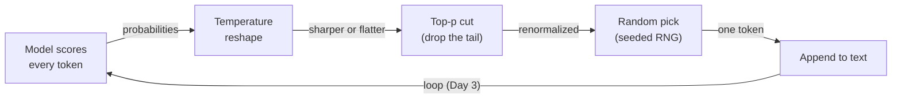
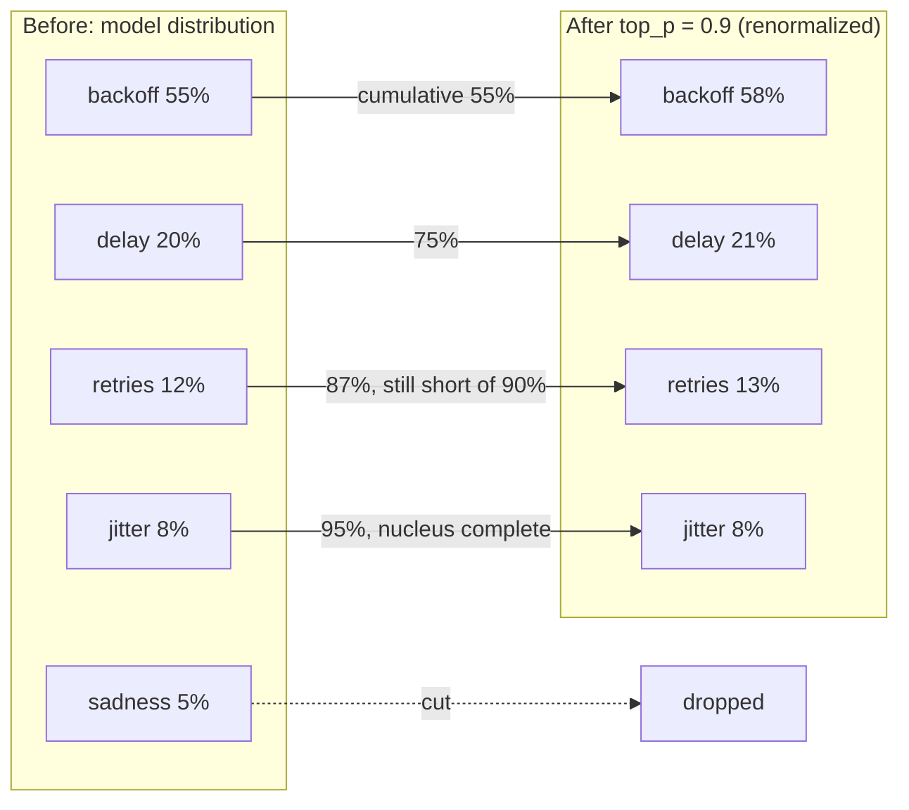
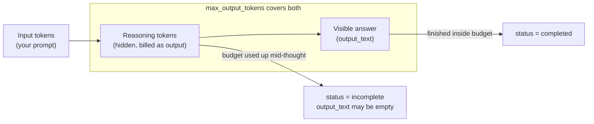
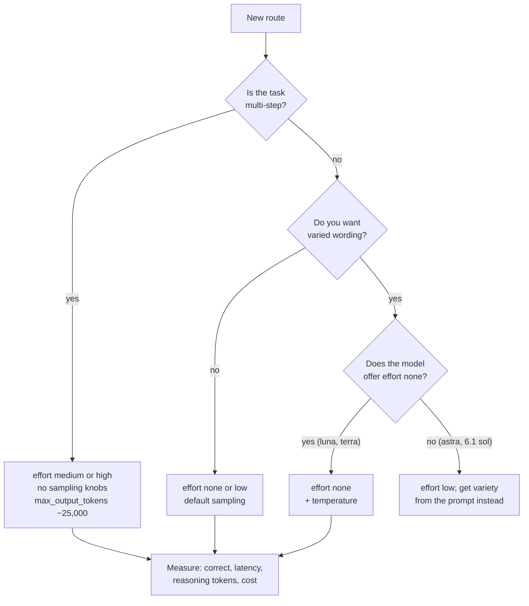

# Controlling Generation: Sampling & Reasoning Effort

You copy a tutorial that sets `temperature=0` "for deterministic output", and the API answers
with a 400. Modern models reason before they answer, so the main dial is now **reasoning
effort**, and the classic sampling knobs work in only one mode. Today you see what sampling does
with offline simulators that need no model at all, then learn which knobs are left and what
thinking costs.

## At a Glance

- **Time:** ~2 h core (+ optional Go Deeper) · **Depth:** working
- **Prerequisites:** [Day 3: What an LLM Is (and Isn't)](../../Phase_1_How_LLMs_Work/Day_003_what_is_an_llm/what_is_an_llm.md),
  [Day 4: Tokens: How Models Read Text](../../Phase_1_How_LLMs_Work/Day_004_tokens/tokens.md),
  [Day 5: Inside the Transformer: Attention & Context Windows](../../Phase_1_How_LLMs_Work/Day_005_transformers_attention/transformers_attention.md)
- **You'll build:** temperature and top-p simulators with a seeded sampler, an effort sweep that
  prints correctness, latency, reasoning tokens and cost, and a per-route settings guard
- **Stops at:** logit math (Go Deeper only), beam search, RL training
- **Fast path:** Already know temperature and top-p? Read §Sampling on a Live Model, §Reasoning
  Effort and §When the Answer Gets Cut Off, then do Exercise 3 (about 45 min).
- **Cost:** ≈ $0.05 or less on `gpt-6-luna`; the simulators are free and the high-effort sweep
  dominates (prices as of 2026-11, [verify](https://developers.openai.com/api/docs/pricing))
- **New terms:** sampling, temperature, top-p, reasoning effort, reasoning tokens

> **Coming from Software Engineering?** Temperature is a randomness config dial: low values make
> the same input give nearly the same output, high values trade reproducibility for variety.
> Top-p is a percentile cutoff: sort the candidates, keep just enough of the top to cover p of the
> probability, drop the tail. Reasoning effort is a "how hard to try" budget, like a query
> planner's time limit (how long the database may search for a better plan): more effort costs
> latency and money and usually buys quality on hard problems. `status: "incomplete"` is a
> truncated HTTP response, so check it before you trust the body.

## The 400 You Get for temperature=0

Here is the call most older tutorials teach, sent to today's course default model:

```python
# script_id: day_006_sampling_reasoning_effort/naive_call
# fragment
# The old habit: no reasoning setting (so effort defaults to "medium") plus temperature=0
client.responses.create(model="gpt-6-luna", input="Summarize issue 42.", temperature=0)
# -> openai.BadRequestError, HTTP 400, naming 'temperature' as unsupported (exact wording: ⚠ verify)
```

The request never reaches generation. On GPT-6 models, `temperature`, `top_p` and
`top_logprobs` are accepted **only** when `reasoning={"effort": "none"}`, and only on models that
offer `none` ([latest-model guide](https://developers.openai.com/api/docs/guides/latest-model)).
To see why the knobs existed, and why they matter less now, start with how a model picks a word.

## Picking from a Bag of Words

In [Day 3](../../Phase_1_How_LLMs_Work/Day_003_what_is_an_llm/what_is_an_llm.md) you saw the
loop: the model scores every possible next token, one is picked, it's appended, repeat. The
"picked" step is **sampling**: drawing the next token at random, weighted by how likely the model
thinks each one is.

Picture a bag of paper slips. Each candidate word gets slips in proportion to its probability, and
you draw one blindfolded. Three dials change the draw:

- **Temperature** changes how many slips each word gets. Low temperature gives the favourite even
  more slips; high temperature evens things out.
- **Top-p** throws away the rarest slips before you draw.
- **Reasoning effort** is different in kind: it's how long the model thinks (writing hidden
  scratch tokens) before it starts writing the answer you see.

## A Distribution by Hand

Take the prompt *"Orbit retries failed jobs with exponential …"*. Suppose the model's
**probability distribution** (chances over the options, adding up to 1) for the next word is:

| Token | Probability | Cumulative |
|---|---|---|
| backoff | 0.55 | 0.55 |
| delay | 0.20 | 0.75 |
| retries | 0.12 | 0.87 |
| jitter | 0.08 | 0.95 |
| sadness | 0.05 | 1.00 |

These numbers are made up so you can check them in your head. Now apply the dials by hand:

- **Top-p 0.9.** Walk down the sorted list adding probabilities until you reach 0.9. After
  `retries` you have 0.87, not enough; adding `jitter` reaches 0.95. Keep those four, cut
  `sadness`, and renormalize so the four sum to 1 again.
- **Top-p 0.5.** `backoff` alone is 0.55, so it's the only survivor: top-p 0.5 behaves like
  "always pick the favourite" on this distribution.
- **Low temperature** widens the gaps: `backoff` climbs well above 55% and `sadness` almost
  vanishes. **High temperature** narrows them: `backoff` drops and `sadness` gains.

Hold those predictions; the simulators will confirm them with exact numbers.

## Name the Parts: Sampling, Temperature, Top-p

- **Sampling:** choosing the next token at random, weighted by the distribution.
- **Greedy decoding:** always taking the single most likely token. It's what temperature → 0
  approaches.
- **Temperature:** a number (0–2 on the OpenAI API) that sharpens (below 1) or flattens (above 1)
  the distribution before the draw. At 1 it changes nothing.
- **Top-p** (also called nucleus sampling): keep the smallest set of top tokens whose probabilities
  add up to at least p, then draw only from those.
- **Seed:** a starting value for a random number generator that makes "random" picks repeatable.



## Build the Simulators

These run offline, on any machine, with no model. The first block reshapes a distribution by
temperature.

```python
# script_id: day_006_sampling_reasoning_effort/simulators
"""Offline sampling simulators: temperature, top-p and a seeded sampler.

Install: nothing (stdlib only) · Env: none · Services: none · No API key, no network.
"""
import math
import random
from collections import Counter

# Toy distribution after "Orbit retries failed jobs with exponential ..."
NEXT = {"backoff": 0.55, "delay": 0.20, "retries": 0.12, "jitter": 0.08, "sadness": 0.05}

def apply_temperature(probs: dict[str, float], temperature: float) -> dict[str, float]:
    """Reshape a distribution: T < 1 sharpens, T = 1 leaves it alone, T > 1 flattens."""
    if temperature < 0:
        raise ValueError("temperature must be >= 0")
    if temperature == 0:  # the limit as T -> 0: all weight on the top token (greedy)
        top = max(probs, key=probs.get)
        return {tok: float(tok == top) for tok in probs}
    # log(p) recovers the model's raw scores up to a constant; divide by T, then re-normalize
    scaled = {tok: math.log(p) / temperature for tok, p in probs.items() if p > 0}
    peak = max(scaled.values())  # subtract the max so exp() can't overflow
    weights = {tok: math.exp(z - peak) for tok, z in scaled.items()}
    total = sum(weights.values())
    return {tok: w / total for tok, w in weights.items()}

def show(probs: dict[str, float]) -> str:
    return ", ".join(f"{tok} {p:.0%}" for tok, p in probs.items())

for t in (0.1, 0.5, 1.0, 2.0):
    print(f"T={t}: {show(apply_temperature(NEXT, t))}")
```

```text
T=0.1: backoff 100%, delay 0%, retries 0%, jitter 0%, sadness 0%
T=0.5: backoff 83%, delay 11%, retries 4%, jitter 2%, sadness 1%
T=1.0: backoff 55%, delay 20%, retries 12%, jitter 8%, sadness 5%
T=2.0: backoff 36%, delay 22%, retries 17%, jitter 14%, sadness 11%
```

The order never changes; only the gaps do. Temperature can't promote `sadness` above `backoff`,
it can only give it more or fewer slips. The second block adds the top-p cut.

```python
# script_id: day_006_sampling_reasoning_effort/simulators
def apply_top_p(probs: dict[str, float], p: float) -> dict[str, float]:
    """Keep the smallest set of top tokens whose probability reaches p, renormalized."""
    if not 0 < p <= 1:
        raise ValueError("top_p must be in (0, 1]")
    kept: dict[str, float] = {}
    cumulative = 0.0
    for tok, prob in sorted(probs.items(), key=lambda kv: kv[1], reverse=True):
        kept[tok] = prob
        cumulative += prob
        if cumulative >= p:  # stop once the nucleus covers p
            break
    total = sum(kept.values())
    return {tok: prob / total for tok, prob in kept.items()}

print("top_p=0.9:", show(apply_top_p(NEXT, 0.9)))
print("top_p=0.5:", show(apply_top_p(NEXT, 0.5)))
```

```text
top_p=0.9: backoff 58%, delay 21%, retries 13%, jitter 8%
top_p=0.5: backoff 100%
```

Both match the hand calculation: four survivors at 0.9, one at 0.5.



## Turn the Knobs: Seeded Sampling

A distribution isn't an output. The third block draws real tokens, 1,000 times per setting, with
a seeded `random.Random` so you get the same counts every run.

```python
# script_id: day_006_sampling_reasoning_effort/simulators
def sample_next(probs: dict[str, float], *, temperature: float = 1.0,
                top_p: float = 1.0, rng: random.Random) -> str:
    """One draw: temperature first, then the top-p cut, then a weighted random pick."""
    dist = apply_top_p(apply_temperature(probs, temperature), top_p)
    tokens = list(dist)
    return rng.choices(tokens, weights=[dist[t] for t in tokens], k=1)[0]

for t in (0.2, 1.0, 1.5):
    rng = random.Random(42)  # a fixed seed makes the whole run reproducible
    counts = Counter(sample_next(NEXT, temperature=t, rng=rng) for _ in range(1000))
    print(f"T={t}: " + "  ".join(f"{tok} {counts[tok]:>3}" for tok in NEXT))

rng_a, rng_b = random.Random(7), random.Random(7)  # two generators, same seed
first = [sample_next(NEXT, rng=rng_a) for _ in range(5)]
again = [sample_next(NEXT, rng=rng_b) for _ in range(5)]
print("seed 7:", first, "| repeat matches:", first == again)
```

```text
T=0.2: backoff 988  delay  10  retries   2  jitter   0  sadness   0
T=1.0: backoff 532  delay 211  retries 120  jitter  78  sadness  59
T=1.5: backoff 406  delay 223  retries 157  jitter 122  sadness  92
seed 7: ['backoff', 'backoff', 'delay', 'backoff', 'backoff'] | repeat matches: True
```

Read the table the way you'd read a load test. At T=0.2, `backoff` wins 988 times out of 1,000,
close to greedy. At T=1.5, `sadness` shows up 92 times: one sentence in eleven would contain a
nonsense word at this position. Real text is hundreds of tokens long, so small per-token odds add
up, which is why high temperature drifts off-topic.

The seed line matters for later: your *simulator* is reproducible because you own the random
number generator. A hosted model's sampler is not yours to seed, as you'll see next.

## Sampling on a Live Model

On GPT-6 models, sampling knobs come with one condition: set `reasoning={"effort": "none"}` so the
model answers without a hidden thinking phase. Only some models offer `none`:

| Model (as of 2026-11) | Effort values | `temperature` / `top_p` allowed? |
|---|---|---|
| `gpt-6-luna` (course default) | none, low, medium, high, xhigh, max | Yes, at effort `none` only |
| `gpt-6.1-terra` | none … max | Yes, at effort `none` only |
| `gpt-6-sol` | none … max | Yes, at effort `none` only |
| `gpt-6.1-sol` | low … max | No (`none` isn't offered) |
| `gpt-6-astra` | low … max | No (`none` returns HTTP 400) |

The default effort is `medium`, and the SDK still lists `minimal`; use `low` instead. Check the
[model pages](https://developers.openai.com/api/docs/models) before you rely on this table, since
it changes with new releases.

```python
# script_id: day_006_sampling_reasoning_effort/live_sampling
"""Live sampling: temperature only works at reasoning effort "none".

Install: uv add "openai>=3.46,<4" · Env: OPENAI_API_KEY (required), ATLAS_MODEL (optional)
Model:   must offer effort "none" (gpt-6-luna, gpt-6.1-terra, gpt-6-sol as of 2026-11)
"""
import os

from openai import OpenAI

MODEL = os.environ.get("ATLAS_MODEL", "gpt-6-luna")
client = OpenAI()
PROMPT = "Suggest one name for Orbit's retry-backoff helper function. Reply with the name only."

def sample_names(temperature: float, n: int = 3) -> list[str]:
    names = []
    for _ in range(n):
        r = client.responses.create(
            model=MODEL,
            input=PROMPT,
            reasoning={"effort": "none"},  # the only mode that accepts sampling knobs
            temperature=temperature,        # 0-2; tune this OR top_p, not both
            max_output_tokens=50,
        )
        names.append(r.output_text.strip())
    return names

for t in (0.2, 1.2):
    print(f"T={t}: {sample_names(t)}")
```

```text
Illustrative shape, not a recorded run (your names will differ):
T=0.2: ['<name A>', '<name A>', '<name A>']      # often the same, or nearly the same, name
T=1.2: ['<name B>', '<name C>', '<name D>']      # usually three different names
```

Now break it on purpose. The next script sends two requests the API rejects before any
generation happens, catches `openai.BadRequestError` (the SDK's class for HTTP 400), and prints
what the server said.

```python
# script_id: day_006_sampling_reasoning_effort/sampling_errors
"""Two calls that fail with HTTP 400, caught and printed. Rejected requests generate nothing.

Install: uv add "openai>=3.46,<4" · Env: OPENAI_API_KEY (required), ATLAS_MODEL (optional)
"""
import os

import openai
from openai import OpenAI

MODEL = os.environ.get("ATLAS_MODEL", "gpt-6-luna")
client = OpenAI()

BROKEN = {
    "temperature at effort low": {"model": MODEL, "reasoning": {"effort": "low"}, "temperature": 0},
    "effort none on gpt-6-astra": {"model": "gpt-6-astra", "reasoning": {"effort": "none"}},
}

for label, kwargs in BROKEN.items():
    try:
        client.responses.create(input="Say hi.", max_output_tokens=50, **kwargs)
        print(f"{label}: accepted (the rules changed; re-check the model page)")
    except openai.BadRequestError as e:
        # .param names the offending field when the server reports one
        print(f"{label}: HTTP {e.status_code} param={e.param!r}\n  {e.message}")
    except openai.APIStatusError as e:  # any other HTTP error, e.g. no access to that model
        print(f"{label}: HTTP {e.status_code} {e.message}")
```

```text
Illustrative shape (exact server wording: ⚠ verify on your run):
temperature at effort low: HTTP 400 param='temperature'
  Error code: 400 - {... 'message': "<says temperature isn't supported with this reasoning setting>" ...}
effort none on gpt-6-astra: HTTP 400 param=<'reasoning.effort' or None>
  Error code: 400 - {... 'message': "<says 'none' isn't a supported effort for this model>" ...}
```

Your run shows the server's real wording; it can change between API versions, so code should
branch on `e.status_code` and `e.param`, never on the message text. The fix is always one of two
moves: drop `temperature`/`top_p`/`top_logprobs`, or switch to effort `none` on a model that
offers it.

Two neighbours you may meet in older code. Anthropic's current Messages API rejects sampling
parameters entirely (Day 7 compares providers). `frequency_penalty` and `presence_penalty`
(throttles on repeated words) are legacy Chat Completions knobs; this course doesn't use them.

## Reasoning Effort: Paying for Thinking

With sampling mostly off the table, **reasoning effort** is the dial you'll turn most. At any
effort above `none`, the model first writes **reasoning tokens**: hidden working-out you never see
in `output_text`, but which you pay for at the output-token price
([reasoning guide](https://developers.openai.com/api/docs/guides/reasoning)). Higher effort means
more of them: usually better answers on multi-step problems, always more latency and cost.



A good effort test has an answer you can check by code. Orbit runs cron schedules
(`docs/scheduling-cron.md`): `0 9 * * MON` means 09:00 every Monday, evaluated in the worker's time
zone. Ask for the next run after Thursday 2026-11-05 08:30 UTC. The answer is Monday 2026-11-09
09:00 UTC, and the trap is that "09:00 is still ahead today" doesn't apply on a Thursday.

The first block holds the helpers. The cost function is a compact copy of Day 4's
`estimate_cost()` with Day 5's long-prompt surcharge, so this script stays self-contained.

```python
# script_id: day_006_sampling_reasoning_effort/effort_sweep
"""Sweep reasoning effort on one checkable task: correctness, latency, tokens and cost.

Install: uv add "openai>=3.46,<4" · Env: OPENAI_API_KEY (required), ATLAS_MODEL, SWEEP_EFFORTS
"""
import os
import time

from openai import OpenAI

MODEL = os.environ.get("ATLAS_MODEL", "gpt-6-luna")
client = OpenAI()

# Compact copy of Day 4's PRICES_PER_1M + estimate_cost (with Day 5's >272K surcharge).
# USD per 1M tokens, Standard tier. As of 2026-11, verify at https://developers.openai.com/api/docs/pricing
PRICES_PER_1M = {
    "gpt-6-luna":    {"input": 0.10, "cached_input": 0.01, "output": 0.50},
    "gpt-6.1-terra": {"input": 1.00, "cached_input": 0.05, "output": 5.00},
}

def estimate_cost(input_tokens: int, output_tokens: int, model: str = MODEL) -> float:
    price = PRICES_PER_1M[model]  # KeyError on purpose: an unknown model must not cost $0
    long_prompt = input_tokens > 272_000  # whole request: 2x input, 1.5x output
    in_rate = price["input"] * (2 if long_prompt else 1)
    out_rate = price["output"] * (1.5 if long_prompt else 1)
    return (input_tokens * in_rate + output_tokens * out_rate) / 1_000_000

def run_with_effort(prompt: str, effort: str, **kwargs) -> dict:
    """One call at one effort level, reduced to the numbers you compare settings on."""
    model = kwargs.pop("model", MODEL)
    start = time.perf_counter()
    r = client.responses.create(model=model, input=prompt, reasoning={"effort": effort}, **kwargs)
    latency = time.perf_counter() - start
    u = r.usage
    return {
        "text": r.output_text, "status": r.status, "latency_s": latency,
        "output_tokens": u.output_tokens,  # includes reasoning tokens
        "reasoning_tokens": u.output_tokens_details.reasoning_tokens,
        "cost": estimate_cost(u.input_tokens, u.output_tokens, model),
    }
```

The second block runs the sweep. `SWEEP_EFFORTS` lets you try `xhigh` or drop `none` on a model
that lacks it, without editing code.

```python
# script_id: day_006_sampling_reasoning_effort/effort_sweep
TASK = (
    "Orbit evaluates cron expressions in UTC. A job is scheduled with `0 9 * * MON`. "
    "The current time is Thursday 2026-11-05 08:30 UTC. When is the next run? "
    "Reply with only: YYYY-MM-DD HH:MM UTC"
)
EXPECTED = "2026-11-09 09:00"
EFFORTS = [e.strip() for e in os.environ.get("SWEEP_EFFORTS", "none,low,medium,high").split(",")]

print(f"{'effort':<8}{'correct':<9}{'latency s':>10}{'out tok':>9}{'reason tok':>11}{'cost $':>11}")
for effort in EFFORTS:
    row = run_with_effort(TASK, effort, max_output_tokens=25_000)  # headroom, see next section
    correct = EXPECTED in row["text"] and row["status"] == "completed"
    print(f"{effort:<8}{str(correct):<9}{row['latency_s']:>10.1f}{row['output_tokens']:>9}"
          f"{row['reasoning_tokens']:>11}{row['cost']:>11.6f}")
```

```text
Shape of the table, not a recorded run (fill it in from yours; values vary run to run):
effort  correct  latency s  out tok  reason tok     cost $
none    <bool>       <s>      <n>        <n>        <$>
low     <bool>       <s>      <n>        <n>        <$>
medium  <bool>       <s>      <n>        <n>        <$>
high    <bool>       <s>      <n>        <n>        <$>
```

What to look for in your table:

- **Reasoning tokens** should be at or near zero at `none` and grow with effort. They make up most
  of `out tok` at `high`.
- **Latency** tracks output tokens, because each token is generated in sequence.
- **Correctness** is the only column that tells you which effort to *pay* for. If `low` is already
  correct, `high` buys you nothing on this task. Run each level a few times before you decide,
  since one run can be lucky.

Day 11 goes further: how effort relates to chain-of-thought prompting and what the reasoning items
in `output` contain. Today effort is a knob with a measurable price.

## When the Answer Gets Cut Off

`max_output_tokens` caps **reasoning plus visible tokens together**. Set it low on a high-effort
call and the model can spend the whole budget thinking. The response then comes back with
`status="incomplete"`, `incomplete_details.reason="max_output_tokens"`, and an `output_text` that
is empty or partial. You are still billed for the input and every reasoning token.

```python
# script_id: day_006_sampling_reasoning_effort/incomplete
"""Hit the max_output_tokens cap on purpose, then handle incomplete responses explicitly.

Install: uv add "openai>=3.46,<4" · Env: OPENAI_API_KEY (required), ATLAS_MODEL (optional)
"""
import os

from openai import OpenAI
from openai.types.responses import Response

MODEL = os.environ.get("ATLAS_MODEL", "gpt-6-luna")
client = OpenAI()
TASK = ("Orbit evaluates cron in UTC. Schedule `0 9 * * MON`; now is Thursday 2026-11-05 08:30 "
        "UTC. When is the next run? Reply with only: YYYY-MM-DD HH:MM UTC")

r = client.responses.create(model=MODEL, input=TASK, reasoning={"effort": "high"},
                            max_output_tokens=64)  # far too small for high effort
reason = r.incomplete_details.reason if r.incomplete_details else None
print(f"status={r.status} reason={reason} text={r.output_text!r}")
print("reasoning tokens:", r.usage.output_tokens_details.reasoning_tokens)
```

```text
Illustrative shape, not a recorded run (high effort usually needs far more than 64 tokens):
status=incomplete reason=max_output_tokens text=''
reasoning tokens: <up to 64>
```

The second block turns that into a habit: never read `output_text` without checking `status`.
`require_complete()` returns the text or raises with a message that says what to change. It does
not retry; bounded re-asks are Day 17's topic.

```python
# script_id: day_006_sampling_reasoning_effort/incomplete
def require_complete(resp: Response) -> str:
    """Return output_text only for a completed response; otherwise explain what to change."""
    if resp.status == "completed":
        return resp.output_text
    reason = resp.incomplete_details.reason if resp.incomplete_details else None
    if reason == "max_output_tokens":
        used = resp.usage.output_tokens_details.reasoning_tokens
        raise RuntimeError(
            f"cut off at max_output_tokens={resp.max_output_tokens} ({used} reasoning tokens): "
            "raise the cap (start near 25,000 for reasoning) or lower the effort"
        )
    raise RuntimeError(f"response not usable: status={resp.status} reason={reason}")

for cap in (64, 25_000):
    resp = client.responses.create(model=MODEL, input=TASK, reasoning={"effort": "high"},
                                   max_output_tokens=cap)
    try:
        print(f"cap={cap}: {require_complete(resp)}")
    except RuntimeError as e:
        print(f"cap={cap}: {e}")
```

```text
Typical shape (your numbers will differ):
cap=64: cut off at max_output_tokens=64 (<n> reasoning tokens): raise the cap (start near 25,000 for reasoning) or lower the effort
cap=25000: 2026-11-09 09:00 UTC
```

The reasoning guide suggests reserving at least 25,000 tokens for reasoning plus output when you
start, then tuning down from what `usage` shows.

## Determinism and Tests

"Set temperature to 0 and the output is fixed" was never a guarantee from a hosted API, and on
most GPT-6 calls you can't set temperature at all. This script counts distinct answers across
five identical calls in two modes.

```python
# script_id: day_006_sampling_reasoning_effort/determinism
"""Same prompt, five calls, two modes: count how many distinct answers come back.

Install: uv add "openai>=3.46,<4" · Env: OPENAI_API_KEY (required), ATLAS_MODEL (optional)
"""
import os

from openai import OpenAI

MODEL = os.environ.get("ATLAS_MODEL", "gpt-6-luna")
client = OpenAI()
PROMPT = "In one sentence, explain what a dead-letter queue is for."

def distinct_answers(n: int, **settings) -> int:
    answers = {client.responses.create(model=MODEL, input=PROMPT, **settings).output_text
               for _ in range(n)}
    return len(answers)

print("effort none, T=0:", distinct_answers(5, reasoning={"effort": "none"}, temperature=0,
                                            max_output_tokens=200), "distinct of 5")
print("effort low:      ", distinct_answers(5, reasoning={"effort": "low"},
                                            max_output_tokens=25_000), "distinct of 5")
```

```text
Illustrative shape (your counts will differ, and can change between runs):
effort none, T=0: <1 to 5> distinct of 5
effort low:       <1 to 5> distinct of 5
```

Whatever your counts, the conclusion for tests is the same: **never assert on an exact output
string.** Assert on structure and properties (valid JSON, the right label from a fixed set, a date
that parses), mock the client in unit tests
([Day 19](../../Phase_2_Building_with_LLM_APIs/Day_019_testing_llm_code/testing_llm_code.md)), and
measure quality with an eval set
([Day 20](../../Phase_2_Building_with_LLM_APIs/Day_020_first_eval_set/first_eval_set.md)).

## Trade-offs: Choosing Settings

Settings belong to the *task*, not the app. A rule of thumb: pick the lowest effort that passes
your checks, and use temperature only for text where variety is the point.

| Task | Effort | Sampling | Why |
|---|---|---|---|
| Extraction, classification, short lookups | `none` or `low` | leave default | Little to reason about; latency and cost dominate |
| Multi-step problems (dates, debugging, planning) | `medium` or `high` | not allowed | Reasoning tokens buy correctness; measure it |
| Creative text (names, release-note drafts) | `none` | `temperature` ~1.0–1.2 | Variety is the goal; only on models that offer `none` |
| Unit tests | whatever production uses | n/a | Mock the client; never exact-match outputs |



Write those choices down as data, and validate them before any request leaves your code. That
turns a 400 at runtime into an error you catch at startup. This script runs offline.

```python
# script_id: day_006_sampling_reasoning_effort/settings_by_route
"""Per-route generation settings as data, validated offline before any request is sent.

Install: nothing (stdlib only) · Env: ATLAS_MODEL (optional) · No API key, no network.
"""
import os

MODEL = os.environ.get("ATLAS_MODEL", "gpt-6-luna")
# Models that offer effort "none" (as of 2026-11; check the model pages when this changes)
NONE_MODELS = {"gpt-6-luna", "gpt-6.1-terra", "gpt-6-sol"}
SAMPLING_KEYS = {"temperature", "top_p", "top_logprobs"}

ROUTES: dict[str, dict] = {
    "extract_issue":  {"effort": "none"},
    "label_component": {"effort": "low"},
    "next_cron_run":  {"effort": "medium", "max_output_tokens": 25_000},
    "name_suggestion": {"effort": "none", "temperature": 1.1, "max_output_tokens": 50},
}

def generation_params(route: str, model: str = MODEL) -> dict:
    """Return keyword arguments for responses.create(), or raise before the API would."""
    settings = dict(ROUTES[route])
    effort = settings.pop("effort")
    if effort == "minimal":
        raise ValueError(f"{route}: use effort 'low' instead of 'minimal'")
    if effort == "none" and model not in NONE_MODELS:
        raise ValueError(f"{route}: {model} doesn't offer effort 'none'; use 'low'")
    if effort != "none" and SAMPLING_KEYS & settings.keys():
        raise ValueError(f"{route}: sampling knobs need effort 'none', got {effort!r}")
    if not 0 <= settings.get("temperature", 1.0) <= 2:
        raise ValueError(f"{route}: temperature must be within 0-2")
    return {"model": model, "reasoning": {"effort": effort}, **settings}

for name in ROUTES:
    print(f"{name:<16} {generation_params(name)}")
try:
    generation_params("name_suggestion", model="gpt-6-astra")
except ValueError as e:
    print("caught before sending:", e)
```

```text
extract_issue    {'model': 'gpt-6-luna', 'reasoning': {'effort': 'none'}}
label_component  {'model': 'gpt-6-luna', 'reasoning': {'effort': 'low'}}
next_cron_run    {'model': 'gpt-6-luna', 'reasoning': {'effort': 'medium'}, 'max_output_tokens': 25000}
name_suggestion  {'model': 'gpt-6-luna', 'reasoning': {'effort': 'none'}, 'temperature': 1.1, 'max_output_tokens': 50}
caught before sending: name_suggestion: gpt-6-astra doesn't offer effort 'none'; use 'low'
```

Use it as `client.responses.create(input=..., **generation_params("next_cron_run"))`. Adding a
route or moving one to another model is a data change, and the guard tells you at once if the new
combination is one the API would reject.

### In production

- Teams set effort **per route** and store it with the prompt, so changing it is reviewed like
  any config change.
- Log `usage.output_tokens_details.reasoning_tokens` on every call; reasoning is often the
  biggest line on the bill and invisible in the response text.
- Leave `max_output_tokens` headroom on reasoning routes and alert on `status="incomplete"`
  instead of shipping empty answers.
- Re-run your effort sweep when you change models: the cheapest correct effort moves with the
  model (Day 7).
- Treat a 400 on sampling parameters as a config bug, not a transient error: retrying it can't
  succeed (retry policy is Day 84's topic).

## Go Deeper (optional)

<details><summary>Go deeper: logits, softmax and why T → 0 means greedy</summary>

The simulators started from probabilities, but a model produces raw scores first. A **logit** is
the raw score for one token before it becomes a probability; it can be any number, like `2.0` or
`-3.5`. **Softmax** turns scores into probabilities: raise *e* to each score, then divide by the
total so everything sums to 1.

In words, then toy numbers, then the formula:

1. **Words.** Exponentiating stretches gaps: a score one point higher ends up about 2.7× likelier.
   Temperature divides every score by `T` *before* softmax. Dividing by `T < 1` makes the gaps
   bigger (sharper); `T > 1` makes them smaller (flatter).
2. **Toy numbers.** Scores `backoff 2.0, delay 1.0, retries 0.5`. At `T = 1` softmax gives about
   63% / 23% / 14%. At `T = 0.5` the scores become 4.0 / 2.0 / 1.0, giving 84% / 11% / 4%.
   At `T = 2` they become 1.0 / 0.5 / 0.25, giving 48% / 29% / 23%.
3. **Formula.** `p_i = exp(z_i / T) / Σ_j exp(z_j / T)`. As `T → 0`, the largest `z_i / T` grows
   far faster than the rest, so its share tends to 1: that's greedy decoding (argmax).

`apply_temperature()` did the same thing in reverse: `log(p)` recovers the scores up to a constant
that cancels in the division. **Top-k** is the simpler cousin of top-p: keep a fixed number `k` of
top tokens no matter how the probability is spread (Exercise 2 compares them).

```python
# script_id: day_006_sampling_reasoning_effort/softmax_by_hand
"""Softmax over toy logits at three temperatures. Stdlib only, offline."""
import math

LOGITS = {"backoff": 2.0, "delay": 1.0, "retries": 0.5}

def softmax(logits: dict[str, float], temperature: float = 1.0) -> dict[str, float]:
    exps = {tok: math.exp(z / temperature) for tok, z in logits.items()}
    total = sum(exps.values())
    return {tok: e / total for tok, e in exps.items()}

for t in (1.0, 0.5, 2.0):
    print(f"T={t}: " + ", ".join(f"{k} {v:.1%}" for k, v in softmax(LOGITS, t).items()))
```

```text
T=1.0: backoff 62.9%, delay 23.1%, retries 14.0%
T=0.5: backoff 84.4%, delay 11.4%, retries 4.2%
T=2.0: backoff 48.1%, delay 29.2%, retries 22.7%
```

</details>

<details><summary>Go deeper: reading the model's real distribution with logprobs</summary>

At effort `none`, on a model that offers it, the API can return **logprobs**: the log-probability
of each generated token, plus the top alternatives at each position. That's the real version of
the `NEXT` table you invented. Ask for them with `top_logprobs` (0–20) and
`include=["message.output_text.logprobs"]`; both are rejected at any other effort.

```python
# script_id: day_006_sampling_reasoning_effort/logprobs_peek
"""Peek at the first-token distribution of a live answer (effort none only).

Install: uv add "openai>=3.46,<4" · Env: OPENAI_API_KEY (required), ATLAS_MODEL (optional)
"""
import math
import os

from openai import OpenAI

MODEL = os.environ.get("ATLAS_MODEL", "gpt-6-luna")  # must offer effort "none"
client = OpenAI()

r = client.responses.create(
    model=MODEL,
    instructions="Continue the text with exactly one word.",
    input="Orbit retries failed jobs with exponential",
    reasoning={"effort": "none"},
    top_logprobs=5,
    include=["message.output_text.logprobs"],
    max_output_tokens=16,
)
part = next(item for item in r.output if item.type == "message").content[0]
first = part.logprobs[0]  # the first generated token
print("picked:", repr(first.token))
for alt in first.top_logprobs:
    print(f"  {alt.token!r:<14} {math.exp(alt.logprob):.1%}")  # exp(logprob) = probability
```

```text
Illustrative shape (no recorded run):
picked: '<token>'
  '<token>'      <percent>
  ... (five rows)
```

Logprobs are useful for confidence scores on classification labels and for spotting when the
model is torn between two answers. They exist only in the mode without reasoning, so a design
that depends on them also fixes your effort at `none`.

</details>

<details><summary>Go deeper: what "effort" does not control</summary>

- **It's not a hard token budget.** Effort is a hint about how much to think; `max_output_tokens`
  is the hard cap. Use both: effort for quality, the cap for cost and latency limits.
- **It's not chain-of-thought prompting.** Asking for step-by-step reasoning in the prompt is a
  separate technique; how the two interact is Day 11's subject.
- **Higher isn't always better.** On simple tasks extra reasoning adds cost and latency with no
  gain, which is why the sweep reports correctness first.
- **Beam search** (keeping several candidate continuations in parallel and picking the best
  sequence) is a decoding method from older and open-weight systems. Hosted reasoning APIs don't
  expose it, so this course doesn't cover it.

</details>

## Common Pitfalls

- **HTTP 400 naming `temperature`, `top_p` or `top_logprobs`** (exact wording ⚠ verify on your
  run). Cause: a sampling knob at effort other than `none` (including the default `medium`). Fix: drop the knob, or use effort `none` on
  `gpt-6-luna`/`gpt-6.1-terra`.
- **HTTP 400 for `reasoning={"effort": "none"}`.** Cause: the model doesn't offer it
  (`gpt-6-astra`; `gpt-6.1-sol` doesn't list it either). Fix: use `low`. `minimal` should also
  become `low`.
- **Empty `output_text` with `status="incomplete"`.** Cause: reasoning used up
  `max_output_tokens`. Fix: check `status` on every call, raise the cap (start near 25,000) or
  lower the effort.
- **"temperature=0 makes it deterministic."** Hosted outputs can still vary, and most GPT-6 calls
  can't set temperature anyway. Fix: test structure and properties, never exact strings.
- **Tuning temperature and top-p together.** The effects compound (reshape, then cut) and are
  hard to reason about (long-standing provider advice; ⚠ verify against the current docs). Fix: tune one and leave the other at its default.
- **A surprise bill.** Cause: hidden reasoning at high effort. Fix: read
  `usage.output_tokens_details.reasoning_tokens` in every sweep and log it in production.

> **Where we stop:** logit math stays in Go Deeper, and beam search and RL (reinforcement
> learning) training are out of scope because you can't control them through a hosted API; the
> [OpenAI reasoning guide](https://developers.openai.com/api/docs/guides/reasoning) is the place to
> read more about effort.

## Key Takeaways

- Sampling draws the next token at random, weighted by the model's distribution; temperature
  reshapes the odds (never the order), and top-p cuts the unlikely tail before the draw.
- Your simulators are reproducible because you own the seeded RNG; a hosted model's outputs are
  not, so tests check properties and never exact strings.
- On GPT-6, `temperature`/`top_p`/`top_logprobs` work only at `reasoning={"effort": "none"}` on
  models that offer it (luna, 6.1 terra, 6 sol); otherwise you get a 400, and `none` on astra is
  itself a 400.
- Reasoning effort trades latency and cost for correctness; reasoning tokens are hidden, billed as
  output, and the cheapest correct effort is found per task by measuring.
- `max_output_tokens` caps reasoning plus answer; check `status` and
  `incomplete_details.reason` before reading `output_text`, and leave headroom on reasoning routes.

## Quick Reference

| API / pattern | What it does | When to use | Gotcha |
|---|---|---|---|
| `reasoning={"effort": "none" \| "low" \| "medium" \| "high" \| "xhigh" \| "max"}` | Sets how much the model thinks | Every call; choose per route | Default is `medium`; `none` not on astra/6.1 sol; `minimal` → `low` |
| `temperature=` (0–2) | Sharpens or flattens sampling | Creative text at effort `none` | 400 at any other effort |
| `top_p=` | Cuts the low-probability tail | Rarely; prefer temperature | Don't tune together with temperature |
| `max_output_tokens=` | Hard cap on reasoning + visible tokens | Always, with headroom | Too low → `incomplete`, still billed |
| `resp.status`, `resp.incomplete_details.reason` | Whether the answer finished | Before reading `output_text` | `output_text` can be `""` |
| `resp.usage.output_tokens_details.reasoning_tokens` | Hidden thinking you paid for | Sweeps, logs, cost checks | Already included in `output_tokens` |
| `openai.BadRequestError` (`.status_code`, `.param`, `.message`) | HTTP 400 from the API | Config mistakes | Don't retry; fix the request |
| `random.Random(seed)` | Reproducible local randomness | Simulators, local tests | Doesn't make a hosted model repeatable |

## Exercises

1. **Warm-up.** In `orbit.toml`, the line `concurrency = ` is followed by a number. Invent a
   distribution over `"8"`, `"4"`, `"16"`, `"32"`, `"1"` and print it at T=0.3, 1.0 and 1.8 with
   `apply_temperature()`. Before running, predict which value gains most at 1.8.

<details><summary>Solution</summary>

```python
# script_id: day_006_sampling_reasoning_effort/solution_ex1
# Stdlib only · Env: none. Compact copy of this lesson's apply_temperature().
import math

CONCURRENCY = {"8": 0.40, "4": 0.25, "16": 0.20, "32": 0.10, "1": 0.05}

def apply_temperature(probs: dict[str, float], temperature: float) -> dict[str, float]:
    scaled = {tok: math.log(p) / temperature for tok, p in probs.items()}
    peak = max(scaled.values())
    weights = {tok: math.exp(z - peak) for tok, z in scaled.items()}
    total = sum(weights.values())
    return {tok: w / total for tok, w in weights.items()}

for t in (0.3, 1.0, 1.8):
    dist = apply_temperature(CONCURRENCY, t)
    print(f"T={t}: " + ", ".join(f"{k} {v:.0%}" for k, v in dist.items()))
```

The rarest values gain most in relative terms at 1.8 (`"1"` doubles, 5% → 10%), while `"8"`
climbs to 76% at 0.3. A config value is a case where you'd want low variety.

</details>

2. **Core.** Write `apply_top_k(probs, k)`, which keeps the `k` most likely tokens and
   renormalizes. Compare `top_k=3` with `top_p=0.9` on a peaked distribution (one token at 90%)
   and on a flat one (five tokens between 16% and 24%). Which method adapts to the shape?

<details><summary>Solution</summary>

```python
# script_id: day_006_sampling_reasoning_effort/solution_ex2
# Stdlib only · Env: none. apply_top_p() is a compact copy from this lesson.
def renormalize(kept: dict[str, float]) -> dict[str, float]:
    total = sum(kept.values())
    return {tok: p / total for tok, p in kept.items()}

def apply_top_k(probs: dict[str, float], k: int) -> dict[str, float]:
    ranked = sorted(probs.items(), key=lambda kv: kv[1], reverse=True)
    return renormalize(dict(ranked[:k]))

def apply_top_p(probs: dict[str, float], p: float) -> dict[str, float]:
    kept, cumulative = {}, 0.0
    for tok, prob in sorted(probs.items(), key=lambda kv: kv[1], reverse=True):
        kept[tok] = prob
        cumulative += prob
        if cumulative >= p:
            break
    return renormalize(kept)

PEAKED = {"backoff": 0.90, "delay": 0.05, "retries": 0.03, "jitter": 0.01, "sadness": 0.01}
FLAT = {"backoff": 0.24, "delay": 0.22, "retries": 0.20, "jitter": 0.18, "sadness": 0.16}

for name, dist in (("peaked", PEAKED), ("flat", FLAT)):
    print(f"{name}: top_k=3 keeps {list(apply_top_k(dist, 3))}, "
          f"top_p=0.9 keeps {list(apply_top_p(dist, 0.9))}")
```

Top-k keeps three tokens on both. Top-p keeps one on the peaked distribution (the model is
confident) and all five on the flat one (it isn't). Top-p adapts to the model's certainty; top-k
doesn't.

</details>

3. **Core.** Find the cheapest effort that answers each of three tasks correctly in 3 out of 3
   runs: a docs lookup (missed cron ticks), the cron question, and picking a component label. Use
   `gpt-6-luna` and print the winning effort per task.

<details><summary>Solution</summary>

```python
# script_id: day_006_sampling_reasoning_effort/solution_ex3
# Install: uv add "openai>=3.46,<4" · Env: OPENAI_API_KEY (required), ATLAS_MODEL (optional)
import os

from openai import OpenAI

MODEL = os.environ.get("ATLAS_MODEL", "gpt-6-luna")
client = OpenAI()
OUT_PRICE = 0.50  # gpt-6-luna output USD per 1M; as of 2026-11, verify at the pricing page
TASKS = {
    "docs lookup": ("Orbit docs: 'Missed ticks are not backfilled. If no worker was running at "
                    "09:00 on Monday, the 09:00 run is skipped.' Is a missed run executed later? "
                    "Reply yes or no.", "no"),
    "cron": ("Orbit evaluates cron in UTC. Schedule `0 9 * * MON`; now is Thursday 2026-11-05 "
             "08:30 UTC. When is the next run? Reply with only: YYYY-MM-DD HH:MM UTC",
             "2026-11-09 09:00"),
    "component": ("Pick one Orbit component label for: 'Jobs enqueued through the Redis broker "
                  "vanish after a broker restart.' Labels: core, cli, scheduler, broker-redis, "
                  "dashboard. Reply with the label only.", "broker-redis"),
}
RUNS = 3  # one run can be lucky

for name, (prompt, expected) in TASKS.items():
    for effort in ("none", "low", "medium", "high"):
        hits = out_tokens = 0
        for _ in range(RUNS):
            r = client.responses.create(model=MODEL, input=prompt, reasoning={"effort": effort},
                                        max_output_tokens=25_000)
            hits += r.status == "completed" and r.output_text.strip().lower().startswith(expected)
            out_tokens += r.usage.output_tokens
        if hits == RUNS:
            cost = out_tokens / RUNS * OUT_PRICE / 1_000_000
            print(f"{name}: cheapest correct effort = {effort} (~${cost:.6f} output per call)")
            break
    else:
        print(f"{name}: no effort passed {RUNS}/{RUNS}; fix the prompt before paying for effort")
```

Expect the lookup and the label to pass at `none` or `low`, and the cron question to need more.
If your numbers disagree, trust them: that's the point of measuring per task.

</details>

4. **Stretch (optional, past the stop line).** Using the logprobs Go Deeper block, turn the five
   first-token alternatives into a distribution, sample it 20 times with a seeded RNG, and compare
   the counts with the first word of 20 live answers at the default temperature.

<details><summary>Solution</summary>

```python
# script_id: day_006_sampling_reasoning_effort/solution_ex4
# Install: uv add "openai>=3.46,<4" · Env: OPENAI_API_KEY (required), ATLAS_MODEL (optional)
import math
import os
import random
from collections import Counter

from openai import OpenAI

MODEL = os.environ.get("ATLAS_MODEL", "gpt-6-luna")  # must offer effort "none"
client = OpenAI()
ASK = {"model": MODEL, "instructions": "Continue the text with exactly one word.",
       "input": "Orbit retries failed jobs with exponential",
       "reasoning": {"effort": "none"}, "max_output_tokens": 16}

def first_word(text: str) -> str:
    return (text.split() or [""])[0].strip(".,").lower()

r = client.responses.create(**ASK, top_logprobs=5, include=["message.output_text.logprobs"])
part = next(item for item in r.output if item.type == "message").content[0]
dist: dict[str, float] = {}
for alt in part.logprobs[0].top_logprobs:
    word = first_word(alt.token)
    dist[word] = dist.get(word, 0.0) + math.exp(alt.logprob)  # merge "backoff" and " backoff"
total = sum(dist.values())
dist = {w: p / total for w, p in dist.items()}  # renormalize over the top 5 only

rng = random.Random(0)
simulated = Counter(rng.choices(list(dist), weights=list(dist.values()), k=20))
live = Counter(first_word(client.responses.create(**ASK).output_text) for _ in range(20))
print("simulated:", dict(simulated))
print("live:     ", dict(live))
```

With 20 draws the counts are noisy, but the top word should lead in both. Gaps come from
renormalizing over only five alternatives, and from multi-token words whose first token isn't the
whole word.

</details>

## References & Further Reading

- [OpenAI: Reasoning models](https://developers.openai.com/api/docs/guides/reasoning): effort
  values, the 25,000-token headroom advice and how to handle `incomplete` responses.
- [OpenAI: Using the latest model](https://developers.openai.com/api/docs/guides/latest-model):
  which GPT-6 models offer effort `none` and the rule that removes sampling parameters otherwise.
- [OpenAI: gpt-6-luna model page](https://developers.openai.com/api/docs/models/gpt-6-luna): the
  course default's effort values, limits and prices.
- [OpenAI: Pricing](https://developers.openai.com/api/docs/pricing): current output rates, which
  is what reasoning tokens are billed at.
- [OpenAI: Error codes](https://developers.openai.com/api/docs/guides/error-codes): what a 400
  means and which errors are worth retrying.
- Holtzman et al., "The Curious Case of Neural Text Degeneration" (arXiv 1904.09751, 2019): the
  paper that introduced nucleus (top-p) sampling, past today's stop line.

## What's Next

You can now set the knobs and measure what thinking costs on one model. In
[Day 7: Choosing a Model: Capability, Cost, Latency & Lifecycle](../../Phase_1_How_LLMs_Work/Day_007_choosing_a_model/choosing_a_model.md)
you'll compare models themselves, reusing today's `run_with_effort()` shape to put latency, cost
and correctness side by side across tiers.
