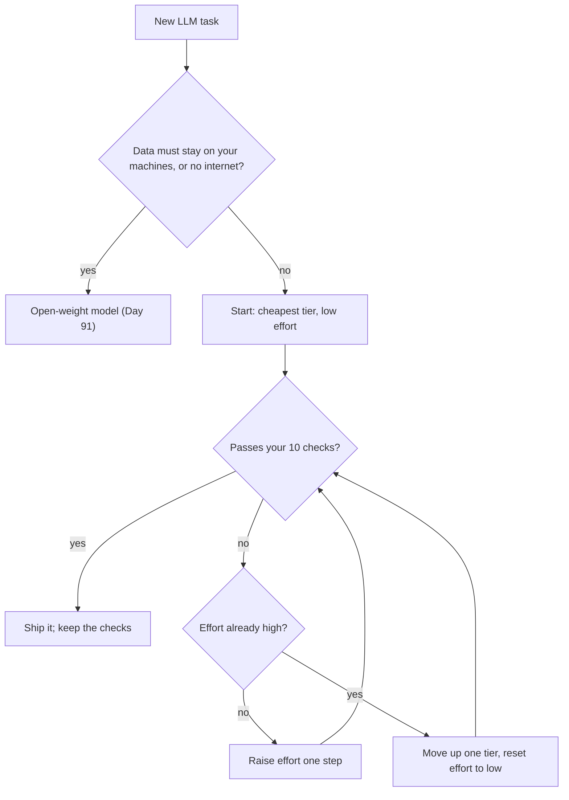
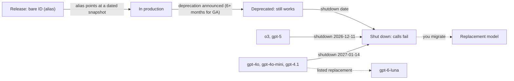
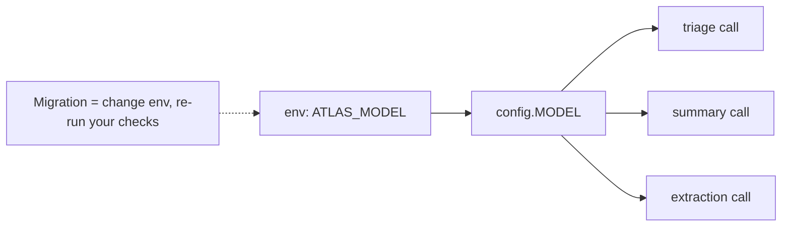
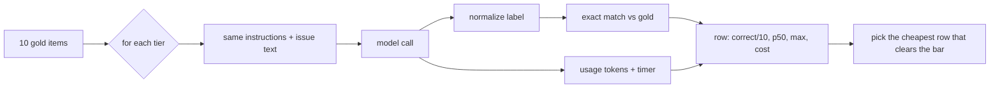

# Choosing a Model: Capability, Cost, Latency & Lifecycle

Triaging 10,000 Orbit issues a day costs about $1 on `gpt-6-luna` and about $100 on `gpt-6-astra`,
and on most teams nobody has checked whether the cheap one was good enough. The model ID you
hard-code today can also be shut down before you finish this course: `gpt-4o` retires on
2027-01-14. Today you measure instead of guessing, and you make the model a one-line config change.

## At a Glance

- **Time:** ~2 h core (+ optional Go Deeper) · **Depth:** working
- **Prerequisites:** [Day 2: Setup & Your First LLM Call](../../Phase_0_Start_Here/Day_002_setup_first_call/setup_first_call.md) (config, client), [Day 4: Tokens: How Models Read Text](../../Phase_1_How_LLMs_Work/Day_004_tokens/tokens.md) (`estimate_cost`), [Day 6: Controlling Generation: Sampling & Reasoning Effort](../../Phase_1_How_LLMs_Work/Day_006_sampling_reasoning_effort/sampling_reasoning_effort.md) (the effort knob)
- **You'll build:** a tier comparison over 10 hand-checked Orbit issues that prints accuracy, latency and cost per tier, plus a startup check that your configured model exists
- **Stops at:** benchmark methodology, leaderboards and significance testing (real evals start in [Day 20](../../Phase_2_Building_with_LLM_APIs/Day_020_first_eval_set/first_eval_set.md))
- **Fast path:** Already pick models for a living? Read §Name the Parts (the lifecycle half), run `compare_tiers`, and do Exercise 3 (about 45 min)
- **Cost:** ≈ $0.05 for luna/terra/sol, ≈ $0.20 with the flagship opted in, ≈ $0.10 including exercises (prices as of 2026-11, [verify](https://developers.openai.com/api/docs/pricing))
- **New terms:** model tier, alias vs snapshot, deprecation/shutdown, open-weight model, exact match

> **Coming from Software Engineering?** Picking a model is instance sizing: capacity planning, but
> per request instead of per server. You would not put a cron job on the biggest box in the fleet
> without a reason, and the same discipline applies here. Choosing between OpenAI and Anthropic
> feels like AWS vs GCP: similar services, different APIs and price sheets. A model alias behaves
> like a floating Docker tag (`:latest`), a snapshot like a pinned image digest, and a shutdown
> date like a dependency's end-of-life. Keeping model IDs in environment variables is plain
> twelve-factor config (settings live in the environment, not the code).

## Flagship by Default Is a Budget Bug

Here is the naive version: a teammate wires Atlas's issue triage to the biggest model "to be safe".
Each call sends about 600 input tokens (the issue) and gets about 80 output tokens back (a label and
a sentence). At 10,000 issues a day, the tier you pick is the difference between a rounding error and
a line item your manager asks about.

The script below is pure arithmetic: no key, no network. It reuses Day 4's `estimate_cost` and
extends `PRICES_PER_1M` with every tier you meet today.

```python
# script_id: day_007_choosing_a_model/cost_at_scale
# What 10,000 triage calls a day cost on each tier. Pure arithmetic: no key, no network.
# Run: uv run cost_at_scale.py
# Prices as of 2026-11; verify at https://developers.openai.com/api/docs/pricing
import os

MODEL = os.environ.get("ATLAS_MODEL", "gpt-6-luna")

# USD per 1M tokens, Standard tier, prompts up to 272K input tokens (built on Day 4)
PRICES_PER_1M: dict[str, dict[str, float]] = {
    "gpt-6-luna":    {"input": 0.10, "cached_input": 0.01, "output": 0.50},
    "gpt-6.1-terra": {"input": 1.00, "cached_input": 0.05, "output": 5.00},
    "gpt-6.1-sol":   {"input": 2.00, "cached_input": 0.10, "output": 10.00},
    "gpt-6-astra":   {"input": 10.00, "cached_input": 1.00, "output": 50.00},
    # Claude comparison row; cache rates differ, see https://www.anthropic.com/pricing (verify)
    "claude-haiku-5-5": {"input": 0.10, "output": 0.50},
}

def estimate_cost(input_tokens: int, output_tokens: int, model: str = MODEL) -> float:
    """USD for one call. output_tokens must include reasoning tokens (they bill as output)."""
    if model not in PRICES_PER_1M:
        raise KeyError(f"no price for {model!r}; add it to PRICES_PER_1M")
    price = PRICES_PER_1M[model]
    return (input_tokens * price["input"] + output_tokens * price["output"]) / 1_000_000

CALLS_PER_DAY, IN_TOKENS, OUT_TOKENS = 10_000, 600, 80   # one triage call

for model in PRICES_PER_1M:
    per_call = estimate_cost(IN_TOKENS, OUT_TOKENS, model)
    print(f"{model:<17} ${per_call:.5f}/call  ${per_call * CALLS_PER_DAY:>7.2f}/day  "
          f"${per_call * CALLS_PER_DAY * 30:>8.2f}/month")
```

```text
gpt-6-luna        $0.00010/call  $   1.00/day  $   30.00/month
gpt-6.1-terra     $0.00100/call  $  10.00/day  $  300.00/month
gpt-6.1-sol       $0.00200/call  $  20.00/day  $  600.00/month
gpt-6-astra       $0.01000/call  $ 100.00/day  $ 3000.00/month
claude-haiku-5-5  $0.00010/call  $   1.00/day  $   30.00/month
```

A 100× spread for the same job. The question this lesson answers is not "which model is best" but
"which is the least expensive model that is good enough *for this task*, and how do I know?"

## Junior, Mid, Senior: The Intuition

Think of staffing a task. You'd hand "sort these tickets into 13 buckets" to a junior colleague and
spot-check their work, escalating only when they get things wrong in a way you can point to. Model
choice works the same way:

1. Start with the least expensive tier.
2. Check its work on a small set of examples where you know the right answer.
3. Escalate (more effort, then a bigger tier) only on *measured* failures.

"The big model feels smarter" is not a measurement. "Luna got 6 of 10 components right and Terra
got 9" is.

## Reading a Pricing Page by Hand

Before any code, price one triage call yourself. A **model tier** is a price/capability band: the
same provider sells a cheap, fast model and progressively larger, slower, more capable ones. Prices
are quoted in USD per 1 million tokens, with separate input and output rates.

One call = 600 input tokens + 80 output tokens (prices as of 2026-11,
[verify](https://developers.openai.com/api/docs/pricing)):

| Tier | Input math | Output math | Per call | 10k/day |
|---|---|---|---|---|
| `gpt-6-luna` | 600 × $0.10 / 1M = $0.00006 | 80 × $0.50 / 1M = $0.00004 | $0.0001 | $1 |
| `gpt-6.1-terra` | 600 × $1.00 / 1M = $0.0006 | 80 × $5.00 / 1M = $0.0004 | $0.001 | $10 |
| `gpt-6.1-sol` | 600 × $2.00 / 1M = $0.0012 | 80 × $10.00 / 1M = $0.0008 | $0.002 | $20 |
| `gpt-6-astra` | 600 × $10.00 / 1M = $0.006 | 80 × $50.00 / 1M = $0.004 | $0.01 | $100 |

Three footnotes on every pricing page are worth knowing now:

- **Output costs 5× input** on all four tiers, and reasoning tokens bill as output. A model that
  "thinks" for 400 tokens before writing an 80-token label is billed for 480 output tokens.
- **The >272K surcharge** from [Day 5](../../Phase_1_How_LLMs_Work/Day_005_transformers_attention/transformers_attention.md):
  a prompt over 272K input tokens is billed at 2× input and 1.5× output for the whole request.
- **Batch** runs the same models at 50% of Standard price if you can wait up to 24 hours.
  [Day 18](../../Phase_2_Building_with_LLM_APIs/Day_018_cost_latency_caching/cost_latency_caching.md) owns it.

## Name the Parts: Tiers, Effort, Lifecycle

### The tier table

All values as of 2026-11-06 from the [models](https://developers.openai.com/api/docs/models) and
[pricing](https://developers.openai.com/api/docs/pricing) pages; verify before quoting.

| Tier (our name) | Model ID | $ in / out per 1M | Context | Effort values | Notes |
|---|---|---|---|---|---|
| cheap | `gpt-6-luna` | 0.10 / 0.50 | 1.05M (922K max input) | `none`…`max` | course default; cutoff 2026-05-18 |
| mid | `gpt-6.1-terra` | 1.00 / 5.00 | 1.05M | `none`…`max` | fast, vision; cutoff 2026-06-01 |
| strong | `gpt-6.1-sol` | 2.00 / 10.00 | 1.05M | `low`…`max` (no `none`) | balanced; cutoff 2026-04-30 |
| flagship | `gpt-6-astra` | 10.00 / 50.00 | 1.05M | `low`…`max` (`none` → 400) | cutoff 2026-04-30 |
| Claude row | `claude-haiku-5-5` | 0.10 / 0.50 ⚠ verify | see Anthropic docs | via `output_config` | cheapest Claude; also `claude-sonnet-5-5` ($2 / $10), `claude-opus-5-5` ($4 / $20) |

The "cutoff" is the training-data cutoff: the model knows nothing published after that date ([Day 3](../../Phase_1_How_LLMs_Work/Day_003_what_is_an_llm/what_is_an_llm.md)).
Claude prices come from Anthropic's reference cached 2026-10-06, so
[verify](https://www.anthropic.com/pricing) before quoting them.

**Effort is the second dial.** Day 6 showed that `reasoning={"effort": ...}` decides how long a model
thinks before answering. Tier and effort multiply: a cheap model at high effort can cost more, and
take longer, than a stronger model at low effort, because the extra reasoning tokens bill as output.
You'll see that crossover in a few minutes.

**Open-weight models** are models whose weights you can download and run yourself, such as OpenAI's
`gpt-oss-20b` and `gpt-oss-120b` (Apache-2.0). You pay for hardware instead of tokens. They're worth
a look for privacy, offline use, very high volume or fine-tuning, and
[Day 91](../../Phase_10_Open_Models_and_Fine_Tuning/Day_091_open_weight_local/open_weight_local.md)
runs one.



This is a *design-time* choice: you run it once per task, before you ship. Choosing a model per
request at runtime is routing, which [Day 85](../../Phase_9_Production/Day_085_caching_cost_scale/caching_cost_scale.md) owns.

### The lifecycle: aliases, snapshots, shutdowns

Model IDs expire. Three terms explain how:

- An **alias** is a model name the provider can point at a new version, such as `gpt-4o`.
- A **snapshot** is a frozen, dated version, such as `gpt-4o-2024-08-06`. The alias points at a
  "default snapshot". Pinning a snapshot means behaviour can't change under you.
- **Deprecation** is the announcement that a model will go away; **shutdown** is the date it stops
  answering. OpenAI's [deprecations page](https://developers.openai.com/api/docs/deprecations)
  promises at least 6 months' notice for generally available models and about 2 weeks for `*-preview`
  models.

Every GPT-6 model currently lists only its bare ID, so there is no dated snapshot to pin yet. Go
Deeper shows pinning with `gpt-5.5`.



This is why the course never hard-codes a model ID in logic. Every call reads one config value:



## Minimal Code: One Issue, Every Tier

Now the real thing, kept as small as possible: one Orbit issue, the same instructions, three tiers.
The flagship is left out on purpose; you'll opt into it later.

```python
# script_id: day_007_choosing_a_model/one_item_all_tiers
# Same prompt, one Orbit issue, three tiers. Install: uv add "openai>=3.46,<4"
# Env: OPENAI_API_KEY; ORBIT_DATA (default datasets/orbit). Cost: under $0.01 (as of 2026-11, verify)
import json, os, time
from pathlib import Path
from openai import OpenAI

DATA_DIR = Path(os.environ.get("ORBIT_DATA", "datasets/orbit"))
PRICES = {"gpt-6-luna": (0.10, 0.50), "gpt-6.1-terra": (1.00, 5.00), "gpt-6.1-sol": (2.00, 10.00)}
client = OpenAI()
with (DATA_DIR / "issues" / "issues.jsonl").open(encoding="utf-8") as f:
    issue = json.loads(f.readline())   # issue #1, labelled comp:cli
prompt = "Name the one Orbit component this issue is about (for example cli, core, scheduler). One word."

for model, (p_in, p_out) in PRICES.items():
    t0 = time.perf_counter()
    r = client.responses.create(model=model, instructions=prompt, reasoning={"effort": "low"},
                                input=issue["title"] + "\n\n" + issue["body"])
    cost = (r.usage.input_tokens * p_in + r.usage.output_tokens * p_out) / 1_000_000
    print(f"{model:<14} → {r.output_text.strip():<10} · {time.perf_counter() - t0:.1f} s · ${cost:.5f}")
```

Illustrative output (your labels, latencies and costs will differ):

```text
gpt-6-luna     → cli        · 1.1 s · $0.00012
gpt-6.1-terra  → cli        · 1.3 s · $0.00110
gpt-6.1-sol    → cli        · 1.9 s · $0.00230
```

On an easy issue every tier agrees, and the only difference is price and speed. That is the normal
case, and it's why "start cheap" works. One item tells you nothing about the hard cases, though.

## Turn a Knob: Tier × Effort

Change one thing: effort. The script runs the same item on Luna at `low` and `high`, then on Sol at
`low`, and prints the reasoning tokens so you can see where the money goes.

```python
# script_id: day_007_choosing_a_model/tier_vs_effort
# Tier and effort are two dials; they can cross over. Install: uv add "openai>=3.46,<4"
# Env: OPENAI_API_KEY; ORBIT_DATA. Cost: about $0.01 (as of 2026-11, verify)
import json, os, time
from pathlib import Path

import openai
from openai import OpenAI

DATA_DIR = Path(os.environ.get("ORBIT_DATA", "datasets/orbit"))
PRICES = {"gpt-6-luna": (0.10, 0.50), "gpt-6.1-sol": (2.00, 10.00), "gpt-6-astra": (10.00, 50.00)}
client = OpenAI()
with (DATA_DIR / "issues" / "issues.jsonl").open(encoding="utf-8") as f:
    issue = json.loads(f.readline())
QUESTION = "Which Orbit component is this about, and is it a regression? Answer in one line."

def run(model: str, effort: str) -> None:
    t0 = time.perf_counter()
    r = client.responses.create(model=model, reasoning={"effort": effort},
                                max_output_tokens=25_000,   # a ceiling for reasoning + answer
                                input=f"{QUESTION}\n\n{issue['title']}\n{issue['body']}")
    u = r.usage
    p_in, p_out = PRICES[model]
    cost = (u.input_tokens * p_in + u.output_tokens * p_out) / 1_000_000  # reasoning is inside output
    print(f"{model:<12} effort={effort:<6} reasoning={u.output_tokens_details.reasoning_tokens:>5} "
          f"output={u.output_tokens:>5} {time.perf_counter() - t0:5.1f} s ${cost:.5f}")

for model, effort in [("gpt-6-luna", "low"), ("gpt-6-luna", "high"), ("gpt-6.1-sol", "low")]:
    run(model, effort)
```

Illustrative output (your numbers will differ, sometimes a lot):

```text
gpt-6-luna   effort=low    reasoning=   64 output=   98   1.2 s $0.00011
gpt-6-luna   effort=high   reasoning= 1856 output= 1890   9.8 s $0.00106
gpt-6.1-sol  effort=low    reasoning=   48 output=   80   1.7 s $0.00200
```

Luna at `high` costs about half of Sol at `low` here and takes far longer. On another item the
reasoning count could be three times higher, and the order flips: measure `usage`.

Now break it. Two mistakes everyone makes: sending an effort the model doesn't accept, and a typo in
the model ID. Both raise typed SDK errors that you can catch.

```python
# script_id: day_007_choosing_a_model/tier_vs_effort
# Break it on purpose. Both calls fail fast with a typed error.
for model, effort in [("gpt-6-astra", "none"), ("gpt-6-lunna", "low")]:
    try:
        run(model, effort)
    except openai.BadRequestError as e:   # 400: astra accepts low…max, not "none" (Day 6)
        print(f"{model}: BadRequestError {e.status_code} code={e.code}")
    except openai.NotFoundError as e:     # 404: typo'd, retired or not-yet-enabled model ID
        print(f"{model}: NotFoundError {e.status_code} code={e.code}")
```

```text
gpt-6-astra: BadRequestError 400 code=...
gpt-6-lunna: NotFoundError 404 code=...
```

The SDK's message starts with `Error code: 400` or `Error code: 404`, then the API's JSON error
body; branch on the exception class or `e.code`, not the message text (⚠ exact body wording not
verified here). The 404 bites months later, because a retired model fails exactly like a typo. So
check at startup:

```python
# script_id: day_007_choosing_a_model/preflight
# Fail at startup, not mid-traffic: does the configured model exist, and is it retiring?
# Install: uv add "openai>=3.46,<4". Env: OPENAI_API_KEY, ATLAS_MODEL (default gpt-6-luna)
import os, sys

import openai
from openai import OpenAI

MODEL = os.environ.get("ATLAS_MODEL", "gpt-6-luna")
client = OpenAI()

def check_model_available(model: str) -> bool:
    """True if this API key can see `model`; typo'd and retired IDs raise 404."""
    try:
        client.models.retrieve(model)
        return True
    except openai.NotFoundError:
        return False

def shutdown_date(model: str) -> str | None:
    """'YYYY-MM-DD' once the provider schedules a shutdown, else None."""
    return client.models.retrieve(model).shutdown_date

if __name__ == "__main__":
    if not check_model_available(MODEL):
        sys.exit(f"ATLAS_MODEL={MODEL!r} is not available to this API key")
    if date := shutdown_date(MODEL):
        print(f"WARNING: {MODEL} shuts down on {date}; plan the migration (Day 21)")
    print(f"ok: {MODEL}")
```

```text
ok: gpt-6-luna
```

## Realistic Version: The 10-Item Comparison

One item is an anecdote. Ten hand-checked items are a smoke test: enough to catch a tier that is
clearly too weak, not enough to rank two close ones (Go Deeper shows why). The ten come from
`eval/extraction_gold.jsonl`, where a person recorded the right `components` for each issue. They
include vague one-liners and issues written in Spanish, Hindi and Portuguese, which is what makes the
cheap tier sweat.

### Look at your items first

**Exact match** means the model's answer, after normalizing case, whitespace and punctuation, equals
the expected label. It's the simplest possible grader, so it only works when the answer is one label
from a fixed list. Look at the data and the normalizer before you score anything:

```python
# script_id: day_007_choosing_a_model/gold_items
# Look at your 10 test items before you score anything. No key needed.
# Data: ORBIT_DATA (default datasets/orbit): eval/extraction_gold.jsonl joined to issues/issues.jsonl
import json, os
from pathlib import Path

DATA_DIR = Path(os.environ.get("ORBIT_DATA", "datasets/orbit"))

def read_jsonl(path: Path) -> list[dict]:
    with path.open(encoding="utf-8") as f:
        return [json.loads(line) for line in f if line.strip()]

def load_items(n: int = 10) -> list[dict]:
    """First n gold records, each joined to its issue (gold issue_id == issue id)."""
    issues = {i["id"]: i for i in read_jsonl(DATA_DIR / "issues" / "issues.jsonl")}
    gold = read_jsonl(DATA_DIR / "eval" / "extraction_gold.jsonl")
    return [{**issues[g["issue_id"]], "gold": g} for g in gold[:n]]

def normalize_label(s: str) -> str:
    """'comp:Core.', ' CORE ' and '`core`' all become 'core'."""
    return s.strip().strip(".`'\"").strip().lower().removeprefix("comp:")

for item in load_items():
    gold = item["gold"]
    print(f"#{item['id']:<4} {gold['type']:<9} {','.join(gold['components']):<13} {item['title'][:44]}")
for raw in ["comp:Core.", " CORE ", "`scheduler`"]:
    print(f"{raw!r:>14} → {normalize_label(raw)!r}")
```

```text
#10   question  core          worker not picking up jobs
#25   question  core          ORB-1202 PayloadTooLarge al encolar un PDF
#62   bug       scheduler     cron jobs off by an hour since sunday
#63   question  broker-redis  Docker Compose में worker शुरू करते ही ORB-1
#74   feature   cli           CLI: respect NO_COLOR / don't print ANSI cod
#83   bug       core          workers stop working
#97   question  cli           Como migrar variáveis ORBIT_* para orbit.tom
#104  bug       core          ORB-1802 UnknownConfigKey for documented key
#109  bug       flows,cli     `orbit flows status` shows step as running f
#113  question  core,cli      orbit doctor fails: heartbeat_seconds (120)
  'comp:Core.' → 'core'
      ' CORE ' → 'core'
 '`scheduler`' → 'scheduler'
```

Notice #10 and #83: two-line reports labelled `core` by human judgment, so a model can reasonably
disagree. Issues with two gold components (#109, #113) accept either answer. That is grader policy:
write it down.

### The comparison harness



**p50** is the median latency (half the calls were faster) and **max** is the slowest call. The script below is one file in four blocks, each adding one concern. Every setting is an
environment variable, so the exercises change behaviour without editing code. First, config, prices
and the preflight check:

```python
# script_id: day_007_choosing_a_model/compare_tiers
# Compare tiers on hand-checked Orbit issues: correct/N, latency, cost. Install: uv add "openai>=3.46,<4"
# Env: OPENAI_API_KEY. Optional: ATLAS_MODEL, ATLAS_TIER_<CHEAP|MID|STRONG|FLAGSHIP>, ATLAS_EFFORT,
#      ATLAS_N_ITEMS, ATLAS_MAX_SPEND (USD, default 0.50), ATLAS_INCLUDE_FLAGSHIP=1. Data: ORBIT_DATA.
# Cost: ≈ $0.05 without the flagship, ≈ $0.20 with it (as of 2026-11, verify)
import json, os, statistics, sys, time
from dataclasses import dataclass
from pathlib import Path

import openai
from openai import OpenAI

MODEL = os.environ.get("ATLAS_MODEL", "gpt-6-luna")
DATA_DIR = Path(os.environ.get("ORBIT_DATA", "datasets/orbit"))
EFFORT = os.environ.get("ATLAS_EFFORT", "low")         # every default tier accepts "low"
N_ITEMS = int(os.environ.get("ATLAS_N_ITEMS", "10"))
MAX_SPEND = float(os.environ.get("ATLAS_MAX_SPEND", "0.50"))
MAX_OUTPUT = 25_000                                     # ceiling for reasoning + answer

_DEFAULT_TIERS = {"cheap": MODEL, "mid": "gpt-6.1-terra", "strong": "gpt-6.1-sol", "flagship": "gpt-6-astra"}
TIERS: dict[str, str] = {t: os.environ.get(f"ATLAS_TIER_{t.upper()}", m) for t, m in _DEFAULT_TIERS.items()}

PRICES_PER_1M: dict[str, dict[str, float]] = {  # USD, as of 2026-11; verify on the pricing page
    "gpt-6-luna":    {"input": 0.10, "cached_input": 0.01, "output": 0.50},
    "gpt-6.1-terra": {"input": 1.00, "cached_input": 0.05, "output": 5.00},
    "gpt-6.1-sol":   {"input": 2.00, "cached_input": 0.10, "output": 10.00},
    "gpt-6-sol":     {"input": 2.00, "cached_input": 0.20, "output": 10.00},
    "gpt-6-astra":   {"input": 10.00, "cached_input": 1.00, "output": 50.00},
}
client = OpenAI()

def estimate_cost(input_tokens: int, output_tokens: int, model: str = MODEL) -> float:
    if model not in PRICES_PER_1M:
        raise KeyError(f"no price for {model!r}; add it to PRICES_PER_1M")
    p = PRICES_PER_1M[model]
    return (input_tokens * p["input"] + output_tokens * p["output"]) / 1_000_000

def check_model_available(model: str) -> bool:
    """True if this API key can see `model`; typo'd and retired IDs raise 404."""
    try:
        client.models.retrieve(model)
        return True
    except openai.NotFoundError:
        return False
```

Second, the task and the data. A `Task` bundles the instructions with the gold field it is scored
against, so a second task is a new `Task` value, not a new script:

```python
# script_id: day_007_choosing_a_model/compare_tiers
COMPONENTS = ["core", "scheduler", "flows", "broker-redis", "broker-postgres", "broker-sqs", "cli",
              "dashboard", "retries", "results", "observability", "auth", "docs"]

@dataclass(frozen=True)
class Task:
    name: str
    instructions: str
    gold_field: str            # key in eval/extraction_gold.jsonl

COMPONENT_TASK = Task(
    "component",
    "You triage issues for Orbit, a Python background-jobs library. Reply with exactly one "
    f"component name from this list and nothing else: {', '.join(COMPONENTS)}.",
    "components",
)

def read_jsonl(path: Path) -> list[dict]:
    with path.open(encoding="utf-8") as f:
        return [json.loads(line) for line in f if line.strip()]

def load_items(n: int = N_ITEMS) -> list[dict]:
    issues = {i["id"]: i for i in read_jsonl(DATA_DIR / "issues" / "issues.jsonl")}
    gold = read_jsonl(DATA_DIR / "eval" / "extraction_gold.jsonl")
    return [{**issues[g["issue_id"]], "gold": g} for g in gold[:n]]

def normalize_label(s: str) -> str:
    return s.strip().strip(".`'\"").strip().lower().removeprefix("comp:")

def is_correct(label: str, gold_value: str | list[str] | None) -> bool:
    """Exact match after normalizing; a multi-component issue accepts any listed component."""
    golds = gold_value if isinstance(gold_value, list) else [gold_value]
    return label in {normalize_label(g) for g in golds if g}
```

Third, one measured call. It returns the label plus everything the table needs. An `incomplete`
response (Day 6) scores as wrong instead of crashing:

```python
# script_id: day_007_choosing_a_model/compare_tiers
def classify_component(issue: dict, model: str, effort: str = EFFORT,
                       task: Task = COMPONENT_TASK) -> dict:
    text = f"Title: {issue['title']}\n\n{issue['body'][:6000]}"   # cap the rare very long issue
    t0 = time.perf_counter()
    r = client.responses.create(model=model, instructions=task.instructions, input=text,
                                reasoning={"effort": effort}, max_output_tokens=MAX_OUTPUT)
    latency_s = time.perf_counter() - t0       # total latency; time to first token is Day 13
    u = r.usage
    return {
        "label": normalize_label(r.output_text) if r.status == "completed" else "",
        "latency_s": latency_s,
        "input_tokens": u.input_tokens,
        "output_tokens": u.output_tokens,       # includes reasoning tokens
        "cost": estimate_cost(u.input_tokens, u.output_tokens, model),
    }
```

Fourth, the loop, a spend guard and the table. The flagship only runs when you opt in, and the guard
stops the run once spending passes `ATLAS_MAX_SPEND` (it can overshoot by one call):

```python
# script_id: day_007_choosing_a_model/compare_tiers
def summarize(tier: str, model: str, effort: str, results: list[dict]) -> dict:
    lat, cost = [x["latency_s"] for x in results], sum(x["cost"] for x in results)
    return {"tier": tier, "model": model, "effort": effort, "n": len(results),
            "correct": sum(x["correct"] for x in results), "p50_s": statistics.median(lat),
            "max_s": max(lat), "usd": cost, "usd_per_1k": cost / len(results) * 1000}

def compare(models: dict[str, str], items: list[dict], effort: str = EFFORT,
            task: Task = COMPONENT_TASK) -> list[dict]:
    rows, spent = [], 0.0
    for tier, model in models.items():
        results = []
        for item in items:
            res = classify_component(item, model, effort=effort, task=task)
            res["correct"] = is_correct(res["label"], item["gold"][task.gold_field])
            results.append(res)
            spent += res["cost"]
            if spent >= MAX_SPEND:
                print(f"stopped: spend guard ${MAX_SPEND:.2f} reached (raise ATLAS_MAX_SPEND)")
                return rows + [summarize(tier, model, effort, results)]
        rows.append(summarize(tier, model, effort, results))
    return rows

def print_table(rows: list[dict]) -> None:
    print(f"{'tier':<9}{'model':<15}{'effort':<8}{'correct':>9}{'p50 s':>7}{'max s':>7}"
          f"{'$ total':>10}{'$/1k':>8}")
    for r in rows:
        print(f"{r['tier']:<9}{r['model']:<15}{r['effort']:<8}{r['correct']:>4}/{r['n']:<4}"
              f"{r['p50_s']:>7.1f}{r['max_s']:>7.1f}{r['usd']:>10.4f}{r['usd_per_1k']:>8.2f}")

if __name__ == "__main__":
    selected = {t: m for t, m in TIERS.items()
                if t != "flagship" or os.environ.get("ATLAS_INCLUDE_FLAGSHIP") == "1"}
    missing = [m for m in selected.values() if not check_model_available(m)]
    if missing:
        sys.exit(f"not available to this API key: {missing}")
    print_table(compare(selected, load_items()))
```

Run it with `uv run compare_tiers.py`, or `ATLAS_INCLUDE_FLAGSHIP=1 uv run compare_tiers.py` to add
Astra. The shape of the output looks like this (illustrative values, not a measurement; your numbers
will differ, and 10 items is a smoke test):

```text
tier     model          effort    correct  p50 s  max s   $ total    $/1k
cheap    gpt-6-luna     low        7/10      0.9    2.1    0.0013    0.13
mid      gpt-6.1-terra  low        8/10      1.1    2.4    0.0121    1.21
strong   gpt-6.1-sol    low        8/10      1.6    3.0    0.0238    2.38
```

Read it from the right: cost spans 18×, accuracy spans one item. Before paying 10× more for one
item, look at *which* item the cheap tier missed. If it's #10, the gold label is a judgment call, and a better prompt ([Day 9](../../Phase_2_Building_with_LLM_APIs/Day_009_effective_prompts/effective_prompts.md))
or a few examples ([Day 10](../../Phase_2_Building_with_LLM_APIs/Day_010_few_shot_prompting/few_shot_prompting.md))
may close the gap for free.

### Optional: a Claude row

Comparing providers works the same way: same items, same grader, one more row. Anthropic's Messages
API differs in three ways that matter here: `max_tokens` is required, `system` is a top-level
parameter, and `content` is a list of typed blocks, where a thinking block can come before the text.

```python
# script_id: day_007_choosing_a_model/claude_row
# Optional: the same 10 items on Claude, as one comparison row. Install: uv add anthropic
# Env: ANTHROPIC_API_KEY; ORBIT_DATA. Cost: under $0.01.
# Prices from Anthropic's reference cached 2026-10-06; verify at https://www.anthropic.com/pricing
import json, os, statistics, time
from pathlib import Path

import anthropic

DATA_DIR = Path(os.environ.get("ORBIT_DATA", "datasets/orbit"))
CLAUDE_MODEL = os.environ.get("ATLAS_CLAUDE_MODEL", "claude-haiku-5-5")
P_IN, P_OUT = 0.10, 0.50   # USD per 1M tokens for claude-haiku-5-5, prompts up to 100K tokens
COMPONENTS = ("core, scheduler, flows, broker-redis, broker-postgres, broker-sqs, cli, dashboard, "
              "retries, results, observability, auth, docs")
client = anthropic.Anthropic()

def read_jsonl(path: Path) -> list[dict]:
    with path.open(encoding="utf-8") as f:
        return [json.loads(line) for line in f if line.strip()]

issues = {i["id"]: i for i in read_jsonl(DATA_DIR / "issues" / "issues.jsonl")}
correct, latencies, cost = 0, [], 0.0
for g in read_jsonl(DATA_DIR / "eval" / "extraction_gold.jsonl")[:10]:
    issue = issues[g["issue_id"]]
    t0 = time.perf_counter()
    msg = client.messages.create(
        model=CLAUDE_MODEL,
        max_tokens=2_000,   # required; leaves room in case a thinking block comes first
        system=f"You triage issues for Orbit. Reply with exactly one component from: {COMPONENTS}.",
        messages=[{"role": "user", "content": f"Title: {issue['title']}\n\n{issue['body'][:6000]}"}],
    )
    latencies.append(time.perf_counter() - t0)
    text = "".join(b.text for b in msg.content if b.type == "text")   # skip thinking blocks
    correct += text.strip().strip(".`'\"").strip().lower().removeprefix("comp:") in g["components"]
    cost += (msg.usage.input_tokens * P_IN + msg.usage.output_tokens * P_OUT) / 1_000_000
print(f"{CLAUDE_MODEL:<17} {correct}/10  p50 {statistics.median(latencies):.1f} s  "
      f"max {max(latencies):.1f} s  ${cost:.4f}")
```

Don't pass `temperature` here: the current Anthropic API rejects sampling parameters (⚠ verify against
current docs). Don't index `msg.content[0]` blindly either; filter by `type`.

## Trade-offs: Picking and Living with a Model

The table becomes a decision with one small function. It picks the least expensive configuration
that clears your accuracy bar (and a latency bar, if a user is waiting):

```python
# script_id: day_007_choosing_a_model/pick_tier
# Turn a comparison table into a decision: the cheapest config that clears the bar. No key needed.
from typing import TypedDict

class Row(TypedDict):
    model: str
    effort: str
    correct: int
    p50_s: float
    usd_per_1k: float

def pick_tier(rows: list[Row], *, min_correct: int = 8, max_p50_s: float | None = None) -> Row | None:
    """Cheapest row meeting the bars. None means: rethink the task or prompt before buying a bigger model."""
    ok = [r for r in rows
          if r["correct"] >= min_correct and (max_p50_s is None or r["p50_s"] <= max_p50_s)]
    return min(ok, key=lambda r: r["usd_per_1k"], default=None)

ROWS: list[Row] = [  # illustrative values, NOT measurements: paste your own from compare_tiers
    {"model": "gpt-6-luna", "effort": "low", "correct": 7, "p50_s": 0.9, "usd_per_1k": 0.13},
    {"model": "gpt-6-luna", "effort": "high", "correct": 8, "p50_s": 6.5, "usd_per_1k": 0.95},
    {"model": "gpt-6.1-terra", "effort": "low", "correct": 8, "p50_s": 1.1, "usd_per_1k": 1.21},
    {"model": "gpt-6.1-sol", "effort": "low", "correct": 9, "p50_s": 1.6, "usd_per_1k": 2.38},
]
for bar, latency in [(7, None), (8, None), (8, 2.0), (10, None)]:
    best = pick_tier(ROWS, min_correct=bar, max_p50_s=latency)
    choice = f"{best['model']} @ {best['effort']}" if best else "nothing qualifies"
    print(f"need >= {bar}/10, p50 <= {latency or 'any'} s → {choice}")
```

```text
need >= 7/10, p50 <= any s → gpt-6-luna @ low
need >= 8/10, p50 <= any s → gpt-6-luna @ high
need >= 8/10, p50 <= 2.0 s → gpt-6.1-terra @ low
need >= 10/10, p50 <= any s → nothing qualifies
```

The third line is the interesting one: add a latency requirement and the answer changes tier. As a
rule of thumb for where to *start* measuring:

| Situation | Start with | Why |
|---|---|---|
| High-volume classification or extraction with fixed labels | cheap tier, low effort | the 100× price spread dominates |
| Multi-step reasoning, code, ambiguous inputs | mid or strong, low effort, then raise | cheap tiers often fail the checks |
| A user is waiting on the answer | cheap or mid at `low` (or `none` on Luna/Terra) | effort adds seconds |
| A few high-stakes calls a day | strong or flagship | cost is negligible at low volume |
| Data must stay on your machines, offline, or huge volume | open-weight ([Day 91](../../Phase_10_Open_Models_and_Fine_Tuning/Day_091_open_weight_local/open_weight_local.md)) | you pay for hardware, not tokens |
| You need to fine-tune | open-weight ([Day 94](../../Phase_10_Open_Models_and_Fine_Tuning/Day_094_should_you_finetune/should_you_finetune.md)) | OpenAI fine-tuning jobs are closed to new organizations |

**When not to use this harness:** free-form answers (summaries, replies) can't be graded by exact
match. They need rubric graders and LLM judges, which arrive in Day 20 and
[Day 45](../../Phase_5_Evaluation_and_Observability/Day_045_llm_as_judge/llm_as_judge.md).

### In production

- Teams keep model IDs in config (`ATLAS_MODEL`, `ATLAS_TIER_*`), never inside logic, so a migration
  is an environment change plus a re-run of the checks.
- They run a preflight like `check_model_available` at startup and a lifecycle check in CI, and they
  watch the [deprecations page](https://developers.openai.com/api/docs/deprecations).
- Every model change, including an alias moving to a new snapshot, triggers a re-run of the evals
  ([Day 21](../../Phase_2_Building_with_LLM_APIs/Day_021_prompts_as_code/prompts_as_code.md) drills
  it; [Day 87](../../Phase_9_Production/Day_087_shipping_changes_safely/shipping_changes_safely.md) and
  [Day 88](../../Phase_9_Production/Day_088_operating_ai_systems/operating_ai_systems.md) operate it).
- Every call logs its model ID and `usage`, so cost per feature is a query, not a guess
  ([Day 12](../../Phase_2_Building_with_LLM_APIs/Day_012_openai_sdk_production/openai_sdk_production.md)).
- Fallback models and gateways come later, only when an outage would hurt
  ([Day 84](../../Phase_9_Production/Day_084_reliability_fallbacks/reliability_fallbacks.md)).

## Go Deeper (optional)

<details><summary>Go deeper: why 10 items can't rank two close models</summary>

**In words.** Each item is worth 10 percentage points, so one lucky or unlucky answer moves a score
from 70% to 80%. Run the same model twice and it can score 7 one time and 9 the next.

**Toy numbers.** Suppose model A is truly right 80% of the time and model B 70%. Score both on 10
items, many times over, and see how often the weaker model looks as good or better:

```python
# script_id: day_007_choosing_a_model/sampling_noise
# Simulate scoring two models on 10 items, 10,000 times. No key needed.
import random

rng = random.Random(7)
TRIALS, N = 10_000, 10

def score(p_correct: float) -> int:
    """Correct answers out of N for a model that is right with probability p_correct per item."""
    return sum(rng.random() < p_correct for _ in range(N))

a_scores = [score(0.8) for _ in range(TRIALS)]   # model A: truly 80% accurate
b_scores = [score(0.7) for _ in range(TRIALS)]   # model B: truly 70% accurate
for s in range(5, N + 1):
    share = a_scores.count(s) / TRIALS
    print(f"A scores {s:>2}/10 {share:6.1%} {'#' * round(share * 100)}")
ties_or_upsets = sum(b >= a for a, b in zip(a_scores, b_scores)) / TRIALS
print(f"the weaker model B ties or beats A in {ties_or_upsets:.0%} of runs")
```

```text
A scores  5/10   2.7% ###
A scores  6/10   9.2% #########
A scores  7/10  19.7% ####################
A scores  8/10  30.0% ##############################
A scores  9/10  27.3% ###########################
A scores 10/10  10.8% ###########
the weaker model B ties or beats A in 39% of runs
```

A truly-80% model scores anywhere from 6 to 10, and a model that is 10 points worse ties or wins
almost 4 times in 10.

**The formula.** For accuracy *p* on *n* independent items, the standard error is
√(p(1−p)/n). With p = 0.8 and n = 10 that is √(0.016) ≈ 0.13, so a rough 95% range is
80% ± 25 points. At n = 100 it shrinks to about ± 8 points; at n = 400, about ± 4. Halving the error
costs four times the items.

So the 10-item table is good for one thing: spotting a tier that is clearly too weak (3/10) or clearly
fine (10/10 on the cheap tier). Ranking close models needs a real eval set, which you start in
[Day 20](../../Phase_2_Building_with_LLM_APIs/Day_020_first_eval_set/first_eval_set.md). The
[eval metrics primer](../../Appendix_Primers/A12_eval_metrics_basics.md) covers accuracy and
confidence intervals gently.

</details>

<details><summary>Go deeper: pinning snapshots and the rest of the pricing page</summary>

**Pinning.** OpenAI's text-generation guide recommends pinning a dated snapshot in production so
behaviour can't change underneath you. The GPT-6 models don't have dated snapshots yet (each lists
only its bare ID), so pinning is shown with a model that does: `gpt-5.5` is an alias for the snapshot
`gpt-5.5-2026-04-23`, and `gpt-4o` was an alias for `gpt-4o-2024-08-06`. Because Atlas reads the
model from the environment, pinning is a config change, not a code change:

```text
ATLAS_MODEL=gpt-5.5-2026-04-23     # pinned: behaviour frozen until its shutdown date
ATLAS_MODEL=gpt-5.5                # alias: the provider may move it to a newer snapshot
```

Pinning trades surprise for upkeep. A pinned snapshot never improves, and it still has a shutdown
date. An alias can change behaviour on a day you didn't choose. Either way, the fix is the same:
an eval you re-run on every change.

**Notice periods** (deprecations page, as of 2026-11): at least 6 months for generally available
models, at least 3 months for specialised variants, and about 2 weeks for `*-preview` models. Treat
a preview model as something you can lose in a fortnight.

**More rows on the pricing page** (as of 2026-11, verify on the
[pricing page](https://developers.openai.com/api/docs/pricing)):

| Option | Price vs Standard | Trade-off |
|---|---|---|
| Batch | 50% | results within 24 hours; [Day 18](../../Phase_2_Building_with_LLM_APIs/Day_018_cost_latency_caching/cost_latency_caching.md) |
| Flex (`service_tier="flex"`) | 50% | synchronous but slower, can return `429 Resource Unavailable`; Day 18 |
| Fast mode | 2× | lower latency |
| Regional processing | +10% | data processed in a chosen region |
| Prompts over 272K input tokens | 2× input, 1.5× output | whole request; [Day 5](../../Phase_1_How_LLMs_Work/Day_005_transformers_attention/transformers_attention.md) |
| Cached input | 10% of input (5% on 6.1 Sol/Terra) | repeated prefixes; Day 18 |

**Knowledge cutoffs** belong in the comparison too. Luna's training data ends 2026-05-18, Terra's
2026-06-01, Sol's and Astra's 2026-04-30. For questions about recent events, a newer cutoff can
matter more than a bigger tier, and retrieval (Day 28) matters more than either.

</details>

<details><summary>Go deeper: an open-weight row through the same client</summary>

Ollama, a local model runner, serves an OpenAI-compatible API, so the client you already know talks
to a model on your laptop by changing `base_url`. It's the cheapest way to see whether an
open-weight model belongs in your comparison before Day 91 does it properly.

```python
# script_id: day_007_choosing_a_model/local_model_row
# Optional: one open-weight row through the same OpenAI client. Install: uv add "openai>=3.46,<4"
# Needs: Ollama installed and running locally, then `ollama pull qwen3:4b` (2.5 GB; fits 8 GB RAM).
# No API key: Ollama requires a key string but ignores it. Data: ORBIT_DATA.
import json, os, time
from pathlib import Path

from openai import OpenAI

DATA_DIR = Path(os.environ.get("ORBIT_DATA", "datasets/orbit"))
LOCAL_MODEL = os.environ.get("ATLAS_LOCAL_MODEL", "qwen3:4b")
local = OpenAI(base_url=os.environ.get("ATLAS_LOCAL_BASE_URL", "http://localhost:11434/v1/"),
               api_key="ollama")
COMPONENTS = ("core, scheduler, flows, broker-redis, broker-postgres, broker-sqs, cli, dashboard, "
              "retries, results, observability, auth, docs")

with (DATA_DIR / "issues" / "issues.jsonl").open(encoding="utf-8") as f:
    issue = json.loads(f.readline())
t0 = time.perf_counter()
r = local.responses.create(  # Ollama supports stateless Responses only: no previous_response_id
    model=LOCAL_MODEL,
    instructions=f"Reply with exactly one Orbit component from: {COMPONENTS}.",
    input=issue["title"] + "\n\n" + issue["body"],
)
print(f"{LOCAL_MODEL} → {r.output_text.strip()} · {time.perf_counter() - t0:.1f} s · $0/token, you pay in hardware")
```

The first call is slow while the model loads into memory, so time several calls and ignore the
first. `gpt-oss:20b` (13.8 GB download) is OpenAI's open-weight model, but plan for a machine with
at least 16 GB of memory (rule of thumb, ⚠ verify). Swap the `local` client into `compare_tiers`'s
`classify_component` to get a full 10-item row; drop the `reasoning` argument, since local servers
may not accept it.

</details>

## Common Pitfalls

- **Hard-coding an ID from an old tutorial.** `gpt-4o-mini` fails after 2027-01-14 with
  `openai.NotFoundError: Error code: 404 …`. Read `MODEL` from the environment and run the preflight
  at startup.
- **Ranking models on 1–3 examples.** One example is an anecdote, ten is a smoke test. Rule out weak
  tiers here; choose between close ones with Day 20's eval sets.
- **One latency sample per tier.** First calls can be slow and networks vary. Report p50 (the
  median) and max. Time to first token is a different metric; see
  [Day 13](../../Phase_2_Building_with_LLM_APIs/Day_013_streaming/streaming.md).
- **Ignoring reasoning tokens.** They bill as output, at 5× the input rate. Raising effort on the cheap
  tier can cost more than the next tier at low effort; read `usage.output_tokens_details.reasoning_tokens`.
- **Brittle exact match.** `comp:core`, `Core.` and `core` are the same answer. Normalize (strip,
  lowercase, drop `comp:`) before comparing; don't use an LLM judge to fix formatting.
- **Copying OpenAI habits into the Claude row.** Leaving out `max_tokens` raises an error, sending
  `temperature` is rejected (⚠ verify), and `msg.content[0]` can be a thinking block. Filter blocks by
  `type == "text"`.

> **Where we stop:** we compare tiers on a 10-item smoke test, and don't cover benchmark methodology,
> public leaderboards or significance testing. Those need real eval sets, which start in
> [Day 20: Your First Eval Set](../../Phase_2_Building_with_LLM_APIs/Day_020_first_eval_set/first_eval_set.md).

## Key Takeaways

- The tier you pick is the biggest cost lever: the same triage job costs about $1 or $100 a day, so
  "flagship by default" is a budget bug, not a safety measure.
- Start with the least expensive tier at low effort and escalate (more effort, then a bigger tier)
  only on measured failures against items you checked by hand.
- Price a call by hand from the pricing page: input and output rates per 1M tokens, reasoning tokens
  billed as output, and footnotes such as the >272K surcharge and Batch at 50%.
- Tier and effort interact: a cheap model at high effort can cost more and run slower than a stronger
  model at low effort, so measure `usage` and latency (p50 and max) instead of predicting.
- Model IDs expire. Aliases move, snapshots freeze, and shutdowns are announced on the deprecations
  page, so keep IDs in config, check availability at startup, and re-run your checks on every change.

## Quick Reference

| API / pattern | When to use | Gotcha |
|---|---|---|
| `os.environ.get("ATLAS_MODEL", "gpt-6-luna")` | every lesson, every call site | never hard-code an ID in logic |
| `reasoning={"effort": "low"}` | default effort for comparisons | Astra and 6.1 Sol reject `none` (400) |
| `r.usage.input_tokens`, `.output_tokens` | pricing a real call | `output_tokens` already includes reasoning |
| `r.usage.output_tokens_details.reasoning_tokens` | seeing where effort's cost goes | can be 0 at `none`/`low` |
| `time.perf_counter()` around the call | total latency | report p50 and max, not one sample |
| `client.models.retrieve(id)` | startup preflight | unknown or retired ID → `openai.NotFoundError` |
| `Model.shutdown_date` | lifecycle checks | `"YYYY-MM-DD"` or `None` |
| `openai.BadRequestError` | effort or parameter not accepted | check the model page's effort list |
| `anthropic.Anthropic().messages.create(model=, max_tokens=, system=, messages=)` | Claude comparison row | `max_tokens` required; filter `content` by `type` |
| Exact match after `normalize_label` | fixed-label tasks | free-form answers need judges (Day 45) |

## Exercises

1. **Warm-up: change the model without editing code.** Run `preflight` and `compare_tiers` against a
   different configuration using only environment variables: make Terra the default model, swap the
   "mid" tier for `gpt-6-sol`, and score only 5 items.

<details><summary>Solution</summary>

Every setting is read from the environment, so the code stays untouched:

```bash
ATLAS_MODEL=gpt-6.1-terra uv run preflight.py                     # ok: gpt-6.1-terra
ATLAS_MODEL=gpt-6.1-terra uv run compare_tiers.py                 # cheap tier now = Terra
ATLAS_TIER_MID=gpt-6-sol ATLAS_N_ITEMS=5 uv run compare_tiers.py  # different mid tier, 5 items
ATLAS_TIER_MID=gpt-6-sol-typo uv run compare_tiers.py             # preflight exits before spending
```

The last line shows why the preflight exists: it stops with
`not available to this API key: ['gpt-6-sol-typo']` before a single paid call. If you configure a
model that isn't in `PRICES_PER_1M`, `estimate_cost` raises `KeyError` instead of silently
reporting $0.

</details>

2. **Core: add effort as a dimension.** Run the cheap tier at `low`, `medium` and `high`, print one
   table, and report the least expensive configuration that scores at least 8/10. Is it the cheap
   tier at higher effort, or the mid tier at low effort?

<details><summary>Solution</summary>

Replace the `if __name__ == "__main__":` block of `compare_tiers.py` with this. `compare` already
takes `effort`, so the sweep is a loop:

```python
# script_id: day_007_choosing_a_model/solution_ex2
# fragment: replaces the __main__ block of compare_tiers.py (uses its compare/print_table/TIERS)
if __name__ == "__main__":
    items = load_items()
    rows = []
    for effort in ("low", "medium", "high"):
        rows += compare({"cheap": TIERS["cheap"]}, items, effort=effort)
    rows += compare({"mid": TIERS["mid"]}, items, effort="low")   # the alternative to beat
    print_table(rows)
    ok = [r for r in rows if r["correct"] >= 8]
    best = min(ok, key=lambda r: r["usd_per_1k"], default=None)
    print("cheapest >= 8/10:", f"{best['model']} @ {best['effort']}" if best else "none: try strong @ low")
```

What it demonstrates: tier and effort are one trade-off space. Often Luna at `medium` lands between
Luna at `low` and Terra at `low` on cost, but compare p50 too: effort costs seconds as well as cents.

</details>

3. **Core: write `lifecycle_check.py`.** For every ID in `TIERS`, report whether this key can see it
   and whether it has a `shutdown_date`, and flag any ID on a hard-coded legacy list (with an as-of
   date). Exit non-zero if anything is flagged, so CI can run it.

<details><summary>Solution</summary>

```python
# script_id: day_007_choosing_a_model/solution_ex3
# lifecycle_check.py: flag configured model IDs that are missing, retiring, or known-legacy.
# Install: uv add "openai>=3.46,<4". Env: OPENAI_API_KEY, optional ATLAS_MODEL / ATLAS_TIER_*.
import os, sys

from openai import OpenAI

_DEFAULTS = {"cheap": os.environ.get("ATLAS_MODEL", "gpt-6-luna"), "mid": "gpt-6.1-terra",
             "strong": "gpt-6.1-sol", "flagship": "gpt-6-astra"}
TIERS = {t: os.environ.get(f"ATLAS_TIER_{t.upper()}", m) for t, m in _DEFAULTS.items()}
# Shutdown dates from the deprecations page, as of 2026-11-06 (verify:
# https://developers.openai.com/api/docs/deprecations)
LEGACY = {"gpt-5": "2026-12-11", "gpt-5-mini": "2026-12-11", "o3": "2026-12-11",
          "gpt-4o": "2027-01-14", "gpt-4o-mini": "2027-01-14", "gpt-4.1": "2027-01-14",
          "gpt-4.1-mini": "2027-01-14"}

client = OpenAI()
visible = {m.id: m for m in client.models.list()}   # iterating the page fetches every model
problems = 0
for tier, model in TIERS.items():
    if model in LEGACY:
        status = f"LEGACY: shuts down {LEGACY[model]}; replace it"
    elif model not in visible:
        status = "MISSING: not visible to this API key"
    elif visible[model].shutdown_date:
        status = f"RETIRING: shutdown_date {visible[model].shutdown_date}"
    else:
        status = "ok"
    problems += status != "ok"
    print(f"{tier:<9}{model:<16}{status}")
sys.exit(1 if problems else 0)
```

What it demonstrates: lifecycle hygiene is a cheap, automatable check. Run it on deploy and on a
weekly schedule, because shutdown dates appear long after you chose the model.

</details>

4. **Stretch (optional): a second task.** Score severity (S1–S4) on the first 10 *bug* items in the
   gold file, with the same tiers. Does the tier ranking change? Then argue, using the Go Deeper
   noise simulation, whether 10 items justify switching tiers for this task.

<details><summary>Solution</summary>

The dataset doesn't define S1–S4, so write your own rubric in the instructions; that rubric is part
of the task. Replace the `__main__` block of `compare_tiers.py`:

```python
# script_id: day_007_choosing_a_model/solution_ex4
# fragment: replaces the __main__ block of compare_tiers.py (uses its Task/compare/load_items)
SEVERITY_TASK = Task(
    "severity",
    "You triage bug reports for Orbit, a Python background-jobs library. Use this rubric: "
    "S1 = outage or data loss for many users; S2 = a major feature broken, no easy workaround; "
    "S3 = broken with a workaround; S4 = cosmetic or minor. Reply with exactly one of: S1, S2, S3, S4.",
    "severity",
)

if __name__ == "__main__":
    bugs = [it for it in load_items(30) if it["gold"]["type"] == "bug"][:10]
    selected = {t: m for t, m in TIERS.items() if t != "flagship"}
    print_table(compare(selected, bugs, task=SEVERITY_TASK))
```

`is_correct` normalizes the gold value too, so `"S3"` matches the model's `s3`. What it
demonstrates: the right tier depends on the task. Component labels are mostly about keywords;
severity needs judgment, so the cheap tier may fall further behind. With 10 items, a gap of one or
two is still noise; a gap of four or more is a signal worth taking to a real eval.

</details>

## References & Further Reading

- [OpenAI models](https://developers.openai.com/api/docs/models): the catalog; each model page lists context window, effort values, cutoff and snapshots.
- [OpenAI pricing](https://developers.openai.com/api/docs/pricing): Standard, Batch, Flex, Fast and long-context columns; check it before quoting any number.
- [OpenAI deprecations](https://developers.openai.com/api/docs/deprecations): shutdown dates, replacements and notice policy; the page to watch.
- [Using the latest models](https://developers.openai.com/api/docs/guides/latest-model): which GPT-6 models accept effort `none` and which parameters to drop.
- [Reasoning guide](https://developers.openai.com/api/docs/guides/reasoning): effort values, reasoning-token billing and the 25K headroom advice.
- [API error codes](https://developers.openai.com/api/docs/guides/error-codes): what 400, 404 and 429 mean and how to react.
- [Anthropic pricing](https://www.anthropic.com/pricing): Claude rates for the comparison row (the course's figures are from a cached copy, so verify).

## What's Next

You can now choose a model on evidence and keep that choice in one config value. Next comes
[Day 8: Messages, Roles & Conversation State](../../Phase_2_Building_with_LLM_APIs/Day_008_messages_and_state/messages_and_state.md),
where you go beyond one-shot calls: how instructions, user messages and model output items fit
together, and how a conversation keeps its state when the API itself is stateless.
