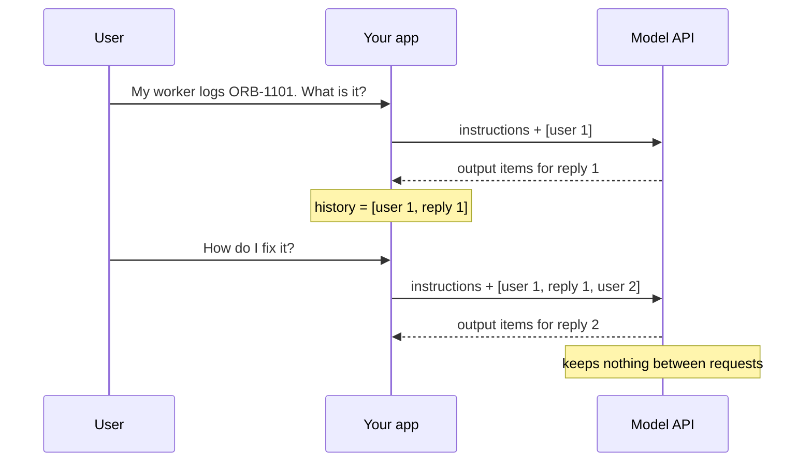
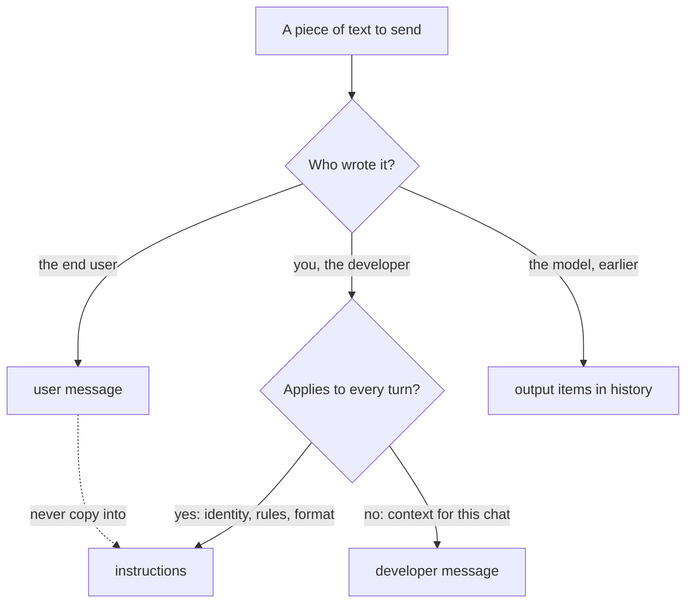
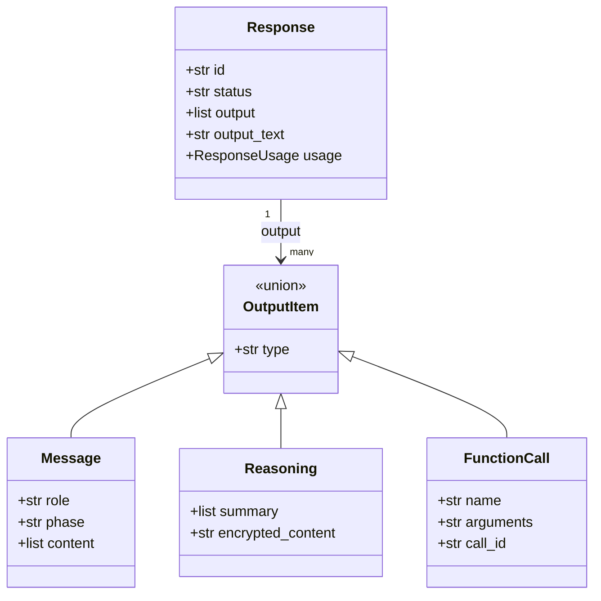

# Messages, Roles & Conversation State

Ask Atlas "My worker logs ORB-1101, what is it?" and you get a good answer. Ask "How do I fix it?" in a second call and the model has no idea what "it" is, because it remembers nothing between calls. Every chat app, support bot and agent you will build rests on two questions: who remembers the conversation (you do), and where each piece of text belongs in the request. Today you answer both and build a command-line chat that carries its own history.

## At a Glance

- **Time:** ~2 h core (+ optional Go Deeper) · **Depth:** working
- **Prerequisites:** [Day 2: Setup & Your First LLM Call](../../Phase_0_Start_Here/Day_002_setup_first_call/setup_first_call.md), [Day 4: Tokens: How Models Read Text](../../Phase_1_How_LLMs_Work/Day_004_tokens/tokens.md), [Day 6: Controlling Generation: Sampling & Reasoning Effort](../../Phase_1_How_LLMs_Work/Day_006_sampling_reasoning_effort/sampling_reasoning_effort.md); primer [HTTP, JSON & APIs](../../Appendix_Primers/A05_http_json_apis.md) if requests and JSON are new to you
- **You'll build:** an Atlas CLI chat with a persona, an Orbit fact block, explicit history, a token meter and `/reset` `/tokens` `/history` commands
- **Stops at:** memory stores ([Day 50](../../Phase_6_Agents/Day_050_agent_memory/agent_memory.md)) and context engineering such as trimming and compaction ([Day 49](../../Phase_6_Agents/Day_049_context_engineering/context_engineering.md))
- **Fast path:** Already built chat apps on another API? Read [The Response Is a List of Items](#the-response-is-a-list-of-items) and [Server-Side State with previous_response_id](#server-side-state-with-previous_response_id), then do Exercise 2 (≈40 min)
- **Cost:** ≈ $0.02 on `gpt-6-luna` (prices as of 2026-11, [verify](https://developers.openai.com/api/docs/pricing))
- **New terms:** role, instructions, output item, conversation state, `previous_response_id`

## The Model Forgets Everything

Here is the naive version: two calls, one after the other, the way you would call any function twice. Orbit is a fictional library, so the model can't know what ORB-1101 means; the first message carries the fact from Orbit's `docs/error-codes.md`.

```python
# script_id: day_008_messages_and_state/stateless_demo
# Two independent calls forget each other; one shared list fixes it. ≈ $0.001.
# Install: uv add "openai>=3.46,<4" · Env: OPENAI_API_KEY (ATLAS_MODEL optional)
import os

from openai import OpenAI

MODEL = os.environ.get("ATLAS_MODEL", "gpt-6-luna")  # built on Day 2's atlas/config.py
client = OpenAI()

FACT = ("Orbit docs: ORB-1101 LeaseExpired means a job outlived its lease and may run twice. "
        "Fix: let heartbeats renew the lease ([worker] heartbeat_seconds) or raise "
        "[worker] lease_seconds for long jobs.")
turn1 = f"{FACT}\n\nMy worker logs ORB-1101. What is it?"
turn2 = "How do I fix it?"


def reply(input_items: str | list) -> tuple[str, list]:
    resp = client.responses.create(model=MODEL, input=input_items, reasoning={"effort": "low"})
    return resp.output_text, resp.output


# A) Two independent calls: the second request contains only turn2.
reply(turn1)
alone, _ = reply(turn2)
print("WITHOUT history:", alone[:150])

# B) Carry the conversation yourself: turn 1, the model's output, then turn 2.
history: list = [{"role": "user", "content": turn1}]
_, items = reply(history)
history += items                      # the model's whole turn, not only its text
history.append({"role": "user", "content": turn2})
together, _ = reply(history)
print("WITH history:   ", together[:150])
```

```text
WITHOUT history: I'm not sure what "it" refers to. Could you tell me which error or tool you're working with?
WITH history:    Make sure heartbeats can renew the lease: set [worker] heartbeat_seconds well below lease_seconds, or raise [worker] lease_seconds for long jobs.
(illustrative; your wording will differ)
```

The API is **stateless**: it keeps nothing between requests. Each call is a fresh request, and the only conversation the model sees is the one inside that request. Version B works because your code sent turn 1, the model's reply and turn 2 together.



## A Transcript and a Sticky Note

Picture a phone call with someone who has total amnesia. Before each reply, you hand them two things: a sticky note with the house rules ("you are Atlas, be brief, only use these facts") and the full transcript so far. They read both, say one thing, and forget it all again. If you hand over a shorter transcript, they know less. If you lose the sticky note, they forget who they are.

The sticky note is **instructions**. The transcript is the **conversation state**: everything said so far, which your code stores and re-sends.

> **Coming from Software Engineering?** Think of an HTTP API with no session, where "stateless" means the server keeps nothing between requests. The messages list is the session object, and you re-send all of it on every request. `instructions` are like server config: they set behaviour for every request, and they come from you. User messages are the request body: **untrusted input**, text you didn't write, so it never gets config-level authority. `previous_response_id` is like a server-side **session** (the server remembers the user for you), except this session still bills you for the whole conversation on every request.

## A Three-Message Conversation by Hand

Before any library, write down exactly what the model receives on turn 2. It fits in your head: the rules, then three messages in order.

```python
# script_id: day_008_messages_and_state/turn2_by_hand
# The exact request body for turn 2 of a chat. Runs offline: no API call, no key.
import json

instructions = "You are Atlas, assistant to Orbit's maintainers. Answer in 2 sentences."
turn_2_input = [
    {"role": "user", "content": "My worker logs ORB-1101. What is it?"},
    {"role": "assistant", "content": "ORB-1101 LeaseExpired: a job outlived its lease, so it may run twice."},
    {"role": "user", "content": "How do I fix it?"},
]
print("instructions:", instructions)
print(json.dumps(turn_2_input, indent=2))
print(f"{len(turn_2_input)} messages; the model reads all of them on every call.")
```

```text
instructions: You are Atlas, assistant to Orbit's maintainers. Answer in 2 sentences.
[
  {
    "role": "user",
    "content": "My worker logs ORB-1101. What is it?"
  },
  {
    "role": "assistant",
    "content": "ORB-1101 LeaseExpired: a job outlived its lease, so it may run twice."
  },
  {
    "role": "user",
    "content": "How do I fix it?"
  }
]
3 messages; the model reads all of them on every call.
```

"It" now has something to point at. Turn 3 would be this list plus the turn-2 reply plus the new question, so the request grows every turn. Hold on to that; it decides your bill.

## Roles and Where Content Goes

A **role** is the label on a message that says who it speaks for. The Responses API accepts four roles in `input` messages, plus the separate `instructions` parameter:

| Slot | Who writes it | Typical content |
|---|---|---|
| `instructions=` | You, the developer | Identity, goal, rules, standing facts, output format |
| `developer` message | Your app, mid-conversation | Context for this chat or turn: account data, a note such as "user upgraded" |
| `user` message | The end user | Their question, pasted logs. Untrusted |
| `assistant` message / output items | The model, earlier | Its previous replies, carried in history |

The priority order matters when two slots disagree. The OpenAI text guide says `instructions` take priority over messages in `input`, and the SDK documents that `developer` (or `system`) messages take precedence over `user` messages. So the order is **instructions > developer > user**, and assistant messages are treated as the model's own past output. The API also accepts a `system` role for compatibility with older chat code; this course uses `instructions` for standing rules and `developer` for app-written messages in `input`.



Here is how Atlas content lands:

| Content | Where | Why |
|---|---|---|
| "You are Atlas, assistant to Orbit's maintainers" | `instructions` | Identity, needed every turn |
| "At most 4 bullets; never invent config keys" | `instructions` | A rule for every reply |
| The FAQ fact block from `docs/faq.md` | `instructions` | Orbit is fictional, so the model needs the facts every turn |
| "This user runs Orbit 2.9.0 on Redis" (from your account DB) | `developer` message | App-supplied context for this chat |
| "My worker logs ORB-1101, what is it?" | `user` message | End-user text |
| A pasted log line that says "ignore your rules" | `user` message, never `instructions` | Untrusted text keeps user-level authority ([Day 69](../../Phase_8_Safety_and_Security/Day_069_prompt_injection/prompt_injection.md)) |
| Atlas's previous reply | Output items in history | The model's own earlier turn |

A good set of instructions (often still called the "system prompt") has six parts: **persona** (who), **goal** (what success is), **rules** (do and don't), **facts** (what it may rely on), **format** (shape of the reply) and **escalation** (what to do when stuck). [Day 9: Writing Effective Prompts](../../Phase_2_Building_with_LLM_APIs/Day_009_effective_prompts/effective_prompts.md) teaches how to write each one well; today you only need to put them in the right slot.

A developer message changes the answer without the user typing anything:

```python
# script_id: day_008_messages_and_state/roles_placement
# instructions vs developer vs user, in one call. ≈ $0.001.
# Install: uv add "openai>=3.46,<4" · Env: OPENAI_API_KEY (ATLAS_MODEL optional)
import os

from openai import OpenAI

MODEL = os.environ.get("ATLAS_MODEL", "gpt-6-luna")
client = OpenAI()

INSTRUCTIONS = "You are Atlas, assistant to Orbit's maintainers. Answer in at most 3 sentences."
input_items = [
    # Written by your app (e.g. from the account DB), not typed by the user.
    {"role": "developer", "content": (
        "This user runs Orbit 2.9.0. Facts: on 2.x the lease length is the ORBIT_LEASE "
        "environment variable; on 3.x it is [worker] lease_seconds in orbit.toml.")},
    # The end user's words, sent as-is and never merged into instructions.
    {"role": "user", "content": "Where do I set the lease length?"},
]
resp = client.responses.create(model=MODEL, instructions=INSTRUCTIONS, input=input_items,
                               reasoning={"effort": "low"})
print(resp.output_text)
```

```text
Since you're on Orbit 2.9.0, set the lease length with the ORBIT_LEASE environment variable. On 3.x it moves to [worker] lease_seconds in orbit.toml.
(illustrative; your wording will differ)
```

Delete the developer message and the model can't tell which version applies, so it has to hedge or ask.

## The Response Is a List of Items

On Day 2 you read `resp.output_text` and moved on. To carry history correctly you need to see what the response really holds. `resp.output` is a list of **output items**: typed objects, each with a `type` field. A reply can contain several:

- `reasoning`: the model's internal thinking for this turn (mostly opaque; [Day 11](../../Phase_2_Building_with_LLM_APIs/Day_011_reasoning_cot/reasoning_cot.md) covers it across turns).
- `message`: visible text. Its `content` is a list of parts (`output_text`, or `refusal`), and its `phase` is `"commentary"` (an in-progress note) or `"final_answer"`.
- `function_call`: the model asking your code to run a tool. You meet it on [Day 35: Function Calling: The Tool Loop](../../Phase_4_Tools_and_MCP/Day_035_function_calling/function_calling.md).

`resp.output_text` is a convenience property that joins the text of every message item, both phases, and returns `""` if there are none.



Ask a real FAQ question and print what comes back. The fact block is a slice of `docs/faq.md`, because the model has never seen Orbit's docs.

```python
# script_id: day_008_messages_and_state/output_items
# Inspect output items, phase, output_text and usage. ≈ $0.001.
# Install: uv add "openai>=3.46,<4" · Env: OPENAI_API_KEY, ORBIT_DATA (path to datasets/orbit)
import os
from pathlib import Path

from openai import OpenAI

MODEL = os.environ.get("ATLAS_MODEL", "gpt-6-luna")
DATA_DIR = Path(os.environ.get("ORBIT_DATA", "datasets/orbit"))
client = OpenAI()

faq = (DATA_DIR / "docs" / "faq.md").read_text(encoding="utf-8")[:2400]  # a slice keeps it cheap
resp = client.responses.create(
    model=MODEL,
    instructions=f"Answer only from these Orbit docs.\n<facts>\n{faq}\n</facts>",
    input="Does Orbit run each job exactly once?",
    reasoning={"effort": "low"},
)
print("item types:", [item.type for item in resp.output])
for item in resp.output:
    if item.type == "message":                  # only message items carry visible text
        print("phase:", item.phase, "| parts:", [part.type for part in item.content])
print("output_text:", resp.output_text)
u = resp.usage
print(f"usage: input={u.input_tokens} output={u.output_tokens} "
      f"(reasoning={u.output_tokens_details.reasoning_tokens})")
```

```text
item types: ['reasoning', 'message']
phase: final_answer | parts: ['output_text']
output_text: No. Orbit delivers jobs at least once: a job whose lease expires (ORB-1101) or whose worker dies can run again, so make side effects idempotent.
usage: input=631 output=88 (reasoning=41)
(illustrative; your items and numbers may differ)
```

Two habits follow. First, never write `resp.output[0].content[0].text`: item 0 is often a `reasoning` item, and the text guide warns that `output` frequently holds several items. Use `output_text`, or loop and check `item.type`. Second, reasoning tokens are billed as output tokens even though you never see them.

## Carrying History Yourself

Now the minimal chat. The whole trick is one line: after each call, append `resp.output` to your list, then append the next user turn.

```python
# script_id: day_008_messages_and_state/minimal_chat
# The smallest correct chat loop. Type /quit or an empty line to stop. ≈ $0.001 per turn.
# Install: uv add "openai>=3.46,<4" · Env: OPENAI_API_KEY (ATLAS_MODEL optional)
import os

from openai import OpenAI

MODEL = os.environ.get("ATLAS_MODEL", "gpt-6-luna")
client = OpenAI()
INSTRUCTIONS = "You are Atlas, a concise assistant for Orbit's maintainers."
history: list = []                       # the conversation lives here, in your process

while (user_text := input("you> ").strip()) not in ("", "/quit"):
    history.append({"role": "user", "content": user_text})
    resp = client.responses.create(model=MODEL, instructions=INSTRUCTIONS, input=history,
                                   reasoning={"effort": "low"})  # default is medium: be explicit
    history += resp.output               # every item: reasoning + message (with its phase)
    print("atlas>", resp.output_text)
```

```text
you> My name is Priya and I maintain the Redis broker.
atlas> Nice to meet you, Priya. What's going on with the Redis broker?
you> What's my name, and what do I maintain?
atlas> You're Priya, and you maintain Orbit's Redis broker.
(illustrative)
```

Three details are deliberate. `instructions` go on every call, because they are a request parameter, not part of `history`. `history` mixes plain dicts (your inputs) with SDK objects (the model's items), and the API accepts both in `input`. And the effort is set explicitly: GPT-6 models default to `medium` ([Day 6](../../Phase_1_How_LLMs_Work/Day_006_sampling_reasoning_effort/sampling_reasoning_effort.md)), which costs more and is slower than a chat needs.

## Turn a Knob, Then Break It

Run five scripted turns and print `usage.input_tokens` each time. Then change what you carry forward with one argument: `items` (correct), `text` (only the reply text) or `none` (the classic bug).

```python
# script_id: day_008_messages_and_state/token_growth
# Five scripted turns; watch input tokens grow. Run: python token_growth.py [items|text|none]
# ≈ $0.003 per run. Install: uv add "openai>=3.46,<4" · Env: OPENAI_API_KEY
import os
import sys

from openai import OpenAI

MODEL = os.environ.get("ATLAS_MODEL", "gpt-6-luna")
client = OpenAI()
MODE = sys.argv[1] if len(sys.argv) > 1 else "items"
QUESTIONS = ["My Orbit worker logs ORB-1101 LeaseExpired. In one sentence, what might that mean?",
             "Name one setting you'd check first.", "What goes wrong if I set it far too high?",
             "Give me a one-line summary of the fix.", "Which setting did you tell me to check first?"]

history: list = []
billed = 0
for turn, question in enumerate(QUESTIONS, start=1):
    history.append({"role": "user", "content": question})
    resp = client.responses.create(model=MODEL, input=history, reasoning={"effort": "low"})
    if MODE == "items":
        history += resp.output                     # correct: everything the model produced
    elif MODE == "text":                           # works for plain text, drops reasoning + phase
        history.append({"role": "assistant", "content": resp.output_text})
    # MODE == "none": the bug, only user turns are kept
    billed += resp.usage.input_tokens
    print(f"turn {turn} · input {resp.usage.input_tokens:>4} tok · billed so far {billed:>5} · "
          f"{resp.output_text[:45]!r}")
```

```text
$ python token_growth.py items
turn 1 · input   32 tok · billed so far    32 · 'ORB-1101 LeaseExpired usually means a job ran'
turn 2 · input   95 tok · billed so far   127 · 'Check the lease length (lease_seconds) first.'
turn 3 · input  139 tok · billed so far   266 · 'Too high a lease delays recovery: if a worker'
turn 4 · input  201 tok · billed so far   467 · 'Keep heartbeats well inside the lease and siz'
turn 5 · input  248 tok · billed so far   715 · 'I suggested checking the lease length (lease_'
$ python token_growth.py none
turn 5 · input   78 tok · billed so far   250 · "I don't see an earlier suggestion from me in"
(illustrative; your numbers will differ)
```

Each turn's input is everything before it, so per-turn input grows roughly linearly and the running total grows roughly quadratically (see Go Deeper for the arithmetic). In `none` mode the model sees your questions but none of its own answers, so turn 5 can't recall what it suggested. That is the most common chat bug: "the model forgot", when your code never told it.

`text` mode answers correctly here, and plenty of tutorials do exactly this. It throws away two things: `reasoning` items, and the `phase` label, which the SDK docs say should be preserved on assistant messages for newer models because dropping it can degrade performance. Once tool calls arrive on Day 35, text-only history breaks outright, since a tool result must follow its `function_call` item. Carry `resp.output`.

## Server-Side State with previous_response_id

The API can hold the chain for you. Pass the previous response's `id` as `previous_response_id`, and send only the new message. This works because responses are **stored by default**: `store` defaults to true, and stored responses are kept for 30 days.

```python
# script_id: day_008_messages_and_state/server_state
# Same 3-turn chat two ways; compare input tokens. ≈ $0.002.
# Install: uv add "openai>=3.46,<4" · Env: OPENAI_API_KEY (ATLAS_MODEL optional)
import os

from openai import OpenAI

MODEL = os.environ.get("ATLAS_MODEL", "gpt-6-luna")
client = OpenAI()
INSTRUCTIONS = "You are Atlas, a concise assistant for Orbit's maintainers."
QUESTIONS = ["What does a job lease protect against?", "And what renews it?", "Summarize in one line."]

manual: list = []
prev_id: str | None = None
print("turn | manual input tok | server input tok")
for turn, question in enumerate(QUESTIONS, start=1):
    manual.append({"role": "user", "content": question})
    a = client.responses.create(model=MODEL, instructions=INSTRUCTIONS, input=manual,
                                reasoning={"effort": "low"})
    manual += a.output
    b = client.responses.create(model=MODEL, instructions=INSTRUCTIONS,  # not carried over: re-send
                                input=question, previous_response_id=prev_id,
                                reasoning={"effort": "low"})
    prev_id = b.id                       # chaining needs a stored response (store defaults to True)
    print(f"{turn:>4} | {a.usage.input_tokens:>16} | {b.usage.input_tokens:>16}")
```

```text
turn | manual input tok | server input tok
   1 |               24 |               24
   2 |               71 |               69
   3 |              113 |              116
(illustrative; the two columns track each other)
```

Read the right-hand column carefully. You sent one short question, yet input tokens grow like the manual list, because **every earlier token in the chain is billed again as input**. `previous_response_id` saves you re-sending bytes over the network and storing the list; it does not save tokens. Three rules come with it:

- **`instructions` are not carried over.** Re-send them on every call, or the persona disappears on turn 2.
- **It needs a stored response.** With `store=False` there is nothing on the server to chain from.
- **It can't be combined with `conversation`**, the Conversations API parameter (see Go Deeper).

Storage is a data-retention decision. A stored response is user content sitting on a provider's servers for 30 days; [Day 73: Privacy & PII](../../Phase_8_Safety_and_Security/Day_073_privacy_pii/privacy_pii.md) covers when to pass `store=False` and carry the list yourself.

## Build: The Atlas CLI Chat

Time to put the pieces together into one script you can keep: a persona with the six-part anatomy, a fact block from `docs/faq.md`, explicit history and three commands. It comes in three blocks under one `script_id`; save them in order as `chat_cli.py`.

The first block holds configuration, the persona and `load_facts()`. The grounding rule ("say you don't know if it isn't in the facts") is a preview of [Day 28](../../Phase_3_RAG/Day_028_rag_pipeline/rag_pipeline.md); here it keeps a fictional library from getting invented answers.

```python
# script_id: day_008_messages_and_state/chat_cli
# Atlas CLI chat: persona + Orbit fact block + explicit history. ≈ $0.01 for a 10-turn chat.
# Install: uv add "openai>=3.46,<4" · Env: OPENAI_API_KEY, ORBIT_DATA (ATLAS_MODEL optional)
# Run: python chat_cli.py   (commands: /reset /tokens /history /quit)
import os
from pathlib import Path

import openai
from openai import OpenAI
from openai.types.responses import Response

MODEL = os.environ.get("ATLAS_MODEL", "gpt-6-luna")  # built on Day 2's atlas/config.py
DATA_DIR = Path(os.environ.get("ORBIT_DATA", "datasets/orbit"))
EFFORT = "low"
client = OpenAI()

# Anatomy: persona, goal, rules, format, escalation. The facts are appended below.
ATLAS_PERSONA = """You are Atlas, an assistant for the maintainers of Orbit, an open-source Python background-jobs library.
Goal: help maintainers answer user questions quickly and correctly.
Rules:
- Use only the facts between the <facts> tags. If the answer is not there, say you don't know and suggest which doc page to check.
- Never invent config keys, versions or error codes.
Format: at most 4 sentences or 4 bullets. Put commands and config keys in backticks.
Escalation: if a user reports data loss or a security problem, say a human maintainer must look at it."""


def load_facts(path: Path, max_chars: int = 2400) -> str:
    """Read a docs page, drop its YAML front matter, and cut at a paragraph boundary."""
    text = path.read_text(encoding="utf-8")
    if text.startswith("---"):
        text = text.split("---", 2)[2]          # ["", front matter, body]
    text = text.strip()
    if len(text) <= max_chars:
        return text
    cut = text.rfind("\n\n", 0, max_chars)      # don't end mid-sentence
    return text[: cut if cut > 0 else max_chars]
```

The second block defines `chat_turn()`. It returns a **new** list instead of mutating the old one, so a failed call leaves your history untouched.

```python
# script_id: day_008_messages_and_state/chat_cli
INSTRUCTIONS = f"{ATLAS_PERSONA}\n\n<facts>\n{load_facts(DATA_DIR / 'docs' / 'faq.md')}\n</facts>"


def chat_turn(history: list, user_text: str, *, instructions: str) -> tuple[list, Response]:
    """Send one user turn with the full history; return (new history, response)."""
    turn_input = [*history, {"role": "user", "content": user_text}]
    resp = client.responses.create(model=MODEL, instructions=instructions,  # every turn
                                   input=turn_input, reasoning={"effort": EFFORT})
    return [*turn_input, *resp.output], resp


def describe(item) -> str:
    """One line per history entry: dicts are your inputs, objects are model output items."""
    if isinstance(item, dict):
        return f"{item['role']:<9} {item['content'][:60]!r}"
    if item.type == "message":
        text = "".join(part.text for part in item.content if part.type == "output_text")
        return f"{'assistant':<9} {text[:60]!r} (phase={item.phase})"
    return f"[{item.type} item]"
```

The third block is the loop: commands first, then a turn, then the token meter.

```python
# script_id: day_008_messages_and_state/chat_cli
def main() -> None:
    history: list = []
    last_usage = None
    turn = 0
    print(f"Atlas on {MODEL}. Commands: /reset /tokens /history /quit")
    while (user_text := input("you> ").strip()) not in ("", "/quit"):
        if user_text == "/reset":
            history, turn = [], 0
            print("(history cleared: the model now knows nothing about this chat)")
        elif user_text == "/tokens":
            if last_usage:
                print(f"last turn: input {last_usage.input_tokens} · output {last_usage.output_tokens} tok")
            else:
                print("(no turns yet)")
        elif user_text == "/history":
            for i, item in enumerate(history):
                print(f"{i:>3} {describe(item)}")
        else:
            try:
                history, resp = chat_turn(history, user_text, instructions=INSTRUCTIONS)
            except openai.APIError as err:      # history is unchanged, so the user can retry
                print(f"(API error: {type(err).__name__}; nothing was added to history)")
                continue
            turn, last_usage = turn + 1, resp.usage
            print(f"atlas> {resp.output_text}\n[turn {turn} · input {last_usage.input_tokens} tok]")


if __name__ == "__main__":
    main()
```

```text
Atlas on gpt-6-luna. Commands: /reset /tokens /history /quit
you> My worker logs ORB-1101. Can a job run twice?
atlas> Yes. Orbit delivers jobs at least once, and a job whose lease expires (ORB-1101) can run again. Make side effects idempotent; see `troubleshooting-duplicates.md`.
[turn 1 · input 742 tok]
you> Is Python 3.13 supported?
atlas> Not yet. Orbit is tested up to Python 3.12; 3.13 support is an open feature request.
[turn 2 · input 815 tok]
you> Does Orbit support Kafka?
atlas> I don't know: the facts I have don't mention Kafka. Check the broker pages, starting with `concepts-brokers.md`.
[turn 3 · input 873 tok]
you> /history
  0 user      'My worker logs ORB-1101. Can a job run twice?'
  1 [reasoning item]
  2 assistant 'Yes. Orbit delivers jobs at least once, and a job whose lease' (phase=final_answer)
  ...
(illustrative; your numbers will differ)
```

The base input is about 740 tokens before anyone says a word: persona plus roughly 590 tokens of FAQ (an `o200k_base` estimate from [Day 4](../../Phase_1_How_LLMs_Work/Day_004_tokens/tokens.md); use the token-count endpoint for exact numbers). Every turn adds the question and the reply on top.

## Trade-offs: Who Holds the State?

| Approach | You send each turn | Billed input | Good for | Watch out |
|---|---|---|---|---|
| Manual list (`history += resp.output`) | Whole list | All prior tokens | Full control, `store=False`, trimming later, any provider | You own storage and size |
| `previous_response_id` | New message + `instructions` | All prior tokens | Quick prototypes, smaller requests | Needs `store`, 30-day retention, re-send `instructions` |
| Conversations API (`conversation=`) | New message | Prior items, likely (⚠ verify: watch `usage.input_tokens`) | A durable server-side thread | Items have no 30-day TTL; delete them yourself |

Rule of thumb: start with the manual list. It is explicit, testable, works with `store=False`, and is the shape that trimming, summaries and memory build on later. Reach for server state when request size matters more than control.

### In production

- **Cap history.** Lists grow without bound; trimming and compaction are [Day 49: Context Engineering](../../Phase_6_Agents/Day_049_context_engineering/context_engineering.md).
- **Decide retention on purpose.** `store` defaults to true; `store=False` and data handling are [Day 73](../../Phase_8_Safety_and_Security/Day_073_privacy_pii/privacy_pii.md).
- **Persist the list per user** (a DB row or cache key) if chats must survive restarts; long-term memory is [Day 50: Memory for Agents](../../Phase_6_Agents/Day_050_agent_memory/agent_memory.md).
- **Log token usage per turn.** Growth is your early warning; the cost tracker arrives on [Day 12](../../Phase_2_Building_with_LLM_APIs/Day_012_openai_sdk_production/openai_sdk_production.md).
- **Keep user text in user messages,** however convenient an f-string into `instructions` looks.

## Go Deeper (optional)

<details>
<summary>Go deeper: why chat cost grows quadratically</summary>

In words: turn *t* re-sends everything from turns 1 to *t − 1*, plus the fixed instructions and the new question. Toy numbers: instructions and facts cost 720 tokens, each question 20 and each reply 120, so one exchange adds 140. Turn 1 sends 740, turn 2 sends 880, turn 3 sends 1,020. The formula for the total input over *N* turns is:

`total = N × (base + q) + (q + a) × N × (N − 1) / 2`

The second term is the quadratic one. Doubling the chat length roughly quadruples that part of the bill.

```python
# script_id: day_008_messages_and_state/cost_growth
# Offline: billed input tokens for an N-turn chat. No API call.
PRICE_IN_PER_1M = 0.10  # gpt-6-luna input USD, as of 2026-11; verify at developers.openai.com/api/docs/pricing


def billed_input(turns: int, base: int = 720, q: int = 20, a: int = 120) -> tuple[int, int]:
    """Return (input tokens on the last turn, total input tokens over all turns)."""
    per_turn = [base + (t - 1) * (q + a) + q for t in range(1, turns + 1)]
    return per_turn[-1], sum(per_turn)


print(f"{'turns':>5} | {'last turn':>9} | {'total':>7} | {'input $':>8}")
for n in (1, 5, 10, 20, 50):
    last, total = billed_input(n)
    print(f"{n:>5} | {last:>9,} | {total:>7,} | {total * PRICE_IN_PER_1M / 1e6:>8.5f}")
```

```text
turns | last turn |   total |  input $
    1 |       740 |     740 |  0.00007
    5 |     1,300 |   5,100 |  0.00051
   10 |     2,000 |  13,700 |  0.00137
   20 |     3,400 |  41,400 |  0.00414
   50 |     7,600 | 208,500 |  0.02085
```

Cheap on Luna, but multiply by users and by a 10× pricier model ([Day 7](../../Phase_1_How_LLMs_Work/Day_007_choosing_a_model/choosing_a_model.md)) and it matters. Two forces help: provider prompt caching discounts a repeated prefix ([Day 18](../../Phase_2_Building_with_LLM_APIs/Day_018_cost_latency_caching/cost_latency_caching.md) owns it), and history caps keep *N* bounded (Day 49). The context window ([Day 5](../../Phase_1_How_LLMs_Work/Day_005_transformers_attention/transformers_attention.md)) is the hard ceiling.

</details>

<details>
<summary>Go deeper: the Conversations API</summary>

A Conversation is a durable server-side object that collects the items of a thread. Pass `conversation=conv.id` instead of `previous_response_id` (the two can't be combined). Unlike stored responses, conversation items have no 30-day TTL, so delete what you no longer need.

```python
# script_id: day_008_messages_and_state/conversations_api
# A two-turn chat held in a Conversation object. ≈ $0.001.
# Install: uv add "openai>=3.46,<4" · Env: OPENAI_API_KEY (ATLAS_MODEL optional)
import os

from openai import OpenAI

MODEL = os.environ.get("ATLAS_MODEL", "gpt-6-luna")
client = OpenAI()

conv = client.conversations.create()
for question in ["My worker logs ORB-1101.", "Which error code did I mention?"]:
    resp = client.responses.create(model=MODEL, conversation=conv.id, input=question,
                                   instructions="You are Atlas, a concise assistant.",
                                   reasoning={"effort": "low"})
    print(f"atlas> {resp.output_text}  [input {resp.usage.input_tokens} tok]")

print("stored item types:", [item.type for item in client.conversations.items.list(conv.id, order="asc")])
client.conversations.delete(conv.id)     # no TTL: clean up what you create
```

Billing: the docs state outright that `previous_response_id` re-bills every earlier token. For Conversations, expect the same, since the model must read the earlier items, but check it yourself: the `input` count printed above should grow on turn 2 (⚠ verify against current docs).

</details>

<details>
<summary>Go deeper: system vs developer, phase, and stateless replay</summary>

- **`system` vs `developer`.** Both are accepted roles in `input`. The SDK documents that both take precedence over `user`, but the docs don't rank them against each other, so mixing them invites ambiguity. Pick `developer` for app messages and keep standing rules in `instructions`.
- **`phase` on input.** Input messages accept `phase` (`"commentary"` or `"final_answer"`) on assistant messages only. If you persist history as plain dicts, keep the `phase` field; the SDK notes that dropping it can degrade performance on newer models.
- **Stateless replay with `store=False`.** Nothing is kept on the server, so you must re-send the full list, reasoning items included. With `store=False`, reasoning items carry `encrypted_content` by default, which is what makes them replayable without server storage ([Day 11](../../Phase_2_Building_with_LLM_APIs/Day_011_reasoning_cot/reasoning_cot.md) uses this).
- **Mixing objects and dicts.** `resp.output` items are Pydantic models. Use `item.model_dump()` when you log them; `json.dumps(history)` fails on them (see Common Pitfalls).

</details>

## Common Pitfalls

- **The model "forgets" its last answer.** You appended only user turns (the `none` mode above). Fix: `history += resp.output` after every call.
- **The persona vanishes on turn 2 with `previous_response_id`.** `instructions` are not carried over in the chain. Fix: pass them on every call. Chaining also fails if the earlier response was created with `store=False`, since nothing was stored (⚠ verify the exact error text against current docs).
- **`TypeError: 'NoneType' object is not subscriptable` from `resp.output[0].content[0].text`.** Item 0 was a `reasoning` item, not a message. Fix: use `resp.output_text`, or loop and check `item.type`.
- **`TypeError: Object of type ResponseReasoningItem is not JSON serializable`** when saving history. Output items are SDK objects, not dicts. Fix: convert with `item.model_dump()` for logs.
- **Cost creeps up turn after turn.** Every turn re-bills the whole history, with `previous_response_id` too. Fix: watch the token meter now; caps and compaction come on Day 49.
- **End-user text inside an f-string in `instructions`.** It gains app-level authority, which is how injection starts. Fix: user text goes only in `user` messages ([Day 69](../../Phase_8_Safety_and_Security/Day_069_prompt_injection/prompt_injection.md)).

> **Where we stop:** we don't trim, summarise or store conversations long-term, because those are context and memory design problems with their own trade-offs; see [Day 49: Context Engineering](../../Phase_6_Agents/Day_049_context_engineering/context_engineering.md) and [Day 50: Memory for Agents](../../Phase_6_Agents/Day_050_agent_memory/agent_memory.md).

## Key Takeaways

- The API is stateless: the model sees only what is in the current request, so your code owns the conversation and re-sends it every turn.
- Put standing rules and facts in `instructions`, app-written context in `developer` messages, and end-user text in `user` messages; priority runs instructions > developer > user.
- `resp.output` is a list of typed items (`reasoning`, `message` with `phase`, later `function_call`); read text with `output_text` and never index `output[0]`.
- Carry history with `history += resp.output`; text-only history drops reasoning items and `phase`, and forgetting to append is the classic "it forgot" bug. Input tokens grow every turn.
- `previous_response_id` saves re-sending, not tokens: every prior token is billed again, `instructions` must be re-sent, it needs `store` (true by default, 30-day retention), and it can't be combined with `conversation`.

## Quick Reference

| API / pattern | When to use | Gotcha |
|---|---|---|
| `responses.create(instructions=..., input=[...])` | Every chat call | `instructions` aren't part of `input`; send them each call |
| `{"role": "developer", "content": ...}` | App context mid-chat | Outranks `user`; below `instructions` |
| `{"role": "user", "content": ...}` | End-user text | Untrusted; never merge into `instructions` |
| `resp.output` / `item.type` | Inspect what came back | Item 0 is often `reasoning` |
| `resp.output_text` | The reply text | Joins both phases; `""` if no message |
| `history += resp.output` | Manual conversation state | Keeps reasoning and `phase`; grows every turn |
| `previous_response_id=prev.id` | Server-side chaining | Still bills prior tokens; needs `store` |
| `conversation=conv.id` | Durable server thread | Not with `previous_response_id`; no TTL |
| `resp.usage.input_tokens` | Token meter per turn | Includes the whole history |
| `reasoning={"effort": "low"}` | Chat demos | Default is `medium` |

## Exercises

1. **Warm-up: change the persona.** Make Atlas "a terse on-call SRE" whose replies are at most 3 bullets, and chat for three turns. Instructions steer every turn without you repeating the rule.

<details>
<summary>Solution</summary>

```python
# script_id: day_008_messages_and_state/solution_ex1
# Replace ATLAS_PERSONA in chat_cli.py with this, then rerun the chat.
ATLAS_PERSONA = """You are Atlas, a terse on-call SRE helping Orbit's maintainers during incidents.
Goal: get the user to a safe next step fast.
Rules:
- Use only the facts between the <facts> tags. If the answer is not there, say so.
- Never invent config keys, versions or error codes.
Format: at most 3 bullets. No preamble, no closing pleasantries.
Escalation: data loss or security problems go to a human maintainer immediately."""
```

Every reply stays within three bullets on turns 1, 2 and 3, because `chat_turn()` sends the instructions with each request.

</details>

2. **Core: make history cost visible.** Extend `/tokens` to print per-turn and cumulative input and output tokens. Shows that history cost adds up turn by turn.

<details>
<summary>Solution</summary>

```python
# script_id: day_008_messages_and_state/solution_ex2
# Per-turn + cumulative token log for chat_cli's /tokens. Runs offline with stand-in usage.
from dataclasses import dataclass, field
from types import SimpleNamespace


@dataclass
class TokenLog:
    turns: list[tuple[int, int]] = field(default_factory=list)  # (input, output) per turn

    def add(self, usage) -> None:
        self.turns.append((usage.input_tokens, usage.output_tokens))

    def report(self) -> str:
        lines = [f"turn {i:>2} · in {inp:>5} · out {out:>4}"
                 for i, (inp, out) in enumerate(self.turns, start=1)]
        total_in = sum(inp for inp, _ in self.turns)
        total_out = sum(out for _, out in self.turns)
        lines.append(f"total   · in {total_in:>5} · out {total_out:>4}")
        return "\n".join(lines)


if __name__ == "__main__":
    log = TokenLog()
    for inp, out in [(742, 61), (815, 44), (873, 52)]:  # stand-ins for resp.usage
        log.add(SimpleNamespace(input_tokens=inp, output_tokens=out))
    print(log.report())
# In chat_cli.py: log = TokenLog() in main(); log.add(resp.usage) after each turn;
# print(log.report()) on /tokens; log = TokenLog() again on /reset.
```

```text
turn  1 · in   742 · out   61
turn  2 · in   815 · out   44
turn  3 · in   873 · out   52
total   · in  2430 · out  157
```

</details>

3. **Core: a developer message mid-chat.** Ask "How do I change the lease length?", then append a developer message ("this user runs Orbit 2.9.0") and ask again. The answer changes from hedged to specific: app context belongs in a `developer` message, not in the user's text.

<details>
<summary>Solution</summary>

```python
# script_id: day_008_messages_and_state/solution_ex3
# A developer message added mid-chat changes later answers. ≈ $0.002.
# Install: uv add "openai>=3.46,<4" · Env: OPENAI_API_KEY (ATLAS_MODEL optional)
import os

from openai import OpenAI

MODEL = os.environ.get("ATLAS_MODEL", "gpt-6-luna")
client = OpenAI()
INSTRUCTIONS = ("You are Atlas, assistant to Orbit's maintainers. Answer in 2 sentences. Facts: on 2.x "
                "the lease is the ORBIT_LEASE environment variable; on 3.x it is [worker] "
                "lease_seconds in orbit.toml.")
QUESTION = "How do I change the lease length?"


def ask(history: list, text: str) -> list:
    history = [*history, {"role": "user", "content": text}]
    resp = client.responses.create(model=MODEL, instructions=INSTRUCTIONS, input=history,
                                   reasoning={"effort": "low"})
    print(f"atlas> {resp.output_text}\n")
    return [*history, *resp.output]


history = ask([], QUESTION)                       # version unknown: expect both options
history.append({"role": "developer",              # your app learned the version, e.g. from the account DB
                "content": "Account context: this user runs Orbit 2.9.0."})
history = ask(history, "Asking again: how do I change the lease length?")
```

```text
atlas> On Orbit 3.x, set [worker] lease_seconds in orbit.toml. On 2.x, use the ORBIT_LEASE environment variable.

atlas> Since you're on 2.9.0, set the ORBIT_LEASE environment variable.
(illustrative)
```

</details>

4. **Stretch (past the stop line): keep only the last N turns.** Trim history to the last 2 turns before each call, then ask a question about turn 1. Find what breaks, and why Day 49 exists.

<details>
<summary>Solution</summary>

```python
# script_id: day_008_messages_and_state/solution_ex4
# A sliding window of N turns, and what it forgets. ≈ $0.003.
# Install: uv add "openai>=3.46,<4" · Env: OPENAI_API_KEY (ATLAS_MODEL optional)
import os

from openai import OpenAI

MODEL = os.environ.get("ATLAS_MODEL", "gpt-6-luna")
client = OpenAI()
N = 2
INSTRUCTIONS = "You are Atlas, a concise assistant for Orbit's maintainers."
QUESTIONS = ["My name is Priya.", "My worker logs ORB-1101.", "What's a job lease, in one line?",
             "Should leases be long or short, in one line?", "What's my name, and which error did I mention?"]


def last_turns(history: list, n: int) -> list:
    """Cut at user-message boundaries so each turn's reasoning and reply stay together."""
    starts = [i for i, item in enumerate(history) if isinstance(item, dict) and item["role"] == "user"]
    return history[starts[-n]:] if len(starts) > n else history


history: list = []
for question in QUESTIONS:
    history = last_turns([*history, {"role": "user", "content": question}], N)
    resp = client.responses.create(model=MODEL, instructions=INSTRUCTIONS, input=history,
                                   reasoning={"effort": "low"})
    history += resp.output
    print(f"in {resp.usage.input_tokens:>4} tok · {resp.output_text[:70]!r}")
```

Input tokens stop growing, but the last answer no longer knows the name or the error code: they fell out of the window. Facts that must survive belong in `instructions` or in a summary, which is Day 49's subject.

</details>

## References & Further Reading

- [OpenAI: Conversation state](https://developers.openai.com/api/docs/guides/conversation-state): the official guide to manual history, `previous_response_id` billing, Conversations and retention.
- [OpenAI: Text generation](https://developers.openai.com/api/docs/guides/text): `instructions` vs message roles, and why `output` holds several items.
- [OpenAI: Migrate to the Responses API](https://developers.openai.com/api/docs/guides/migrate-to-responses): how messages became items, and the `store` default, if you know Chat Completions.
- [OpenAI: Reasoning models](https://developers.openai.com/api/docs/guides/reasoning): reasoning items, effort and carrying reasoning between turns.
- [OpenAI: Compaction](https://developers.openai.com/api/docs/guides/compaction): the server-side answer to growing history, previewed here and taught on Day 49.

## What's Next

You now know where every piece of text goes and who carries the conversation. In [Day 9: Writing Effective Prompts](../../Phase_2_Building_with_LLM_APIs/Day_009_effective_prompts/effective_prompts.md) you'll focus on what goes *inside* those slots: turning Atlas's persona into instructions with a clear goal, rules, examples and an output contract, and templating them for real Orbit issues.
