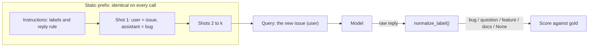
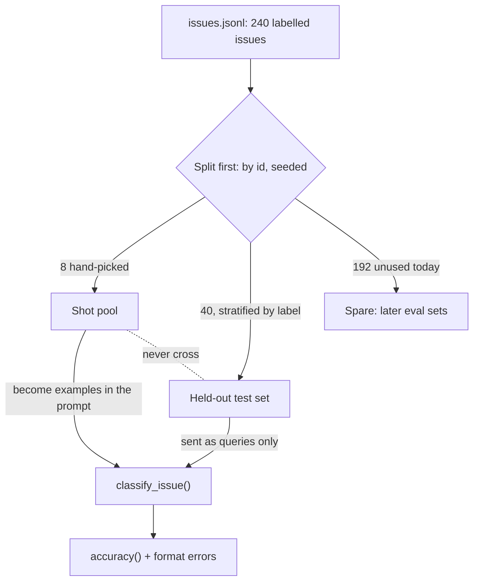
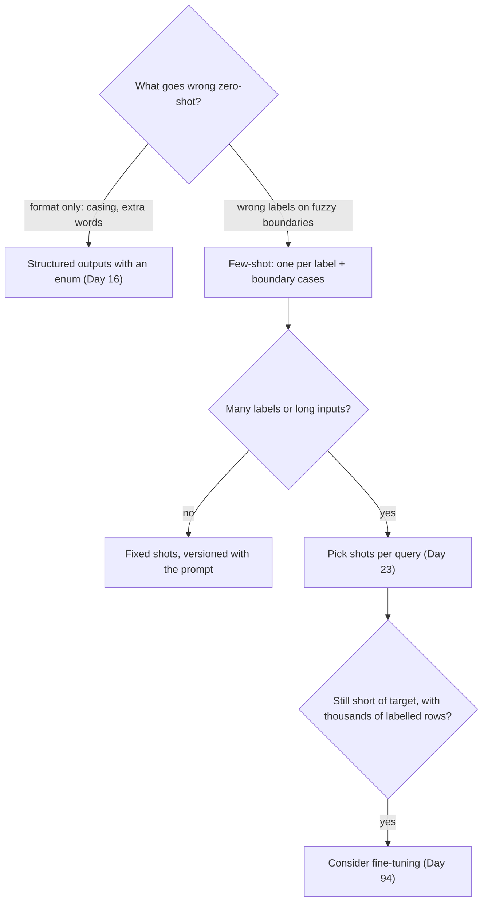

# Few-Shot Prompting

Ask a model, with instructions only, to label the Orbit issue "ORB-1102 WorkerHeartbeatLost during CPU-heavy jobs: is the worker broken?" a plausible reply is `Bug.`: the wrong label (a maintainer filed it as a question), with a capital and a full stop your parser then rejects. Two lines of instructions didn't pin down what your labels mean. A handful of labelled examples usually does, and today you measure how much it helps and what it costs.

## At a Glance

- **Time:** ~2 h core (+ optional Go Deeper) · **Depth:** working
- **Prerequisites:** [Day 9: Writing Effective Prompts](../../Phase_2_Building_with_LLM_APIs/Day_009_effective_prompts/effective_prompts.md), [Primer A12: Eval metrics basics](../../Appendix_Primers/A12_eval_metrics_basics.md); helpful: [Day 4: Tokens: How Models Read Text](../../Phase_1_How_LLMs_Work/Day_004_tokens/tokens.md), [Day 8: Messages, Roles & Conversation State](../../Phase_2_Building_with_LLM_APIs/Day_008_messages_and_state/messages_and_state.md)
- **You'll build:** `fewshot.py` + `classifier.py`, a zero-shot vs k-shot classifier that labels Orbit issues as `bug`, `question`, `feature` or `docs`, scored on 40 held-out issues, plus a cost table per number of shots
- **Stops at:** fine-tuning ([Day 94](../../Phase_10_Open_Models_and_Fine_Tuning/Day_094_should_you_finetune/should_you_finetune.md)) and embedding-based example selection ([Day 23](../../Phase_3_RAG/Day_023_embeddings/embeddings.md))
- **Fast path:** Already put examples in prompts? Read [Choosing Examples That Teach](#choosing-examples-that-teach) and [What Shots Cost](#what-shots-cost), then do Exercise 3 (≈40 min)
- **Cost:** ≈ $0.05 on `gpt-6-luna` (40 issues × 3 configurations + the order runs and exercises; prices as of 2026-11, [verify](https://developers.openai.com/api/docs/pricing))
- **New terms:** zero-shot, few-shot (k-shot), shot, held-out set, accuracy

> **Coming from Software Engineering?** A zero-shot prompt is a function with a docstring; a few-shot prompt is the same docstring with doctest examples underneath, and readers (human or model) copy the examples more faithfully than the prose. The examples are config passed to one call, not edits to the function: nothing about the model changes, and the next request starts fresh. The rule you already follow for tests carries over unchanged: never measure on your own fixtures. The issues you show the model as examples must stay out of the set you score it on, or you are testing the cache, not the code.

## Zero-Shot Mislabels Questions

**Zero-shot** means instructions only, no worked examples. It is often enough, but Orbit's tracker shows where it breaks. Three real issues from `issues.jsonl`, with their gold labels (the answers a maintainer assigned):

| id | Title | Gold label |
|---|---|---|
| 113 | orbit doctor fails: heartbeat_seconds (120) <= lease_seconds (300) / 3 | question |
| 125 | ORB-1102 WorkerHeartbeatLost during CPU-heavy jobs: is the worker broken? | question |
| 43 | Docs: ORBIT_LEASE=5m makes the worker exit, page doesn't say seconds only | docs |

All three contain an error or a failure, so a model can lean towards `bug`. Orbit's maintainers use a sharper rule: a **bug** is Orbit doing something wrong; a **question** is Orbit working as designed while the user needs to know how or why; **docs** means the fix belongs in the documentation. A one-line instruction doesn't say which side of those boundaries each issue sits on.

The second failure is format drift. You asked for a label; you get `Bug.`, `BUG`, or `This is a bug report.` Code that does `if reply == "bug"` treats all three as unknown.

## Show, Don't Only Tell

When a new teammate joins triage, most teams don't hand over a paragraph of rules. They walk through four tickets that are already labelled, then ask the newcomer to label the fifth. The examples carry what the rules leave out: where the boundaries sit, how long an answer is, and what "question" means on *this* project.

**Few-shot** prompting does the same with a model. You put a few solved examples in the request, then the new input. Each example is a **shot**, and a prompt with *k* examples is **k-shot** (4-shot, 8-shot). Zero-shot is k = 0. The model isn't retrained: the examples shape this one reply and are gone on the next request, which is why they cost tokens on every call.

## Label Four Issues by Hand

Try it yourself before the model does. Label these with `bug`, `question`, `feature` or `docs` (all real Orbit issues):

1. *2.8.0: `--concurrency` flag is ignored when ORBIT_CONCURRENCY is set*
2. *orbit doctor fails: heartbeat_seconds (120) <= lease_seconds (300) / 3*
3. *Dashboard: sign in with SSO (OIDC) instead of a token URL*
4. *Quickstart uses `send_receipt.delay(...)`, which doesn't exist*

The answers are bug, question, feature, docs. Number 2 is the interesting one: `orbit doctor` deliberately enforces "heartbeat at most a third of the lease", so the user is asking how to configure it, not reporting a defect. Having seen it, you would label #125 ("ORB-1102 ... is the worker broken?") a question too: an error code in the title, but a user asking whether something is expected. One well-chosen shot settles a boundary the instructions left open.

## The Parts: Instructions, Shots, Query

A few-shot request has three parts:

- **Instructions:** the task, the label set and the reply rule (Day 9's template).
- **Shots:** k solved examples. With the Responses API, each shot is a `user` message holding the input and an `assistant` message holding the answer you want, as if the model had already answered correctly k times ([Day 8](../../Phase_2_Building_with_LLM_APIs/Day_008_messages_and_state/messages_and_state.md) covers roles).
- **Query:** the new input, as the final `user` message.



There is a second layout. [OpenAI's prompting guide](https://developers.openai.com/api/docs/guides/prompt-engineering) shows examples written *inside* the developer message, as tagged blocks after the instructions. Today's code builds both: `build_shots()` makes message pairs and `build_inline()` makes `<example>` blocks. Neither layout is right in general, so Exercise 1 measures them on the same 40 issues. Both keep the static part first and the query last, which matters for caching later ([What Shots Cost](#what-shots-cost)).

## Your First Few-Shot Call

The smallest version: one issue, zero shots versus four, effort fixed at `none` so the only thing that changes is the shots. (Effort is the reasoning knob from [Day 6](../../Phase_1_How_LLMs_Work/Day_006_sampling_reasoning_effort/sampling_reasoning_effort.md); the default is `medium`, and `none` is accepted by `gpt-6-luna`.)

```python
# script_id: day_010_few_shot_prompting/minimal
# Install: uv add "openai>=3.46,<4"   Env: OPENAI_API_KEY (required), ATLAS_MODEL (optional)
import os
from openai import OpenAI

MODEL = os.environ.get("ATLAS_MODEL", "gpt-6-luna")   # atlas/config.py (Day 2)
client = OpenAI()
RULES = "Classify this GitHub issue as bug, question, feature or docs."
SHOTS = [  # real Orbit titles (ids 1, 113, 5, 8): one per label, #113 is the boundary case
    ("2.8.0: `--concurrency` flag is ignored when ORBIT_CONCURRENCY is set", "bug"),
    ("orbit doctor fails: heartbeat_seconds (120) <= lease_seconds (300) / 3", "question"),
    ("Dashboard: sign in with SSO (OIDC) instead of a token URL", "feature"),
    ("Quickstart uses `send_receipt.delay(...)`, which doesn't exist", "docs"),
]
QUERY = "ORB-1102 WorkerHeartbeatLost during CPU-heavy jobs: is the worker broken?"  # issue 125

def label(shots: list[tuple[str, str]]) -> str:
    pairs = [m for title, gold in shots
             for m in ({"role": "user", "content": title}, {"role": "assistant", "content": gold})]
    r = client.responses.create(model=MODEL, instructions=RULES, reasoning={"effort": "none"},
                                input=[*pairs, {"role": "user", "content": QUERY}])
    return r.output_text

print("zero-shot:", repr(label([])), "· 4-shot:", repr(label(SHOTS)))
```

Illustrative output (your reply text will differ, and a single issue proves nothing):

```text
zero-shot: 'Bug.' · 4-shot: 'question'
```

Two things changed: the label moved to the maintainer's choice, and the format became a bare lowercase word, copied from the assistant turns. Examples teach format as strongly as meaning. One issue is an anecdote, though; next comes a measurement.

## Score It Properly: Held-Out Issues and Accuracy

To compare prompts you need a **labelled set** (inputs with known right answers) and one number. Today's number is **accuracy**: the share of answers that are right ([Primer A12](../../Appendix_Primers/A12_eval_metrics_basics.md) covers it and its baseline). Orbit gives you 240 labelled issues: 108 bugs, 63 questions, 44 features, 25 docs.

The trap is leakage: an issue that is both a shot and a test case has its answer in the prompt, which inflates accuracy in a way new issues won't. So split *before* anything else, by issue id, with a fixed seed:



The **held-out set** is the 40 issues kept aside and never used as examples. *Stratified* means each label keeps its share of the whole dataset, so a lucky draw can't hand you 40 bugs. The first file, `fewshot.py`, holds everything that needs no API key: data, the split, both shot layouts and scoring. Its first block loads issues and defines what the model sees.

```python
# script_id: day_010_few_shot_prompting/fewshot
"""fewshot.py: data, split, shot layouts and scoring for the issue-type classifier.

Install: nothing beyond the stdlib for this file (classifier.py needs "openai>=3.46,<4")
Env:     ORBIT_DATA (optional, path to datasets/orbit). No API key needed.
"""
import json
import os
import random
from collections import Counter
from pathlib import Path

DATA_DIR = Path(os.environ.get("ORBIT_DATA", "datasets/orbit"))   # atlas/config.py (Day 2)
LABELS = ("bug", "question", "feature", "docs")
# Hand-picked candidates. The first four cover each label once (113 is the "question that reads
# like a bug" boundary); the last four add a second example per label (43: docs that reads like a bug).
SHOT_POOL_IDS = [1, 113, 5, 8, 199, 2, 30, 43]
# Adapted from Day 9's classify_issue template (question rule sharpened), inlined so this lesson stands alone.
INSTRUCTIONS = """Classify one GitHub issue for Orbit, a Python background-jobs library.
Labels: bug (Orbit behaves wrongly), question (Orbit works as designed; the user asks how or why),
feature (a request for new behaviour), docs (the documentation is wrong or missing).
Reply with the label only."""

def load_jsonl(path: Path) -> list[dict]:
    """One JSON object per line. Proposed shared home: atlas/data.py."""
    with path.open(encoding="utf-8") as f:
        return [json.loads(line) for line in f if line.strip()]

def issue_type(issue: dict) -> str:
    """The gold label: 'type:bug' -> 'bug'. Every Orbit issue has exactly one type label."""
    return next(lab.split(":", 1)[1] for lab in issue["labels"] if lab.startswith("type:"))

def issue_text(issue: dict, max_chars: int = 400) -> str:
    """What the model sees: title + start of the body. Labels never go in; they are the answer."""
    return f"Title: {issue['title']}\n\n{issue['body'][:max_chars]}"
```

The second block is the split and the two shot layouts. The `assert` turns "never cross" from a convention into a check that fails loudly.

```python
# script_id: day_010_few_shot_prompting/fewshot
def split_issues(issues: list[dict], n_test: int = 40, seed: int = 10) -> tuple[list[dict], list[dict]]:
    """Return (shot_pool, test). Split first, by id, so no shot can be scored."""
    by_id = {i["id"]: i for i in issues}
    pool = [by_id[i] for i in SHOT_POOL_IDS]
    rest = [i for i in issues if i["id"] not in set(SHOT_POOL_IDS)]
    rng = random.Random(seed)                 # seeded: the same 40 issues on every run
    test: list[dict] = []
    for label in LABELS:                      # stratified (rounding can be off by one for other sizes)
        group = sorted((i for i in rest if issue_type(i) == label), key=lambda i: i["id"])
        test += rng.sample(group, round(n_test * len(group) / len(rest)))
    assert not {i["id"] for i in test} & set(SHOT_POOL_IDS), "a shot leaked into the test set"
    return pool, sorted(test, key=lambda i: i["id"])

def build_shots(examples: list[dict], max_chars: int = 400) -> list[dict]:
    """Layout 1: each example becomes a user message (the issue) + an assistant message (its label)."""
    shots: list[dict] = []
    for ex in examples:
        shots.append({"role": "user", "content": issue_text(ex, max_chars)})
        shots.append({"role": "assistant", "content": issue_type(ex)})
    return shots

def build_inline(examples: list[dict], max_chars: int = 400) -> str:
    """Layout 2: examples as <example> blocks, appended to the instructions."""
    return "\n\n".join(f"<example>\n{issue_text(ex, max_chars)}\nLabel: {issue_type(ex)}\n</example>"
                       for ex in examples)
```

The third block scores. It keeps two numbers apart: whether the label was *right*, and whether the reply kept the *format* contract. A `Bug.` that normalizes to `bug` counts as correct but is still a format error, because a stricter consumer would choke on it.

```python
# script_id: day_010_few_shot_prompting/fewshot
def normalize_label(raw: str) -> str | None:
    """'Bug.' / ' BUG ' / 'type:bug' -> 'bug'. None when no label can be recovered."""
    word = raw.strip().lower().removeprefix("type:").strip(" .!*`'\"\n")
    return word if word in LABELS else None

def is_format_error(raw: str) -> bool:
    """The contract is 'exactly one bare label'. Anything else breaks it, even if recoverable."""
    return raw.strip() not in LABELS

def accuracy(preds: list[str | None], gold: list[str]) -> float:
    """Share of predictions equal to the gold label. None (unparseable) counts as wrong."""
    return sum(p == g for p, g in zip(preds, gold, strict=True)) / len(gold)

if __name__ == "__main__":
    pool, test = split_issues(load_jsonl(DATA_DIR / "issues" / "issues.jsonl"))
    print("shot pool:", [(i["id"], issue_type(i)) for i in pool])
    counts = Counter(issue_type(i) for i in test)
    print("test set:", len(test), dict(counts))
    top, n = counts.most_common(1)[0]
    print(f"baseline 'always {top}': accuracy {n / len(test):.2f}")
    for raw in ["bug", "Bug.", "This is a bug", "question"]:
        print(f"{raw!r:16} -> {normalize_label(raw)!r:10} format error: {is_format_error(raw)}")
```

Run `python fewshot.py`. No key needed, and the numbers are deterministic:

```text
shot pool: [(1, 'bug'), (113, 'question'), (5, 'feature'), (8, 'docs'), (199, 'bug'), (2, 'question'), (30, 'feature'), (43, 'docs')]
test set: 40 {'bug': 18, 'question': 11, 'feature': 7, 'docs': 4}
baseline 'always bug': accuracy 0.45
'bug'            -> 'bug'      format error: False
'Bug.'           -> 'bug'      format error: True
'This is a bug'  -> None       format error: True
'question'       -> 'question' format error: False
```

The baseline matters. Always answering `bug` already scores 0.45, so a prompt scoring 0.70 is 25 points above doing nothing clever, not 70% of the way to perfect.

Now the model calls. `classifier.py` imports the offline pieces and adds one function that makes one call per issue. Effort and temperature are pinned, so two runs differ only in what you changed on purpose.

```python
# script_id: day_010_few_shot_prompting/classifier
"""classifier.py: zero-shot vs k-shot issue labelling, scored on the 40 held-out issues.

Install: uv add "openai>=3.46,<4"
Env:     OPENAI_API_KEY (required), ATLAS_MODEL and ORBIT_DATA (optional)
Needs:   fewshot.py in the same folder. Cost: 120 calls, well under $0.05 on gpt-6-luna.
"""
import os
from collections import Counter

from openai import OpenAI

from fewshot import (DATA_DIR, INSTRUCTIONS, accuracy, build_shots, is_format_error, issue_text,
                     issue_type, load_jsonl, normalize_label, split_issues)

MODEL = os.environ.get("ATLAS_MODEL", "gpt-6-luna")
client = OpenAI()

def classify_issue(issue: dict, shots: list[dict], instructions: str = INSTRUCTIONS) -> str:
    """Return the model's raw reply; scoring decides whether it is a usable label."""
    resp = client.responses.create(
        model=MODEL,
        instructions=instructions,
        input=[*shots, {"role": "user", "content": issue_text(issue)}],
        reasoning={"effort": "none"},  # pinned: the default is medium (Day 6)
        temperature=0,                 # allowed only with effort none, on models that accept it
        max_output_tokens=20,          # a label is a few tokens; this caps any rambling
    )
    return resp.output_text
```

```python
# script_id: day_010_few_shot_prompting/classifier
def evaluate(test: list[dict], shots: list[dict], **kwargs) -> dict:
    """Score one configuration: accuracy, format errors and where the predictions went."""
    raws = [classify_issue(issue, shots, **kwargs) for issue in test]
    preds = [normalize_label(r) for r in raws]
    return {
        "acc": accuracy(preds, [issue_type(i) for i in test]),
        "format_errors": sum(is_format_error(r) for r in raws),
        "dist": Counter(p or "?" for p in preds),   # "?" = unparseable reply
        "preds": preds,
    }

if __name__ == "__main__":
    pool, test = split_issues(load_jsonl(DATA_DIR / "issues" / "issues.jsonl"))
    for k in (0, 4, 8):
        r = evaluate(test, build_shots(pool[:k]))
        print(f"k={k}  acc {r['acc']:.2f}  format errors {r['format_errors']:2}/{len(test)}  {dict(r['dist'])}")
```

The output has this shape (illustrative numbers, not a measured run; yours will differ):

```text
k=0  acc 0.70  format errors  3/40  {'bug': 21, 'question': 8, 'feature': 7, 'docs': 4}
k=4  acc 0.85  format errors  0/40  {'bug': 18, 'question': 11, 'feature': 7, 'docs': 4}
k=8  acc 0.88  format errors  0/40  {'bug': 18, 'question': 12, 'feature': 6, 'docs': 4}
```

Read it in three passes. Did accuracy move by more than noise (one issue is 2.5 points on 40)? Did format errors drop once shots appear? Did the prediction mix move towards the test set's real 18/11/7/4? An over-full `bug` column at k = 0 is the opening failure, now counted.

## Turn a Knob: How Many Shots, in What Order

You already turned the first knob, k. There is no universal best k, so measure on your data rather than trusting a rule of thumb.

The second knob is less obvious: **order**. Models tend to over-weight what they saw last (recency bias), so the label of the final shot can pull predictions towards it. Keep the same four shots and rotate them:

```python
# script_id: day_010_few_shot_prompting/order_effect
# order_effect.py: same four shots, two orders. Needs fewshot.py + classifier.py alongside.
# Env: OPENAI_API_KEY. Makes 80 client.responses.create calls (about $0.01 on gpt-6-luna).
from fewshot import DATA_DIR, build_shots, issue_type, load_jsonl, split_issues
from classifier import evaluate

pool, test = split_issues(load_jsonl(DATA_DIR / "issues" / "issues.jsonl"))
four = pool[:4]                                    # bug, question, feature, docs
orders = {"docs last": four, "bug last": four[1:] + four[:1]}
for name, shots in orders.items():
    r = evaluate(test, build_shots(shots))
    last = issue_type(shots[-1])
    print(f"{name:9}  acc {r['acc']:.2f}  predicted '{last}': {r['dist'][last]:2}  {dict(r['dist'])}")
```

Illustrative output (yours will differ):

```text
docs last  acc 0.85  predicted 'docs':  4  {'bug': 18, 'question': 11, 'feature': 7, 'docs': 4}
bug last   acc 0.80  predicted 'bug': 21  {'bug': 21, 'question': 9, 'feature': 6, 'docs': 4}
```

If the rows differ by an issue or two, order doesn't matter much here, which is a useful result too. If they differ a lot, fix the order in the prompt file and never shuffle shots per request: a reordered prompt is a different prompt.

## What Shots Cost

Every shot is input tokens on every call. With 400-character shots that is cheap, but it scales with k, with shot length and with traffic. This script prices it *before* you send anything, using Day 4's local `count_tokens()` and `estimate_cost()`, copied in compact form.

```python
# script_id: day_010_few_shot_prompting/shot_cost
"""shot_cost.py: tokens and $ per 1k classifications at k = 0/4/8. Offline, no API key.

Install: uv add tiktoken          Env: ATLAS_MODEL and ORBIT_DATA (optional)
"""
import os

import tiktoken

from fewshot import DATA_DIR, INSTRUCTIONS, build_shots, issue_text, load_jsonl, split_issues

MODEL = os.environ.get("ATLAS_MODEL", "gpt-6-luna")
ENC = tiktoken.get_encoding("o200k_base")   # approximate for GPT-6 (Day 4): no gpt-6 mapping exists
# USD per 1M tokens, Standard tier. As of 2026-11, verify at https://developers.openai.com/api/docs/pricing
PRICES_PER_1M = {"gpt-6-luna": {"input": 0.10, "cached_input": 0.01, "output": 0.50},
                 "gpt-6.1-terra": {"input": 1.00, "cached_input": 0.05, "output": 5.00}}

def count_tokens(text: str) -> int:                                         # Day 4, compact
    return len(ENC.encode(text, disallowed_special=()))

def estimate_cost(input_tokens: float, output_tokens: float, model: str = MODEL) -> float:  # Day 4
    price = PRICES_PER_1M[model]
    return (input_tokens * price["input"] + output_tokens * price["output"]) / 1_000_000

def per_call_tokens(pool: list[dict], test: list[dict], k: int, max_chars: int = 400) -> float:
    """Approximate input tokens per call: instructions + k shots + an average query."""
    shots = sum(count_tokens(m["content"]) for m in build_shots(pool[:k], max_chars))
    query = sum(count_tokens(issue_text(i)) for i in test) / len(test)
    return count_tokens(INSTRUCTIONS) + shots + query

if __name__ == "__main__":
    pool, test = split_issues(load_jsonl(DATA_DIR / "issues" / "issues.jsonl"))
    print(f"{'config':>18} | {'input tokens/call':>17} | {'$ per 1k calls':>14}")
    for k, chars in [(0, 400), (4, 400), (8, 400), (8, 100_000)]:
        n = per_call_tokens(pool, test, k, chars)
        name = f"k={k}" + (" (full bodies)" if chars > 400 else "")
        print(f"{name:>18} | {n:>17,.0f} | {estimate_cost(n, 3) * 1000:>14.4f}")   # ~3 output tokens
```

Output (computed locally from the dataset; prices as of 2026-11, verify):

```text
            config | input tokens/call | $ per 1k calls
               k=0 |               177 |         0.0192
               k=4 |               695 |         0.0710
               k=8 |             1,156 |         0.1171
 k=8 (full bodies) |             1,429 |         0.1444
```

Tokens grow roughly linearly with k, about 120 to 130 per trimmed shot here. Orbit issues are short, so full bodies add only about a quarter at k = 8; on trackers full of long stack traces, trimming is the biggest saving available. These counts skip the few framing tokens each message adds; for exact numbers use the token-count endpoint (Go Deeper).

To decide, pick the *smallest* k whose accuracy is within noise of the best, then read its cost here (Exercise 3).

Putting the static part first also makes instructions plus shots an identical prefix on every call, which prompt caching rewards. GPT-6 caches only prefixes of at least 1,024 tokens, so k = 4 doesn't qualify and k = 8 sits right at the edge. [Day 18](../../Phase_2_Building_with_LLM_APIs/Day_018_cost_latency_caching/cost_latency_caching.md) owns caching; today, keep the order that makes it possible.

## Choosing Examples That Teach

Which examples you pick matters more than how many:

- **Cover every label.** All-bug shots teach "the answer is usually bug".
- **Include the hard boundary.** One example on each confusing edge (a question full of error output, a docs issue that reads like a bug) beats three clear-cut ones.
- **Keep them short, realistic and consistent:** title plus first lines, every answer in exactly the format you want back.
- **Make them diverse.** Near-duplicate shots spend tokens to teach the same thing twice.
- **Never take them from the test set,** nor near-duplicates of test issues; both leak the answer.
- **Check they are correct.** A mislabelled shot teaches the wrong boundary with full confidence.

The selection rules are mechanical enough to code. `pick_shots()` walks the labels round-robin, so every label appears before any repeats, and skips a candidate whose title overlaps too much with one already chosen. Overlap here is Jaccard similarity of title words: shared words divided by all distinct words, so 0 means nothing in common and 1 means the same title. It is a crude measure; [Day 23](../../Phase_3_RAG/Day_023_embeddings/embeddings.md) replaces it with embeddings.

```python
# script_id: day_010_few_shot_prompting/choose_shots
"""choose_shots.py: pick k shots that cover every label and skip near-duplicates. Offline.

Install: nothing beyond the stdlib    Env: ORBIT_DATA (optional). Needs fewshot.py alongside.
"""
from fewshot import DATA_DIR, LABELS, issue_type, load_jsonl, split_issues

def words(issue: dict) -> set[str]:
    """Lower-cased title words longer than 3 characters, punctuation stripped."""
    return {w.strip("`:,.()?'\"").lower() for w in issue["title"].split() if len(w) > 3}

def overlap(a: dict, b: dict) -> float:
    """Jaccard similarity of title words (0 = nothing shared, 1 = same words)."""
    wa, wb = words(a), words(b)
    return len(wa & wb) / max(1, len(wa | wb))

def pick_shots(pool: list[dict], k: int, max_overlap: float = 0.5) -> list[dict]:
    """Round-robin over labels so every label appears before any repeats; skip near-duplicates."""
    queues = {label: [i for i in pool if issue_type(i) == label] for label in LABELS}
    chosen: list[dict] = []
    while len(chosen) < k and any(queues.values()):
        for label in LABELS:
            if queues[label] and len(chosen) < k:
                cand = queues[label].pop(0)
                if all(overlap(cand, c) <= max_overlap for c in chosen):
                    chosen.append(cand)
    return chosen

if __name__ == "__main__":
    pool, test = split_issues(load_jsonl(DATA_DIR / "issues" / "issues.jsonl"))
    for k in (4, 6):
        print(f"k={k}:", [(i["id"], issue_type(i)) for i in pick_shots(pool, k)])
    # Near-duplicate leakage check: how close is each shot to its most similar test issue?
    for shot in pool:
        near = max(test, key=lambda t: overlap(shot, t))
        print(f"shot #{shot['id']:<3} closest test issue #{near['id']:<3} overlap {overlap(shot, near):.2f}")
```

Output (deterministic, no key needed):

```text
k=4: [(1, 'bug'), (113, 'question'), (5, 'feature'), (8, 'docs')]
k=6: [(1, 'bug'), (113, 'question'), (5, 'feature'), (8, 'docs'), (199, 'bug'), (2, 'question')]
shot #1   closest test issue #49  overlap 0.09
shot #113 closest test issue #93  overlap 0.12
shot #5   closest test issue #52  overlap 0.12
shot #8   closest test issue #49  overlap 0.20
shot #199 closest test issue #4   overlap 0.08
shot #2   closest test issue #71  overlap 0.09
shot #30  closest test issue #129 overlap 0.08
shot #43  closest test issue #72  overlap 0.08
```

Every overlap is 0.20 or below, so the pool is safe. A shot at 0.6 or more deserves a side-by-side read; if both describe the same problem, swap the shot.

## Trade-offs: When Shots Are the Wrong Tool

Shots fix two different problems, and only one of them needs shots.



| Situation | Reach for | Why |
|---|---|---|
| Only the format drifts (`Bug.`, extra words) | Structured outputs with an enum ([Day 16](../../Phase_2_Building_with_LLM_APIs/Day_016_structured_outputs/structured_outputs.md)) | The API enforces the label set; no tokens spent on examples |
| Labels whose boundaries are fuzzy | Few-shot, one per label plus boundary cases | Examples define a boundary better than prose does |
| Both | Structured outputs **and** a few shots | The schema fixes the format; the shots fix the meaning |

Rule of thumb: if zero-shot gets the *meaning* right and only the *shape* wrong, don't pay for shots. If it gets the meaning wrong on a recognisable kind of input, show it that kind of input.

### In production

- Shots live in the prompt file and are versioned with it; changing one shot is a new prompt version ([Day 21](../../Phase_2_Building_with_LLM_APIs/Day_021_prompts_as_code/prompts_as_code.md)).
- Re-score whenever the model changes. Shots tuned on one model don't automatically transfer.
- Keep the split fixed and grow the held-out set as new labelled issues arrive; [Day 20](../../Phase_2_Building_with_LLM_APIs/Day_020_first_eval_set/first_eval_set.md) turns it into a proper eval set.
- Log the distribution of predicted labels. A sudden lean towards one label is often the first visible symptom of a prompt or model change.
- Keep instructions and shots first and the query last, so the prefix can be cached ([Day 18](../../Phase_2_Building_with_LLM_APIs/Day_018_cost_latency_caching/cost_latency_caching.md)).

## Go Deeper (optional)

<details><summary>Go deeper: why a handful of examples works at all</summary>

The model never updates its weights from your shots. It predicts the next tokens given everything in the context, and a context that contains "issue, label, issue, label, issue, ..." makes "a label in the same style" the most likely continuation. This is usually called **in-context learning**. The term few-shot in this sense comes from the GPT-3 paper, Brown et al. 2020, *Language Models are Few-Shot Learners* (arXiv:2005.14165), which compared zero-, one- and few-shot prompting against fine-tuned models.

Two lines of research explain the knobs you turned today. Zhao et al. 2021, *Calibrate Before Use* (arXiv:2102.09690), showed few-shot accuracy swinging with the choice and order of examples, and named the biases behind it: towards labels that appear often in the shots, and towards labels that appear near the end. Min et al. 2022, *Rethinking the Role of Demonstrations* (arXiv:2202.12837), found that showing the label set, the kind of input and the format carried much of the benefit on the classification tasks they tested, and that randomly wrong labels in the examples hurt less than expected.

Both papers predate today's models, so treat them as reasons to measure, not as rules. The practical reading is the same either way: balance labels, fix the order, keep the format exact, and check the prediction distribution.

</details>

<details><summary>Go deeper: exact token counts for a shot-heavy prompt</summary>

`shot_cost.py` counts locally with an approximate tokenizer and skips message framing. For a number you can put in a budget, ask the token-count endpoint ([Day 4](../../Phase_1_How_LLMs_Work/Day_004_tokens/tokens.md) introduced it). It takes the same `model`, `instructions` and `input` as `responses.create` but generates nothing.

```python
# script_id: day_010_few_shot_prompting/exact_shot_tokens
# Exact input tokens per k, message framing included. Needs fewshot.py alongside.
# Install: uv add "openai>=3.46,<4"   Env: OPENAI_API_KEY (required), ATLAS_MODEL (optional)
import os

from openai import OpenAI

from fewshot import DATA_DIR, INSTRUCTIONS, build_shots, issue_text, load_jsonl, split_issues

MODEL = os.environ.get("ATLAS_MODEL", "gpt-6-luna")
client = OpenAI()
pool, test = split_issues(load_jsonl(DATA_DIR / "issues" / "issues.jsonl"))
query = {"role": "user", "content": issue_text(test[0])}
for k in (0, 4, 8):
    n = client.responses.input_tokens.count(model=MODEL, instructions=INSTRUCTIONS,
                                            input=[*build_shots(pool[:k]), query])
    print(f"k={k}: {n.input_tokens} input tokens (exact, for test issue #{test[0]['id']})")
```

Expect these to sit a little above the local estimates for the same issue: each message adds a few framing tokens, and the tokenizer differs.

</details>

<details><summary>Go deeper: few-shot prompts with reasoning turned on</summary>

Today pinned effort at `none`, which makes the shots the only variable. With effort `low` or higher, the model reasons before it answers, and two things change. First, sampling parameters such as `temperature` must be removed (they are only accepted with effort `none`). Second, OpenAI's reasoning guidance is to give the model a clear goal, constraints and an output contract without prescribing every intermediate step, so shots that show worked reasoning are less useful than shots that show the input and the final answer. Shots that show the final format still help, because the output contract is exactly what they demonstrate.

Treat effort and k as two separate knobs and measure them one at a time on the same held-out set. [Day 11](../../Phase_2_Building_with_LLM_APIs/Day_011_reasoning_cot/reasoning_cot.md) runs that comparison for chain-of-thought.

</details>

## Common Pitfalls

- **Accuracy that collapses on new issues.** Shots leaked into the test set, or near-duplicates of test issues were used as shots. Fix: split first, by id, with a seed, assert there is no overlap, and run the near-duplicate check in `choose_shots.py`.
- **The model over-predicts one label.** All or most shots share that label, or it is always the last shot. Fix: cover every label, fix the order, and print the prediction distribution next to the test set's real mix.
- **Correct answers scored as wrong.** Replies such as `Bug.`, `BUG` or `Label: bug` fail an exact match. Fix: normalize before scoring and count format errors separately; [Day 16](../../Phase_2_Building_with_LLM_APIs/Day_016_structured_outputs/structured_outputs.md) makes the label an enum so the drift can't happen.
- **Shots blow the token budget.** Cost is k × shot length on every call, and real issue bodies with logs and stack traces can run long. Fix: trim shots to title plus the first few hundred characters, then re-score to confirm nothing was lost.
- **Two runs disagree for a reason you didn't change.** One call used the default effort (`medium`) and the other used `none`, or a model that rejects `none` returned HTTP 400 (`openai.BadRequestError`). Fix: set `reasoning={"effort": ...}` explicitly on every call and keep the model fixed while comparing.

> **Where we stop:** we don't fine-tune (moving examples into the weights is [Day 94](../../Phase_10_Open_Models_and_Fine_Tuning/Day_094_should_you_finetune/should_you_finetune.md)) and we don't select shots by meaning (embeddings arrive in [Day 23](../../Phase_3_RAG/Day_023_embeddings/embeddings.md)), because both need tools this phase hasn't built yet.

## Key Takeaways

- Zero-shot fails in two separate ways, wrong labels on fuzzy boundaries and drifting format, and few-shot examples address both because the model copies what the shots show.
- A shot is a solved example (a `user` input plus the `assistant` answer you want); the model isn't changed by it, so every call pays for the shots again in input tokens.
- Measure on a held-out set that is split first, by id and seeded, report accuracy against the majority baseline, and count format errors apart from wrong labels.
- k and order are knobs to measure, not constants: rotate the same shots and compare the prediction distribution, then pick the smallest k within noise of the best and read its $ per 1k calls.
- Use structured outputs when only the format is wrong, shots when the meaning is wrong, per-query selection for many labels or long inputs, and keep shots versioned with the prompt and re-scored on every model change.

## Quick Reference

| API / pattern | When to use | Gotcha |
|---|---|---|
| `input=[*shots, {"role": "user", "content": query}]` | Shots as message pairs | Each shot is two messages: `user` (input) and `assistant` (answer) |
| `instructions=INSTRUCTIONS + build_inline(examples)` | Shots inside the instructions, as the OpenAI guide shows | A `Label: bug` example format can leak into replies |
| `reasoning={"effort": "none"}` | Fair comparisons on `gpt-6-luna` | Default is `medium`; some models reject `none` with HTTP 400 |
| `split_issues()` before anything else | Every evaluation | Seed it, split by id, assert no overlap |
| `normalize_label()` + `is_format_error()` | Scoring free-text labels | Count format errors separately from wrong labels |
| `count_tokens()` × k | Pricing shots before sending | Approximate; `client.responses.input_tokens.count` is exact |
| Static prefix first, query last | Every few-shot prompt | Caching needs a ≥1,024-token identical prefix ([Day 18](../../Phase_2_Building_with_LLM_APIs/Day_018_cost_latency_caching/cost_latency_caching.md)) |

## Exercises

Save solutions next to `fewshot.py`, `classifier.py`, `shot_cost.py` and `choose_shots.py`. All make API calls (a few cents in total on `gpt-6-luna`).

1. **Warm-up: messages vs inline.** Keep the same four shots (`pool[:4]`) and compare the message-pair layout with the inline layout from OpenAI's prompting guide (`shots=[]`, examples appended to the instructions with `build_inline()`). Report accuracy and format errors for both.

<details><summary>Solution</summary>

```python
# script_id: day_010_few_shot_prompting/solution_ex1
# Messages vs inline layout: same four shots, same 40 issues. 80 client.responses calls.
from fewshot import DATA_DIR, INSTRUCTIONS, build_inline, build_shots, load_jsonl, split_issues
from classifier import evaluate

pool, test = split_issues(load_jsonl(DATA_DIR / "issues" / "issues.jsonl"))
four = pool[:4]
inline_instructions = f"{INSTRUCTIONS}\n\n# Examples\n\n{build_inline(four)}"
runs = {
    "messages": evaluate(test, build_shots(four)),
    "inline": evaluate(test, [], instructions=inline_instructions),
}
for name, r in runs.items():
    print(f"{name:9} acc {r['acc']:.2f}  format errors {r['format_errors']:2}/{len(test)}  {dict(r['dist'])}")
```

Accuracy is often close between the two; the format column is where they can differ. The inline examples end in `Label: bug`, and some replies copy that prefix, which `normalize_label()` can't recover. If you see that, change the example format (or the normalizer), not the scorer.

</details>

2. **Core: per-label accuracy and the boundary shot.** For the 4-shot run, print accuracy per gold label and the most common confusion pair (gold → predicted). Then swap shot #113 (the question that reads like a bug) for #2 (a plain question) and see which label's accuracy moves. [Primer A12](../../Appendix_Primers/A12_eval_metrics_basics.md) calls the per-label number recall.

<details><summary>Solution</summary>

```python
# script_id: day_010_few_shot_prompting/solution_ex2
# Per-label accuracy + top confusion, with and without the boundary shot. 80 client.responses calls.
from collections import Counter

from fewshot import DATA_DIR, LABELS, build_shots, issue_type, load_jsonl, split_issues
from classifier import evaluate

pool, test = split_issues(load_jsonl(DATA_DIR / "issues" / "issues.jsonl"))
by_id = {i["id"]: i for i in pool}
gold = [issue_type(i) for i in test]
for name, ids in {"boundary #113": (1, 113, 5, 8), "plain #2": (1, 2, 5, 8)}.items():
    preds = evaluate(test, build_shots([by_id[i] for i in ids]))["preds"]
    per_label = []
    for label in LABELS:
        idx = [n for n, g in enumerate(gold) if g == label]
        per_label.append(f"{label} {sum(preds[n] == label for n in idx)}/{len(idx)}")
    confusions = Counter((g, p) for g, p in zip(gold, preds) if g != p)
    top = confusions.most_common(1)
    worst = f"{top[0][0][0]} -> {top[0][0][1]} ({top[0][1]}x)" if top else "none"
    print(f"{name:14} {' · '.join(per_label)}   most common mistake: {worst}")
```

The pair to watch is `question -> bug`. If it shrinks with #113 in the shots, one boundary example did the work that extra instructions couldn't.

</details>

3. **Core: the cheapest k that is good enough.** Score k = 0, 2, 4, 6 and 8, find the smallest k whose accuracy is within one issue (2.5 points on 40) of the best, and print its $ per 1k calls from `shot_cost.py`.

<details><summary>Solution</summary>

```python
# script_id: day_010_few_shot_prompting/solution_ex3
# Smallest k within one issue of the best, with its cost. 200 client.responses calls.
from fewshot import DATA_DIR, build_shots, load_jsonl, split_issues
from classifier import evaluate
from shot_cost import estimate_cost, per_call_tokens

pool, test = split_issues(load_jsonl(DATA_DIR / "issues" / "issues.jsonl"))
results = {k: evaluate(test, build_shots(pool[:k]))["acc"] for k in (0, 2, 4, 6, 8)}
best = max(results.values())
tolerance = 1 / len(test)                     # one issue's worth of accuracy
k_small = min(k for k, acc in results.items() if acc >= best - tolerance - 1e-9)
for k, acc in results.items():
    usd = estimate_cost(per_call_tokens(pool, test, k), 3) * 1000
    mark = "  <- smallest k within one issue of the best" if k == k_small else ""
    print(f"k={k}  acc {acc:.2f}  ${usd:.4f} per 1k calls{mark}")
```

With 40 issues you can't resolve differences smaller than one issue, so "within one issue" is the honest tolerance. Note that k = 2 here means one bug and one question, so features and docs are unseen; a dip at k = 2 is the label-coverage rule showing up in data.

</details>

4. **Stretch (optional): shots chosen per query.** For each test issue, pick the four most similar non-test issues by title-word `overlap()` and use them as its shots. Compare with the fixed four. This is the idea Day 23 rebuilds with embeddings.

<details><summary>Solution</summary>

```python
# script_id: day_010_few_shot_prompting/solution_ex4
# Dynamic (per-query) shots vs fixed shots. 80 client.responses calls.
from collections import Counter

from fewshot import (DATA_DIR, accuracy, build_shots, issue_type, load_jsonl, normalize_label,
                     split_issues)
from classifier import classify_issue, evaluate
from choose_shots import overlap

issues = load_jsonl(DATA_DIR / "issues" / "issues.jsonl")
pool, test = split_issues(issues)
test_ids = {i["id"] for i in test}
candidates = [i for i in issues if i["id"] not in test_ids]   # never select from the test set

def nearest_shots(issue: dict, k: int = 4) -> list[dict]:
    ranked = sorted(candidates, key=lambda c: overlap(issue, c), reverse=True)
    return ranked[:k][::-1]                                    # most similar last, nearest the query

gold = [issue_type(i) for i in test]
fixed = evaluate(test, build_shots(pool[:4]))["acc"]
chosen = [nearest_shots(i) for i in test]
preds = [normalize_label(classify_issue(i, build_shots(s))) for i, s in zip(test, chosen)]
single_label = sum(len({issue_type(s) for s in shots}) == 1 for shots in chosen)
print(f"fixed: {fixed:.2f}  dynamic: {accuracy(preds, gold):.2f}")
print(f"queries whose 4 shots all share one label: {single_label}/{len(test)}")
print("dynamic prediction mix:", dict(Counter(p or "?" for p in preds)))
```

Similar titles often share a label, which helps, but they can also hand a query four shots with the same label, which is the over-prediction pitfall again. Production versions mix the two: a fixed shot per label plus a few retrieved neighbours.

</details>

## References & Further Reading

- [OpenAI prompt engineering guide, "Few-shot learning"](https://developers.openai.com/api/docs/guides/prompt-engineering): the official layout (examples inside the developer message) and the advice to show diverse inputs.
- [OpenAI text generation guide](https://developers.openai.com/api/docs/guides/text): how `instructions` and input messages combine in the Responses API.
- [OpenAI reasoning guide](https://developers.openai.com/api/docs/guides/reasoning): effort values and how to prompt reasoning models, relevant when you turn effort up.
- [OpenAI token counting guide](https://developers.openai.com/api/docs/guides/token-counting): exact input-token counts for a prompt before you send it.
- [OpenAI prompt caching guide](https://developers.openai.com/api/docs/guides/prompt-caching): why a static prefix of instructions and shots should come first.
- [OpenAI pricing](https://developers.openai.com/api/docs/pricing): current per-token prices behind the cost table.

## What's Next

Shots showed the model *what* answer you want. [Day 11: Reasoning: Chain-of-Thought & Reasoning Models](../../Phase_2_Building_with_LLM_APIs/Day_011_reasoning_cot/reasoning_cot.md) asks how much *thinking* to pay for: you'll compare chain-of-thought prompting with the effort knob on Orbit problems where the answer takes several steps, scored with today's `accuracy()`.
