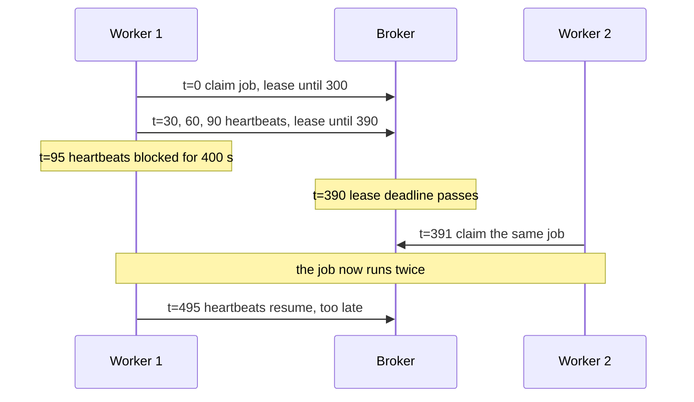
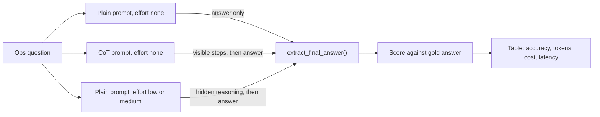
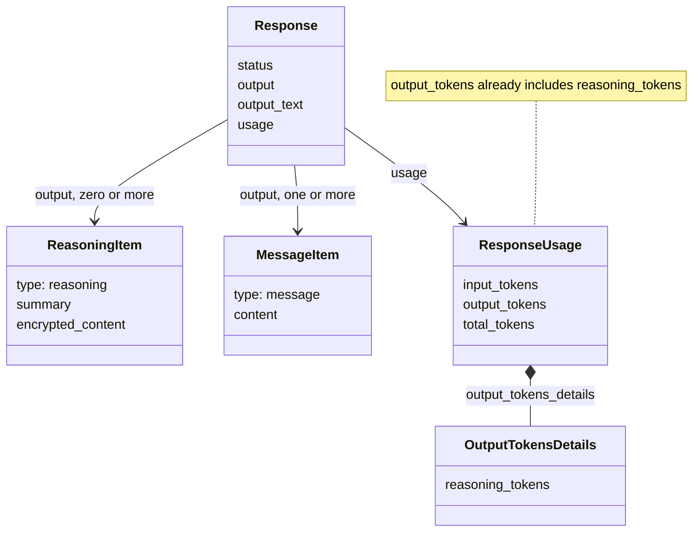
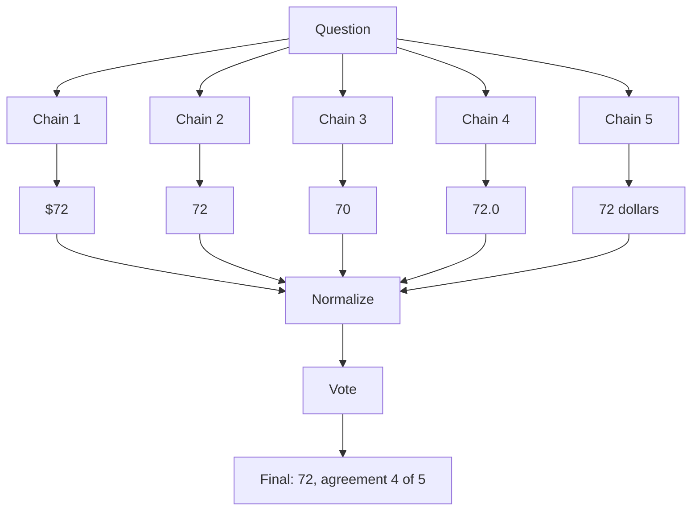

# Reasoning: Chain-of-Thought & Reasoning Models

"A job has `lease_seconds=300`, heartbeats every 30 s, and its worker freezes for 400 s. Can it run twice?" Ask a model for a one-word answer with no room to think, and it will often say "No". Give it room to reason, either by asking for written steps or by turning up a setting, and it gets "Yes". Both ways cost money, and today you measure how much. By the end you will know when to prompt a model to think, when to raise its effort setting instead, and how to read the bill for thinking you never see.

## At a Glance

- **Time:** ~2 h core (+ optional Go Deeper) · **Depth:** working
- **Prerequisites:** [Day 6: Controlling Generation: Sampling & Reasoning Effort](../../Phase_1_How_LLMs_Work/Day_006_sampling_reasoning_effort/sampling_reasoning_effort.md), [Day 10: Few-Shot Prompting](../../Phase_2_Building_with_LLM_APIs/Day_010_few_shot_prompting/few_shot_prompting.md)
- **You'll build:** a "same problem, three ways" benchmark that runs 10 Orbit ops questions as plain, chain-of-thought and raised-effort calls, then reports accuracy, tokens, cost and latency per method
- **Stops at:** how reasoning models are trained
- **Fast path:** Already use reasoning models? Read [the trade-offs table](#trade-offs-when-to-reason-and-how) and [the Build](#build-same-problem-three-ways), then do Exercise 2 (≈45 min)
- **Cost:** ≈ $0.05 or less on `gpt-6-luna`, estimated from list prices (prices as of 2026-11, [verify](https://developers.openai.com/api/docs/pricing))
- **New terms:** chain-of-thought (CoT), reasoning model, reasoning tokens, final-answer extraction, self-consistency

> **Coming from Software Engineering?** Chain-of-thought is the difference between one giant nested expression and code that names its intermediate variables: each named step is something the next step can build on, and something you can inspect when the result is wrong. Reasoning effort is a per-call optimisation flag, like choosing `-O0` or `-O2` for a compiler (a higher level does more work up front for a better result), except here you pay for that work on every call. The work happens in hidden reasoning tokens, so it shows up in your bill and your latency but not in the reply. Self-consistency, covered in Go Deeper, is re-running a flaky test five times and trusting the majority.

## One-Word Answers to Multi-Step Questions

Here is the question from the opening as a real call. It is Orbit's most common support problem, error ORB-1101 `LeaseExpired`, where a job outlives its lease and a second worker picks it up. Answering it takes three steps: find when the last heartbeat happened, add the lease, and compare that deadline with when heartbeats resume. A model asked for "one line, yes or no", with its effort set to `none`, has to produce the answer as its very first token. It has nowhere to do the three steps, so it often matches the pattern "heartbeats keep the lease alive" and replies "No".

The answer is "Yes". This is a real failure mode: lease expiry comes up again and again in `datasets/orbit/issues/` (13 of the 240 issues mention ORB-1101). If Atlas, the assistant you are building for Orbit's maintainers, gets this wrong, it tells a maintainer their duplicate-execution bug can't happen.

## Show Your Working

Remember maths tests at school. Write only the final answer and one slip loses everything. Write the working and you catch the slip yourself, because each line gives the next line something solid to start from. Language models behave in a similar way. A model produces text one token at a time, and each token can use everything written before it. Steps written out are a scratchpad the model can read back.

There are two ways to give a model that scratchpad:

1. **Ask for it in the prompt.** "Think step by step, then give the final answer." This is **chain-of-thought (CoT) prompting**: asking the model to write its intermediate steps in the visible reply.
2. **Turn up its effort.** Every GPT-6 model is a **reasoning model**: a model trained to think in private before it answers. The `reasoning={"effort": ...}` setting from [Day 6](../../Phase_1_How_LLMs_Work/Day_006_sampling_reasoning_effort/sampling_reasoning_effort.md) (effort means how much hidden thinking the model does) controls how long that private thinking runs.

The working from option 2 is hidden from you, but it is not free.

## Work One by Hand

Start with a classic puzzle. A bat and a ball cost $1.10 together. The bat costs $1.00 more than the ball. How much is the ball?

The fast answer is $0.10, and it is wrong: the bat would then be $1.10 and the total $1.20. Written out:

- ball + (ball + 1.00) = 1.10
- 2 × ball = 0.10
- ball = **$0.05**. Check: bat $1.05 + ball $0.05 = $1.10, and $1.05 is exactly $1.00 more than $0.05.

Now the Orbit lease question, step by step, using the rules in `docs/leases-and-heartbeats.md`. Each heartbeat pushes the lease deadline to `now + lease_seconds`.



The last heartbeat lands at t=90, so the deadline is 390. Heartbeats only resume at t=495. Between those two times the job is claimable, so another worker can run it again: **yes**. No single step is hard. The difficulty is doing all three at once, inside a single token.

## The Parts: CoT Prompts, Reasoning Models and Hidden Tokens

Here is the vocabulary for the rest of the day.

- **CoT prompt:** instructions that ask for visible steps before the answer. The steps appear in `output_text`, so you can read them and you pay for them as ordinary output.
- **Reasoning model and effort:** on `gpt-6-luna`, effort accepts `none`, `low`, `medium`, `high`, `xhigh` and `max`, and **the default is `medium`**. So a call that never sets effort is already thinking, and billing for it. `gpt-6.1-sol` and `gpt-6-astra` don't accept `none` (Astra returns HTTP 400). [Day 7](../../Phase_1_How_LLMs_Work/Day_007_choosing_a_model/choosing_a_model.md) compares the tiers.
- **Reasoning tokens:** the hidden thinking. They are counted **inside** `usage.output_tokens` and also reported separately in `usage.output_tokens_details.reasoning_tokens`. They are billed as output tokens, even though you never see them.
- **Reasoning items:** `response.output` is a list of typed items. When the model reasons, the list holds a `reasoning` item before the `message` item. The reasoning item carries no readable thinking, but it matters when you continue a conversation (covered later today).
- **Final-answer extraction:** pulling the one value you need out of a reply that may contain paragraphs of working.

The benchmark you will build sends each question down three paths and scores them the same way:



And here is where the hidden cost appears in the response object:



Because reasoning tokens sit inside `output_tokens`, the cost formula from [Day 4](../../Phase_1_How_LLMs_Work/Day_004_tokens/tokens.md) doesn't change. You only need to read the numbers correctly. This script uses a usage record shaped like the API's, so it runs with no key:

```python
# script_id: day_011_reasoning_cot/usage_cost
# usage_cost.py: read a usage record correctly. No API key or install needed.
PRICES = {"input": 0.10, "output": 0.50}  # gpt-6-luna USD per 1M, as of 2026-11, verify at https://developers.openai.com/api/docs/pricing

# Shaped like response.usage from a medium-effort call (illustrative numbers)
usage = {"input_tokens": 120, "output_tokens": 700,
         "output_tokens_details": {"reasoning_tokens": 640}}

reasoning = usage["output_tokens_details"]["reasoning_tokens"]
visible = usage["output_tokens"] - reasoning          # the part you can actually read
right = (usage["input_tokens"] * PRICES["input"] + usage["output_tokens"] * PRICES["output"]) / 1e6
wrong = right + reasoning * PRICES["output"] / 1e6    # adds the hidden part a second time

print(f"visible {visible} tok, hidden {reasoning} tok "
      f"({reasoning / usage['output_tokens']:.0%} of output)")
print(f"cost ${right:.6f} (adding reasoning again would claim ${wrong:.6f})")
```

```text
visible 60 tok, hidden 640 tok (91% of output)
cost $0.000362 (adding reasoning again would claim $0.000682)
```

Nine tokens in ten are thinking you never read. That ratio is normal at medium effort, and it is why a one-word answer can cost as much as a paragraph.

## Plain vs CoT at Effort `none`

Now the first live call. Both versions run at effort `none`, so the model does no hidden thinking. The only difference is whether the prompt asks for visible steps.

```python
# script_id: day_011_reasoning_cot/minimal
# Install: uv add "openai>=3.46,<4"   Env: OPENAI_API_KEY (ATLAS_MODEL optional)
import os

from openai import OpenAI

MODEL = os.environ.get("ATLAS_MODEL", "gpt-6-luna")
client = OpenAI()

LEASE_Q = ("Orbit worker settings: lease_seconds=300, heartbeat_seconds=30. Each heartbeat renews "
           "the lease to now + 300 s. A job starts at t=0. At t=95 a C extension holds the GIL and "
           "blocks heartbeats for 400 s. Can another worker claim the job and run it a second time?")
PLAIN = "Reply with one line only: 'Final answer: yes' or 'Final answer: no'."
COT = ("Work through it step by step, tracking the lease deadline after each heartbeat. "
       "Then end with one line: 'Final answer: yes' or 'Final answer: no'.")

for name, instructions in [("plain", PLAIN), ("CoT", COT)]:
    r = client.responses.create(model=MODEL, instructions=instructions, input=LEASE_Q,
                                reasoning={"effort": "none"})  # no hidden thinking at all
    u = r.usage
    print(f"--- {name}: {u.output_tokens} output tokens "
          f"({u.output_tokens_details.reasoning_tokens} reasoning)")
    print(r.output_text)
```

Expected output (illustrative; your numbers and wording will differ):

```text
--- plain: 6 output tokens (0 reasoning)
Final answer: no
--- CoT: 138 output tokens (0 reasoning)
1. Heartbeats at t=30, 60 and 90 push the deadline to 90 + 300 = 390 s.
2. Heartbeats are blocked from t=95 until t=495.
3. At t=390 the lease expires while the worker is frozen, so another worker can claim it.
Final answer: yes
```

The CoT version spent about 20 times more output tokens. At effort `none` those tokens are the only thinking the model does, so they are what turns "no" into "yes". Run it a few times: one example proves nothing, which is why the Build uses ten questions.

## Turn the Knob: Raise Effort, Then Break It

Now drop the CoT text and let effort do the work. Keep the answer-only prompt and change one setting.

```python
# script_id: day_011_reasoning_cot/effort_knob
# Install: uv add "openai>=3.46,<4"   Env: OPENAI_API_KEY (ATLAS_MODEL optional)
import os
import time

import openai
from openai import OpenAI

MODEL = os.environ.get("ATLAS_MODEL", "gpt-6-luna")
client = OpenAI()
LEASE_Q = ("Orbit worker settings: lease_seconds=300, heartbeat_seconds=30. Each heartbeat renews "
           "the lease to now + 300 s. A job starts at t=0. At t=95 a C extension holds the GIL and "
           "blocks heartbeats for 400 s. Can another worker claim the job and run it a second time?")
PLAIN = "Reply with one line only: 'Final answer: yes' or 'Final answer: no'."

for effort in ["none", "low", "medium"]:
    t0 = time.perf_counter()
    r = client.responses.create(model=MODEL, instructions=PLAIN, input=LEASE_Q,
                                reasoning={"effort": effort},
                                max_output_tokens=25_000)  # headroom for reasoning + answer
    secs = time.perf_counter() - t0
    u = r.usage
    print(f"{effort:<7} reasoning={u.output_tokens_details.reasoning_tokens:>5} "
          f"output={u.output_tokens:>5} {secs:5.1f}s  {r.output_text.strip()}")
```

Expected output (illustrative; your numbers will differ):

```text
none    reasoning=    0 output=    6   0.4s  Final answer: no
low     reasoning=  186 output=  192   1.3s  Final answer: yes
medium  reasoning=  640 output=  646   3.2s  Final answer: yes
```

The visible reply is the same one line each time. What grows is the hidden reasoning, and latency grows with it, because the model writes every reasoning token before it writes your answer.

Now break it twice. First, set a cap smaller than the thinking. `max_output_tokens` limits reasoning **plus** visible output together. Second, send a sampling knob with effort above `none`, which [Day 6](../../Phase_1_How_LLMs_Work/Day_006_sampling_reasoning_effort/sampling_reasoning_effort.md) showed is rejected.

```python
# script_id: day_011_reasoning_cot/effort_knob
# Break it 1: the cap runs out during reasoning. Input and reasoning are still billed.
r = client.responses.create(model=MODEL, instructions=PLAIN, input=LEASE_Q,
                            reasoning={"effort": "medium"}, max_output_tokens=100)
reason = r.incomplete_details.reason if r.incomplete_details else None
print(r.status, reason, repr(r.output_text))

# Break it 2: temperature/top_p are only accepted at effort "none".
try:
    client.responses.create(model=MODEL, input=LEASE_Q, reasoning={"effort": "medium"},
                            temperature=0.2)
except openai.APIStatusError as err:   # parent of BadRequestError: survives a status change
    print("rejected:", type(err).__name__, err.status_code)
```

Expected output (not captured live; ⚠ verify the status on your run):

```text
incomplete max_output_tokens ''
rejected: BadRequestError 400
```

The first result is the dangerous one. There is no exception: `status` is `"incomplete"`, `output_text` is empty, and you still pay for the reasoning. Code that only reads `output_text` sees a blank answer and moves on. If a cap of 100 still completes on your run, lower it or raise effort to `high`. The rejection's message text comes from the server and can change, so branch on the exception type or status code, never the wording. Catching `openai.APIStatusError` (the parent class) keeps the script running even if the status ever differs from the documented 400.

## Extracting the Final Answer

A benchmark needs one comparable value per reply, but a CoT reply is paragraphs of working. The naive fix, "take the first number in the text", grabs a number from the working. Use a convention instead:

1. **Ask for a fixed last line:** `Final answer: <value>`. Every prompt today ends with that instruction.
2. **Take the last match**, not the first. Models sometimes write "the final answer is not 4..." mid-reasoning, and the line you want comes last.
3. **Normalize before comparing.** "$72", "72.0" and "**72**" are the same answer. Compare numbers as numbers and words as lowercase words.

This file has no API calls, so it runs as-is. The benchmark imports it.

```python
# script_id: day_011_reasoning_cot/answers
# answers.py: pull a final answer out of free text and compare it with gold. No API key needed.
import re

FINAL_RE = re.compile(r"final answer\s*[:=]\s*(.+)", re.IGNORECASE)
NUMBER_RE = re.compile(r"-?\d[\d,]*(?:\.\d+)?")


def extract_final_answer(text: str) -> str | None:
    """The value after the LAST 'Final answer:' line, or None if the reply has none."""
    matches = FINAL_RE.findall(text or "")
    if not matches:
        return None
    return matches[-1].strip().strip("*.` ")  # drop Markdown bold, backticks, trailing period


def normalize_number(s: str) -> float | None:
    """'$72', '72.0', '1,024 s' -> 72.0, 72.0, 1024.0. None if there is no number."""
    m = NUMBER_RE.search(s.replace("$", ""))
    return float(m.group().replace(",", "")) if m else None


def answers_match(predicted: str | None, gold: str) -> bool:
    """Numbers compare as numbers ('72.0' == '$72'); words compare by their first word."""
    if predicted is None:
        return False
    p, g = normalize_number(predicted), normalize_number(gold)
    if g is not None:
        return p is not None and abs(p - g) < 1e-6
    words = predicted.lower().split()
    return bool(words) and words[0].strip(".,!") == gold.lower()  # "Yes, because..." -> yes
```

Now the demo, under the same `script_id`. It shows the first-number trap and the normalizer.

```python
# script_id: day_011_reasoning_cot/answers
if __name__ == "__main__":
    reply = "Retry 1 waits 2 s, retry 2 waits 4 s.\nTotal: 2 + 4 = 6 seconds.\nFinal answer: 6 s"
    naive = NUMBER_RE.findall(reply)[0]  # first number anywhere: the "1" in "Retry 1"
    print("naive:", naive, "| extracted:", extract_final_answer(reply))
    for raw in ["$72", "72.0", "**72**", "72 dollars"]:
        print(f"{raw!r:>13} -> {normalize_number(raw)}")
    assert answers_match("Yes, it can run twice.", "yes")
    assert answers_match("6 s", "6") and not answers_match(None, "6")
    print("all checks pass")
```

```text
naive: 1 | extracted: 6 s
        '$72' -> 72.0
       '72.0' -> 72.0
     '**72**' -> 72.0
 '72 dollars' -> 72.0
all checks pass
```

Normalizing matters most when you count answers, as in self-consistency (Go Deeper): "9" and "9 sheep" are one answer to you, but two different strings to a `Counter`, so the votes split. [Day 16](../../Phase_2_Building_with_LLM_APIs/Day_016_structured_outputs/structured_outputs.md) replaces this regex with a typed schema. Today the regex is the point, because CoT replies are free text.

## Build: Same Problem, Three Ways

Ten questions are enough to see a pattern without spending much. Each gold answer comes from Orbit's documented defaults (`docs/retries-and-backoff.md`, `leases-and-heartbeats.md`, `scaling-workers.md`, `scheduling-cron.md`, `configuration-reference.md`), and each derivation sits in a comment so you can check it by hand. Every question states the facts it needs, so the model doesn't have to know Orbit.

```python
# script_id: day_011_reasoning_cot/ops_questions
# ops_questions.py: 10 Orbit ops questions with gold answers from the Orbit docs. No API key needed.
OPS_QUESTIONS: list[dict] = [
    {"id": "lease", "gold": "yes",  # last heartbeat t=90 -> deadline 390; heartbeats resume at 495
     "q": "lease_seconds=300, heartbeat_seconds=30; each heartbeat renews the lease to now + 300 s. "
          "A job starts at t=0. At t=95 a C extension blocks heartbeats for 400 s. Can another "
          "worker claim the job and run it a second time? Answer yes or no."},
    {"id": "backoff_total", "gold": "6",  # max_attempts=3 -> 2 retries: 2 + 4
     "q": "max_attempts=3 counts the first attempt. Exponential backoff: retry n waits 2**n s. A job "
          "fails every time. Ignoring jitter, how many seconds does it wait between attempts in total?"},
    {"id": "last_retry_delay", "gold": "16",  # retries=5 -> 4 retries; the 4th waits 2**4
     "q": "A job has retries=5 (total attempts, including the first) and exponential backoff where "
          "retry n waits 2**n s. Ignoring jitter, how many seconds is the delay before its last attempt?"},
    {"id": "jitter_min", "gold": "4",  # 2**3 = 8; jitter picks 50-100% of it -> 4..8
     "q": "Retry n waits 2**n s, then jitter picks the real delay uniformly between 50% and 100% of "
          "that value. What is the shortest possible delay before retry 3, in seconds?"},
    {"id": "delay_cap", "gold": "600",  # 2**10 = 1024, capped by max_delay_seconds
     "q": "Retry n waits 2**n s, capped at max_delay_seconds=600. Ignoring jitter, how many seconds "
          "does the job wait before retry 10?"},
]
```

```python
# script_id: day_011_reasoning_cot/ops_questions
OPS_QUESTIONS += [
    {"id": "reserved_jobs", "gold": "54",  # 3 x (8 running + 10 prefetched)
     "q": "Each worker process runs up to `concurrency` jobs and reserves `prefetch` more ahead of "
          "time. You run 3 processes with concurrency=8 and prefetch=10. How many jobs can be "
          "reserved (running or waiting) at once?"},
    {"id": "running_jobs", "gold": "16",  # the CLI flag beats orbit.toml: 2 x 8
     "q": "orbit.toml sets concurrency=4. You start two processes with `orbit worker --concurrency 8`, "
          "and the flag overrides the file. How many jobs can run at the same time?"},
    {"id": "payload_records", "gold": "640",  # 512 KB / 0.8 KB
     "q": "max_payload_kb=512. Each record serializes to 0.8 KB. Ignoring overhead, what is the "
          "largest number of records one job payload can hold?"},
    {"id": "cron_next", "gold": "71",  # Fri 10:00 -> Mon 09:00 = 72 h - 1 h
     "q": "A schedule uses cron '0 9 * * MON-FRI' (09:00 on weekdays). It is Friday 10:00. How many "
          "hours until the next run?"},
    {"id": "lease_dlq", "gold": "3",  # every lease expiry burns one of max_attempts=3
     "q": "max_attempts=3, and every lease expiry counts as a failed attempt. A job never raises but "
          "always outlives its lease. How many times is it delivered before it lands in the DLQ?"},
]

if __name__ == "__main__":
    print(len(OPS_QUESTIONS), "questions:", ", ".join(q["id"] for q in OPS_QUESTIONS))
```

```text
10 questions: lease, backoff_total, last_retry_delay, jitter_min, delay_cap, reserved_jobs, running_jobs, payload_records, cron_next, lease_dlq
```

The benchmark has three blocks. The first sets up the client and two helpers copied in compact form: `estimate_cost()` from Day 4 and `accuracy()` from Day 10.

```python
# script_id: day_011_reasoning_cot/benchmark
# benchmark.py: one question set, four methods. Needs answers.py and ops_questions.py beside it.
# Install: uv add "openai>=3.46,<4"   Env: OPENAI_API_KEY (ATLAS_MODEL optional)
import os
import statistics
import time
from dataclasses import dataclass

from openai import OpenAI

from answers import answers_match, extract_final_answer
from ops_questions import OPS_QUESTIONS

MODEL = os.environ.get("ATLAS_MODEL", "gpt-6-luna")
client = OpenAI()
# USD per 1M tokens, as of 2026-11, verify at https://developers.openai.com/api/docs/pricing
PRICES_PER_1M = {"gpt-6-luna": {"input": 0.10, "output": 0.50},
                 "gpt-6.1-terra": {"input": 1.00, "output": 5.00}}


def estimate_cost(input_tokens: int, output_tokens: int, model: str = MODEL) -> float:
    """Day 4's helper. output_tokens already includes reasoning tokens; never add them again."""
    p = PRICES_PER_1M.get(model)
    if p is None:  # ATLAS_MODEL points at a model this table doesn't know yet
        raise KeyError(f"add {model!r} to PRICES_PER_1M (check the pricing page)")
    return (input_tokens * p["input"] + output_tokens * p["output"]) / 1_000_000


def accuracy(predicted: list[str | None], gold: list[str]) -> float:
    """Day 10's helper, with answers_match() as the comparison."""
    return sum(answers_match(p, g) for p, g in zip(predicted, gold)) / len(gold)
```

The second block defines the methods and `solve()`. `METHODS` is a plain dict, so adding a row (Exercise 2) changes nothing else.

```python
# script_id: day_011_reasoning_cot/benchmark
INSTRUCTIONS = {
    "plain": "Reply with one line only: 'Final answer: <value>'. No explanation.",
    "cot": "Think step by step and show your working. End with one line: 'Final answer: <value>'.",
}
METHODS: dict[str, tuple[str, str]] = {  # method name -> (prompt style, effort)
    "plain-none": ("plain", "none"),
    "cot-none": ("cot", "none"),
    "effort-low": ("plain", "low"),
    "effort-medium": ("plain", "medium"),
}


@dataclass
class Attempt:
    answer: str | None
    output_tokens: int     # visible + reasoning: this is what you are billed for
    reasoning_tokens: int  # the hidden share of output_tokens, reported for insight only
    cost_usd: float
    latency_s: float


def solve(question: str, method: str) -> Attempt:
    style, effort = METHODS[method]
    t0 = time.perf_counter()
    r = client.responses.create(model=MODEL, instructions=INSTRUCTIONS[style], input=question,
                                reasoning={"effort": effort}, max_output_tokens=25_000)
    latency = time.perf_counter() - t0
    if r.status == "incomplete":  # out of room: it scores as wrong, but the cost still counts
        print(f"  ! {method}: incomplete ({r.incomplete_details.reason})")
    u = r.usage
    return Attempt(answer=extract_final_answer(r.output_text), output_tokens=u.output_tokens,
                   reasoning_tokens=u.output_tokens_details.reasoning_tokens,
                   cost_usd=estimate_cost(u.input_tokens, u.output_tokens), latency_s=latency)
```

The third block runs every method over every question and prints a Markdown table. It then lists the misses, because a score without the wrong answers teaches you little.

```python
# script_id: day_011_reasoning_cot/benchmark
def run_benchmark(questions: list[dict], methods: list[str]) -> dict[str, list[Attempt]]:
    return {m: [solve(q["q"], m) for q in questions] for m in methods}


def print_table(results: dict[str, list[Attempt]], questions: list[dict]) -> None:
    gold = [q["gold"] for q in questions]
    print("| method | accuracy | avg output tok (reasoning) | $ / 100 q | p50 latency |")
    print("|---|---|---|---|---|")
    for method, attempts in results.items():
        acc = accuracy([a.answer for a in attempts], gold)
        out = statistics.mean(a.output_tokens for a in attempts)
        rsn = statistics.mean(a.reasoning_tokens for a in attempts)
        per_100 = sum(a.cost_usd for a in attempts) / len(attempts) * 100
        p50 = statistics.median(a.latency_s for a in attempts)
        print(f"| {method} | {acc:.0%} | {out:.0f} ({rsn:.0f}) | ${per_100:.4f} | {p50:.1f}s |")


if __name__ == "__main__":
    res = run_benchmark(OPS_QUESTIONS, list(METHODS))
    print_table(res, OPS_QUESTIONS)
    for method, attempts in res.items():
        for q, a in zip(OPS_QUESTIONS, attempts):
            if not answers_match(a.answer, q["gold"]):
                print(f"{method} missed {q['id']}: got {a.answer!r}, want {q['gold']!r}")
```

The shape of the output (illustrative numbers, not a measurement; run it and use your own):

```text
| method | accuracy | avg output tok (reasoning) | $ / 100 q | p50 latency |
|---|---|---|---|---|
| plain-none | 60% | 7 (0) | $0.0011 | 0.5s |
| cot-none | 90% | 160 (0) | $0.0090 | 2.0s |
| effort-low | 90% | 230 (220) | $0.0126 | 1.8s |
| effort-medium | 100% | 700 (690) | $0.0361 | 4.1s |
plain-none missed lease: got 'no', want 'yes'
...
```

How to read your table:

- **Accuracy vs `plain-none`.** Plain at `none` is the floor. If CoT at `none` closes most of the gap to the effort rows, a written scratchpad is doing the work a hidden one would.
- **Cost per 100 questions.** Even the most expensive row costs cents per hundred questions at Luna prices, but multiply by your traffic before deciding. [Day 18](../../Phase_2_Building_with_LLM_APIs/Day_018_cost_latency_caching/cost_latency_caching.md) turns this into a budget.
- **p50 latency.** The median (p50, half the calls are faster) is the number a user feels. Reasoning tokens are written before the first visible token, so high effort hurts time-to-first-answer most.
- **Ten questions is a small sample.** One question flipping moves accuracy by 10 points. [Day 20](../../Phase_2_Building_with_LLM_APIs/Day_020_first_eval_set/first_eval_set.md) builds a proper eval set. Today's table is a decision aid, not a proof.

One honest caveat. "CoT prompting helps mostly at effort `none`" is a widely used rule of thumb, not something OpenAI documents. The reasoning guide only advises giving reasoning models a clear goal, constraints and an output format "without prescribing every intermediate step". ⚠ Treat the rule as a hypothesis and let your own table decide. Exercise 2 tests it.

## Reasoning Across Turns

[Day 8](../../Phase_2_Building_with_LLM_APIs/Day_008_messages_and_state/messages_and_state.md) taught you to append `response.output` to your history, not only the text. With reasoning models this matters more: the `reasoning` items in `output` carry the model's thinking forward into the next turn, so a follow-up question doesn't start from scratch.

With `store=False` (nothing kept on OpenAI's side; [Day 73](../../Phase_8_Safety_and_Security/Day_073_privacy_pii/privacy_pii.md) covers why you would choose that), the server can't look the reasoning up later. Instead, each reasoning item carries `encrypted_content`: an opaque blob only OpenAI can decrypt, which you send back unchanged.

```python
# script_id: day_011_reasoning_cot/multi_turn
# Two turns that keep the model's reasoning. Install: uv add "openai>=3.46,<4"   Env: OPENAI_API_KEY
import os

from openai import OpenAI

MODEL = os.environ.get("ATLAS_MODEL", "gpt-6-luna")
client = OpenAI()
CALL = dict(model=MODEL, reasoning={"effort": "low"}, max_output_tokens=25_000,
            store=False,                             # stateless: the server keeps nothing
            include=["reasoning.encrypted_content"])  # ask for the replayable reasoning blob

history: list = [{"role": "user", "content": (
    "lease_seconds=300, heartbeat_seconds=30. Heartbeats stop at t=95 for 400 s. "
    "Can the job run twice? End with 'Final answer: yes' or 'Final answer: no'.")}]
r1 = client.responses.create(input=history, **CALL)
print([item.type for item in r1.output])  # e.g. ['reasoning', 'message']
history += r1.output                       # keep EVERY item, reasoning included
history.append({"role": "user", "content": "Now lease_seconds=600. Same answer?"})
r2 = client.responses.create(input=history, **CALL)
print(r2.output_text)
```

```text
['reasoning', 'message']
No. The last heartbeat at t=90 pushes the deadline to 690, and heartbeats resume at t=495, before it expires.
Final answer: no
```

If you rebuild the history from `output_text` alone, the second call still works, but the model no longer sees the reasoning items behind its first answer. With stored responses you can chain with `previous_response_id` instead (Day 8); the trade-offs there don't change.

## Trade-offs: When to Reason, and How

| Task | Example | Setting | Why |
|---|---|---|---|
| Lookup, classification, chat | issue type, FAQ answer | effort `none`, no CoT | The answer needs no steps; thinking only adds cost and latency |
| Extraction into fields | Day 16 issue records | effort `low` | A little checking helps; long thinking doesn't |
| Multi-step arithmetic or logic | backoff totals, lease timelines | effort `low` or `medium` | Hidden steps fix most errors; measure which level is enough |
| You must stay at `none` | sampling, logprobs, lowest latency | `none` + CoT prompt | The written steps are the only scratchpad you get |
| Errors are expensive | anything a human would double-check | `medium` or higher, plus a check | Pay for thinking where a wrong answer costs more than tokens |

Rule of thumb: pick **one** source of thinking. Use a CoT prompt only when effort is `none`. Above `none`, ask for the answer format and let effort do the work, then confirm with your benchmark that this holds for your task.

### In production

- Set effort on every call. The default is `medium`, so a forgotten setting silently pays for thinking on chat-style calls.
- Reserve output headroom. OpenAI suggests starting with about 25,000 tokens for `max_output_tokens` on reasoning calls, then tune down from measured usage.
- Treat `status == "incomplete"` as an error path: log `incomplete_details.reason`, and never pass an empty `output_text` downstream as an answer.
- Log `reasoning_tokens` next to cost so you can see which prompts think the most. Choosing effort per task is part of [Day 18](../../Phase_2_Building_with_LLM_APIs/Day_018_cost_latency_caching/cost_latency_caching.md).
- Replay reasoning items across turns, with their `encrypted_content` when `store=False`.

## Go Deeper (optional)

<details><summary>Go deeper: why written steps help</summary>

A model produces one token per forward pass: one fixed-size trip through all its layers. The amount of computation available to produce any single token is therefore fixed. A question that needs three dependent steps has to fit all three into that one trip if the answer is the first token.

Toy numbers: say one pass can reliably do one "step" of the lease problem. Answer-only gives you one pass, so one step, and the model guesses the rest. Write the steps out and you get one pass per written token, and every later pass can read the earlier results from the context. Sixty tokens of working buys sixty passes of serial computation, which is plenty for three steps.

That is the core intuition behind the original chain-of-thought result (Wei et al., 2022): prompting large models with worked examples of step-by-step reasoning raised their accuracy on maths word problems substantially. Reasoning models do the same thing in a hidden channel. They are trained to produce long internal chains before answering, which is why effort, the length of that chain, behaves like a dial for accuracy against cost. How that training works is out of scope for this course.

The intuition has limits. Written steps can be wrong, and a model can write a convincing chain that ends at the wrong answer, or the right answer with a chain that doesn't support it. Treat visible reasoning as a debugging aid, not as proof the answer is correct. Score the final answer, as the benchmark does.

</details>

<details><summary>Go deeper: self-consistency, offline</summary>

**Self-consistency** (Wang et al., 2022) samples several reasoning chains for the same question and keeps the most common final answer. Most chains reach the right answer; the wrong ones tend to disagree with each other, so a majority vote filters them out. It is the re-run-the-flaky-test idea from the callout.



Chains only differ if sampling is on, and sampling knobs need effort `none` (Day 6), so self-consistency is a technique for `none`. It also multiplies cost by the number of samples. This version votes over five answers recorded earlier from a discount question (20% off $100, then 10% off the reduced price: $72), so it needs no API key. The Stretch exercise runs it live.

```python
# script_id: day_011_reasoning_cot/self_consistency_offline
# Majority vote over recorded answers. No API key needed; needs answers.py beside it.
from collections import Counter

from answers import normalize_number


def majority_vote(answers: list[str]) -> tuple[str, float]:
    """Most common normalized answer and its share of the votes."""
    keys = []
    for a in answers:
        n = normalize_number(a)
        keys.append(f"{n:g}" if n is not None else a.strip().lower())  # 72.0 -> "72"
    winner, votes = Counter(keys).most_common(1)[0]
    return winner, votes / len(answers)


if __name__ == "__main__":
    recorded = ["$72", "72", "70", "72.0", "72 dollars"]  # five chains, recorded earlier
    print("raw vote:", Counter(recorded).most_common(1))
    answer, agreement = majority_vote(recorded)
    print(f"answer {answer} (agreement {agreement})")
```

```text
raw vote: [('$72', 1)]
answer 72 (agreement 0.8)
```

Without normalizing, every string gets one vote and the "winner" is whichever came first. Agreement is also a useful signal on its own: a low share means the question is hard or ambiguous, and is worth routing to a human.

</details>

<details><summary>Go deeper: reasoning summaries and higher effort levels</summary>

You can't read raw reasoning, but you can ask for a summary of it. The SDK's `reasoning` parameter accepts a `summary` key with the values `"auto"`, `"concise"` or `"detailed"` (confirmed by introspecting openai 3.46), and summaries arrive in the `summary` field of each `reasoning` item. ⚠ Which models return summaries, and how detailed they are, is set by the server: check the [reasoning guide](https://developers.openai.com/api/docs/guides/reasoning) before you build on them. Summaries are useful for debugging and audit logs, not for scoring.

Above `medium`, Luna also accepts `high`, `xhigh` and `max`. Each step up buys more hidden thinking and more latency. Add them to `METHODS` and extend the table if your hardest questions still fail at `medium`, but keep the 25,000-token headroom in mind: the longer the thinking, the more likely a small `max_output_tokens` ends in `incomplete`.

</details>

## Common Pitfalls

- **`openai.BadRequestError` (HTTP 400) when you send `temperature` or `top_p`.** Cause: sampling knobs are accepted only at effort `none`, on models that support `none`. Fix: drop them, or set effort `none` on `gpt-6-luna`.
- **`status == "incomplete"` and an empty `output_text`.** Cause: reasoning used up `max_output_tokens` before the answer. Fix: start with about 25,000 tokens of headroom, check `incomplete_details.reason`, and never treat `""` as an answer.
- **The regex grabs a number from the working.** Cause: "first number in the text" matches "Retry 1". Fix: require a `Final answer:` line and take the last match.
- **Paying twice for thinking.** Cause: a CoT prompt on top of `medium` effort adds visible tokens for little or no gain. Fix: measure both rows (Exercise 2) and keep one.
- **Double-counting cost.** Cause: adding `reasoning_tokens` to `output_tokens`, which already includes them. Fix: bill `output_tokens` only; report reasoning separately for insight.
- **Forgetting the default.** Cause: no `reasoning` argument means effort `medium`. Fix: set effort explicitly on every call.

> **Where we stop:** how reasoning models are trained (reinforcement learning on long chains) is out of scope, because you can choose effort well without it; the [reasoning guide](https://developers.openai.com/api/docs/guides/reasoning) is the place to start if you are curious.

## Key Takeaways

- A one-shot answer to a multi-step question fails because the model has to produce it in a single token with no scratchpad; written or hidden steps give it room.
- Chain-of-thought prompting puts the steps in the visible reply; effort puts them in hidden reasoning tokens. Use one source of thinking: CoT only at effort `none`, and treat even that as a heuristic you measure.
- Reasoning tokens are part of `usage.output_tokens` and billed as output. Read `output_tokens_details.reasoning_tokens` for insight, never add it on top, and always set effort because the default is `medium`.
- Ask for a `Final answer:` line, take the last match and normalize numbers before you score or vote, or "$72" and "72.0" count as different answers.
- A cap that is too small returns `status="incomplete"` with no exception, and multi-turn reasoning needs `response.output` replayed, with `encrypted_content` under `store=False`.

## Quick Reference

| API / pattern | When to use | Gotcha |
|---|---|---|
| `reasoning={"effort": "none"}` | lookups, classification, chat; sampling or logprobs | the only level that accepts `temperature`/`top_p` |
| `reasoning={"effort": "low" \| "medium"}` | multi-step logic and arithmetic | default is `medium`; latency rises with reasoning |
| CoT instruction + `Final answer:` line | effort `none` tasks that need steps | visible tokens cost money; don't stack on `medium` |
| `usage.output_tokens_details.reasoning_tokens` | seeing hidden thinking | already inside `output_tokens` |
| `max_output_tokens=25_000` | first version of any reasoning call | too small → `status="incomplete"`, no exception |
| `r.incomplete_details.reason` | handling incomplete responses | `max_output_tokens`, `content_filter`, … |
| `history += r.output` | multi-turn with reasoning | keep reasoning items, not only text |
| `store=False` + `include=["reasoning.encrypted_content"]` | stateless multi-turn | replay the encrypted items unchanged |
| `extract_final_answer()` + `normalize_number()` | scoring free-text replies | last match, not first |

## Exercises

1. **Warm-up: extend the benchmark.** Add two ops questions of your own, each with a gold answer you derived by hand from the Orbit docs, and re-run the benchmark on all twelve.

<details><summary>Solution</summary>

```python
# script_id: day_011_reasoning_cot/solution_ex1
# Needs OPENAI_API_KEY: benchmark.solve() calls client.responses.create for each question.
from benchmark import METHODS, print_table, run_benchmark
from ops_questions import OPS_QUESTIONS

EXTRA = [
    {"id": "linear_total", "gold": "60",  # retries=4 -> 3 retries: 10 + 20 + 30
     "q": "Linear backoff waits 10*n seconds before retry n. A job with retries=4 (total "
          "attempts, including the first) fails every time. Ignoring jitter, how many seconds "
          "does it wait in total?"},
    {"id": "heartbeat_rule", "gold": "40",  # at most a third of the lease: 120 / 3
     "q": "Orbit's rule: heartbeat_seconds must be at most a third of lease_seconds. With "
          "lease_seconds=120, what is the largest allowed heartbeat_seconds?"},
]

questions = OPS_QUESTIONS + EXTRA
print_table(run_benchmark(questions, list(METHODS)), questions)
```

Put the derivation in a comment for every question you add. If you can't derive the gold answer by hand, the question doesn't belong in a benchmark.

</details>

2. **Core: does CoT still pay above `none`?** Add a `cot-medium` method (CoT prompt at effort `medium`), run it next to `effort-medium`, and compute the dollars spent per correct answer for each. Decide which you would ship.

<details><summary>Solution</summary>

```python
# script_id: day_011_reasoning_cot/solution_ex2
# Needs OPENAI_API_KEY: benchmark.solve() calls client.responses.create for each question.
from answers import answers_match
from benchmark import METHODS, Attempt, print_table, run_benchmark
from ops_questions import OPS_QUESTIONS

METHODS["cot-medium"] = ("cot", "medium")  # same dict solve() reads, so nothing else changes


def cost_per_correct(attempts: list[Attempt], gold: list[str]) -> float:
    correct = sum(answers_match(a.answer, g) for a, g in zip(attempts, gold))
    return sum(a.cost_usd for a in attempts) / correct if correct else float("inf")


res = run_benchmark(OPS_QUESTIONS, ["effort-medium", "cot-medium"])
print_table(res, OPS_QUESTIONS)
gold = [q["gold"] for q in OPS_QUESTIONS]
for method, attempts in res.items():
    print(f"{method}: ${cost_per_correct(attempts, gold):.6f} per correct answer")
```

Typically the two rows have similar accuracy and `cot-medium` costs more per correct answer, because it pays for visible steps on top of hidden ones. If your table shows CoT winning on accuracy, keep it for that task: the rule of thumb is a starting point, and your measurement wins.

</details>

3. **Core: answers with units.** Models write "600 s", "10 minutes" or "71 hours". Write `normalize_duration()` that converts to seconds, and `answers_match_units()` that compares two durations, falling back to `answers_match()` when the prediction has no unit.

<details><summary>Solution</summary>

```python
# script_id: day_011_reasoning_cot/solution_ex3
# No API key needed. Needs answers.py beside it.
import re

from answers import answers_match

UNIT_SECONDS = {"ms": 0.001, "s": 1, "sec": 1, "second": 1, "m": 60, "min": 60, "minute": 60,
                "h": 3600, "hr": 3600, "hour": 3600}
DURATION_RE = re.compile(r"(-?\d[\d,]*(?:\.\d+)?)\s*([a-z]+)?", re.IGNORECASE)


def normalize_duration(s: str) -> float | None:
    """'600 s', '10 minutes', '1.5 h' -> seconds. A bare number counts as seconds."""
    m = DURATION_RE.search(s)
    if not m:
        return None
    unit = (m.group(2) or "s").lower()
    if unit not in UNIT_SECONDS:
        unit = unit.rstrip("s")  # plurals: "minutes" -> "minute"
    factor = UNIT_SECONDS.get(unit)
    return float(m.group(1).replace(",", "")) * factor if factor else None


def answers_match_units(predicted: str | None, gold: str) -> bool:
    if predicted is None:
        return False
    p, g = normalize_duration(predicted), normalize_duration(gold)
    if p is None or g is None or not re.search(r"[a-z]", predicted, re.IGNORECASE):
        return answers_match(predicted, gold)  # no unit on the prediction: compare bare numbers
    return abs(p - g) < 1e-6


assert normalize_duration("10 minutes") == 600
assert answers_match_units("10 minutes", "600 s") and answers_match_units("600", "600 s")
assert answers_match_units("71 hours", "71 h") and answers_match_units("71", "71 h")
assert not answers_match_units("10 s", "600 s") and answers_match_units("yes", "yes")
print("all unit checks pass")
```

```text
all unit checks pass
```

Give duration golds a unit ("600 s", "71 h") so a reply in different units still scores. Normalizing before scoring is the same move as normalizing before voting.

</details>

4. **Stretch (optional, uses Go Deeper): live self-consistency.** For the first three ops questions, sample five CoT answers each at effort `none` with `temperature=1.0`, vote with `majority_vote()`, and compare accuracy and cost with a single `cot-none` call.

<details><summary>Solution</summary>

```python
# script_id: day_011_reasoning_cot/solution_ex4
# Needs OPENAI_API_KEY. 3 questions x 5 samples = 15 calls, about 5x one cot-none run.
# Needs answers.py, ops_questions.py and self_consistency_offline.py beside it.
import os

from openai import OpenAI

from answers import answers_match, extract_final_answer
from ops_questions import OPS_QUESTIONS
from self_consistency_offline import majority_vote

MODEL = os.environ.get("ATLAS_MODEL", "gpt-6-luna")
client = OpenAI()
COT = "Think step by step and show your working. End with one line: 'Final answer: <value>'."

total_tokens = 0
for q in OPS_QUESTIONS[:3]:
    samples = []
    for _ in range(5):
        r = client.responses.create(model=MODEL, instructions=COT, input=q["q"],
                                    reasoning={"effort": "none"},  # sampling needs "none"
                                    temperature=1.0)               # so the chains differ
        samples.append(extract_final_answer(r.output_text) or "")
        total_tokens += r.usage.output_tokens
    answer, agreement = majority_vote(samples)
    print(f"{q['id']}: {samples} -> {answer} ({agreement:.0%}), "
          f"correct={answers_match(answer, q['gold'])}")
print("output tokens for all 15 samples:", total_tokens)
```

You pay about five times the tokens of one CoT call for a vote. On questions the model already gets right, agreement is high and the vote adds nothing. It earns its cost only on the questions where single answers flip, and even there `effort-low` is often cheaper. That is why self-consistency is now a niche tool for effort `none`.

</details>

## References & Further Reading

- [OpenAI: Reasoning models guide](https://developers.openai.com/api/docs/guides/reasoning): effort values, the 25K headroom advice, `incomplete` handling and encrypted reasoning.
- [OpenAI: Latest model guide](https://developers.openai.com/api/docs/guides/latest-model): which GPT-6 models accept `none`, and which parameters to remove above it.
- [OpenAI: gpt-6-luna model page](https://developers.openai.com/api/docs/models/gpt-6-luna): the course default's prices, limits and supported effort levels.
- [OpenAI: Conversation state](https://developers.openai.com/api/docs/guides/conversation-state): replaying output items and `previous_response_id`, background for multi-turn reasoning.
- [Wei et al. 2022, "Chain-of-Thought Prompting Elicits Reasoning in Large Language Models"](https://arxiv.org/abs/2201.11903): the paper that named CoT; read it as history.
- [Wang et al. 2022, "Self-Consistency Improves Chain of Thought Reasoning in Language Models"](https://arxiv.org/abs/2203.11171): the original majority-vote method from Go Deeper.

## What's Next

You have now called the API dozens of ways, with a fresh client, copied helpers and no error handling in every script. Tomorrow, [Day 12: The OpenAI SDK in Production Code](../../Phase_2_Building_with_LLM_APIs/Day_012_openai_sdk_production/openai_sdk_production.md), turns that into one `atlas/llm.py` wrapper with retries, timeouts, a cost tracker and a call log, so every later call is measured the way today's benchmark was.
