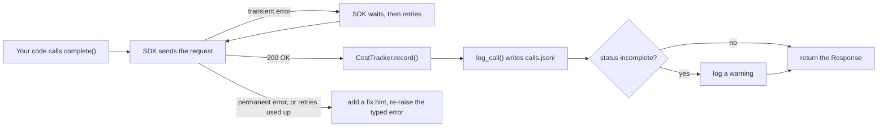
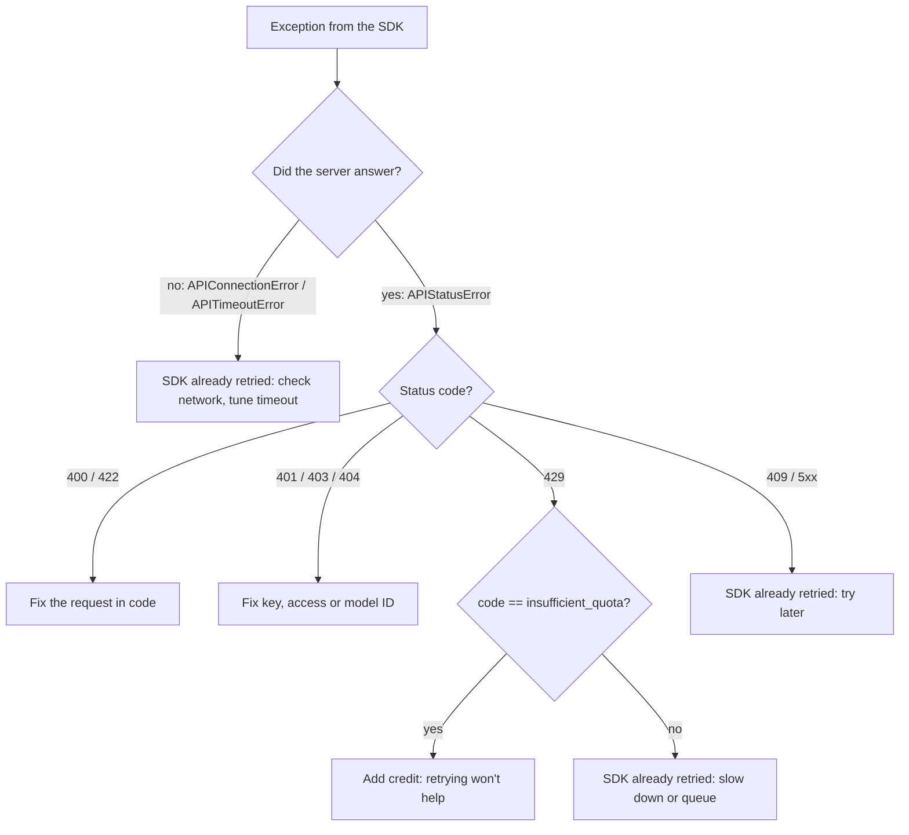
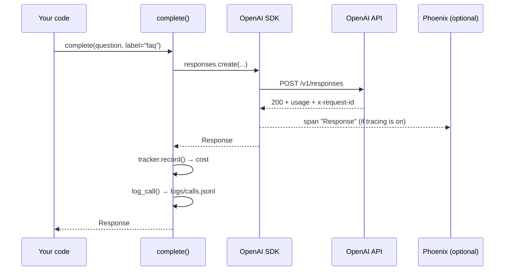

# The OpenAI SDK in Production Code

The chat from Day 8 dies with a stack trace the first time your Wi-Fi drops, and nobody can say what last week's experiments cost. Production code needs errors you can act on, timeouts that fire, and a receipt for every call. Today you write `atlas/llm.py`, the helper that the rest of the course imports for every model call.

## At a Glance

- **Time:** ~2 h core (+ optional Go Deeper) · **Depth:** working
- **Prerequisites:** [Day 2: Setup & Your First LLM Call](../../Phase_0_Start_Here/Day_002_setup_first_call/setup_first_call.md), [Day 8: Messages, Roles & Conversation State](../../Phase_2_Building_with_LLM_APIs/Day_008_messages_and_state/messages_and_state.md); helpful: [Day 4: Tokens: How Models Read Text](../../Phase_1_How_LLMs_Work/Day_004_tokens/tokens.md) for the price table; primers [A3: Python for this course](../../Appendix_Primers/A03_python_for_this_course.md), [A5: HTTP, JSON & APIs](../../Appendix_Primers/A05_http_json_apis.md), and (optional) [A4a: Async Python I](../../Appendix_Primers/A04a_async_python_basics.md)
- **You'll build:** `atlas/llm.py` with one shared `client`, a `complete()` wrapper, a `CostTracker` that turns `usage` into dollars, and `log_call()` that writes one JSON line per call; plus `atlas/tracing.py` with `setup_tracing()` for local Phoenix traces
- **Stops at:** SDK internals and custom backoff or circuit breakers ([Day 84](../../Phase_9_Production/Day_084_reliability_fallbacks/reliability_fallbacks.md))
- **Fast path:** Already wrap API clients for a living? Read [the cost tracker](#the-cost-tracker-from-usage-to-dollars) and [Seeing Traces Locally](#seeing-traces-locally), then do Exercise 3 (≈45 min)
- **Cost:** ≈ $0.02 on `gpt-6-luna` (prices as of 2026-11, [verify](https://developers.openai.com/api/docs/pricing)); the failure demos cost about $0
- **New terms:** transient vs permanent error, timeout, retry budget (`max_retries`), cost tracker, trace

> **Coming from Software Engineering?** The OpenAI SDK is a REST client in the same family as the Stripe or Twilio SDKs: typed exceptions per HTTP status, built-in retries with backoff, and a request id on every response for support tickets. `complete()` is the thin repository-style wrapper you would put around any third-party API so that the rest of the codebase never touches the vendor client directly. `CostTracker` is a metrics counter, `log_call()` is an access log, and a response with `status="incomplete"` is like a truncated HTTP body: the server returned 200, but the payload stops early. Everything you know about timeouts, idempotent retries (repeating a request is safe) and "don't retry a 400" transfers unchanged.

## The Happy-Path Script Falls Over

Every script so far has called `client.responses.create(...)` directly and assumed it works. Turn off your Wi-Fi and run Day 8's chat, and you get this (trimmed):

```text
Traceback (most recent call last):
  File "chat.py", line 21, in chat_turn
    response = client.responses.create(model=MODEL, input=history)
  ...
openai.APIConnectionError: Connection error.
```

It is worse than it looks. With default settings the SDK waited and retried before giving up, so the user stared at a frozen prompt first. And if the network is slow rather than gone, the default timeout is **600 seconds** per attempt: ten minutes before your app learns anything went wrong.

## One Door for Every Call

The fix is organisational before it is technical: **route every model call through one function**. That function is the only place that knows how to handle a bad day, keep a receipt and write a diary entry:

- **Handle bad days:** give up after a set time, send the same request again when that can help, and stop with a clear message when it can't.
- **Keep a receipt:** turn the token counts in each response into dollars and add them up.
- **Write a diary:** append one line per call to a log file, so you can answer "what happened at 14:02?" next week.

Three terms carry the rest of the day. A **timeout** means "give up after N seconds". A **retry** means "send the same request again". A **transient error** is one that may succeed on retry (a dropped connection, a busy server). A **permanent error** will fail the same way every time (a bad parameter, a revoked key). Retrying a permanent error only adds delay to the failure.



## Read One Failure by Hand

Before writing the wrapper, look closely at one error. Here are two HTTP 429 responses (abbreviated sample bodies). They have the same status code, but they ask for opposite reactions:

| Field | Response A | Response B |
|---|---|---|
| status | 429 | 429 |
| `code` | `rate_limit_exceeded` | `insufficient_quota` |
| meaning | too many requests this minute | the account is out of credit |
| `request_id` | `req_…` | `req_…` |
| retry? | yes, after a short wait | no, a human must add credit |

Rate limits (caps on requests or tokens per minute) clear in seconds. An empty balance stays empty until someone pays, so retrying it wastes time. You met both error texts in [Day 2](../../Phase_0_Start_Here/Day_002_setup_first_call/setup_first_call.md). The SDK turns each one into a Python exception carrying those fields, and you can build those exceptions offline to see exactly what your `except` block receives:

```python
# script_id: day_012_openai_sdk_production/read_error
# Install: uv add "openai>=3.46,<4"   Env: none (builds errors locally, no network, no key)
import httpx2  # the SDK's HTTP library since openai 3.0 (installed with it)
import openai

URL = "https://api.openai.com/v1/responses"


def fake_429(code: str, err_type: str, message: str) -> openai.RateLimitError:
    """Build the exception the SDK raises for a 429, from a canned HTTP response."""
    error = {"message": message, "type": err_type, "param": None, "code": code}
    resp = httpx2.Response(429, json={"error": error}, headers={"x-request-id": "req_demo123"},
                           request=httpx2.Request("POST", URL))
    return openai.RateLimitError(f"Error code: 429 - {error}", response=resp, body=error)


def worth_retrying(e: openai.APIStatusError) -> bool:
    # Same status, opposite answers: a rate limit clears in seconds, an empty balance never does
    return e.code != "insufficient_quota"


for err in [fake_429("rate_limit_exceeded", "tokens", "Rate limit reached for ... (TPM) ..."),
            fake_429("insufficient_quota", "insufficient_quota", "You exceeded your current quota ...")]:
    print(f"{type(err).__name__} status={err.status_code} code={err.code} "
          f"request_id={err.request_id} retry={worth_retrying(err)}")
```

Expected output:

```text
RateLimitError status=429 code=rate_limit_exceeded request_id=req_demo123 retry=True
RateLimitError status=429 code=insufficient_quota request_id=req_demo123 retry=False
```

The `request_id` is the most underrated field. It identifies this exact request on OpenAI's side, so put it in every log line and every support ticket.

## The Parts: Error Classes, Retries and Timeouts

The SDK raises one exception class per kind of failure, arranged as a hierarchy so you can catch broadly or narrowly:

```text
OpenAIError
└── APIError
    ├── APIStatusError          (the server answered with 4xx/5xx; has .status_code .request_id .code)
    │   ├── BadRequestError 400 · AuthenticationError 401 · PermissionDeniedError 403
    │   ├── NotFoundError 404 · ConflictError 409 · UnprocessableEntityError 422
    │   └── RateLimitError 429 · InternalServerError >=500
    └── APIConnectionError      (no usable answer: DNS, TLS, dropped socket)
        └── APITimeoutError     (no answer within the timeout)
```

| Class (status) | Transient? | SDK retries it? | What to do |
|---|---|---|---|
| `BadRequestError` (400), `UnprocessableEntityError` (422) | no | no | fix the parameter named in the message |
| `AuthenticationError` (401), `PermissionDeniedError` (403) | no | no | fix the key, project or model access |
| `NotFoundError` (404) | no | no | check the model ID and endpoint |
| `ConflictError` (409) | usually | yes | let the SDK retry; raise if it persists |
| `RateLimitError` (429) | depends on `code` | **yes, always** | rate limit: slow down; `insufficient_quota`: add credit |
| `InternalServerError` (>=500) | yes | yes | retry later; check the status page |
| `APIConnectionError`, `APITimeoutError` | yes | yes | check the network; tune the timeout |

Three defaults matter (from the SDK source and README, openai 3.46):

1. **Retries.** The SDK retries connection errors, 408, 409, 429 and every 5xx, **2 times by default**, with exponential backoff from 0.5 s up to 8 s. It honours a `retry-after` header up to 120 s. This is your **retry budget**: `max_retries` attempts after the first. `max_retries=0` disables retries.
2. **Timeouts.** The default is 600 s per attempt (5 s to connect). For interactive work, set something you can live with, like 30 s.
3. **Where you set them.** Per client with `OpenAI(timeout=30.0, max_retries=3)`, or per call with `client.with_options(timeout=..., max_retries=...)`, which returns a configured copy and leaves the original client unchanged.

The SDK retries 429 even when the code is `insufficient_quota`. It cannot tell the two apart, so your wrapper adds the human-level hint. Here is the table as a decision:



## A Minimal `complete()`

The smallest useful wrapper sets a sane timeout and retry budget, and catches the three classes you can act on differently. It returns the whole `Response`, not only the text, because later days need `usage`, `status` and output items.

```python
# script_id: day_012_openai_sdk_production/minimal_complete
# Install: uv add "openai>=3.46,<4"   Env: OPENAI_API_KEY (ATLAS_MODEL, ORBIT_DATA optional)
import os
from pathlib import Path

import openai

MODEL = os.environ.get("ATLAS_MODEL", "gpt-6-luna")
client = openai.OpenAI(timeout=30.0, max_retries=3)  # fail within ~2 min worst case, not the 600 s default
faq = Path(os.environ.get("ORBIT_DATA", "datasets/orbit"), "docs", "faq.md").read_text(encoding="utf-8")


def complete(input: str, **kwargs):
    try:
        return client.responses.create(model=MODEL, input=input, **kwargs)
    except openai.APIConnectionError:  # includes APITimeoutError; raised after SDK retries
        print("network: no answer from the API after retries")
        raise
    except openai.APIStatusError as e:  # any 4xx/5xx; RateLimitError is one of these
        print(f"HTTP {e.status_code} code={e.code} request_id={e.request_id}")
        raise


r = complete("Does Orbit run each job exactly once? One sentence.",
             instructions="You are Atlas. Answer from this FAQ:\n" + faq, reasoning={"effort": "none"})
print(r.output_text, "|", r.usage.input_tokens, "in /", r.usage.output_tokens, "out |", r._request_id)
```

Expected output (your wording, numbers and id will differ):

```text
No. Orbit delivers jobs at least once, so make side effects idempotent. | 1441 in / 17 out | req_8f3c...
```

Notice the bare `raise`. The wrapper adds a one-line diagnosis but keeps the original exception type, so callers can still write `except openai.RateLimitError`. Catching `Exception` and returning `None` would hide your own bugs (a misspelled parameter is a 400) behind a vague failure.

## Break It on Purpose

Two failures are worth seeing once, so you recognise them later. The first raises; the second does **not**, which makes it the more dangerous one.

```python
# script_id: day_012_openai_sdk_production/break_it
# Install: uv add "openai>=3.46,<4"   Env: OPENAI_API_KEY (ATLAS_MODEL optional)
import os

import openai
from openai import OpenAI

MODEL = os.environ.get("ATLAS_MODEL", "gpt-6-luna")
client = OpenAI(timeout=30.0, max_retries=3)

# Break 1: a 1 ms timeout and no retries. with_options() returns a copy; `client` is unchanged.
impatient = client.with_options(timeout=0.001, max_retries=0)
try:
    impatient.responses.create(model=MODEL, input="ping", reasoning={"effort": "none"})
except openai.APITimeoutError as e:
    print(f"{type(e).__name__}: {e} (also an APIConnectionError: "
          f"{isinstance(e, openai.APIConnectionError)})")

# Break 2: room for 16 output tokens when the answer needs ~200. No exception is raised.
r = client.responses.create(model=MODEL, input="Explain Orbit job leases in 150 words.",
                            max_output_tokens=16, reasoning={"effort": "none"})
print(r.status, r.incomplete_details.reason if r.incomplete_details else None)
print(repr(r.output_text))
```

Expected output (your text will differ):

```text
APITimeoutError: Request timed out. (also an APIConnectionError: True)
incomplete max_output_tokens
'An Orbit job lease is a time-limited claim that a worker holds on'
```

The second call returned normally, with half a sentence. That is the truncated HTTP body from the callout: the request "succeeded", and code that only reads `output_text` would ship the fragment to a user. You met `status` and `incomplete_details.reason` (`max_output_tokens`, `content_filter`, and others) in [Day 6](../../Phase_1_How_LLMs_Work/Day_006_sampling_reasoning_effort/sampling_reasoning_effort.md). Production code checks them on every response, and you are still billed for the tokens. The 401 and 404 texts you would get from a bad key or a misspelled model are in [Day 2](../../Phase_0_Start_Here/Day_002_setup_first_call/setup_first_call.md).

## The Cost Tracker: From Usage to Dollars

Now the real module. It is one script in four blocks, each adding one concern: the client and error hints, then cost, then the log, then `complete()` itself. In your repo this file is `atlas/llm.py`; the course owns exactly one cost tracker, and it lives here ([Day 18](../../Phase_2_Building_with_LLM_APIs/Day_018_cost_latency_caching/cost_latency_caching.md) extends it rather than writing another).

The first block holds the configuration, the shared client and a hint table that turns each error class into a next step:

```python
# script_id: day_012_openai_sdk_production/llm
# atlas/llm.py: the one door every model call goes through (Day 12; Days 13, 16-18 extend it)
# Install: uv add "openai>=3.46,<4"
# Env: OPENAI_API_KEY; optional ATLAS_MODEL, ATLAS_LOG_DIR, ORBIT_DATA. Services: none.
from __future__ import annotations

import json
import logging
import os
import time
from datetime import datetime, timezone
from pathlib import Path

import openai
from openai import OpenAI
from openai.types.responses import Response

# --- atlas/config.py (Day 2, plus LOG_DIR today) ---
MODEL = os.environ.get("ATLAS_MODEL", "gpt-6-luna")
DATA_DIR = Path(os.environ.get("ORBIT_DATA", "datasets/orbit"))
LOG_DIR = Path(os.environ.get("ATLAS_LOG_DIR", "logs"))

log = logging.getLogger("atlas.llm")
# 30 s per attempt, 3 SDK retries on transient errors. Per call: client.with_options(...)
client = OpenAI(timeout=30.0, max_retries=3)

# Checked top to bottom, so APITimeoutError comes before its parent APIConnectionError
HINTS: list[tuple[type[openai.APIError], str]] = [
    (openai.AuthenticationError, "401: check OPENAI_API_KEY is set and not revoked"),
    (openai.PermissionDeniedError, "403: this key's project can't use this model or resource"),
    (openai.NotFoundError, "404: check the model ID (ATLAS_MODEL) and the endpoint"),
    (openai.BadRequestError, "400: a parameter is wrong; read the message and e.param"),
    (openai.UnprocessableEntityError, "422: the request parsed but can't be processed"),
    (openai.RateLimitError, "429 after SDK retries: slow down, queue work or raise limits"),
    (openai.InternalServerError, "5xx after SDK retries: OpenAI-side problem; try later"),
    (openai.APITimeoutError, "timed out: raise the timeout or shrink the request"),
    (openai.APIConnectionError, "network: check connectivity, proxy and TLS (SSL_CERT_FILE)"),
]


def fix_hint(e: openai.APIError) -> str:
    if isinstance(e, openai.RateLimitError) and e.code == "insufficient_quota":
        return "429 insufficient_quota: out of credit; add billing. Retrying won't help"
    return next((hint for cls, hint in HINTS if isinstance(e, cls)), f"{type(e).__name__}")
```

Next, cost. Every response carries `usage`: `input_tokens`, `output_tokens`, and two detail objects. `input_tokens_details.cached_tokens` counts input tokens served from OpenAI's prompt cache at a much lower rate, and `output_tokens_details.reasoning_tokens` counts hidden thinking. Reasoning tokens are **already included** in `output_tokens`, so you never add them again. The formula, with Day 4's per-1M prices:

> cost = (input − cached) × input price + cached × cached price + output × output price, all ÷ 1,000,000

A toy check: 1,000 input tokens of which 800 are cached, and 100 output tokens on `gpt-6-luna` ($0.10 / $0.01 / $0.50 per 1M): 200 × 0.10 + 800 × 0.01 + 100 × 0.50 = 20 + 8 + 50 = 78, so $0.000078. Cache *writes* carry a premium that this version ignores; Day 18 adds it.

```python
# script_id: day_012_openai_sdk_production/llm
# Mirrors Day 7's table (all four TIERS). USD per 1M tokens, Standard tier, prompts up to 272K input tokens.
# As of 2026-11, verify at https://developers.openai.com/api/docs/pricing
PRICES_PER_1M: dict[str, dict[str, float]] = {
    "gpt-6-luna":    {"input": 0.10,  "cached_input": 0.01, "output": 0.50},
    "gpt-6.1-terra": {"input": 1.00,  "cached_input": 0.05, "output": 5.00},
    "gpt-6.1-sol":   {"input": 2.00,  "cached_input": 0.10, "output": 10.00},
    "gpt-6-astra":   {"input": 10.00, "cached_input": 1.00, "output": 50.00},
}


def cost_from_usage(usage, model: str = MODEL) -> float:
    """USD for one response's usage. Reasoning tokens are already inside output_tokens."""
    # Longest matching key, so a dated snapshot ID still finds its alias's price
    key = max((k for k in PRICES_PER_1M if model.startswith(k)), key=len, default=None)
    if key is None:  # a silent $0 is how budgets get blown
        raise KeyError(f"no price for {model!r}; add it to PRICES_PER_1M")
    p = PRICES_PER_1M[key]
    details = usage.input_tokens_details
    cached = (details.cached_tokens or 0) if details else 0
    # Cache-write premium arrives in Day 18; here writes count as normal input
    return ((usage.input_tokens - cached) * p["input"] + cached * p["cached_input"]
            + usage.output_tokens * p["output"]) / 1_000_000


class CostTracker:
    """A metrics counter for spend: every response in, running totals out."""

    def __init__(self) -> None:
        self.records: list[dict] = []

    def record(self, response: Response, *, label: str = "", latency_s: float | None = None) -> float:
        u = response.usage
        if u is None:  # failed or cancelled responses may carry no usage
            return 0.0
        cost = cost_from_usage(u, response.model)
        cached = (u.input_tokens_details.cached_tokens or 0) if u.input_tokens_details else 0
        self.records.append({"label": label, "model": response.model, "in": u.input_tokens,
                             "cached": cached, "out": u.output_tokens, "usd": cost,
                             "latency_s": latency_s})
        return cost

    @property
    def calls(self) -> int:
        return len(self.records)

    @property
    def total_usd(self) -> float:
        return sum(r["usd"] for r in self.records)

    def summary(self) -> str:
        tin, tcached, tout = (sum(r[k] for r in self.records) for k in ("in", "cached", "out"))
        avg = self.total_usd / self.calls if self.calls else 0.0
        return (f"{self.calls} calls · {tin:,} in ({tcached:,} cached) / {tout:,} out · "
                f"${self.total_usd:.4f} (avg ${avg:.6f}/call; prices as of 2026-11, verify)")


tracker = CostTracker()  # one per process; import it wherever you need totals
```

The average per call is what makes budgets thinkable. At $0.00007 per call, 10,000 calls a day is $0.70 a day, about $21 a month. Exercise 2 turns that arithmetic into a method.

## A Diary of Every Call

The tracker answers "how much?". The log answers "what happened?". `log_call()` appends one JSON object per line (**JSONL**) to `logs/calls.jsonl`: the time, a label you choose, the model, both ids, the status, token counts, latency and cost. It does **not** log prompts or outputs by default. They can contain user data, and a log file is the easiest place to leak it. Log ids instead; you can look a stored response up by `response.id` when you need it.

```python
# script_id: day_012_openai_sdk_production/llm
def log_call(response: Response, *, label: str, latency_s: float, cost_usd: float,
             extra: dict | None = None) -> None:
    """Append one JSON line per call: an access log for model calls. No prompts, no keys."""
    u = response.usage
    row = {
        "ts": datetime.now(timezone.utc).isoformat(timespec="seconds"),
        "label": label, "model": response.model,
        "response_id": response.id,          # look the response up later
        "request_id": response._request_id,  # quote this to OpenAI support
        "status": response.status,
        "incomplete": response.incomplete_details.reason if response.incomplete_details else None,
        "in": u.input_tokens if u else 0,
        "cached": (u.input_tokens_details.cached_tokens or 0) if u and u.input_tokens_details else 0,
        "out": u.output_tokens if u else 0,
        "reasoning": (u.output_tokens_details.reasoning_tokens or 0)
                     if u and u.output_tokens_details else 0,
        "latency_s": round(latency_s, 3), "cost_usd": round(cost_usd, 8),
        **(extra or {}),
    }
    LOG_DIR.mkdir(parents=True, exist_ok=True)
    with (LOG_DIR / "calls.jsonl").open("a", encoding="utf-8") as f:
        f.write(json.dumps(row) + "\n")
```

The last block ties it together. `complete()` keeps the signature later days rely on, attaches a fix hint to errors with `add_note()` (Python 3.11+, which prints the note under the traceback and keeps the exception type), and warns on truncation. The demo runs three questions from Orbit's FAQ, then reads the log back:

```python
# script_id: day_012_openai_sdk_production/llm
def complete(input: str | list, *, instructions: str | None = None, model: str = MODEL,
             label: str = "call", **kwargs) -> Response:
    """One model call with timeouts, typed errors, cost and a log line. Returns the full Response."""
    if instructions is not None:
        kwargs["instructions"] = instructions
    start = time.perf_counter()
    try:
        response = client.responses.create(model=model, input=input, **kwargs)
    except openai.APIError as e:
        # Same exception type for callers, plus a human-readable next step under the traceback
        e.add_note(f"atlas[{label}]: {fix_hint(e)} (request_id={getattr(e, 'request_id', None)})")
        log.error("call %s failed: %s", label, type(e).__name__)
        raise
    latency = time.perf_counter() - start
    cost = tracker.record(response, label=label, latency_s=latency)
    log_call(response, label=label, latency_s=latency, cost_usd=cost)
    if response.status == "incomplete":
        log.warning("call %s incomplete: %s", label, response.incomplete_details.reason)
    return response


if __name__ == "__main__":  # demo only; importing atlas.llm never makes a call
    logging.basicConfig(level=logging.WARNING)
    faq = (DATA_DIR / "docs" / "faq.md").read_text(encoding="utf-8")
    for q in ["Does Orbit run each job exactly once?", "How do I check my setup is healthy?",
              "What's the largest payload I can enqueue?"]:
        r = complete(q, instructions="You are Atlas. Answer in one sentence from this FAQ:\n" + faq,
                     label="faq", reasoning={"effort": "none"})
        print("-", r.output_text)
    print(tracker.summary())
    for line in (LOG_DIR / "calls.jsonl").read_text(encoding="utf-8").splitlines()[-1:]:
        row = json.loads(line)  # read back: logs are data you can query
        print(row["ts"], row["label"], row["status"], row["in"], row["out"], row["request_id"])
```

Expected output (illustrative; your answers, ids and numbers will differ, and `cached` may be 0):

```text
- No. Orbit delivers jobs at least once, so make side effects idempotent.
- Run `orbit doctor` to check broker connectivity, configuration and worker versions.
- 512 KB by default, set by `[limits] max_payload_kb`.
3 calls · 4,326 in (2,816 cached) / 61 out · $0.0002 (avg $0.000070/call; prices as of 2026-11, verify)
2026-11-07T10:42:13+00:00 faq completed 1442 22 req_5a1e...
```

The FAQ is the first thing in every request and is over 1,024 tokens, so the second and third calls can reuse the cached prefix, and the tracker prices those tokens at the cached rate. Day 18 shows how to make that happen on purpose. To find the costliest calls later, filter the JSONL by `label` or sort by `cost_usd`; it is a plain file, so `jq`, pandas or five lines of Python all work.

## Seeing Traces Locally

The log gives you one line per call. A **trace** is a recorded timeline of one request: which function ran, what it sent, what came back and how long each step took. For a single call that looks like a fancy log line. Once a request fans out into retrieval, tools and several model calls (from Phase 3 on), it is the only sane way to debug.

Arize Phoenix is an open-source trace viewer that runs on your laptop. Its OpenInference instrumentation patches the OpenAI SDK, so every `responses.create` call becomes a span (one timed step in a trace) with the model name and token counts, and you don't change `complete()` at all. `setup_tracing()` switches it on when the packages are installed and does nothing otherwise, so the rest of Atlas never depends on it:

```python
# script_id: day_012_openai_sdk_production/tracing
# atlas/tracing.py. Optional install:
#   uv add arize-phoenix arize-phoenix-otel openinference-instrumentation-openai
# Env: ATLAS_TRACING=0 switches it off. Services: `phoenix serve` (UI at http://localhost:6006)
from __future__ import annotations

import os
from typing import TYPE_CHECKING

if TYPE_CHECKING:
    from opentelemetry.sdk.trace import TracerProvider


def setup_tracing(project: str = "atlas") -> TracerProvider | None:
    """Trace every OpenAI call into local Phoenix if it's installed; otherwise do nothing."""
    if os.environ.get("ATLAS_TRACING", "1") == "0":
        print("tracing disabled (ATLAS_TRACING=0)")
        return None
    try:
        from phoenix.otel import register
    except ImportError:
        print("tracing disabled (install arize-phoenix-otel openinference-instrumentation-openai)")
        return None
    # auto_instrument loads the installed OpenInference instrumentors, including OpenAI's
    provider = register(project_name=project, auto_instrument=True, verbose=False)
    print(f"tracing → Phoenix project {project!r} (UI at http://localhost:6006)")
    return provider


if __name__ == "__main__":
    setup_tracing()  # call once at startup, before `from atlas.llm import complete`
```

Expected output, depending on what is installed:

```text
tracing → Phoenix project 'atlas' (UI at http://localhost:6006)
```

To try it: run `phoenix serve` in a second terminal, call `setup_tracing()` at the top of your entry script **before** importing `atlas.llm` (the instrumentation must patch the SDK before the client is built), then run the `llm` demo. Open `http://localhost:6006`, pick the `atlas` project, and you will see one span per call named `Response`, of kind `LLM`, with `llm.model_name` and prompt/completion token counts. Click one to see its input, output and latency. If Phoenix isn't running, span export fails with a logged error, but your calls still succeed. [Day 42](../../Phase_5_Evaluation_and_Observability/Day_042_tracing_observability/tracing_observability.md) goes deep on spans, attributes and OpenTelemetry.



## Optional: The Async Client

Skip this section if `async`/`await` is new to you; it becomes required in [Day 22](../../Phase_2_Building_with_LLM_APIs/Day_022_capstone_r1_extractor/capstone_r1_extractor.md), and [primer A4a](../../Appendix_Primers/A04a_async_python_basics.md) covers the basics. `AsyncOpenAI` has the same methods, knobs and exceptions as `OpenAI`, but each call is awaitable, so several calls can wait on the network at the same time:

```python
# script_id: day_012_openai_sdk_production/async_optional
# Optional today, required from Day 22. Install: uv add "openai>=3.46,<4"   Env: OPENAI_API_KEY
import asyncio
import os
import time

from openai import AsyncOpenAI

MODEL = os.environ.get("ATLAS_MODEL", "gpt-6-luna")
QUESTIONS = ["What is an Orbit lease?", "What is a dead-letter queue?", "What does orbit doctor do?"]


async def ask_all(questions: list[str]) -> list[str]:
    # Same timeout/retry knobs and error classes as the sync client; `async with` closes the pool
    async with AsyncOpenAI(timeout=30.0, max_retries=3) as ac:
        rs = await asyncio.gather(*(ac.responses.create(model=MODEL, input=q,
                                                        reasoning={"effort": "none"})
                                    for q in questions))
    return [r.output_text for r in rs]


start = time.perf_counter()
for q, a in zip(QUESTIONS, asyncio.run(ask_all(QUESTIONS))):
    print(f"{q} -> {a[:60]}")
print(f"{len(QUESTIONS)} calls in {time.perf_counter() - start:.1f} s, concurrently")
```

Expected output (illustrative):

```text
What is an Orbit lease? -> A lease is a time-limited claim a worker holds on a job while i
What is a dead-letter queue? -> A dead-letter queue holds jobs that failed every retry so you
What does orbit doctor do? -> It checks broker connectivity, validates configuration and rep
3 calls in 1.4 s, concurrently
```

Three calls take about as long as the slowest one. Without `return_exceptions=True`, the first failure propagates out of `gather` and you lose the other results; pass it to get exceptions back as values. The Stretch exercise wraps this in an `acomplete()` that shares the tracker.

## Trade-offs, Legacy Code and Production

**The legacy box: Chat Completions.** You will meet older code, tutorials and compatible servers that use the previous API. It is still supported, but this course writes new code on Responses. Recognise it, don't copy it:

```python
# script_id: day_012_openai_sdk_production/chat_completions_legacy
# LEGACY / compatibility only: read it, don't write new course code with it.
# Install: uv add "openai>=3.46,<4"   Env: OPENAI_API_KEY
import os

from openai import OpenAI

MODEL = os.environ.get("ATLAS_MODEL", "gpt-6-luna")
client = OpenAI()
cc = client.chat.completions.create(
    model=MODEL, reasoning_effort="none",  # a flat parameter here, not reasoning={...}
    messages=[{"role": "developer", "content": "You are Atlas. Be terse."},
              {"role": "user", "content": "Does Orbit run each job exactly once?"}])
print(cc.choices[0].message.content)  # Responses: r.output_text
print(cc.usage.prompt_tokens, cc.usage.completion_tokens)  # Responses: input_/output_tokens
```

| | Responses (this course) | Chat Completions (legacy) |
|---|---|---|
| Call | `client.responses.create(input=..., instructions=...)` | `client.chat.completions.create(messages=[...])` |
| Text | `r.output_text` | `cc.choices[0].message.content` |
| Usage | `input_tokens` / `output_tokens` | `prompt_tokens` / `completion_tokens` |
| Truncation | `status == "incomplete"` + reason | `finish_reason == "length"` |
| Tools on newer models | supported | limited (Responses required on several GPT-6 models) |

**Whose retries?** One layer per kind of failure:

| Failure | Who handles it | Where |
|---|---|---|
| network, 408/409/429/5xx | the SDK (`max_retries`) | today |
| valid response, wrong content (bad JSON, invented field) | your semantic re-ask loop | [Day 17](../../Phase_2_Building_with_LLM_APIs/Day_017_semantic_failures/semantic_failures.md) |
| provider down for minutes, fallbacks, circuit breakers | a reliability layer | [Day 84](../../Phase_9_Production/Day_084_reliability_fallbacks/reliability_fallbacks.md) |
| truncation | your code: raise, or retry with more room | today + Exercise 3 |

Use `with_options()` for the odd slow call (a long document, a batch job) instead of raising the timeout for everyone. Don't wrap `complete()` in your own retry loop for transient errors: the SDK already does it.

### In production

- Log `request_id` and `response.id` on every call and every error; support can't help without them.
- Use one API key per environment and per service, so you can revoke one without taking down the rest (setup in [primer A2](../../Appendix_Primers/A02_project_setup_secrets.md)).
- Set the client timeout below your own server's request timeout, or your users see your proxy's 504 instead of your error message.
- openai 3.x uses `httpx2` and no longer installs `httpx`, so custom-client code that imports `httpx` breaks; use `openai.DefaultHttpx2Client(...)` (see Go Deeper).
- httpx2 trusts the operating system's certificate store, so behind a corporate TLS proxy set `SSL_CERT_FILE` / `SSL_CERT_DIR` to your company's CA bundle.

## Go Deeper (optional)

<details><summary>Go deeper: what the SDK's retry loop does, with numbers</summary>

The retry logic lives in the SDK's base client (`_should_retry` and `_calculate_retry_timeout` in openai 3.46). In words: after a retryable failure, wait, then try again, doubling the wait each time up to a cap, and shave a random amount off so a thousand clients don't retry in lockstep.

Toy numbers with `max_retries=3`:

| Retry | Base wait (0.5 s × 2ⁿ, cap 8 s) | After jitter (× 0.75–1.0) |
|---|---|---|
| 1st | 0.5 s | 0.375–0.5 s |
| 2nd | 1.0 s | 0.75–1.0 s |
| 3rd | 2.0 s | 1.5–2.0 s |

Formula: `wait = min(0.5 × 2^n, 8) × (1 − 0.25 × random())`, where n counts retries already made.

Three refinements:

- **`retry-after` wins.** If the server sends a `retry-after` header between 0 and 120 seconds, the SDK sleeps exactly that long instead. If the server asks for *more* than 120 s, the SDK does not retry at all and raises immediately, which is the right call for a request a user is waiting on.
- **`x-should-retry` overrides the status.** The server can send `x-should-retry: true` or `false`, and the SDK obeys it before looking at the status code.
- **The timeout is per attempt.** Worst-case wall time is roughly `(max_retries + 1) × timeout + total backoff`. With `timeout=30.0, max_retries=3` that is 4 × 30 + about 3.5 = about 124 s. If your user-facing budget is 10 s, a 30 s timeout is the wrong setting, however many retries you allow.

Streams are different: once a streaming response has started, a dropped stream is never retried by the SDK ([Day 13](../../Phase_2_Building_with_LLM_APIs/Day_013_streaming/streaming.md) handles it).

</details>

<details><summary>Go deeper: run the whole wrapper offline with a fake transport</summary>

You can exercise `atlas/llm.py` with no key and no network by giving the client a fake HTTP transport that returns canned JSON. This is how you watch the SDK retry: the fake server fails twice with a 500, then succeeds. [Day 19](../../Phase_2_Building_with_LLM_APIs/Day_019_testing_llm_code/testing_llm_code.md) builds proper tests on the same idea.

```python
# script_id: day_012_openai_sdk_production/offline_dry_run
# Runs the `llm` script with a fake transport: no key, no network, $0.
# Needs the llm script saved next to this file as llm.py (in your repo: atlas/llm.py).
import os

os.environ.setdefault("OPENAI_API_KEY", "offline-not-a-real-key")  # llm.py builds a client on import
import httpx2
import openai
from openai import OpenAI

import llm

attempts = 0
REPLY = {"id": "resp_offline1", "object": "response", "created_at": 0, "status": "completed",
         "model": "gpt-6-luna", "output": [{"type": "message", "id": "msg_1", "role": "assistant",
         "status": "completed", "content": [{"type": "output_text", "text": "No: at least once.",
                                             "annotations": []}]}],
         "usage": {"input_tokens": 400, "input_tokens_details": {"cached_tokens": 0},
                   "output_tokens": 12, "output_tokens_details": {"reasoning_tokens": 0},
                   "total_tokens": 412}}


def flaky_api(request: httpx2.Request) -> httpx2.Response:
    global attempts
    attempts += 1
    if attempts < 3:  # two server errors, then success
        return httpx2.Response(500, json={"error": {"message": "boom", "type": "server_error"}})
    return httpx2.Response(200, json=REPLY, headers={"x-request-id": "req_offline1"})


def broke_api(request: httpx2.Request) -> httpx2.Response:
    return httpx2.Response(429, json={"error": {"message": "You exceeded your current quota",
                           "type": "insufficient_quota", "param": None, "code": "insufficient_quota"}})


def fake_client(handler, retries: int) -> OpenAI:
    return OpenAI(max_retries=retries,
                  http_client=openai.DefaultHttpx2Client(transport=httpx2.MockTransport(handler)))


llm.client = fake_client(flaky_api, retries=2)  # complete() looks up the module-level client
r = llm.complete("Does Orbit run each job exactly once?", label="dry-run")
print(f"{r.output_text} | HTTP attempts: {attempts} | {llm.tracker.summary()}")

llm.client = fake_client(broke_api, retries=0)
try:
    llm.complete("hi", label="dry-run")
except openai.RateLimitError as e:
    print(type(e).__name__, e.code, "|", e.__notes__[0])
```

Expected output (after about 1 s of backoff):

```text
No: at least once. | HTTP attempts: 3 | 1 calls · 400 in (0 cached) / 12 out · $0.0000 (avg $0.000046/call; prices as of 2026-11, verify)
call dry-run failed: RateLimitError
RateLimitError insufficient_quota | atlas[dry-run]: 429 insufficient_quota: out of credit; add billing. Retrying won't help (request_id=None)
```

One logical call, three HTTP attempts, one cost record: the retries are invisible to the tracker, which is what you want. The demo also writes a `dry-run` line to `logs/calls.jsonl`.

</details>

<details><summary>Go deeper: custom HTTP clients, proxies and TLS under httpx2</summary>

openai 3.0.0 (2026-08-12) replaced `httpx` with `httpx2` as the SDK's HTTP library, and plain `httpx` is no longer installed with it. Three consequences for real projects:

- **Custom clients.** Code that passed `http_client=httpx.Client(...)`, or used `httpx.Timeout` or `httpx.MockTransport`, should switch to the `httpx2` equivalents (openai 3.46 still accepts a legacy `httpx.Client` if you install `httpx` yourself, but that is a compatibility path, not the default). The easiest path is `openai.DefaultHttpx2Client(...)`, which keeps the SDK's own defaults (connection limits, timeouts) and accepts the usual client arguments, as the offline demo's `transport=` shows. The old `DefaultHttpxClient` name still works and now builds an httpx2 client.
- **TLS trust.** httpx2 uses the operating system's trust store instead of the `certifi` bundle. On a laptop that usually works better. Behind a corporate TLS-inspecting proxy, or in a slim container with no CA certificates, you may see certificate verification errors after upgrading. Set `SSL_CERT_FILE` (one bundle file) or `SSL_CERT_DIR` (a directory) to the right certificates.
- **Async throughput.** For many concurrent async calls, the SDK supports an aiohttp backend: `pip install "openai[aiohttp]"` and pass `http_client=DefaultAioHttpClient()` to `AsyncOpenAI`. ⚠ Verify against the SDK README before relying on it; the course does not use it.

The [httpx2 migration guide](https://github.com/openai/openai-python/blob/main/httpx2.md) in the SDK repo lists every renamed piece.

</details>

<details><summary>Go deeper: point base_url at a local model for $0</summary>

Many local servers speak the same HTTP API, so the same SDK and the same `complete()` work against them. Ollama exposes an OpenAI-compatible endpoint, including `/v1/responses` (Ollama v0.13.3+). Install Ollama, run `ollama pull qwen3:4b`, then:

```python
# script_id: day_012_openai_sdk_production/local_base_url
# Zero-cost aside; Day 91 goes deep. Needs Ollama running locally and `ollama pull qwen3:4b`.
# Install: uv add "openai>=3.46,<4"   Env: none (the key is required by the SDK but ignored)
from openai import OpenAI

local = OpenAI(base_url="http://localhost:11434/v1/", api_key="ollama",
               timeout=120.0, max_retries=0)  # local models load slowly the first time
r = local.responses.create(model="qwen3:4b", input="Greet the Orbit maintainers in five words.")
print(r.output_text)
```

Expected output (illustrative): `Hello, Orbit maintainers, welcome back!`

To route Atlas through it, set `llm.client = local` and add `"qwen3:4b": {"input": 0.0, "cached_input": 0.0, "output": 0.0}` to `PRICES_PER_1M`, or the tracker raises `KeyError` by design. Ollama's endpoint is stateless (no `previous_response_id`), and small local models answer worse than hosted ones. [Day 91](../../Phase_10_Open_Models_and_Fine_Tuning/Day_091_open_weight_local/open_weight_local.md) covers when that trade is worth it.

</details>

## Common Pitfalls

- **Retrying an empty account.** Symptom: `openai.RateLimitError: Error code: 429 - {... 'code': 'insufficient_quota'}` after a long pause. Cause: the SDK retries every 429, and no wait refills a balance. Fix: check `e.code`; add credit or raise the project's limit.
- **Double retries.** Symptom: one failing call takes minutes. Cause: your own retry loop (×4 attempts) around an SDK with `max_retries=3` (×4) makes up to 16 HTTP attempts. Fix: one layer per failure type: the SDK for transport, [Day 17](../../Phase_2_Building_with_LLM_APIs/Day_017_semantic_failures/semantic_failures.md) for content.
- **`except Exception:` swallowing your bugs.** Symptom: "the model didn't answer", while the real error was `BadRequestError` from a misspelled parameter. Fix: catch specific classes, re-raise what you can't handle, and let permanent errors surface in tests.
- **Old `httpx` code on SDK 3.x.** Symptom: `ModuleNotFoundError: No module named 'httpx'` from code that builds a custom client or mock. Cause: the SDK moved to httpx2 and no longer installs `httpx`. Fix: `openai.DefaultHttpx2Client(...)` and `httpx2.*` transports.
- **TLS errors after upgrading.** Symptom: certificate verification failures behind a corporate proxy. Cause: httpx2 uses the OS trust store, not certifi. Fix: set `SSL_CERT_FILE` / `SSL_CERT_DIR`.
- **Costs off by 10× or double-counted.** Cause: mixing per-1K and per-1M prices, or adding `reasoning_tokens` on top of `output_tokens`. Fix: one price table with the unit in its name (`PRICES_PER_1M`), and price only `output_tokens`.

> **Where we stop:** this lesson configures the SDK's built-in retries and stops before SDK internals and custom backoff, fallbacks or circuit breakers, which need a whole reliability layer; see [Day 84: Reliability: Backoff, Fallbacks & LLM Gateways](../../Phase_9_Production/Day_084_reliability_fallbacks/reliability_fallbacks.md).

## Key Takeaways

- A bare `responses.create` in app code fails slowly and opaquely: route every call through one `complete()` that owns timeouts, errors, cost and logging.
- Errors split into transient (connection, timeout, 409, 429 rate limits, 5xx), which the SDK retries 2 times by default with 0.5–8 s backoff, and permanent (400, 401, 403, 404, 422, and 429 `insufficient_quota`), which you fix in code or config.
- Set `timeout` and `max_retries` on the client and override per call with `with_options()`; the default 600 s timeout is per attempt and far too long for interactive work.
- `status == "incomplete"` arrives as a normal, billed response, so check it and its `incomplete_details.reason` on every call and log the `request_id`.
- Cost = uncached input × input price + cached × cached price + output × output price; the `CostTracker` records it per call, `log_call()` writes it to JSONL, and Phoenix tracing is an optional switch on top.

## Quick Reference

| API / pattern | When to use | Gotcha |
|---|---|---|
| `OpenAI(timeout=30.0, max_retries=3)` | once per process | default timeout is 600 s per attempt |
| `client.with_options(timeout=..., max_retries=...)` | one slow or must-fail-fast call | returns a copy; the original is unchanged |
| `except openai.RateLimitError as e: e.code` | 429 handling | `insufficient_quota` is not transient |
| `except openai.APIStatusError as e` | any 4xx/5xx | has `.status_code`, `.request_id`, `.code` |
| `except openai.APIConnectionError` | network failures | `APITimeoutError` is a subclass |
| `r.status`, `r.incomplete_details.reason` | every response | truncation doesn't raise |
| `r.usage.input_tokens_details.cached_tokens` | cost | priced at the cached rate |
| `r.usage.output_tokens_details.reasoning_tokens` | cost insight | already inside `output_tokens` |
| `r._request_id`, `e.request_id` | logs, support tickets | connection errors have no `request_id` (use `getattr(e, "request_id", None)`) |
| `register(project_name=..., auto_instrument=True)` | local tracing | call before building the client |
| `AsyncOpenAI` + `asyncio.gather` | concurrent calls | required from Day 22 |

## Exercises

1. **Warm-up: tag your spend.** Give every demo call a distinct `label=` and add a `by_label()` view that totals dollars and calls per label.

<details><summary>Solution</summary>

```python
# script_id: day_012_openai_sdk_production/solution_ex1
# Runs offline with fake responses. In your repo, paste by_label() into CostTracker.
import os

os.environ.setdefault("OPENAI_API_KEY", "offline-not-a-real-key")  # llm.py builds a client on import
from collections import defaultdict
from types import SimpleNamespace as NS

from llm import CostTracker  # in your repo: from atlas.llm import CostTracker


class LabelledTracker(CostTracker):
    def by_label(self) -> dict[str, dict[str, float]]:
        out: dict[str, dict[str, float]] = defaultdict(lambda: {"calls": 0, "usd": 0.0})
        for r in self.records:
            out[r["label"] or "unlabelled"]["calls"] += 1
            out[r["label"] or "unlabelled"]["usd"] += r["usd"]
        return dict(out)


def fake(i: int, o: int) -> NS:  # just the fields record() reads
    return NS(model="gpt-6-luna", usage=NS(input_tokens=i, output_tokens=o,
                                           input_tokens_details=NS(cached_tokens=0)))


t = LabelledTracker()
for label, i, o in [("faq", 1400, 20), ("faq", 1400, 25), ("triage", 600, 200)]:
    t.record(fake(i, o), label=label)
for label, row in t.by_label().items():
    print(f"{label:8} {row['calls']} calls ${row['usd']:.6f}")
```

Expected output:

```text
faq      2 calls $0.000302
triage   1 calls $0.000160
```

</details>

2. **Core: project the bill.** Add `project(calls_per_day: int) -> str` to the tracker that uses the average cost per call so far to print dollars per day and per month (30 days).

<details><summary>Solution</summary>

```python
# script_id: day_012_openai_sdk_production/solution_ex2
# Runs offline with fake responses. In your repo, paste project() into CostTracker.
import os

os.environ.setdefault("OPENAI_API_KEY", "offline-not-a-real-key")
from types import SimpleNamespace as NS

from llm import CostTracker  # in your repo: from atlas.llm import CostTracker


class ProjectingTracker(CostTracker):
    def project(self, calls_per_day: int) -> str:
        if not self.calls:
            return "no calls recorded yet"
        per_call = self.total_usd / self.calls
        day = per_call * calls_per_day
        return (f"${per_call:.6f}/call × {calls_per_day:,}/day = ${day:,.2f}/day, "
                f"${day * 30:,.2f}/month (prices as of 2026-11, verify)")


t = ProjectingTracker()
for i, o in [(1400, 20), (1400, 25), (1500, 30)]:
    t.record(NS(model="gpt-6-luna", usage=NS(input_tokens=i, output_tokens=o,
                                             input_tokens_details=NS(cached_tokens=0))))
print(t.project(10_000))
```

Expected output:

```text
$0.000156/call × 10,000/day = $1.56/day, $46.75/month (prices as of 2026-11, verify)
```

</details>

3. **Core: truncation is an error.** Make truncated responses impossible to ignore: raise a custom `TruncatedResponse` that carries the reason and the response.

<details><summary>Solution</summary>

```python
# script_id: day_012_openai_sdk_production/solution_ex3
# Runs offline with a fake response. In your repo, call ensure_complete() inside complete().
import os

os.environ.setdefault("OPENAI_API_KEY", "offline-not-a-real-key")
from types import SimpleNamespace as NS

from llm import complete  # in your repo: from atlas.llm import complete


class TruncatedResponse(Exception):
    def __init__(self, response) -> None:
        self.response = response
        self.reason = response.incomplete_details.reason if response.incomplete_details else None
        super().__init__(f"response {response.id} incomplete: {self.reason}")


def ensure_complete(response):
    if response.status == "incomplete":
        raise TruncatedResponse(response)
    return response


def strict_complete(*args, **kwargs):
    return ensure_complete(complete(*args, **kwargs))


cut = NS(id="resp_demo", status="incomplete", incomplete_details=NS(reason="max_output_tokens"))
try:
    ensure_complete(cut)
except TruncatedResponse as e:
    print(type(e).__name__, "|", e, "| reason:", e.reason)
```

Expected output:

```text
TruncatedResponse | response resp_demo incomplete: max_output_tokens | reason: max_output_tokens
```

Callers now choose deliberately: retry with a larger `max_output_tokens`, or surface the failure. A silent half-answer is no longer an option.

</details>

4. **Stretch (optional): an async `complete()`.** Write `acomplete()` on `AsyncOpenAI` that records into the *same* `tracker` and log as the sync version, then run the three FAQ questions concurrently.

<details><summary>Solution</summary>

```python
# script_id: day_012_openai_sdk_production/solution_ex4
# Needs OPENAI_API_KEY. Reuses the sync module's tracker, log and hints (in your repo: atlas.llm).
import asyncio
import time

import openai
from openai import AsyncOpenAI

from llm import MODEL, fix_hint, log_call, tracker

aclient = AsyncOpenAI(timeout=30.0, max_retries=3)  # same knobs as the sync client


async def acomplete(input, *, instructions=None, model: str = MODEL, label: str = "call", **kwargs):
    if instructions is not None:
        kwargs["instructions"] = instructions
    start = time.perf_counter()
    try:
        response = await aclient.responses.create(model=model, input=input, **kwargs)
    except openai.APIError as e:
        e.add_note(f"atlas[{label}]: {fix_hint(e)}")
        raise
    latency = time.perf_counter() - start
    cost = tracker.record(response, label=label, latency_s=latency)  # one tracker for both
    log_call(response, label=label, latency_s=latency, cost_usd=cost)
    return response


async def main() -> None:
    qs = ["What is an Orbit lease?", "What is a dead-letter queue?", "What does orbit doctor do?"]
    rs = await asyncio.gather(*(acomplete(q, label="async", reasoning={"effort": "none"}) for q in qs))
    for r in rs:
        print("-", r.output_text[:70])
    print(tracker.summary())


asyncio.run(main())
```

Expected output (illustrative): three answers, then `3 calls · 61 in (0 cached) / 95 out · $0.0001 (...)`.

</details>

## References & Further Reading

- [OpenAI API error codes](https://developers.openai.com/api/docs/guides/error-codes): what each status and `code` means, from the provider.
- [OpenAI pricing](https://developers.openai.com/api/docs/pricing): the source for `PRICES_PER_1M`; check it before quoting any number.
- [Reasoning guide](https://developers.openai.com/api/docs/guides/reasoning): `max_output_tokens`, headroom for reasoning tokens and handling `incomplete`.
- [Migrate to the Responses API](https://developers.openai.com/api/docs/guides/migrate-to-responses): the Chat Completions → Responses mapping, for the legacy code you will meet.
- [openai-python httpx2 guide](https://github.com/openai/openai-python/blob/main/httpx2.md): custom clients, transports and TLS after SDK 3.0.
- [openai-python changelog](https://github.com/openai/openai-python/blob/main/CHANGELOG.md): what changed between SDK versions; read it before every upgrade.
- [Arize Phoenix](https://github.com/Arize-ai/phoenix) and [OpenInference](https://github.com/Arize-ai/openinference): the local trace viewer and the instrumentation that traces `responses.create`.

## What's Next

Every call now goes through `complete()` and leaves a receipt, but the user still waits for the whole answer before seeing a word. Tomorrow, [Day 13: Streaming Responses](../../Phase_2_Building_with_LLM_APIs/Day_013_streaming/streaming.md), adds `stream_complete()` to `atlas/llm.py`: tokens appear as they are generated, you measure time-to-first-token, and the tracker still gets its usage at the end.
