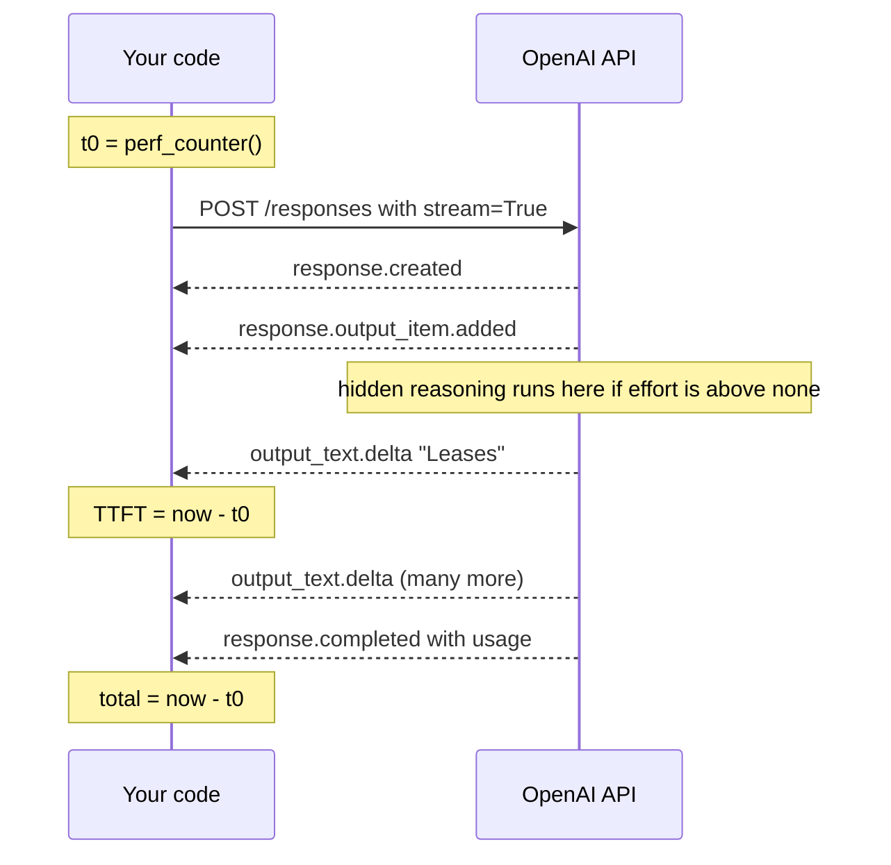
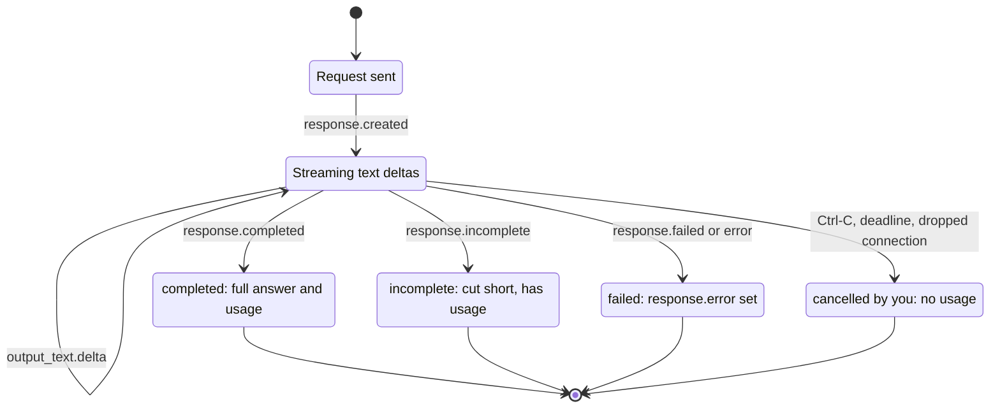
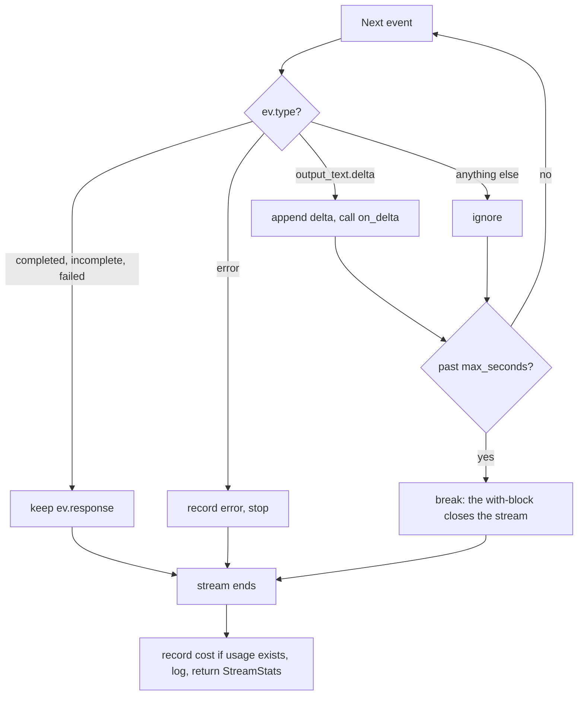

# Streaming Responses

Ask Atlas to explain leases and heartbeats and the terminal sits frozen for several seconds, then a wall of text lands all at once. Streaming doesn't make the total time any shorter, but users judge your app by when the first word appears. With streaming, the first word arrives within a fraction of a second. Today you learn to read a stream, measure how fast it starts, and stop it cleanly when the user has seen enough.

## At a Glance

- **Time:** ~2 h core (+ optional Go Deeper) · **Depth:** working
- **Prerequisites:** [Day 12: The OpenAI SDK in Production Code](../../Phase_2_Building_with_LLM_APIs/Day_012_openai_sdk_production/openai_sdk_production.md), [Day 8: Messages, Roles & Conversation State](../../Phase_2_Building_with_LLM_APIs/Day_008_messages_and_state/messages_and_state.md), primer [A5: HTTP, JSON & APIs](../../Appendix_Primers/A05_http_json_apis.md)
- **You'll build:** `stream_complete()`, a streaming wrapper that reports time to first token, throughput and cost, and a streaming Atlas chat for the terminal that prints a footer like `TTFT 0.42 s · 61 tok/s · $0.00012` after every answer
- **Stops at:** web transports. Serving a stream over HTTP is [Day 77](../../Phase_9_Production/Day_077_fastapi_serving/fastapi_serving.md); chat UIs are [Day 79](../../Phase_9_Production/Day_079_chat_uis_streaming/chat_uis_streaming.md)
- **Fast path:** Already stream Chat Completions? Read [the event table](#name-the-parts-events-deltas-and-timings) and [Measure TTFT and Throughput](#measure-ttft-and-throughput), then do Exercise 2 (≈35 min)
- **Cost:** ≈ $0.02 on `gpt-6-luna` for the whole day, estimated from list prices (prices as of 2026-11, [verify](https://developers.openai.com/api/docs/pricing))
- **New terms:** stream event, delta, time to first token (TTFT), throughput, cancellation

> **Coming from Software Engineering?** A model stream is `tail -f` on a log file, or a chunked HTTP download: an append-only sequence of small, typed records that you fold into one final value. Your loop is a reducer (a function that combines each new record into an accumulator) over an event log: text deltas append to a buffer, and the last event carries the final object with its usage. On the wire it's SSE (Server-Sent Events, a one-way HTTP stream that stays open while the server writes events), from primer A5. What transfers: handle every terminal state, never assume the stream finishes, and release the connection when you stop reading. Serving it to a browser is Day 77.

## The Frozen Terminal

Start with the problem. Here is a normal, blocking call for a long answer. Nothing appears on screen until the whole answer has been generated.

```python
# script_id: day_013_streaming/blocking_baseline
# blocking_baseline.py: time one long answer without streaming.
# Install: uv add "openai>=3.46,<4"   Env: OPENAI_API_KEY (ATLAS_MODEL optional)
import os
import time

from openai import OpenAI

MODEL = os.environ.get("ATLAS_MODEL", "gpt-6-luna")
client = OpenAI()

QUESTION = ("Explain how job leases and heartbeats work in a background-jobs library, "
            "in about 300 words.")
t0 = time.perf_counter()
resp = client.responses.create(model=MODEL, input=QUESTION, reasoning={"effort": "none"})
total = time.perf_counter() - t0   # the screen stays blank for this entire interval
print(resp.output_text)
print(f"\ntotal {total:.1f} s · {resp.usage.output_tokens} output tokens")
```

```text
Imagine a job queue where a worker takes a job off the queue...   (300 words appear at once)

total 4.8 s · 412 output tokens        (your numbers will differ)
```

Five seconds of blank cursor makes users wonder whether the app has crashed. The model wasn't stuck: it had the first word within a fraction of a second, but the blocking call held everything back until the last token was done.

## Dishes as They're Ready

Picture a restaurant. One waiter brings your whole order once every dish is cooked; another brings each dish as soon as it's ready. The kitchen is equally fast in both cases and the last dish lands at the same moment, but at the second table you start eating within minutes.

A model generates text one token at a time, front to back, so the start of the answer exists long before the end. Streaming is the second waiter: the API sends each piece as it's generated and your code prints it at once. Total time stays the same; the wait for the first word drops to well under a second.

## Read a Stream by Hand

Before calling the API, look at what a stream contains. When you pass `stream=True`, the Responses API doesn't return one `Response` object. It returns a sequence of **stream events**: small typed messages, each with a `type` field that says what happened. The text arrives in **deltas**: each delta is only the *new* piece of text, not the whole answer so far.

Here are six events, written by hand to match the shapes the SDK produces (real events carry more fields, such as ids). Fold them into text by hand:

```python
# script_id: day_013_streaming/fold_by_hand
# fold_by_hand.py: fold a recorded stream into text. No API key or install needed.
# Hand-written to match the SDK's event types; real events carry more fields (ids, indexes).
EVENTS = [
    {"type": "response.created", "sequence_number": 0},
    {"type": "response.output_item.added", "sequence_number": 1, "item": {"type": "message"}},
    {"type": "response.output_text.delta", "sequence_number": 2, "delta": "Leases"},
    {"type": "response.output_text.delta", "sequence_number": 3, "delta": " expire"},
    {"type": "response.output_text.delta", "sequence_number": 4, "delta": " without heartbeats."},
    {"type": "response.completed", "sequence_number": 5,
     "response": {"status": "completed", "usage": {"output_tokens": 5}}},
]

text = ""
for ev in EVENTS:
    if ev["type"] == "response.output_text.delta":
        text += ev["delta"]            # a delta is only the NEW piece; append it
        print(f"after #{ev['sequence_number']}: {text!r}")
    elif ev["type"] == "response.completed":
        print("final:", text, "| status:", ev["response"]["status"],
              "| usage:", ev["response"]["usage"])
```

```text
after #2: 'Leases'
after #3: 'Leases expire'
after #4: 'Leases expire without heartbeats.'
final: Leases expire without heartbeats. | status: completed | usage: {'output_tokens': 5}
```

Check it in your head: three deltas, appended in order, make one sentence. The first two events carry no text; they announce a response and a message item. The last carries the finished response with `usage`, the token counts you pay for. Every stream has this shape: setup events, many deltas, one final event.

## Name the Parts: Events, Deltas and Timings

These are the events you'll meet when streaming text. Every one has a `type` string and a `sequence_number` that counts up from 0. The SDK turns each into a typed object (for example `ResponseTextDeltaEvent`), so you read fields as attributes: `ev.delta`, not `ev["delta"]`.

| Event `type` | When it arrives | What to read |
|---|---|---|
| `response.created` | once, first | `ev.response.id`; the status is `in_progress` |
| `response.in_progress` | once, right after | usually nothing |
| `response.output_item.added` | once per output item (reasoning, message, tool call) | `ev.item.type` |
| `response.content_part.added` | once per content part of a message | rarely needed |
| `response.output_text.delta` | many times | **`ev.delta`**, the new text |
| `response.output_text.done` | once per text part | `ev.text`, the full text of that part |
| `response.output_item.done` | once per output item | `ev.item`, the finished item |
| `response.completed` | last, on success | **`ev.response`**: `.usage`, `.output_text`, `.output` |
| `response.incomplete` | last, instead of completed | `ev.response.incomplete_details.reason`, e.g. `max_output_tokens` |
| `response.failed` | last, instead of completed | `ev.response.error` |
| `error` | when the stream itself errors | `ev.code`, `ev.message` |

For text you need two rows: deltas for the pieces and a final event for the result. Skipping the rest is intended; the official guide lists `response.created`, `response.output_text.delta`, `response.completed` and `error` as the common events to listen for.

To see the real sequence for yourself, print each event type the first time it appears:

```python
# script_id: day_013_streaming/event_dump
# event_dump.py: list the event types one streamed call produces, in order of first appearance.
# Install: uv add "openai>=3.46,<4"   Env: OPENAI_API_KEY (ATLAS_MODEL optional)
import os

from openai import OpenAI

MODEL = os.environ.get("ATLAS_MODEL", "gpt-6-luna")
client = OpenAI()

seen: set[str] = set()
with client.responses.create(model=MODEL, input="In two sentences, what does `orbit doctor` check?",
                             reasoning={"effort": "none"}, stream=True) as stream:
    for ev in stream:
        if ev.type not in seen:
            seen.add(ev.type)
            print(f"#{ev.sequence_number:<4} {ev.type}")
```

```text
#0    response.created
#1    response.in_progress
#2    response.output_item.added
#3    response.content_part.added
#4    response.output_text.delta
#41   response.output_text.done
#42   response.content_part.done
#43   response.output_item.done
#44   response.completed          (typical; you may also see a reasoning item, and the numbers differ)
```

Three timings describe how a stream feels to the person watching it:

- **Time to first token (TTFT):** seconds from sending the request to the first text delta. This is the wait the user feels. Note that `response.created` usually arrives earlier, but it carries no text, so it doesn't count.
- **Total time:** seconds from sending the request to the final event. Streaming barely changes this number.
- **Throughput:** tokens per second while text is flowing, that is output tokens divided by (total − TTFT). It tells you how fast the text scrolls once it starts.



TTFT is read at the first delta and total at the final event. Throughput comes from the gap between them plus the token count that only the final event provides.

## Your First Stream

Here is the same question as before, streamed. It takes one extra argument and a loop.

```python
# script_id: day_013_streaming/minimal_stream
# minimal_stream.py: print an answer while it is generated.
# Install: uv add "openai>=3.46,<4"   Env: OPENAI_API_KEY (ATLAS_MODEL optional)
import os

from openai import OpenAI

MODEL = os.environ.get("ATLAS_MODEL", "gpt-6-luna")
client = OpenAI()

stream = client.responses.create(
    model=MODEL,
    input="Explain how job leases and heartbeats work in a background-jobs library, in about 300 words.",
    reasoning={"effort": "none"},   # no hidden thinking before the first word
    stream=True,                    # returns an iterator of typed events, not a Response
)
for ev in stream:
    if ev.type == "response.output_text.delta":
        print(ev.delta, end="", flush=True)   # flush, or the terminal may hold the text back
print()
```

```text
Imagine a job queue where a worker takes a job off the queue... (words appear a few at a time)
```

Run it: the first words appear almost at once, then the rest scrolls in, and the program finishes at about the same moment as the blocking version. `end=""` stops `print` from adding a newline after every piece, and `flush=True` pushes each piece to the terminal immediately instead of waiting for a full line.

## Break It: Three Common Mistakes

Change one thing at a time in `minimal_stream.py` and see what happens.

```python
# script_id: day_013_streaming/break_it
# fragment: three edits to minimal_stream.py. Try each one on its own.

# 1. The Chat Completions habit. Responses events have no .choices:
for chunk in stream:
    print(chunk.choices[0].delta.content)
# AttributeError: 'ResponseCreatedEvent' object has no attribute 'choices'

# 2. Drop flush=True. Text shows up in bursts, or only at the end when output is piped:
    print(ev.delta, end="")

# 3. Raise the effort. The model reasons privately before it writes the first word:
stream = client.responses.create(model=MODEL, input=QUESTION, stream=True,
                                 reasoning={"effort": "medium"})
```

```text
effort none:   TTFT 0.4 s · total 4.6 s
effort medium: TTFT 3.1 s · total 7.9 s      (illustrative; your numbers will differ)
```

The first mistake is the usual one when porting Chat Completions code: Responses streams use typed events, the first of which (`response.created`) has no `choices`. Switch on `ev.type` instead. The second is buffering: without `flush=True`, Python holds your deltas until a newline or a full buffer.

The third matters most for design. Reasoning effort ([Day 6](../../Phase_1_How_LLMs_Work/Day_006_sampling_reasoning_effort/sampling_reasoning_effort.md)) is hidden thinking that happens *before* the first text delta, so every second of it is a second of TTFT that streaming can't hide. GPT-6 models default to `medium`, so set effort explicitly; `none` or `low` suits chat replies.

## Measure TTFT and Throughput

To improve the speed users feel, you have to measure it. Take three timestamps with `time.perf_counter()`, which is a monotonic clock: it never jumps backwards, unlike wall-clock time. Read one before the request, one at the first delta and one at the final event. The token count comes from `usage` on the final event; deltas don't carry token counts.

This is the start of `stream_complete()`, the streaming sibling of Day 12's `complete()`. It lives in `atlas/llm.py` next to the tracker. The first block defines the result type and the throughput maths.

```python
# script_id: day_013_streaming/stream_complete
# stream_complete.py: Atlas's streaming wrapper (adds to atlas/llm.py). Built on Day 12's llm.py.
# Install: uv add "openai>=3.46,<4" httpx2   Env: OPENAI_API_KEY (ATLAS_MODEL, ATLAS_LOG_DIR optional)
from __future__ import annotations

import json
import os
import time
from collections.abc import Callable
from dataclasses import dataclass
from pathlib import Path
from typing import Any

import httpx2   # installed with openai 3.x; the SDK's HTTP layer
import openai
from openai import OpenAI
from openai.types.responses import Response

MODEL = os.environ.get("ATLAS_MODEL", "gpt-6-luna")
EFFORT = "none"   # chat replies: lowest TTFT. Pass reasoning=... to override per call
LOG_DIR = Path(os.environ.get("ATLAS_LOG_DIR", "logs"))
client = OpenAI()
END_EVENTS = {"response.completed", "response.incomplete", "response.failed"}


@dataclass
class StreamStats:
    text: str                      # everything the user saw
    ttft_s: float | None           # None if no text ever arrived
    total_s: float
    output_tokens: int | None      # None when cancelled: usage only comes in the final event
    tokens_per_s: float | None
    cost_usd: float | None
    response: Response | None      # the final Response, or None if you stopped first
    interrupted: bool = False
    error: str | None = None


def print_delta(delta: str) -> None:
    print(delta, end="", flush=True)


def visible_rate(resp: Response, ttft_s: float | None, total_s: float) -> float | None:
    """Visible tokens per second after the first token. Reasoning tokens are never streamed."""
    u = resp.usage
    if u is None or ttft_s is None or total_s <= ttft_s:
        return None
    visible = u.output_tokens - u.output_tokens_details.reasoning_tokens
    return visible / (total_s - ttft_s)
```

Why subtract reasoning tokens? `usage.output_tokens` includes them ([Day 11](../../Phase_2_Building_with_LLM_APIs/Day_011_reasoning_cot/reasoning_cot.md)), but they're generated inside the TTFT window, so counting them would overstate how fast text scrolls. At effort `none` the difference is close to zero.

Here is a worked example with toy numbers. The request goes out at 0.00 s, the first delta arrives at 0.40 s and `response.completed` at 4.60 s, with 420 output tokens and 0 reasoning tokens. TTFT is 0.40 s, total is 4.6 s, and throughput is 420 / (4.60 − 0.40) = 100 tokens per second.

## Collect While Streaming and Record Cost

Printing is half the job. Your code usually also needs the final text (to save it in history) and the usage (to record cost). You could rebuild both from the events yourself, but the SDK has a helper that does the bookkeeping: `client.responses.stream(...)`. It's a context manager that yields the same typed events, and when the stream ends, `get_final_response()` returns the complete `Response`.

```python
# script_id: day_013_streaming/helper_collect
# helper_collect.py: stream with the SDK helper, then read the final Response and its usage.
# Install: uv add "openai>=3.46,<4"   Env: OPENAI_API_KEY (ATLAS_MODEL optional)
import os

from openai import OpenAI

MODEL = os.environ.get("ATLAS_MODEL", "gpt-6-luna")
client = OpenAI()

parts: list[str] = []
with client.responses.stream(model=MODEL, input="In three sentences, why do job leases expire?",
                             reasoning={"effort": "none"}) as stream:
    for ev in stream:
        if ev.type == "response.output_text.delta":
            parts.append(ev.delta)                 # keep what the user saw
            print(ev.delta, end="", flush=True)
    final = stream.get_final_response()            # needs a response.completed event

collected = "".join(parts)
print(f"\nmatch: {collected == final.output_text} · status: {final.status} · "
      f"input {final.usage.input_tokens} · output {final.usage.output_tokens} tokens")
```

```text
A lease is a time limit on a worker's claim to a job...
match: True · status: completed · input 19 · output 74 tokens      (your numbers will differ)
```

Joining the deltas gives exactly `final.output_text`, a sanity check worth keeping in tests. Leaving the `with` block closes the HTTP connection, even if an exception is raised inside it.

The helper has one sharp edge. `get_final_response()` waits for a `response.completed` event. If the stream ended any other way, for instance `response.incomplete` because it hit `max_output_tokens`, or because you stopped reading, it raises ``RuntimeError: Didn't receive a `response.completed` event.`` That's why `stream_complete()` uses `responses.create(..., stream=True)` and keeps whichever final event arrives (completed, incomplete or failed). All three carry a `Response` with `status` and, normally, `usage`.



Every stream ends in exactly one of these four states, and your code needs a plan for each. Only the first three give you `usage`. The fourth, where you stop early, ends with no final event at all.

Cost recording is owned by [Day 12](../../Phase_2_Building_with_LLM_APIs/Day_012_openai_sdk_production/openai_sdk_production.md), so `stream_complete()` reuses its `tracker` and `log_call()` rather than inventing new ones. Lessons are self-contained, so the next block is a compact copy. If you built Day 12's `atlas/llm.py`, use that version instead.

```python
# script_id: day_013_streaming/stream_complete
# Compact copies of Day 12's cost tracker and call log (see ../Day_012_openai_sdk_production/).
# USD per 1M tokens, as of 2026-11, verify at https://developers.openai.com/api/docs/pricing
PRICES_PER_1M = {"gpt-6-luna": {"input": 0.10, "cached_input": 0.01, "output": 0.50}}


def cost_from_usage(usage, model: str = MODEL) -> float:
    p = PRICES_PER_1M.get(model) or next(v for k, v in PRICES_PER_1M.items() if model.startswith(k))
    cached = usage.input_tokens_details.cached_tokens
    return ((usage.input_tokens - cached) * p["input"] + cached * p["cached_input"]
            + usage.output_tokens * p["output"]) / 1_000_000


class CostTracker:
    def __init__(self) -> None:
        self.calls: list[dict] = []

    @property
    def total_usd(self) -> float:
        return sum(c["cost_usd"] for c in self.calls)

    def record(self, response: Response, *, label: str = "", latency_s: float | None = None) -> float:
        cost = cost_from_usage(response.usage, response.model)
        self.calls.append({"label": label, "cost_usd": cost, "latency_s": latency_s})
        return cost

    def summary(self) -> str:
        return f"{len(self.calls)} calls · ${self.total_usd:.5f}"


tracker = CostTracker()


def log_call(response: Response | None, *, label: str, latency_s: float,
             cost_usd: float | None, extra: dict | None = None) -> None:
    """One JSON line per call. Unlike Day 12's copy, accepts None for a cancelled stream."""
    LOG_DIR.mkdir(parents=True, exist_ok=True)
    row = {"ts": time.time(), "label": label, "id": getattr(response, "id", None),
           "status": getattr(response, "status", "cancelled"), "latency_s": round(latency_s, 3),
           "cost_usd": cost_usd, **(extra or {})}
    with (LOG_DIR / "calls.jsonl").open("a", encoding="utf-8") as f:
        f.write(json.dumps(row) + "\n")
```

## Cancel a Stream Cleanly

Streams give users something blocking calls never could: the power to stop. A user who sees the answer heading the wrong way presses Ctrl-C. A batch script that only needs a preview stops after two seconds. Either way, **cancellation** means stopping the stream early on purpose, keeping the partial text and closing the connection.

Each event goes through one decision, and every path either continues or leaves the loop deliberately.



Three things can stop a stream early:

1. **Ctrl-C** raises `KeyboardInterrupt` inside the `for` loop. Catch it there and keep the text.
2. **A deadline** (`max_seconds`): check elapsed time after each event and `break`. The check runs only when an event arrives; a stalled connection is the client `timeout`'s job (Day 12).
3. **A dropped connection or stream error.** The SDK retries the *initial* request, but never a stream you're already reading. Mid-stream failures arrive as an exception (`openai.APIError` or an `httpx2` transport error) or an `error` event. Keep the partial text and let the user retry.

In each case, leaving the `with` block calls `close()` and releases the connection. Whether the server stops generating, and billing, when you disconnect isn't documented in the streaming guide (⚠ verify against current docs), so budget as if the whole answer is billed.

```python
# script_id: day_013_streaming/stream_complete
def stream_complete(input: str | list, *, instructions: str | None = None, model: str = MODEL,
                    on_delta: Callable[[str], None] = print_delta, max_seconds: float | None = None,
                    label: str = "stream", **kwargs: Any) -> StreamStats:
    """Stream one Responses call. Ctrl-C, max_seconds or a mid-stream error stop it early."""
    kwargs.setdefault("reasoning", {"effort": EFFORT})
    if instructions is not None:
        kwargs["instructions"] = instructions   # re-sent every call, as on Day 8
    parts: list[str] = []
    final: Response | None = None
    ttft: float | None = None
    interrupted, error, t0 = False, None, time.perf_counter()
    # Errors before the first event (auth, 400, 429 after retries) raise here, as on Day 12.
    stream = client.responses.create(model=model, input=input, stream=True, **kwargs)
    with stream:
        try:
            for ev in stream:
                if ev.type == "response.output_text.delta":
                    ttft = ttft if ttft is not None else time.perf_counter() - t0
                    parts.append(ev.delta)
                    on_delta(ev.delta)
                elif ev.type in END_EVENTS:
                    final = ev.response            # status + usage for all three end states
                elif ev.type == "error":
                    interrupted, error = True, f"stream error {ev.code}: {ev.message}"
                    break
                if max_seconds is not None and final is None and time.perf_counter() - t0 > max_seconds:
                    interrupted = True
                    break                          # leaving `with` closes the connection
        except KeyboardInterrupt:
            interrupted = True
        except (openai.APIError, httpx2.TransportError) as e:   # mid-stream: never auto-retried
            interrupted, error = True, f"{type(e).__name__}: {e}"
    total = time.perf_counter() - t0
    cost = tokens = rate = None
    if final is not None and final.usage is not None:
        cost = tracker.record(final, label=label, latency_s=total)
        tokens, rate = final.usage.output_tokens, visible_rate(final, ttft, total)
    log_call(final, label=label, latency_s=total, cost_usd=cost,
             extra={"ttft_s": ttft, "interrupted": interrupted, "error": error})
    return StreamStats("".join(parts), ttft, total, tokens, rate, cost, final, interrupted, error)
```

The `**kwargs` keeps the wrapper flexible: anything `responses.create` accepts (`max_output_tokens`, a different `reasoning` setting, later `tools`) passes straight through. A caller that wants silence passes `on_delta=lambda s: None`, and a UI can pass a function that writes to a socket instead of the terminal.

The last block adds a one-line footer and a demo: one full answer, then the same question with a 1.5-second deadline.

```python
# script_id: day_013_streaming/stream_complete
def footer(s: StreamStats) -> str:
    """One status line per call, e.g. 'TTFT 0.42 s · total 3.9 s · 58 tok/s · $0.00011'."""
    bits = [f"TTFT {s.ttft_s:.2f} s" if s.ttft_s is not None else "no text", f"total {s.total_s:.1f} s"]
    if s.tokens_per_s is not None:
        bits.append(f"{s.tokens_per_s:.0f} tok/s")
    bits.append(f"${s.cost_usd:.5f}" if s.cost_usd is not None else "cost unknown (no usage)")
    if s.interrupted:
        bits.append("[interrupted]")
    if s.error:
        bits.append(s.error)
    return " · ".join(bits)


if __name__ == "__main__":
    q = "Explain how job leases and heartbeats work in a background-jobs library, in about 300 words."
    print("\n" + footer(stream_complete(q, label="leases_full")))
    print("\n" + footer(stream_complete(q, max_seconds=1.5, label="leases_deadline")))
    print(tracker.summary())
```

```text
Imagine a job queue where a worker takes a job off the queue... (full answer streams)
TTFT 0.41 s · total 3.9 s · 108 tok/s · $0.00022
Imagine a job queue where a worker takes a job off the queue, and it promises
TTFT 0.39 s · total 1.5 s · cost unknown (no usage) · [interrupted]
1 calls · $0.00022                                  (your numbers will differ)
```

The second call stopped after 1.5 seconds with its partial text intact. Its cost is unknown, because the usage would have arrived in the final event you chose not to wait for. Exercise 2 estimates it.

## The Build: A Streaming Atlas Chat

Day 8 built a chat that re-sends the whole history every turn, grounded in `docs/faq.md`. The streaming version prints each reply as it's generated, ends each turn with a footer, and adds one rule for history.

**Update history exactly once per turn, after the stream ends, whatever ended it.** If the stream completed, append the response's output items, as on Day 8. If it was cancelled, append one assistant message holding the text the user actually saw, marked `[interrupted]`, so that the next turn's context matches the screen. Never append inside the loop. That's how half-answers get lost or saved twice.

```python
# script_id: day_013_streaming/stream_chat
# stream_chat.py: streaming Atlas chat over Orbit's FAQ, with a footer per turn.
# Install: uv add "openai>=3.46,<4" httpx2   Env: OPENAI_API_KEY; ORBIT_DATA (default datasets/orbit)
# Needs stream_complete.py (above) in the same folder; it calls client.responses.create.
import os
from pathlib import Path

from stream_complete import StreamStats, footer, stream_complete, tracker

DATA_DIR = Path(os.environ.get("ORBIT_DATA", "datasets/orbit"))
ATLAS_PERSONA = """You are Atlas, an assistant for the maintainers of Orbit, an open-source Python background-jobs library.
Rules:
- Use only the facts between the <facts> tags. If the answer is not there, say you don't know.
- Never invent config keys, versions or error codes.
Format: at most 4 sentences or 4 bullets."""   # compact version of Day 8's persona


def load_facts(path: Path, max_chars: int = 2400) -> str:
    """Day 8's helper: a docs page without its YAML front matter, cut at a paragraph."""
    text = path.read_text(encoding="utf-8")
    if text.startswith("---"):
        text = text.split("---", 2)[2]
    text = text.strip()
    cut = text.rfind("\n\n", 0, max_chars) if len(text) > max_chars else len(text)
    return text[: cut if cut > 0 else max_chars]


INSTRUCTIONS = f"{ATLAS_PERSONA}\n\n<facts>\n{load_facts(DATA_DIR / 'docs' / 'faq.md')}\n</facts>"
```

The second block holds the turn logic and the loop. `chat_turn_streamed()` returns a new history list instead of changing the old one, as Day 8's `chat_turn()` did, so a turn that crashes leaves history untouched.

```python
# script_id: day_013_streaming/stream_chat
def chat_turn_streamed(history: list, user_text: str) -> tuple[list, StreamStats]:
    turn_input = [*history, {"role": "user", "content": user_text}]
    stats = stream_complete(turn_input, instructions=INSTRUCTIONS, label="chat")
    if stats.response is not None and not stats.interrupted:
        return [*turn_input, *stats.response.output], stats       # same as Day 8
    # Cancelled or broken: keep exactly what the user saw, once, and say so.
    partial = {"role": "assistant", "content": f"{stats.text} [interrupted]"}
    return [*turn_input, partial], stats


def main() -> None:
    history: list = []
    print("Atlas (streaming). Ctrl-C stops an answer; Ctrl-D or 'quit' exits.")
    while True:
        try:
            user_text = input("\nyou> ").strip()
        except (EOFError, KeyboardInterrupt):
            break
        if user_text.lower() in {"quit", "exit"}:
            break
        if not user_text:
            continue
        print("atlas> ", end="", flush=True)
        try:
            history, stats = chat_turn_streamed(history, user_text)
        except KeyboardInterrupt:          # pressed before the first event arrived
            print("\n  [cancelled before the stream started; history unchanged]")
            continue
        print(f"\n  [{footer(stats)}]")
    print(f"\n{tracker.summary()}")


if __name__ == "__main__":
    main()
```

```text
Atlas (streaming). Ctrl-C stops an answer; Ctrl-D or 'quit' exits.

you> Does Orbit run each job exactly once?
atlas> No. Orbit delivers jobs at least once. A job whose lease expires (ORB-1101) or whose
worker dies can run again, so make side effects idempotent.
  [TTFT 0.42 s · total 1.3 s · 61 tok/s · $0.00012]

you> Is Windows OK for production?
atlas> For development, yes. For production, the docs recommend against it, because the Windows
worker ignores ^C
  [TTFT 0.40 s · total 0.9 s · cost unknown (no usage) · [interrupted]]

you> quit

1 calls · $0.00012                                  (your numbers will differ)
```

The second answer was cut off with Ctrl-C, and the next turn sees exactly that half-sentence plus `[interrupted]`, so nothing invisible sits in history.

## Trade-offs: When Not to Stream

Stream anything a person watches; for everything else it is extra complexity.

| Situation | Stream? | Why |
|---|---|---|
| Chat, CLI or any long answer a person reads | Yes | TTFT is the experience; total time is barely noticed |
| Batch jobs and offline pipelines ([Day 22](../../Phase_2_Building_with_LLM_APIs/Day_022_capstone_r1_extractor/capstone_r1_extractor.md)) | No | Nobody is watching, and the SDK's automatic retries cover the whole call |
| Structured output you validate as a whole ([Day 16](../../Phase_2_Building_with_LLM_APIs/Day_016_structured_outputs/structured_outputs.md)) | Usually no | Half a JSON object can't be validated; show progress per record instead |
| Output that must pass moderation before display ([Day 70](../../Phase_8_Safety_and_Security/Day_070_guardrails_moderation/guardrails_moderation.md)) | With care | The guide warns partial output is harder to moderate |
| Short answers (well under a second) | Optional | The gap between TTFT and total is too small to notice |

Rule of thumb: stream when a human waits on the output; don't when a program does.

### In production

- Mid-stream failures are never retried automatically. Keep the partial text, log it, and offer a retry rather than silently re-running (which bills twice).
- Handle every end state: `response.completed`, `response.incomplete`, `response.failed`, `error` events and your own cancellation.
- Log TTFT and total time on every call and watch p95 (the value 95% of calls beat), not the average ([Day 18](../../Phase_2_Building_with_LLM_APIs/Day_018_cost_latency_caching/cost_latency_caching.md) covers percentiles).
- Set effort per use case. Hidden reasoning sits entirely inside TTFT.
- The terminal is only one consumer. Streaming over HTTP with SSE is [Day 77](../../Phase_9_Production/Day_077_fastapi_serving/fastapi_serving.md), and browser chat UIs are [Day 79](../../Phase_9_Production/Day_079_chat_uis_streaming/chat_uis_streaming.md).

## Go Deeper (optional)

<details><summary>Go deeper: what a stream looks like on the wire</summary>

Under the SDK, a streamed response is one long HTTP response with the content type `text/event-stream`. The server writes events as plain text and keeps the connection open. Each event is a few `field: value` lines followed by a blank line. The `event:` field names the type and the `data:` field holds JSON. The SDK reads these lines, parses the JSON and builds the typed objects you loop over.

This parser handles the core of the format, so you can see there's no magic in it. It covers what Responses streams use; the full SSE spec also has `id:`, `retry:` and comment lines (see the MDN page in References).

```python
# script_id: day_013_streaming/sse_by_hand
# sse_by_hand.py: parse raw Server-Sent Events text. No API key or install needed.
# The RAW text is illustrative: real events carry many more fields.
import json
from collections.abc import Iterator

RAW = """event: response.created
data: {"type": "response.created", "sequence_number": 0}

event: response.output_text.delta
data: {"type": "response.output_text.delta", "sequence_number": 1, "delta": "Hel"}

event: response.output_text.delta
data: {"type": "response.output_text.delta", "sequence_number": 2, "delta": "lo"}

event: response.completed
data: {"type": "response.completed", "sequence_number": 3}

"""


def parse_sse(raw: str) -> Iterator[tuple[str | None, dict]]:
    for block in raw.split("\n\n"):                  # a blank line ends one event
        fields: dict[str, list[str]] = {}
        for line in block.splitlines():
            name, _, value = line.partition(":")
            fields.setdefault(name, []).append(value.removeprefix(" "))
        if "data" in fields:                         # several data: lines join with newlines
            yield (fields.get("event") or [None])[0], json.loads("\n".join(fields["data"]))


for name, data in parse_sse(RAW):
    print(f"{name:<28} seq={data['sequence_number']} delta={data.get('delta', '')!r}")
```

```text
response.created             seq=0 delta=''
response.output_text.delta   seq=1 delta='Hel'
response.output_text.delta   seq=2 delta='lo'
response.completed           seq=3 delta=''
```

Two consequences follow from the format. A proxy that buffers responses (some corporate proxies and load balancers do) can turn a smooth stream into one burst at the end, because it holds the bytes until the response finishes. And because SSE flows one way, from server to client, "stop generating" can only be signalled by closing the connection. Day 77 serves this same format from your own FastAPI endpoint.

</details>

<details><summary>Go deeper: one stream, any consumer</summary>

`stream_complete()` pushes text to a callback (`on_delta`). The other common shape is pull-based: a generator that yields text pieces, so the caller decides what to do with them. It can write to a file, feed a UI, or join everything into one string. The final `Response` goes into a small holder, because a generator can't return a value to a `for` loop.

```python
# script_id: day_013_streaming/text_iterator
# text_iterator.py: turn a Responses stream into a plain iterator of text pieces.
# Install: uv add "openai>=3.46,<4"   Env: OPENAI_API_KEY (ATLAS_MODEL optional)
import os
from collections.abc import Iterable, Iterator

from openai import OpenAI

MODEL = os.environ.get("ATLAS_MODEL", "gpt-6-luna")
client = OpenAI()
END_EVENTS = {"response.completed", "response.incomplete", "response.failed"}


def iter_text(events: Iterable, holder: dict) -> Iterator[str]:
    """Yield text deltas; put the final Response in holder['response'] when it arrives."""
    for ev in events:
        if ev.type == "response.output_text.delta":
            yield ev.delta
        elif ev.type in END_EVENTS:
            holder["response"] = ev.response


holder: dict = {}
with client.responses.create(model=MODEL, input="Name three Orbit-style queue features.",
                             reasoning={"effort": "none"}, stream=True) as stream:
    with open("answer.txt", "w", encoding="utf-8") as f:
        for piece in iter_text(stream, holder):
            f.write(piece)                       # the consumer chooses: file, socket, UI...
print("saved; status:", holder["response"].status, "· usage:", holder["response"].usage.output_tokens)
```

Because `iter_text()` takes any iterable of events, you can test it offline with a list of fake events shaped like the ones in [Read a Stream by Hand](#read-a-stream-by-hand). [Day 19](../../Phase_2_Building_with_LLM_APIs/Day_019_testing_llm_code/testing_llm_code.md) builds fakes like that properly.

</details>

<details><summary>Go deeper: other events you will meet</summary>

The event table covers plain text. Other features add their own event families, and the same "switch on `ev.type`, ignore the rest" loop keeps working:

- **Tool calls** stream their JSON arguments as `response.function_call_arguments.delta` and `.done`. You'll usually wait for the finished item rather than parse partial JSON. See [Day 35](../../Phase_4_Tools_and_MCP/Day_035_function_calling/function_calling.md).
- **Refusals** arrive as `response.refusal.delta` and `response.refusal.done` instead of text deltas. A loop that only reads `output_text.delta` prints nothing for a refusal, so check the final response if the text is empty.
- **Reasoning summaries.** The SDK's `reasoning` parameter has a `summary` field (`"auto"`, `"concise"` or `"detailed"`), and the SDK defines a `response.reasoning_summary_text.delta` event for it. Which GPT-6 models return summaries, and what they cost, isn't covered by this course's verified facts (⚠ verify against current docs). Streaming a summary can make a high-effort call feel responsive while the model thinks.
- **Ordering.** `sequence_number` increases by one per event. If you forward events through a queue and something re-orders them, sort or de-duplicate by it.
- **Resuming.** `client.responses.stream()` also accepts `response_id=` and `starting_after=`, for picking up a stored background response after a given sequence number. That belongs to background mode on [Day 78](../../Phase_9_Production/Day_078_async_jobs/async_jobs.md).

</details>

<details><summary>Go deeper: measuring latency honestly</summary>

A TTFT measured in your code is end-to-end. It includes DNS and the TLS handshake on a fresh connection, any queueing at the provider, the time to read your input (longer prompts take longer before the first token) and any hidden reasoning. Some habits keep the numbers meaningful:

- **Reuse one client.** The first call on a new `OpenAI()` pays for opening the connection. Benchmarks that build a client per call measure your setup, not the model.
- **Warm up, then repeat.** Throw away the first run and take at least 10 more. One run tells you almost nothing, because latency varies from call to call.
- **Report the median and p95** (the value 95% of calls beat). Users remember the slow calls, and p95 shows them. Day 18 adds percentiles to the tracker.
- **Hold the prompt fixed** when you compare models or effort levels. A longer prompt raises TTFT on its own.
- **Measure where users are.** A laptop on office Wi-Fi and a server in the provider's region see different numbers.

</details>

## Common Pitfalls

- **`AttributeError: 'ResponseCreatedEvent' object has no attribute 'choices'`.** Cause: Chat Completions chunk code (`chunk.choices[0].delta.content`) on a Responses stream. Fix: switch on `ev.type` and read `ev.delta` from `response.output_text.delta` events.
- **Text appears in bursts, or all at the end.** Cause: missing `flush=True`, so Python's output buffer holds the pieces (worse when output is piped). Fix: `print(ev.delta, end="", flush=True)`. If it's still bursty behind a proxy, the proxy is buffering.
- **`usage` is missing.** Cause: looking for it on delta events, which carry no token counts. Fix: read `ev.response.usage` from the final event, or `get_final_response().usage` with the helper.
- **``RuntimeError: Didn't receive a `response.completed` event.``** Cause: calling `get_final_response()` after a stream that ended as `incomplete`, or that you stopped early. Fix: keep whichever final event arrived, as `stream_complete()` does, and check `status`.
- **History is corrupted after Ctrl-C** (half an answer lost, or saved twice). Cause: appending to history inside the loop, or in more than one place. Fix: build the new history once, after the stream ends, with the partial text marked `[interrupted]`.
- **A dropped connection mid-stream isn't retried.** Cause: the SDK retries only the initial request; stream consumption is never retried. Fix: catch `openai.APIError` and `httpx2.TransportError` around the loop, keep the partial text and let the user retry.

> **Where we stop:** today's streams end at your terminal. Sending them to a browser over HTTP with SSE is [Day 77](../../Phase_9_Production/Day_077_fastapi_serving/fastapi_serving.md), and chat UIs are [Day 79](../../Phase_9_Production/Day_079_chat_uis_streaming/chat_uis_streaming.md).

## Key Takeaways

- Streaming doesn't shorten total time. It cuts the wait for the first word (TTFT), and that wait is what users judge.
- A stream is a sequence of typed events: switch on `ev.type`, append `ev.delta` from `response.output_text.delta`, and take status and `usage` from the final event (`completed`, `incomplete` or `failed`).
- Measure with `perf_counter()` at the start, at the first delta and at the end. Throughput is visible output tokens divided by (total − TTFT), and hidden reasoning shows up as a higher TTFT.
- Collect while streaming: the joined deltas equal `output_text`, and cost is recorded from the final event's usage with Day 12's tracker. A cancelled stream has no usage, so its cost is an estimate.
- Cancel cleanly: catch Ctrl-C, check a deadline, leave the `with` block to close the connection, and update history exactly once with the partial text marked `[interrupted]`. Streams aren't retried mid-way, and batch jobs or whole-object validation usually shouldn't stream at all.

## Quick Reference

| API / pattern | When to use | Gotcha |
|---|---|---|
| `client.responses.create(..., stream=True)` | Any streamed call; you handle every event | Returns events, not a `Response`; use `with` so it closes |
| `ev.type == "response.output_text.delta"` → `ev.delta` | Printing or collecting text | Only the new piece; never `choices[0]` |
| `ev.response` on `response.completed` / `.incomplete` / `.failed` | Final status, `usage`, `output` | Absent if you stop early |
| `client.responses.stream(...)` + `get_final_response()` | Simple "stream, then use the result" code | Raises `RuntimeError` without `response.completed` |
| `print(..., end="", flush=True)` | Terminal output | Without flush, text arrives in bursts |
| `time.perf_counter()` at start, first delta, end | TTFT, total time, throughput | `response.created` is not the first token |
| `try: ... except KeyboardInterrupt` inside the loop | Ctrl-C cancellation | Update history once, after the loop |
| `stream_complete(..., max_seconds=2)` | Deadline-bounded streams | Checked per event; stalls need the client `timeout` |

## Exercises

1. **Warm-up: count the events.** Change `event_dump.py` to count how many times each event type appears in one call, then print the counts. Which types appear once, and which appear many times? Why?

<details>
<summary>Solution</summary>

```python
# script_id: day_013_streaming/solution_ex1
# solution_ex1.py: count events by type for one streamed call.
# Install: uv add "openai>=3.46,<4"   Env: OPENAI_API_KEY (ATLAS_MODEL optional)
import os
from collections import Counter

from openai import OpenAI

MODEL = os.environ.get("ATLAS_MODEL", "gpt-6-luna")
client = OpenAI()

counts: Counter[str] = Counter()
with client.responses.create(model=MODEL, input="In two sentences, what does `orbit doctor` check?",
                             reasoning={"effort": "none"}, stream=True) as stream:
    for ev in stream:
        counts[ev.type] += 1
for event_type, n in counts.most_common():
    print(f"{n:>4}  {event_type}")
```

```text
  38  response.output_text.delta
   1  response.created
   1  response.in_progress
   1  response.output_item.added
   ...                                    (your counts will differ)
```

Lifecycle events (`created`, `in_progress`, `completed`) appear once per response. Item and part events (`output_item.added`/`.done`, `content_part.added`/`.done`, `output_text.done`) appear once per output item or part, so a reasoning item adds its own pair. Deltas appear once per piece of text, which is roughly once per token or few tokens, so their count grows with the length of the answer.

</details>

2. **Core: the effort–latency knob.** Ask the first 10 questions from `docs/faq.md` (its `### ` headings) at effort `none` and then at `low`, without printing the answers. Report the median TTFT and the median tokens per second for each effort.

<details>
<summary>Solution</summary>

```python
# script_id: day_013_streaming/solution_ex2
# solution_ex2.py: effort none vs low on 10 FAQ questions; prints medians only.
# Needs stream_complete.py and stream_chat.py in this folder (they call client.responses.create).
import statistics

from stream_chat import DATA_DIR, INSTRUCTIONS
from stream_complete import stream_complete, tracker

faq = (DATA_DIR / "docs" / "faq.md").read_text(encoding="utf-8")
questions = [line[4:] for line in faq.splitlines() if line.startswith("### ")][:10]

for effort in ("none", "low"):
    runs = [stream_complete(q, instructions=INSTRUCTIONS, on_delta=lambda s: None,
                            reasoning={"effort": effort}, label=f"effort_{effort}")
            for q in questions]
    ttfts = [r.ttft_s for r in runs if r.ttft_s is not None]
    rates = [r.tokens_per_s for r in runs if r.tokens_per_s is not None]
    print(f"effort {effort:<4}  median TTFT {statistics.median(ttfts):.2f} s · "
          f"median {statistics.median(rates):.0f} tok/s · n={len(ttfts)}")
print(tracker.summary())
```

```text
effort none  median TTFT 0.41 s · median 63 tok/s · n=10
effort low   median TTFT 1.32 s · median 61 tok/s · n=10
20 calls · $0.00271                       (illustrative; your numbers will differ)
```

Throughput barely moves, because once text flows the model writes at about the same speed. TTFT rises at `low` because the reasoning happens before the first delta. For a chat reply that's grounded in supplied facts, `none` is usually good enough. Check that on your own eval set before deciding (Day 20).

</details>

3. **Core: a bounded stream.** Call `stream_complete()` with `max_seconds=2` on a long question. Print the partial answer's length, then estimate what it cost: count the input exactly with the token-count endpoint ([Day 4](../../Phase_1_How_LLMs_Work/Day_004_tokens/tokens.md)) and approximate the output with `tiktoken`.

<details>
<summary>Solution</summary>

```python
# script_id: day_013_streaming/solution_ex3
# solution_ex3.py: a 2-second stream, then an estimate of what the partial answer cost.
# Install: uv add "openai>=3.46,<4" tiktoken   Needs stream_complete.py (calls client.responses.create).
import tiktoken

from stream_complete import MODEL, PRICES_PER_1M, client, footer, stream_complete

Q = "Explain how job leases and heartbeats work in a background-jobs library, in about 500 words."
stats = stream_complete(Q, max_seconds=2, label="ex3")
print(f"\n\n{footer(stats)} · {len(stats.text)} characters kept")

if stats.cost_usd is None:   # no usage event arrived, so estimate it
    n_in = client.responses.input_tokens.count(model=MODEL, input=Q).input_tokens   # exact
    # tiktoken has no GPT-6 mapping; o200k_base is an approximation (Day 4)
    n_out = len(tiktoken.get_encoding("o200k_base").encode(stats.text))
    p = PRICES_PER_1M[MODEL]
    est = (n_in * p["input"] + n_out * p["output"]) / 1_000_000
    print(f"≈ {n_in} input + {n_out} output tokens ≈ ${est:.6f} (lower bound)")
```

```text
TTFT 0.40 s · total 2.0 s · cost unknown (no usage) · [interrupted] · 702 characters kept
≈ 24 input + 151 output tokens ≈ $0.000078 (lower bound)        (your numbers will differ)
```

It's a lower bound for two reasons: tokens generated after you disconnected may still be billed (⚠ verify against current docs), and at higher effort the hidden reasoning tokens never appear in the text you counted.

</details>

4. **Stretch (optional): two streams at once.** Use `AsyncOpenAI` to stream two different questions concurrently, labelling each printed piece `[A]` or `[B]`, and report each stream's TTFT. Primer [A4a: Async Python I](../../Appendix_Primers/A04a_async_python_basics.md) covers `asyncio.gather`.

<details>
<summary>Solution</summary>

```python
# script_id: day_013_streaming/solution_ex4
# solution_ex4.py: two concurrent streams with AsyncOpenAI, output labelled by stream.
# Install: uv add "openai>=3.46,<4"   Env: OPENAI_API_KEY (ATLAS_MODEL optional)
import asyncio
import os
import time

from openai import AsyncOpenAI

MODEL = os.environ.get("ATLAS_MODEL", "gpt-6-luna")


async def run(ac: AsyncOpenAI, label: str, question: str, t0: float) -> tuple[str, float | None]:
    ttft = None
    stream = await ac.responses.create(model=MODEL, input=question,
                                       reasoning={"effort": "none"}, stream=True)
    async with stream:
        async for ev in stream:
            if ev.type == "response.output_text.delta":
                ttft = ttft if ttft is not None else time.perf_counter() - t0
                print(f"[{label}] {ev.delta!r}")
    return label, ttft


async def main() -> None:
    t0 = time.perf_counter()
    async with AsyncOpenAI() as ac:
        results = await asyncio.gather(
            run(ac, "A", "In two sentences, what is a job lease?", t0),
            run(ac, "B", "In two sentences, what is a dead-letter queue?", t0))
    for label, ttft in results:
        print(f"{label}: TTFT {ttft:.2f} s" if ttft is not None else f"{label}: no text")


asyncio.run(main())
```

The `[A]` and `[B]` lines interleave, because both streams are open at once and each `async for` hands control back to the event loop while it waits for the next event. Both TTFTs are close to a single call's, so two concurrent streams take about as long as one. Running them one after the other would take roughly twice as long.

</details>

## References & Further Reading

- [OpenAI: Streaming API responses](https://developers.openai.com/api/docs/guides/streaming-responses): the official guide; lists the common events and the moderation caveat.
- [OpenAI API reference: Responses](https://developers.openai.com/api/reference/resources/responses): every streaming event type and its fields.
- [OpenAI: Reasoning models](https://developers.openai.com/api/docs/guides/reasoning): effort levels, and why reasoning happens before the visible answer.
- [OpenAI: Error codes](https://developers.openai.com/api/docs/guides/error-codes): what the errors you catch around a stream mean.
- [openai-python: httpx2 migration guide](https://github.com/openai/openai-python/blob/main/httpx2.md): the SDK's HTTP layer (`httpx2`), whose transport errors you catch around a stream.
- [MDN: Using server-sent events](https://developer.mozilla.org/en-US/docs/Web/API/Server-sent_events/Using_server-sent_events): the SSE wire format from the browser side; useful before Day 77.

## What's Next

Atlas now answers as fast as it can start talking, and you can prove it with numbers. So far, though, everything you've sent it has been text. Tomorrow, in [Day 14: Multimodal Inputs: Images, Files & Audio](../../Phase_2_Building_with_LLM_APIs/Day_014_multimodal_inputs/multimodal_inputs.md), Atlas reads screenshots, PDFs and audio clips, and turns a screenshot of an Orbit error into a bug report.
