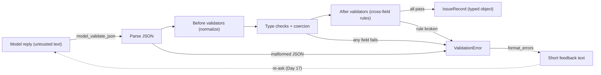
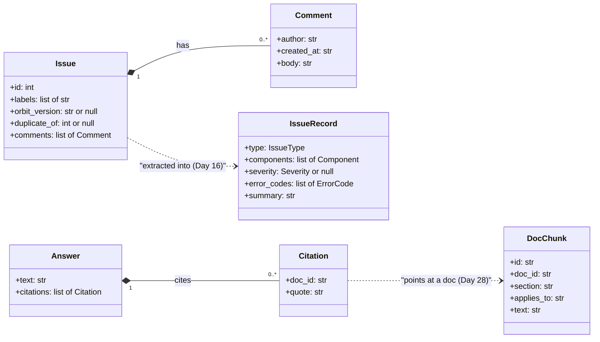
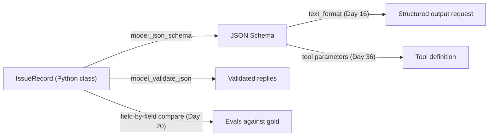

# Pydantic for LLM Apps

The model replied `{"severity": "high", "error_codes": "ORB-1101, orb-1102"}`, and your dashboard crashed three functions later. Nothing failed at the point where the bad data came in; it failed far away, where it was hard to debug. Model output is untrusted input, exactly like a webhook payload from a partner you don't control. Today you learn Pydantic, the library that turns "looks like JSON" into typed, validated Python objects, or into a precise error that says which field was wrong and why.

## At a Glance

- **Time:** ~2 h core (+ optional Go Deeper) · **Depth:** working
- **Prerequisites:** [Day 12: The OpenAI SDK in Production Code](../../Phase_2_Building_with_LLM_APIs/Day_012_openai_sdk_production/openai_sdk_production.md), primer [A3: Python for This Course](../../Appendix_Primers/A03_python_for_this_course.md) (type hints, decorators)
- **You'll build:** `atlas/schemas.py`, the Atlas schema library (`Issue`, `IssueRecord`, `Citation`, `Answer`, `DocChunk`, `format_errors()`), plus `load_issues()` and a self-check that validates all 30 gold records and rejects 6 crafted bad ones
- **Stops at:** custom core schemas (pydantic-core internals); no API calls today
- **Fast path:** Already know Pydantic v2? Read [LLM-Specific Pydantic](#llm-specific-pydantic-what-the-model-sees) and do Exercise 3 (≈20 min)
- **Cost:** $0 (no API calls; [Day 16](../../Phase_2_Building_with_LLM_APIs/Day_016_structured_outputs/structured_outputs.md) sends these schemas to the model)
- **New terms:** model (Pydantic), validator, coercion, JSON Schema, `ValidationError`

> **Coming from Software Engineering?** Pydantic is roughly "TypeScript types, but enforced at runtime": you declare a shape once, and every payload that crosses the boundary is validated, coerced or rejected. It's the same validate–coerce–reject discipline you apply to request bodies at an API edge, now applied to model output. `model_json_schema()` is an OpenAPI spec for a single object, and Day 16 hands that spec to the model so it knows the contract. If you've used `zod`, `marshmallow` or Java's Bean Validation, this transfers directly; the LLM-specific twist is only in how optional fields work.

## Valid JSON, Wrong Data

`json.loads` answers one question: is this text well-formed JSON? It says nothing about whether the values make sense. The reply above parses fine, and then poisons everything downstream.

Think of a paper form at a government office. It has fixed boxes ("Severity: tick S1, S2, S3 or S4"), and some boxes say "leave blank if unknown". A clerk checks the form at the counter. Anything that doesn't fit is handed back with a sticky note: "box 3: 'high' is not one of the options". The clerk never lets a bad form into the filing cabinet, because fixing it later costs far more. Pydantic is that clerk.

Before using the library, do the clerk's job by hand on four fields:

| Field | Rule | Value in the reply | Verdict |
|---|---|---|---|
| `type` | one of bug, feature, question, docs | `"bug"` | fine |
| `severity` | S1–S4, or null | `"high"` | wrong vocabulary |
| `orbit_version` | a version like `3.1.0`, or null | `"v3.1.0"` | fixable: strip the `v` |
| `error_codes` | a **list** of `ORB-NNNN` codes | `"ORB-1101, orb-1102"` | wrong type, wrong case |

Here is the same check as code, plus the silent bug it prevents:

```python
# script_id: day_015_pydantic_for_llms/by_hand
# Python 3.11+, stdlib only. No env vars or services. Shows the bug Pydantic prevents.
import json

reply = '{"type": "bug", "severity": "high", "orbit_version": "v3.1.0", "error_codes": "ORB-1101, orb-1102"}'
data = json.loads(reply)                      # no exception: this IS valid JSON
print("parsed OK:", sorted(data))

# Three functions later, the dashboard counts codes. A str is iterable, so no crash, only nonsense.
print("codes seen:", [c for c in data["error_codes"]][:6])

# The checks you'd write by hand, one if-statement per rule.
problems = []
if data["type"] not in {"bug", "feature", "question", "docs"}:
    problems.append(f"type: {data['type']!r} is not an issue type")
if data["severity"] not in {"S1", "S2", "S3", "S4", None}:
    problems.append(f"severity: {data['severity']!r} is not S1-S4")
if not isinstance(data["error_codes"], list):
    problems.append("error_codes: expected a list, got a string")
if str(data["orbit_version"]).startswith("v"):
    problems.append("orbit_version: has a 'v' prefix")
print(problems)
```

Output:

```text
parsed OK: ['error_codes', 'orbit_version', 'severity', 'type']
codes seen: ['O', 'R', 'B', '-', '1', '1']
["severity: 'high' is not S1-S4", 'error_codes: expected a list, got a string', "orbit_version: has a 'v' prefix"]
```

The middle line is the real danger: iterating a string gives characters, so a dashboard would count "O", "R", "B" as error codes and nobody would notice for weeks. The hand-written checks work, but they grow one `if` per rule, they don't compose for nested objects, and they don't tell the model what shape you wanted in the first place. Pydantic fixes all three.

## The Parts of a Pydantic Model

A **model (Pydantic)** is a Python class that inherits from `BaseModel`. Its type-annotated attributes are the form's boxes. When you call `Model.model_validate_json(text)`, Pydantic parses the JSON, checks every field against its annotation and either returns an instance or raises one **`ValidationError`** (an exception that lists every failing field at once, not only the first).

| Part | What it does | Example |
|---|---|---|
| `BaseModel` | The base class; annotations become fields | `class IssueRecord(BaseModel): ...` |
| `Literal[...]` | A closed set of allowed values | `Literal["S1", "S2", "S3", "S4"]` |
| `X \| None` | The value may be null ("not stated") | `orbit_version: str \| None` |
| `list[X]` | A JSON array whose items are each validated as `X` | `list[str]` |
| `Field(...)` | Per-field extras: description, constraints, default factory | `Field(min_length=1, description="...")` |
| **validator** | Your own function that checks or rewrites a value | `@field_validator("error_codes", mode="before")` |
| `model_config` | Class-wide settings, such as rejecting unknown keys | `ConfigDict(extra="forbid")` |
| **JSON Schema** | A standard JSON format that describes JSON; Pydantic generates it from the class | `IssueRecord.model_json_schema()` |

By default Pydantic applies **coercion** (turning a compatible value into the declared type automatically, such as `"37"` into `37`). That's convenient for human input and risky for model output, as you'll see in a minute.

Validation is a pipeline. Every reply flows through the same stages, and any stage can stop it:



## A Minimal Model

Install Pydantic v2 (this course pins 2.14) with `uv add pydantic`. Here is a four-field preview of `IssueRecord`, run on one good and one bad reply:

```python
# script_id: day_015_pydantic_for_llms/minimal
# Install: uv add pydantic   (Pydantic v2). No env vars, no services, no API key.
from typing import Literal

from pydantic import BaseModel, ValidationError


class IssueRecord(BaseModel):          # a 4-field preview; the full model comes later today
    type: Literal["bug", "feature", "question", "docs"]
    severity: Literal["S1", "S2", "S3", "S4"] | None
    orbit_version: str | None
    error_codes: list[str]


good = '{"type": "bug", "severity": "S3", "orbit_version": "3.1.2", "error_codes": ["ORB-1101"]}'
bad = '{"type": "bug", "severity": "high", "orbit_version": "v3.1.0", "error_codes": "ORB-1101, orb-1102"}'
print(IssueRecord.model_validate_json(good))
try:
    IssueRecord.model_validate_json(bad)
except ValidationError as err:
    print(err)
```

Output:

```text
type='bug' severity='S3' orbit_version='3.1.2' error_codes=['ORB-1101']
2 validation errors for IssueRecord
severity
  Input should be 'S1', 'S2', 'S3' or 'S4' [type=literal_error, input_value='high', input_type=str]
    For further information visit https://errors.pydantic.dev/2.14/v/literal_error
error_codes
  Input should be a valid array [type=list_type, input_value='ORB-1101, orb-1102', input_type=str]
    For further information visit https://errors.pydantic.dev/2.14/v/list_type
```

Read the error closely, because you'll see this format all week. Each block names the field (`severity`), a human message, a machine-readable `type` (`literal_error`), and the offending input. Notice also what was *not* caught: `"v3.1.0"` is a perfectly valid `str`. Types catch wrong shapes; formats and normalization need validators, which come shortly.

## Turn the Knobs: Coercion, Extra Keys, Missing Fields

Three settings decide how forgiving a model is. Change one at a time and watch the error text:

```python
# script_id: day_015_pydantic_for_llms/knobs
# Install: uv add pydantic. Three knobs: coercion, extra keys, missing fields.
from pydantic import BaseModel, ConfigDict, ValidationError


class Lax(BaseModel):                  # defaults: coerce compatible types, ignore unknown keys
    duplicate_of: int | None
    orbit_version: str | None


class Strict(Lax):                     # same fields, stricter contract
    model_config = ConfigDict(strict=True, extra="forbid")


payload = {"duplicate_of": "37", "orbit_version": "3.1.2", "priority": "high"}
print(Lax.model_validate(payload))     # "37" -> 37, and "priority" silently dropped

for p in (payload, {"duplicate_of": 37}):
    try:
        Strict.model_validate(p)
    except ValidationError as err:
        print(err)
```

Output:

```text
duplicate_of=37 orbit_version='3.1.2'
2 validation errors for Strict
duplicate_of
  Input should be a valid integer [type=int_type, input_value='37', input_type=str]
    For further information visit https://errors.pydantic.dev/2.14/v/int_type
priority
  Extra inputs are not permitted [type=extra_forbidden, input_value='high', input_type=str]
    For further information visit https://errors.pydantic.dev/2.14/v/extra_forbidden
1 validation error for Strict
orbit_version
  Field required [type=missing, input_value={'duplicate_of': 37}, input_type=dict]
    For further information visit https://errors.pydantic.dev/2.14/v/missing
```

What each knob means for LLM output:

- **Coercion (lax vs strict).** Lax mode turned `"37"` into `37`. For an issue number that's harmless. For a field like `is_duplicate: bool`, lax mode also accepts `"yes"` and `"false"`, which can hide a model that doesn't understand the field. You can make the whole model strict with `ConfigDict(strict=True)`, one call strict with `model_validate(data, strict=True)`, or one field strict with `Field(strict=True)`.
- **Extra keys.** The default `extra="ignore"` drops `priority` without a word. `extra="forbid"` turns an invented key into an error. For a contract the model must follow, forbid; for loosely structured data you only partly need, ignore and log what you dropped.
- **Missing fields.** `orbit_version: str | None` means "may be null", **not** "may be absent". The key must be present. That distinction is the single most important LLM-specific rule today, and it comes back in the LLM-specific section below.

## Build: The Atlas Schema Library

Now the real thing. `atlas/schemas.py` is one module that every later day imports: the extractor (Day 16), the re-ask loop (Day 17), the tests (Day 19), the evals (Day 20) and the RAG pipeline (Day 28). One module means one definition of "an issue record", so a change shows up everywhere at once. Save the five `schemas` blocks below as one file, `schemas.py`; the other scripts today import from it.

Here is the library you are about to write:



The first block holds the closed vocabularies and the raw `Issue`. The 13 components come straight from the dataset README; `Issue` has one field per key in `issues/issues.jsonl`.

```python
# script_id: day_015_pydantic_for_llms/schemas
# atlas/schemas.py (+ load_issues for atlas/data.py): the Atlas schema library.
# Install: uv add pydantic   (Pydantic v2; this course pins 2.14)
# Env: ORBIT_DATA (optional, path to datasets/orbit). No API key, no services.
import json
import os
from pathlib import Path
from typing import Annotated, Literal

from pydantic import BaseModel, ConfigDict, Field, ValidationError, field_validator, model_validator

DATA_DIR = Path(os.environ.get("ORBIT_DATA", "datasets/orbit"))   # atlas/config.py (Day 2)

# Closed vocabularies. A Literal is a set of allowed strings that also lands in the schema as "enum".
IssueType = Literal["bug", "feature", "question", "docs"]
Severity = Literal["S1", "S2", "S3", "S4"]
Component = Literal["core", "scheduler", "flows", "broker-redis", "broker-postgres", "broker-sqs",
                    "cli", "dashboard", "retries", "results", "observability", "auth", "docs"]


class Comment(BaseModel):
    author: str
    created_at: str
    body: str


class Issue(BaseModel):
    """One raw row of issues/issues.jsonl. Labels and version fields are ground truth."""
    id: int
    title: str
    body: str
    author: str
    created_at: str
    state: Literal["open", "closed"]
    labels: list[str]
    orbit_version: str | None
    python_version: str | None
    error_codes: list[str]
    duplicate_of: int | None
    comments: list[Comment] = Field(default_factory=list)   # a fresh list per instance
    closed_at: str | None
```

Two details are worth a pause. `comments: list[Comment]` is nesting: Pydantic validates every comment dict as a `Comment`, and an error in comment 2 is reported at `comments.2.body`. And `Field(default_factory=list)` gives each instance its own empty list when the key is absent. `Issue` is data you load, not data a model writes, so a default is fine here. You'll see shortly why `IssueRecord` has none.

The loader lives next to [Day 10](../../Phase_2_Building_with_LLM_APIs/Day_010_few_shot_prompting/few_shot_prompting.md)'s `load_jsonl()` in `atlas/data.py`. It's copied here so the file runs on its own:

```python
# script_id: day_015_pydantic_for_llms/schemas
def load_jsonl(path: Path) -> list[dict]:
    """One JSON object per line (Day 10). Lives in atlas/data.py."""
    with path.open(encoding="utf-8") as f:
        return [json.loads(line) for line in f if line.strip()]


def load_issues(path: Path | None = None) -> list[Issue]:
    """Every row of issues.jsonl as a typed Issue. Raises ValidationError on the first bad row."""
    rows = load_jsonl(path or DATA_DIR / "issues" / "issues.jsonl")
    return [Issue.model_validate(row) for row in rows]
```

The third block defines three small models you won't use until Phase 3. They're here now so the module map stays stable: [Day 25](../../Phase_3_RAG/Day_025_chunking/chunking.md) fills `DocChunk` with real chunks, and [Day 28](../../Phase_3_RAG/Day_028_rag_pipeline/rag_pipeline.md) makes the model answer with an `Answer` that cites `doc_id`s.

```python
# script_id: day_015_pydantic_for_llms/schemas
# Small on purpose: Day 25 fills DocChunk, Day 28 fills Answer and Citation.
class Citation(BaseModel):
    doc_id: str = Field(description="Doc id from the docs front matter, e.g. leases-and-heartbeats")
    quote: str = Field(description="A short passage copied word for word from that doc")


class Answer(BaseModel):
    text: str = Field(description="The answer, in plain English")
    citations: list[Citation] = Field(description="One entry per doc the answer relies on")


class DocChunk(BaseModel):
    id: str                                   # e.g. "leases-and-heartbeats#3"
    doc_id: str
    section: str
    applies_to: Literal["2.x", "3.x", "all"]
    text: str
```

## Normalizers: Fix What's Fixable, Reject the Rest

`IssueRecord` is what Atlas extracts from an issue. Its seven fields match `eval/extraction_gold.jsonl` exactly, because [Day 20](../../Phase_2_Building_with_LLM_APIs/Day_020_first_eval_set/first_eval_set.md) compares extractions to gold field by field. A rename here would silently break that comparison.

Models make two kinds of mistakes. Some are cosmetic: `orb-1101` instead of `ORB-1101`, `v3.1.2` instead of `3.1.2`, a comma-joined string instead of a list. Rejecting those wastes a retry, so you normalize them. Others are real: `"high"` isn't a severity, and a question can't have one. Those must fail. A validator draws that line:

- `@field_validator("x", mode="before")` runs on the **raw** value, before type checks. Use it to normalize.
- `@model_validator(mode="after")` runs on the finished instance, after every field passed. Use it only for rules that span fields.

```python
# script_id: day_015_pydantic_for_llms/schemas
ErrorCode = Annotated[str, Field(pattern=r"^ORB-\d{4}$")]     # Annotated = a type plus extra rules, reusable


class IssueRecord(BaseModel):
    """The facts Atlas extracts from one issue. Fields mirror eval/extraction_gold.jsonl."""
    model_config = ConfigDict(extra="forbid")       # an invented key is an error, not noise

    type: IssueType = Field(description="bug, feature, question or docs")
    components: list[Component] = Field(min_length=1, description="Every Orbit component the issue is about")
    severity: Severity | None = Field(description="Bugs only: S1 outage or data loss, S2 major "
                                      "breakage, S3 has a workaround, S4 cosmetic. null otherwise")
    orbit_version: str | None = Field(description="Full Orbit version, e.g. 3.1.2. null when not stated")
    python_version: str | None = Field(description="Python version as written, e.g. 3.12.6. "
                                       "null when not stated")
    error_codes: list[ErrorCode] = Field(description="ORB-NNNN codes quoted in the issue or its comments")
    summary: str = Field(description="One or two English sentences: symptom, trigger, version")

    @field_validator("error_codes", mode="before")
    @classmethod
    def normalize_codes(cls, v: object) -> object:
        if isinstance(v, str):                       # "ORB-1101, orb-1102" -> two items
            v = v.replace(",", " ").split()
        if isinstance(v, list):                      # uppercase, trim, dedupe, keep order
            v = list(dict.fromkeys(str(c).strip().upper() for c in v))
        return v                                     # forget this line and the field becomes None

    @field_validator("orbit_version", mode="before")
    @classmethod
    def strip_v_prefix(cls, v: object) -> object:
        return v.strip().lstrip("vV") if isinstance(v, str) else v    # "v3.1.0" -> "3.1.0"

    @model_validator(mode="after")
    def severity_only_on_bugs(self) -> "IssueRecord":
        if self.type != "bug" and self.severity is not None:          # a rule across two fields
            raise ValueError(f"severity must be null for a {self.type}")
        return self
```

Notes on the choices:

- `@field_validator` needs `@classmethod` under it, and the `before` validators accept `object` because the raw value can be anything the model sent. They return non-strings unchanged and let the type check reject them.
- The pattern lives on `ErrorCode`, not inside the validator, so it also appears in the JSON Schema the model sees. Normalization runs first, so `orb-1101` is uppercased before the pattern check.
- `severity_only_on_bugs` enforces the dataset's labeling rule (severity on bugs only). It checks one direction only; requiring severity on every bug is a judgment you could add later.

Run a messy but recoverable reply through it:

```python
# script_id: day_015_pydantic_for_llms/normalize_demo
# Messy but recoverable model output -> clean IssueRecord. Imports schemas.py from this lesson.
from schemas import IssueRecord

reply = """{"type": "bug", "components": ["core"], "severity": "S3",
  "orbit_version": "v3.1.2", "python_version": "3.12.6",
  "error_codes": "orb-1101, ORB-1101 ", "summary": "Nightly export runs twice after ORB-1101."}"""
record = IssueRecord.model_validate_json(reply)
print(record.orbit_version, record.error_codes)
print(record.model_dump(include={"type", "severity", "components"}))
```

Output:

```text
3.1.2 ['ORB-1101']
{'type': 'bug', 'components': ['core'], 'severity': 'S3'}
```

`model_dump()` turns the instance back into a plain dict (the v2 name for v1's `.dict()`); `include=` picks fields.

## LLM-Specific Pydantic: What the Model Sees

This is the fast-path section. Everything above is ordinary Pydantic; three habits make it work well with models.

**1. Descriptions are prompt text.** `Field(description=...)` is copied into the JSON Schema. On Day 16 the SDK sends that schema with the request, so each description is a tiny instruction attached to exactly one field. "Bugs only: S1 outage or data loss, S2 major breakage…" teaches the model the severity scale right where it decides the value. Write descriptions for the model, not for a code reviewer.

**2. Nullable, not optional.** OpenAI's structured outputs in strict mode send **every** property as required, and the SDK builds the schema that way no matter what defaults you wrote (as of 2026-11, [verify](https://developers.openai.com/api/docs/guides/structured-outputs)). So "the issue doesn't say" can't be expressed by leaving a key out. It must be an explicit `null`, which means `str | None` with **no default**. A default doesn't help the model and does change what your own validator accepts: a reply that drops `orbit_version` would quietly pass instead of failing.

**3. One source of truth.** The class generates the schema, validates replies, and defines what evals compare:



Look at the schema Pydantic generates, and at what a default does to it:

```python
# script_id: day_015_pydantic_for_llms/schema_json
# What the model will see on Day 16: the JSON Schema Pydantic generates. Imports schemas.py.
import json

from pydantic import BaseModel

from schemas import IssueRecord

schema = IssueRecord.model_json_schema()
print("required:", schema["required"])
print("additionalProperties:", schema["additionalProperties"])
print("severity:", json.dumps(schema["properties"]["severity"]))
print("error_codes.items:", json.dumps(schema["properties"]["error_codes"]["items"]))


class WithDefault(BaseModel):          # the trap: a Python default makes the key optional here
    orbit_version: str | None = None

print("with a default, required =", WithDefault.model_json_schema().get("required", []))
```

Output:

```text
required: ['type', 'components', 'severity', 'orbit_version', 'python_version', 'error_codes', 'summary']
additionalProperties: False
severity: {"anyOf": [{"enum": ["S1", "S2", "S3", "S4"], "type": "string"}, {"type": "null"}], "description": "Bugs only: S1 outage or data loss, S2 major breakage, S3 has a workaround, S4 cosmetic. null otherwise", "title": "Severity"}
error_codes.items: {"pattern": "^ORB-\\d{4}$", "type": "string"}
with a default, required = []
```

Every field of `IssueRecord` is required, `extra="forbid"` became `additionalProperties: false`, the `Literal` became an `enum`, `| None` became `anyOf … null`, and the pattern traveled with the item type. That's already the shape strict mode wants, so the schema the model gets and the validator you run agree.

The last piece is turning a failure into something a model can act on. Printing `str(err)` works for humans but includes URLs and Python reprs. `format_errors()` gives one short line per problem, built from `err.errors()`, the structured list behind the message (each entry has `type`, `loc`, `msg` and `input`). It closes the schema module, along with a `__main__` check that loads everything:

```python
# script_id: day_015_pydantic_for_llms/schemas
def format_errors(err: ValidationError, max_input: int = 60) -> str:
    """One line per problem, phrased so a model can fix it. Day 17 sends this back as a re-ask."""
    lines = []
    for e in err.errors(include_url=False):
        where = ".".join(str(part) for part in e["loc"]) or "(whole object)"
        got = "" if e["type"] == "missing" else f" (got {repr(e['input'])[:max_input]})"
        lines.append(f"- {where}: {e['msg']}{got}")
    return "\n".join(lines)


if __name__ == "__main__":
    issues = load_issues()
    gold = load_jsonl(DATA_DIR / "eval" / "extraction_gold.jsonl")
    records = [IssueRecord.model_validate({k: v for k, v in g.items() if k != "issue_id"}) for g in gold]
    print(f"loaded {len(issues)} issues · {len(records)} gold records · 0 errors")
    print(issues[0].id, issues[0].state, issues[0].labels[:3], len(issues[0].comments), "comments")
```

Run `python schemas.py` (with `ORBIT_DATA` pointing at `datasets/orbit` if you run it from elsewhere):

```text
loaded 240 issues · 30 gold records · 0 errors
1 closed ['type:bug', 'comp:cli', 'severity:S3'] 3 comments
```

The gold rows carry an `issue_id` key that isn't part of `IssueRecord`, so the loader strips it; with `extra="forbid"` it would otherwise be rejected. Now feed `format_errors()` a reply that can't be rescued:

```python
# script_id: day_015_pydantic_for_llms/feedback
# Unrecoverable output -> a short feedback string for a re-ask (Day 17). Imports schemas.py.
from pydantic import ValidationError

from schemas import IssueRecord, format_errors

reply = """{"type": "question", "components": ["redis"], "severity": "high",
  "orbit_version": "3.1.0", "error_codes": ["ORB-11O1"], "summary": "Jobs stuck.", "priority": "P1"}"""
try:
    IssueRecord.model_validate_json(reply)
except ValidationError as err:
    print(f"{err.error_count()} problems")
    print(format_errors(err))
```

Output:

```text
5 problems
- components.0: Input should be 'core', 'scheduler', 'flows', 'broker-redis', 'broker-postgres', 'broker-sqs', 'cli', 'dashboard', 'retries', 'results', 'observability', 'auth' or 'docs' (got 'redis')
- severity: Input should be 'S1', 'S2', 'S3' or 'S4' (got 'high')
- python_version: Field required
- error_codes.0: String should match pattern '^ORB-\d{4}$' (got 'ORB-11O1')
- priority: Extra inputs are not permitted (got 'P1')
```

Five problems, each with a location (`components.0` is the first list item) and the allowed values. Notice what's missing: the "severity on a question" rule never ran. An `after` model validator runs only when every field is valid, so fixing these five could reveal a sixth. That's one reason Day 17's re-ask loop is bounded.

## Validation Tests: Prove the Schema Accepts and Rejects

A schema is code, so test it in both directions: every gold row must pass, and each crafted bad row must fail **for the reason you expect**. Checking the error `type` matters; a test that only asserts "it raised" would still pass if a typo in your fixture broke a different field. This is a plain-`assert` version; [Day 19](../../Phase_2_Building_with_LLM_APIs/Day_019_testing_llm_code/testing_llm_code.md) turns it into pytest.

```python
# script_id: day_015_pydantic_for_llms/self_check
# Gold rows must pass; crafted bad rows must fail for the RIGHT reason. pytest version: Day 19.
# Env: ORBIT_DATA. Imports schemas.py from this lesson.
from pydantic import ValidationError

from schemas import DATA_DIR, IssueRecord, load_jsonl

gold = [{k: v for k, v in row.items() if k != "issue_id"}
        for row in load_jsonl(DATA_DIR / "eval" / "extraction_gold.jsonl")]
valid = sum(1 for row in gold if IssueRecord.model_validate(row))   # raises on the first bad row

base = gold[1]                                                      # issue 25, a question
BAD = [  # (payload, the error type it must cause)
    (base | {"severity": "high"}, "literal_error"),
    (base | {"components": []}, "too_short"),
    (base | {"error_codes": ["ORB-11O1"]}, "string_pattern_mismatch"),   # letter O, not zero
    (base | {"priority": "P1"}, "extra_forbidden"),
    (base | {"severity": "S2"}, "value_error"),                         # severity on a question
    ({k: v for k, v in base.items() if k != "orbit_version"}, "missing"),
]
rejected = 0
for payload, expected in BAD:
    try:
        IssueRecord.model_validate(payload)
    except ValidationError as err:
        got = err.errors()[0]["type"]
        assert got == expected, f"expected {expected}, got {got} for {payload}"
        rejected += 1
print(f"{valid}/{len(gold)} gold valid · {rejected}/{len(BAD)} bad rejected")
```

Output (this is the first line of the R1 scoreboard):

```text
30/30 gold valid · 6/6 bad rejected
```

If a bad payload unexpectedly passes, `rejected` comes up short and you know the schema is looser than you thought.

## Trade-offs: How Strict Should a Schema Be?

| Situation | Choose | Why |
|---|---|---|
| Model output you act on (labels, routing, DB writes) | `extra="forbid"`, `Literal`s, patterns | An invented key or value is a bug signal; surface it |
| Cosmetic variation (case, `v` prefix, comma lists) | `before` validator | A retry costs money and latency for no information |
| Numbers or booleans where a wrong guess matters | `strict=True` on that field | Stops `"yes"` from becoming `True` unnoticed |
| Data you only partly need (third-party payloads) | `extra="ignore"` and log drops | Their schema changes shouldn't break you |
| Facts that need the source text ("is ORB-1101 really in the issue?") | Not Pydantic; [Day 17](../../Phase_2_Building_with_LLM_APIs/Day_017_semantic_failures/semantic_failures.md) | A validator can't see the issue text |

The main risk of normalizers is that coercion can hide model mistakes. If a normalizer rewrites half the replies, the prompt or descriptions are wrong, and you'd rather know. Count how often each normalizer changes a value (log before and after) and treat a rising rate as a signal.

When not to use a full schema: free-form prose answers, where a plain `str` is the whole contract, and one-off scripts you'll throw away. Validation pays off when other code consumes the output.

### In production

- Keep one schema module shared by the extractor, evals and storage; never redefine `IssueRecord` locally.
- Version schemas like APIs: adding a nullable field is backward compatible; renaming or tightening a field is a breaking change that needs a migration and an eval run.
- Log the `err.errors()` list (not `str(err)`) so you can count failures by `type` and `loc`.
- Track normalizer hit rates; a sudden jump usually means a model or prompt change.
- Pin the Pydantic major version; error text and schema output are part of your contract with tests.

## Go Deeper (optional)

<details><summary>Go deeper: the order validators run in</summary>

Pydantic validates fields in definition order. For one field, the stages are: `mode="before"` validators (raw input), then the core type check with coercion, then `mode="after"` field validators (the typed value). There's also `mode="wrap"`, which receives the raw value plus a `handler` that runs the inner validation; it lets you catch an error and substitute a value, which is rarely what you want for model output because it hides the failure.

Model validators wrap the whole thing. `@model_validator(mode="before")` sees the raw dict (useful to rename a key the model keeps inventing, though fixing the description is usually better). `@model_validator(mode="after")` runs only if every field passed, which is why the feedback example didn't report the severity-on-a-question rule.

Two practical consequences. First, put normalization in `before` validators, so the type and pattern checks run on the cleaned value. Second, keep `after` validators cheap and side-effect free: they run on every validation, including when you load gold data and fixtures.

</details>

<details><summary>Go deeper: validate a whole file at once with TypeAdapter</summary>

`TypeAdapter` validates any type, not only `BaseModel` subclasses: a `list[IssueRecord]`, a `dict[int, IssueRecord]`, or a bare `Literal`. Validating a list in one call gives you every bad row, with its index in `loc`, instead of stopping at the first.

```python
# script_id: day_015_pydantic_for_llms/type_adapter
# Validate a whole list in one call; errors carry the row index. Imports schemas.py.
from pydantic import TypeAdapter, ValidationError

from schemas import DATA_DIR, IssueRecord, load_jsonl

rows = [{k: v for k, v in r.items() if k != "issue_id"}
        for r in load_jsonl(DATA_DIR / "eval" / "extraction_gold.jsonl")]
records = TypeAdapter(list[IssueRecord])
print(len(records.validate_python(rows)), "records valid")

rows[3]["severity"] = "urgent"
rows[7]["components"] = []
try:
    records.validate_python(rows)
except ValidationError as err:
    for e in err.errors(include_url=False):
        print(e["loc"], e["type"])
```

Output:

```text
30 records valid
(3, 'severity') literal_error
(7, 'components') too_short
```

Create the adapter once at module level and reuse it; building one compiles a validator, which costs far more than running it.

</details>

<details><summary>Go deeper: tagged unions for "one of several actions"</summary>

Sometimes the model must choose between differently shaped outputs: add labels, close as a duplicate, or reply. A **discriminated union** uses a `Literal` tag field so Pydantic checks only the matching shape and reports errors against it, instead of listing failures for every alternative.

```python
# script_id: day_015_pydantic_for_llms/tagged_union
# One of several action shapes, chosen by the "action" tag. Install: uv add pydantic.
from typing import Literal

from pydantic import BaseModel, Field, ValidationError


class AddLabels(BaseModel):
    action: Literal["label"]
    labels: list[str]


class CloseDuplicate(BaseModel):
    action: Literal["close_duplicate"]
    duplicate_of: int


class Reply(BaseModel):
    action: Literal["reply"]
    text: str


class TriageStep(BaseModel):
    step: AddLabels | CloseDuplicate | Reply = Field(discriminator="action")


ok = TriageStep.model_validate_json('{"step": {"action": "close_duplicate", "duplicate_of": 37}}')
print(type(ok.step).__name__, ok.step.duplicate_of)
try:
    TriageStep.model_validate_json('{"step": {"action": "close_duplicate"}}')
except ValidationError as err:
    print([(e["loc"], e["type"]) for e in err.errors()])
```

Output:

```text
CloseDuplicate 37
[(('step', 'close_duplicate', 'duplicate_of'), 'missing')]
```

The error names the branch (`close_duplicate`) and the one missing field. Keep the union nested inside an object as shown, because strict structured outputs require an object at the root. Pydantic emits a tagged union as `oneOf` with a `discriminator` mapping; ⚠ verify against current OpenAI docs that strict mode accepts that form before sending it, or use a plain union (emitted as `anyOf`) with the same `Literal` tags.

</details>

<details><summary>Go deeper: serializing records and evolving a schema</summary>

Going out is the mirror of coming in. `record.model_dump()` gives Python objects; `record.model_dump(mode="json")` gives only JSON-safe types (useful once you add `datetime` fields); `record.model_dump_json()` gives a string ready for a JSONL file or a database column. `exclude_none=True` drops null fields, which saves space but loses the "explicitly not stated" signal; keep nulls in anything an eval reads.

Schemas outlive prompts, so plan for change:

| Change | Compatible with stored records? | What to do |
|---|---|---|
| Add a nullable field | Old records lack the key; with no default they fail | Load old rows through a `before` model validator that fills `None`, or add a default on a separate storage model |
| Add a `Literal` value | Yes | Update descriptions and re-run evals |
| Remove or rename a field | No | New schema version, migrate stored rows, re-run evals |
| Tighten a constraint | Maybe | Re-validate gold and stored rows first; count failures |

A common pattern is a separate storage model with `schema_version: int` and defaults, kept apart from the LLM-facing model that has none. The LLM sees the strict contract; your database tolerates history.

</details>

## Common Pitfalls

- **v1 syntax from old tutorials.** `@validator`, `.dict()`, `.parse_raw()` and `class Config:` come from Pydantic v1; in v2 they raise deprecation warnings or errors. Fix: `@field_validator` with `@classmethod` under it, `model_dump()`, `model_validate_json()`, `model_config = ConfigDict(...)`.
- **`Input should be 'S1', 'S2', 'S3' or 'S4' [type=literal_error, input_value='high', …]`.** The model used words instead of the vocabulary. Fix the field description (and later the prompt); don't widen the `Literal` to accept "high", or every consumer now has to handle two vocabularies.
- **`Extra inputs are not permitted [type=extra_forbidden]`.** The model added a key. Decide per model: forbid it (a contract the model must follow) or ignore it (and log the dropped keys). Don't flip to `ignore` only to make the error go away.
- **A validator that forgets `return v`.** Python returns `None` from a function without `return`, so the field silently becomes `None` (or fails with a confusing type error if the field isn't nullable). Fix: every validator path ends with `return`.
- **`datetime.now()` (or `[]`) as a default.** A bare `created_at: datetime = datetime.now()` is evaluated once, at import, so every instance shares one timestamp. Fix: `Field(default_factory=datetime.now)`, which runs per instance; same for lists with `default_factory=list`.
- **A default on an LLM-facing field.** `orbit_version: str | None = None` lets a reply that omits the key pass your validator, while the API's strict schema still requires it. Fix: nullable with no default, as in `IssueRecord`.

> **Where we stop:** we don't write custom core schemas (`__get_pydantic_core_schema__`) or touch pydantic-core internals, because typed fields, `Field` constraints and validators cover what LLM apps need; the curious can start at the [Pydantic JSON Schema docs](https://pydantic.dev/docs/validation/latest/concepts/json_schema/).

## Key Takeaways

- Valid JSON isn't valid data: `json.loads` accepts `"error_codes": "ORB-1101, orb-1102"`, and the bug surfaces far downstream. Validate model output at the boundary, like any untrusted payload.
- A Pydantic model declares the contract once with `Literal`, `X | None`, `list[X]` and `Field`; `model_validate_json` returns a typed object or one `ValidationError` listing every bad field with `loc`, `type`, `msg` and `input`.
- Choose the knobs on purpose: lax coercion and `extra="ignore"` are defaults; `strict=True` and `extra="forbid"` turn silent fixes into visible errors for data you act on.
- `before` field validators normalize cosmetic variation (case, prefixes, comma strings); `after` model validators enforce cross-field rules and only run once every field is valid.
- For LLM schemas, descriptions are prompt text, "not stated" is `X | None` with no default (strict outputs require every key), and one class feeds the schema, the validator, the evals and `format_errors()` feedback for re-asks.

## Quick Reference

| API / pattern | When to use | Gotcha |
|---|---|---|
| `Model.model_validate_json(text)` | Validate a model reply (a JSON string) | Raises `ValidationError`, never returns partial data |
| `Model.model_validate(dict)` | Validate already-parsed data (gold rows, fixtures) | Add `strict=True` for one strict call |
| `err.errors(include_url=False)` | Structured list of problems for logs or feedback | `loc` is a tuple; join it for display |
| `Literal["a", "b"]` | Closed vocabularies (type, severity, component) | Becomes `enum` in the schema |
| `X \| None` (no default) | "May be not stated" in LLM output | Nullable is not optional: the key must be present |
| `Field(description=..., min_length=..., pattern=...)` | Constraints and model-facing hints | Descriptions are sent to the model on Day 16 |
| `Field(default_factory=list)` | Defaults on data you load, not data a model writes | Never `= []` or `= datetime.now()` |
| `@field_validator("f", mode="before")` + `@classmethod` | Normalize raw values | Must `return` the value |
| `@model_validator(mode="after")` | Rules across fields | Skipped when any field failed |
| `ConfigDict(extra="forbid", strict=True)` | Contracts the model must follow | `extra="forbid"` emits `additionalProperties: false` |
| `Model.model_json_schema()` | See or export the contract | Defaults remove keys from `required` |
| `model_dump()` / `model_dump_json()` | Serialize back out | v1's `.dict()` / `.json()` are deprecated |

## Exercises

1. **Warm-up.** Add `title_suggestion: str | None` to the record, with a description written for the model, and print its schema entry. Check that it's in `required`.

<details><summary>Solution</summary>

```python
# script_id: day_015_pydantic_for_llms/solution_ex1
# Subclassing keeps the config and validators; in your project, edit schemas.py directly.
import json

from pydantic import Field

from schemas import IssueRecord


class IssueRecordV2(IssueRecord):
    title_suggestion: str | None = Field(
        description="A clearer one-line title if the current one is vague, else null")


schema = IssueRecordV2.model_json_schema()
print(json.dumps(schema["properties"]["title_suggestion"]))
print("required:", "title_suggestion" in schema["required"])
```

```text
{"anyOf": [{"type": "string"}, {"type": "null"}], "description": "A clearer one-line title if the current one is vague, else null", "title": "Title Suggestion"}
required: True
```

No default, so the key stays required: the model must answer it, with `null` when the title is fine.

</details>

2. **Core.** Models write Python versions as `py3.12`, `Python 3.12.1` or ` 3.11 `. Add a `before` validator that strips the prefix and whitespace, keeping the number as written (`3.12`, `3.12.1`, `3.11`), so it still matches the gold convention "as written".

<details><summary>Solution</summary>

```python
# script_id: day_015_pydantic_for_llms/solution_ex2
import re

from pydantic import field_validator

from schemas import IssueRecord


class IssueRecordPy(IssueRecord):
    @field_validator("python_version", mode="before")
    @classmethod
    def strip_python_prefix(cls, v: object) -> object:
        if isinstance(v, str):
            v = re.sub(r"^(python|py)\s*", "", v.strip(), flags=re.IGNORECASE)
        return v


base = {"type": "bug", "components": ["core"], "severity": "S3", "orbit_version": "3.1.2",
        "error_codes": [], "summary": "Worker exits on start."}
for raw in ["py3.12", "Python 3.12.1", " 3.11 ", None]:
    print(repr(raw), "->", repr(IssueRecordPy.model_validate(base | {"python_version": raw}).python_version))
```

```text
'py3.12' -> '3.12'
'Python 3.12.1' -> '3.12.1'
' 3.11 ' -> '3.11'
None -> None
```

</details>

3. **Core.** Validate an `Answer` whose first citation lacks `doc_id`, and print `format_errors()`. Where does the error point?

<details><summary>Solution</summary>

```python
# script_id: day_015_pydantic_for_llms/solution_ex3
from pydantic import ValidationError

from schemas import Answer, format_errors

reply = """{"text": "Raise the lease so long jobs keep it.",
  "citations": [{"quote": "the lease is renewed by heartbeats"},
                {"doc_id": "leases-and-heartbeats", "quote": "lease_seconds"}]}"""
try:
    Answer.model_validate_json(reply)
except ValidationError as err:
    print(format_errors(err))
```

```text
- citations.0.doc_id: Field required
```

The location walks the nesting: field `citations`, item `0`, field `doc_id`. A re-ask can quote that path back to the model.

</details>

4. **Stretch (optional).** Write `strict_problems(schema)` that lists every object in a generated schema (the root and each entry in `$defs`) whose properties aren't all required or that lacks `additionalProperties: false`. Assert `IssueRecord` passes, then run it on `Answer`.

<details><summary>Solution</summary>

```python
# script_id: day_015_pydantic_for_llms/solution_ex4
# Checks the root and $defs only; nested inline objects would need a recursive walk.
from schemas import Answer, IssueRecord


def strict_problems(schema: dict) -> list[str]:
    """What strict structured outputs would reject in a hand-sent schema."""
    problems = []
    for name, obj in [("(root)", schema), *schema.get("$defs", {}).items()]:
        not_required = set(obj.get("properties", {})) - set(obj.get("required", []))
        if not_required:
            problems.append(f"{name}: not required: {sorted(not_required)}")
        if obj.get("additionalProperties") is not False:
            problems.append(f"{name}: additionalProperties is not false")
    return problems


assert strict_problems(IssueRecord.model_json_schema()) == []
print("IssueRecord: strict-friendly")
for p in strict_problems(Answer.model_json_schema()):
    print("Answer ->", p)
```

```text
IssueRecord: strict-friendly
Answer -> (root): additionalProperties is not false
Answer -> Citation: additionalProperties is not false
```

`Answer` and `Citation` don't set `extra="forbid"`. With `text_format=Answer` on Day 16 the SDK adds `additionalProperties: false` for you; this check matters when you send a schema by hand (a raw `json_schema` request or a tool on [Day 36](../../Phase_4_Tools_and_MCP/Day_036_tool_design/tool_design.md)).

</details>

## References & Further Reading

- [OpenAI: Structured Outputs guide](https://developers.openai.com/api/docs/guides/structured-outputs): why every key is required and which JSON Schema keywords strict mode supports.
- [Pydantic: Models](https://pydantic.dev/docs/validation/latest/concepts/models/): `BaseModel`, validation methods, nesting and `model_dump`.
- [Pydantic: Validators](https://pydantic.dev/docs/validation/latest/concepts/validators/): before, after and wrap validators for fields and models.
- [Pydantic: Fields](https://pydantic.dev/docs/validation/latest/concepts/fields/): descriptions, constraints and default factories, all of which reach the schema.
- [Pydantic: JSON Schema](https://pydantic.dev/docs/validation/latest/concepts/json_schema/): how each Python type becomes the schema the model sees.
- [Pydantic: Strict Mode](https://pydantic.dev/docs/validation/latest/concepts/strict_mode/): the exact coercions lax mode allows and how to turn them off.
- [Pydantic: Migration Guide](https://pydantic.dev/docs/validation/latest/migration/): the v1 → v2 renames, for when you meet old tutorial code.

## What's Next

Tomorrow, [Day 16: Structured Outputs: Native JSON Schema & Extraction](../../Phase_2_Building_with_LLM_APIs/Day_016_structured_outputs/structured_outputs.md) hands `IssueRecord` to the model with `responses.parse(text_format=IssueRecord)`, so the API itself constrains the reply to this schema, and you build `extract_issue()` on real Orbit issues.
