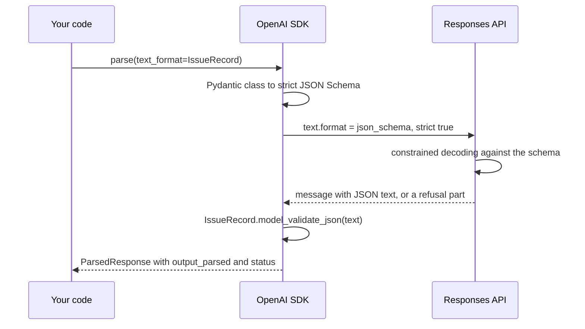
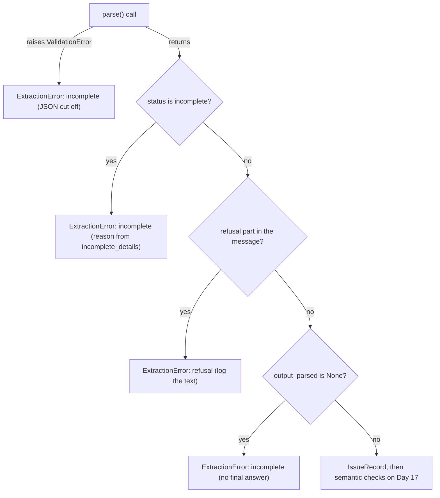
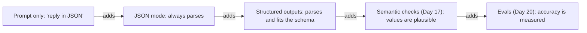

# Structured Outputs: Native JSON Schema & Extraction

Ask for JSON in a prompt, run it over ten Orbit issues, and one reply starts with "Sure! Here's the JSON:", one arrives in a Markdown fence, and one says `"severity": "high"`. Yesterday's Pydantic models catch all of these, but catching isn't preventing. Structured outputs move the contract into the API: the model can only return JSON that fits your schema. Today you use them to build `extract_issue()`, the heart of Capstone R1.

## At a Glance

- **Time:** ~2 h core (+ optional Go Deeper) · **Depth:** working
- **Prerequisites:** [Day 15: Pydantic for LLM Apps](../../Phase_2_Building_with_LLM_APIs/Day_015_pydantic_for_llms/pydantic_for_llms.md), [Day 12: The OpenAI SDK in Production Code](../../Phase_2_Building_with_LLM_APIs/Day_012_openai_sdk_production/openai_sdk_production.md), [Day 4: Tokens: How Models Read Text](../../Phase_1_How_LLMs_Work/Day_004_tokens/tokens.md)
- **You'll build:** `atlas/extract.py`: `extract_issue()` turns an Orbit issue into a typed `IssueRecord`, spot-checked against gold
- **Stops at:** constrained-decoding internals
- **Fast path:** none; this is core. JSON Schema veterans: read [the schema section](#read-the-schema-the-model-receives), [the build](#build-the-atlas-extractor) and [the rules](#strict-mode-rules-and-limits), then do Exercise 2 (≈60 min)
- **Cost:** ≈ $0.05 on `gpt-6-luna` (prices as of 2026-11, [verify](https://developers.openai.com/api/docs/pricing))
- **New terms:** structured outputs, strict mode, `text_format`, refusal, JSON mode

> **Coming from Software Engineering?** Structured outputs are a typed RPC contract: like gRPC, or an OpenAPI spec enforced by a response validator, the server can't send a field the schema doesn't define, and you get typed objects back. JSON mode is the weaker cousin, a `Content-Type: application/json` header that promises the body parses, not that it has your fields. Keep one source of truth: the Pydantic model generates the schema, so code and contract can't drift. One difference from RPC: the model never runs your code. It reads the schema and fills it in; your code decides what to do with the result.

## Before You Start: Three Files from Earlier Days

Today's scripts import three lesson-local modules copied compactly from earlier days. Save each as its file name (`schemas.py`, `tokens.py`, `llm.py`) in one folder and run everything from there. First, Day 15's schemas. `Issue` is one row of `issues.jsonl`; its labels are the answer key and never go to the model.

```python
# script_id: day_016_structured_outputs/schemas
# schemas.py: compact copy of Day 15's atlas/schemas.py + atlas/data.py.
# Install: uv add "openai>=3.46,<4" pydantic tiktoken
# Env: ORBIT_DATA (optional, path to datasets/orbit). No API key needed for this file.
import json
import os
from pathlib import Path
from typing import Literal

from pydantic import BaseModel, ConfigDict, Field

DATA_DIR = Path(os.environ.get("ORBIT_DATA", "datasets/orbit"))

IssueType = Literal["bug", "feature", "question", "docs"]
Severity = Literal["S1", "S2", "S3", "S4"]
Component = Literal["core", "scheduler", "flows", "broker-redis", "broker-postgres", "broker-sqs",
                    "cli", "dashboard", "retries", "results", "observability", "auth", "docs"]


class Comment(BaseModel):
    author: str
    created_at: str
    body: str


class Issue(BaseModel):
    """One raw row of issues/issues.jsonl. Labels and version fields are ground truth."""
    id: int
    title: str
    body: str
    author: str
    created_at: str
    state: Literal["open", "closed"]
    labels: list[str]
    orbit_version: str | None
    python_version: str | None
    error_codes: list[str]
    duplicate_of: int | None
    comments: list[Comment]
    closed_at: str | None
```

`IssueRecord` is what Atlas extracts; its fields match the gold file exactly, so Day 20 can score it field by field. Note two Day 15 habits: "not stated" is `X | None` with no default, and every field has a `description`. Both matter shortly.

```python
# script_id: day_016_structured_outputs/schemas
class IssueRecord(BaseModel):
    """The facts Atlas extracts from one issue. Fields mirror eval/extraction_gold.jsonl."""
    model_config = ConfigDict(extra="forbid")

    type: IssueType = Field(description="bug, feature, question or docs")
    components: list[Component] = Field(description="Every Orbit component the issue is about")
    severity: Severity | None = Field(description="Bugs only: S1 outage or data loss, S2 major "
                                      "breakage, S3 has a workaround, S4 cosmetic. null otherwise")
    orbit_version: str | None = Field(description="Full Orbit version, e.g. 3.1.2. null when not stated")
    python_version: str | None = Field(description="Python version as written, e.g. 3.12.6. "
                                       "null when not stated")
    error_codes: list[str] = Field(description="ORB-NNNN codes quoted in the issue or its comments")
    summary: str = Field(description="One or two English sentences: symptom, trigger, version")


def _jsonl(path: Path) -> list[dict]:
    return [json.loads(line) for line in path.read_text(encoding="utf-8").splitlines() if line.strip()]


def load_issues(path: Path | None = None) -> list[Issue]:
    return [Issue.model_validate(row) for row in _jsonl(path or DATA_DIR / "issues" / "issues.jsonl")]


def load_gold() -> dict[int, IssueRecord]:
    """extraction_gold.jsonl keyed by issue id. Day 20 uses the first 20 ids as the dev set."""
    rows = _jsonl(DATA_DIR / "eval" / "extraction_gold.jsonl")
    return {row.pop("issue_id"): IssueRecord.model_validate(row) for row in rows}


if __name__ == "__main__":
    print(f"{len(load_issues())} issues · {len(load_gold())} gold records")
```

```text
240 issues · 30 gold records
```

Next, Day 4's token counter plus one new helper: `truncate_tokens()` keeps the start and end of a long text, where versions and questions usually sit, and cuts the middle, where logs pile up.

```python
# script_id: day_016_structured_outputs/tokens
# tokens.py: compact copy of Day 4's atlas/tokens.py, plus truncate_tokens() (new today).
# Install: uv add tiktoken   (downloads the o200k_base file once, then works offline)
import tiktoken

# GPT-6's tokenizer isn't published, so these counts are approximate (Day 4).
_ENC = tiktoken.get_encoding("o200k_base")


def count_tokens(text: str) -> int:
    return len(_ENC.encode(text))


def truncate_tokens(text: str, max_tokens: int, head_share: float = 0.7) -> str:
    """Keep the first ~70% and the last ~30% of the budget, and mark the cut."""
    ids = _ENC.encode(text)
    if len(ids) <= max_tokens:
        return text
    head = int(max_tokens * head_share)
    tail = max_tokens - head
    cut = len(ids) - max_tokens
    return _ENC.decode(ids[:head]) + f"\n\n[... {cut:,} tokens cut ...]\n\n" + _ENC.decode(ids[-tail:])


if __name__ == "__main__":
    print(count_tokens("ORB-1101 LeaseExpired"))
```

```text
6
```

Last, a slimmed-down Day 12 wrapper: client, cost tracker, call log. It needs `OPENAI_API_KEY` at import, so only API-calling scripts import it.

```python
# script_id: day_016_structured_outputs/llm
# llm.py: compact copy of Day 12's atlas/llm.py (client, CostTracker, log_call).
# Install: uv add "openai>=3.46,<4"
# Env: OPENAI_API_KEY (required), ATLAS_MODEL, ATLAS_LOG_DIR (optional)
import json
import os
import time
from pathlib import Path

from openai import OpenAI

MODEL = os.environ.get("ATLAS_MODEL", "gpt-6-luna")
LOG_DIR = Path(os.environ.get("ATLAS_LOG_DIR", "logs"))
# USD per 1M tokens, as of 2026-11; verify at https://developers.openai.com/api/docs/pricing
PRICES_PER_1M = {"gpt-6-luna": {"input": 0.10, "cached_input": 0.01, "output": 0.50}}

client = OpenAI(timeout=60, max_retries=3)
```

```python
# script_id: day_016_structured_outputs/llm
def cost_from_usage(usage, model: str = MODEL) -> float:
    p, cached = PRICES_PER_1M[model], usage.input_tokens_details.cached_tokens
    return ((usage.input_tokens - cached) * p["input"] + cached * p["cached_input"]
            + usage.output_tokens * p["output"]) / 1_000_000   # reasoning is inside output_tokens


class CostTracker:
    def __init__(self) -> None:
        self.calls, self.total_usd = 0, 0.0

    def record(self, response, *, label: str = "", latency_s: float | None = None) -> float:
        cost = cost_from_usage(response.usage)
        self.calls, self.total_usd = self.calls + 1, self.total_usd + cost
        return cost

    def summary(self) -> str:
        return f"{self.calls} calls · ${self.total_usd:.4f} (prices as of 2026-11, verify)"


tracker = CostTracker()


def log_call(response, *, label: str, latency_s: float, cost_usd: float, extra: dict | None = None) -> None:
    """One JSON line per call. No prompts and no keys in the log."""
    LOG_DIR.mkdir(parents=True, exist_ok=True)
    row = {"ts": time.time(), "label": label, "model": response.model, "id": response.id,
           "status": response.status, "input_tokens": response.usage.input_tokens,
           "output_tokens": response.usage.output_tokens, "latency_s": round(latency_s, 3),
           "cost_usd": round(cost_usd, 6), **(extra or {})}
    with open(LOG_DIR / "calls.jsonl", "a", encoding="utf-8") as f:
        f.write(json.dumps(row) + "\n")
```

## Prompted JSON Breaks

The naive approach puts the format in the prompt and validates the reply with the Day 15 model. Here it is on the first ten gold issues.

```python
# script_id: day_016_structured_outputs/prompted_json_baseline
# The naive way: ask for JSON in the prompt, then validate the reply. ≈ $0.005.
# Install: uv add "openai>=3.46,<4" pydantic tiktoken
# Env: OPENAI_API_KEY, ORBIT_DATA. Imports the lesson-local llm.py and schemas.py.
# reasoning effort "low" = little hidden thinking, cheapest; Day 6 covers the knob.
from collections import Counter

from pydantic import ValidationError

from llm import MODEL, client
from schemas import IssueRecord, load_gold, load_issues

PROMPT = """Read the GitHub issue below and reply in JSON with the keys type, components,
severity, orbit_version, python_version, error_codes and summary.

{issue}"""

gold = load_gold()
issues = [i for i in load_issues() if i.id in gold][:10]
failures: Counter[str] = Counter()
for issue in issues:
    resp = client.responses.create(model=MODEL, reasoning={"effort": "low"},
                                   input=PROMPT.format(issue=f"# {issue.title}\n\n{issue.body}"))
    try:
        IssueRecord.model_validate_json(resp.output_text)
    except ValidationError as err:
        failures[err.errors()[0]["type"]] += 1
print(f"parsed {len(issues) - sum(failures.values())}/{len(issues)} · failures: {dict(failures)}")
```

Illustrative output (your numbers will differ):

```text
parsed 6/10 · failures: {'json_invalid': 2, 'literal_error': 1, 'missing': 1}
```

Those four failure types are the whole family. Reproduce them offline by feeding typical bad replies to the validator:

```python
# script_id: day_016_structured_outputs/failure_modes
# Four replies prompted JSON really produces, run through the Day 15 schema. Offline, $0.
# Install: uv add "openai>=3.46,<4" pydantic tiktoken · Env: ORBIT_DATA (optional)
from pydantic import ValidationError

from schemas import IssueRecord

GOOD = ('{"type": "bug", "components": ["core"], "severity": "S3", "orbit_version": "3.1.2", '
        '"python_version": "3.11", "error_codes": ["ORB-1101"], "summary": "Export runs twice."}')
replies = {
    "prose prefix": "Sure! Here's the JSON:\n" + GOOD,
    "markdown fence": "```json\n" + GOOD + "\n```",
    "word severity": GOOD.replace('"S3"', '"high"'),
    "missing field": GOOD.replace('"python_version": "3.11", ', ""),
}
for name, text in replies.items():
    try:
        IssueRecord.model_validate_json(text)
        print(f"{name:<15} ok")
    except ValidationError as err:
        e = err.errors()[0]
        print(f"{name:<15} {e['type']}: {e['msg']}")
```

```text
prose prefix    json_invalid: Invalid JSON: expected value at line 1 column 1
markdown fence  json_invalid: Invalid JSON: expected value at line 1 column 1
word severity   literal_error: Input should be 'S1', 'S2', 'S3' or 'S4'
missing field   missing: Field required
```

Each error is precise, but each is a wasted call. You want bad replies to be impossible.

## A Form You Can't Write Outside Of

Picture a paper form: "Severity" has four tick boxes, "Orbit version" has a box plus "not stated". There's no margin for "Sure! Here's the form:" and no "priority" box to invent. You can tick the wrong box, but you can't hand back something that isn't the form.

**Structured outputs** are that form for an LLM: you send a JSON Schema with the request, and the API guarantees the reply is valid JSON that matches it. The server uses **constrained decoding** (the model may only pick tokens that keep the output valid), so `"high"` is never produced, rather than produced and rejected. **Strict mode** (`"strict": true`) is the switch that turns the guarantee on.

Fill the form by hand for issue #176: "Long nightly export job runs twice: ORB-1101 LeaseExpired then a second worker picks it up … Orbit 3.1.2, Python 3.11, Redis."

| Box | What you'd write | Why |
|---|---|---|
| `type` | `bug` | A job runs twice |
| `components` | `["core"]` | Leases and workers belong to `core` |
| `severity` | `S3` | Real harm, with a workaround |
| `orbit_version` | `"3.1.2"` | Stated |
| `python_version` | `"3.11"` | As written, not `3.11.0` |
| `error_codes` | `["ORB-1101"]` | Quoted in the log |
| `summary` | "A nightly export…" | Free text, still a string |

The model gets the same form plus your instructions; gold has these seven values for #176.

## Read the Schema the Model Receives

`parse(text_format=IssueRecord)` sends your class as a JSON Schema in `text.format`. To see it without a key, give the SDK a fake transport that records the request and returns a canned reply (Day 19 builds a fuller fake):

```python
# script_id: day_016_structured_outputs/strict_schema
# See exactly what responses.parse() sends. No key, no network, $0.
# Install: uv add "openai>=3.46,<4" pydantic tiktoken  (httpx2, the SDK's HTTP library, comes with openai>=3)
import json

import httpx2
from openai import OpenAI

from schemas import IssueRecord

sent: dict = {}
CANNED = ('{"type":"bug","components":["core"],"severity":"S3","orbit_version":null,'
          '"python_version":null,"error_codes":[],"summary":"stub"}')


def fake_api(request: httpx2.Request) -> httpx2.Response:
    sent.update(json.loads(request.content))          # keep the request body
    return httpx2.Response(200, json={"id": "resp_fake", "status": "completed", "output": [
        {"type": "message", "role": "assistant", "content": [{"type": "output_text", "text": CANNED}]}]})


client = OpenAI(api_key="sk-test-FAKE", http_client=httpx2.Client(transport=httpx2.MockTransport(fake_api)))
resp = client.responses.parse(model="gpt-6-luna", input="(issue text)", text_format=IssueRecord)

fmt = sent["text"]["format"]
print({k: v for k, v in fmt.items() if k != "schema"})
print("required:", fmt["schema"]["required"])
print("additionalProperties:", fmt["schema"]["additionalProperties"])
print("severity:", json.dumps(fmt["schema"]["properties"]["severity"]))
print("parsed:", type(resp.output_parsed).__name__, resp.output_parsed.severity)
```

```text
{'type': 'json_schema', 'strict': True, 'name': 'IssueRecord'}
required: ['type', 'components', 'severity', 'orbit_version', 'python_version', 'error_codes', 'summary']
additionalProperties: False
severity: {"anyOf": [{"enum": ["S1", "S2", "S3", "S4"], "type": "string"}, {"type": "null"}], "description": "Bugs only: S1 outage or data loss, S2 major breakage, S3 has a workaround, S4 cosmetic. null otherwise", "title": "Severity"}
parsed: IssueRecord S3
```

Each line is a rule you'll meet again:

- **`strict: True`, `name`.** Strict mode is on; the schema is named after the class.
- **`required` lists all seven fields.** Strict mode requires every property, and a Python default doesn't change that. "May be missing" is spelled `str | None`, which becomes `anyOf: [string, null]`.
- **`additionalProperties: False`.** No invented keys. `extra="forbid"` produces it, and the SDK adds it if you forget.
- **`Literal` becomes `enum`.** That's what makes `"high"` impossible.
- **`description` travels along.** It's prompt text attached to its field.

## The Parts: text_format, output_parsed, Refusals and Status

Five names cover the feature:

- **`text_format`**: the `parse()` argument that takes your Pydantic class.
- **`output_parsed`**: the typed result, or `None` when there's no final text to parse.
- **Refusal** (the model declines to answer, usually for safety reasons): the message carries a content part with `type == "refusal"` and a `.refusal` string instead of JSON, and `output_parsed` is `None`.
- **`status`**: on `incomplete`, `incomplete_details.reason` says why, e.g. `max_output_tokens`.
- **The raw form**: `responses.create(text={"format": {"type": "json_schema", …}})`, for schemas from elsewhere.



The server guarantees *shape*. Your code still checks `status`, refusals, and whether values are *true*.

## Your First Parsed Call

The smallest real call: one ORB-1101 issue in, one typed record out. Phase 2 sets reasoning effort explicitly on every call ([Day 6](../../Phase_1_How_LLMs_Work/Day_006_sampling_reasoning_effort/sampling_reasoning_effort.md) explains the knob), and `low` suits extraction.

```python
# script_id: day_016_structured_outputs/parse_and_break
# One issue → one typed IssueRecord; the next section breaks it two ways. ≈ $0.005 in all.
# Install: uv add "openai>=3.46,<4" pydantic tiktoken
# Env: OPENAI_API_KEY, ORBIT_DATA. Imports the lesson-local llm.py and schemas.py.
from llm import MODEL, client
from schemas import IssueRecord, load_issues

issue = next(i for i in load_issues() if i.id == 176)          # the lease-expiry report
resp = client.responses.parse(
    model=MODEL, reasoning={"effort": "low"},
    instructions="Extract the facts of this Orbit issue. Use null when a fact is not stated.",
    input=f"# {issue.title}\n\n{issue.body}",
    text_format=IssueRecord,                                    # → strict JSON Schema
)
print(resp.status)
print(resp.output_parsed.model_dump_json(indent=2))
```

Illustrative output (your numbers and wording will differ):

```text
completed
{
  "type": "bug",
  "components": [
    "core"
  ],
  "severity": "S3",
  "orbit_version": "3.1.2",
  "python_version": "3.11",
  "error_codes": [
    "ORB-1101"
  ],
  "summary": "A nightly export job runs twice: the first attempt hits ORB-1101 LeaseExpired after 300 s because heartbeat_seconds is 240, so a second worker starts it."
}
```

No `json.loads`, no fence-stripping regex, and `resp.output_parsed.severity` is typed, so your editor autocompletes it.

## Break It: Remove the Null Rule, Starve the Budget

Strict mode guarantees shape, not truth. To feel the difference, remove the guidance and watch values go wrong while the JSON stays perfect. Five gold issues state no Orbit version (vague reports such as #214, "upgrade broke everything"). Run them with a bare schema and no null rule, then with descriptions and the rule:

```python
# script_id: day_016_structured_outputs/parse_and_break
# Knob 1: no descriptions + no null rule → count invented versions.
from pydantic import BaseModel, ValidationError

from schemas import Component, IssueRecord, IssueType, Severity, load_gold, load_issues


class BareRecord(BaseModel):          # the same fields as IssueRecord, with no descriptions
    type: IssueType
    components: list[Component]
    severity: Severity | None
    orbit_version: str | None
    python_version: str | None
    error_codes: list[str]
    summary: str


gold = load_gold()
no_version = [i for i in load_issues() if i.id in gold and gold[i.id].orbit_version is None]
for schema, rule in [(BareRecord, ""), (IssueRecord, " Use null when a fact is not stated.")]:
    invented = 0
    for issue in no_version:
        resp = client.responses.parse(model=MODEL, instructions="Extract the issue's facts." + rule,
                                      input=f"# {issue.title}\n\n{issue.body}", text_format=schema,
                                      reasoning={"effort": "low"})
        invented += resp.output_parsed is not None and resp.output_parsed.orbit_version is not None
    print(f"{schema.__name__:<12} invented versions: {invented}/{len(no_version)}")
```

Illustrative output (your numbers will differ):

```text
BareRecord   invented versions: 3/5
IssueRecord  invented versions: 0/5
```

All ten replies were schema-perfect, yet the bare run invented versions such as `"3.2.1"` (the current release): the box was required and nothing said empty was fine. The schema made `null` *possible*; the description and rule made it *likely*.

Now starve the budget. `max_output_tokens` caps reasoning and visible tokens together:

```python
# script_id: day_016_structured_outputs/parse_and_break
# Knob 2: a tiny max_output_tokens. The call ends `incomplete`, and you are still billed.
issue = next(i for i in load_issues() if i.id == 176)
try:
    resp = client.responses.parse(model=MODEL, input=issue.body, text_format=IssueRecord,
                                  reasoning={"effort": "low"}, max_output_tokens=20)
    print(resp.status, resp.incomplete_details, resp.output_parsed)
except ValidationError as err:        # the JSON was cut off mid-way: parse() raises before you see it
    print("truncated JSON:", err.errors()[0]["type"])
```

You'll see one of two outcomes:

```text
incomplete IncompleteDetails(reason='max_output_tokens') None
```

```text
truncated JSON: json_invalid
```

The first ran out during reasoning: no message. The second surprises people: the SDK validated half-written JSON *inside* `parse()`, so `ValidationError` escaped before you could read `status`. Handle both. Every exit, as the extractor implements them:



You can't reliably trigger a refusal here; handle it anyway, since user-written text will produce one eventually.

## Extraction Patterns That Hold Up

Extraction is the most common production LLM task, and the same schema decisions recur. `IssueRecord` already makes each one.

**Lists for anything that can repeat.** Issue #109 quotes two codes and touches two components. A `str` field forces the model to pick one or cram both into `"ORB-1502, ORB-1301"`; a `list[str]` holds each, and `[]` is a clean "none". Same for any multi-entity field: `contacts: list[Contact]`, never `contact: Contact`.

**Nullable for "not stated", never a sentinel.** An `"unknown"` enum value looks like data: it sorts, groups in dashboards, and slips past checks for missing values. `null` is what every language and database already treats as absent. Orbit's 20 vague issues are where this pays off.

**Enums for labels.** `type`, `severity` and `components` are closed sets, so `Literal`s rule out `"Bug"`, `"high"` and `"redis"`, and your code can `match` on values without normalising them.

**Field order is generation order.** Keys come out in schema order, so earlier fields become context for later ones. `summary` goes last, after the facts. The Stretch exercise puts an `evidence` field *first*.

**Budget the input.** Issue #227 is about 33,000 tokens of Postgres logs, 100 times the median issue. `truncate_tokens()` (from the preamble) keeps the head and tail, where versions, codes and questions usually sit. The first Go Deeper box below shows what survives a 3,000-token budget.

**Non-English input, English output.** Five issues aren't in English. One instruction ("summary in English") handles them; enums and codes are language-neutral.

## Build: The Atlas Extractor

`atlas/extract.py` comes in three blocks: instructions and input builder, the function, and a spot-check. The instructions are static (rules, then a glossary of the 13 components), because an unchanging prefix is what [Day 18](../../Phase_2_Building_with_LLM_APIs/Day_018_cost_latency_caching/cost_latency_caching.md)'s prompt caching rewards; the issue goes last, in `input`.

```python
# script_id: day_016_structured_outputs/extract
# atlas/extract.py: issue → IssueRecord with structured outputs. The core of Capstone R1 (Day 22).
# Install: uv add "openai>=3.46,<4" pydantic tiktoken
# Env: OPENAI_API_KEY (required), ATLAS_MODEL, ORBIT_DATA, ATLAS_LOG_DIR (optional)
import time
from typing import Literal

from openai.types.responses import ParsedResponse
from pydantic import ValidationError

from llm import MODEL, client, log_call, tracker
from schemas import Issue, IssueRecord, load_gold, load_issues
from tokens import truncate_tokens

EXTRACT_INSTRUCTIONS = """You extract facts from GitHub issues filed against Orbit, an open-source
Python background-jobs library. Fill every field of the schema from the issue text only.

Rules:
- Use null when a fact is not stated. Never guess a version from dates or context.
- severity is for bugs only; use null for features, questions and docs.
- error_codes: every ORB-NNNN code that appears anywhere, including logs and comments. [] if none.
- components: usually one; list two only when the issue really spans both.
- summary: one or two sentences in English, even when the issue is in another language.

Component glossary:
core = queues, workers, leases, job execution | scheduler = cron schedules and delays
flows = Flows, steps and step state | broker-redis, broker-postgres, broker-sqs = that broker
cli = the orbit command | dashboard = the web UI | retries = retry policy and backoff
results = the result backend | observability = metrics and tracing
auth = dashboard login and OIDC | docs = the documentation itself"""


def issue_to_input(issue: Issue, max_tokens: int = 3000) -> str:
    """Title, body and comments, within a token budget. Never the labels: they're the answer key."""
    parts = [f"# {issue.title}", issue.body]
    parts += [f"--- comment by {c.author} ---\n{c.body}" for c in issue.comments]
    return truncate_tokens("\n\n".join(parts), max_tokens)
```

Comments are included because gold `error_codes` count codes quoted in replies too.

The function follows the flowchart exit by exit. `ExtractionError.reason` is machine-readable, so Day 17's re-ask loop and Day 22's pipeline can branch on it.

```python
# script_id: day_016_structured_outputs/extract
class ExtractionError(Exception):
    """The API answered, but not with a usable record."""

    def __init__(self, reason: Literal["refusal", "incomplete"],
                 response: ParsedResponse | None = None, detail: str = "") -> None:
        super().__init__(f"{reason}: {detail}")
        self.reason, self.response = reason, response


def extract_issue(issue: Issue, *, model: str = MODEL) -> IssueRecord:
    start = time.perf_counter()
    try:
        resp = client.responses.parse(
            model=model, instructions=EXTRACT_INSTRUCTIONS, input=issue_to_input(issue),
            text_format=IssueRecord, reasoning={"effort": "low"},
            max_output_tokens=25_000)        # headroom for reasoning + JSON (reasoning guide)
    except ValidationError as err:
        # Strict mode fixes the shape, so a parse failure here means the JSON was cut off.
        raise ExtractionError("incomplete", detail=f"issue {issue.id}: truncated JSON") from err
    latency = time.perf_counter() - start
    cost = tracker.record(resp, label="extract_issue", latency_s=latency)
    log_call(resp, label="extract_issue", latency_s=latency, cost_usd=cost, extra={"issue_id": issue.id})

    if resp.status == "incomplete":
        raise ExtractionError("incomplete", resp, str(resp.incomplete_details.reason))
    refusals = [part.refusal for item in resp.output if item.type == "message"
                for part in item.content if part.type == "refusal"]
    if refusals:
        raise ExtractionError("refusal", resp, refusals[0])
    if resp.output_parsed is None:
        raise ExtractionError("incomplete", resp, "no final answer")
    return resp.output_parsed
```

Three details: cost is recorded *before* the checks, because incomplete and refused calls are billed too. The one blind spot is the cut-off-JSON path: `parse()` raises, so there's no response to record, and that spend never reaches the tracker (another reason to leave headroom). And `parse()` only reads messages whose `phase` is absent or `"final_answer"`, so commentary never reaches `output_parsed`.

Finally, a spot check of three fields on ten gold issues. It isn't an eval; [Day 20](../../Phase_2_Building_with_LLM_APIs/Day_020_first_eval_set/first_eval_set.md) builds that.

```python
# script_id: day_016_structured_outputs/extract
if __name__ == "__main__":
    gold = load_gold()
    issues = [i for i in load_issues() if i.id in gold][:10]      # 10 of the 20 dev issues
    hits = {"type": 0, "severity": 0, "error_codes": 0}
    for issue in issues:
        try:
            rec = extract_issue(issue)
        except ExtractionError as err:
            print(f"#{issue.id:<4} skipped ({err})")
            continue
        want = gold[issue.id]
        hits["type"] += rec.type == want.type
        hits["severity"] += rec.severity == want.severity
        hits["error_codes"] += sorted(rec.error_codes) == sorted(want.error_codes)
        print(f"#{issue.id:<4} {rec.type:<9} {rec.severity or '-':<3} {rec.error_codes}")
    print(" · ".join(f"{k} {v}/{len(issues)}" for k, v in hits.items()), "·", tracker.summary())
```

Illustrative output (your numbers will differ; they start the R1 scoreboard):

```text
#10   question  -   []
#25   question  -   ['ORB-1202']
#62   bug       S3  []
#63   question  -   ['ORB-1001']
#74   feature   -   []
#83   bug       S2  []
#97   question  -   []
#104  bug       S2  ['ORB-1802']
#109  bug       S2  ['ORB-1502', 'ORB-1301']
#113  bug       S3  []
type 9/10 · severity 8/10 · error_codes 10/10 · 10 calls · $0.0042 (prices as of 2026-11, verify)
```

Read the misses: #113 ("orbit doctor fails…") came back as an S3 bug where gold says question, and #83 got S2 instead of S3. Flawless JSON, arguable labels: errors no schema catches.

## Strict-Mode Rules and Limits

`text_format` generates a compliant schema, so you need the rules when you write one by hand: a raw `json_schema` request, a schema in config, or a tool on [Day 36](../../Phase_4_Tools_and_MCP/Day_036_tool_design/tool_design.md). The documented rules (as of 2026-11, [verify](https://developers.openai.com/api/docs/guides/structured-outputs)):

| Rule | In practice |
|---|---|
| Root is an object, not `anyOf` | Wrap a union in a field |
| Every property is `required` | "Optional" means `X \| None` |
| `additionalProperties: false` on every object | No `dict[str, X]` fields; use a list of key/value models |
| ≤ 5,000 properties, ≤ 10 nesting levels | Deep trees usually mean two jobs; split them |
| ≤ 1,000 enum values; ≤ 120,000 characters of names and enum values | 13 components is fine; a 5,000-SKU catalogue belongs in retrieval |
| `$defs` and recursion allowed | Nested models arrive as `$ref`s |
| No `allOf`, `not`, `if`/`then`/`else`, `dependentRequired`, `dependentSchemas` | Check such rules in Pydantic or on Day 17 |

Constraints that do work (an older course table wrongly said numeric ranges didn't), and one trap:

| Pydantic | JSON Schema | Strict mode |
|---|---|---|
| `list[X]` with `min_length` | `array` with `minItems` | Supported |
| `Field(ge=1, le=5)`, `Field(pattern=...)` | `minimum`/`maximum`, `pattern` | Supported; `format` (`date`, `email`, `uuid`…) too |
| Field with a default | Still `required`; SDK strips `default: None` only | ⚠ verify the API accepts a leftover `default`, or drop it |

A `pattern` on `error_codes` items would make codes *look* right without proving they appear in the issue; that semantic check is Day 17's. `IssueRecord` stays as Day 15 defined it.

When you hand-write a schema, lint it before the API rejects it. A 30-line linter is in Go Deeper below.

A bare union in `text_format` fails before any request: `TypeError: Unsupported response_format type - A | B` (with your class names). A raw schema with a root `anyOf` is rejected by the API with an error (⚠ verify the exact status and message; it can't be captured without a key).

## JSON Mode vs Structured Outputs

Older code uses **JSON mode** (`{"type": "json_object"}`: the reply always parses as JSON, with no schema). The official guide says to prefer structured outputs whenever possible. It is legacy: the last Go Deeper box runs it so you can see it fail. Don't copy it into Atlas.

Each technique adds one guarantee to the last:



## Trade-offs and When Not to Use It

Use them whenever code reads the reply. Where they don't fit:

| Situation | Use | Why |
|---|---|---|
| Code consumes the result (extraction, routing) | Structured outputs | Typed, never unparseable |
| A person reads free text | Plain text | One `answer: str` field adds nothing |
| A token-streaming chat UI ([Day 13](../../Phase_2_Building_with_LLM_APIs/Day_013_streaming/streaming.md)) | Plain text | Half a JSON object isn't worth showing |
| The model should act | Strict tools (Day 36) | Same mechanism, for arguments |
| Values must be correct | Plus checks (Day 17), evals (Day 20) | Schemas stop at shape |
| A model without strict support | Prompted JSON + validation | Day 15 tools still work |

One cost: the first request with a new schema has extra latency while the API processes it; later ones don't.

### In production

- **The schema is a versioned contract.** Review `IssueRecord` changes like public API changes and re-run the eval: descriptions and order are prompt. Generate the schema from the model; hand-kept JSON copies drift.
- **Count `ExtractionError.reason` per day.** Rising `incomplete` means longer inputs or a tight budget; rising refusals mean the inputs changed.
- **The schema travels with every request.** Changing it changes what can be cached (Day 18 measures caching).
- **Strict isn't accurate.** #113 was perfectly typed and wrong; only evals (Day 20) say how often.

## Go Deeper (optional)

<details>
<summary>Go deeper: what a 3,000-token budget keeps</summary>

```python
# script_id: day_016_structured_outputs/truncation_demo
# What survives a 3,000-token budget on the longest Orbit issue. Offline, $0.
# Install: uv add "openai>=3.46,<4" pydantic tiktoken · Env: ORBIT_DATA (optional)
import re

from schemas import load_issues
from tokens import count_tokens, truncate_tokens

CODE = re.compile(r"ORB-\d{4}")
issue = next(i for i in load_issues() if i.id == 227)          # ~8,900 words, mostly logs
full = "\n\n".join([f"# {issue.title}", issue.body] + [c.body for c in issue.comments])
short = truncate_tokens(full, 3000)
print(f"tokens: {count_tokens(full):,} -> {count_tokens(short):,}")
for label, text in [("full", full), ("short", short)]:
    codes = sorted(set(CODE.findall(text)))
    print(f"{label:<6} codes={codes} version={'Orbit 3.2.0' in text} questions={'## Questions' in text}")
```

```text
tokens: 32,898 -> 3,010
full   codes=['ORB-1001'] version=True questions=True
short  codes=['ORB-1001'] version=True questions=True
```

A 91% cut kept every fact gold needs. It's a heuristic: a code that appears only mid-log would be lost.

</details>

<details>
<summary>Go deeper: lint a hand-written strict schema</summary>

`text_format` builds a compliant schema for you. A raw `json_schema` request, a schema kept in config, or a tool definition does not, so a small linter catches the rejections before the API does.

```python
# script_id: day_016_structured_outputs/strict_rules
# A small linter for hand-written strict schemas. Offline, $0.
# Install: uv add "openai>=3.46,<4" pydantic tiktoken
from pydantic import BaseModel

from schemas import IssueRecord

UNSUPPORTED = {"allOf", "not", "if", "then", "else", "dependentRequired", "dependentSchemas"}


def strict_problems(node: dict, path: str = "$", level: int = 0) -> list[str]:
    """Walk a JSON Schema and list what strict mode would reject."""
    problems = [f"{path}: '{key}' is not supported" for key in sorted(UNSUPPORTED & node.keys())]
    if node.get("type") == "object":
        level += 1
        if level > 10:
            problems.append(f"{path}: objects nested deeper than 10 levels")
        if node.get("additionalProperties") is not False:
            problems.append(f"{path}: needs additionalProperties: false")
        missing = set(node.get("properties", {})) - set(node.get("required", []))
        problems += [f"{path}.{name}: must be listed in required" for name in sorted(missing)]
    children = list(node.get("properties", {}).items()) + list(node.get("$defs", {}).items())
    children += [(f"anyOf[{i}]", sub) for i, sub in enumerate(node.get("anyOf", []))]
    if isinstance(node.get("items"), dict):
        children.append(("items", node["items"]))
    for name, child in children:
        problems += strict_problems(child, f"{path}.{name}", level)
    return problems


def lint(schema: dict) -> list[str]:
    root = [] if schema.get("type") == "object" else ["$: root must be an object, not a union"]
    return root + strict_problems(schema)
```

Point it at `IssueRecord`, a first draft and a union root:

```python
# script_id: day_016_structured_outputs/strict_rules
class Draft(BaseModel):                    # a plausible first attempt
    title: str
    priority: int = 3                      # has a default, so Pydantic leaves it out of required
    labels: dict[str, str]                 # free-form keys: additionalProperties is a schema


print("IssueRecord:", lint(IssueRecord.model_json_schema()) or "ok")
for problem in lint(Draft.model_json_schema()):
    print("Draft:", problem)
print("Union root:", lint({"anyOf": [{"type": "string"}, {"type": "integer"}]}))
```

```text
IssueRecord: ok
Draft: $: needs additionalProperties: false
Draft: $.priority: must be listed in required
Draft: $.labels: needs additionalProperties: false
Union root: ['$: root must be an object, not a union']
```

`IssueRecord` passes as plain `model_json_schema()` output, thanks to `extra="forbid"` and no defaults. Through `text_format`, the SDK would fix `Draft`'s first two problems (it adds `additionalProperties: false` to objects that don't set it and marks every field required), but not the `dict`: that field already sets `additionalProperties`, so it goes out unchanged and is rejected. Use `labels: list[Label]` with `key` and `value` fields.

</details>

<details>
<summary>Go deeper: JSON mode, the legacy comparison</summary>

```python
# script_id: day_016_structured_outputs/json_mode_comparison
# LEGACY COMPARISON ONLY: JSON mode guarantees valid JSON, not your schema. Don't copy into Atlas.
# Install: uv add "openai>=3.46,<4" pydantic tiktoken
# Env: OPENAI_API_KEY, ORBIT_DATA. ≈ $0.002.
from pydantic import ValidationError

from llm import MODEL, client
from schemas import IssueRecord, load_issues

for issue in [i for i in load_issues() if i.id in (25, 104, 176)]:
    resp = client.responses.create(
        model=MODEL, reasoning={"effort": "low"},
        instructions="Extract the issue's facts as JSON.",   # the API requires the word "JSON"
        input=f"# {issue.title}\n\n{issue.body}",
        text={"format": {"type": "json_object"}},           # valid JSON, any shape
    )
    try:
        IssueRecord.model_validate_json(resp.output_text)
        print(f"#{issue.id}: fits IssueRecord")
    except ValidationError as err:
        print(f"#{issue.id}: valid JSON, wrong shape ({err.error_count()} errors, "
              f"first: {err.errors()[0]['type']})")
```

Illustrative output (your numbers will differ):

```text
#25: valid JSON, wrong shape (7 errors, first: missing)
#104: valid JSON, wrong shape (6 errors, first: missing)
#176: valid JSON, wrong shape (5 errors, first: missing)
```

Every reply parsed; none fit. Without a schema the model picks its own keys (`issue_type`, `codes`), and you're back to validating and re-asking. Also, in JSON mode the API errors if "JSON" appears nowhere in the context, a guard against endless whitespace.

</details>

<details>
<summary>Go deeper: code reads, the model judges</summary>

A pattern worth practising once you have `extract_issue()`: split a record into the fields code can read deterministically and the fields that need judgement, and let the model fill only the second set. For an Orbit docs page, `doc_id`, `title` and `applies_to` come from the front matter, and `error_codes` from `re.findall(r"ORB-\d{4}", body)`. The model fills only `config_keys` and `summary` through a small `DocFacts` model, and code assembles the final `DocRecord`. A field the model never fills can't be wrong, and the model call gets cheaper. Day 22 builds a full version for the capstone; try three `docs/` pages as extra practice.

</details>

## Common Pitfalls

- **`AttributeError: 'NoneType' object has no attribute 'model_dump_json'`.** `output_parsed` is `None` after a refusal or when the budget ran out during reasoning. Check `status` and refusal parts first, as `extract_issue()` does.
- **`ValidationError: 1 validation error for IssueRecord … Invalid JSON: EOF while parsing a string`.** `max_output_tokens` cut the JSON off and `parse()` raised before you could read `status`. Catch `ValidationError` around the call as `incomplete`, and leave headroom (the reasoning guide suggests starting at 25,000).
- **`TypeError: Responses.create() got an unexpected keyword argument 'response_format'`.** Code copied from Chat Completions. Use `parse(text_format=Model)` or `create(text={"format": {...}})`.
- **An "optional" field filled with a guess.** `version: str | None = None` is still required on the wire. Describe "not stated" explicitly and measure it.
- **A union at the root.** `text_format=A | B` raises `TypeError: Unsupported response_format type`; a raw root `anyOf` is rejected by the API. Wrap the union in a one-field object.

> **Where we stop:** we skip constrained-decoding internals, because you can't tune them and the API contract is what you build on (the [structured outputs guide](https://developers.openai.com/api/docs/guides/structured-outputs) is the place to start); checking whether values are *right* is [Day 17](../../Phase_2_Building_with_LLM_APIs/Day_017_semantic_failures/semantic_failures.md).

## Key Takeaways

- Prompted JSON fails four ways (prose, fences, out-of-range values, missing keys); validation detects them, only an API-enforced schema prevents them.
- `responses.parse(text_format=IssueRecord)` sends a strict schema built from your class and returns a typed `output_parsed`; you still check `status`, refusals and truth.
- Strict mode: root object, every property required, `additionalProperties: false`, no free-form dicts, size limits (5,000 properties, 10 levels, 1,000 enum values). "Optional" is `X | None`.
- Extraction schemas use lists for repeats, `null` for "not stated" (no sentinels), enums for labels, facts before the summary, and an input token budget; descriptions decide what goes in the boxes.
- Use structured outputs whenever code reads the result, not for free text or streaming UIs; a typed record can still be wrong, which only checks (Day 17) and evals (Day 20) reveal.

## Quick Reference

| API / pattern | When to use | Gotcha |
|---|---|---|
| `client.responses.parse(model=, input=, text_format=Model)` | Code consumes the result | Raises `ValidationError` on truncated JSON |
| `resp.output_parsed` | The typed record | `None` on refusal or no final text |
| `resp.status`, `resp.incomplete_details.reason` | Detect cut-off replies | Still billed |
| `part.type == "refusal"`, `part.refusal` | Declined requests | Doesn't follow your schema |
| `create(text={"format": {"type": "json_schema", "name": …, "strict": True, "schema": …}})` | Schema from config | Apply every strict rule yourself |
| `X \| None` + "null when not stated" | Facts that may be absent | Defaults don't make fields optional |
| `list[str]`, `list[Model]` | Repeating values | `[]` means none |
| `Literal[...]` / `Enum` | Closed label sets | ≤ 1,000 enum values |
| `truncate_tokens(text, max_tokens)` | Long inputs | Loses middle-only facts |
| `text={"format": {"type": "json_object"}}` | Legacy only | Any shape; needs "JSON" in the prompt |

## Exercises

1. **Warm-up: add a field.** Subclass `IssueRecord` with a described `title_suggestion: str | None` and run issues 10, 83 and 176. A schema edit changes the output with no prompt change.

<details>
<summary>Solution</summary>

```python
# script_id: day_016_structured_outputs/solution_ex1
# Schema edits flow straight to the model. ≈ $0.002.
# Install: uv add "openai>=3.46,<4" pydantic tiktoken · Env: OPENAI_API_KEY, ORBIT_DATA
from pydantic import Field

from llm import MODEL, client
from schemas import IssueRecord, load_issues


class TitledRecord(IssueRecord):         # inherits extra="forbid"; the new field goes last
    title_suggestion: str | None = Field(
        description="A clearer issue title under 70 characters, or null if the current one is clear")


for issue in [i for i in load_issues() if i.id in (10, 83, 176)]:
    resp = client.responses.parse(
        model=MODEL, reasoning={"effort": "low"}, text_format=TitledRecord,
        instructions="Extract the facts of this Orbit issue. Use null when a fact is not stated.",
        input=f"# {issue.title}\n\n{issue.body}")
    if resp.output_parsed is not None:
        print(f"#{issue.id}: {issue.title!r} -> {resp.output_parsed.title_suggestion!r}")
```

Vague titles (#10, #83) get rewrites; #176's precise one often comes back `null`.

</details>

2. **Core: measure a prompt rule.** On the 20 dev issues (first 20 gold ids), count invented `orbit_version`s (gold `null`, model wrote one) and wrong ones, with and without the null rule in `EXTRACT_INSTRUCTIONS`.

<details>
<summary>Solution</summary>

```python
# script_id: day_016_structured_outputs/solution_ex2
# One prompt rule, measured. 40 calls, ≈ $0.02.
# Install: uv add "openai>=3.46,<4" pydantic tiktoken · Env: OPENAI_API_KEY, ORBIT_DATA
from extract import EXTRACT_INSTRUCTIONS, issue_to_input
from llm import MODEL, client
from schemas import IssueRecord, load_gold, load_issues

NULL_RULE = "- Use null when a fact is not stated. Never guess a version from dates or context.\n"
assert NULL_RULE in EXTRACT_INSTRUCTIONS, "the rule text changed; update NULL_RULE"

gold = load_gold()
dev = sorted(gold)[:20]                                   # Day 20's dev split
issues = [i for i in load_issues() if i.id in dev]
nulls = sum(gold[i].orbit_version is None for i in dev)
for name, instructions in [("with rule", EXTRACT_INSTRUCTIONS),
                           ("without", EXTRACT_INSTRUCTIONS.replace(NULL_RULE, ""))]:
    invented = wrong = 0
    for issue in issues:
        rec = client.responses.parse(model=MODEL, instructions=instructions, input=issue_to_input(issue),
                                     text_format=IssueRecord, reasoning={"effort": "low"}).output_parsed
        want = gold[issue.id].orbit_version
        if rec is not None:
            invented += want is None and rec.orbit_version is not None
            wrong += want is not None and rec.orbit_version != want
    print(f"{name:<10} invented {invented}/{nulls} · wrong {wrong}/{len(dev) - nulls}")
```

Illustrative (your numbers will differ): `with rule  invented 0/4 · wrong 1/16`, `without    invented 2/4 · wrong 1/16`. Four null cases make this noisy (Day 20 tackles small samples).

</details>

3. **Core: finish Day 14's bug report.** Send your [Day 14](../../Phase_2_Building_with_LLM_APIs/Day_014_multimodal_inputs/multimodal_inputs.md) traceback screenshot (or any PNG) as an `input_image` and get an `IssueRecord` back.

<details>
<summary>Solution</summary>

```python
# script_id: day_016_structured_outputs/solution_ex3
# Screenshot -> typed IssueRecord. Usage: python solution_ex3.py <screenshot.png>
# Install: uv add "openai>=3.46,<4" pydantic tiktoken · Env: OPENAI_API_KEY
# ≈ $0.002 (image tokens vary; count them exactly with input_tokens.count, Day 14).
import base64
import mimetypes
import sys
from pathlib import Path

from llm import MODEL, client
from schemas import IssueRecord

if len(sys.argv) < 2:
    sys.exit("usage: python solution_ex3.py <screenshot.png>")
path = Path(sys.argv[1])
mime = mimetypes.guess_type(path.name)[0] or "image/png"
data_url = f"data:{mime};base64," + base64.b64encode(path.read_bytes()).decode()

resp = client.responses.parse(
    model=MODEL, reasoning={"effort": "low"}, text_format=IssueRecord,
    instructions="Extract the facts of the Orbit problem shown. Use null when a fact is not visible.",
    input=[{"role": "user", "content": [
        {"type": "input_text", "text": "Screenshot attached to a new Orbit issue:"},
        {"type": "input_image", "image_url": data_url, "detail": "high"},   # detail is required
    ]}],
)
print(resp.status)
print(resp.output_parsed.model_dump_json(indent=2) if resp.output_parsed else "no record")
```

`text_format` doesn't care about the input type; only `input` became a list of parts.

</details>

4. **Stretch: evidence first.** Put an `evidence: list[str]` field of verbatim quotes *before* the `IssueRecord` fields. Compare the spot-check on ten issues with and without it, and count quotes that really appear in the input.

<details>
<summary>Solution</summary>

```python
# script_id: day_016_structured_outputs/solution_ex4
# Field order as a technique: quote first, then label. 20 calls, ≈ $0.01.
# Install: uv add "openai>=3.46,<4" pydantic tiktoken · Env: OPENAI_API_KEY, ORBIT_DATA
from pydantic import ConfigDict, Field, create_model

from extract import EXTRACT_INSTRUCTIONS, issue_to_input
from llm import MODEL, client
from schemas import IssueRecord, load_gold, load_issues

GroundedRecord = create_model(            # evidence first, then every IssueRecord field in order
    "GroundedRecord", __config__=ConfigDict(extra="forbid"),
    evidence=(list[str], Field(description="Up to 5 short verbatim quotes from the issue "
                                           "that support the fields below")),
    **{name: (field.annotation, field) for name, field in IssueRecord.model_fields.items()})

gold = load_gold()
issues = [i for i in load_issues() if i.id in gold][:10]
for schema in (IssueRecord, GroundedRecord):
    hits = quotes = verbatim = 0
    for issue in issues:
        text = issue_to_input(issue)
        rec = client.responses.parse(model=MODEL, instructions=EXTRACT_INSTRUCTIONS, input=text,
                                     text_format=schema, reasoning={"effort": "low"}).output_parsed
        if rec is None:
            continue
        want = gold[issue.id]
        hits += (rec.type, rec.severity, sorted(rec.error_codes)) == \
                (want.type, want.severity, sorted(want.error_codes))
        for quote in getattr(rec, "evidence", []):
            quotes, verbatim = quotes + 1, verbatim + (quote in text)
    print(f"{schema.__name__:<15} all three right {hits}/{len(issues)} · verbatim quotes {verbatim}/{quotes}")
```

Expect little accuracy change; the win is quotes a reviewer can verify.

</details>

## References & Further Reading

- [OpenAI: Structured model outputs](https://developers.openai.com/api/docs/guides/structured-outputs): the official guide; "Supported schemas" lists every rule and limit.
- [OpenAI: Reasoning models](https://developers.openai.com/api/docs/guides/reasoning): why `max_output_tokens` covers reasoning, and `incomplete` handling.
- [OpenAI: Migrate to the Responses API](https://developers.openai.com/api/docs/guides/migrate-to-responses): where `response_format` went when porting old code.
- [Pydantic: JSON Schema](https://docs.pydantic.dev/latest/concepts/json_schema/): how each Python type becomes the schema the model sees.
- [Pydantic: Fields](https://docs.pydantic.dev/latest/concepts/fields/): descriptions, constraints and defaults, all of which reach the schema.

## What's Next

Your extractor always returns a well-formed `IssueRecord`, but #113 showed well-formed isn't right. In [Day 17: Handling Semantic Failures: Validate, Re-ask, Bound](../../Phase_2_Building_with_LLM_APIs/Day_017_semantic_failures/semantic_failures.md) you'll check codes and versions against the source and Orbit's known values, and feed precise errors back in a bounded re-ask loop.
