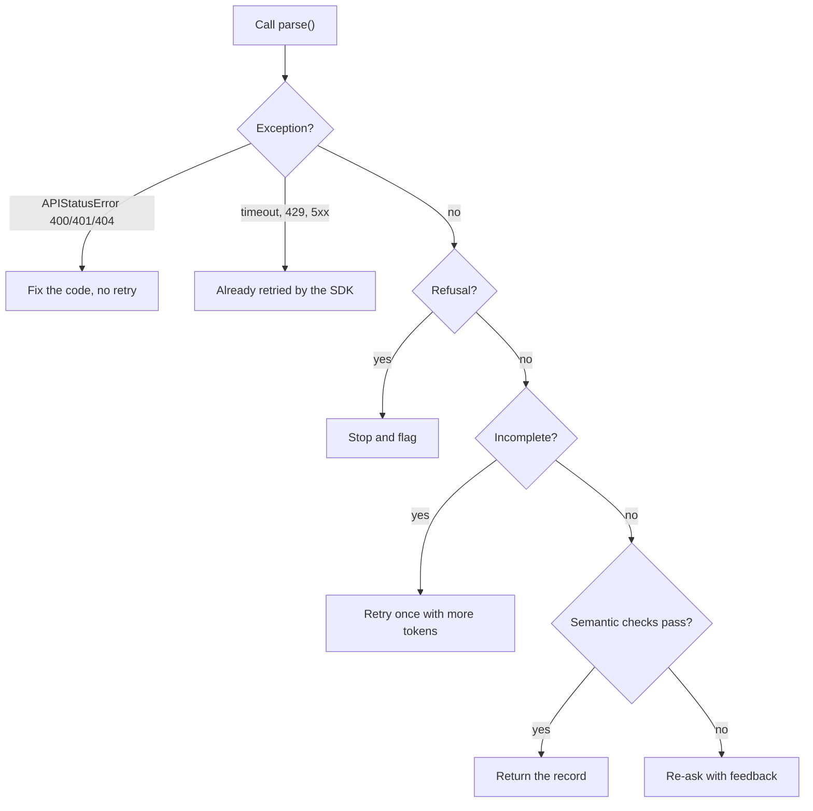
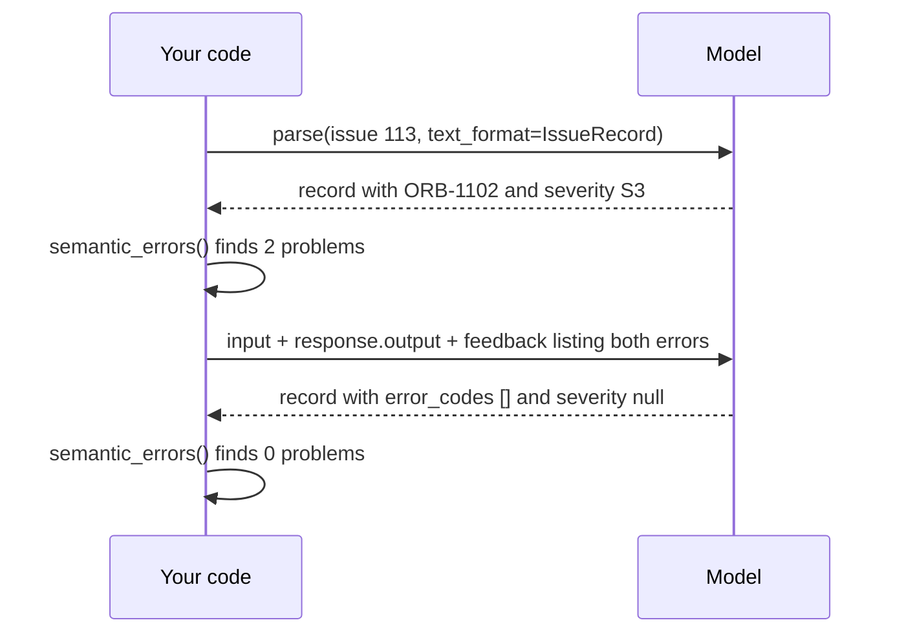
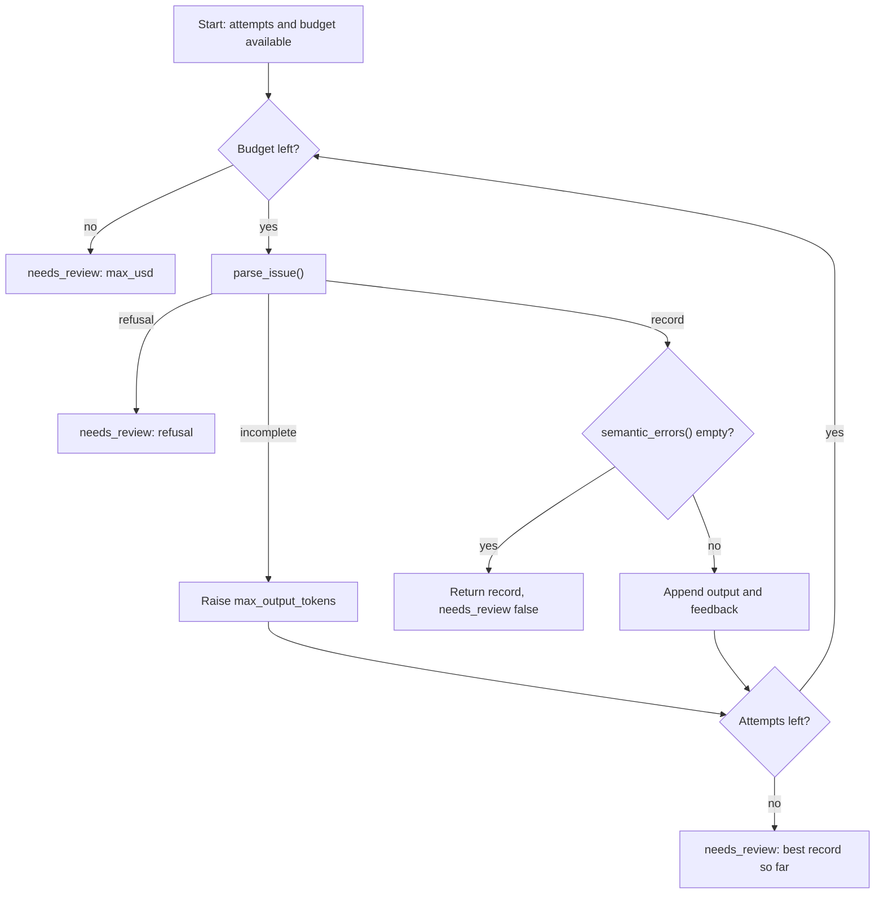
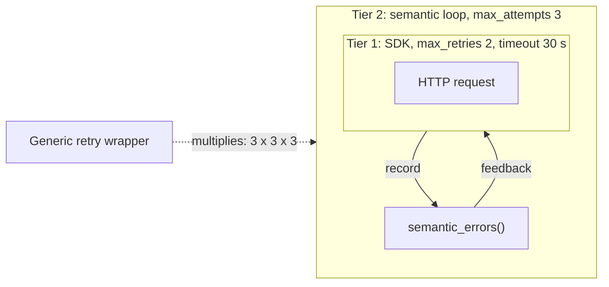

# Handling Semantic Failures: Validate, Re-ask, Bound

Strict mode guarantees the shape of a record, not its truth. Yesterday's extractor can return `error_codes: ["ORB-1102"]` for an issue that quotes no code at all, or `orbit_version: "3.2.1"` for an issue that never names a version, and both pass Pydantic. Today you catch those errors with plain code, send them back to the model once or twice, and stop cleanly when it still can't get them right.

## At a Glance

- **Time:** ~2 h core (+ optional Go Deeper) · **Depth:** working
- **Prerequisites:** [Day 16: Structured Outputs: Native JSON Schema & Extraction](../../Phase_2_Building_with_LLM_APIs/Day_016_structured_outputs/structured_outputs.md), [Day 15: Pydantic for LLM Apps](../../Phase_2_Building_with_LLM_APIs/Day_015_pydantic_for_llms/pydantic_for_llms.md), [Day 12: The OpenAI SDK in Production Code](../../Phase_2_Building_with_LLM_APIs/Day_012_openai_sdk_production/openai_sdk_production.md); primer [A10: Backend & production vocabulary](../../Appendix_Primers/A10_backend_production_vocabulary.md)
- **You'll build:** `reliable_extract()` for `atlas/extract.py`: extract, check against the source issue, re-ask with precise feedback, and return a `needs_review` result when the budget runs out
- **Stops at:** network resilience: custom backoff, fallbacks and circuit breakers ([Day 84](../../Phase_9_Production/Day_084_reliability_fallbacks/reliability_fallbacks.md))
- **Fast path:** Already write retry policies? Read [Re-ask with Feedback](#re-ask-with-feedback) and [Two Tiers of Retries](#two-tiers-of-retries), then do Exercise 2 (≈40 min)
- **Cost:** ≈ $0.05 on `gpt-6-luna` (prices as of 2026-11, [verify](https://developers.openai.com/api/docs/pricing))
- **New terms:** semantic validation, re-ask (feedback retry), attempt cap, needs-review, two-tier retries

> **Coming from Software Engineering?** Two kinds of failure, two kinds of retry. Transport failures (timeouts, 429s, 5xx) are ordinary HTTP retries, and the SDK already does them. Semantic failures are like a `422 Unprocessable Entity` with a field-level error body: the request was well-formed, the content was wrong, and the client must fix it and resubmit. The new part is that an LLM can be *told* what it got wrong and will usually fix it on the next turn. The attempt cap is your retry budget, and the `needs_review` flag is a dead-letter queue (a holding area for messages that kept failing) with a human reading it.

## Before You Start: One File from Earlier Days

Today's scripts import one lesson-local module, `atlas_base.py`, which packs compact copies of Day 15's schemas, Day 12's client and cost math, and Day 16's extractor. Save it next to the other scripts. Two changes from Day 16: the client is built on first use, so offline scripts can import the file without a key, and `extract_issue()` becomes `parse_issue()`, which takes an input list and returns the whole response, because a re-ask needs `response.output`.

```python
# script_id: day_017_semantic_failures/atlas_base
# atlas_base.py: compact copy of Day 15 (schemas, data), Day 12 (client, cost) and Day 16 (extractor).
# Install: uv add "openai>=3.46,<4" pydantic
# Env: ORBIT_DATA (optional). OPENAI_API_KEY only when a call is made: the client is built lazily.
import json
import os
from functools import cache
from pathlib import Path
from typing import Literal

from openai import OpenAI
from openai.types.responses import ParsedResponse
from pydantic import BaseModel, ConfigDict, Field, ValidationError

MODEL = os.environ.get("ATLAS_MODEL", "gpt-6-luna")
DATA_DIR = Path(os.environ.get("ORBIT_DATA", "datasets/orbit"))

IssueType = Literal["bug", "feature", "question", "docs"]
Severity = Literal["S1", "S2", "S3", "S4"]
Component = Literal["core", "scheduler", "flows", "broker-redis", "broker-postgres", "broker-sqs",
                    "cli", "dashboard", "retries", "results", "observability", "auth", "docs"]


class Comment(BaseModel):
    author: str
    body: str


class Issue(BaseModel):
    """One row of issues/issues.jsonl, trimmed to the fields used today (extra keys are ignored)."""
    id: int
    title: str
    body: str
    labels: list[str]
    comments: list[Comment]
```

```python
# script_id: day_017_semantic_failures/atlas_base
class IssueRecord(BaseModel):
    """The facts Atlas extracts from one issue. Fields mirror eval/extraction_gold.jsonl."""
    model_config = ConfigDict(extra="forbid")

    type: IssueType = Field(description="bug, feature, question or docs")
    components: list[Component] = Field(description="Every Orbit component the issue is about")
    severity: Severity | None = Field(description="Bugs only: S1 outage or data loss, S2 major "
                                      "breakage, S3 has a workaround, S4 cosmetic. null otherwise")
    orbit_version: str | None = Field(description="Full Orbit version, e.g. 3.1.2. null when not stated")
    python_version: str | None = Field(description="Python version as written, e.g. 3.12.6. "
                                       "null when not stated")
    error_codes: list[str] = Field(description="ORB-NNNN codes quoted in the issue or its comments")
    summary: str = Field(description="One or two English sentences: symptom, trigger, version")


def _jsonl(path: Path) -> list[dict]:
    return [json.loads(line) for line in path.read_text(encoding="utf-8").splitlines() if line.strip()]


def load_issues() -> list[Issue]:
    return [Issue.model_validate(row) for row in _jsonl(DATA_DIR / "issues" / "issues.jsonl")]


def load_gold() -> dict[int, IssueRecord]:
    rows = _jsonl(DATA_DIR / "eval" / "extraction_gold.jsonl")
    return {row.pop("issue_id"): IssueRecord.model_validate(row) for row in rows}


# USD per 1M tokens, as of 2026-11; verify at https://developers.openai.com/api/docs/pricing
PRICES_PER_1M = {"gpt-6-luna": {"input": 0.10, "cached_input": 0.01, "output": 0.50},
                 "gpt-6.1-terra": {"input": 1.00, "cached_input": 0.05, "output": 5.00}}


@cache
def get_client() -> OpenAI:
    # Tier 1 of two-tier retries: the SDK retries 408/409/429/5xx and connection errors itself.
    return OpenAI(max_retries=2, timeout=30.0)


def cost_from_usage(usage, model: str = MODEL) -> float:
    # Approximation: ignores the cache-write surcharge, which only matters for prefixes over 1,024 tokens (Day 18).
    p, cached = PRICES_PER_1M[model], usage.input_tokens_details.cached_tokens
    return ((usage.input_tokens - cached) * p["input"] + cached * p["cached_input"]
            + usage.output_tokens * p["output"]) / 1_000_000   # reasoning is inside output_tokens
```

The extractor keeps Day 16's instructions and exits. `ExtractionError` gains a `cost_usd`, because refused and truncated calls are billed too and the loop has to count them.

```python
# script_id: day_017_semantic_failures/atlas_base
EXTRACT_INSTRUCTIONS = """You extract facts from GitHub issues filed against Orbit, an open-source
Python background-jobs library. Fill every field of the schema from the issue text only.

Rules:
- Use null when a fact is not stated. Never guess a version from dates or context.
- severity is for bugs only; use null for features, questions and docs.
- error_codes: every ORB-NNNN code that appears anywhere, including logs and comments. [] if none.
- components: usually one; list two only when the issue really spans both.
- summary: one or two sentences in English, even when the issue is in another language.

Component glossary:
core = queues, workers, leases, job execution | scheduler = cron schedules and delays
flows = Flows, steps and step state | broker-redis, broker-postgres, broker-sqs = that broker
cli = the orbit command | dashboard = the web UI | retries = retry policy and backoff
results = the result backend | observability = metrics and tracing
auth = dashboard login and OIDC | docs = the documentation itself"""


def issue_to_input(issue: Issue) -> str:
    """Title, body and comments; never the labels. (Day 16 also truncates very long issues.)"""
    parts = [f"# {issue.title}", issue.body]
    parts += [f"--- comment by {c.author} ---\n{c.body}" for c in issue.comments]
    return "\n\n".join(parts)


class ExtractionError(Exception):
    """The API answered, but not with a usable record."""

    def __init__(self, reason: Literal["refusal", "incomplete"], response: ParsedResponse | None = None,
                 detail: str = "", cost_usd: float = 0.0) -> None:
        super().__init__(f"{reason}: {detail}")
        self.reason, self.response, self.cost_usd = reason, response, cost_usd
```

```python
# script_id: day_017_semantic_failures/atlas_base
def parse_issue(items: list, *, model: str = MODEL, effort: str = "low",
                max_output_tokens: int = 25_000) -> tuple[ParsedResponse, float]:
    """Day 16's extract_issue(), refactored to take the input list and return (response, cost)."""
    try:
        resp = get_client().responses.parse(
            model=model, instructions=EXTRACT_INSTRUCTIONS, input=items, text_format=IssueRecord,
            reasoning={"effort": effort}, max_output_tokens=max_output_tokens)
    except ValidationError as err:   # strict mode fixes the shape, so this means cut-off JSON
        raise ExtractionError("incomplete", detail="truncated JSON") from err   # cost unknown
    cost = cost_from_usage(resp.usage, model)
    if resp.status == "incomplete":
        raise ExtractionError("incomplete", resp, str(resp.incomplete_details.reason), cost)
    refusals = [part.refusal for item in resp.output if item.type == "message"
                for part in item.content if part.type == "refusal"]
    if refusals:
        raise ExtractionError("refusal", resp, refusals[0], cost)
    if resp.output_parsed is None:
        raise ExtractionError("incomplete", resp, "no final answer", cost)
    return resp, cost
```

## Valid JSON, Wrong Facts

Here are three wrong values, from two records of the kind Day 16's spot check turns up (illustrative). Both records validate against `IssueRecord`:

| Issue | Field | Record says | Issue text says |
|---|---|---|---|
| #113 `orbit doctor` heartbeat check | `error_codes` | `["ORB-1102"]` | no ORB code anywhere; the model "remembered" the heartbeat code |
| #113 | `severity` | `"S3"` | it's a question, so severity must be null |
| #10 "worker not picking up jobs" | `orbit_version` | `"3.2.1"` | no version at all; 3.2.1 is the current release |

A schema can't catch these, because each value has the right type. What's wrong is the *meaning*, judged against the source.

## Red Pen and Resubmit

Picture an office form with a reviewer. You hand it in; the reviewer circles two fields in red ("this code isn't in the report", "severity is for bugs only") and hands it back. You fix those two and resubmit. If it comes back wrong a second time, the reviewer stops arguing and puts it in a tray for a manager. Nobody loops forever, and nobody rubber-stamps a bad form.

That's the whole pattern:

- **Semantic validation**: code that checks a record's meaning (right format, wrong meaning) against the source text and known facts.
- **Re-ask (feedback retry)**: send the specific errors back and ask for a corrected record.
- **Attempt cap**: the retry budget, the most attempts you'll allow (here 3), plus a dollar cap.
- **Needs-review**: the result you return when the cap is hit; it goes to a review queue (items a human checks) instead of raising or looping.

## Check One Record by Hand

Before writing code, apply five rules to #113's bad record. The issue is a question about `orbit doctor` failing with `heartbeat_seconds (120) <= lease_seconds (300) / 3`; its log shows `orbit 3.0.1, python 3.11.8`.

| Rule | Record | Verdict |
|---|---|---|
| Every code appears verbatim in the text | `ORB-1102` | ✘ the text contains no ORB code |
| Every code is one of Orbit's 20 codes | `ORB-1102` | ✔ it's real, which is why it's dangerous |
| Severity is set if and only if `type == "bug"` | `S3` on a question | ✘ |
| `orbit_version` is a known release and appears in the text | `3.0.1` | ✔ (see the pitfall about 3.0.1 later) |
| `python_version` appears in the text | `3.11.8` | ✔ |

Two red marks. Notice that rule 2 passes: a plausible, real code is harder to spot than a made-up one, and only the source-text rule catches it. Every rule here is deterministic, cheap and needs no model, which keeps checks fast and testable.

## Name the Parts: Which Failures Deserve a Re-ask

Re-asking fixes only one kind of failure. Before writing the loop, sort every way a call can go wrong into its recovery:

| Failure | Example | Recovery |
|---|---|---|
| Transport | timeout, 429, 500 | SDK retries it (Tier 1); you only configure `max_retries` and `timeout` |
| Permanent request error | 400, 401, 404 | Fix your code or key; never retry |
| Truncated | `status == "incomplete"`, reason `max_output_tokens` | Retry once with a larger `max_output_tokens`; no feedback needed |
| Refusal | content part `type == "refusal"` | Don't re-ask (it refuses again and you pay twice); flag it |
| Semantic | `ORB-1102` not in the text | Re-ask with feedback (Tier 2) |
| Low-information input | #10: no version, no logs | Accept nulls; if checks still fail, `needs_review` |



The SDK raises `openai.APIStatusError` subclasses such as `BadRequestError` (400) and `AuthenticationError` (401) only after its own retries are exhausted, or immediately for codes it never retries ([Day 12](../../Phase_2_Building_with_LLM_APIs/Day_012_openai_sdk_production/openai_sdk_production.md) covers the hierarchy). Your semantic loop never catches those.

## A Minimal Semantic Check

Three rules, each a small function that takes the record and the issue text and returns error messages. Each message starts with the field name, names the bad value and states the rule; that format becomes the feedback later. The 20 known codes are read from Orbit's own `docs/error-codes.md`, so the set can't drift from the docs.

```python
# script_id: day_017_semantic_failures/semantic_checks
# semantic_checks.py: three deterministic rules that compare a record with its source issue. Offline, $0.
# Install: uv add "openai>=3.46,<4" pydantic · Env: ORBIT_DATA (optional)
import re
from collections.abc import Callable, Sequence

from atlas_base import DATA_DIR, Issue, IssueRecord, load_issues

KNOWN_CODES = frozenset(re.findall(r"ORB-\d{4}", (DATA_DIR / "docs" / "error-codes.md").read_text("utf-8")))
Rule = Callable[[IssueRecord, str], list[str]]      # (record, issue text) -> error messages


def issue_text(issue: Issue) -> str:
    return "\n".join([issue.title, issue.body, *(c.body for c in issue.comments)])


def codes_in_text(rec: IssueRecord, text: str) -> list[str]:
    return [f"error_codes: {c} is not in the issue text" for c in rec.error_codes if c not in text]


def codes_known(rec: IssueRecord, text: str) -> list[str]:
    return [f"error_codes: {c} is not an Orbit error code" for c in rec.error_codes if c not in KNOWN_CODES]


def severity_matches_type(rec: IssueRecord, text: str) -> list[str]:
    if (rec.severity is None) == (rec.type == "bug"):
        return [f"severity: {rec.severity} on a {rec.type}; set it for bugs only, null otherwise"]
    return []


BASIC_RULES: list[Rule] = [codes_in_text, codes_known, severity_matches_type]


def semantic_errors(record: IssueRecord, issue: Issue, rules: Sequence[Rule] | None = None) -> list[str]:
    text = issue_text(issue)
    return [msg for rule in (rules or BASIC_RULES) for msg in rule(record, text)]


if __name__ == "__main__":
    issue = next(i for i in load_issues() if i.id == 113)
    bad = IssueRecord(type="question", components=["core", "cli"], severity="S3", orbit_version="3.0.1",
                      python_version="3.11.8", error_codes=["ORB-1102"], summary="orbit doctor fails.")
    print(f"{len(KNOWN_CODES)} known codes")
    print(semantic_errors(bad, issue))
```

```text
20 known codes
['error_codes: ORB-1102 is not in the issue text', 'severity: S3 on a question; set it for bugs only, null otherwise']
```

`rules` is a parameter, so later code can pass a larger or a custom rule list without touching this function.

## Re-ask with Feedback

A re-ask continues the conversation instead of starting over. The model sees its own answer, then your red marks, then produces a new record. In code it's the [Day 8](../../Phase_2_Building_with_LLM_APIs/Day_008_messages_and_state/messages_and_state.md) history pattern: the next input is the original input, plus every item of `response.output` (reasoning and the message), plus one user message with the feedback.



```python
# script_id: day_017_semantic_failures/reask_minimal
# One re-ask round on issue #113: extract, check, feed the errors back, extract again. ≈ $0.001.
# Install: uv add "openai>=3.46,<4" pydantic · Env: OPENAI_API_KEY, ORBIT_DATA
from atlas_base import issue_to_input, load_issues, parse_issue
from semantic_checks import semantic_errors

issue = next(i for i in load_issues() if i.id == 113)
items = [{"role": "user", "content": issue_to_input(issue)}]
resp, cost = parse_issue(items)
errors = semantic_errors(resp.output_parsed, issue)
print("attempt 1:", errors)

if errors:
    feedback = ("Your record breaks these rules:\n" + "\n".join(f"- {e}" for e in errors)
                + "\nReturn the full corrected record and change only those fields. "
                "If the issue doesn't state a fact, use null (or [] for lists). Never guess.")
    items = [*items, *resp.output, {"role": "user", "content": feedback}]   # Day 8 history pattern
    resp, cost2 = parse_issue(items)
    print("attempt 2:", semantic_errors(resp.output_parsed, issue), f"· ${cost + cost2:.5f}")
```

Illustrative output (your numbers will differ; the model often gets #113 right first time, in which case you'll see one clean line and no second call):

```text
attempt 1: ['error_codes: ORB-1102 is not in the issue text']
attempt 2: [] · $0.00083
```

Two details make this work. The `parse()` response's output items replay cleanly as input: the SDK sends the reasoning item and the assistant message back without the parsed object attached. And the feedback ends with "use null… never guess", which matters more than it looks, as the next section shows.

## Break It: Vague Feedback, No Cap, Demanding Feedback

Change one thing at a time in `reask_minimal` and watch what happens (behaviour described from typical runs; yours may vary):

1. **Vague feedback.** Replace the feedback with `"That's wrong, try again."`. The model doesn't know which field is wrong, so it often returns the same record, or changes a correct field. You paid for a second call and learned nothing. Feedback must name the field, the bad value and the rule.
2. **No cap.** Wrap the re-ask in `while semantic_errors(...)`. On an issue the model keeps misreading, this never ends, and every turn re-sends the whole, growing conversation. Correlated failures are the norm: if the model misread the issue once, it tends to misread it again.
3. **Demanding feedback.** Write `"orbit_version is required, fill it in"` for #10, which states no version. The model complies and invents one, usually the latest release. Now the record passes a type check, and if your version rule only checks "is a known release", it passes that too. Always leave the model an honest way out: null.

```text
✘ "Try again."                                    -> same answer, double cost
✘ "orbit_version is required."                    -> fabricated 3.2.1
✔ "orbit_version: 3.2.1 does not appear in the issue; use null when the version isn't stated"
```

## Build: `reliable_extract()`

Three pieces: the full rule set, the result type, and the bounded loop.

### The full rule set

Four more rules join the first three. The version rule is a small factory (a function that builds a rule) so you can pass in which versions count as known, and `mentioned()` matches whole version tokens, so `3.1.2` doesn't match inside `3.1.25`. The `__main__` block runs every rule over the 30 gold records: a rule that flags a correct gold record is over-strict, and you want to know before it starts sending wrong feedback.

```python
# script_id: day_017_semantic_failures/rules
# rules.py: the full rule set (7 rules) plus a sanity check against gold. Offline, $0.
# Install: uv add "openai>=3.46,<4" pydantic · Env: ORBIT_DATA (optional)
import re

from collections.abc import Sequence

from atlas_base import DATA_DIR, Issue, IssueRecord, load_gold, load_issues
from semantic_checks import BASIC_RULES, Rule
import semantic_checks as basic

_CHANGELOG = (DATA_DIR / "docs" / "changelog.md").read_text("utf-8")
CHANGELOG_VERSIONS = frozenset(re.findall(r"^## (\d+\.\d+\.\d+) ", _CHANGELOG, re.M))
KNOWN_VERSIONS = CHANGELOG_VERSIONS | {"3.0.1"}   # 3.0.1 shipped without its own entry; issues cite it


def mentioned(value: str, text: str) -> bool:
    return re.search(rf"(?<![\d.]){re.escape(value)}(?!\d)", text) is not None


def version_rule(known: frozenset[str]) -> Rule:
    def orbit_version_ok(rec: IssueRecord, text: str) -> list[str]:
        v = rec.orbit_version
        if v is not None and v not in known:
            return [f"orbit_version: {v} is not a known Orbit release; use null if unsure"]
        if v is not None and not mentioned(v, text):
            return [f"orbit_version: {v} does not appear in the issue; use null when it isn't stated"]
        return []
    return orbit_version_ok
```

```python
# script_id: day_017_semantic_failures/rules
def python_version_stated(rec: IssueRecord, text: str) -> list[str]:
    v = rec.python_version
    return [] if v is None or mentioned(v, text) else [f"python_version: {v} does not appear in the issue; use null"]


def components_present(rec: IssueRecord, text: str) -> list[str]:
    if rec.type in ("bug", "feature") and not rec.components:
        return [f"components: empty on a {rec.type}; list the component(s) the issue is about"]
    return []


def summary_short(rec: IssueRecord, text: str) -> list[str]:
    return [f"summary: {len(rec.summary)} characters; keep it under 300"] if len(rec.summary) > 300 else []


RULES: list[Rule] = [*BASIC_RULES, version_rule(KNOWN_VERSIONS), python_version_stated,
                     components_present, summary_short]


def semantic_errors(record: IssueRecord, issue: Issue, rules: Sequence[Rule] | None = None) -> list[str]:
    """All seven rules by default; pass `rules` to check a subset or a custom list."""
    return basic.semantic_errors(record, issue, rules or RULES)


if __name__ == "__main__":
    gold, issues = load_gold(), {i.id: i for i in load_issues()}
    for label, rules in [("changelog versions only", [*BASIC_RULES, version_rule(CHANGELOG_VERSIONS)]),
                         ("full RULES", RULES)]:
        flagged = {iid: errs for iid, rec in gold.items() if (errs := semantic_errors(rec, issues[iid], rules))}
        print(f"{label}: {len(flagged)}/{len(gold)} gold records flagged {flagged}")
```

```text
changelog versions only: 1/30 gold records flagged {113: ['orbit_version: 3.0.1 is not a known Orbit release; use null if unsure']}
full RULES: 0/30 gold records flagged {}
```

The first line is the over-strict trap in action: #113 really does run 3.0.1, a patch release with no changelog heading of its own. Build known-value sets from the data you actually see, and re-run this gold check whenever a rule changes.

### The result type and the loop

`ExtractResult` is what callers get back, always: the best record seen (fewest errors), how many calls it took, the errors still open, the money spent, and whether a person needs to look. `history` keeps each attempt's errors and cost, which is what the measurement below reads.

```python
# script_id: day_017_semantic_failures/reliable_extract
# reliable_extract.py: the bounded re-ask loop for atlas/extract.py. ≈ $0.0005-0.002 per issue on gpt-6-luna.
# Install: uv add "openai>=3.46,<4" pydantic · Env: OPENAI_API_KEY, ORBIT_DATA, ATLAS_MODEL (optional)
from collections.abc import Callable, Sequence
from dataclasses import dataclass, field

from atlas_base import MODEL, ExtractionError, Issue, IssueRecord, issue_to_input, load_issues, parse_issue
from rules import RULES, Rule, semantic_errors

ParseFn = Callable[..., tuple]   # parse_issue() in production; a fake with the same shape in tests


@dataclass
class ExtractResult:
    record: IssueRecord | None          # best record seen, even when needs_review is True
    attempts: int                       # API calls made
    errors: list[str]                   # errors still open on `record`
    cost_usd: float
    needs_review: bool                  # True -> send to the review queue
    stop_reason: str = "ok"             # ok | max_attempts | max_usd | refusal | incomplete
    history: list[dict] = field(default_factory=list)   # [{"errors": [...], "cost_usd": x}, ...]


def build_feedback(errors: list[str]) -> str:
    """Name each field, its bad value and the rule, and always allow null."""
    lines = "\n".join(f"- {e}" for e in errors)
    return (f"Your record breaks these rules:\n{lines}\nReturn the full corrected record and change "
            "only those fields. If the issue doesn't state a fact, use null (or [] for lists). Never guess.")
```

The loop follows this flowchart exit by exit:



```python
# script_id: day_017_semantic_failures/reliable_extract
def reliable_extract(issue: Issue, *, max_attempts: int = 3, max_usd: float = 0.01, model: str = MODEL,
                     effort: str = "low", rules: Sequence[Rule] = RULES, parse: ParseFn = parse_issue) -> ExtractResult:
    """Extract, check, re-ask with feedback. Never raises for a bad answer, never loops forever."""
    items: list = [{"role": "user", "content": issue_to_input(issue)}]
    best, best_errors, spent, history = None, [], 0.0, []
    max_tokens, stop = 25_000, "max_attempts"
    for _ in range(max_attempts):
        if spent >= max_usd:
            stop = "max_usd"
            break
        try:
            resp, cost = parse(items, model=model, effort=effort, max_output_tokens=max_tokens)
        except ExtractionError as err:
            spent += err.cost_usd
            history.append({"errors": [str(err)], "cost_usd": err.cost_usd})
            stop = err.reason
            if err.reason == "refusal":
                break                   # a re-ask pays twice for the same "no"
            max_tokens = 50_000         # incomplete: same input, more room
            continue
        spent += cost
        errors = semantic_errors(resp.output_parsed, issue, rules)
        history.append({"errors": errors, "cost_usd": cost})
        if best is None or len(errors) < len(best_errors):
            best, best_errors = resp.output_parsed, errors
        if not errors:
            stop = "ok"
            break
        stop = "max_attempts"
        items = [*items, *resp.output, {"role": "user", "content": build_feedback(errors)}]
    return ExtractResult(record=best, attempts=len(history), errors=best_errors, cost_usd=spent,
                         needs_review=stop != "ok", stop_reason=stop, history=history)


if __name__ == "__main__":
    issue = next(i for i in load_issues() if i.id == 113)
    r = reliable_extract(issue)
    print(f"#{issue.id} attempts={r.attempts} needs_review={r.needs_review} "
          f"stop={r.stop_reason} cost=${r.cost_usd:.5f} errors={r.errors}")
```

Illustrative output (your numbers will differ):

```text
#113 attempts=2 needs_review=False stop=ok cost=$0.00082 errors=[]
```

Note what the function never does: it never raises for a bad answer, so a batch of 1,000 issues can't die on issue 17, and it never returns a bad record silently, because `needs_review` travels with it. Transport errors after the SDK's own retries do still raise; that's deliberate, and [Day 22](../../Phase_2_Building_with_LLM_APIs/Day_022_capstone_r1_extractor/capstone_r1_extractor.md)'s pipeline decides what to do with them. The `max_usd` default is generous for `gpt-6-luna` (about 10–20 calls); it exists for the day you switch `model` to something 100× pricier.

### Run every exit offline

The `parse` parameter is a seam (a point where you can swap in a stand-in without editing the function). Production uses the real `parse_issue()`; here a scripted fake model returns records you choose, so you can watch each exit of the loop with no key and no cost. [Day 19](../../Phase_2_Building_with_LLM_APIs/Day_019_testing_llm_code/testing_llm_code.md) turns this into unit tests.

```python
# script_id: day_017_semantic_failures/loop_offline
# loop_offline.py: drive reliable_extract() with a scripted fake model, so every exit runs offline. $0.
# Install: uv add "openai>=3.46,<4" pydantic · Env: ORBIT_DATA (optional). No API key needed.
from types import SimpleNamespace

from atlas_base import ExtractionError, IssueRecord, load_gold, load_issues
from reliable_extract import reliable_extract


def scripted(*replies: IssueRecord | str, cost: float = 0.0004):
    """Stands in for parse_issue(): returns replies in order; the string "refusal" raises like a refusal."""
    queue, seen = list(replies), []

    def fake_parse(items: list, **_: object) -> tuple:
        seen.append(len(items))                  # the input grows by output + feedback on each re-ask
        reply = queue.pop(0)
        if reply == "refusal":
            raise ExtractionError("refusal", detail="I can't help with that.", cost_usd=cost)
        message = {"role": "assistant", "content": reply.model_dump_json()}   # stands in for resp.output
        return SimpleNamespace(output=[message], output_parsed=reply), cost

    fake_parse.seen = seen
    return fake_parse


issue = next(i for i in load_issues() if i.id == 113)
good = load_gold()[113]
bad = good.model_copy(update={"error_codes": ["ORB-1102"], "severity": "S3"})
cases = [("fixed on re-ask", scripted(bad, good), {}),
         ("never fixed", scripted(bad, bad, bad), {}),
         ("refusal", scripted("refusal"), {}),
         ("over budget", scripted(bad, bad, bad, cost=0.006), {"max_usd": 0.01})]
for label, fake, kwargs in cases:
    r = reliable_extract(issue, parse=fake, **kwargs)
    print(f"{label:<16} attempts={r.attempts} stop={r.stop_reason:<12} needs_review={r.needs_review!s:<5} "
          f"cost=${r.cost_usd:.4f} input items per call={fake.seen}")
```

```text
fixed on re-ask  attempts=2 stop=ok           needs_review=False cost=$0.0008 input items per call=[1, 3]
never fixed      attempts=3 stop=max_attempts needs_review=True  cost=$0.0012 input items per call=[1, 3, 5]
refusal          attempts=1 stop=refusal      needs_review=True  cost=$0.0004 input items per call=[1]
over budget      attempts=2 stop=max_usd      needs_review=True  cost=$0.0120 input items per call=[1, 3]
```

Each line is one exit of the flowchart. The budget case shows that `max_usd` is checked *before* a call, so the second call can overshoot the cap; Exercise 3 fixes that. The fake can't tell you how often a real model fixes its record; that's what the live run and the measurement below are for.

## Two Tiers of Retries

You now have two retry loops, and they must stay separate:

- **Tier 1, inside: the SDK.** `OpenAI(max_retries=2, timeout=30.0)` in `get_client()`. The SDK retries connection errors, 408, 409, 429 and 5xx with exponential backoff (0.5 s growing to 8 s, honouring `retry-after`), and never retries 400/401/404. Override per call with `get_client().with_options(max_retries=0, timeout=10.0)` on a path where a user is waiting.
- **Tier 2, outside: your semantic loop.** `reliable_extract(max_attempts=3)` reacts only to a record that came back and failed the rules.

Two-tier retries means each tier handles only its own failure type, so attempts add up predictably. Nest a third, generic retry around everything and they multiply.



How bad is "multiplies"? Turn the knobs and compute the worst case for one issue:

```python
# script_id: day_017_semantic_failures/attempt_math
# Worst-case requests and wall time for one issue, right vs wrong nesting. Offline, $0. Stdlib only.
from math import prod

SDK_TRIES = 1 + 2          # max_retries=2 on the client: the first try plus 2 retries
SEMANTIC_ATTEMPTS = 3      # reliable_extract(max_attempts=3)
OUTER_WRAPPER = 3          # a generic "retry 3 times" decorator someone adds around everything
BACKOFF_CAP_S = 8          # SDK backoff grows from 0.5 s to 8 s (a retry-after header can ask for more)


def worst_case(timeout_s: float, *layers: int) -> tuple[int, float]:
    requests = prod(layers)
    logical_calls = requests // SDK_TRIES
    return requests, requests * timeout_s + logical_calls * (SDK_TRIES - 1) * BACKOFF_CAP_S


for label, layers in [("right: semantic x SDK", (SEMANTIC_ATTEMPTS, SDK_TRIES)),
                      ("wrong: wrapper x semantic x SDK", (OUTER_WRAPPER, SEMANTIC_ATTEMPTS, SDK_TRIES))]:
    for timeout in (30, 600):                 # 600 s is the SDK's default timeout
        n, secs = worst_case(timeout, *layers)
        print(f"{label:<32} timeout={timeout:>3}s  {n:>2} requests  up to {secs / 60:5.1f} min")
```

```text
right: semantic x SDK            timeout= 30s   9 requests  up to   5.3 min
right: semantic x SDK            timeout=600s   9 requests  up to  90.8 min
wrong: wrapper x semantic x SDK  timeout= 30s  27 requests  up to  15.9 min
wrong: wrapper x semantic x SDK  timeout=600s  27 requests  up to 272.4 min
```

Two lessons from four lines. Set a timeout: the 600 s default turns one stuck issue into a 90-minute hang. And never wrap the semantic loop in another retry, or catch `RateLimitError` to re-ask: Tier 1 already handled it. Custom backoff, jitter and circuit breakers (which stop calling a failing service for a while) belong to [Day 84](../../Phase_9_Production/Day_084_reliability_fallbacks/reliability_fallbacks.md); the [A10 primer](../../Appendix_Primers/A10_backend_production_vocabulary.md) defines the vocabulary.

## Measure the Upgrade

The R1 scoreboard gets today's line: how many of the 30 gold issues produce a record with at least one semantic error on the first attempt, versus after the loop. This counts rule violations, not field accuracy; a record can pass every rule and still pick the wrong component. [Day 20](../../Phase_2_Building_with_LLM_APIs/Day_020_first_eval_set/first_eval_set.md) measures accuracy.

```python
# script_id: day_017_semantic_failures/measure
# R1 scoreboard: semantic errors before vs after re-ask on the 30 gold issues. ≈ $0.02.
# Install: uv add "openai>=3.46,<4" pydantic · Env: OPENAI_API_KEY, ORBIT_DATA
from collections import Counter

from atlas_base import load_gold, load_issues
from reliable_extract import reliable_extract

gold = load_gold()
issues = [i for i in load_issues() if i.id in gold]
results = [reliable_extract(issue) for issue in issues]

n = len(results)
before = sum(bool(r.history[0]["errors"]) for r in results)      # attempt 1 alone
after = sum(r.needs_review for r in results)
first_cost = sum(r.history[0]["cost_usd"] for r in results)
total = sum(r.cost_usd for r in results)
print(f"records with semantic errors: {before}/{n} -> {after}/{n}")
print(f"re-ask rate {sum(r.attempts > 1 for r in results) / n:.0%} · "
      f"extra cost +{(total - first_cost) / max(first_cost, 1e-9):.0%} · total ${total:.4f}")
print("attempts histogram:", dict(sorted(Counter(r.attempts for r in results).items())))
print("needs_review:", [f"#{i.id} {r.stop_reason}" for i, r in zip(issues, results) if r.needs_review])
```

Illustrative output (your numbers will differ):

```text
records with semantic errors: 7/30 -> 2/30
re-ask rate 23% · extra cost +27% · total $0.0161
attempts histogram: {1: 23, 2: 5, 3: 2}
needs_review: ['#10 max_attempts', '#176 max_attempts']
```

Read it like an engineer: re-asking fixed most failures for about a quarter more money, and the leftovers go to a person with their errors attached. Look at the leftovers before tuning anything: they're often low-information issues where no prompt can help.

## Trade-offs and When Not to Re-ask

| Situation | Do | Why |
|---|---|---|
| A deterministic rule fails and the text holds the answer | Re-ask with specific feedback | Cheap, and usually fixed in one round |
| Refusal | Stop and flag | It refuses again and you pay twice |
| Vague or low-information issue | Accept nulls; `needs_review` if rules still fail | More attempts can't add missing facts |
| Expensive model | `max_attempts=1–2`, or raise effort once (Exercise 4) | Each re-ask re-sends the whole conversation |
| A user is waiting | One re-ask at most, short timeout | Latency adds up per attempt |
| The check needs judgment ("is the summary faithful?") | Not a rule; use an LLM judge ([Day 45](../../Phase_5_Evaluation_and_Observability/Day_045_llm_as_judge/llm_as_judge.md)) | Rules stay deterministic and testable |

Rule of thumb: re-ask only when your code can say exactly what's wrong.

### In production

- Persist every `needs_review` result with its errors and history in a review queue; a person's corrections become future gold.
- Log every attempt (issue id, attempt number, errors, cost) with Day 12's `log_call()`, and alert when the re-ask rate jumps; that usually means a prompt or model change regressed.
- Track hit rates per rule. A rule that fires on 40% of records is a bug in the rule or the prompt.
- Put the rules under unit tests ([Day 19](../../Phase_2_Building_with_LLM_APIs/Day_019_testing_llm_code/testing_llm_code.md)); they're pure functions, so this is cheap.
- Remember validity ≠ accuracy: zero violations doesn't mean the fields are right (Day 20).

## Go Deeper (optional)

<details><summary>Go deeper: why the cap is 2–3 attempts, in numbers</summary>

**In words.** Each re-ask fixes some of the records it sees, but the ones left are the hard ones, so later attempts fix fewer and cost more (the conversation grows).

**Toy numbers.** 100 issues; 20 fail attempt 1. Suppose a re-ask fixes 60% of what it sees. After attempt 2, 8 still fail; after attempt 3, about 3; a fourth attempt would leave about 1.3. Calls made: 100 + 20 + 8 = 128 for three attempts, so +28% calls to cut failures from 20 to 3. A fourth attempt spends 3 more calls to rescue about 2 records, and in practice fewer, because the fix rate drops on the hard cases.

**Formula.** With first-attempt failure rate *p*, re-ask fix rate *r* and *N* issues, records still failing after *k* attempts ≈ *N·p·(1−r)^(k−1)*, and calls ≈ *N·(1 + p·Σ_{j=0}^{k−2} (1−r)^j)*. Estimate *p* and *r* from `ExtractResult.history` on your own data before you change `max_attempts`.

</details>

<details><summary>Go deeper: escalate instead of repeating</summary>

When the cheap model keeps failing the same rule, a third identical attempt rarely helps, but one attempt on a stronger model sometimes does. This is quality escalation, not an availability fallback (switching models during an outage is Day 84's topic).

```python
# script_id: day_017_semantic_failures/escalate
# Escalate a needs_review result to a stronger model once, before a person sees it. ≈ $0.01 per escalation.
# Install: uv add "openai>=3.46,<4" pydantic · Env: OPENAI_API_KEY, ORBIT_DATA
from atlas_base import Issue, load_gold, load_issues
from reliable_extract import ExtractResult, reliable_extract

STRONG_MODEL = "gpt-6.1-terra"   # 10x Luna's price (as of 2026-11, verify); must be in PRICES_PER_1M


def extract_with_escalation(issue: Issue) -> ExtractResult:
    cheap = reliable_extract(issue)
    if not cheap.needs_review or cheap.stop_reason == "refusal":
        return cheap                              # clean, or a refusal a bigger model won't fix
    strong = reliable_extract(issue, model=STRONG_MODEL, max_attempts=2, max_usd=0.02)
    pick = strong if strong.record and len(strong.errors) <= len(cheap.errors) else cheap
    pick.attempts = cheap.attempts + strong.attempts
    pick.cost_usd = cheap.cost_usd + strong.cost_usd   # report the full spend, whichever won
    pick.history = cheap.history + strong.history
    return pick


if __name__ == "__main__":
    gold = load_gold()
    for issue in [i for i in load_issues() if i.id in gold]:
        r = extract_with_escalation(issue)
        if r.attempts > 3 or r.needs_review:
            print(f"#{issue.id} attempts={r.attempts} needs_review={r.needs_review} ${r.cost_usd:.4f}")
```

Measure before adopting it: if escalations rarely end clean, the issues are low-information and a person is the right next step.

</details>

<details><summary>Go deeper: what a re-ask costs, and three ways to carry state</summary>

- **Manual history (today's choice).** Each re-ask re-sends the instructions, the issue, the previous output items (including reasoning) and the feedback, so attempt 2's input is roughly double attempt 1's. The prefix (instructions + issue) is identical across attempts, which is exactly what automatic prompt caching rewards once it passes 1,024 tokens ([Day 18](../../Phase_2_Building_with_LLM_APIs/Day_018_cost_latency_caching/cost_latency_caching.md)).
- **`previous_response_id=resp.id`, input = the feedback message only.** Less to upload, but it needs a stored response (`store` defaults to true), every earlier token is still billed as input, and `instructions` don't carry over, so keep passing them (`parse_issue()` does).
- **A fresh call.** Send the original input plus "A previous attempt made these errors: …", without the old output. Smaller and stateless, but the model can't see the answer it's correcting; it works best when errors name specific fields.
- **With `store=False`** (no server-side retention), reasoning items come back with `encrypted_content`; replay them unchanged. Retention choices are [Day 73](../../Phase_8_Safety_and_Security/Day_073_privacy_pii/privacy_pii.md)'s topic.

</details>

## Common Pitfalls

- **Re-asking transport errors on top of SDK retries.** Symptom: one flaky minute turns into dozens of requests per issue and a burst of `openai.RateLimitError: Error code: 429`. Cause: a generic retry around the semantic loop. Fix: the semantic loop reacts only to records that failed rules; Tier 1 owns transport.
- **Re-asking a refusal.** Symptom: two refusal parts, two bills. Fix: stop on `reason == "refusal"` and flag it.
- **"Try again" feedback.** Symptom: attempt 2 returns the same record. Fix: name each field, the bad value and the rule.
- **Feedback that demands a value.** Symptom: `orbit_version: "3.2.1"` appears on issues that state no version. Fix: every feedback message allows null.
- **Over-strict checks.** Symptom: correct records flagged, e.g. #113's `3.0.1`, which has no changelog heading. Cause: a known-value set built from one source. Fix: build sets from the data you see, run the gold sanity check, and log rule hit rates.

> **Where we stop:** today configures SDK retries and adds a semantic loop; custom backoff with jitter, model fallbacks and circuit breakers are network resilience, covered in [Day 84](../../Phase_9_Production/Day_084_reliability_fallbacks/reliability_fallbacks.md).

## Key Takeaways

- Strict mode guarantees shape, not truth: check meaning against the source text with deterministic rules, and run those rules on gold before trusting them.
- Sort failures before retrying: transport goes to the SDK, permanent errors to your code, `incomplete` to one bigger budget, refusals to a flag, and only semantic errors to a re-ask.
- A re-ask continues the conversation (`input + response.output + feedback`), and good feedback names the field, the value and the rule, and always allows null.
- Bound the loop by attempts and dollars, and return an `ExtractResult` with `needs_review` instead of raising or looping.
- Keep two tiers, never three: SDK retries inside, the semantic loop outside, and measure the re-ask rate and extra cost on gold.

## Quick Reference

| API / pattern | When to use | Gotcha |
|---|---|---|
| `semantic_errors(record, issue, rules)` | After every parsed record | Run new rules on gold first |
| `[*items, *resp.output, {"role": "user", "content": feedback}]` | Re-ask | Keep every output item, not only the text |
| `build_feedback(errors)` | Writing the re-ask message | Field + value + rule; always allow null |
| `reliable_extract(issue, max_attempts=3, max_usd=0.01)` | Any batch extraction | Returns `needs_review`; transport errors still raise |
| `OpenAI(max_retries=2, timeout=30.0)` · `client.with_options(...)` | Tier 1 transport retries | Default timeout is 600 s |
| `part.type == "refusal"` | Detect refusals | Never re-ask them |
| `resp.status == "incomplete"` | Truncated output | Billed anyway; retry once with more tokens |

## Exercises

1. **Warm-up.** Add a rule: `summary` must be under 300 characters *and* must not repeat the issue title. Swap it into the rule list without editing `rules.py`.

<details><summary>Solution</summary>

```python
# script_id: day_017_semantic_failures/solution_ex1
# A summary rule: under 300 characters and not a copy of the title. Offline, $0.
# Install: uv add "openai>=3.46,<4" pydantic · Env: ORBIT_DATA (optional)
from atlas_base import IssueRecord, load_gold, load_issues
from rules import RULES, semantic_errors, summary_short


def summary_ok(rec: IssueRecord, text: str) -> list[str]:
    title = text.splitlines()[0].strip().lower().rstrip(".")   # issue_text() puts the title first
    errors = summary_short(rec, text)
    if rec.summary.strip().lower().rstrip(".") == title:
        errors.append("summary: repeats the title; describe the symptom and trigger instead")
    return errors


RULES_EX1 = [r for r in RULES if r is not summary_short] + [summary_ok]

if __name__ == "__main__":
    issues, gold = {i.id: i for i in load_issues()}, load_gold()
    lazy = gold[113].model_copy(update={"summary": issues[113].title})
    print(semantic_errors(lazy, issues[113], RULES_EX1))
    print(sum(bool(semantic_errors(r, issues[i], RULES_EX1)) for i, r in gold.items()), "gold records flagged")
```

```text
['summary: repeats the title; describe the symptom and trigger instead']
0 gold records flagged
```

</details>

2. **Core.** Make the error-code feedback quote the evidence ("the text contains ORB-1301, ORB-1502"), then compare plain vs evidence feedback on the gold issues.

<details><summary>Solution</summary>

```python
# script_id: day_017_semantic_failures/solution_ex2
# Evidence-quoting feedback for error codes, plus a live A/B. Offline part $0; live part ≈ $0.03.
# Install: uv add "openai>=3.46,<4" pydantic · Env: ORBIT_DATA; OPENAI_API_KEY for the live part
import os
import re

from atlas_base import IssueRecord, load_gold, load_issues
from reliable_extract import reliable_extract
from rules import RULES, semantic_errors
from semantic_checks import codes_in_text


def codes_with_evidence(rec: IssueRecord, text: str) -> list[str]:
    found = sorted(set(re.findall(r"ORB-\d{4}", text)))
    seen = ", ".join(found) if found else "no ORB codes at all"
    return [f"error_codes: {c} is not in the issue text; the text contains {seen}"
            for c in rec.error_codes if c not in text]


EVIDENCE_RULES = [codes_with_evidence if r is codes_in_text else r for r in RULES]

if __name__ == "__main__":
    issues, gold = {i.id: i for i in load_issues()}, load_gold()
    bad = gold[109].model_copy(update={"error_codes": ["ORB-1501", "ORB-1301"]})
    print(semantic_errors(bad, issues[109], EVIDENCE_RULES))
    if os.environ.get("OPENAI_API_KEY"):
        for label, rules in [("plain", RULES), ("evidence", EVIDENCE_RULES)]:
            results = [reliable_extract(issues[i], rules=rules) for i in gold]
            fixed = sum(r.attempts > 1 and not r.needs_review for r in results)
            print(f"{label}: fixed by re-ask {fixed} · needs_review {sum(r.needs_review for r in results)}")
```

```text
['error_codes: ORB-1501 is not in the issue text; the text contains ORB-1301, ORB-1502']
```

With only a handful of failing records, a difference of one or two is noise; run it twice before concluding.

</details>

3. **Core.** Enforce `max_usd` *before* spending: skip an attempt whose estimated cost would push the total over the cap, and report `stop_reason="max_usd"`.

<details><summary>Solution</summary>

```python
# script_id: day_017_semantic_failures/solution_ex3
# Bound by money before spending it: estimate the next attempt from the last one. Offline, $0.


def next_attempt_fits(history: list[dict], spent: float, max_usd: float, growth: float = 1.6) -> bool:
    """A re-ask re-sends everything plus feedback, so it costs more than the call before it.
    growth=1.6 is a starting guess; fit it from your call logs."""
    if not history:
        return spent < max_usd                 # the first attempt always runs under a positive cap
    return spent + history[-1]["cost_usd"] * growth <= max_usd


# In reliable_extract, replace the budget check at the top of the loop with:
#     if not next_attempt_fits(history, spent, max_usd):
#         stop = "max_usd"
#         break

if __name__ == "__main__":
    h = [{"errors": ["x"], "cost_usd": 0.004}]
    print(next_attempt_fits(h, spent=0.004, max_usd=0.01))   # 0.004 + 0.0064 > 0.01
    print(next_attempt_fits(h, spent=0.004, max_usd=0.02))
    print(next_attempt_fits([], spent=0.0, max_usd=0.01))
```

```text
False
True
True
```

</details>

4. **Stretch (optional).** Compare `effort="low"` with up to 3 attempts against one call at `effort="medium"`: dollars per clean record on the 30 gold issues. When does raising effort beat re-asking?

<details><summary>Solution</summary>

```python
# script_id: day_017_semantic_failures/solution_ex4
# Re-ask at effort "low" vs one call at "medium": dollars per clean record on 30 gold issues. ≈ $0.05.
# Install: uv add "openai>=3.46,<4" pydantic · Env: OPENAI_API_KEY, ORBIT_DATA
from atlas_base import load_gold, load_issues
from reliable_extract import reliable_extract

gold = load_gold()
issues = [i for i in load_issues() if i.id in gold]
for label, kwargs in [("low + re-ask (3)", {"effort": "low", "max_attempts": 3}),
                      ("medium, 1 call", {"effort": "medium", "max_attempts": 1})]:
    results = [reliable_extract(issue, **kwargs) for issue in issues]
    clean = sum(not r.needs_review for r in results)
    spent = sum(r.cost_usd for r in results)
    print(f"{label:<17} clean {clean}/{len(results)} · ${spent:.4f} · ${spent / max(clean, 1):.5f} per clean record")
```

Medium effort pays for more reasoning tokens on *every* call; re-asking pays extra only on the records that fail. Raising effort wins when the first-attempt failure rate is high; re-asking wins when it's low.

</details>

## References & Further Reading

- [OpenAI: Structured model outputs](https://developers.openai.com/api/docs/guides/structured-outputs): the official guide, including how refusals appear and why you check them.
- [OpenAI: Conversation state](https://developers.openai.com/api/docs/guides/conversation-state): manual history vs `previous_response_id`, and what each bills.
- [OpenAI: Reasoning models](https://developers.openai.com/api/docs/guides/reasoning): effort values and handling `incomplete` responses.
- [OpenAI: Error codes](https://developers.openai.com/api/docs/guides/error-codes): which HTTP errors are permanent and which are transient.
- [OpenAI: Libraries](https://developers.openai.com/api/docs/libraries): the official SDKs, whose READMEs document `max_retries`, `timeout` and `with_options`.
- [A10: Backend & production vocabulary](../../Appendix_Primers/A10_backend_production_vocabulary.md): retries, idempotency, dead-letter queues and timeouts in one place.

## What's Next

Your extractor now catches its own wrong answers and knows when to stop, but every re-ask re-sends the whole conversation. In [Day 18: Cost & Latency Engineering: Caching, Batch & Budgets](../../Phase_2_Building_with_LLM_APIs/Day_018_cost_latency_caching/cost_latency_caching.md) you'll make those repeated prefixes cheap with prompt caching, move bulk extraction to Batch, and turn `max_usd` into a real per-run budget.
