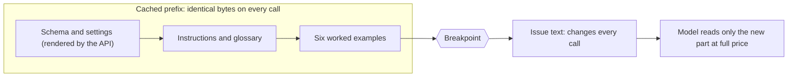
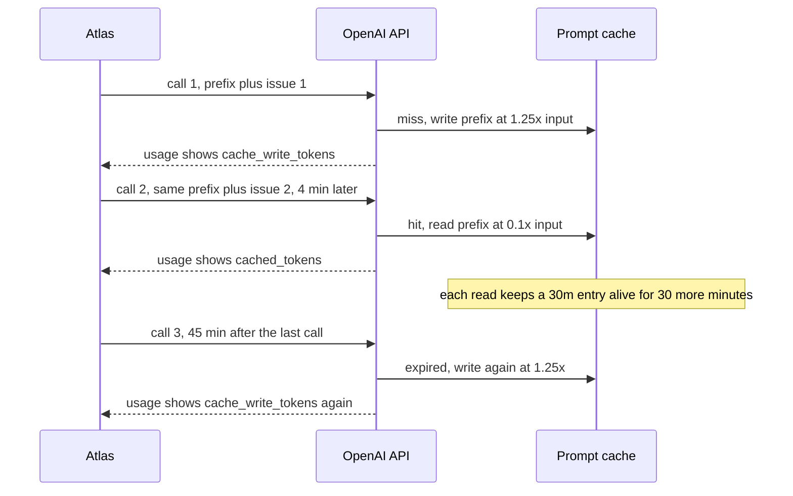
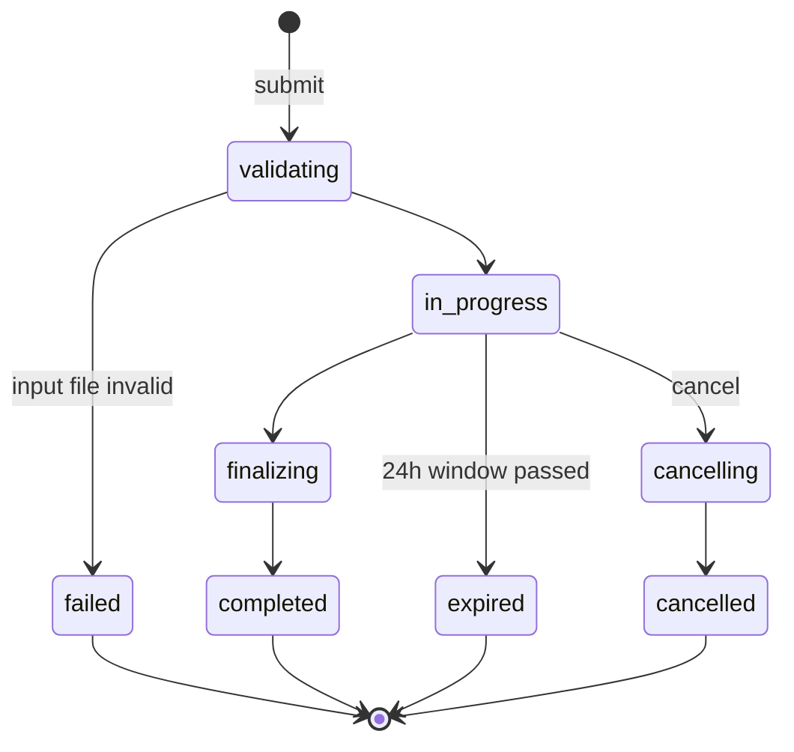

# Cost & Latency Engineering: Caching, Batch & Budgets

One extraction costs a fraction of a cent, until it runs nightly over every Orbit issue, re-runs on every prompt change, re-asks 30% of the time and gets compared across two models. Cost and latency decide whether a feature ships. Today you cut both with measurements from `usage`: prompt caching for text that never changes, Batch and Flex for work that can wait, and budgets that stop a run before it overspends.

## At a Glance

- **Time:** ~2 h core (+ optional Go Deeper) · **Depth:** working
- **Prerequisites:** [Day 7: Choosing a Model: Capability, Cost, Latency & Lifecycle](../../Phase_1_How_LLMs_Work/Day_007_choosing_a_model/choosing_a_model.md), [Day 12: The OpenAI SDK in Production Code](../../Phase_2_Building_with_LLM_APIs/Day_012_openai_sdk_production/openai_sdk_production.md), [Day 16: Structured Outputs: Native JSON Schema & Extraction](../../Phase_2_Building_with_LLM_APIs/Day_016_structured_outputs/structured_outputs.md), [Day 17: Handling Semantic Failures: Validate, Re-ask, Bound](../../Phase_2_Building_with_LLM_APIs/Day_017_semantic_failures/semantic_failures.md); primer [A10: Backend & production vocabulary](../../Appendix_Primers/A10_backend_production_vocabulary.md) for p95
- **You'll build:** a caching experiment measuring hit rate and savings on an extended `CostTracker` (cache writes, tiers, p50/p95), a Batch job module and a `Budget`
- **Stops at:** semantic caching and model routing ([Day 85](../../Phase_9_Production/Day_085_caching_cost_scale/caching_cost_scale.md))
- **Fast path:** Already price cloud APIs for a living? Read [Caching Math by Hand](#caching-math-by-hand) and [the build](#build-the-caching-experiment), then do Exercise 2 (≈50 min)
- **Cost:** ≈ $0.10 on `gpt-6-luna` (prices as of 2026-11, [verify](https://developers.openai.com/api/docs/pricing))
- **New terms:** prompt caching, cache hit rate, Batch API, Flex processing, latency percentile (p50/p95)

> **Coming from Software Engineering?** Prompt caching is HTTP/CDN caching (a content delivery network keeps copies of responses close to users) keyed on the exact bytes of the start of your prompt, with a TTL (how long a cached item lives). Change one byte near the top and every later byte misses, like changing a URL. The Batch API is spot instances or off-peak jobs: you trade a deadline for a 50% discount. Budgets are capacity planning plus spend alarms, except the alarm also stops the job. What transfers: measure the hit rate, put volatile data last, and treat a hit-rate drop after a deploy as a regression.

## Before You Start: One File from Earlier Days

Today's scripts share one lesson-local module, `extract.py`: a compact copy of Day 15's schemas and Day 16's extractor with one change: the rules plus six worked examples form one **static prefix** (the start of the prompt, identical on every call), and the issue goes last. The examples come from maintainer labels on issues outside the eval gold, so Day 20's scores stay honest.

```python
# script_id: day_018_cost_latency_caching/extract
# extract.py: compact copy of Day 15's schemas + Day 16's extractor, laid out for caching.
# Install: uv add "openai>=3.46,<4" pydantic tiktoken
# Env: OPENAI_API_KEY (required at import), ATLAS_MODEL, ORBIT_DATA (optional)
import json
import os
import time
from pathlib import Path
from typing import Literal

import tiktoken
from openai import OpenAI
from pydantic import BaseModel, ConfigDict, Field

MODEL = os.environ.get("ATLAS_MODEL", "gpt-6-luna")
DATA_DIR = Path(os.environ.get("ORBIT_DATA", "datasets/orbit"))
client = OpenAI(timeout=60, max_retries=3)
_ENC = tiktoken.get_encoding("o200k_base")  # approximate for GPT-6 (Day 4)

IssueType = Literal["bug", "feature", "question", "docs"]
Severity = Literal["S1", "S2", "S3", "S4"]
Component = Literal["core", "scheduler", "flows", "broker-redis", "broker-postgres", "broker-sqs",
                    "cli", "dashboard", "retries", "results", "observability", "auth", "docs"]


class Issue(BaseModel):
    """One raw row of issues.jsonl (Day 15, trimmed). Labels are the answer key, never model input."""
    id: int
    title: str
    body: str
    labels: list[str]
    orbit_version: str | None
    python_version: str | None
    error_codes: list[str]
    comments: list[dict]
```

`IssueRecord` is unchanged from Day 15, so gold comparisons still work.

```python
# script_id: day_018_cost_latency_caching/extract
class IssueRecord(BaseModel):
    model_config = ConfigDict(extra="forbid")
    type: IssueType = Field(description="bug, feature, question or docs")
    components: list[Component] = Field(description="Every Orbit component the issue is about")
    severity: Severity | None = Field(description="Bugs only: S1 outage or data loss, S2 major "
                                      "breakage, S3 has a workaround, S4 cosmetic. null otherwise")
    orbit_version: str | None = Field(description="Full Orbit version, e.g. 3.1.2. null when not stated")
    python_version: str | None = Field(description="Python version as written, e.g. 3.12.6. "
                                       "null when not stated")
    error_codes: list[str] = Field(description="ORB-NNNN codes quoted in the issue or its comments")
    summary: str = Field(description="One or two English sentences: symptom, trigger, version")


def _jsonl(path: Path) -> list[dict]:
    return [json.loads(line) for line in path.read_text(encoding="utf-8").splitlines() if line.strip()]


def load_issues() -> list[Issue]:
    return [Issue.model_validate(row) for row in _jsonl(DATA_DIR / "issues" / "issues.jsonl")]


def load_gold() -> dict[int, IssueRecord]:
    rows = _jsonl(DATA_DIR / "eval" / "extraction_gold.jsonl")
    return {row.pop("issue_id"): IssueRecord.model_validate(row) for row in rows}


def label_record(issue: Issue) -> IssueRecord:
    """A worked-example answer built from maintainer labels (not from the eval gold)."""
    tags = lambda kind: [lab.split(":", 1)[1] for lab in issue.labels if lab.startswith(kind + ":")]
    return IssueRecord(type=tags("type")[0], components=tags("comp"),
                       severity=(tags("severity") or [None])[0], orbit_version=issue.orbit_version,
                       python_version=issue.python_version, error_codes=issue.error_codes,
                       summary=issue.title)
```

`EXTRACT_INSTRUCTIONS` is Day 16's text; six worked examples push the static part past caching's 1,024-token minimum.

```python
# script_id: day_018_cost_latency_caching/extract
EXTRACT_INSTRUCTIONS = """You extract facts from GitHub issues filed against Orbit, an open-source
Python background-jobs library. Fill every field of the schema from the issue text only.

Rules:
- Use null when a fact is not stated. Never guess a version from dates or context.
- severity is for bugs only; use null for features, questions and docs.
- error_codes: every ORB-NNNN code that appears anywhere, including logs and comments. [] if none.
- components: usually one; list two only when the issue really spans both.
- summary: one or two sentences in English, even when the issue is in another language.

Component glossary:
core = queues, workers, leases, job execution | scheduler = cron schedules and delays
flows = Flows, steps and step state | broker-redis, broker-postgres, broker-sqs = that broker
cli = the orbit command | dashboard = the web UI | retries = retry policy and backoff
results = the result backend | observability = metrics and tracing
auth = dashboard login and OIDC | docs = the documentation itself"""

SHOT_IDS = (18, 44, 49, 80, 118, 129)  # short, varied, not in eval/extraction_gold.jsonl


def issue_to_input(issue: Issue, max_tokens: int = 3000) -> str:
    """Title, body and comments, capped: keep the head and tail, cut the middle (Day 16)."""
    text = "\n\n".join([f"# {issue.title}", issue.body]
                       + [f"--- comment by {c['author']} ---\n{c['body']}" for c in issue.comments])
    ids = _ENC.encode(text, disallowed_special=())
    if len(ids) <= max_tokens:
        return text
    head = int(max_tokens * 0.7)
    return _ENC.decode(ids[:head]) + "\n\n[... cut ...]\n\n" + _ENC.decode(ids[head - max_tokens:])


_BY_ID = {issue.id: issue for issue in load_issues()}
SHOTS = [f"\n\n<example>\n{issue_to_input(_BY_ID[i])}\n</example>\n<record>\n"
         f"{label_record(_BY_ID[i]).model_dump_json()}\n</record>" for i in SHOT_IDS]
STATIC_PREFIX = EXTRACT_INSTRUCTIONS + "\n\nWorked examples:" + "".join(SHOTS)
```

`cache_friendly_input()` puts the prefix in a developer message with a cache breakpoint at its end. `extract_issue()` keeps Day 16's call but takes layout, effort, cache options and tracker as parameters, so experiments can swap each one.

```python
# script_id: day_018_cost_latency_caching/extract
EXPLICIT_30M = {"mode": "explicit", "ttl": "30m"}


class ExtractionError(Exception):
    """The API answered, but not with a usable record (Day 16 has the full version)."""


def cache_friendly_input(issue: Issue, prefix: str = STATIC_PREFIX) -> list[dict]:
    """Static prefix first, with a breakpoint at its end; the issue last."""
    return [{"role": "developer", "content": [{"type": "input_text", "text": prefix,
                                               "prompt_cache_breakpoint": {"mode": "explicit"}}]},
            {"role": "user", "content": issue_to_input(issue)}]


def extract_issue(issue: Issue, *, model: str = MODEL, effort: str = "low",
                  layout=cache_friendly_input, cache_options: dict | None = EXPLICIT_30M,
                  tracker=None, **kwargs) -> IssueRecord:
    """Day 16's extractor. cache_options=None means the API default (implicit mode, 30m)."""
    if cache_options is not None:
        kwargs["prompt_cache_options"] = cache_options
    start = time.perf_counter()
    resp = client.responses.parse(model=model, input=layout(issue), text_format=IssueRecord,
                                  reasoning={"effort": effort}, max_output_tokens=25_000, **kwargs)
    if tracker is not None:  # record first: incomplete and refused calls are billed too
        tracker.record(resp, label="extract_issue", latency_s=time.perf_counter() - start, model=model)
    if resp.output_parsed is None:
        raise ExtractionError(f"issue {issue.id}: no record (status={resp.status})")
    return resp.output_parsed
```

`**kwargs` passes extra options through, such as `service_tier="flex"`.

## The Nightly Bill

The nightly job: extract all 240 Orbit issues, with Day 17's re-ask adding about 30% more calls, on two models. That's 240 × 1.3 × 30 nights = 9,360 calls per model per month. One call is about 1,750 tokens of static prefix, 400 of issue and, say, 400 output tokens (reasoning bills as output). Day 12's tracker projects:

| Model | Per call | Per month (9,360 calls) |
|---|---|---|
| `gpt-6-luna` | 2,150 × $0.10 + 400 × $0.50 per 1M ≈ $0.00042 | ≈ $3.88 |
| `gpt-6.1-terra` | 2,150 × $1.00 + 400 × $5.00 per 1M ≈ $0.0042 | ≈ $38.84 |

Prices as of 2026-11; [verify](https://developers.openai.com/api/docs/pricing). About $43 a month isn't scary, but it grows with every prompt tweak you re-run and every repository you onboard. Look at the split: of 2,150 input tokens, 1,750 are identical on every call. You pay full price, every night, for the model to re-read text it has already read.

## Reuse What Doesn't Change

Picture a coffee shop where most orders start with the same double espresso. The barista pulls shots ahead of time and adds the milk to order. That's **prompt caching**: the API saves the work of reading a prompt's unchanging start and, when the next request starts with exactly the same tokens, reuses it at a tenth of the price. Ordering the night before, when the shop is quiet, earns a discount too: that's the **Batch API**. Three rules follow. Only the prefix is reused, matched from the first token. Reuse has a shelf life (the TTL). And writing to the cache costs more than plain input, so a prefix used once costs more cached than uncached.

## Caching Math by Hand

Work the numbers before you trust any code. Take a toy job: a 2,000-token static prefix, 300 variable tokens, and 1,000 calls inside 30 minutes on `gpt-6-luna`. Rates per 1M input tokens, as of 2026-11 ([verify](https://developers.openai.com/api/docs/pricing)): $0.10 plain, $0.125 to write the cache (1.25× input, 30-minute TTL), $0.01 to read it (0.1×). Every input token is billed exactly once, at one of those three rates. Input cost only:

| Layout | Call 1 | Each of calls 2–1,000 | Total input | Hit rate |
|---|---|---|---|---|
| No caching | 2,300 plain = $0.000230 | 2,300 plain = $0.000230 | **$0.2300** | 0% |
| Default (implicit) caching | 2,300 written = $0.0002875 | 2,000 read + 300 written = $0.0000575 | **$0.0577** | 87% |
| Breakpoint after the prefix | 2,000 written + 300 plain = $0.000280 | 2,000 read + 300 plain = $0.000050 | **$0.0502** | 87% |

Caching cuts input cost by 75–78%. The last two rows share a **cache hit rate** (the share of input tokens read from cache) but not a bill: by default the API also writes each request's variable tail at 1.25×, and marking where the reusable part ends avoids that. Hit rate is the health metric; dollars are the result.

The TTL is the second knob. A 30-minute entry stays alive while reads keep arriving; if calls come less often than every 30 minutes, each one writes again at 1.25×. A 12-hour TTL writes at 2.5× and reads at the same 0.1×, so with sparse traffic it wins from about the third call in 12 hours (Exercise 2).

## The Parts of Prompt Caching

Caching is on by default on every GPT-6 model. You control the layout and a few options:

- **Minimum prefix:** 1,024 visible tokens; shorter prefixes are never cached.
- **Breakpoint:** the end of a prefix the API may save. In the default implicit mode there's one at the end of the latest eligible message, usually your last user message, which is why the toy's variable tail got written.
- **Explicit breakpoint:** `"prompt_cache_breakpoint": {"mode": "explicit"}` on an `input_text` block marks where the stable part ends (at most four writes per request). Top-level `instructions` can't carry one, so the prefix goes in a developer message.
- **Options:** `prompt_cache_options={"mode": "explicit", "ttl": "30m"}`. Explicit mode drops the implicit breakpoint (no breakpoints means no caching); `ttl` is `"30m"` (default) or `"12h"`.
- **Usage fields:** `input_tokens_details.cached_tokens` (billed reads) and `.cache_write_tokens` (billed writes, split into `ttl_30m_tokens` and `ttl_12h_tokens` under `.cache_write_tokens_details`). Reads exclude writes.
- **What breaks the prefix:** any change before the breakpoint, including settings the API renders ahead of your messages: `model`, `tools`, the `text.format` schema and `reasoning.effort`.



The billing timeline for one prefix looks like this:



## Your First Cache Hit

Send the same prefix twice, with two different issues after it, and print three numbers from `usage`. This uses the default implicit mode.

```python
# script_id: day_018_cost_latency_caching/cache_minimal
# cache_minimal.py: same prefix, two issues. Live API (client.responses), well under $0.01.
# Env: OPENAI_API_KEY, ORBIT_DATA. Needs extract.py from "Before You Start".
from extract import MODEL, STATIC_PREFIX, client, issue_to_input, load_issues


def ask(prefix: str, issue_text: str, effort: str = "none") -> str:
    resp = client.responses.create(
        model=MODEL, reasoning={"effort": effort}, max_output_tokens=300,
        input=[{"role": "developer", "content": prefix},   # identical bytes every call
               {"role": "user", "content": issue_text}])   # different every call
    u, d = resp.usage, resp.usage.input_tokens_details
    return f"input {u.input_tokens:,} · cached {d.cached_tokens:,} · written {d.cache_write_tokens:,}"


issues = load_issues()
for n, issue in enumerate(issues[:2], start=1):
    print(f"call {n}:", ask(STATIC_PREFIX, issue_to_input(issue)))
```

Illustrative output (your numbers will differ):

```text
call 1: input 2,262 · cached 0 · written 2,251
call 2: input 2,122 · cached 1,748 · written 363
```

Call 1 wrote everything up to the end of the user message. Call 2 read the 1,748-token prefix at 0.1× and wrote only its own issue. The small remainder is hidden system tokens, billed as plain input.

## Break It: One Timestamp, One Effort Switch

Two mistakes cost you the whole discount: per-request data at the top of the prompt (a timestamp, a request id, a user's name), and a setting that changes between calls.

```python
# script_id: day_018_cost_latency_caching/cache_minimal
from datetime import datetime

issue_text = issue_to_input(issues[2])
for n in (3, 4):  # a timestamp in the first line makes every prefix unique
    print(f"call {n}:", ask(f"Today is {datetime.now()}.\n\n" + STATIC_PREFIX, issue_text))
print("call 5:", ask(STATIC_PREFIX, issue_text, effort="low"))  # calls 1-2 used effort "none"
```

Illustrative output (your numbers will differ):

```text
call 3: input 2,280 · cached 0 · written 2,269
call 4: input 2,280 · cached 0 · written 2,269
call 5: input 2,270 · cached 0 · written 2,259
```

Calls 3 and 4 are worse than no caching: no reads, every token written at 1.25×. Call 5 sends the prefix from calls 1–2 yet misses, because a different effort changes what the API renders before your messages. Move volatile data after the breakpoint (Exercise 1) and keep effort fixed per prompt (Go Deeper has an alternative).

## Build: The Caching Experiment

First, teach Day 12's cost code about writes, tiers and latency. In Atlas this lives in `atlas/llm.py`; here it's a separate `costs.py` with no client, so it runs offline. `PRICES_PER_1M` gains two write rates, and `cost_from_usage()` bills each input token once.

```python
# script_id: day_018_cost_latency_caching/costs
# costs.py: Day 12's cost_from_usage + CostTracker, extended for cache writes, tiers and latency.
# Install: uv add "openai>=3.46,<4"  · Env: ATLAS_MODEL (optional) · No API key needed.
import os
import statistics
from dataclasses import dataclass, field
from types import SimpleNamespace

MODEL = os.environ.get("ATLAS_MODEL", "gpt-6-luna")

# USD per 1M tokens, Standard tier, prompts up to 272K input tokens (Day 5 covers the surcharge).
# As of 2026-11, verify at https://developers.openai.com/api/docs/pricing
# Same table as Day 12 (same four models, same input/cached/output prices) plus two write rates:
# 1.25x input for the 30-minute TTL, 2.5x for the 12-hour TTL.
PRICES_PER_1M: dict[str, dict[str, float]] = {
    "gpt-6-luna":    {"input": 0.10, "cached_input": 0.01, "cache_write_30m": 0.125,
                      "cache_write_12h": 0.25, "output": 0.50},
    "gpt-6.1-terra": {"input": 1.00, "cached_input": 0.05, "cache_write_30m": 1.25,
                      "cache_write_12h": 2.50, "output": 5.00},
    "gpt-6.1-sol":   {"input": 2.00, "cached_input": 0.10, "cache_write_30m": 2.50,
                      "cache_write_12h": 5.00, "output": 10.00},
    "gpt-6-astra":   {"input": 10.00, "cached_input": 1.00, "cache_write_30m": 12.50,
                      "cache_write_12h": 25.00, "output": 50.00},
}
TIER_MULTIPLIER = {"flex": 0.5, "batch": 0.5}  # Batch and Flex: 50% of Standard (verify)


def cost_from_usage(usage, model: str = MODEL, *, tier: str | None = None) -> float:
    """USD for one response. Each input token is billed once: plain, cache read or cache write."""
    p, d = PRICES_PER_1M[model], usage.input_tokens_details
    w = d.cache_write_tokens_details  # 30m/12h split; None on models without write pricing
    w30, w12 = (w.ttl_30m_tokens, w.ttl_12h_tokens) if w else (d.cache_write_tokens, 0)
    plain = usage.input_tokens - d.cached_tokens - d.cache_write_tokens
    usd = (plain * p["input"] + d.cached_tokens * p["cached_input"] + w30 * p["cache_write_30m"]
           + w12 * p["cache_write_12h"] + usage.output_tokens * p["output"]) / 1_000_000
    return usd * TIER_MULTIPLIER.get(tier or "", 1.0)
```

The tracker keeps Day 12's `record()` / `summary()` interface and adds token totals, a hit rate and latency percentiles. A **latency percentile** says how slow your slower requests are: p50 (the median) is the typical call, and p95 is the time 95% of requests beat.

```python
# script_id: day_018_cost_latency_caching/costs
@dataclass
class CostTracker:
    """One instance per run, per job or per experiment arm."""
    calls: int = 0
    total_usd: float = 0.0
    input_tokens: int = 0
    cached_tokens: int = 0
    cache_write_tokens: int = 0
    latencies: list[float] = field(default_factory=list)

    def record(self, response, *, label: str = "", latency_s: float | None = None,
               model: str = MODEL, tier: str | None = None) -> float:
        u, d = response.usage, response.usage.input_tokens_details
        cost = cost_from_usage(u, model, tier=tier or response.service_tier)  # "flex" is billed at 50%
        self.calls, self.total_usd = self.calls + 1, self.total_usd + cost
        self.input_tokens += u.input_tokens
        self.cached_tokens += d.cached_tokens
        self.cache_write_tokens += d.cache_write_tokens
        if latency_s is not None:
            self.latencies.append(latency_s)
        return cost

    @property
    def cache_hit_rate(self) -> float:  # cached input tokens / all input tokens
        return self.cached_tokens / self.input_tokens if self.input_tokens else 0.0

    def percentile(self, q: int) -> float:
        if len(self.latencies) < 2:  # quantiles() needs two points; report what you have
            return self.latencies[0] if self.latencies else 0.0
        return statistics.quantiles(self.latencies, n=100, method="inclusive")[q - 1]

    p50 = property(lambda self: self.percentile(50))
    p95 = property(lambda self: self.percentile(95))

    def summary(self) -> str:
        return (f"{self.calls} calls · hit {self.cache_hit_rate:.0%} · ${self.total_usd:.4f} · "
                f"p50 {self.p50:.2f}s · p95 {self.p95:.2f}s (prices as of 2026-11, verify)")
```

Check the code against your hand math before spending a cent: `fake_response()` builds an object with only the `.usage` and `.service_tier` the tracker reads.

```python
# script_id: day_018_cost_latency_caching/costs
def fake_response(input_tokens: int, output_tokens: int, *, cached: int = 0, written: int = 0,
                  written_12h: int = 0, service_tier: str = "default") -> SimpleNamespace:
    w = SimpleNamespace(ttl_30m_tokens=written - written_12h, ttl_12h_tokens=written_12h)
    d = SimpleNamespace(cached_tokens=cached, cache_write_tokens=written, cache_write_tokens_details=w)
    usage = SimpleNamespace(input_tokens=input_tokens, output_tokens=output_tokens, input_tokens_details=d)
    return SimpleNamespace(usage=usage, service_tier=service_tier)


if __name__ == "__main__":  # the toy from "Caching Math by Hand": input cost only
    S, V, N = 2_000, 300, 1_000
    arms = {"no cache": [fake_response(S + V, 0)] * N,
            "implicit": [fake_response(S + V, 0, written=S + V)]
                        + [fake_response(S + V, 0, cached=S, written=V)] * (N - 1),
            "explicit": [fake_response(S + V, 0, written=S)]
                        + [fake_response(S + V, 0, cached=S)] * (N - 1)}
    for name, responses in arms.items():
        t = CostTracker()
        for r in responses:
            t.record(r)
        print(f"{name:<9} hit {t.cache_hit_rate:4.0%} · input ${t.total_usd:.4f}")
```

```text
no cache  hit   0% · input $0.2300
implicit  hit  87% · input $0.0577
explicit  hit  87% · input $0.0502
```

Now the experiment. Three layouts, the same 20 issues, one tracker each. `broken` is the timestamp mistake, `implicit` is a stable prefix with default options, and `explicit` is `extract_issue()`'s default.

```python
# script_id: day_018_cost_latency_caching/caching_experiment
# caching_experiment.py: 3 layouts x 20 issues, measured from usage.
# Live API: 60 calls (client.responses.parse inside extract_issue), ≈ $0.02 on gpt-6-luna.
# Env: OPENAI_API_KEY, ORBIT_DATA. Needs extract.py and costs.py from this lesson.
from datetime import datetime, timezone

from costs import CostTracker
from extract import (STATIC_PREFIX, ExtractionError, Issue, cache_friendly_input, extract_issue,
                     issue_to_input, load_issues)


def broken_input(issue: Issue) -> list[dict]:
    stamp = f"Run at {datetime.now(timezone.utc).isoformat()} for issue #{issue.id}.\n\n"
    return [{"role": "developer", "content": stamp + STATIC_PREFIX},
            {"role": "user", "content": issue_to_input(issue)}]


def implicit_input(issue: Issue) -> list[dict]:
    return [{"role": "developer", "content": STATIC_PREFIX},
            {"role": "user", "content": issue_to_input(issue)}]


ARMS = {  # name -> (layout, prompt_cache_options); None = API default (implicit, 30m)
    "broken": (broken_input, None),
    "implicit": (implicit_input, None),
    "explicit": (cache_friendly_input, {"mode": "explicit", "ttl": "30m"}),
}
```

The run loop catches `ExtractionError` so one bad issue doesn't sink an arm; its cost is already recorded.

```python
# script_id: day_018_cost_latency_caching/caching_experiment
def run_arm(layout, cache_options: dict | None, issues: list[Issue]) -> CostTracker:
    tracker = CostTracker()
    for issue in issues:
        try:
            extract_issue(issue, layout=layout, cache_options=cache_options, tracker=tracker)
        except ExtractionError as err:
            print("  skipped:", err)
    return tracker


if __name__ == "__main__":
    issues = load_issues()[:20]
    print(f"{'layout':<9} {'hit':>4} {'cached':>8} {'written':>8} {'total $':>8} {'p50 s':>6}")
    for name, (layout, opts) in ARMS.items():
        t = run_arm(layout, opts, issues)
        print(f"{name:<9} {t.cache_hit_rate:4.0%} {t.cached_tokens:>8,} {t.cache_write_tokens:>8,} "
              f"{t.total_usd:>8.4f} {t.p50:>6.2f}")
```

Expected shape, estimated from token counts with 350 output tokens per call (run it for your real numbers and latencies):

```text
layout     hit   cached  written  total $  p50 s
broken      0%        0   44,065   0.0090   x.xx
implicit   75%   33,212   10,453   0.0052   x.xx
explicit   75%   33,212    1,748   0.0050   x.xx
```

Without caching this run would cost about $0.0079, so `broken` is worse than no cache at all. The good layouts cut the total by 34–37%, and output tokens are now most of the bill: that's the next lever. The arms share a prefix, so `explicit` run right after `implicit` may skip its first write. The docs say caching reduces input-processing time but a hit doesn't guarantee lower latency, so trust your p50 column. Add hit rate and $/1k to the R1 scoreboard.

## Batch and Flex for Offline Jobs

The nightly run has no user waiting, so it's an **offline (deferred) job**: work that can wait hours (not `asyncio`, where you still wait for every answer). The **Batch API** takes a JSONL file (JSON Lines: one JSON object per line) of requests, runs them within 24 hours from a separate rate-limit pool, and bills every token at 50% of Standard, cache rates included (as of 2026-11, [verify](https://developers.openai.com/api/docs/pricing)). Each line is `{"custom_id", "method", "url", "body"}`, where `body` is what you'd pass to `responses.create`; a file holds up to 50,000 requests or 200 MB, for one model.



Batch lines are plain JSON, so `text_format=IssueRecord` becomes Day 16's raw `text.format` form; `IssueRecord.model_json_schema()` matches what `responses.parse` sends.

```python
# script_id: day_018_cost_latency_caching/batch_job
# batch_job.py (atlas/batch.py in the Atlas codebase): nightly extraction as a Batch job.
# Live API: client.files / client.batches; flex_extract calls client.responses via extract_issue.
# Env: OPENAI_API_KEY, ORBIT_DATA. Usage: python batch_job.py submit | wait ID | collect ID
import json
import sys
import time
from types import SimpleNamespace

import openai
from openai.types.responses import ResponseUsage

from costs import CostTracker
from extract import MODEL, Issue, IssueRecord, cache_friendly_input, client, extract_issue, load_issues

TERMINAL = {"completed", "failed", "expired", "cancelled"}


def build_batch_lines(issues: list[Issue], *, model: str = MODEL) -> list[dict]:
    fmt = {"type": "json_schema", "name": "IssueRecord", "strict": True,
           "schema": IssueRecord.model_json_schema()}
    return [{"custom_id": f"issue-{issue.id}", "method": "POST", "url": "/v1/responses",
             "body": {"model": model, "input": cache_friendly_input(issue), "text": {"format": fmt},
                      "reasoning": {"effort": "low"}, "max_output_tokens": 25_000,
                      "prompt_cache_options": {"mode": "explicit"}}} for issue in issues]


def submit_batch(lines: list[dict]) -> str:
    payload = "\n".join(json.dumps(line) for line in lines).encode()
    f = client.files.create(file=("atlas-batch.jsonl", payload), purpose="batch")
    return client.batches.create(input_file_id=f.id, endpoint="/v1/responses",
                                 completion_window="24h").id


def wait_for_batch(batch_id: str, *, every_s: float = 60.0):
    while (b := client.batches.retrieve(batch_id)).status not in TERMINAL:
        c = b.request_counts
        print(f"{b.status} · {c.completed}/{c.total} done" if c else b.status)
        time.sleep(every_s)
    return b
```

Results come back in any order, so map them by `custom_id`. Failed and expired lines go to an error file; completed lines are billed even if the batch expired. Each body is read as plain JSON, taking only `usage` and the output text.

```python
# script_id: day_018_cost_latency_caching/batch_job
def collect_batch(batch_id: str, *, model: str = MODEL,
                  tracker: CostTracker | None = None) -> dict[str, IssueRecord]:
    b = client.batches.retrieve(batch_id)
    if b.status not in TERMINAL:
        raise RuntimeError(f"batch {batch_id} is still {b.status}; collect it later")
    if b.status == "failed":  # the input file itself was rejected
        raise RuntimeError(f"batch {batch_id} failed validation: {b.errors}")
    records: dict[str, IssueRecord] = {}
    lines = client.files.content(b.output_file_id).text.splitlines() if b.output_file_id else []
    for line in lines:
        row = json.loads(line)
        body = row["response"]["body"]
        if tracker is not None:  # the tracker reads only .usage (and .service_tier)
            usage = ResponseUsage.model_validate(body["usage"])
            tracker.record(SimpleNamespace(usage=usage, service_tier=None), model=model, tier="batch")
        text = "".join(part["text"] for item in body["output"] if item["type"] == "message"
                       for part in item["content"] if part["type"] == "output_text")
        if body["status"] == "completed":
            records[row["custom_id"]] = IssueRecord.model_validate_json(text)
    if b.error_file_id:
        errors = client.files.content(b.error_file_id).text.splitlines()
        print(f"{len(errors)} lines failed; first: {errors[0][:160]}")
    return records
```

**Flex processing** gives Batch prices on a synchronous call: add `service_tier="flex"` and accept slower responses (beta, limited models, `gpt-6-luna` included as of 2026-11). When capacity is short it returns an unbilled `429 Resource Unavailable`; the SDK retries it automatically (`max_retries=3` on our client), then you fall back to standard processing.

```python
# script_id: day_018_cost_latency_caching/batch_job
def flex_extract(issue: Issue, *, tracker: CostTracker | None = None) -> IssueRecord:
    try:  # the flex guide recommends a 15-minute timeout
        return extract_issue(issue, tracker=tracker, service_tier="flex", timeout=900.0)
    except openai.RateLimitError:  # 429 Resource Unavailable: not billed, retry at full price
        return extract_issue(issue, tracker=tracker, service_tier="auto")


if __name__ == "__main__":
    cmd, arg = (sys.argv + ["", ""])[1:3]
    if cmd == "submit":  # costs money: you start it explicitly
        print("submitted", submit_batch(build_batch_lines(load_issues()[:30])))
    elif cmd == "wait":
        print(wait_for_batch(arg).status)
    elif cmd == "collect":
        t = CostTracker()
        print(f"{len(collect_batch(arg, tracker=t))}/30 records · {t.summary()}")
    else:
        print(__doc__ or "usage: python batch_job.py submit | wait ID | collect ID")
```

Illustrative session (your ids and numbers will differ; plan for the full 24 hours):

```text
$ python batch_job.py submit
submitted batch_6f0c...
$ python batch_job.py wait batch_6f0c...
in_progress · 12/30 done
completed
$ python batch_job.py collect batch_6f0c...
30/30 records · 30 calls · hit 79% · $0.0036 · p50 0.00s · p95 0.00s (prices as of 2026-11, verify)
```

Latency reads 0.00s because batch lines have no per-call clock; time the whole job instead.

## Effort and Tier per Task

Caching and Batch change the price of the same work. Effort (Day 6) and model tier (Day 7) change the work itself, and the right choice differs per task, so measure it: two tasks, four configurations, ten cases each.

```python
# script_id: day_018_cost_latency_caching/tier_table
# tier_table.py: score, $/1k calls and p50 per (task, model, effort).
# Live API: 2 tasks x 4 configs x 10 cases = 80 calls via client.responses.parse, ≈ $0.05.
# Env: OPENAI_API_KEY, ORBIT_DATA. Needs extract.py and costs.py.
import time

from pydantic import BaseModel

from costs import CostTracker
from extract import (SHOT_IDS, IssueRecord, IssueType, cache_friendly_input, client, label_record,
                     load_gold, load_issues)

CONFIGS = [("gpt-6-luna", "none"), ("gpt-6-luna", "low"), ("gpt-6-luna", "medium"),
           ("gpt-6.1-terra", "low")]
FIELDS = ("type", "components", "severity", "orbit_version", "python_version", "error_codes")


class TypeLabel(BaseModel):
    type: IssueType


TASKS = {"classify": (TypeLabel, ("type",)), "extract": (IssueRecord, FIELDS)}  # schema, scored fields


def score(fields: tuple[str, ...], got, want: IssueRecord) -> float:
    norm = lambda v: sorted(v) if isinstance(v, list) else v
    return sum(norm(getattr(got, f)) == norm(getattr(want, f)) for f in fields) / len(fields)


def measure(task: str, cases: list, model: str, effort: str) -> tuple[float, CostTracker]:
    (schema, fields), t, total = TASKS[task], CostTracker(), 0.0
    for issue, want in cases:
        start = time.perf_counter()
        resp = client.responses.parse(
            model=model, input=cache_friendly_input(issue), reasoning={"effort": effort},
            text_format=schema,
            max_output_tokens=25_000, prompt_cache_options={"mode": "explicit"})
        t.record(resp, latency_s=time.perf_counter() - start, model=model)
        total += score(fields, resp.output_parsed, want) if resp.output_parsed else 0.0
    return total / len(cases), t


if __name__ == "__main__":
    gold, issues = load_gold(), load_issues()
    by_id = {i.id: i for i in issues}
    tasks = {"classify": [(i, label_record(i)) for i in issues
                          if i.id not in gold and i.id not in SHOT_IDS][:10],
             "extract": [(by_id[k], v) for k, v in list(gold.items())[:10]]}
    for task, cases in tasks.items():
        for model, effort in CONFIGS:
            s, t = measure(task, cases, model, effort)
            print(f"{task:<9} {model:<14} {effort:<7} score {s:.2f} · "
                  f"${t.total_usd / t.calls * 1000:.2f}/1k · p50 {t.p50:.1f}s")
```

Expected shape, eight rows (measure your own numbers):

```text
classify  gpt-6-luna     none    score 0.xx · $x.xx/1k · p50 x.xs
classify  gpt-6-luna     low     score 0.xx · $x.xx/1k · p50 x.xs
...
extract   gpt-6.1-terra  low     score 0.xx · $x.xx/1k · p50 x.xs
```

To add a task (say, Day 11's ops-reasoning set), add a `TASKS` entry and its cases. Each configuration writes its own cache entry, since schema and effort are part of the prefix. The rule: **pick the cheapest row whose score you'd accept**, per task. A bigger tier must buy a score gain you can name. Ten cases is a smoke test; Day 20 builds the real eval.

## Budgets That Stop a Run

Measurements say what a run should cost; a budget makes sure a bug can't make it cost more (a re-ask loop that never ends, a prompt that doubles, a model ten times the price). `Budget.check()` runs before each call and raises `BudgetExceeded` if the next call, guessed as the average so far, would cross the limit. Per-run means one CLI run; per-job means one batch. Per-user quotas are [Day 83](../../Phase_9_Production/Day_083_auth_multitenancy_quotas/auth_multitenancy_quotas.md)'s job.

```python
# script_id: day_018_cost_latency_caching/budget
# budget.py: per-run and per-job spend limits on top of CostTracker.
# Install: uv add "openai>=3.46,<4"  · No API key needed: the demo simulates calls.
from collections.abc import Callable, Iterable
from dataclasses import dataclass
from typing import TypeVar

from costs import CostTracker, fake_response

T, R = TypeVar("T"), TypeVar("R")


class BudgetExceeded(RuntimeError):
    def __init__(self, spent: float, limit: float) -> None:
        super().__init__(f"spent ${spent:.6f} of ${limit:.6f}")
        self.spent, self.limit = spent, limit


@dataclass
class Budget:
    max_usd: float

    def check(self, tracker: CostTracker, *, next_call_usd: float | None = None) -> None:
        if next_call_usd is None:  # best guess for the next call: the average so far
            next_call_usd = tracker.total_usd / tracker.calls if tracker.calls else 0.0
        if tracker.total_usd + next_call_usd > self.max_usd:
            raise BudgetExceeded(tracker.total_usd, self.max_usd)


def run_with_budget(items: Iterable[T], work: Callable[[T], R], budget: Budget,
                    tracker: CostTracker) -> tuple[list[R], BudgetExceeded | None]:
    """Process items until done, or stop cleanly before the call that would bust the budget."""
    done: list[R] = []
    for item in items:
        try:
            budget.check(tracker)
        except BudgetExceeded as stop:
            return done, stop
        done.append(work(item))
    return done, None
```

The demo's stand-in has Atlas's token shape and runs offline. For real, pass `lambda i: extract_issue(i, tracker=tracker)` as `work` (Exercise 3). For a batch, call `budget.check(tracker, next_call_usd=estimate)` before `submit_batch()`.

```python
# script_id: day_018_cost_latency_caching/budget
if __name__ == "__main__":
    tracker = CostTracker()

    def fake_extract(issue_id: int) -> int:  # same shape as an Atlas call, no API
        tracker.record(fake_response(2_150, 350, cached=1_750))
        return issue_id

    done, stop = run_with_budget(range(1, 241), fake_extract, Budget(max_usd=0.01), tracker)
    print(f"{len(done)}/240 issues · {'stopped: ' + str(stop) if stop else 'finished'}")
    print(tracker.summary())
```

```text
43/240 issues · stopped: spent $0.009998 of $0.010000
43 calls · hit 81% · $0.0100 · p50 0.00s · p95 0.00s (prices as of 2026-11, verify)
```

The run stops between calls, never mid-call, so every finished record is usable. Write results as you go and a rerun can skip what's done.

## Latency and p95

Users feel the slow calls, not the average, so report percentiles. With 8 samples a p95 is noise; collect 50 or more, or report the max. The levers:

| Lever | What it cuts | Taught in |
|---|---|---|
| Shorter outputs (tight schema, `max_output_tokens`) | Generation time | Day 16 |
| Lower effort | Hidden reasoning tokens | Day 6, Day 11 |
| Streaming | Time to first token, not total time | [Day 13](../../Phase_2_Building_with_LLM_APIs/Day_013_streaming/streaming.md) |
| Concurrency | Wall clock for many calls; each call is as slow as before | [Day 22](../../Phase_2_Building_with_LLM_APIs/Day_022_capstone_r1_extractor/capstone_r1_extractor.md) |
| Caching long prefixes | Input processing before the first token (not guaranteed) | today |

## Trade-offs: Which Lever When

| Situation | Use | Avoid |
|---|---|---|
| Long instructions/examples repeated across calls | Caching: prefix first, breakpoint after it | Volatile data at the top |
| Prefix under 1,024 tokens | Nothing, or stable examples that also help quality | Filler padding |
| Bulk work, results by tomorrow | Batch (50% off, 24h) | Batch when a user waits |
| Bulk sync code that tolerates slow calls | Flex plus standard fallback | Flex on the request path |
| A user is waiting | Lower effort, streaming, smaller outputs | Raising effort "to be safe" |
| Any loop or job | A `Budget` per run or job | Finding spend on the invoice |

### In production

- Chart $/request, hit rate and p95 per prompt version; [Day 86](../../Phase_9_Production/Day_086_monitoring_feedback/monitoring_feedback.md) builds it.
- Alert on hit-rate drops after deploys: one moved prompt line can multiply input cost.
- On GPT-6, `prompt_cache_key` only separates cache accounting (say, per tenant); it doesn't improve hits.
- Semantic caching and model routing are [Day 85](../../Phase_9_Production/Day_085_caching_cost_scale/caching_cost_scale.md).
- Work too slow for a web request moves to background jobs in [Day 78](../../Phase_9_Production/Day_078_async_jobs/async_jobs.md).

## Go Deeper (optional)

<details><summary>Go deeper: the break-even math, and why cached tokens are cheaper</summary>

**Why it's cheaper.** Before generating anything, the model turns every input token into intermediate key-value (KV) states, the attention bookkeeping from [Day 5](../../Phase_1_How_LLMs_Work/Day_005_transformers_attention/transformers_attention.md). For a fixed prefix those states are always the same, so the provider stores them and skips the recomputation next time. The cache holds KV tensors, not your text. That's also why the match must be exact from the first token: each token's state depends on every token before it.

**Words.** A cached prefix costs one write and then a cheap read per reuse. Caching wins as soon as the write premium is paid back by the reads.

**Toy numbers** (per prefix token, in units of the plain input price): two requests cost 1.25 + 0.1 = 1.35 cached vs 2 uncached; ten requests cost 1.25 + 9 × 0.1 = 2.15 vs 10. A prefix used exactly once costs 1.25 vs 1: caching made it 25% more expensive.

**Formula.** With write multiplier *w*, read multiplier *r* and *N* requests, caching costs *w* + (*N* − 1)*r* against *N*. The provider's docs apply the same idea to a short prompt: if your stable prefix has *L* < 1,024 tokens, padding it to *M* = 1,024 with useful material costs *M*[*w* + (*N* − 1)*r*], so it pays when *L* > *M*[*w* + (*N* − 1)*r*] / *N*, which is 102.4 + 1,177.6/*N* at the 30m rates. Never pad with filler; add examples that also help quality, and re-run your evals.

```python
# script_id: day_018_cost_latency_caching/breakeven
# breakeven.py: when caching pays, in units of the plain input price. Offline, no API key.
R, W30 = 0.1, 1.25  # GPT-6 read and 30m write multipliers (reads are 0.05 on 6.1 Sol/Terra)
M = 1_024           # minimum cacheable prefix, tokens


def cached_cost(n_requests: int, w: float = W30, r: float = R) -> float:
    """One write, then full reuse, per prefix token."""
    return w + (n_requests - 1) * r


for n in (1, 2, 10, 100):
    print(f"{n:>4} requests: cached {cached_cost(n):6.2f} vs uncached {n:>4}")
for n in (10, 100, 1_963):  # padding an L-token prefix up to M pays when L exceeds this
    print(f"N = {n:>5}: padding to {M} pays from L = {M * cached_cost(n) / n:.1f} tokens")
```

```text
   1 requests: cached   1.25 vs uncached    1
   2 requests: cached   1.35 vs uncached    2
  10 requests: cached   2.15 vs uncached   10
 100 requests: cached  11.15 vs uncached  100
N =    10: padding to 1024 pays from L = 220.2 tokens
N =   100: padding to 1024 pays from L = 114.2 tokens
N =  1963: padding to 1024 pays from L = 103.0 tokens
```

</details>

<details><summary>Go deeper: explicit-only mode, several breakpoints and prewarming</summary>

- **Write slots.** A request can create up to four cache writes. In implicit mode the automatic breakpoint uses one slot, leaving three for explicit ones.
- **Different lifetimes per layer.** The request-level `ttl` applies to the implicit breakpoint and to explicit breakpoints without their own `ttl`; set `prompt_cache_breakpoint={"mode": "explicit", "ttl": "12h"}` on one block to override it. A common layout: a 12h breakpoint after stable instructions, a 30m breakpoint after material you still tune (Exercise 4).
- **Overlapping writes are billed once.** Within one request each token is billed at the longest lifetime covering it. Upgrading tokens from 30m to 12h coverage charges a fresh 12h write, with no credit for the earlier one.
- **Reads refresh, but don't restart 12h.** A read keeps an entry alive for at least 30 more minutes; it doesn't restart a 12-hour clock or charge another write.
- **Prewarming.** `prompt_cache_options={"prewarm": True}` prepares the cache without generating output, billed at the write rate. It suits a job that starts with a burst of parallel calls, which would otherwise all miss at once.
- **Lookup rules.** In implicit mode, a request can match at any of up to 20 earlier message endings, the end of the first block of developer messages, and explicit breakpoints. That's why call 2 in "Your First Cache Hit" read the prefix even though its implicit breakpoint sat after a new issue.

</details>

<details><summary>Go deeper: keeping the prefix stable when settings change</summary>

The prefix includes things you don't type into messages, so teams change settings in ways that preserve it:

- **Effort.** Instead of changing top-level `reasoning.effort`, GPT-6 models accept an appended `configuration_update` input item that changes effort for later responses while the earlier prefix stays reusable. ⚠ Verify the item shape in the [reasoning guide](https://developers.openai.com/api/docs/guides/reasoning) before using it.
- **Tools.** Keep the `tools` list, order and schemas stable, and restrict which tools are callable per request with `allowed_tools` ([Day 36](../../Phase_4_Tools_and_MCP/Day_036_tool_design/tool_design.md)).
- **Schema.** On supported GPT-6 models you can append a format update mid-conversation instead of changing `text.format`, so the original schema stays in the prefix (see the structured outputs guide).
- **Large shared documents.** Caching makes "put the whole manual in the prompt" affordable for repeated questions. [Day 32](../../Phase_3_RAG/Day_032_long_context_vs_rag/long_context_vs_rag.md) weighs that against retrieval, including the 2× long-context surcharge above 272K input tokens.

</details>

## Common Pitfalls

- **`cached_tokens` stays 0.** The prefix is under 1,024 tokens, or `mode="explicit"` has no breakpoint. Count the prefix (Day 4's `count_tokens`).
- **Hit rate 0% and input cost up.** Volatile data before the breakpoint, or effort, schema or tools changing between calls, so every call writes at 1.25×. Move per-request data last; fix settings per prompt.
- **Savings look wrong.** Cached tokens priced at full rate overstate cost; a forgotten write premium understates it. Plain input is `input_tokens − cached_tokens − cache_write_tokens`.
- **Batch records on the wrong issue.** Output order isn't input order: map by `custom_id`, and read `error_file_id` (expired lines show `"code": "batch_expired"`).
- **Flex `429 Resource Unavailable` treated as a bug.** It's expected and unbilled. Catch `openai.RateLimitError`; retry later or with `service_tier="auto"`.
- **A p95 from 8 samples.** One slow call decides it; collect 50+ or report the max. With one sample, `statistics.quantiles` raises `StatisticsError: must have at least two data points`.

> **Where we stop:** provider caching, Batch, Flex and per-run budgets. Reusing answers to *similar* questions (semantic caching) and model routing are [Day 85: Caching & Cost Optimization at Scale](../../Phase_9_Production/Day_085_caching_cost_scale/caching_cost_scale.md).

## Key Takeaways

- **Measure first:** project $/month and p95 from the tracker; for Atlas, about 80% of each prompt was identical text paid at full price.
- **Three rates:** each input token bills once, as plain, write (1.25× for 30m, 2.5× for 12h) or read (0.1×); a prefix used once costs more cached.
- **Layout decides hits:** static content first (≥1,024 tokens), a breakpoint at its end, volatile data last; a top-line timestamp or a changed effort, schema or tool list turns hits into writes.
- **Deferred work is half price:** Batch for 24-hour jobs (map by `custom_id`), Flex for slow-tolerant sync calls with a 429 fallback.
- **Measure effort and tier per task, then cap spend:** take the cheapest configuration whose score you accept, and run loops under a `Budget` that stops between calls.

## Quick Reference

| API / pattern | When to use | Gotcha |
|---|---|---|
| `"prompt_cache_breakpoint": {"mode": "explicit"}` in a developer message | Mark where the stable part ends | Not allowed in top-level `instructions` |
| `prompt_cache_options={"mode": "explicit", "ttl": "30m"}` | Avoid writing the variable tail | Explicit mode with no breakpoint caches nothing |
| `ttl: "12h"` | Stable prefix, calls more than 30 min apart but ≥3 per 12 h | Writes cost 2.5× |
| `usage.input_tokens_details.cached_tokens` / `.cache_write_tokens` | Hit rate and cost per call | Reads exclude writes; don't double count |
| `client.batches.create(input_file_id=..., endpoint="/v1/responses", completion_window="24h")` | Offline jobs, 50% off | One model per file; results unordered |
| `service_tier="flex"` + `timeout=900.0` | Bulk sync work at Batch prices | `429 Resource Unavailable`; fall back to `"auto"` |
| `statistics.quantiles(xs, n=100)[94]` | p95 latency | Needs ≥2 points; meaningful from ~50 |

## Exercises

1. **Warm-up.** Put `Issue #<id>` at the top of the developer message, then at the start of the user message. Run 10 issues each way (`cache_options=None`) and compare hit rates.

<details><summary>Solution</summary>

```python
# script_id: day_018_cost_latency_caching/solution_ex1
# Live API: 20 calls (client.responses via extract_issue). Env: OPENAI_API_KEY, ORBIT_DATA.
from costs import CostTracker
from extract import STATIC_PREFIX, Issue, extract_issue, issue_to_input, load_issues


def id_first(issue: Issue) -> list[dict]:
    return [{"role": "developer", "content": f"Issue #{issue.id}\n\n" + STATIC_PREFIX},
            {"role": "user", "content": issue_to_input(issue)}]


def id_last(issue: Issue) -> list[dict]:
    return [{"role": "developer", "content": STATIC_PREFIX},
            {"role": "user", "content": f"Issue #{issue.id}\n\n" + issue_to_input(issue)}]


for name, layout in {"id first": id_first, "id last": id_last}.items():
    tracker = CostTracker()
    for issue in load_issues()[:10]:
        extract_issue(issue, layout=layout, cache_options=None, tracker=tracker)
    print(f"{name:<9} {tracker.summary()}")
```

Expect about 0% for `id first` and roughly 70% or more for `id last`: one short line moved below the prefix restores every hit.

</details>

2. **Core.** For the Atlas prefix (about 1,750 tokens on `gpt-6-luna`), find the traffic rate, in calls per hour, at which a 12h TTL beats 30m. Assume evenly spaced calls.

<details><summary>Solution</summary>

```python
# script_id: day_018_cost_latency_caching/solution_ex2
# 30m vs 12h TTL for the Atlas prefix, by traffic rate. Offline; assumes evenly spaced calls.
from costs import PRICES_PER_1M

PREFIX = 1_750  # tokens; read yours from usage.cached_tokens
p = PRICES_PER_1M["gpt-6-luna"]


def prefix_usd_per_12h(calls_per_hour: float, ttl: str) -> float:
    n = calls_per_hour * 12  # calls in a 12-hour window
    reads = max(n - 1, 0) * PREFIX * p["cached_input"]
    if ttl == "12h":  # one write per 12 hours; every other call reads
        usd = PREFIX * p["cache_write_12h"] + reads
    elif 60 / calls_per_hour <= 30:  # gap <= 30 min: each read keeps the entry alive
        usd = PREFIX * p["cache_write_30m"] + reads
    else:  # gap > 30 min: the entry expires, so every call writes again
        usd = n * PREFIX * p["cache_write_30m"]
    return usd / 1_000_000


print(f"{'calls/h':>7} {'30m $':>9} {'12h $':>9}  cheaper")
for rate in (0.1, 0.17, 0.25, 0.5, 1, 2, 10):
    a, b = prefix_usd_per_12h(rate, "30m"), prefix_usd_per_12h(rate, "12h")
    print(f"{rate:>7} {a:>9.6f} {b:>9.6f}  {'12h' if b < a else '30m'}")
# Gaps > 30 min: 1.25n = 2.5 + 0.1(n - 1)  =>  n ≈ 2.1 calls per 12 h ≈ 0.17 calls/hour.
```

12h wins between roughly 0.18 and 2 calls per hour; from 2 calls per hour the 30m entry never expires, and below about 2 calls per 12 hours there's little reuse to pay for the 2.5× write. Bursty traffic shifts these lines, so check your call log.

</details>

3. **Core.** Run all 240 issues under a $0.01 run budget. The run must stop cleanly, report how far it got, and resume on rerun without redoing finished issues.

<details><summary>Solution</summary>

```python
# script_id: day_018_cost_latency_caching/solution_ex3
# Live API (client.responses via extract_issue). Env: OPENAI_API_KEY, ORBIT_DATA.
import json
from pathlib import Path

from budget import Budget, run_with_budget
from costs import CostTracker
from extract import Issue, extract_issue, load_issues

OUT = Path("records.jsonl")
done_ids = {json.loads(line)["issue_id"] for line in OUT.read_text().splitlines()} if OUT.exists() else set()
todo = [issue for issue in load_issues() if issue.id not in done_ids]
tracker = CostTracker()


def work(issue: Issue) -> int:
    record = extract_issue(issue, tracker=tracker)
    with OUT.open("a", encoding="utf-8") as f:  # write as you go: a stop loses nothing
        f.write(json.dumps({"issue_id": issue.id, **record.model_dump()}) + "\n")
    return issue.id


done, stop = run_with_budget(todo, work, Budget(max_usd=0.01), tracker)
total = len(done_ids) + len(done)
print(f"{total}/240 issues done ({len(done)} this run) · {tracker.summary()}")
if stop:
    print(f"stopped by budget ({stop}); rerun to continue")
```

A rerun picks up where the last one stopped, because finished ids are read back from `records.jsonl`. Each run gets a fresh $0.01.

</details>

4. **Stretch (optional, uses Go Deeper).** Use two explicit breakpoints: 12h after the instructions and first four examples (about 1,200 tokens), 30m after the last two. Measure the write/read split over three calls.

<details><summary>Solution</summary>

```python
# script_id: day_018_cost_latency_caching/solution_ex4
# Live API: 3 calls (client.responses via extract_issue). Env: OPENAI_API_KEY, ORBIT_DATA.
from costs import CostTracker
from extract import EXTRACT_INSTRUCTIONS, SHOTS, Issue, extract_issue, issue_to_input, load_issues

STABLE = EXTRACT_INSTRUCTIONS + "\n\nWorked examples:" + "".join(SHOTS[:4])  # ≈1,200 tokens
TUNING = "".join(SHOTS[4:])  # examples you still edit: shorter lifetime


def two_breakpoints(issue: Issue) -> list[dict]:
    return [{"role": "developer", "content": [
                {"type": "input_text", "text": STABLE,
                 "prompt_cache_breakpoint": {"mode": "explicit", "ttl": "12h"}},
                {"type": "input_text", "text": TUNING,
                 "prompt_cache_breakpoint": {"mode": "explicit"}}]},
            {"role": "user", "content": issue_to_input(issue)}]


class SplitTracker(CostTracker):
    def record(self, response, **kwargs) -> float:
        d = response.usage.input_tokens_details
        w = d.cache_write_tokens_details
        print(f"read {d.cached_tokens:>5,} · 30m write {w.ttl_30m_tokens if w else 0:>5,}"
              f" · 12h write {w.ttl_12h_tokens if w else 0:>5,}")
        return super().record(response, **kwargs)


tracker = SplitTracker()
for issue in load_issues()[:3]:
    extract_issue(issue, layout=two_breakpoints, cache_options={"mode": "explicit", "ttl": "30m"},
                  tracker=tracker)
print(tracker.summary())
```

Call 1 should show about 1,200 tokens of 12h writes and about 550 of 30m writes; calls 2 and 3 read all of it. Edit one of the last two examples and only the 30m layer is rewritten.

</details>

## References & Further Reading

- [OpenAI: Prompt caching](https://developers.openai.com/api/docs/guides/prompt-caching): the source for breakpoints, TTLs, billing rules and the usage fields; read "Which settings affect the cached prefix?"
- [OpenAI: Batch API](https://developers.openai.com/api/docs/guides/batch): JSONL format, limits, statuses, and the expired-batch rules.
- [OpenAI: Flex processing](https://developers.openai.com/api/docs/guides/flex-processing): timeouts and the `429 Resource Unavailable` strategies.
- [OpenAI: Pricing](https://developers.openai.com/api/docs/pricing): Standard, Batch and Flex rates, including cache-write columns; check it before quoting any number from this lesson.
- [OpenAI: Reasoning models](https://developers.openai.com/api/docs/guides/reasoning): effort values and changing effort mid-conversation.

## What's Next

Today's numbers came from live calls: slow, paid and different every run. In [Day 19: Testing LLM Code](../../Phase_2_Building_with_LLM_APIs/Day_019_testing_llm_code/testing_llm_code.md) you'll test `extract_issue()` and the `reliable_extract()` retry loop with no API at all, using fake clients, recorded fixtures and snapshot tests, and run the suite in CI. The same fake-client pattern carries over to the tracker and the `Budget`, but writing those tests is up to you.
