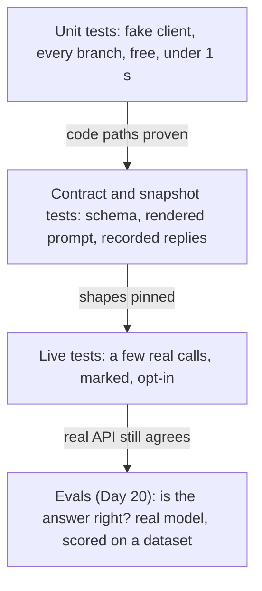
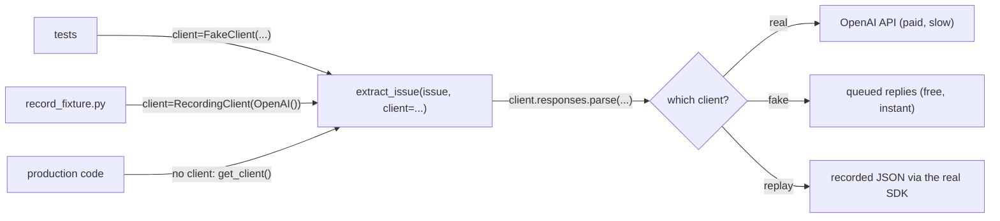
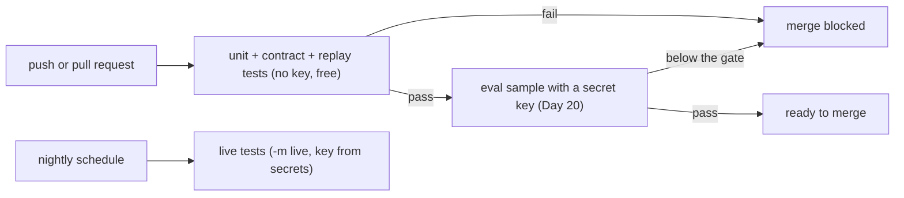

# Testing LLM Code: Fakes, Fixtures, Snapshots and CI

You tidy up the wording of Day 17's re-ask feedback, and in the process you quietly break the retry loop: attempt 2 now gets the original prompt with no errors attached. Right now the only way to notice is to spend 30 paid calls and read the output by eye. Most of an LLM app is ordinary code (prompt building, parsing, checks, retries, cost math), and ordinary code can be tested for free, offline, in under a second. Today you build that test suite for the Atlas extractor and run it in GitHub Actions.

## At a Glance

- **Time:** ~2 h core (+ optional Go Deeper) · **Depth:** working
- **Prerequisites:** [Day 16: Structured Outputs: Native JSON Schema & Extraction](../../Phase_2_Building_with_LLM_APIs/Day_016_structured_outputs/structured_outputs.md), [Day 17: Handling Semantic Failures: Validate, Re-ask, Bound](../../Phase_2_Building_with_LLM_APIs/Day_017_semantic_failures/semantic_failures.md), primer [A09: pytest & CI](../../Appendix_Primers/A09_pytest_and_ci.md) (includes a first Actions workflow)
- **You'll build:** a mocked pytest suite for `extract_issue()` and `reliable_extract()` (unit, retry, replay, snapshot and live tests), plus a GitHub Actions workflow that runs it with no API key
- **Stops at:** quality evals (Day 20)
- **Fast path:** already write pytest suites with mocks? Read [Recorded-Response Fixtures](#recorded-response-fixtures), [Contract and Snapshot Tests](#contract-and-snapshot-tests) and [Live Tests Behind a Marker](#live-tests-behind-a-marker), then do Exercise 3 (≈40 min)
- **Cost:** $0. The one live test and the fixture recorder are opt-in, ≈ $0.001 each on `gpt-6-luna` (prices as of 2026-11, [verify](https://developers.openai.com/api/docs/pricing))
- **New terms:** test pyramid, fake client, recorded fixture, snapshot test, test marker

> **Coming from Software Engineering?** Treat the model like Stripe. When you test code that charges cards, you inject the payment client, swap in a fake for unit tests, record a few real responses as "cassettes" (saved HTTP replies replayed later), and contract-test the shapes you send and receive. An LLM is a slow, paid and non-deterministic external dependency, so the rule is the same: **test what you control, and validate the shape of what you don't.** Your pytest habits transfer directly. The new part: "is the answer good?" isn't a unit-test question. That's an eval, and it's tomorrow.

## Before You Start: The Code Under Test

Today's suite tests a compact copy of Days 15–17 in one lesson-local file, `extract.py`. In your repo this code lives in `atlas/schemas.py` and `atlas/extract.py`, and the tests in `tests/` ([Day 22](../../Phase_2_Building_with_LLM_APIs/Day_022_capstone_r1_extractor/capstone_r1_extractor.md) uses that layout). Save every block in this lesson under its script name in one folder and run from there.

The schemas are unchanged from [Day 15](../../Phase_2_Building_with_LLM_APIs/Day_015_pydantic_for_llms/pydantic_for_llms.md) (`Issue` is trimmed to the fields the extractor reads):

```python
# script_id: day_019_testing_llm_code/extract
# extract.py: compact Days 15-17 code + today's client= seam. Repo: atlas/schemas.py, atlas/extract.py
# Install: uv add "openai>=3.46,<4" pydantic && uv add --dev pytest · Env: ORBIT_DATA (optional);
# OPENAI_API_KEY only when a REAL client is used. Tests never need it.
import functools
import os
from dataclasses import dataclass, field
from pathlib import Path
from typing import Literal

from openai import OpenAI
from pydantic import BaseModel, ConfigDict, Field, ValidationError

MODEL = os.environ.get("ATLAS_MODEL", "gpt-6-luna")
DATA_DIR = Path(os.environ.get("ORBIT_DATA", "datasets/orbit"))
Component = Literal["core", "scheduler", "flows", "broker-redis", "broker-postgres", "broker-sqs",
                    "cli", "dashboard", "retries", "results", "observability", "auth", "docs"]


class Comment(BaseModel):
    author: str
    body: str


class Issue(BaseModel):            # compact: extra keys in issues.jsonl are ignored
    id: int
    title: str
    body: str
    comments: list[Comment]


class IssueRecord(BaseModel):
    model_config = ConfigDict(extra="forbid")
    type: Literal["bug", "feature", "question", "docs"] = Field(description="bug, feature, question or docs")
    components: list[Component] = Field(description="Every Orbit component the issue is about")
    severity: Literal["S1", "S2", "S3", "S4"] | None = Field(description="Bugs only. null otherwise")
    orbit_version: str | None = Field(description="Full Orbit version, e.g. 3.1.2. null when not stated")
    python_version: str | None = Field(description="Python version as written. null when not stated")
    error_codes: list[str] = Field(description="ORB-NNNN codes quoted in the issue or its comments")
    summary: str = Field(description="One or two English sentences: symptom, trigger, version")
```

Day 17's extractor shapes, with one change: `client` is now a keyword argument (this compact copy skips Day 16's input truncation). When you don't pass one, `get_client()` builds the real `OpenAI()` on first use, so importing the module never needs a key.

```python
# script_id: day_019_testing_llm_code/extract
EXTRACT_INSTRUCTIONS = """You extract facts from GitHub issues filed against Orbit, an open-source
Python background-jobs library. Fill every field of the schema from the issue text only.
Rules:
- Use null when a fact is not stated. Never guess a version from dates or context.
- severity is for bugs only; use null for features, questions and docs.
- error_codes: every ORB-NNNN code that appears anywhere, including logs and comments. [] if none.
- summary: one or two sentences in English, even when the issue is in another language."""


def issue_to_input(issue: Issue) -> str:   # Day 16 also truncates to 3,000 tokens
    parts = [f"# {issue.title}", issue.body]
    parts += [f"--- comment by {c.author} ---\n{c.body}" for c in issue.comments]
    return "\n\n".join(parts)


def load_issues() -> list[Issue]:
    lines = (DATA_DIR / "issues" / "issues.jsonl").read_text(encoding="utf-8").splitlines()
    return [Issue.model_validate_json(line) for line in lines if line.strip()]


@functools.cache
def get_client() -> OpenAI:
    return OpenAI(max_retries=2, timeout=30.0)   # Day 17's tier-1 retries; built on first use, never at import


PRICES_PER_1M = {"gpt-6-luna": {"input": 0.10, "output": 0.50}}   # USD, as of 2026-11; verify


def cost_from_usage(usage, model: str = MODEL) -> float:   # Days 17-18 also price cached tokens
    price = PRICES_PER_1M[model]
    return (usage.input_tokens * price["input"] + usage.output_tokens * price["output"]) / 1_000_000


class ExtractionError(Exception):
    def __init__(self, reason: Literal["refusal", "incomplete"], response=None, detail: str = "",
                 cost_usd: float = 0.0) -> None:   # Day 17: refused and cut-off calls are billed too
        super().__init__(f"{reason}: {detail}")
        self.reason, self.response, self.cost_usd = reason, response, cost_usd
```

`parse_issue()` is Day 17's version of Day 16's exit-by-exit checks: it returns `(response, cost)` and puts the cost on every `ExtractionError`:

```python
# script_id: day_019_testing_llm_code/extract
def parse_issue(items: str | list, *, client=None, model: str = MODEL, effort: str = "low",
                max_output_tokens: int = 25_000) -> tuple:
    try:
        resp = (client or get_client()).responses.parse(
            model=model, instructions=EXTRACT_INSTRUCTIONS, input=items, text_format=IssueRecord,
            reasoning={"effort": effort}, max_output_tokens=max_output_tokens)
    except ValidationError as err:            # strict mode fixes the shape, so this is cut-off JSON
        raise ExtractionError("incomplete", detail="truncated JSON") from err   # cost unknown
    cost = cost_from_usage(resp.usage, model)
    if resp.status == "incomplete":
        raise ExtractionError("incomplete", resp, str(resp.incomplete_details.reason), cost)
    refusals = [part.refusal for item in resp.output if item.type == "message"
                for part in item.content if part.type == "refusal"]
    if refusals:
        raise ExtractionError("refusal", resp, refusals[0], cost)
    if resp.output_parsed is None:
        raise ExtractionError("incomplete", resp, "no final answer", cost)
    return resp, cost


def extract_issue(issue: Issue, *, client=None, model: str = MODEL) -> IssueRecord:
    resp, _cost = parse_issue(issue_to_input(issue), client=client, model=model)
    return resp.output_parsed
```

And Day 17's checks and bounded re-ask loop (compact: no `stop_reason`, `history` or pluggable rules):

```python
# script_id: day_019_testing_llm_code/extract
KNOWN_CODES = frozenset(f"ORB-{n}" for n in (1001, 1002, 1101, 1102, 1201, 1202, 1301, 1401, 1402, 1501,
                                             1502, 1503, 1601, 1701, 1702, 1801, 1802, 1901, 2001, 2101))
KNOWN_VERSIONS = frozenset({"2.8.0", "2.9.0", "3.0.0", "3.0.1", "3.0.3", "3.1.0", "3.1.2", "3.2.0", "3.2.1"})


def semantic_errors(record: IssueRecord, issue: Issue) -> list[str]:
    text, errors = issue_to_input(issue), []
    for code in record.error_codes:
        if code not in KNOWN_CODES or code not in text:
            errors.append(f"{code} does not appear in the issue; list only codes quoted in it")
    if (record.severity is None) == (record.type == "bug"):
        errors.append("severity must be set for bugs and null for every other type")
    if record.orbit_version and (record.orbit_version not in KNOWN_VERSIONS or record.orbit_version not in text):
        errors.append(f"orbit_version {record.orbit_version} is not stated; use null if unsure")
    return errors


@dataclass
class ExtractResult:
    record: IssueRecord | None = None
    attempts: int = 0
    errors: list[str] = field(default_factory=list)
    cost_usd: float = 0.0
    needs_review: bool = True
```

```python
# script_id: day_019_testing_llm_code/extract
def reliable_extract(issue: Issue, *, client=None, max_attempts: int = 3, max_usd: float = 0.01,
                     model: str = MODEL) -> ExtractResult:
    result = ExtractResult()
    history: list = [{"role": "user", "content": issue_to_input(issue)}]
    while result.attempts < max_attempts and result.cost_usd < max_usd:
        result.attempts += 1
        try:
            resp, cost = parse_issue(history, client=client, model=model)   # transport errors propagate
        except ExtractionError as err:
            result.cost_usd += err.cost_usd                # refused and cut-off calls are billed too
            result.errors = [str(err)]
            if err.reason == "refusal":
                return result                              # re-asking won't change a refusal
            continue
        result.cost_usd += cost
        result.record = resp.output_parsed
        result.errors = semantic_errors(result.record, issue)
        if not result.errors:
            result.needs_review = False
            return result
        feedback = "Fix these problems and return the full record:\n" + "\n".join(
            f"- {e}" for e in result.errors) + "\nUse null when the issue doesn't state a fact."
        history = [*history, {"role": "assistant", "content": result.record.model_dump_json()},
                   {"role": "user", "content": feedback}]
    return result
```

That's the code under test: about 100 lines, and one call talks to the network.

## A One-Line Change Breaks the Loop

Here's the hook's bug. During a cleanup someone "simplifies" the last line of the loop:

```text
-        history = [*history, {"role": "assistant", "content": result.record.model_dump_json()},
-                   {"role": "user", "content": feedback}]
+        history = [{"role": "user", "content": issue_to_input(issue)}]   # "reset to a clean prompt"
```

Nothing crashes, and every call returns a valid `IssueRecord`. Attempt 2 sees the same prompt as attempt 1, makes the same mistake, and the loop burns all three attempts before flagging the issue for review. On 30 gold issues that's a higher review rate and bill. A test that inspects what attempt 2 *sent* catches it in milliseconds; you'll write it and watch it fail.

## A Stand-in Actor

A theatre company doesn't wait for the star to rehearse. A stand-in walks the stage, hits the marks and says the cue lines, so the lights, the set changes and the other actors can all be checked. Nobody judges the stand-in's acting.

A **fake client** (a stand-in object with the same methods as the real one) plays that role for the model. It returns the replies you scripted, in order, and records every call. With it you check the stagecraft: right instructions sent, reply parsed, errors fed back, attempts capped, refusals not retried. Whether the *answer* is good is Day 20's question.

## One Fake by Hand

Before writing a reusable fake, list what our code actually reads from a `parse()` reply. Look at `parse_issue()` and `reliable_extract()`: `status`, `incomplete_details.reason`, `output[*].type` and `.content[*].type`/`.refusal`, `output_parsed`, and `usage.input_tokens`/`.output_tokens`. That's the whole surface. Build it by hand:

```python
# script_id: day_019_testing_llm_code/first_fake
# The parts of a parse() reply our code reads, built by hand. Offline, no key, $0.
from types import SimpleNamespace

text_part = SimpleNamespace(type="output_text", text='{"type": "bug"}')
reply = SimpleNamespace(
    status="completed",                       # parse_issue() checks this first
    incomplete_details=None,                  # only read when status == "incomplete"
    output=[SimpleNamespace(type="message", content=[text_part])],
    output_parsed={"type": "bug"},            # a real reply holds an IssueRecord here
    usage=SimpleNamespace(input_tokens=500, output_tokens=80),
)
fake = SimpleNamespace(responses=SimpleNamespace(parse=lambda **kwargs: reply))

resp = fake.responses.parse(model="any", input="hello")
refusals = [p for item in resp.output for p in item.content if p.type == "refusal"]
print(resp.status, resp.output_parsed, resp.usage.input_tokens, "refusals:", refusals)
```

```text
completed {'type': 'bug'} 500 refusals: []
```

`SimpleNamespace` turns keyword arguments into attributes, so `reply.usage.input_tokens` works exactly like the SDK object. A plain `dict` wouldn't: our code reads attributes, not keys.

## The LLM Testing Pyramid

Not every test should touch the model. The **test pyramid** (many cheap tests at the bottom, few expensive ones at the top) sorts tests by what they depend on:



| Layer | What it checks | Needs a key? | Runs |
|---|---|---|---|
| Unit (fake client) | your branches: parsing, checks, re-ask, bounds, errors | no | every push |
| Contract / snapshot | the schema you send, the exact prompt text, real reply shapes | no | every push |
| Live | the real API still accepts your request and honours the schema | yes | nightly or on demand |
| Eval | output quality on a labelled dataset | yes | per change, gated (Day 20, [Day 47](../../Phase_5_Evaluation_and_Observability/Day_047_evals_in_ci/evals_in_ci.md)) |

The bottom two layers are deterministic (same code, same result), so they can block a merge. The top two depend on a changing model and are treated differently.

## Your First Test: Inject a Fake Client

The `client=` keyword you added to `extract_issue()` is a **seam**: a place where a test can swap one implementation for another without editing the code. This is dependency injection (passing collaborators in instead of creating them inside), and here's what it buys you:



Now the reusable fake. `fake_parsed()` builds the reply surface you listed by hand:

```python
# script_id: day_019_testing_llm_code/fakes
# fakes.py: test doubles for the OpenAI client. In your repo: tests/fakes.py.
# Install: uv add --dev pytest   (httpx2 ships with openai>=3) · No key, no network.
import copy
import os
from pathlib import Path
from types import SimpleNamespace

import httpx2
import pytest
from openai import OpenAI

from extract import IssueRecord

HERE = Path(__file__).parent
FIXTURE_DIR, SNAPSHOT_DIR = HERE / "fixtures", HERE / "snapshots"


def fake_parsed(record: IssueRecord | None, *, status: str = "completed", input_tokens: int = 500,
                output_tokens: int = 80, refusal: str | None = None) -> SimpleNamespace:
    """A parse() reply with exactly the attributes extract.py reads."""
    part = (SimpleNamespace(type="refusal", refusal=refusal) if refusal else
            SimpleNamespace(type="output_text", text=record.model_dump_json() if record else ""))
    return SimpleNamespace(
        status=status, output_parsed=None if refusal else record,
        incomplete_details=SimpleNamespace(reason="max_output_tokens") if status == "incomplete" else None,
        output=[SimpleNamespace(type="message", role="assistant", content=[part])],
        usage=SimpleNamespace(input_tokens=input_tokens, output_tokens=output_tokens))
```

`FakeClient` queues replies (or exceptions) and records a copy of every call's arguments:

```python
# script_id: day_019_testing_llm_code/fakes
class FakeClient:
    """Stands in for OpenAI(). Queue replies or exceptions; each parse() call takes the next one."""

    def __init__(self, *replies: object) -> None:
        self.replies, self.calls = list(replies), []
        self.responses = SimpleNamespace(parse=self._parse)     # mirrors client.responses.parse

    def _parse(self, **kwargs: object) -> object:
        self.calls.append(copy.deepcopy(kwargs))   # a copy, in case the caller mutates its lists later
        if not self.replies:
            raise AssertionError(f"unexpected API call #{len(self.calls)}: no reply queued")
        reply = self.replies.pop(0)
        if isinstance(reply, BaseException):
            raise reply
        return reply
```

An empty queue raises instead of returning something, so an unexpected extra call fails loudly rather than passing by accident. The first test is short:

```python
# script_id: day_019_testing_llm_code/test_extract
# test_extract.py: unit tests with a fake client. In your repo: tests/test_extract.py.
# Run: python test_extract.py   (in a repo: uv run pytest -q) · No key, no network, $0.
import httpx2
import openai
import pytest

import extract
from extract import IssueRecord, extract_issue, load_issues, reliable_extract
from fakes import FakeClient, fake_parsed

ISSUE = next(i for i in load_issues() if i.id == 1)   # "2.8.0: `--concurrency` flag is ignored..."
GOOD = IssueRecord(type="bug", components=["cli"], severity="S3", orbit_version="2.8.0",
                   python_version="3.11.9", error_codes=[],
                   summary="On 2.8.0 the --concurrency flag is ignored when ORBIT_CONCURRENCY is set.")


def test_extract_returns_the_parsed_record():
    fake = FakeClient(fake_parsed(GOOD))
    assert extract_issue(ISSUE, client=fake) == GOOD
    assert len(fake.calls) == 1
    assert fake.calls[0]["text_format"] is IssueRecord      # the schema we promised to send
```

`GOOD` is a hand-written record, not model output. It's test data: you decide what the "model" said, so you can check what your code does with it.

## Break It: Bring Back the Bug

Run `pytest test_extract.py -q` and you get one green test. Now the test that catches the hook's bug. It queues a bad record, then a good one, and inspects what the second call *sent*:

```python
# script_id: day_019_testing_llm_code/test_extract
BAD = GOOD.model_copy(update={"error_codes": ["ORB-1102"]})   # valid JSON; the code isn't in the issue


def test_reask_sends_the_errors_back():
    fake = FakeClient(fake_parsed(BAD), fake_parsed(GOOD))
    result = reliable_extract(ISSUE, client=fake)
    assert (result.record, result.attempts, result.needs_review) == (GOOD, 2, False)
    feedback = fake.calls[1]["input"][-1]["content"]          # last message of attempt 2
    assert "ORB-1102" in feedback


def test_default_client_can_be_patched(monkeypatch):
    fake = FakeClient(fake_parsed(GOOD))
    monkeypatch.setattr(extract, "get_client", lambda: fake)   # works, but the seam is plainer
    assert extract_issue(ISSUE) == GOOD
```

Apply the one-line "cleanup" from the hook and rerun. pytest pinpoints the broken line and shows you the value it got (output from the finished six-test file):

```text
.F....                                                                   [100%]
_______________________ test_reask_sends_the_errors_back _______________________
    def test_reask_sends_the_errors_back():
        fake = FakeClient(fake_parsed(BAD), fake_parsed(GOOD))
        result = reliable_extract(ISSUE, client=fake)
        assert (result.record, result.attempts, result.needs_review) == (GOOD, 2, False)
        feedback = fake.calls[1]["input"][-1]["content"]          # last message of attempt 2
>       assert "ORB-1102" in feedback
E       AssertionError: assert 'ORB-1102' in '# 2.8.0: `--concurrency` flag is ignored when
        ORBIT_CONCURRENCY is set\n\nAfter upgrading to 2.8.0, the `--concurrenc...Closing.'
FAILED test_extract.py::test_reask_sends_the_errors_back - AssertionError: as...
1 failed, 5 passed in 0.40s
```

Read it bottom-up: the second call's last message is the original issue text, not the feedback. Revert the change and the test goes green again.

The second test shows the alternative to a seam: `monkeypatch.setattr` (a pytest fixture that replaces an attribute for one test, then restores it) swaps `get_client` for a lambda. For code you can't change, that's the only option. In your own code prefer the seam: the stand-in is visible in one argument, and the test doesn't break when someone renames a module-level name. Avoid patching `openai.OpenAI` itself; it hides which SDK entry point your code really used.

Why build the real client lazily? If `extract.py` ran `client = OpenAI()` at import time, merely importing it in a test run without a key would fail before any test ran:

```text
openai.OpenAIError: Missing credentials. Please pass an `api_key`, `workload_identity`, `admin_api_key`, or set the `OPENAI_API_KEY` or `OPENAI_ADMIN_KEY` environment variable.
```

With `get_client()`, that error appears only when a test forgets to inject a fake, which is exactly when you want it. That's why the CI job below has no `OPENAI_API_KEY`.

## Testing the Retry Loop

The loop's contract from Day 17 has four branches, and each gets one test: bad-then-good re-asks once; always-bad stops at the cap with `needs_review`; a refusal is never re-asked; a transport error (network failure or timeout) propagates without a re-ask, because the SDK already retried it. The last two encode the "two tiers of retries" rule: if your loop also retried timeouts, three attempts × three SDK tries would become nine calls.

```python
# script_id: day_019_testing_llm_code/test_extract
def test_always_bad_stops_at_max_attempts():
    fake = FakeClient(*[fake_parsed(BAD)] * 3)
    result = reliable_extract(ISSUE, client=fake, max_attempts=3)
    assert result.needs_review and result.attempts == 3 and len(fake.calls) == 3
    assert result.record == BAD                    # the best effort goes to the reviewer
    assert "ORB-1102" in result.errors[0]


def test_refusal_is_not_reasked():
    fake = FakeClient(fake_parsed(None, refusal="I can't help with that."))
    result = reliable_extract(ISSUE, client=fake)
    assert result.needs_review and len(fake.calls) == 1
    assert result.errors[0].startswith("refusal") and result.cost_usd > 0   # refusals are billed


def test_timeout_propagates_without_reask():
    request = httpx2.Request("POST", "https://api.openai.com/v1/responses")
    fake = FakeClient(openai.APITimeoutError(request=request))
    with pytest.raises(openai.APITimeoutError):
        reliable_extract(ISSUE, client=fake)
    assert len(fake.calls) == 1


if __name__ == "__main__":
    raise SystemExit(pytest.main([__file__, "-q"]))
```

```text
......                                                                   [100%]
6 passed in 0.21s
```

Your timing will differ. `openai.APITimeoutError` needs the request that timed out, so you build an `httpx2.Request` (the SDK's HTTP library since openai 3.0). The test covers *your* loop; Go Deeper counts the SDK's own retries.

## Recorded-Response Fixtures

A hand-built fake has one weakness: it's only as accurate as your memory of the SDK. If the real `usage` object were shaped differently, `cost_from_usage()` would pass every unit test and crash in production. The fix is a **recorded fixture** (a real API reply saved to a file once and replayed in tests). It's the cassette idea from the callout.

Recording goes through the production code path. `RecordingClient` wraps a real client, makes the same `parse()` call through `with_raw_response` (an SDK accessor that also hands you the raw HTTP reply), and keeps the exact bytes the API sent:

```python
# script_id: day_019_testing_llm_code/record_fixture
# record_fixture.py: call the real API ONCE; save the raw reply as fixtures/issue_1.json.
# Install: uv add "openai>=3.46,<4" pydantic · Env: OPENAI_API_KEY (required) · Cost ≈ $0.001
from types import SimpleNamespace

from openai import OpenAI

from extract import extract_issue, load_issues
from fakes import FIXTURE_DIR


class RecordingClient:
    """Same parse() call as the real client, but keeps the raw JSON body of every reply."""

    def __init__(self, real: OpenAI) -> None:
        self.real, self.bodies = real, []
        self.responses = SimpleNamespace(parse=self._parse)

    def _parse(self, **kwargs: object) -> object:
        raw = self.real.responses.with_raw_response.parse(**kwargs)
        self.bodies.append(raw.text)              # exactly what came over the wire
        return raw.parse()                        # the ParsedResponse extract.py expects


if __name__ == "__main__":
    recorder = RecordingClient(OpenAI())
    issue = next(i for i in load_issues() if i.id == 1)
    record = extract_issue(issue, client=recorder)            # production code, unchanged
    FIXTURE_DIR.mkdir(exist_ok=True)
    (FIXTURE_DIR / "issue_1.json").write_text(recorder.bodies[-1], encoding="utf-8")
    print(f"wrote fixtures/issue_1.json · {record.type} {record.orbit_version}")
```

```text
wrote fixtures/issue_1.json · bug 2.8.0
```

Replay serves those bytes back to a *real* `OpenAI` client through `httpx2.MockTransport` (a fake network layer that answers every request with a function you supply). The SDK parses the reply exactly as it would in production, so the shapes can't drift from reality. Add these helpers to `fakes.py`:

```python
# script_id: day_019_testing_llm_code/fakes
def load_fixture(name: str) -> str:
    """A recorded API reply (raw JSON). Skips the test until it has been recorded."""
    path = FIXTURE_DIR / f"{name}.json"
    if not path.exists():
        pytest.skip(f"no fixture {path.name}: run record_fixture.py once with a key")
    return path.read_text(encoding="utf-8")


def replay_client(body: str, status_code: int = 200) -> OpenAI:
    """A real OpenAI client whose network always answers with `body`. Nothing leaves the machine."""
    def answer(request: httpx2.Request) -> httpx2.Response:
        return httpx2.Response(status_code, text=body, headers={"content-type": "application/json"})
    return OpenAI(api_key="sk-test-FAKE", max_retries=0,
                  http_client=httpx2.Client(transport=httpx2.MockTransport(answer)))
```

The same helper turns an HTTP error into a test. A canned 429 body makes the real SDK raise its real `RateLimitError`, which is more faithful than constructing the exception yourself:

```python
# script_id: day_019_testing_llm_code/test_replay
# test_replay.py: recorded replies through the REAL SDK. In your repo: tests/test_replay.py.
# Run: python test_replay.py · No key, no network, $0. Needs fixtures/issue_1.json for test 1.
import json

import openai
import pytest

from extract import IssueRecord, extract_issue, load_issues, reliable_extract
from fakes import load_fixture, replay_client

ISSUE = next(i for i in load_issues() if i.id == 1)
RATE_LIMITED = json.dumps({"error": {"message": "Rate limit reached", "type": "requests",
                                     "code": "rate_limit_exceeded", "param": None}})


def test_recorded_reply_parses_and_is_priced():
    client = replay_client(load_fixture("issue_1"))
    result = reliable_extract(ISSUE, client=client, max_attempts=1)
    assert isinstance(result.record, IssueRecord)     # real ParsedResponse → our parsing
    assert result.cost_usd > 0                        # real usage object → our cost math


def test_rate_limit_reaches_the_caller():
    client = replay_client(RATE_LIMITED, status_code=429)
    with pytest.raises(openai.RateLimitError):
        extract_issue(ISSUE, client=client)


if __name__ == "__main__":
    raise SystemExit(pytest.main([__file__, "-q", "-rs"]))
```

```text
s.                                                                       [100%]
SKIPPED [1] fakes.py:52: no fixture issue_1.json: run record_fixture.py once with a key
1 passed, 1 skipped in 0.35s
```

Once you record the fixture, both pass. The replay test asserts that our code handles a real reply, not what the model said. Commit the fixture; re-record it after an SDK upgrade or a schema change, and read it first, since a reply echoes your instructions and data.

## Contract and Snapshot Tests

Two things your code sends should never change by accident: the JSON Schema built from `IssueRecord`, and the exact prompt text. If the schema changes, Day 20's scores and the gold file stop lining up. If the instructions change, Day 18's cached prefix stops matching and cost per call jumps. Neither crashes.

A **snapshot test** (a saved copy of some output, compared on every run) guards them. The first run writes `snapshots/<name>.txt`; you read it and commit it. Later runs fail on any difference until you refresh on purpose with `UPDATE_SNAPSHOTS=1`. Add the helper to `fakes.py`:

```python
# script_id: day_019_testing_llm_code/fakes
def assert_matches_snapshot(name: str, text: str) -> None:
    """Compare text with snapshots/<name>.txt. A missing snapshot is written, except in CI."""
    path = SNAPSHOT_DIR / f"{name}.txt"
    if path.exists() and os.environ.get("UPDATE_SNAPSHOTS") != "1":
        assert text == path.read_text(encoding="utf-8"), (
            f"snapshot {name!r} changed. If intended: UPDATE_SNAPSHOTS=1, review the diff, commit")
        return
    if os.environ.get("CI") and not path.exists():      # GitHub Actions sets CI=true
        pytest.fail(f"snapshot {path.name} is missing: create it locally and commit it")
    path.parent.mkdir(exist_ok=True)
    path.write_text(text, encoding="utf-8")
```

The CI rule matters: without it, a forgotten snapshot would be created on the runner and the test would pass forever. These tests snapshot deterministic text only:

```python
# script_id: day_019_testing_llm_code/test_contracts
# test_contracts.py: pin the schema and the rendered prompt. In your repo: tests/test_contracts.py.
# Run: python test_contracts.py · First run writes snapshots/*.txt: read them, then commit them.
import json

import pytest

from extract import EXTRACT_INSTRUCTIONS, IssueRecord, issue_to_input, load_issues
from fakes import assert_matches_snapshot


def test_schema_is_unchanged():
    schema = json.dumps(IssueRecord.model_json_schema(), indent=2, sort_keys=True)
    assert_matches_snapshot("issue_record_schema", schema)


def test_schema_is_strict_compatible():
    schema = IssueRecord.model_json_schema()
    assert schema["additionalProperties"] is False
    assert set(schema["required"]) == set(schema["properties"])    # strict mode: all required


def test_rendered_prompt_is_unchanged():
    issue = next(i for i in load_issues() if i.id == 1)
    prompt = f"{EXTRACT_INSTRUCTIONS}\n\n=== input ===\n{issue_to_input(issue)}"
    assert_matches_snapshot("extract_prompt_issue_1", prompt)


if __name__ == "__main__":
    raise SystemExit(pytest.main([__file__, "-q"]))
```

```text
...                                                                      [100%]
3 passed in 0.12s
```

Now turn the knob. Add `title_suggestion: str | None = None` to `IssueRecord` and rerun:

```text
FF.                                                                      [100%]
E           AssertionError: snapshot 'issue_record_schema' changed. If intended: UPDATE_SNAPSHOTS=1, review the diff, commit
fakes.py:68: AssertionError
>       assert set(schema["required"]) == set(schema["properties"])    # strict mode: all required
E         Extra items in the right set:
E         'title_suggestion'
FAILED test_contracts.py::test_schema_is_unchanged - AssertionError: snapshot...
FAILED test_contracts.py::test_schema_is_strict_compatible - AssertionError: ...
2 failed, 1 passed in 0.67s
```

Two tests catch it, for two reasons. The snapshot asks "the contract changed; was that on purpose?" The strict test catches a subtler lie: under strict mode the SDK sends every field as required anyway (Day 16), so `= None` misleads readers into thinking the model may skip it. Day 15's rule is nullable, not optional. Remove the default (`str | None`, no `= None`) and only the snapshot fails; refresh it with `UPDATE_SNAPSHOTS=1 python test_contracts.py` and commit the diff with the change that caused it. [Day 21](../../Phase_2_Building_with_LLM_APIs/Day_021_prompts_as_code/prompts_as_code.md) turns the prompt snapshot into a versioned prompt registry. If you'd rather not maintain the helper, the pytest plugin [syrupy](https://github.com/syrupy-project/syrupy) does the same job with `--snapshot-update`.

## Live Tests Behind a Marker

Fakes and replays prove your code is right *given* a reply. One question is left: does the real API still accept your request and honour the schema? Only a real call answers that, so keep a few, and make them impossible to run by accident. A **test marker** (a label such as `@pytest.mark.live` that lets you select or skip groups of tests) does that:

```python
# script_id: day_019_testing_llm_code/test_live
# test_live.py: one real call, opt-in. In your repo: tests/test_live.py.
# Env: ATLAS_LIVE_TESTS=1 and OPENAI_API_KEY, otherwise skipped.
# Cost ≈ $0.001 per run on gpt-6-luna (as of 2026-11, verify at https://developers.openai.com/api/docs/pricing)
import os

import pytest

from extract import IssueRecord, load_issues, reliable_extract

LIVE = os.environ.get("ATLAS_LIVE_TESTS") == "1" and bool(os.environ.get("OPENAI_API_KEY"))
pytestmark = [pytest.mark.live,
              pytest.mark.skipif(not LIVE, reason="set ATLAS_LIVE_TESTS=1 and OPENAI_API_KEY")]


def test_real_api_honours_the_contract():
    issue = next(i for i in load_issues() if i.id == 1)
    result = reliable_extract(issue)                    # no client=: the real one
    assert isinstance(result.record, IssueRecord)       # the shape, never the wording
    assert result.record.orbit_version == "2.8.0"       # a fact stated verbatim in the issue
    assert result.attempts <= 3 and result.cost_usd < 0.01


if __name__ == "__main__":
    raise SystemExit(pytest.main([__file__, "-q", "-rs", "-o", "markers=live: calls the real API"]))
```

```text
s                                                                        [100%]
SKIPPED [1] test_live.py:16: set ATLAS_LIVE_TESTS=1 and OPENAI_API_KEY
1 skipped in 0.05s
```

The assertions are deliberately loose: a type, a version stated verbatim in the issue, and the bounds. Asserting the summary's wording would make the test flaky (passing or failing on unchanged code), because the model phrases it differently every run.

In a real repo, configure pytest once in `pyproject.toml`. `addopts` makes "not live" the default, and registering the marker stops pytest's `PytestUnknownMarkWarning`:

```toml
[tool.pytest.ini_options]
testpaths = ["tests"]
pythonpath = ["."]                          # lets tests import atlas/ without installing it
addopts = "-m 'not live'"                   # live tests never run by accident
markers = ["live: calls the real OpenAI API (needs a key, costs money)"]
```

```text
$ uv run pytest -q
.........s.                                                              [100%]
10 passed, 1 skipped, 1 deselected in 0.30s     # skipped: replay without a fixture
$ ATLAS_LIVE_TESTS=1 uv run pytest -m live -q   # a later -m overrides the one in addopts
```

## CI: Run the Suite on Every Push

CI (continuous integration: tests that run automatically on every push) is where these tests pay off, because nobody has to remember to run them. The unit and contract layers need no key, so the workflow is short:

```yaml
# .github/workflows/ci.yml
name: ci
on:
  push:
  pull_request:
jobs:
  test:
    runs-on: ubuntu-latest
    steps:
      - uses: actions/checkout@v7
      - uses: astral-sh/setup-uv@v10.3.3    # no floating @v10 tag exists: pin the full version or a SHA
        with:
          enable-cache: true
      - run: uv sync --locked --all-extras --dev
      - run: uv run pytest                  # addopts deselects live tests; no OPENAI_API_KEY on purpose
```



Both gates block; a layer that only "warns" trains everyone to ignore it. Day 20 adds the eval job with a repository secret (an encrypted value the workflow can read but never prints). The sharp edge is the `setup-uv` pin: there is no `@v10` tag, so pin `v10.3.3` (the action's README pins a commit SHA, stricter still). Primer [A09](../../Appendix_Primers/A09_pytest_and_ci.md) covers Actions basics.

## What Tests Can't Tell You

Today's suite proves your code handles whatever the model returns, not that the model returns the right thing:

| Question | Tool | Example |
|---|---|---|
| Does the loop re-ask with the errors? | unit test, fake client | `test_reask_sends_the_errors_back` |
| Did the schema or prompt change? | snapshot test | `test_schema_is_unchanged` |
| Does our code handle a real reply? | replay of a recorded fixture | `test_recorded_reply_parses_and_is_priced` |
| Does the API still accept the request? | live test, marked | `test_real_api_honours_the_contract` |
| Are the extracted fields correct? | eval on gold data | Day 20 |

Rules of thumb: never snapshot or exact-match model output; a test that needs a key is live or an eval; reproduce bugs with a fake first.

### In production

- Run unit, contract and replay tests on every push; run live tests nightly and before a release.
- Treat a flaky test as a bug: quarantine it and fix it within days. Repeats and flake handling for evals are covered in [Day 47](../../Phase_5_Evaluation_and_Observability/Day_047_evals_in_ci/evals_in_ci.md).
- Leave `OPENAI_API_KEY` unset in the unit job, so an un-faked call fails instead of billing.
- Re-record fixtures when you upgrade the SDK (`uv lock --upgrade-package openai`); a replay failure then shows exactly what changed.
- Security tests (injection, leaks) join the same pipeline in [Day 75](../../Phase_8_Safety_and_Security/Day_075_red_teaming_ci/red_teaming_ci.md), and deployment in [Day 82](../../Phase_9_Production/Day_082_containerize_deploy/containerize_deploy.md).

## Go Deeper (optional)

<details>
<summary>Go deeper: count the SDK's own retries with a fake network</summary>

The timeout test showed that *your* loop doesn't re-ask on transport errors. It didn't show the full multiplication: how many HTTP requests one `reliable_extract()` call makes when the API keeps failing. Fake the network instead of the client and count. The SDK honours a `retry-after-ms` header, which keeps the backoff to a few milliseconds:

```python
# script_id: day_019_testing_llm_code/deeper_retry_math
# Count HTTP requests: SDK retries (tier 1) under the semantic loop (tier 2). Offline, $0.
import httpx2
import openai
from openai import OpenAI

from extract import load_issues, reliable_extract

hits: list[str] = []


def overloaded(request: httpx2.Request) -> httpx2.Response:
    hits.append(request.url.path)
    return httpx2.Response(503, json={"error": {"message": "overloaded", "type": "server_error"}},
                           headers={"retry-after-ms": "10"})


for retries in (0, 2):
    hits.clear()
    client = OpenAI(api_key="sk-test-FAKE", max_retries=retries,
                    http_client=httpx2.Client(transport=httpx2.MockTransport(overloaded)))
    try:
        reliable_extract(next(i for i in load_issues() if i.id == 1), client=client, max_attempts=3)
    except openai.InternalServerError:
        print(f"max_retries={retries}: InternalServerError after {len(hits)} HTTP requests")
```

```text
max_retries=0: InternalServerError after 1 HTTP requests
max_retries=2: InternalServerError after 3 HTTP requests
```

Three, not nine: the SDK retries, and the semantic loop stays out of it. Turn this into a test with `assert len(hits) == 3`, and a future "let's also catch `APIError` in the loop" refactor fails immediately. Faking at the HTTP layer is the most faithful double you can build without a network, and it costs the most to set up. Use it for SDK behaviour (retries, error mapping, headers); use `FakeClient` for your own branches. Custom backoff and circuit breakers are [Day 84](../../Phase_9_Production/Day_084_reliability_fallbacks/reliability_fallbacks.md)'s topic.

</details>

<details>
<summary>Go deeper: growing the suite without slowing it down</summary>

A few habits keep a test suite for an LLM app fast and trusted as it grows:

- **Shared fixtures in `conftest.py`.** Once three files build `FakeClient(fake_parsed(GOOD))`, move it into a pytest fixture in `tests/conftest.py`. pytest loads that file automatically, so tests take `fake` as an argument. Keep plain helpers such as `fake_parsed()` in `fakes.py`; importing from `conftest.py` is a known anti-pattern.
- **Table-driven checks.** Rule functions such as `semantic_errors()` are pure: record in, list of strings out. `pytest.mark.parametrize` turns one test into one case per bad record (Exercise 2), and each case reads like a line in a spec.
- **One fixture per shape, not per issue.** You need one recorded success, one refusal and one `incomplete` reply, not thirty successes. More fixtures means more re-recording on every SDK upgrade, and more data to review before committing.
- **Fakes that fail loudly.** `FakeClient` raises on an unexpected call. Extend the same idea: assert on `fake.calls` for every argument that matters (model, instructions, `text_format`, effort), because a fake that accepts anything hides bugs in what you send.
- **Async code.** Day 22 adds `aextract_issue()`. Test it by calling `asyncio.run()` inside a normal test, with a fake whose `parse` is an `async def`. You don't need a pytest plugin for that.
- **Coverage as a map, not a target.** Run `uv run pytest --cov` (with the `pytest-cov` plugin) once to find branches no test reaches, such as the "no final answer" exit in `parse_issue()`. Chasing a percentage adds tests nobody reads.

</details>

## Common Pitfalls

- **`ModuleNotFoundError: No module named 'atlas'`** when you run `pytest` in a real repo. pytest can't see your package. Fix: `pythonpath = ["."]` under `[tool.pytest.ini_options]`, and run from the repo root.
- **`AttributeError: 'dict' object has no attribute 'output_parsed'`.** The fake returns dicts where the code reads attributes. Fix: build fakes with `SimpleNamespace` (or replay a recorded fixture through the real SDK).
- **A "unit" test that calls the real API.** In CI it fails with `openai.OpenAIError: Missing credentials…`, or with `openai.AuthenticationError` if a key is present but wrong. Fix: always pass `client=`, and leave the key unset in the unit job so the leak fails fast.
- **`TypeError: APITimeoutError.__init__() missing 1 required positional argument: 'request'`.** Fix: `openai.APITimeoutError(request=httpx2.Request("POST", "https://api.openai.com/v1/responses"))`, and use `httpx2`, not `httpx`, with openai 3.x.
- **Snapshots that change on every run.** They contain timestamps, ids or model output. Fix: snapshot only deterministic text (schemas, rendered prompts), and test model output with evals.

> **Where we stop:** today's tests prove the code handles every reply correctly, not that the model's answers are right. Measuring accuracy on labelled data is [Day 20: Your First Eval Set](../../Phase_2_Building_with_LLM_APIs/Day_020_first_eval_set/first_eval_set.md).

## Key Takeaways

- Most of an LLM app is ordinary code. Test it with a fake client, offline and free, and keep "is the answer good?" for evals.
- Put each test on the right layer of the pyramid: many unit tests, some contract/snapshot/replay tests, a few marked live tests, then evals.
- A `client=` seam beats patching globals: the test states its stand-in in one argument, and a lazily built real client makes un-faked calls fail fast.
- Test the retry loop by inspecting what each call *sent*: feedback reaches attempt 2, the cap holds, refusals and transport errors are never re-asked.
- Record real replies once and replay them through the real SDK; snapshot the schema and prompt; never snapshot model output, and run the key-free suite in CI on every push.

## Quick Reference

| API / pattern | When to use | Gotcha |
|---|---|---|
| `extract_issue(issue, client=fake)` | every unit test | build the real client lazily, never at import |
| `FakeClient(*replies)` + `fake.calls` | script replies, inspect requests | deep-copy kwargs; raise when the queue is empty |
| `fake_parsed(record, status=, refusal=)` | build a `parse()` reply | attributes, not dict keys |
| `openai.APITimeoutError(request=httpx2.Request(...))` | transport-error tests | `request=` is required; `httpx2`, not `httpx` |
| `client.responses.with_raw_response.parse(...)` → `.text`, `.parse()` | record a fixture | review the body before committing |
| `httpx2.MockTransport(fn)` in `OpenAI(http_client=...)` | replay, HTTP errors, retry counts | `max_retries=0` unless you're testing retries |
| `assert_matches_snapshot(name, text)` | schema and prompt contracts | deterministic text only; fail on a missing snapshot in CI |
| `@pytest.mark.live` + `addopts = "-m 'not live'"` | real-API tests | register the marker; assert shapes, not wording |
| `astral-sh/setup-uv@v10.3.3` | CI with uv | `@v10` doesn't exist |

## Exercises

1. **Warm-up: pin the request.** Write a test that checks everything `extract_issue()` sends: `instructions` is exactly `EXTRACT_INSTRUCTIONS`, `input` is `issue_to_input(issue)`, the model and effort are what you expect, and none of the issue's labels (the answer key) leaks into the input.

<details>
<summary>Solution</summary>

```python
# script_id: day_019_testing_llm_code/solution_ex1
# Inspect fake.calls[0]: the request is a contract too. Run: python solution_ex1.py · $0.
import pytest

from extract import EXTRACT_INSTRUCTIONS, MODEL, IssueRecord, extract_issue, issue_to_input, load_issues
from fakes import FakeClient, fake_parsed

ISSUE = next(i for i in load_issues() if i.id == 1)
GOOD = IssueRecord(type="bug", components=["cli"], severity="S3", orbit_version="2.8.0",
                   python_version="3.11.9", error_codes=[], summary="Flag ignored on 2.8.0.")


def test_request_is_exactly_what_we_promised():
    fake = FakeClient(fake_parsed(GOOD))
    extract_issue(ISSUE, client=fake)
    sent = fake.calls[0]
    assert sent["instructions"] == EXTRACT_INSTRUCTIONS     # unchanged prefix keeps Day 18's cache warm
    assert sent["input"] == issue_to_input(ISSUE)
    assert sent["model"] == MODEL and sent["reasoning"] == {"effort": "low"}
    assert sent["text_format"] is IssueRecord
    for label in ("type:bug", "severity:S3", "comp:cli"):   # the answer key never reaches the model
        assert label not in sent["input"]


if __name__ == "__main__":
    raise SystemExit(pytest.main([__file__, "-q"]))
```

</details>

2. **Core: table-driven rules.** Use `pytest.mark.parametrize` to run `semantic_errors()` over six bad versions of `GOOD`, one per rule: a fake ORB code, a real code that isn't in the issue, a bug without severity, a non-bug with severity, a known release that isn't in the text, and a version that was never released. Each case should produce exactly one error that names the problem.

<details>
<summary>Solution</summary>

```python
# script_id: day_019_testing_llm_code/solution_ex2
# One test function, six cases: each line reads like a row of the spec. Run: python solution_ex2.py
import pytest

from extract import IssueRecord, load_issues, semantic_errors

ISSUE = next(i for i in load_issues() if i.id == 1)
GOOD = IssueRecord(type="bug", components=["cli"], severity="S3", orbit_version="2.8.0",
                   python_version="3.11.9", error_codes=[], summary="Flag ignored on 2.8.0.")
CASES = {
    "unknown-code": ({"error_codes": ["ORB-9999"]}, "ORB-9999"),
    "code-not-in-issue": ({"error_codes": ["ORB-1101"]}, "ORB-1101"),
    "bug-without-severity": ({"severity": None}, "severity"),
    "question-with-severity": ({"type": "question"}, "severity"),
    "version-not-in-text": ({"orbit_version": "3.1.0"}, "3.1.0"),
    "never-released": ({"orbit_version": "2.8.7"}, "2.8.7"),
}


def test_good_record_has_no_errors():
    assert semantic_errors(GOOD, ISSUE) == []


@pytest.mark.parametrize(("change", "expected"), CASES.values(), ids=CASES.keys())
def test_each_rule_fires_alone(change: dict, expected: str):
    errors = semantic_errors(GOOD.model_copy(update=change), ISSUE)
    assert len(errors) == 1 and expected in errors[0]


if __name__ == "__main__":
    raise SystemExit(pytest.main([__file__, "-q"]))
```

`ids=` names each case, so a failure reads `test_each_rule_fires_alone[never-released]` instead of an index.

</details>

3. **Core: one fixture per failure shape.** Hand-write two raw API replies, a refusal and an `incomplete` reply (`"incomplete_details": {"reason": "max_output_tokens"}`), and replay them through `replay_client()`. Assert that `extract_issue()` raises `ExtractionError` with the right `reason`, and that `reliable_extract()` never re-asks a refusal but does retry an incomplete reply, and bills both.

<details>
<summary>Solution</summary>

```python
# script_id: day_019_testing_llm_code/solution_ex3
# Failure-shape fixtures through the real SDK. In a repo, save them in fixtures/ and use load_fixture().
import json

import pytest

from extract import ExtractionError, extract_issue, load_issues, reliable_extract
from fakes import replay_client

ISSUE = next(i for i in load_issues() if i.id == 1)
USAGE = {"input_tokens": 700, "output_tokens": 40, "total_tokens": 740,
         "input_tokens_details": {"cached_tokens": 0}, "output_tokens_details": {"reasoning_tokens": 0}}
REFUSAL = {"id": "resp_refusal", "object": "response", "status": "completed", "model": "gpt-6-luna",
           "usage": USAGE, "output": [{"type": "message", "id": "msg_1", "role": "assistant",
                                       "status": "completed", "content": [
                                           {"type": "refusal", "refusal": "I can't help with that."}]}]}
INCOMPLETE = {"id": "resp_cut", "object": "response", "status": "incomplete", "model": "gpt-6-luna",
              "incomplete_details": {"reason": "max_output_tokens"}, "output": [], "usage": USAGE}


@pytest.mark.parametrize(("body", "reason"), [(REFUSAL, "refusal"), (INCOMPLETE, "incomplete")])
def test_failure_shape_raises(body: dict, reason: str):
    with pytest.raises(ExtractionError) as info:
        extract_issue(ISSUE, client=replay_client(json.dumps(body)))
    assert info.value.reason == reason


@pytest.mark.parametrize(("body", "attempts"), [(REFUSAL, 1), (INCOMPLETE, 3)])
def test_only_incomplete_is_retried(body: dict, attempts: int):
    result = reliable_extract(ISSUE, client=replay_client(json.dumps(body)), max_attempts=3)
    assert result.needs_review and result.attempts == attempts and result.cost_usd > 0


if __name__ == "__main__":
    raise SystemExit(pytest.main([__file__, "-q"]))
```

</details>

4. **Stretch (optional): tiered CI.** Extend `ci.yml` so the key-free suite runs on Python 3.11 and 3.12, and add a nightly (and manually triggerable) `live` job that runs only `-m live`, with the key from a repository secret named `OPENAI_API_KEY`.

<details>
<summary>Solution</summary>

```yaml
# .github/workflows/ci.yml  (requires-python = ">=3.11" in pyproject.toml)
name: ci
on:
  push:
  pull_request:
  schedule:
    - cron: "0 3 * * *"                     # nightly, 03:00 UTC
  workflow_dispatch:                        # a "Run workflow" button
jobs:
  test:
    runs-on: ubuntu-latest
    strategy:
      matrix:
        python: ["3.11", "3.12"]
    env:
      UV_PYTHON: ${{ matrix.python }}       # uv uses (and if needed downloads) this interpreter
    steps:
      - uses: actions/checkout@v7
      - uses: astral-sh/setup-uv@v10.3.3
        with:
          enable-cache: true
      - run: uv sync --locked --all-extras --dev
      - run: uv run pytest
  live:
    if: github.event_name == 'schedule' || github.event_name == 'workflow_dispatch'
    needs: test
    runs-on: ubuntu-latest
    env:
      ATLAS_LIVE_TESTS: "1"
      OPENAI_API_KEY: ${{ secrets.OPENAI_API_KEY }}   # never echo it; Actions masks secrets in logs
    steps:
      - uses: actions/checkout@v7
      - uses: astral-sh/setup-uv@v10.3.3
      - run: uv sync --locked --all-extras --dev
      - run: uv run pytest -m live
```

Pull requests from forks don't receive secrets, which is one more reason the push/PR job must never need a key.

</details>

## References & Further Reading

- [pytest: Get Started](https://docs.pytest.org/en/stable/getting-started.html): install, write and run a first test; how assertion diffs are reported.
- [pytest: monkeypatch](https://docs.pytest.org/en/stable/how-to/monkeypatch.html): the patching alternative to a seam, and how it restores state after each test.
- [OpenAI: Structured model outputs](https://developers.openai.com/api/docs/guides/structured-outputs): refusals, `incomplete` and the strict-schema rules your contract tests pin.
- [GitHub Docs: Building and testing Python](https://docs.github.com/en/actions/tutorials/build-and-test-code/python): workflow syntax, matrices and test reporting on Actions.
- [astral-sh/setup-uv README](https://raw.githubusercontent.com/astral-sh/setup-uv/main/README.md): the action's inputs, caching, and why it pins a full version or SHA.
- [uv: Working on projects](https://raw.githubusercontent.com/astral-sh/uv/main/docs/guides/projects.md): `uv add --dev`, `uv run pytest` and `uv sync --locked`.
- [syrupy](https://github.com/syrupy-project/syrupy): a pytest snapshot plugin, if you outgrow the hand-rolled helper.

## What's Next

Your suite now proves the extractor's code is right, offline and on every push. It can't tell you whether the extracted fields are *correct*. In [Day 20: Your First Eval Set](../../Phase_2_Building_with_LLM_APIs/Day_020_first_eval_set/first_eval_set.md) you'll score `reliable_extract()` against 20 gold issues field by field, and add an eval job to this CI workflow that blocks a merge when the pass rate drops.
