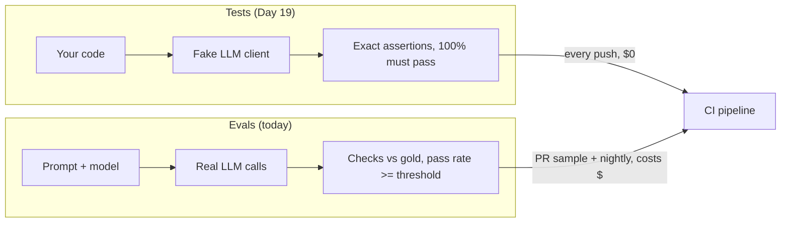
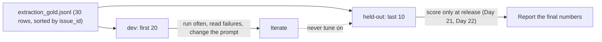
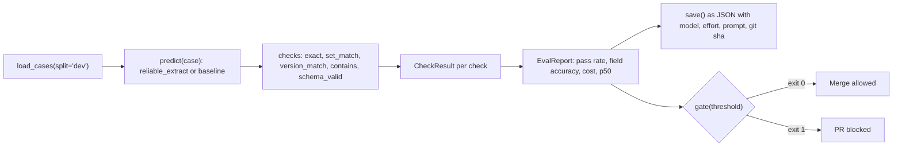
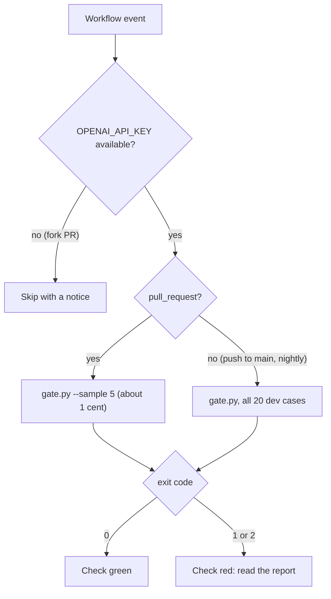

# Your First Eval Set

After Day 17, every record Atlas extracts is valid JSON and passes your semantic rules. But is it *right*? For issue #63 the record says `components: ["core"]`, while the maintainers' answer key says `["broker-redis"]`. No schema can catch that. Tests check your code; evals check the model's behaviour. Today you build your first eval set, a runner that turns it into numbers, and a CI gate that blocks a pull request when those numbers drop.

## At a Glance

- **Time:** ~2 h core (+ optional Go Deeper) · **Depth:** intro
- **Prerequisites:** [Day 16: Structured Outputs: Native JSON Schema & Extraction](../../Phase_2_Building_with_LLM_APIs/Day_016_structured_outputs/structured_outputs.md), [Day 17: Handling Semantic Failures: Validate, Re-ask, Bound](../../Phase_2_Building_with_LLM_APIs/Day_017_semantic_failures/semantic_failures.md), [Day 19: Testing LLM Code](../../Phase_2_Building_with_LLM_APIs/Day_019_testing_llm_code/testing_llm_code.md), primer [A12: Eval Metrics Basics](../../Appendix_Primers/A12_eval_metrics_basics.md)
- **You'll build:** `evals/` for the extractor: `checks.py` (code-based checks), `runner.py` (`run_eval()` → `EvalReport`), `gate.py` (exit code for CI), plus a GitHub Actions job. 20 dev cases, 10 held out.
- **Stops at:** LLM judges and error analysis ([Day 43](../../Phase_5_Evaluation_and_Observability/Day_043_eval_datasets/eval_datasets.md) to [Day 46](../../Phase_5_Evaluation_and_Observability/Day_046_judge_validation/judge_validation.md))
- **Fast path:** none; this is core. Experienced engineers: read [Checks as Small Functions](#checks-as-small-functions), [The Runner](#build-the-runner) and [A Gate in CI](#a-gate-in-ci), then do Exercise 3 (≈60 min).
- **Cost:** ≈ $0.05 per full dev run on `gpt-6-luna` including re-asks; the 5-case CI sample ≈ $0.01. The offline baseline is $0 (prices as of 2026-11, [verify](https://developers.openai.com/api/docs/pricing)).
- **New terms:** eval, golden set, code-based check, pass rate, eval gate

> **Coming from Software Engineering?** An eval is a regression suite that runs against a golden dataset and passes on a *threshold* instead of 100% green. The closest thing you already know is a performance benchmark in CI: the numbers are noisy, so you gate on "no worse than baseline minus a margin", not on an exact value. The parts transfer directly: fixtures become cases, assertions become checks, the test report becomes an eval report, and a red build becomes a non-zero exit code. What's new is that the thing under test changes its answer between runs, so one failing case is a data point, not a bug report.

## Valid Isn't Right

Three records an extractor like Day 17's can produce for dev issues. Each one is schema-valid and passes every semantic rule (codes and versions appear in the text, severity only on bugs), and each one disagrees with the gold answer somewhere.

| Issue | Field | Atlas said | Gold says |
|---|---|---|---|
| #63 (Hindi, Redis in Docker Compose) | `components` | `["core"]` | `["broker-redis"]` |
| #109 (flow step timeout) | `severity` | `"S3"` | `"S2"` |
| #113 (`orbit doctor` heartbeat rule) | `type`, `severity` | `"bug"`, `"S3"` | `"question"`, `null` |

Validation answers "is this a well-formed record?" Only a comparison with trusted answers answers "is it the *right* record?" That comparison, done systematically and turned into numbers, is an **eval**: a repeatable measurement of model behaviour against expected results.

## An Exam with an Answer Key

Think of grading an exam. You have the students' answers (the model's records), an answer key (gold), and a marking rule per question. You care about two numbers: the class average, and which questions everybody misses.

That maps one-to-one onto today's parts:

- The answer key is a **golden set**: inputs with trusted, human-checked answers. Orbit ships one, `eval/extraction_gold.jsonl`, with 30 issues the maintainers labelled.
- Each marking rule is a **code-based check**: a small function that compares one field to gold and returns pass or fail, with no model involved.
- The class average is the **pass rate**: the share of cases where *every* check passed.
- The rule "the class must average at least X" is the **eval gate**: a threshold that turns the report into a CI exit code.

Binary pass/fail per check is deliberate. A score like "0.73 similar" invites arguments about what 0.73 means; "severity matched: no" doesn't.

## Grade Three Cases by Hand

Before writing any code, grade the three records above against their gold rows. You need one rule per field:

- `type`, `severity`: exact match, where `null == null` counts as a match.
- `components`, `error_codes`: set equality, so `["cli", "flows"]` equals `["flows", "cli"]`.
- `orbit_version`: equal up to missing trailing zeros, so `"2.8"` matches `"2.8.0"` but `"3.0.1"` doesn't match `"3.0.0"`.
- `summary`: between 20 and 300 characters, and it mentions every gold error code.

| Case | type | severity | components | error_codes | orbit_version | summary | Case passes? |
|---|---|---|---|---|---|---|---|
| #63 | ✓ | ✓ (null = null) | ✗ | ✓ | ✓ (`2.8` ≈ `2.8.0`) | ✓ mentions ORB-1001 | no |
| #109 | ✓ | ✗ | ✓ (order ignored) | ✓ | ✓ | ✓ | no |
| #113 | ✗ | ✗ | ✓ | ✓ (both `[]`) | ✓ | ✓ | no |

The pass rate is 0/3, which sounds terrible. Now look per field: `type` 2/3, `severity` 1/3, `components` 2/3, everything else 3/3. The pass rate says "something is wrong"; **field accuracy** (the share of cases where one check passed) says *where*. Your runner reports both.

## Name the Parts

An eval run has six parts. A **case** is one gold row. A **predict function** turns a case into a record (here, by calling the extractor). A **check** compares one aspect of that record to gold and returns a `CheckResult`. The **report** collects every result plus pass rate, field accuracy, cost and latency. The **threshold** decides whether the report is good enough.

Tests and evals both run in CI, but they answer different questions with different machinery:



## Set Up: Three Lesson-Local Files

The runnable scripts from here on import compact copies of earlier days' code. Save each block under its file name (`schemas.py`, `extract.py`, `predictors.py`) in one folder, put `datasets/orbit` next to it (or set `ORBIT_DATA`), and run everything from that folder. First, Day 15's schemas, trimmed to what an eval needs. `IssueRecord`'s fields mirror `eval/extraction_gold.jsonl` exactly, which is what makes field-by-field scoring possible.

```python
# script_id: day_020_first_eval_set/schemas
# schemas.py: compact copy of Day 15's atlas/schemas.py + atlas/data.py, trimmed for Day 20.
# Install: uv add "openai>=3.46,<4" pydantic
# Env: ORBIT_DATA (optional, path to datasets/orbit). No API key needed for this file.
import json
import os
from pathlib import Path
from typing import Literal

from pydantic import BaseModel, ConfigDict, Field

DATA_DIR = Path(os.environ.get("ORBIT_DATA", "datasets/orbit"))
Component = Literal["core", "scheduler", "flows", "broker-redis", "broker-postgres", "broker-sqs",
                    "cli", "dashboard", "retries", "results", "observability", "auth", "docs"]


class Comment(BaseModel):
    author: str
    body: str


class Issue(BaseModel):
    """One row of issues/issues.jsonl. Only the fields the extractor reads; the rest are ignored."""
    id: int
    title: str
    body: str
    comments: list[Comment]
```

```python
# script_id: day_020_first_eval_set/schemas
class IssueRecord(BaseModel):
    """The facts Atlas extracts from one issue. Fields mirror eval/extraction_gold.jsonl."""
    model_config = ConfigDict(extra="forbid")

    type: Literal["bug", "feature", "question", "docs"] = Field(description="bug, feature, question or docs")
    components: list[Component] = Field(description="Every Orbit component the issue is about")
    severity: Literal["S1", "S2", "S3", "S4"] | None = Field(
        description="Bugs only: S1 outage or data loss, S2 major breakage, S3 has a workaround, "
                    "S4 cosmetic. null otherwise")
    orbit_version: str | None = Field(description="Full Orbit version, e.g. 3.1.2. null when not stated")
    python_version: str | None = Field(description="Python version as written, e.g. 3.12.6. null when not stated")
    error_codes: list[str] = Field(description="ORB-NNNN codes quoted in the issue or its comments")
    summary: str = Field(description="One or two English sentences: symptom, trigger, version")


def load_jsonl(path: Path) -> list[dict]:
    return [json.loads(line) for line in path.read_text(encoding="utf-8").splitlines() if line.strip()]


def load_issues(path: Path | None = None) -> list[Issue]:
    return [Issue.model_validate(row) for row in load_jsonl(path or DATA_DIR / "issues" / "issues.jsonl")]


if __name__ == "__main__":
    gold = load_jsonl(DATA_DIR / "eval" / "extraction_gold.jsonl")
    print(f"{len(load_issues())} issues · {len(gold)} gold records")
```

```text
240 issues · 30 gold records
```

Next, the thing you're evaluating: Day 16's `extract_issue()` and Day 17's bounded re-ask loop `reliable_extract()`, compacted into one file. The instructions are Day 16's, word for word, because an eval only means something if it scores the prompt you ship. Note the explicit `EFFORT`: GPT-6 models default to effort `medium`, which costs more and drifts more than the `low` you chose for extraction.

```python
# script_id: day_020_first_eval_set/extract
# extract.py: compact copy of Day 16-17's atlas/extract.py (extract_issue + reliable_extract).
# Install: uv add "openai>=3.46,<4" pydantic
# Env: OPENAI_API_KEY (required), ATLAS_MODEL, ATLAS_EFFORT (optional). Imports schemas.py.
import os
from dataclasses import dataclass, field

from openai import OpenAI
from pydantic import ValidationError

from schemas import Issue, IssueRecord

MODEL = os.environ.get("ATLAS_MODEL", "gpt-6-luna")
EFFORT = os.environ.get("ATLAS_EFFORT", "low")      # always explicit: the model default is "medium"
# USD per 1M tokens, as of 2026-11; verify at https://developers.openai.com/api/docs/pricing
PRICES_PER_1M = {"gpt-6-luna": {"input": 0.10, "cached_input": 0.01, "output": 0.50},
                 "gpt-6.1-terra": {"input": 1.00, "cached_input": 0.05, "output": 5.00}}
client = OpenAI(timeout=60, max_retries=3)

EXTRACT_INSTRUCTIONS = """You extract facts from GitHub issues filed against Orbit, an open-source
Python background-jobs library. Fill every field of the schema from the issue text only.

Rules:
- Use null when a fact is not stated. Never guess a version from dates or context.
- severity is for bugs only; use null for features, questions and docs.
- error_codes: every ORB-NNNN code that appears anywhere, including logs and comments. [] if none.
- components: usually one; list two only when the issue really spans both.
- summary: one or two sentences in English, even when the issue is in another language.

Component glossary:
core = queues, workers, leases, job execution | scheduler = cron schedules and delays
flows = Flows, steps and step state | broker-redis, broker-postgres, broker-sqs = that broker
cli = the orbit command | dashboard = the web UI | retries = retry policy and backoff
results = the result backend | observability = metrics and tracing
auth = dashboard login and OIDC | docs = the documentation itself"""
```

```python
# script_id: day_020_first_eval_set/extract
class CostTracker:
    """Day 12's tracker, reduced to a running total."""
    def __init__(self) -> None:
        self.calls, self.total_usd = 0, 0.0

    def record(self, usage, model: str = MODEL) -> float:
        p, cached = PRICES_PER_1M[model], usage.input_tokens_details.cached_tokens
        cost = ((usage.input_tokens - cached) * p["input"] + cached * p["cached_input"]
                + usage.output_tokens * p["output"]) / 1_000_000   # reasoning is inside output_tokens; cache-write surcharge omitted (Day 18)
        self.calls, self.total_usd = self.calls + 1, self.total_usd + cost
        return cost


tracker = CostTracker()


class ExtractionError(Exception):
    def __init__(self, reason: str, detail: str = "") -> None:
        super().__init__(f"{reason}: {detail}")
        self.reason = reason


def issue_to_input(issue: Issue, max_chars: int = 12_000) -> str:
    """Title, body and comments; never the labels (they're the answer key). Day 16 trims by tokens."""
    parts = [f"# {issue.title}", issue.body] + [f"--- comment by {c.author} ---\n{c.body}" for c in issue.comments]
    return "\n\n".join(parts)[:max_chars]


def extract_issue(issue: Issue, *, client=client, model: str = MODEL, feedback: str = "") -> IssueRecord:
    try:
        resp = client.responses.parse(model=model, instructions=EXTRACT_INSTRUCTIONS,
                                      input=issue_to_input(issue) + feedback, text_format=IssueRecord,
                                      reasoning={"effort": EFFORT}, max_output_tokens=25_000)
    except ValidationError as err:            # strict mode fixes the shape, so this is cut-off JSON
        raise ExtractionError("incomplete", "truncated JSON") from err
    tracker.record(resp.usage, model)          # billed even when the result is unusable
    if resp.status == "incomplete":
        raise ExtractionError("incomplete", str(resp.incomplete_details.reason))
    if resp.output_parsed is None:            # a refusal, or no final answer (Day 16)
        raise ExtractionError("refusal")
    return resp.output_parsed
```

```python
# script_id: day_020_first_eval_set/extract
def semantic_errors(record: IssueRecord, issue: Issue) -> list[str]:
    """Day 17's rules, compact: quoted facts must appear in the text; severity is for bugs."""
    text = issue_to_input(issue)
    errors = [f"error code {c} is not in the issue" for c in record.error_codes if c not in text]
    for name in ("orbit_version", "python_version"):
        value = getattr(record, name)
        if value and value not in text:
            errors.append(f"{name} {value} is not stated in the issue; use null")
    if record.severity and record.type != "bug":
        errors.append("severity is for bugs only; use null")
    if len(record.summary) > 300:
        errors.append("summary is longer than 300 characters")
    return errors


@dataclass
class ExtractResult:
    record: IssueRecord | None
    attempts: int = 0
    errors: list[str] = field(default_factory=list)
    cost_usd: float = 0.0
    needs_review: bool = False


def reliable_extract(issue: Issue, *, client=client, max_attempts: int = 3,
                     max_usd: float = 0.01, model: str = MODEL) -> ExtractResult:
    start, result, feedback = tracker.total_usd, ExtractResult(None), ""
    while result.attempts < max_attempts and tracker.total_usd - start < max_usd:
        result.attempts += 1
        try:
            record = extract_issue(issue, client=client, model=model, feedback=feedback)
        except ExtractionError as err:
            result.errors = [str(err)]
            if err.reason == "refusal":
                break                          # re-asking a refusal rarely helps (Day 17)
            continue
        result.record, result.errors = record, semantic_errors(record, issue)
        if not result.errors:
            break
        feedback = "\n\nYour previous answer broke these rules. Fix them:\n- " + "\n- ".join(result.errors)
    result.cost_usd = tracker.total_usd - start
    result.needs_review = result.record is None or bool(result.errors)
    return result
```

The third file holds the **predict functions**: anything that takes a case and returns a record. Keeping that one shape is what lets the same runner score a real model, an older prompt, a recording, or a deliberately dumb `keyword_baseline` that uses regexes and no model at all. The baseline costs $0, runs offline, and gives you a floor: if the LLM can't beat a regex on a field, that field's prompt needs work.

```python
# script_id: day_020_first_eval_set/predictors
# predictors.py: interchangeable predict functions, case dict -> record.
# Install: uv add "openai>=3.46,<4" pydantic · Env: ORBIT_DATA; OPENAI_API_KEY for llm_predict only
import re

from schemas import Issue, IssueRecord, load_issues

ISSUES: dict[int, Issue] = {issue.id: issue for issue in load_issues()}
CODE_RE = re.compile(r"\bORB-\d{4}\b")
PY_RE = re.compile(r"(?i)\bpython\s*v?(3\.\d+(?:\.\d+)?)")
ORBIT_RE = re.compile(r"(?i)(?:\borbit\s*v?|^)(\d+\.\d+\.\d+)")
TITLE_WORDS = {"broker-redis": "redis", "broker-postgres": "postgres", "broker-sqs": "sqs",
               "scheduler": "cron", "flows": "flow", "dashboard": "dashboard", "auth": "oidc",
               "retries": "retr", "cli": "orbit ", "docs": "docs"}


def keyword_baseline(case: dict) -> IssueRecord:
    """A deliberately dumb extractor: regexes and title keywords. Offline, $0, never reads labels."""
    issue = ISSUES[case["issue_id"]]
    head, title = f"{issue.title}\n{issue.body}", issue.title.lower()
    everything = "\n".join([head, *(c.body for c in issue.comments)])
    kind = ("question" if title.rstrip().endswith("?") or title.startswith(("how", "can", "is", "why"))
            else "feature" if any(w in title for w in ("support", "add ", "allow", "feature"))
            else "docs" if "docs" in title or "documentation" in title else "bug")
    python = PY_RE.search(head)
    orbit = ORBIT_RE.search(head)
    return IssueRecord(
        type=kind, severity="S3" if kind == "bug" else None,       # S3 is the most common bug label
        components=[c for c, word in TITLE_WORDS.items() if word in title][:1] or ["core"],
        orbit_version=orbit.group(1) if orbit else None, python_version=python.group(1) if python else None,
        error_codes=sorted(set(CODE_RE.findall(everything))), summary=issue.title)


def llm_predict(case: dict):
    from extract import reliable_extract    # imported here: creating the client needs OPENAI_API_KEY
    return reliable_extract(ISSUES[case["issue_id"]])
```

## The Smallest Useful Eval

Five cases, one check, one number. Everything else today is this loop with better bookkeeping.

```python
# script_id: day_020_first_eval_set/minimal_eval
# The smallest useful eval: 5 gold cases, one exact check on `type`. ≈ $0.01 (as of 2026-11, verify).
# Install: uv add "openai>=3.46,<4" pydantic · Env: OPENAI_API_KEY, ORBIT_DATA
from extract import reliable_extract
from schemas import DATA_DIR, load_issues, load_jsonl

issues = {issue.id: issue for issue in load_issues()}
gold = sorted(load_jsonl(DATA_DIR / "eval" / "extraction_gold.jsonl"), key=lambda r: r["issue_id"])[:5]
records = {case["issue_id"]: reliable_extract(issues[case["issue_id"]]).record for case in gold}

passed = 0
for case in gold:
    got = records[case["issue_id"]]                # None when reliable_extract gave up
    ok = got is not None and got.type == case["type"]
    passed += ok
    print(f"#{case['issue_id']:<4} want {case['type']:<9} got {got.type if got else '-':<9} {'PASS' if ok else 'FAIL'}")
print(f"type: {passed}/{len(gold)} pass ({passed / len(gold):.0%})")
```

Illustrative output (your numbers will differ):

```text
#10   want question  got question  PASS
#25   want question  got question  PASS
#62   want bug       got bug       PASS
#63   want question  got question  PASS
#74   want feature   got feature   PASS
type: 5/5 pass (100%)
```

Notice the shape: predict everything first, score afterwards. Predictions are the expensive part; scoring them again is free.

## Break It: Run Twice, Then Mis-Set the Checks

Turn three knobs. First, run the same five cases again. Second, make the check too strict: compare `summary` to the gold summary character by character. Third, make it too loose: pass any non-empty summary.

```python
# script_id: day_020_first_eval_set/minimal_eval
# Knob 1: same cases, second run (5 more calls). Knobs 2-3: rescore run 1's records, $0.
again = {cid: reliable_extract(issues[cid]).record for cid in records}
flips = [cid for cid in records if (records[cid] and records[cid].type) != (again[cid] and again[cid].type)]
print("type changed between runs on:", flips or "none")


def rate(check) -> str:
    hits = sum(bool(check(case, records[case["issue_id"]])) for case in gold)
    return f"{hits}/{len(gold)}"


print("too strict, summary == gold summary:", rate(lambda c, r: r and r.summary == c["summary"]))
print("too loose, summary is non-empty:   ", rate(lambda c, r: r and len(r.summary) > 0))
```

```text
type changed between runs on: [62]
too strict, summary == gold summary: 0/5
too loose, summary is non-empty:    5/5
```

Three lessons, one per line:

1. **The number moves on its own.** Issue #62 ("cron jobs off by an hour") is vague, so the model sometimes says bug, sometimes question. On 5 cases one flip is 20 points, which is why you set `EFFORT` explicitly and why a gate needs a margin.
2. **Too strict measures nothing.** Correct summaries never match word for word. Free text needs checks on *properties* (length, mentions the code) or, later, a judge ([Day 45: LLM-as-Judge](../../Phase_5_Evaluation_and_Observability/Day_045_llm_as_judge/llm_as_judge.md)).
3. **Too loose measures nothing either.** "Non-empty" can't fail when quality drops. A useful check fails on wrong output and passes on right output.

## Checks as Small Functions

Each hand-grading rule becomes a factory: `exact("type")` returns a function `(case, prediction) -> CheckResult`. One result shape, `CheckResult(name, passed, detail)`, means a Day 45 LLM judge can join the same list without changing the runner.

Two normalization decisions live here, in one place, so every check agrees: `None`, `""`, `"unknown"` and `"n/a"` all mean "not stated", and lists compare as sets.

```python
# script_id: day_020_first_eval_set/checks
# checks.py: atlas/evals/checks.py. Binary, code-based checks; each returns one CheckResult. $0.
# Install: uv add pydantic · Env: none. Imports the lesson-local schemas.py for schema_valid().
import re
from dataclasses import dataclass
from typing import Any, Callable

from pydantic import BaseModel, ValidationError

from schemas import IssueRecord


@dataclass(frozen=True)
class CheckResult:
    name: str
    passed: bool
    detail: str = ""


Check = Callable[[dict, Any], CheckResult]          # (gold case, prediction) -> verdict


def _get(pred: Any, field: str) -> Any:
    """Predictions may be Pydantic records or plain dicts (replayed from a saved report)."""
    return pred.get(field) if isinstance(pred, dict) else getattr(pred, field, None)


def _norm(value: Any) -> Any:
    """One null convention for every check: None, "", "unknown" and "n/a" mean "not stated"."""
    if isinstance(value, str):
        value = value.strip().lower()
        return None if value in {"", "unknown", "n/a", "none", "null"} else value
    return value


def exact(field: str) -> Check:
    def check(case: dict, pred: Any) -> CheckResult:
        want, got = _norm(case[field]), _norm(_get(pred, field))
        return CheckResult(field, want == got, "" if want == got else f"want {want!r}, got {got!r}")
    return check
```

```python
# script_id: day_020_first_eval_set/checks
def set_match(field: str) -> Check:
    def check(case: dict, pred: Any) -> CheckResult:
        want, got = set(case[field] or []), set(_get(pred, field) or [])   # None and [] both mean "none"
        detail = "" if want == got else f"missing {sorted(want - got)}, extra {sorted(got - want)}"
        return CheckResult(field, want == got, detail)
    return check


def _release(value: Any) -> tuple[int, ...] | None:
    if _norm(value) is None:
        return None
    nums = [int(n) for n in re.findall(r"\d+", str(value))][:3]
    return tuple(nums + [0] * (3 - len(nums)))       # "3.1" -> (3, 1, 0), same release as "3.1.0"


def version_match(field: str) -> Check:
    def check(case: dict, pred: Any) -> CheckResult:
        want, got = _release(case[field]), _release(_get(pred, field))
        return CheckResult(field, want == got, "" if want == got else f"want {case[field]!r}, got {_get(pred, field)!r}")
    return check


def contains(field: str, needle_field: str) -> Check:
    """Pass if the predicted `field` mentions every gold value of `needle_field` (case-insensitive)."""
    def check(case: dict, pred: Any) -> CheckResult:
        text, needles = str(_get(pred, field) or "").lower(), case[needle_field] or []
        missing = [n for n in (needles if isinstance(needles, list) else [needles]) if str(n).lower() not in text]
        return CheckResult(f"{field}_mentions_{needle_field}", not missing, f"missing {missing}" if missing else "")
    return check


def length_between(field: str, lo: int, hi: int) -> Check:
    def check(case: dict, pred: Any) -> CheckResult:
        n = len(str(_get(pred, field) or ""))
        return CheckResult(f"{field}_length", lo <= n <= hi, "" if lo <= n <= hi else f"{n} chars, want {lo}-{hi}")
    return check
```

`schema_valid()` re-validates the prediction, which matters for predictions loaded from a file. Then a self-test: code you gate releases on deserves its own tests.

```python
# script_id: day_020_first_eval_set/checks
def schema_valid(model: type[BaseModel] = IssueRecord) -> Check:
    def check(case: dict, pred: Any) -> CheckResult:
        if pred is None:
            return CheckResult("schema", False, "no record (refusal, incomplete or over budget)")
        try:
            model.model_validate(pred if isinstance(pred, dict) else pred.model_dump())
            return CheckResult("schema", True)
        except ValidationError as err:
            return CheckResult("schema", False, f"{err.error_count()} validation errors")
    return check


if __name__ == "__main__":
    gold = {"type": "bug", "severity": None, "components": ["flows", "cli"], "orbit_version": "3.0.0",
            "error_codes": ["ORB-1502", "ORB-1301"]}
    cases = [(exact("type"), {"type": "Bug"}, True), (exact("type"), {"type": "question"}, False),
             (exact("severity"), {"severity": "unknown"}, True),            # normalizes to None
             (set_match("components"), {"components": ["cli", "flows"]}, True),   # order ignored
             (set_match("components"), {"components": ["cli"]}, False),
             (version_match("orbit_version"), {"orbit_version": "3.0"}, True),
             (version_match("orbit_version"), {"orbit_version": "3.0.1"}, False),
             (contains("summary", "error_codes"), {"summary": "ORB-1502 then the DLQ (orb-1301)"}, True),
             (length_between("summary", 20, 300), {"summary": "broken"}, False),
             (schema_valid(), None, False)]
    ok = sum(check(gold, pred).passed == want for check, pred, want in cases)
    print(f"checks self-test: {ok}/{len(cases)}")
```

```text
checks self-test: 10/10
```

## Build: The Runner

Now the bookkeeping. Three decisions shape `atlas/evals/runner.py`.

**Split before you iterate.** Numbers on cases you tuned against are optimistic. So split the 30 gold rows once, by `issue_id`: the first 20 are **dev** (look at them, iterate on them), the last 10 are **held out** (scored only when you report a release, on [Day 21](../../Phase_2_Building_with_LLM_APIs/Day_021_prompts_as_code/prompts_as_code.md) and [Day 22](../../Phase_2_Building_with_LLM_APIs/Day_022_capstone_r1_extractor/capstone_r1_extractor.md)).



```python
# script_id: day_020_first_eval_set/runner
# runner.py: atlas/evals/runner.py. cases -> predict -> checks -> EvalReport -> gate().
# Install: uv add "openai>=3.46,<4" pydantic · Env: ORBIT_DATA; ATLAS_MODEL/ATLAS_EFFORT recorded in meta
import json
import os
import statistics
import subprocess
import time
from dataclasses import asdict, dataclass, field
from datetime import datetime, timezone
from pathlib import Path
from typing import Any, Callable, Literal

from checks import (Check, CheckResult, contains, exact, length_between, schema_valid,
                    set_match, version_match)
from schemas import DATA_DIR, load_jsonl

DEV_SIZE = 20
DEFAULT_CHECKS: list[Check] = [
    schema_valid(), exact("type"), exact("severity"), set_match("components"),
    set_match("error_codes"), version_match("orbit_version"),
    contains("summary", "error_codes"), length_between("summary", 20, 300)]


def load_cases(path: Path | None = None, *, split: Literal["dev", "heldout", "all"] = "dev") -> list[dict]:
    """Gold rows sorted by issue_id. First 20 = dev (iterate here); last 10 = held out (release only)."""
    rows = load_jsonl(path or DATA_DIR / "eval" / "extraction_gold.jsonl")
    rows.sort(key=lambda row: row["issue_id"])
    return {"dev": rows[:DEV_SIZE], "heldout": rows[DEV_SIZE:], "all": rows}[split]
```

**One result type per case, one report per run.** `CaseResult` keeps the verdicts *and* the prediction itself, so you can read failures later or re-score without paying again. `EvalReport` derives every number from the results, so the numbers can't disagree with the evidence.

```python
# script_id: day_020_first_eval_set/runner
@dataclass
class CaseResult:
    issue_id: int
    checks: list[CheckResult]
    prediction: dict | None
    cost_usd: float = 0.0
    latency_s: float = 0.0
    error: str = ""

    @property
    def passed(self) -> bool:
        return all(c.passed for c in self.checks)


@dataclass
class EvalReport:
    results: list[CaseResult]
    meta: dict = field(default_factory=dict)

    @property
    def pass_rate(self) -> float:
        return sum(r.passed for r in self.results) / max(len(self.results), 1)

    @property
    def field_accuracy(self) -> dict[str, float]:
        names = [c.name for c in self.results[0].checks] if self.results else []
        return {n: sum(c.passed for r in self.results for c in r.checks if c.name == n) / len(self.results)
                for n in names}

    @property
    def cost_usd(self) -> float:
        return sum(r.cost_usd for r in self.results)

    @property
    def p50_s(self) -> float:
        return statistics.median(r.latency_s for r in self.results) if self.results else 0.0

    def failures(self) -> list[tuple[int, str, str]]:
        return [(r.issue_id, c.name, c.detail) for r in self.results for c in r.checks if not c.passed]

```

`summary()` is the one-line view; `save()` writes everything, predictions included, to JSON.

```python
# script_id: day_020_first_eval_set/runner
    def summary(self) -> str:
        fields = " · ".join(f"{name} {acc:.2f}" for name, acc in self.field_accuracy.items())
        return (f"pass {sum(r.passed for r in self.results)}/{len(self.results)} ({self.pass_rate:.0%}) · "
                f"{fields} · ${self.cost_usd:.4f} · p50 {self.p50_s:.2f}s")

    def save(self, path: Path) -> Path:
        path.parent.mkdir(parents=True, exist_ok=True)
        data = {"meta": self.meta, "pass_rate": self.pass_rate, "field_accuracy": self.field_accuracy,
                "cost_usd": self.cost_usd, "p50_s": self.p50_s,
                "results": [asdict(r) | {"passed": r.passed} for r in self.results]}
        path.write_text(json.dumps(data, indent=2), encoding="utf-8")
        return path
```

**Record what produced the numbers.** A pass rate without model, effort, prompt and commit can't be compared with anything, so `run_eval()` stamps them on every report. One broken case (a timeout, a refusal) counts as a failure instead of crashing the run; if *every* case errors, the setup is wrong (a missing key, say), and the runner raises instead of reporting 0%.

```python
# script_id: day_020_first_eval_set/runner
def run_meta() -> dict:
    try:
        sha = subprocess.run(["git", "rev-parse", "--short", "HEAD"], capture_output=True,
                             text=True, timeout=5).stdout.strip()
    except (OSError, subprocess.SubprocessError):
        sha = ""
    return {"model": os.environ.get("ATLAS_MODEL", "gpt-6-luna"), "effort": os.environ.get("ATLAS_EFFORT", "low"),
            "prompt": "extract_issue@inline", "git_sha": sha or "unknown",     # Day 21 versions prompts
            "created": datetime.now(timezone.utc).isoformat(timespec="seconds")}


def run_eval(cases: list[dict], predict: Callable[[dict], Any], checks: list[Check], *,
             label: str = "") -> EvalReport:
    results = []
    for case in cases:
        start, error = time.perf_counter(), ""
        try:
            out = predict(case)
        except Exception as err:             # one bad case is a failed case, not a crashed run
            out, error = None, f"{type(err).__name__}: {err}"
        latency = time.perf_counter() - start
        record = getattr(out, "record", out)        # ExtractResult (Day 17) or a bare record
        verdicts = [check(case, record) for check in checks]
        if record is None:                          # no record: every check fails, with the reason
            verdicts = [CheckResult(v.name, False, error or "no record") for v in verdicts]
        prediction = record.model_dump() if hasattr(record, "model_dump") else record
        results.append(CaseResult(case["issue_id"], verdicts, prediction,
                                  getattr(out, "cost_usd", 0.0), latency, error))
    if results and all(r.error for r in results):
        raise RuntimeError(f"every case failed, so this is a setup problem: {results[0].error}")
    return EvalReport(results, meta={"label": label, "n": len(cases), **run_meta()})
```

Finally `gate()`, and a demo that runs offline: it scores the keyword baseline on dev, prints the failure table and saves the report.

```python
# script_id: day_020_first_eval_set/runner
def gate(report: EvalReport, *, threshold: float, min_field: float = 0.6) -> int:
    """0 = good enough to merge, 1 = block. Set threshold = your baseline minus a noise margin."""
    problems = [f"pass_rate {report.pass_rate:.2f} < {threshold:.2f}"] if report.pass_rate < threshold else []
    problems += [f"{name} {acc:.2f} < {min_field:.2f}" for name, acc in report.field_accuracy.items()
                 if acc < min_field]
    print("FAIL: " + "; ".join(problems) if problems else f"PASS: pass_rate {report.pass_rate:.2f} >= {threshold:.2f}")
    return 1 if problems else 0


if __name__ == "__main__":
    from predictors import keyword_baseline    # swap in llm_predict to score the real extractor
    report = run_eval(load_cases(split="dev"), keyword_baseline, DEFAULT_CHECKS, label="keyword_baseline")
    print(report.summary())
    print(f"{'issue':<6} {'check':<28} detail")
    for issue_id, name, detail in report.failures()[:6]:
        print(f"#{issue_id:<5} {name:<28} {detail}")
    print("saved", report.save(Path("reports/baseline.json")), "· gate exit code:", gate(report, threshold=0.65))
```

The flow you built, end to end:



Run `python runner.py`. These numbers are real; the baseline is deterministic:

```text
pass 4/20 (20%) · schema 1.00 · type 0.70 · severity 0.35 · components 0.65 · error_codes 1.00 · orbit_version 1.00 · summary_mentions_error_codes 0.85 · summary_length 0.95 · $0.0000 · p50 0.00s
issue  check                        detail
#10    type                         want 'question', got 'bug'
#10    severity                     want None, got 's3'
#25    type                         want 'question', got 'bug'
#25    severity                     want None, got 's3'
#63    type                         want 'question', got 'bug'
#63    severity                     want None, got 's3'
FAIL: pass_rate 0.20 < 0.65; severity 0.35 < 0.60
saved reports/baseline.json · gate exit code: 1
```

Notice two things before spending a cent. The regex baseline already scores 1.00 on `error_codes` and `orbit_version`, so the model must not do *worse* there. And `type`/`severity` are where judgement lives: the baseline can't tell a question from a bug, which is what you pay the model for.

Now swap `keyword_baseline` for `llm_predict` (or run `gate.py` below). Illustrative output (your numbers will differ; paste yours into the R1 scoreboard):

```text
pass 14/20 (70%) · schema 1.00 · type 0.95 · severity 0.85 · components 0.75 · error_codes 1.00 · orbit_version 0.95 · summary_mentions_error_codes 0.95 · summary_length 1.00 · $0.0410 · p50 1.40s
```

## Reading Failures

The pass rate tells you whether to worry; the failure table tells you what to fix. Read every failing row of a dev run and write one sentence per row naming the likely cause. Look for patterns:

| Pattern in the table | Likely cause | First thing to try |
|---|---|---|
| `components` says `core` where gold names a broker (#63) | The model reads "worker fails" and stops; the broker is in the logs | Add "the broker named in URLs or logs counts" to the rules |
| `orbit_version` set where gold is `null` | Invented from context (a version in a comment or the changelog) | Day 16's "never guess a version" rule; check it survived the edit |
| `summary_mentions_error_codes` fails on non-English issues (#25, #63) | The summary was translated and the code dropped | Say "keep ORB codes verbatim" in the summary rule |
| `type`: question vs bug on "X fails" titles (#113) | A real ambiguity: the reporter asks *why*, the title says *fails* | Add a shot ([Day 10: Few-Shot Prompting](../../Phase_2_Building_with_LLM_APIs/Day_010_few_shot_prompting/few_shot_prompting.md)) |

Don't patch each row separately: a prompt with one special case per failing issue fits dev and nothing else, which is what the held-out split catches. The systematic version of this reading (open coding, a failure taxonomy, counts per mode) is [Day 44: Error Analysis: From Traces to Failure Modes](../../Phase_5_Evaluation_and_Observability/Day_044_error_analysis/error_analysis.md).

## A Gate in CI

An eval nobody runs protects nothing, so wire it into CI next to Day 19's test job.

**The threshold is your baseline minus a margin.** If your first honest dev run passes 14/20 (0.70), a gate at 0.70 fails on noise about half the time. Leave room: pass rate ≥ 0.65 and every check ≥ 0.6. Raise the bar only after the baseline rises.

**Pay little on every PR, more every night.** Five cases cost about a cent and catch big breaks, such as a prompt edit that drops a field. The full 20 run nightly and on pushes to `main`. On 5 cases one miss costs 20 points, so the PR check is a smoke alarm, not a measurement.

`gate.py` is the CI entry point: run, save, gate, exit code.

```python
# script_id: day_020_first_eval_set/gate
# gate.py: CI entry point. Run the eval, save the report, exit 1 when the gate fails.
# Install: uv add "openai>=3.46,<4" pydantic · Env: OPENAI_API_KEY (llm predictor), ATLAS_MODEL, ATLAS_EFFORT
#   python gate.py --sample 5 --threshold 0.65              # PR check, ≈ $0.01 (as of 2026-11, verify)
#   python gate.py --predictor baseline --threshold 0 --min-field 0   # offline dry run, $0
import argparse
import os
import sys
from pathlib import Path

from runner import DEFAULT_CHECKS, gate, load_cases, run_eval


def main(argv: list[str] | None = None) -> int:
    p = argparse.ArgumentParser(description="Run the extraction eval and gate on the result.")
    p.add_argument("--split", choices=["dev", "heldout", "all"], default="dev")
    p.add_argument("--sample", type=int, default=0, help="first N cases only; 0 = the whole split")
    p.add_argument("--threshold", type=float, default=0.65, help="minimum pass rate")
    p.add_argument("--min-field", type=float, default=0.6, help="minimum accuracy for every check")
    p.add_argument("--predictor", choices=["llm", "baseline"], default="llm")
    p.add_argument("--out", type=Path, default=Path("reports/latest.json"))
    args = p.parse_args(argv)
    if args.predictor == "llm" and not os.environ.get("OPENAI_API_KEY"):
        print("ERROR: OPENAI_API_KEY is not set. A gate that didn't run must not pass.", file=sys.stderr)
        return 2
    from predictors import keyword_baseline, llm_predict
    cases = load_cases(split=args.split)[: args.sample or None]
    report = run_eval(cases, llm_predict if args.predictor == "llm" else keyword_baseline,
                      DEFAULT_CHECKS, label=f"{args.predictor}:{args.split}:{len(cases)}")
    print(report.summary(), "->", report.save(args.out))
    return gate(report, threshold=args.threshold, min_field=args.min_field)


if __name__ == "__main__":
    sys.exit(main())
```

```text
$ python gate.py --sample 5 --threshold 0.65
pass 4/5 (80%) · schema 1.00 · type 1.00 · severity 1.00 · components 0.80 · ... · $0.0098 · p50 1.30s -> reports/latest.json
PASS: pass_rate 0.80 >= 0.65
$ echo $?
0
```

The missing-key branch exits 2, not 0, on purpose: a gate that passes because it never ran is worse than no gate.

Now the workflow. GitHub doesn't pass secrets (other than `GITHUB_TOKEN`) to workflows triggered from a fork, and `secrets` can't appear directly in `if:` conditions. The documented pattern is a job-level environment variable that steps test. The `--sample` expression picks 5 cases on PRs and the whole split otherwise.

```yaml
# .github/workflows/evals.yml (next to Day 19's ci.yml). Assumes today's files live in evals/.
name: evals
on:
  pull_request:
  push:
    branches: [main]
  schedule:
    - cron: "0 3 * * *"          # nightly at 03:00 UTC: the full dev set
  workflow_dispatch:
jobs:
  eval-gate:
    runs-on: ubuntu-latest
    env:
      OPENAI_API_KEY: ${{ secrets.OPENAI_API_KEY }}   # empty on fork PRs: GitHub withholds secrets
      ATLAS_MODEL: gpt-6-luna
      ATLAS_EFFORT: low
      ORBIT_DATA: datasets/orbit
    steps:
      - uses: actions/checkout@v7
      - uses: astral-sh/setup-uv@v10.3.3     # no floating major tag after v7: pin the full version
        with: { enable-cache: true }
      - run: uv sync --locked
      - name: Skip notice (no secret, e.g. a fork PR)
        if: env.OPENAI_API_KEY == ''
        run: echo "::notice::OPENAI_API_KEY unavailable; eval gate skipped. A maintainer runs it after merge."
      - name: Eval gate (5 cases on PRs, the whole dev set otherwise)
        if: env.OPENAI_API_KEY != ''
        run: uv run python evals/gate.py --sample ${{ github.event_name == 'pull_request' && 5 || 0 }} --threshold 0.65
```

The skip step keeps fork PRs green without hiding anything, and the run after merge still gates. Don't reach for the `pull_request_target` trigger to get secrets into fork PRs: it hands the workflow your secrets, and checking out the PR's code there runs unreviewed code with them.



## Trade-offs: What 20 Cases Can and Can't Tell You

| Question | 20 code-checked cases | What you need instead |
|---|---|---|
| Did a change break a field badly (≥ 20 points)? | Yes, reliably | — |
| Is prompt v2 3 points better than v1? | No; that's inside the noise | More cases ([Day 43](../../Phase_5_Evaluation_and_Observability/Day_043_eval_datasets/eval_datasets.md)), repeats ([Day 47](../../Phase_5_Evaluation_and_Observability/Day_047_evals_in_ci/evals_in_ci.md)) |
| Is the summary *good*, not merely short and coded? | No | An LLM judge ([Day 45](../../Phase_5_Evaluation_and_Observability/Day_045_llm_as_judge/llm_as_judge.md)) |
| Does it work on next month's issues? | Only if the gold set looks like them | Grow the set from production failures (Day 43) |

At 70% on 20 cases, one standard error is about ±10 points ([A12: Small samples](../../Appendix_Primers/A12_eval_metrics_basics.md#small-samples-why-20-examples-can-mislead)). Use code-based checks wherever the answer is a fact; they're free, fast and consistent. Save judges for what code can't see.

### In production

- Grow the golden set from real failures: every bug report about a wrong record becomes a case ([Day 43](../../Phase_5_Evaluation_and_Observability/Day_043_eval_datasets/eval_datasets.md)).
- Keep the report JSON as a CI artifact; a diff between two reports is how [Day 21](../../Phase_2_Building_with_LLM_APIs/Day_021_prompts_as_code/prompts_as_code.md) decides whether a prompt or model change ships.
- Handle flakes with repeats and confidence intervals, not by rerunning until green ([Day 47](../../Phase_5_Evaluation_and_Observability/Day_047_evals_in_ci/evals_in_ci.md)).
- Track cost per run next to accuracy; an eval that triples in price gets switched off.
- Use your own harness (this one, pytest, or Promptfoo). OpenAI's hosted Evals platform is read-only since 2026-10-31 and shuts down on 2026-11-30 ([deprecations](https://developers.openai.com/api/docs/deprecations)), so don't build on it.

## Go Deeper (optional)

<details><summary>Go deeper: how wide is the error bar on 20 cases?</summary>

In words: a pass rate measured on a few cases is an estimate, and small samples give wide ranges. Toy numbers: 14 of 20 is 70%, but if each case is a coin that lands "pass" 70% of the time, a rerun on a fresh 20 could easily give 12 or 16. The formula for one standard error of a proportion is √(p(1−p)/n): √(0.7 × 0.3 / 20) ≈ 0.10, so ±10 points. For a 95% range, the Wilson interval behaves better than ±2 standard errors at small n:

```python
# script_id: day_020_first_eval_set/noise
# 95% Wilson interval for a pass rate. Stdlib only, $0.
import math


def wilson(passed: int, n: int, z: float = 1.96) -> tuple[float, float]:
    p = passed / n
    centre = (p + z * z / (2 * n)) / (1 + z * z / n)
    half = z * math.sqrt(p * (1 - p) / n + z * z / (4 * n * n)) / (1 + z * z / n)
    return centre - half, centre + half


for passed, n in [(14, 20), (4, 5), (70, 100), (700, 1000)]:
    lo, hi = wilson(passed, n)
    print(f"{passed:>4}/{n:<5} = {passed / n:.0%}  95% interval {lo:.0%}-{hi:.0%}")
```

```text
  14/20    = 70%  95% interval 48%-85%
   4/5     = 80%  95% interval 38%-96%
  70/100   = 70%  95% interval 60%-78%
 700/1000  = 70%  95% interval 67%-73%
```

Read the 5-case row twice: the PR sample can't distinguish 40% from 95%. It catches collapses, nothing finer. To detect a 5-point change you need hundreds of cases, or the same cases scored by two variants (a paired comparison), which Day 47 covers.

</details>

<details><summary>Go deeper: replay saved predictions to iterate on checks for $0</summary>

Every `CaseResult` stores the prediction, so a saved report is also a recording. When you change a *check* (not the prompt), you don't need new model calls: replay the predictions through the new checks. This is how teams tune normalization rules without paying for a rerun, and it's the offline twin of Day 19's recorded fixtures.

```python
# script_id: day_020_first_eval_set/replay
# Re-score a saved report's predictions with a different check list. No model calls, $0.
import json
from pathlib import Path

from checks import version_match
from runner import DEFAULT_CHECKS, load_cases, run_eval


def replay_predictor(report_path: Path):
    saved = {r["issue_id"]: r["prediction"] for r in json.loads(report_path.read_text())["results"]}
    return lambda case: saved[case["issue_id"]]       # dicts are valid predictions for every check


path = Path("reports/baseline.json")
if not path.exists():                                 # first run: record one with the offline baseline
    from predictors import keyword_baseline
    run_eval(load_cases(), keyword_baseline, DEFAULT_CHECKS, label="keyword_baseline").save(path)
checks = DEFAULT_CHECKS + [version_match("python_version")]
print(run_eval(load_cases(), replay_predictor(path), checks, label="replay").summary())
```

Replay only answers "what would the new checks say about the old outputs". The moment the prompt, model or effort changes, the recording is stale and you need a real run.

</details>

<details><summary>Go deeper: write your normalization rules down</summary>

Most "the model got it wrong" reports in a young eval are really "the check and the gold file disagree about conventions". Decide each convention once, apply it in `_norm()` or the check, and write it next to the gold file:

| Convention | Rule in this lesson | Why |
|---|---|---|
| Not stated | `None`, `""`, `"unknown"`, `"n/a"` → `None`; `[]` and `None` equal for lists | The model and the labellers express "absent" differently |
| Case | Compare lowercase | `"Bug"` and `"bug"` are the same label |
| List order | Sets | `["cli", "core"]` and `["core", "cli"]` are the same answer |
| Versions | Pad to three parts | `"3.1"` is release 3.1.0; `"3.1.2"` is a different release |
| Free text | Properties only (length, mentions codes) | Exact text match is 0% by construction |

Be careful in the other direction too. Normalizing `"S2"` and `"S3"` to "some severity" would make the check pass on the exact mistake you care about. Every rule should merge things that *mean* the same and nothing else.

</details>

## Common Pitfalls

- **Great numbers that later drop.** You tuned on all 30 cases, so nothing measures generalization. Fix: iterate on dev; score held-out once per release.
- **A correct answer fails on order.** `["cli", "core"] != ["core", "cli"]` when compared as lists. Fix: `set_match()` for every list field.
- **Null mismatches.** Gold says `null`, the model says `"unknown"`, and the check reports a false miss. Fix: normalize in one place (`_norm()`) and document it.
- **A flaky gate.** Default effort (`medium`) plus a threshold equal to the baseline, so the gate flips between runs. Fix: set `ATLAS_EFFORT`, gate at baseline minus a margin; repeats are Day 47.
- **Fork PRs fail with an auth error.** Forks get no secrets, so creating the client raises `OpenAIError: Missing credentials. Please pass an api_key ...` (and `gate.py` exits 2). Fix: the `env.OPENAI_API_KEY != ''` step guard, plus the `push` and nightly runs.
- **`RuntimeError: every case failed, so this is a setup problem: ...`** Usually a missing key or a wrong `ATLAS_MODEL`. Fix: read the text after the colon; it's the first case's exception.

> **Where we stop:** today's checks are code-only and the set has 20 dev cases; building larger datasets, error analysis, LLM judges and judge validation are [Day 43](../../Phase_5_Evaluation_and_Observability/Day_043_eval_datasets/eval_datasets.md) to [Day 46](../../Phase_5_Evaluation_and_Observability/Day_046_judge_validation/judge_validation.md), and repeats plus PR comments at scale are [Day 47](../../Phase_5_Evaluation_and_Observability/Day_047_evals_in_ci/evals_in_ci.md).

## Key Takeaways

- Tests check your code with a fake client and must be 100% green; evals check the model's behaviour against gold with real calls and pass on a threshold.
- A golden set is only honest if you split it: iterate on the 20 dev cases, report the 10 held-out cases at release time.
- Checks are small binary functions with one result shape (`CheckResult`); normalization (nulls, sets, versions) lives inside them so every check agrees.
- Report pass rate *and* per-field accuracy, cost and p50, stamped with model, effort, prompt and git sha, so any number can be traced and compared.
- Gate at baseline minus a margin, run a cheap sample on PRs and the full set nightly, and make a gate that couldn't run fail loudly instead of passing.

## Quick Reference

| API / pattern | What it does | When to use | Gotcha |
|---|---|---|---|
| `load_cases(split="dev")` | First 20 gold rows by `issue_id` | Every iteration | `"heldout"` only at release |
| `exact(field)` | Equal after normalization | Labels: `type`, `severity` | `null == null` is a pass |
| `set_match(field)` | Set equality, `[]` == `None` | `components`, `error_codes` | Not for ordered lists |
| `version_match(field)` | `"3.1"` == `"3.1.0"` | Version strings | `"3.1"` ≠ `"3.1.2"` |
| `contains(field, needle_field)` | Text mentions every gold value | Free-text properties | Passes automatically when gold is `[]` |
| `schema_valid()` | Re-validates a record or dict | Replayed or stored predictions | `None` prediction fails |
| `run_eval(cases, predict, checks)` | Runs and scores everything | Any predict function | Raises if every case errors |
| `EvalReport.save(path)` / `.failures()` | JSON report / failure rows | CI artifacts, reading failures | Commit reports, not keys |
| `gate(report, threshold=…, min_field=…)` | 0 = pass, 1 = block | CI exit code | Threshold = baseline − margin |
| `if: env.OPENAI_API_KEY != ''` | Skips the eval without a secret | Fork PRs | `secrets.*` isn't allowed in `if:` |

## Exercises

1. **Warm-up: extend the suite.** Add a `python_version` check to the default list and rerun on dev. How does the keyword baseline score on the new field, and how would you expect the LLM to compare?
2. **Core: does re-asking improve accuracy, or only validity?** Score Day 16's one-shot `extract_issue()` and Day 17's `reliable_extract()` on the same 20 dev cases and print a per-check comparison with cost. Add the line to your R1 scoreboard.
3. **Core: a regression gate.** Write `regression_gate(report, baseline_path, threshold=…, max_drop=0.10)` that fails when *any* check drops more than 10 points against a saved baseline report, on top of the normal `gate()`. Demonstrate it offline with a deliberately broken predictor.
4. **Stretch (optional): quantify non-determinism.** Run the dev set 3 times with `llm_predict` and report the flip rate: the share of cases whose pass/fail verdict isn't the same in all three runs.

<details><summary>Solution</summary>

`version_match` already handles `"3.12"` vs `"3.12.6"` correctly (different, because the gold value is more precise). Swap `keyword_baseline` for `llm_predict` to score the model.

```python
# script_id: day_020_first_eval_set/solution_ex1
# Warm-up: add a python_version check. Offline with the baseline, $0.
from checks import version_match
from predictors import keyword_baseline
from runner import DEFAULT_CHECKS, load_cases, run_eval

checks = DEFAULT_CHECKS + [version_match("python_version")]
report = run_eval(load_cases(split="dev"), keyword_baseline, checks, label="baseline+python")
print(report.summary())
print("python_version accuracy:", report.field_accuracy["python_version"])
```

</details>

<details><summary>Solution</summary>

The wrapper turns a bare record into an `ExtractResult` so cost is reported the same way for both. A one-shot `ExtractionError` is caught by `run_eval()` and counted as a failed case.

```python
# script_id: day_020_first_eval_set/solution_ex2
# One-shot extract_issue (Day 16) vs reliable_extract (Day 17) on dev. ≈ $0.08 (as of 2026-11, verify).
# Env: OPENAI_API_KEY, ORBIT_DATA
from extract import ExtractResult, extract_issue, tracker
from predictors import ISSUES, llm_predict
from runner import DEFAULT_CHECKS, load_cases, run_eval


def one_shot(case: dict) -> ExtractResult:
    before = tracker.total_usd
    record = extract_issue(ISSUES[case["issue_id"]])
    return ExtractResult(record, attempts=1, cost_usd=tracker.total_usd - before)


cases = load_cases(split="dev")
a = run_eval(cases, one_shot, DEFAULT_CHECKS, label="extract_issue")
b = run_eval(cases, llm_predict, DEFAULT_CHECKS, label="reliable_extract")
print(f"{'check':<30} {'one-shot':>9} {'re-ask':>9}")
for name, acc in a.field_accuracy.items():
    print(f"{name:<30} {acc:>9.2f} {b.field_accuracy[name]:>9.2f}")
print(f"{'pass rate':<30} {a.pass_rate:>9.2f} {b.pass_rate:>9.2f}")
print(f"{'cost $':<30} {a.cost_usd:>9.4f} {b.cost_usd:>9.4f}")
```

Expect re-asking to help most on fields its rules cover (versions, codes, severity on non-bugs) and barely at all on `components` or `type`, which no rule checks. Validity and accuracy are different things.

</details>

<details><summary>Solution</summary>

```python
# script_id: day_020_first_eval_set/solution_ex3
# Fail when any check drops > 10 points vs a saved baseline report. Offline demo, $0.
import json
from pathlib import Path

from predictors import keyword_baseline
from runner import DEFAULT_CHECKS, EvalReport, gate, load_cases, run_eval


def regression_gate(report: EvalReport, baseline_path: Path, *, threshold: float,
                    max_drop: float = 0.10, min_field: float = 0.6) -> int:
    base = json.loads(baseline_path.read_text(encoding="utf-8"))["field_accuracy"]
    drops = [f"{name} {base[name]:.2f} -> {acc:.2f}" for name, acc in report.field_accuracy.items()
             if name in base and base[name] - acc > max_drop]
    for line in drops:
        print("REGRESSION:", line)
    return max(gate(report, threshold=threshold, min_field=min_field), 1 if drops else 0)


def broken(case: dict):
    """A simulated bad prompt change: same predictions, but error codes are dropped."""
    return keyword_baseline(case).model_copy(update={"error_codes": []})


cases = load_cases(split="dev")
saved = run_eval(cases, keyword_baseline, DEFAULT_CHECKS, label="baseline").save(Path("reports/base.json"))
candidate = run_eval(cases, broken, DEFAULT_CHECKS, label="candidate")
print("exit code:", regression_gate(candidate, saved, threshold=0.0, min_field=0.0))
```

```text
REGRESSION: error_codes 1.00 -> 0.45
PASS: pass_rate 0.10 >= 0.00
exit code: 1
```

The absolute gate passes (the thresholds are zero in this demo) while the regression gate catches the drop. In real use you keep both: the absolute floor stops a bad baseline from being accepted, and the relative check stops slow erosion.

</details>

<details><summary>Solution</summary>

```python
# script_id: day_020_first_eval_set/solution_ex4
# Stretch: run dev 3 times and count verdict flips. 60 extractions ≈ $0.15 (as of 2026-11, verify).
# Env: OPENAI_API_KEY, ORBIT_DATA
from predictors import llm_predict
from runner import DEFAULT_CHECKS, load_cases, run_eval

cases = load_cases(split="dev")
runs = [run_eval(cases, llm_predict, DEFAULT_CHECKS, label=f"repeat-{i}") for i in range(3)]
flipped = [case["issue_id"] for i, case in enumerate(cases)
           if len({run.results[i].passed for run in runs}) > 1]
print("pass rates:", [f"{run.pass_rate:.2f}" for run in runs])
print(f"flip rate: {len(flipped)}/{len(cases)} = {len(flipped) / len(cases):.0%} · flipped: {flipped}")
```

```text
pass rates: ['0.70', '0.65', '0.75']
flip rate: 3/20 = 15% · flipped: [62, 83, 113]
```

Illustrative; yours will differ. The flipped cases are usually the vague or ambiguous ones, which is useful in itself: they're the first candidates for a clearer gold label, a shot, or a "needs human" route.

</details>

## References & Further Reading

- [OpenAI: Evaluation best practices](https://developers.openai.com/api/docs/guides/evaluation-best-practices): how to design evals for variable outputs (the platform it links is closing).
- [OpenAI: Deprecations](https://developers.openai.com/api/docs/deprecations): the Evals platform shutdown timeline.
- [OpenAI Cookbook: Moving from OpenAI Evals to Promptfoo](https://developers.openai.com/cookbook/examples/evaluation/moving-from-openai-evals-to-promptfoo): a config-driven alternative to this harness.
- [GitHub Docs: Using secrets in GitHub Actions](https://docs.github.com/en/actions/how-tos/write-workflows/choose-what-workflows-do/use-secrets): the fork-PR rule and the `if:` restriction.
- [GitHub Docs: Events that trigger workflows](https://docs.github.com/en/actions/reference/workflows-and-actions/events-that-trigger-workflows): triggers, and the `pull_request_target` caveats.
- [setup-uv README](https://raw.githubusercontent.com/astral-sh/setup-uv/main/README.md): how to pin the uv action.
- [A12: Eval Metrics Basics](../../Appendix_Primers/A12_eval_metrics_basics.md): baselines, pass rate and small samples.

## What's Next

Your extractor now has a number, and the number has a gate. Tomorrow, [Day 21: Prompts as Code & Model Migrations](../../Phase_2_Building_with_LLM_APIs/Day_021_prompts_as_code/prompts_as_code.md) versions the prompt that produced it, and uses today's reports to decide whether a prompt edit or a move to a different model is safe to ship.
