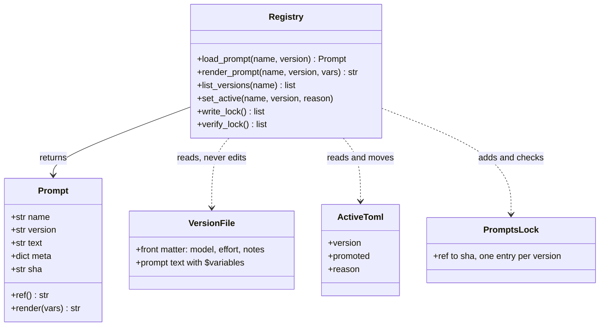
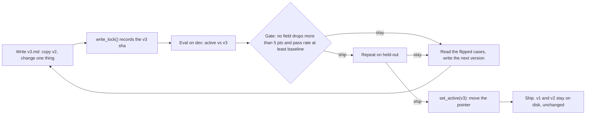
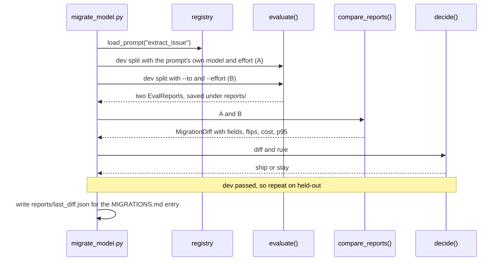

# Prompts as Code & Model Migrations

A teammate "improved" the extraction prompt in place. A week later severity accuracy is down, and nobody can say which wording produced which numbers, because the eval report from Day 20 only says "pass rate 70%". Meanwhile, the model you depend on will one day get a shutdown date. Prompts and model IDs change all the time, so today you version them like code and put every change, prompt or model, through the same eval gate.

## At a Glance

- **Time:** ~2 h core (+ optional Go Deeper) · **Depth:** working
- **Prerequisites:** [Day 9: Writing Effective Prompts](../../Phase_2_Building_with_LLM_APIs/Day_009_effective_prompts/effective_prompts.md), [Day 20: Your First Eval Set](../../Phase_2_Building_with_LLM_APIs/Day_020_first_eval_set/first_eval_set.md), [Day 7: Choosing a Model](../../Phase_1_How_LLMs_Work/Day_007_choosing_a_model/choosing_a_model.md), [Day 10: Few-Shot Prompting](../../Phase_2_Building_with_LLM_APIs/Day_010_few_shot_prompting/few_shot_prompting.md)
- **You'll build:** a file-based prompt registry (`registry.py`: `Prompt`, `load_prompt()`, `verify_lock()`) and `migrate_model.py`, which re-runs the eval set on a candidate model or prompt and prints a diff plus a ship/stay decision
- **Stops at:** production A/B testing and canaries ([Day 87](../../Phase_9_Production/Day_087_shipping_changes_safely/shipping_changes_safely.md))
- **Fast path:** Already version prompts in Git? Read [The Model-Migration Drill](#the-model-migration-drill) and do Exercise 3 (≈45 min)
- **Cost:** ≈ $0.10 on `gpt-6-luna` + `gpt-6.1-terra` for one live gate and one live drill; $0 in simulated mode (prices as of 2026-11, [verify](https://developers.openai.com/api/docs/pricing))
- **New terms:** prompt registry, prompt version, content hash, migration drill, regression diff

> **Coming from Software Engineering?** Prompts are config-as-code. They live in the repo, get reviewed in PRs, are released by moving a pointer (like a feature flag or a `latest` Docker tag), and are protected by a regression suite in CI. A published prompt version is like a released package version: you never edit `1.4.0` in place, you publish `1.4.1`. A model migration is a major dependency upgrade (think Postgres 15 → 17): you pin the old one, run the test suite on the new one, read the diff, and write down the decision and the rollback. The one new thing is that your "tests" are evals with scores, so the gate compares numbers instead of checking green/red.

## Which Prompt Shipped?

Here is the failure in concrete form. On Day 9 your prompts lived in a Python dict, and on Day 20 your eval runner wrote a report like this:

```text
{"pass_rate": 0.70, "fields": {"severity": 0.80, "type": 0.95, ...}}
```

Two weeks later the same command prints `severity: 0.70`. Did someone edit the prompt string? Was `ATLAS_MODEL` set differently on that laptop? The report can't tell you, because it never recorded *which text* and *which model* produced it. A number you can't trace back to its inputs is a number you can't act on.

## Every Draft, Labelled

Think of a restaurant kitchen. The chef keeps every draft of a recipe in a binder, each one dated and never scribbled over. A card on the wall says which draft the kitchen cooks tonight. Before the card changes, the new draft gets taste-tested against the old one. Prompts work the same way:

- **Every draft is kept.** A **prompt version** is one immutable file: `v1.md`, `v2.md`. Changing anything means writing `v3.md`.
- **One label says which is live.** A small pointer file, `active.toml`, names the version production uses. Moving it is called **promotion** (making a version the active one).
- **A fingerprint proves nothing was scribbled over.** A **content hash** is a short fingerprint that changes whenever the text changes. You can check it by hand:

```text
"Summarize the issue in 3 bullets.\n"        sha256[:12] = fc22e7a99665
"Summarize the issue in 3 short bullets.\n"  sha256[:12] = 3e5ebc93b1c6
```

One word changes the whole fingerprint. Record the hash next to every eval number and every logged call, and "which prompt produced this?" has an exact answer. The set of version files, the pointer and the loader that reads them together form a **prompt registry**.

## Name the Parts

The tree is plain files in your repo, so Git gives you history, blame and PR review for free:

```text
prompts/
├── prompts.lock              # {"extract_issue@v1": "<sha>", ...}: written once per version
└── extract_issue/
    ├── v1.md                 # TOML front matter between +++ lines, then the prompt text
    ├── v2.md
    └── active.toml           # version = "v1": the only file that changes on promotion
```

Each version file starts with **front matter**, a small TOML header with facts about the prompt (TOML is the `key = "value"` config format `pyproject.toml` uses):

```text
+++
model = "gpt-6-luna"
effort = "low"
created = "2026-11-03"
author = "maya"
notes = "Adds a severity rubric (S3 vs S2 confusions)."
+++
You extract facts from GitHub issues filed against Orbit, ...
```

Model and effort live *inside* the versioned file on purpose: they change behaviour as much as the wording does, so they share its hash and its review. Why files and not a hosted service? OpenAI's own reusable-prompt objects (`prompt={"id": "pmpt_..."}`) shut down on 2026-11-30 ([deprecations](https://developers.openai.com/api/docs/deprecations)), and the advice there is to move prompts into code. Files also work with any provider or local model.



## A Minimal File-Based Loader

The course pipeline extracts only Python, so a small script writes the demo files. In your own repo you would commit `v1.md`, `v2.md` and `active.toml` directly. Note that `seed()` refuses to overwrite: a published version is never rewritten.

```python
# script_id: day_021_prompts_as_code/seed_prompts
# seed_prompts.py: writes the demo prompt files. In a real repo you commit these files directly;
# this script exists only because the course pipeline extracts Python, not .md or .toml files.
# Install: nothing (stdlib). Env: ATLAS_PROMPTS_DIR (optional, default ./prompts). No API key.
import os
from pathlib import Path

PROMPTS_DIR = Path(os.environ.get("ATLAS_PROMPTS_DIR", "prompts"))

RULES = """You extract facts from GitHub issues filed against Orbit, an open-source
Python background-jobs library. Fill every field of the schema from the issue text only.

Rules:
- Use null when a fact is not stated. Never guess a version from dates or context.
- severity is for bugs only; use null for features, questions and docs.
- error_codes: every ORB-NNNN code that appears anywhere, including logs and comments. [] if none.
- components: usually one; list two only when the issue really spans both.
- summary: one or two sentences in English, even when the issue is in another language.
"""
SEVERITY = """
Severity (bugs only):
- S1: outage or data loss with no workaround.
- S2: a major feature is broken for many users.
- S3: broken, but a workaround exists (the reporter or a comment names one).
- S4: cosmetic: typos, misleading log lines, wrong colours.
"""
GLOSSARY = "\nComponent glossary:\n$glossary\n"


def _version(created: str, notes: str, body: str) -> str:
    return (f'+++\nmodel = "gpt-6-luna"\neffort = "low"\ncreated = "{created}"\n'
            f'author = "maya"\nnotes = "{notes}"\n+++\n{body}')


FILES = {
    "extract_issue/v1.md": _version("2026-10-20", "Day 16 instructions, moved to a file.", RULES + GLOSSARY),
    "extract_issue/v2.md": _version("2026-11-03", "Adds a severity rubric (S3 vs S2 confusions).",
                                    RULES + SEVERITY + GLOSSARY),
    "extract_issue/active.toml": 'version = "v1"\npromoted = "2026-10-20"\nreason = "first file version"\n',
}


def seed(root: Path = PROMPTS_DIR) -> list[Path]:
    """Create missing files only. Never overwrite: a published version is immutable."""
    written = []
    for rel, text in FILES.items():
        path = root / rel
        if not path.exists():
            path.parent.mkdir(parents=True, exist_ok=True)
            path.write_text(text, encoding="utf-8")
            written.append(path)
    return written


if __name__ == "__main__":
    print(f"wrote {len(seed())} files under {PROMPTS_DIR}/")
```

```text
wrote 3 files under prompts/
```

Run it a second time and it prints `wrote 0 files`. Now the smallest possible loader: read the file, split off the front matter, parse it with `tomllib` (in the standard library since Python 3.11):

```python
# script_id: day_021_prompts_as_code/minimal_registry
# minimal_registry.py: the smallest file-based loader. Stdlib only, Python 3.11+. No API key.
import tomllib
from pathlib import Path

from seed_prompts import PROMPTS_DIR, seed


def load_prompt_file(path: Path) -> tuple[dict, str]:
    """Split '+++ <TOML> +++ <text>' into (meta, text)."""
    _, front, body = path.read_text(encoding="utf-8").split("+++\n", 2)   # '', TOML, prompt text
    return tomllib.loads(front), body


if __name__ == "__main__":
    seed()                                       # idempotent, so this demo runs in any order
    meta, text = load_prompt_file(PROMPTS_DIR / "extract_issue" / "v2.md")
    print(meta["model"], meta["effort"], "|", text.splitlines()[0][:60])
```

```text
gpt-6-luna low | You extract facts from GitHub issues filed against Orbit, an
```

Each version is now a reviewable file, but nothing yet tells you whether `v1.md` still says what it said when you measured it.

## The Registry: Versions, Hashes and a Lock

The real registry adds three things: a `Prompt` object that carries its own provenance, an active pointer, and a lock file. The **lock file** works like `uv.lock` or `package-lock.json`: it records the hash of every published version, so an edit in place is detectable. Day 9's call sites keep working: `render_prompt(name, **vars)` has the same shape, and the only change is that `load_prompt()` now returns a `Prompt` instead of a bare `Template`.

```python
# script_id: day_021_prompts_as_code/registry
# registry.py (atlas/prompts/registry.py): versioned prompt files, content hashes, a lock file.
# Install: nothing (stdlib, Python 3.11+). Env: ATLAS_PROMPTS_DIR (optional, default ./prompts).
import hashlib
import json
import os
import tomllib
from dataclasses import dataclass, field
from datetime import date
from pathlib import Path
from string import Template

PROMPTS_DIR = Path(os.environ.get("ATLAS_PROMPTS_DIR", "prompts"))
LOCK = "prompts.lock"


@dataclass(frozen=True)
class Prompt:
    name: str
    version: str
    text: str
    meta: dict = field(repr=False)     # front matter: model, effort, created, author, notes
    sha: str = ""

    @property
    def ref(self) -> str:
        return f"{self.name}@{self.version}"

    def render(self, **vars: str) -> str:
        """Day 9's rules: a missing variable raises KeyError; '</' inside data is escaped."""
        safe = {key: str(value).replace("</", "&lt;/") for key, value in vars.items()}
        return Template(self.text).substitute(**safe)


def file_sha(path: Path) -> str:
    """Hash the whole file, front matter included: model and effort change behaviour too.
    read_text() turns \\r\\n into \\n, so a Windows checkout hashes the same."""
    return hashlib.sha256(path.read_text(encoding="utf-8").encode("utf-8")).hexdigest()[:12]
```

The loading functions. `version="active"` follows the pointer; any other value loads that exact file:

```python
# script_id: day_021_prompts_as_code/registry
def list_versions(name: str, root: Path = PROMPTS_DIR) -> list[str]:
    return sorted((p.stem for p in (root / name).glob("v*.md")), key=lambda v: int(v[1:]))


def load_prompt(name: str, version: str = "active", root: Path = PROMPTS_DIR) -> Prompt:
    """Day 9's load_prompt, upgraded: returns a Prompt (text + meta + sha), not a bare Template."""
    if version == "active":
        pointer = (root / name / "active.toml").read_text(encoding="utf-8")
        version = tomllib.loads(pointer)["version"]
    path = root / name / f"{version}.md"
    if not path.exists():
        known = ", ".join(list_versions(name, root)) or "none"
        raise KeyError(f"unknown prompt {name}@{version}; known versions: {known}")
    _, front, body = path.read_text(encoding="utf-8").split("+++\n", 2)
    return Prompt(name, version, body, tomllib.loads(front), file_sha(path))


def render_prompt(name: str, version: str = "active", **vars: str) -> str:
    """Call-compatible with Day 9: render_prompt("extract_issue", glossary=...) still works."""
    return load_prompt(name, version).render(**vars)


def set_active(name: str, version: str, reason: str, root: Path = PROMPTS_DIR) -> None:
    """Promotion moves the pointer. The version files themselves never change."""
    load_prompt(name, version, root)               # a typo fails here, before anything is written
    (root / name / "active.toml").write_text(
        f'version = "{version}"\npromoted = "{date.today()}"\nreason = {json.dumps(reason)}\n',
        encoding="utf-8")
```

The lock. `write_lock()` only *adds* entries; it never rewrites an existing one, so the lock keeps remembering what each version looked like when it was published:

```python
# script_id: day_021_prompts_as_code/registry
def _all_versions(root: Path) -> dict[str, Path]:
    return {f"{p.parent.name}@{p.stem}": p for p in sorted(root.glob("*/v*.md"))}


def write_lock(root: Path = PROMPTS_DIR) -> list[str]:
    """Record the sha of every version not yet locked. Returns the refs it added."""
    path = root / LOCK
    lock = json.loads(path.read_text(encoding="utf-8")) if path.exists() else {}
    added = {ref: file_sha(p) for ref, p in _all_versions(root).items() if ref not in lock}
    path.write_text(json.dumps(dict(sorted((lock | added).items())), indent=2) + "\n", encoding="utf-8")
    return list(added)


def verify_lock(root: Path = PROMPTS_DIR) -> list[str]:
    """Problems as strings. [] means every version is byte-identical to when it was locked."""
    lock = json.loads((root / LOCK).read_text(encoding="utf-8"))
    files = _all_versions(root)
    problems = [f"{ref} modified" for ref, p in files.items() if ref in lock and file_sha(p) != lock[ref]]
    problems += [f"{ref} not locked" for ref in files if ref not in lock]
    problems += [f"{ref} deleted" for ref in lock if ref not in files]
    return problems
```

### Break it

The demo loads the active prompt, then breaks things on a scratch copy so your real files stay clean. It edits `v1.md` in place, then forgets a template variable:

```python
# script_id: day_021_prompts_as_code/registry
if __name__ == "__main__":
    import shutil
    import tempfile

    from seed_prompts import seed

    seed(PROMPTS_DIR)
    write_lock()                       # in a real repo you run this once, when you publish a version
    p = load_prompt("extract_issue")
    print(f"{p.ref} sha={p.sha} · versions: {', '.join(list_versions('extract_issue'))}")
    print("lock problems:", verify_lock())

    scratch = Path(tempfile.mkdtemp()) / "prompts"
    shutil.copytree(PROMPTS_DIR, scratch)
    v1 = scratch / "extract_issue" / "v1.md"
    v1.write_text(v1.read_text(encoding="utf-8").replace("one or two sentences", "one sentence"),
                  encoding="utf-8")
    print("after an in-place edit:", verify_lock(scratch))
    try:
        p.render()                     # forgot glossary=
    except KeyError as err:
        print("KeyError:", err)
```

```text
extract_issue@v1 sha=0e9a2cf41539 · versions: v1, v2
lock problems: []
after an in-place edit: ['extract_issue@v1 modified']
KeyError: 'glossary'
```

Both failures are loud. The edited `v1` no longer matches its locked hash, so old reports citing `extract_issue@v1` would describe different text; `verify_lock()` in CI turns "don't edit published prompts" into a failing build. The `KeyError` is Day 9's guard: without it, the literal text `$glossary` would reach the model.

## Model and Effort Come From Config

A migration gets harder with every place a model ID is written. If `"gpt-6-luna"` appears in five helpers, the day you migrate you change four and spend an afternoon finding the fifth. The rule: model IDs, effort and prices live in exactly one config module, and each prompt version can pin its own model and effort in front matter. Precedence is explicit argument (a drill or a test) > the prompt's front matter > environment default. So changing a pinned model means publishing a new version, and the new version goes through the gate.

```python
# script_id: day_021_prompts_as_code/config
# config.py: the ONE place model IDs, effort and prices live. Everything else imports from here.
# Install: nothing (stdlib). Env: ATLAS_MODEL, ATLAS_EFFORT, ATLAS_TIER_MID (all optional).
import os
import re
from dataclasses import dataclass
from pathlib import Path

MODEL = os.environ.get("ATLAS_MODEL", "gpt-6-luna")      # cheapest current model (Day 7)
EFFORT = os.environ.get("ATLAS_EFFORT", "low")           # GPT-6 uses "medium" if you send nothing
TIERS = {"cheap": MODEL, "mid": os.environ.get("ATLAS_TIER_MID", "gpt-6.1-terra")}
# USD per 1M tokens, standard tier, as of 2026-11; verify at https://developers.openai.com/api/docs/pricing
PRICES_PER_1M = {
    "gpt-6-luna": {"input": 0.10, "cached_input": 0.01, "output": 0.50},
    "gpt-6.1-terra": {"input": 1.00, "cached_input": 0.05, "output": 5.00},
}


@dataclass(frozen=True)
class Settings:
    model: str
    effort: str


def settings_for(meta: dict, *, model: str | None = None, effort: str | None = None) -> Settings:
    """Explicit argument > prompt front matter > env/default."""
    return Settings(model or meta.get("model") or MODEL, effort or meta.get("effort") or EFFORT)


MODEL_LITERAL = re.compile(r"""["'](gpt-\d[\w.\-]*)["']""")
SKIP_DIRS = {".venv", "venv", "site-packages", "node_modules", ".git"}


def find_hardcoded_models(root: Path = Path("."), allow: tuple[str, ...] = ("config.py", "seed_prompts.py")) -> list[str]:
    """'file:line: id' for every model-ID string literal outside the allowed files."""
    hits = []
    for path in sorted(root.rglob("*.py")):
        if path.name in allow or SKIP_DIRS & set(path.parts):
            continue
        for n, line in enumerate(path.read_text(encoding="utf-8").splitlines(), 1):
            hits += [f"{path}:{n}: {m}" for m in MODEL_LITERAL.findall(line)]
    return hits


if __name__ == "__main__":
    print(settings_for({"model": MODEL, "effort": "low"}))
    print(settings_for({"model": MODEL, "effort": "low"}, model=TIERS["mid"]))
    print("hard-coded model IDs:", find_hardcoded_models() or "none")
```

```text
Settings(model='gpt-6-luna', effort='low')
Settings(model='gpt-6.1-terra', effort='low')
hard-coded model IDs: none
```

`find_hardcoded_models()` belongs in CI next to `verify_lock()`. Also set effort explicitly: GPT-6 models default to `medium`, which silently costs more and runs slower ([reasoning guide](https://developers.openai.com/api/docs/guides/reasoning)). And watch shutdown dates: Day 7's `shutdown_date()` reads `Model.shutdown_date` from `client.models.retrieve()`. An **alias** is a moving name like `gpt-6-luna`; a **snapshot** is a dated, fixed version you can pin (Day 7). GPT-6 models are currently alias-only, so there is nothing dated to pin, and a scheduled shutdown or an alias change is your trigger to run today's drill.

## Every Number Traces Back

Provenance is attached at the source: the eval report and the call log. Below is a compact copy of Day 20's runner, upgraded so `evaluate()` stamps every report with the prompt ref, sha, model and effort. The first block is Day 16's schema, plus the component glossary that the prompt's `$glossary` variable is filled from. The `assert` keeps schema and glossary from drifting apart.

```python
# script_id: day_021_prompts_as_code/evals
# evals.py: compact copy of Day 20's runner + provenance (prompt ref, sha, model, effort per report).
# Built on Day 20 (../../Phase_2_Building_with_LLM_APIs/Day_020_first_eval_set/first_eval_set.md).
# Install: uv add pydantic. Env: ORBIT_DATA (optional). Needs OPENAI_API_KEY only for live runs.
import hashlib
import json
import os
import random
import time
from dataclasses import asdict, dataclass, field
from pathlib import Path
from typing import Callable, Literal, get_args

from pydantic import BaseModel, ConfigDict, Field

from config import PRICES_PER_1M, Settings, settings_for
from registry import Prompt

DATA_DIR = Path(os.environ.get("ORBIT_DATA", "datasets/orbit"))
Component = Literal["core", "scheduler", "flows", "broker-redis", "broker-postgres", "broker-sqs",
                    "cli", "dashboard", "retries", "results", "observability", "auth", "docs"]
COMPONENT_HELP = {
    "core": "queues, workers, leases, job execution", "scheduler": "cron schedules and delays",
    "flows": "Flows, steps and step state", "broker-redis": "the Redis broker",
    "broker-postgres": "the Postgres broker", "broker-sqs": "the SQS broker", "cli": "the orbit command",
    "dashboard": "the web UI", "retries": "retry policy and backoff", "results": "the result backend",
    "observability": "metrics and tracing", "auth": "dashboard login and OIDC",
    "docs": "the documentation itself"}
assert set(get_args(Component)) == set(COMPONENT_HELP), "glossary and schema drifted apart"


class IssueRecord(BaseModel):                     # Day 16's schema, descriptions shortened
    model_config = ConfigDict(extra="forbid")
    type: Literal["bug", "feature", "question", "docs"]
    components: list[Component] = Field(description="Every Orbit component the issue is about")
    severity: Literal["S1", "S2", "S3", "S4"] | None = Field(description="Bugs only; null otherwise")
    orbit_version: str | None = Field(description="Full version, e.g. 3.1.2; null when not stated")
    python_version: str | None = Field(description="As written, e.g. 3.12.6; null when not stated")
    error_codes: list[str] = Field(description="Every ORB-NNNN code in the issue or its comments")
    summary: str = Field(description="One or two English sentences")


def glossary() -> str:
    return "\n".join(f"{name} = {desc}" for name, desc in COMPONENT_HELP.items())
```

Data loading uses Day 20's split: gold sorted by `issue_id`, dev = first 20 (the cases you iterate on), held-out = last 10 (kept back to check you didn't overfit dev).

```python
# script_id: day_021_prompts_as_code/evals
FIELDS = ("type", "components", "severity", "orbit_version", "python_version", "error_codes")
SETS = {"components", "error_codes"}               # order doesn't matter for these two


def _jsonl(path: Path) -> list[dict]:
    return [json.loads(line) for line in path.read_text(encoding="utf-8").splitlines() if line.strip()]


def issue_to_input(issue: dict) -> str:
    """Title, body and comments. Never the labels: they are the answer key."""
    parts = [f"# {issue['title']}", issue["body"]]
    parts += [f"--- comment by {c['author']} ---\n{c['body']}" for c in issue["comments"]]
    return "\n\n".join(parts)


def load_cases(split: str = "dev") -> list[tuple[dict, IssueRecord]]:
    issues = {i["id"]: i for i in _jsonl(DATA_DIR / "issues" / "issues.jsonl")}
    gold = sorted(_jsonl(DATA_DIR / "eval" / "extraction_gold.jsonl"), key=lambda g: g["issue_id"])
    rows = {"dev": gold[:20], "heldout": gold[20:], "all": gold}[split]
    return [(issues[g["issue_id"]], IssueRecord.model_validate({k: v for k, v in g.items() if k != "issue_id"}))
            for g in rows]
```

The report keeps per-case results, not only averages, because a migration diff needs to know *which* cases changed:

```python
# script_id: day_021_prompts_as_code/evals
@dataclass
class CaseResult:
    issue_id: int
    fields: dict[str, bool]
    latency_s: float
    cost_usd: float
    error: str | None = None

    @property
    def passed(self) -> bool:
        return self.error is None and all(self.fields.values())


@dataclass
class EvalReport:
    meta: dict                                     # prompt, sha, model, effort, split, simulated, n
    cases: list[CaseResult] = field(default_factory=list)

    def field_accuracy(self) -> dict[str, float]:
        return {f: sum(c.fields[f] for c in self.cases) / len(self.cases) for f in FIELDS}

    @property
    def pass_rate(self) -> float:
        return sum(c.passed for c in self.cases) / len(self.cases)

    def cost_per_1k(self) -> float:
        return 1000 * sum(c.cost_usd for c in self.cases) / len(self.cases)

    def latency(self, q: float) -> float:
        """Nearest-rank percentile. With 20 cases, p95 is the slowest call: treat it as rough."""
        xs = sorted(c.latency_s for c in self.cases)
        return xs[min(len(xs) - 1, int(q * len(xs)))]

    def save(self, path: Path) -> Path:
        path.parent.mkdir(parents=True, exist_ok=True)
        path.write_text(json.dumps({"meta": self.meta, "cases": [asdict(c) for c in self.cases]}, indent=1))
        return path

    @classmethod
    def load(cls, path: Path) -> "EvalReport":
        raw = json.loads(Path(path).read_text())
        return cls(raw["meta"], [CaseResult(**c) for c in raw["cases"]])
```

The runner takes any **extractor**: a function from one issue to an `Outcome`. That seam (the same idea as Day 19's fake client) lets the same code run live or offline:

```python
# script_id: day_021_prompts_as_code/evals
@dataclass
class Outcome:
    record: IssueRecord | None                     # None = refusal or nothing parseable
    cost_usd: float
    latency_s: float


Extractor = Callable[[dict], Outcome]


def score(pred: IssueRecord, gold: IssueRecord) -> dict[str, bool]:
    p, g = pred.model_dump(), gold.model_dump()
    return {f: set(p[f]) == set(g[f]) if f in SETS else p[f] == g[f] for f in FIELDS}


def run_eval(cases: list[tuple[dict, IssueRecord]], extract: Extractor, meta: dict) -> EvalReport:
    report = EvalReport({**meta, "n": len(cases), "created": time.strftime("%Y-%m-%dT%H:%M:%S")})
    for issue, gold in cases:
        try:
            out = extract(issue)
            ok = score(out.record, gold) if out.record else dict.fromkeys(FIELDS, False)
            error = None if out.record else "no parsed output"
            report.cases.append(CaseResult(issue["id"], ok, out.latency_s, out.cost_usd, error))
        except Exception as err:                   # one bad case counts as a failure, not a crash
            report.cases.append(CaseResult(issue["id"], dict.fromkeys(FIELDS, False), 0.0, 0.0, repr(err)))
    return report
```

Last, `evaluate()`: one prompt version plus settings over one split. Without an API key it uses a **simulated extractor**: it starts from the gold answer and corrupts fields at a seeded rate, with token counts priced from `config.py`. It lets you practise the drill offline; its accuracy numbers are coin flips that say nothing about any model.

```python
# script_id: day_021_prompts_as_code/evals
WRONG = {"type": ["bug", "question"], "severity": ["S2", "S3"], "components": [["core"], ["docs"]],
         "error_codes": [[], ["ORB-9999"]], "orbit_version": [None, "0.0.0"], "python_version": [None, "3.12"]}
SIM_LATENCY_S = {"none": 0.6, "low": 1.1, "medium": 2.2, "high": 4.0, "xhigh": 7.0, "max": 10.0}
SIM_REASONING_TOKENS = {"none": 0, "low": 150, "medium": 600, "high": 1500, "xhigh": 3000, "max": 5000}


def simulated_extractor(prompt: Prompt, s: Settings, gold: dict[int, IssueRecord]) -> Extractor:
    key = f"{prompt.sha}|{s.model}|{s.effort}"
    error_rate = 0.03 + int(hashlib.sha256(key.encode()).hexdigest(), 16) % 9 / 100   # 3-11% per field
    price = PRICES_PER_1M[s.model]                 # an unpriced model fails here, before any run

    def extract(issue: dict) -> Outcome:
        rng = random.Random(f"{key}|{issue['id']}")   # string seeds give the same draws every run
        rec = gold[issue["id"]].model_dump()
        for f in FIELDS:
            if rng.random() < error_rate:
                rec[f] = next(v for v in WRONG[f] if v != rec[f])
        tokens_in = len(issue_to_input(issue)) // 4 + 700          # + instructions and schema
        tokens_out = 120 + SIM_REASONING_TOKENS[s.effort]
        cost = (tokens_in * price["input"] + tokens_out * price["output"]) / 1_000_000
        return Outcome(IssueRecord.model_validate(rec), cost, SIM_LATENCY_S[s.effort] * rng.uniform(0.7, 1.8))
    return extract


def evaluate(prompt: Prompt, split: str = "dev", *, model: str | None = None, effort: str | None = None,
             simulate: bool = False) -> EvalReport:
    """Run one prompt version + settings over a split. The report records exactly what ran."""
    s = settings_for(prompt.meta, model=model, effort=effort)
    cases = load_cases(split)
    if simulate:
        extract = simulated_extractor(prompt, s, {issue["id"]: gold for issue, gold in cases})
    else:
        from extract import make_extractor         # lazy import: the offline path never needs a key
        extract = make_extractor(prompt, model=s.model, effort=s.effort)
    meta = {"prompt": prompt.ref, "sha": prompt.sha, "model": s.model, "effort": s.effort,
            "split": split, "simulated": simulate}
    return run_eval(cases, extract, meta)


if __name__ == "__main__":
    from registry import load_prompt
    from seed_prompts import seed

    seed()
    report = evaluate(load_prompt("extract_issue"), "dev", simulate=not os.environ.get("OPENAI_API_KEY"))
    print(json.dumps({k: report.meta[k] for k in ("prompt", "sha", "model", "effort", "simulated")}))
    print(f"pass rate {report.pass_rate:.0%} · $/1k {report.cost_per_1k():.2f} · p95 {report.latency(0.95):.1f}s")
```

```text
# your numbers will differ; simulated runs are seeded noise
{"prompt": "extract_issue@v1", "sha": "0e9a2cf41539", "model": "gpt-6-luna", "effort": "low", "simulated": true}
pass rate 70% · $/1k 0.25 · p95 1.9s
```

`$/1k` is dollars per 1,000 items, and `p95` is the latency that 95% of calls beat ([Day 18](../../Phase_2_Building_with_LLM_APIs/Day_018_cost_latency_caching/cost_latency_caching.md)).

The live extractor is Day 16's `extract_issue()` reshaped into a factory: it renders the prompt once, calls `responses.parse` with the version's model and effort, and logs every call with Day 12's `log_call()`, now with `prompt` and `sha` in `extra`. Day 17's re-ask loop is left out to keep one variable per run.

```python
# script_id: day_021_prompts_as_code/extract
# extract.py: the live extractor. One prompt version + settings -> a function run_eval can call.
# Install: uv add "openai>=3.46,<4" pydantic. Env: OPENAI_API_KEY (required), ATLAS_LOG_DIR (optional)
import json
import os
import time
from pathlib import Path

from openai import OpenAI

from config import PRICES_PER_1M, settings_for
from evals import Extractor, IssueRecord, Outcome, glossary, issue_to_input
from registry import Prompt

LOG_DIR = Path(os.environ.get("ATLAS_LOG_DIR", "logs"))
client = OpenAI(timeout=60, max_retries=3)


def cost_from_usage(usage, model: str) -> float:   # Day 12; reasoning tokens are inside output_tokens;
    # simplified: ignores the cache-write surcharge (Day 18)
    p, cached = PRICES_PER_1M[model], usage.input_tokens_details.cached_tokens
    return ((usage.input_tokens - cached) * p["input"] + cached * p["cached_input"]
            + usage.output_tokens * p["output"]) / 1_000_000


def log_call(response, *, label: str, latency_s: float, cost_usd: float, extra: dict | None = None) -> None:
    """Day 12's call log: one JSON line per call, no prompt text, no keys."""
    LOG_DIR.mkdir(parents=True, exist_ok=True)
    row = {"ts": time.time(), "label": label, "model": response.model, "id": response.id,
           "status": response.status, "input_tokens": response.usage.input_tokens,
           "output_tokens": response.usage.output_tokens, "latency_s": round(latency_s, 3),
           "cost_usd": round(cost_usd, 6), **(extra or {})}
    with open(LOG_DIR / "calls.jsonl", "a", encoding="utf-8") as f:
        f.write(json.dumps(row) + "\n")


def shutdown_date(model: str) -> str | None:       # Day 7: 'YYYY-MM-DD' once a shutdown is scheduled
    return client.models.retrieve(model).shutdown_date
```

```python
# script_id: day_021_prompts_as_code/extract
def make_extractor(prompt: Prompt, *, model: str | None = None, effort: str | None = None) -> Extractor:
    s = settings_for(prompt.meta, model=model, effort=effort)
    instructions = prompt.render(glossary=glossary())
    provenance = {"prompt": prompt.ref, "sha": prompt.sha, "effort": s.effort}

    def extract(issue: dict) -> Outcome:
        t0 = time.perf_counter()
        resp = client.responses.parse(model=s.model, instructions=instructions, input=issue_to_input(issue),
                                      text_format=IssueRecord, reasoning={"effort": s.effort})
        latency = time.perf_counter() - t0
        cost = cost_from_usage(resp.usage, s.model)
        log_call(resp, label="extract_issue", latency_s=latency, cost_usd=cost,
                 extra={"issue_id": issue["id"], **provenance})
        return Outcome(resp.output_parsed, cost, latency)     # None on refusal: scored as a failure
    return extract


if __name__ == "__main__":
    from evals import load_cases
    from registry import load_prompt

    issue, gold = load_cases("dev")[0]
    out = make_extractor(load_prompt("extract_issue"))(issue)
    print(out.record, f"${out.cost_usd:.5f}", f"{out.latency_s:.1f}s")
```

Every line in `logs/calls.jsonl` now carries `"prompt": "extract_issue@v1", "sha": "…"`, so spend and failures can be grouped by version (Exercise 2).

## Diffing Two Eval Reports

A gate needs a diff and a rule. Work through a tiny one by hand first. Version A gets severity right on 16 of 20 dev cases (80%); version B gets 14 (70%). That's a 10-point drop, 2 cases. If your rule is "no field may drop more than 5 points", B fails. With 20 cases one case is worth 5 points, so the rule really means "two or more cases worse on any field", which is about as fine-grained as 20 cases can resolve.

Averages hide churn, so the diff also lists **flips**: case ids that passed on A and fail on B. A pass rate that stays at 70% while 3 cases flip one way and 3 the other is not "no change". It means B behaves differently, and the flipped cases are where you start reading outputs. A **regression diff** is this per-field, per-case comparison of two runs over the same cases.

```python
# script_id: day_021_prompts_as_code/migrate_model
# migrate_model.py (scripts/migrate_model.py): re-run the eval set with a candidate and diff the reports.
# Install: uv add "openai>=3.46,<4" pydantic. Env: OPENAI_API_KEY for live runs; without it, simulated.
import argparse
import json
import os
from dataclasses import asdict, dataclass
from pathlib import Path

from config import TIERS, settings_for
from evals import FIELDS, EvalReport, evaluate
from registry import Prompt, load_prompt


@dataclass
class MigrationDiff:
    a: dict                                        # meta of the baseline report
    b: dict                                        # meta of the candidate report
    fields: dict[str, tuple[float, float]]         # field -> (accuracy on A, accuracy on B)
    pass_rate: tuple[float, float]
    flips: list[int]                               # passed on A, fail on B
    fixes: list[int]                               # failed on A, pass on B
    cost_per_1k: tuple[float, float]
    p50_s: tuple[float, float]
    p95_s: tuple[float, float]


def compare_reports(a: EvalReport, b: EvalReport) -> MigrationDiff:
    pa, pb = ({c.issue_id: c.passed for c in r.cases} for r in (a, b))
    if pa.keys() != pb.keys():
        raise ValueError("reports cover different cases; compare like with like")
    fa, fb = a.field_accuracy(), b.field_accuracy()
    return MigrationDiff(
        a.meta, b.meta, {f: (fa[f], fb[f]) for f in FIELDS}, (a.pass_rate, b.pass_rate),
        sorted(i for i in pa if pa[i] and not pb[i]), sorted(i for i in pa if pb[i] and not pa[i]),
        (a.cost_per_1k(), b.cost_per_1k()), (a.latency(0.5), b.latency(0.5)), (a.latency(0.95), b.latency(0.95)))
```

The decision rule is code, written before the run, so nobody argues it after seeing the numbers. Cost and latency limits are optional knobs; `drill()` runs dev first and spends money on held-out only if dev passes:

```python
# script_id: day_021_prompts_as_code/migrate_model
def decide(diff: MigrationDiff, *, max_field_drop: float = 0.05, max_cost_ratio: float | None = None,
           max_p95_s: float | None = None) -> str:
    """'ship', or 'stay: <reasons>'."""
    reasons = [f"{f} -{round((x - y) * 100)} pts" for f, (x, y) in diff.fields.items()
               if round(x - y, 6) > max_field_drop]     # round(): 1.0 - 0.95 is 0.050000000000000044
    if diff.pass_rate[1] < diff.pass_rate[0]:
        reasons.append(f"pass rate {diff.pass_rate[0]:.0%} -> {diff.pass_rate[1]:.0%}")
    if max_cost_ratio and diff.cost_per_1k[1] > max_cost_ratio * diff.cost_per_1k[0]:
        reasons.append(f"cost x{diff.cost_per_1k[1] / diff.cost_per_1k[0]:.1f}")
    if max_p95_s and diff.p95_s[1] > max_p95_s:
        reasons.append(f"p95 {diff.p95_s[1]:.1f}s")
    return "ship" if not reasons else "stay: " + "; ".join(reasons)


def label(meta: dict) -> str:
    return f"{meta['prompt']} on {meta['model']}/{meta['effort']}"


def format_diff(d: MigrationDiff) -> str:
    rows = [f"{'field':<16}{'A':>5}{'B':>6}{'Δ':>6}"]
    rows += [f"{f:<16}{x:>5.0%}{y:>6.0%}{(y - x) * 100:>+6.0f}" for f, (x, y) in d.fields.items()]
    (pa, pb), (ca, cb) = d.pass_rate, d.cost_per_1k
    rows += [f"{'pass rate':<16}{pa:>5.0%}{pb:>6.0%}{(pb - pa) * 100:>+6.0f}",
             f"flips: {len(d.flips)} {d.flips} · fixes: {len(d.fixes)} {d.fixes}",
             f"$/1k {ca:.2f} -> {cb:.2f} · p50 {d.p50_s[0]:.1f}s -> {d.p50_s[1]:.1f}s"
             f" · p95 {d.p95_s[0]:.1f}s -> {d.p95_s[1]:.1f}s"]
    return f"A = {label(d.a)}\nB = {label(d.b)}\n" + "\n".join(rows)


def drill(base: Prompt, cand: Prompt, *, model: str | None = None, effort: str | None = None,
          splits: tuple[str, ...] = ("dev", "heldout"), simulate: bool = False,
          out_dir: Path = Path("reports"), **rule) -> tuple[str, list[MigrationDiff]]:
    diffs: list[MigrationDiff] = []
    for split in splits:
        a = evaluate(base, split, simulate=simulate)
        b = evaluate(cand, split, model=model, effort=effort, simulate=simulate)
        for r in (a, b):
            r.save(out_dir / f"{split}_{r.meta['prompt']}_{r.meta['model']}_{r.meta['effort']}.json")
        diffs.append(compare_reports(a, b))
        verdict = decide(diffs[-1], **rule)
        print(f"--- {split} ({len(a.cases)} cases)\n{format_diff(diffs[-1])}\n{split}: {verdict}")
        if verdict != "ship":
            return verdict, diffs
    return "ship", diffs
```

`compare_reports()` works on any two saved reports, so with no key at all you can diff yesterday's JSON against today's.

## Gate a Prompt Change With Evals

Now the hook's story, done properly. `v2` adds a severity rubric. It runs against the active `v1` on dev, then held-out, and the pointer moves only if both pass. Promotion is a side effect, so it also needs an explicit `--promote`.



```python
# script_id: day_021_prompts_as_code/prompt_gate
# prompt_gate.py: gate a new prompt version against the active one; promote only with --promote.
# Install: uv add "openai>=3.46,<4" pydantic. Env: OPENAI_API_KEY for live runs (else simulated).
import argparse
import os

from config import settings_for
from migrate_model import drill
from registry import load_prompt, set_active


def gate_prompt(name: str, candidate: str, *, simulate: bool, promote: bool = False) -> str:
    base, cand = load_prompt(name), load_prompt(name, candidate)
    if base.version == cand.version:
        return f"{cand.ref} is already active"
    if settings_for(base.meta) != settings_for(cand.meta):
        print(f"note: {cand.ref} also changes model/effort, so you can't tell which change caused what")
    verdict, _ = drill(base, cand, simulate=simulate)    # each version runs with its own model/effort
    if verdict == "ship" and promote:
        set_active(name, candidate, reason=f"gate passed vs {base.ref}")
    return verdict


if __name__ == "__main__":
    from seed_prompts import seed

    seed()
    ap = argparse.ArgumentParser(description=__doc__)
    ap.add_argument("candidate", nargs="?", default="v2")
    ap.add_argument("--name", default="extract_issue")
    ap.add_argument("--promote", action="store_true", help="move active.toml if the gate passes")
    args = ap.parse_args()
    verdict = gate_prompt(args.name, args.candidate, simulate=not os.environ.get("OPENAI_API_KEY"),
                          promote=args.promote)
    print(f"promote {args.candidate}: {verdict}")
```

```text
# your numbers will differ; simulated runs are seeded noise
--- dev (20 cases)
A = extract_issue@v1 on gpt-6-luna/low
B = extract_issue@v2 on gpt-6-luna/low
field               A     B     Δ
type              95%   95%    +0
components        90%   95%    +5
severity         100%   95%    -5
orbit_version     95%   95%    +0
python_version    85%   95%   +10
error_codes       85%   90%    +5
pass rate         70%   70%    +0
flips: 4 [10, 83, 97, 104] · fixes: 4 [109, 173, 177, 180]
$/1k 0.25 -> 0.25 · p50 1.3s -> 1.5s · p95 1.9s -> 2.0s
dev: ship
--- heldout (10 cases)
A = extract_issue@v1 on gpt-6-luna/low
B = extract_issue@v2 on gpt-6-luna/low
field               A     B     Δ
type             100%   80%   -20
components        90%  100%   +10
severity         100%  100%    +0
orbit_version    100%  100%    +0
python_version    90%  100%   +10
error_codes       80%   80%    +0
pass rate         60%   70%   +10
flips: 1 [209] · fixes: 2 [188, 219]
$/1k 0.48 -> 0.48 · p50 1.5s -> 1.4s · p95 2.0s -> 1.9s
heldout: stay: type -20 pts
promote v2: stay: type -20 pts
```

Read the shape, not the values. Dev passed (pass rate flat, 4 flips balanced by 4 fixes), and held-out caught a `type` regression dev didn't show. That is exactly why held-out exists. When the decision is "stay", don't tweak the gate. Open the flipped cases, find the pattern (the [Day 9 loop](../../Phase_2_Building_with_LLM_APIs/Day_009_effective_prompts/effective_prompts.md): look at failures, hypothesize, change one thing), and write `v3`.

## The Model-Migration Drill

A model migration is the same gate with the prompt held still and the model (or effort) changed. Run it when a shutdown date appears, a cheaper tier ships, or before a planned upgrade. It is deliberately small: 30 cases, a few cents, ten minutes. The full release process (canaries, A/B tests, staged rollout) belongs to [Day 87](../../Phase_9_Production/Day_087_shipping_changes_safely/shipping_changes_safely.md); wiring this into CI is [Day 47](../../Phase_5_Evaluation_and_Observability/Day_047_evals_in_ci/evals_in_ci.md).



The CLI wraps `drill()`. With no flags it tries your configured mid tier; `--to` names any model and `--effort` changes only the effort:

```python
# script_id: day_021_prompts_as_code/migrate_model
def main(argv: list[str] | None = None) -> int:
    ap = argparse.ArgumentParser(description="Model-migration drill: same prompt, candidate model/effort.")
    ap.add_argument("--prompt", default="extract_issue")
    ap.add_argument("--to", dest="model", help=f"candidate model (default {TIERS['mid']} unless --effort)")
    ap.add_argument("--effort", help="candidate effort (default: the prompt's own)")
    ap.add_argument("--max-field-drop", type=float, default=0.05)
    ap.add_argument("--max-cost-ratio", type=float, help="e.g. 3 = stay if B costs more than 3x A")
    ap.add_argument("--simulate", action="store_true", help="offline; automatic without OPENAI_API_KEY")
    args = ap.parse_args(argv)
    if args.model is None and args.effort is None:
        args.model = TIERS["mid"]
    simulate = args.simulate or not os.environ.get("OPENAI_API_KEY")
    prompt = load_prompt(args.prompt)
    if simulate:
        print("SIMULATED: no API calls; the numbers exercise the mechanics, not the models")
    else:
        from extract import shutdown_date
        for m in {settings_for(prompt.meta).model, args.model} - {None}:
            if when := shutdown_date(m):
                print(f"WARNING: {m} shuts down on {when}")
    verdict, diffs = drill(prompt, prompt, model=args.model, effort=args.effort, simulate=simulate,
                           max_field_drop=args.max_field_drop, max_cost_ratio=args.max_cost_ratio)
    Path("reports").mkdir(exist_ok=True)
    Path("reports/last_diff.json").write_text(json.dumps([asdict(d) for d in diffs], indent=2))
    print("decision:", verdict)
    return 0


if __name__ == "__main__":
    from seed_prompts import seed

    seed()
    raise SystemExit(main())
```

```bash
python migrate_model.py                        # active prompt: its own model vs the mid tier
python migrate_model.py --to gpt-6.1-terra --max-cost-ratio 3
python migrate_model.py --effort none          # same model, effort only (Exercise 3)
```

```text
# your numbers will differ; simulated runs are seeded noise
SIMULATED: no API calls; the numbers exercise the mechanics, not the models
--- dev (20 cases)
A = extract_issue@v1 on gpt-6-luna/low
B = extract_issue@v1 on gpt-6.1-terra/low
field               A     B     Δ
type              95%   85%   -10
components        90%   95%    +5
severity         100%   95%    -5
orbit_version     95%   95%    +0
python_version    85%   85%    +0
error_codes       85%   90%    +5
pass rate         70%   60%   -10
flips: 5 [25, 63, 74, 97, 104] · fixes: 3 [173, 177, 180]
$/1k 0.25 -> 2.49 · p50 1.3s -> 1.6s · p95 1.9s -> 2.0s
dev: stay: type -10 pts; pass rate 70% -> 60%
decision: stay: type -10 pts; pass rate 70% -> 60%
```

Read it like a code review. The candidate costs about 10× per item and is no better on dev, so it stops before held-out. Even an accuracy win would have to justify that price; `--max-cost-ratio` writes the judgement into the rule. Whatever the outcome, write it down in a `MIGRATIONS.md` next to the code, one entry per drill:

```text
## 2026-11-07 · extract_issue@v1 on gpt-6-luna/low -> gpt-6.1-terra/low
- Decision: stay (type -10 pts; pass rate 70% -> 60%; $/1k 0.25 -> 2.49) · simulated run
- Numbers: reports/dev_*.json · flips: [25, 63, 74, 97, 104]
- Rollback: nothing shipped; if it had, set_active back / revert the front-matter pin
- Next drill: when gpt-6-luna gets a shutdown_date, or a new cheap tier ships
```

Two rules keep the drill honest. **One variable per run**: change the model *or* the prompt, never both, or you can't attribute the change. And **dev, then held-out**: held-out checks that you didn't just tune the prompt to those 20 cases.

## Trade-offs: When This Is Overkill, and When It Isn't

| Situation | Do this |
|---|---|
| One script, one prompt, you're the only user | A constant in code + Git history is enough |
| Prompt feeds a product or a metric someone reads | Version files + hash in every report (today) |
| Non-engineers edit prompts, or you need per-environment labels without a deploy | A hosted prompt-management tool (Langfuse, LangSmith and others offer one) with the same rule: immutable versions, gated promotion |
| A model gets a shutdown date | Run the drill this week; notice is at least 6 months for GA models, at least 3 for specialised variants, and as little as about 2 weeks for `*-preview` models ([deprecations](https://developers.openai.com/api/docs/deprecations)) |
| Pass rate moves by 1 case on 20 | That's noise. Grow the set ([Day 43](../../Phase_5_Evaluation_and_Observability/Day_043_eval_datasets/eval_datasets.md)) before trusting small deltas |

### In production

- Prompt diffs are reviewed in PRs like code; the PR description links the gate output.
- `verify_lock()` and `find_hardcoded_models()` run in CI on every push; the full eval gate runs on prompt or config changes ([Day 47](../../Phase_5_Evaluation_and_Observability/Day_047_evals_in_ci/evals_in_ci.md)).
- Ship a passed migration gradually: canary a small share of traffic and A/B it on live metrics ([Day 87](../../Phase_9_Production/Day_087_shipping_changes_safely/shipping_changes_safely.md)).
- Incident-driven migrations (a model degrades or disappears) and embedding-model migrations, which force a re-index, are [Day 88](../../Phase_9_Production/Day_088_operating_ai_systems/operating_ai_systems.md).
- Local and open-weight models plug into the same config: a model ID plus a `base_url` ([Day 91](../../Phase_10_Open_Models_and_Fine_Tuning/Day_091_open_weight_local/open_weight_local.md)).

## Go Deeper (optional)

<details><summary>Go deeper: are those flips real or noise?</summary>

The drill printed "flips: 2, fixes: 0". Is B worse, or did two cases wobble? **Words first:** look only at the cases that changed. If A and B were equally good, each changed case would be equally likely to go either way, like a coin.

**Toy numbers:** 2 changed cases, both against B. The chance a fair coin gives 2 out of 2 the same way is 2 × (1/2)² = 0.5. That's no evidence at all. With 6 out of 6 it's 2 × (1/2)⁶ ≈ 0.03, which starts to mean something.

**Formula:** with n = flips + fixes and k = max(flips, fixes), the two-sided p-value is 2 × Σᵢ₌ₖⁿ C(n, i) / 2ⁿ. This is the exact sign test (also called McNemar's exact test), the standard test for paired pass/fail results.

```python
# script_id: day_021_prompts_as_code/flip_significance
# flip_significance.py: exact sign test on the cases that changed between two runs. Stdlib only.
from math import comb


def flip_p_value(flips: int, fixes: int) -> float:
    """Two-sided p-value: how often a split this lopsided happens if A and B are equally good."""
    n = flips + fixes
    if n == 0:
        return 1.0
    k = max(flips, fixes)
    return min(1.0, 2 * sum(comb(n, i) for i in range(k, n + 1)) / 2 ** n)


if __name__ == "__main__":
    for flips, fixes in [(2, 0), (3, 1), (6, 0), (9, 1)]:
        print(f"flips={flips} fixes={fixes}: p={flip_p_value(flips, fixes):.3f}")
```

```text
flips=2 fixes=0: p=0.500
flips=3 fixes=1: p=0.625
flips=6 fixes=0: p=0.031
flips=9 fixes=1: p=0.021
```

The practical reading: with 20–30 cases you can catch big regressions, not small ones. That's why `decide()` uses a field-drop threshold rather than "any change", and why the eval set grows over time. LLM outputs also vary run to run even on the same model, so repeated runs and flake handling come in [Day 47](../../Phase_5_Evaluation_and_Observability/Day_047_evals_in_ci/evals_in_ci.md).

</details>

<details><summary>Go deeper: let DSPy write the few-shot part (optional library)</summary>

Hand-tuning a prompt is trial and error, and the tuning is tied to one model: migrate, and the carefully chosen examples may stop being the best ones. **DSPy** treats the prompt as something compiled from a spec. You declare a *signature* (inputs, outputs, a docstring), pick a *module* such as `dspy.Predict`, and an *optimizer* searches for the prompt. `BootstrapFewShot` runs your program on training examples, checks each output with your metric, and keeps the runs that passed as few-shot demonstrations, then tops up with raw labelled examples to `max_labeled_demos` (default 16, so cap it). You supply the answers; DSPy picks which worked examples go in the prompt. After a model migration you re-compile instead of re-tuning by hand.

The example below uses Day 10's issue-type task. API shapes were checked against an installed `dspy==3.4.1` and the code was run offline with `dspy.utils.DummyLM` standing in for the model (`dspy.LM(model, model_type="responses")`, `BootstrapFewShot(metric=, max_bootstrapped_demos=, max_labeled_demos=)`, `.compile(student, trainset=)`, `dspy.Evaluate(devset=, metric=)` returning a result with `.score` as a percentage); it was not run against the live API here. ⚠ verify: how DSPy forwards reasoning effort on this engine isn't covered in its docs, so this example runs at the model's default effort (`medium`), which costs more than the rest of today's calls.

```python
# script_id: day_021_prompts_as_code/dspy_optional
# dspy_optional.py: DSPy picks the few-shot demos for Day 10's issue-type task.
# Install: uv add "dspy==3.4.1" (a separate, heavier dependency; keep it out of core requirements)
# Env: OPENAI_API_KEY (required), ATLAS_MODEL, ORBIT_DATA. Cost ≈ $0.05 (as of 2026-11, verify).
import json
import os
import random
from pathlib import Path
from typing import Literal

import dspy

from config import MODEL

DATA_DIR = Path(os.environ.get("ORBIT_DATA", "datasets/orbit"))


class IssueType(dspy.Signature):
    """Label an Orbit GitHub issue as bug, question, feature or docs."""
    issue: str = dspy.InputField(desc="title and the start of the body")
    label: Literal["bug", "question", "feature", "docs"] = dspy.OutputField()


def load_examples(n_train: int = 20, n_test: int = 40) -> tuple[list, list]:
    """Seeded split (Day 10 stratifies; swap in its split_issues() for a like-for-like comparison)."""
    rows = [json.loads(l) for l in (DATA_DIR / "issues" / "issues.jsonl").read_text().splitlines() if l]
    ex = [dspy.Example(issue=f"Title: {r['title']}\n\n{r['body'][:400]}",
                       label=next(x.split(":", 1)[1] for x in r["labels"] if x.startswith("type:")))
          .with_inputs("issue") for r in rows]
    random.Random(10).shuffle(ex)
    return ex[:n_train], ex[n_train:n_train + n_test]


def exact(example, pred, trace=None) -> bool:
    return example.label == pred.label


if __name__ == "__main__":
    dspy.configure(lm=dspy.LM(f"openai/{MODEL}", model_type="responses"))
    train, test = load_examples()
    evaluate = dspy.Evaluate(devset=test, metric=exact, num_threads=4)
    compiled = dspy.BootstrapFewShot(metric=exact, max_bootstrapped_demos=4, max_labeled_demos=4).compile(
        dspy.Predict(IssueType), trainset=train)   # max_labeled_demos defaults to 16: cap it
    print(f"zero-shot {evaluate(dspy.Predict(IssueType)).score:.1f}% · compiled {evaluate(compiled).score:.1f}%")
    compiled.save("prompts/issue_type_dspy_v1.json")   # a compiled program is a prompt version too
```

When is it worth it? When you have a metric and 20+ labelled examples, re-tune for several models, or keep losing hours to example-picking. When the task is one prompt with a clear rubric, hand-written plus today's gate is simpler and easier to review. Either way, the compiled JSON is a versioned artifact: hash it, lock it, and gate it like any other prompt version. See the [DSPy docs](https://dspy.ai/) for the other optimizers.

</details>

<details><summary>Go deeper: environments, labels and what hosted tools add</summary>

`active.toml` is a single label. Real teams often need one per environment: `dev` points at `v4`, `staging` at `v3`, `prod` at `v2`. The same design extends naturally: replace `active.toml` with `labels.toml` holding `prod = "v2"`, `staging = "v3"`, and pass `version="prod"` to `load_prompt()`. Promotion becomes "move the `prod` label", and rollback becomes "move it back", with no deploy because the label is read at startup or on a short cache timer.

Hosted prompt-management tools mostly add three things on top of this: a UI so non-engineers can edit drafts, label moves without a code deploy, and dashboards that join traces to prompt versions. What they don't remove is the gate. Whichever tool you use, keep versions immutable, record the version in every trace, and require an eval run before a label moves. If a tool lets anyone edit "the prod prompt" in place, you're back to the hook of this lesson.

</details>

## Common Pitfalls

- **Editing a published version in place.** Symptom: an old report says 80% and re-running "the same prompt" gives 70%. Cause: `v1.md` changed after it was measured. Fix: immutable files, `verify_lock()` in CI (`['extract_issue@v1 modified']`), and a new version for every change.
- **A model ID hard-coded in one helper.** Symptom: after the migration, one code path still calls the old model, and you only find out when it 404s on shutdown day. Fix: IDs only in `config.py` and front matter; `find_hardcoded_models()` in CI.
- **Changing prompt and model in one run.** Symptom: accuracy moved and nobody can say why. Fix: one variable per drill; `prompt_gate.py` prints a note when a candidate version also changes model or effort.
- **Deciding on dev results only.** Symptom: v5 wins on dev, then loses in production. Cause: you tuned against those 20 cases. Fix: `drill()` confirms on held-out before promoting.
- **The candidate runs at its default effort.** Symptom: cost and p95 jump on a model that "should be cheaper". Cause: GPT-6 defaults to `medium` when `reasoning.effort` is omitted. Fix: effort pinned in front matter and passed on every call.
- **A model missing from the price table.** Symptom: `KeyError: 'gpt-6.1-sol'` from `PRICES_PER_1M[...]`. Fix: add the price (as of a date, verified) before the drill; a migration without a cost column is half a decision.

> **Where we stop:** today's drill is a small offline gate on 30 cases; production A/B tests, canaries and staged rollouts are in [Day 87: Shipping Changes Safely](../../Phase_9_Production/Day_087_shipping_changes_safely/shipping_changes_safely.md).

## Key Takeaways

- When an eval number can't be traced to an exact prompt text and model, you can't act on it, so record the prompt ref, sha, model and effort in every report and every logged call.
- A prompt version is an immutable file with front matter. Change anything, including model or effort, and you publish a new version; promotion only moves the `active.toml` pointer.
- Content hashes plus a lock file turn "don't edit published prompts" into a CI check, and a missing template variable fails with `KeyError` before the call.
- Model IDs, effort and prices live in config and front matter only. A model migration then becomes a re-run of the same eval set with one setting changed, read as a per-field diff with flips, $/1k and p95.
- The gate is a rule written before the run (no field down more than 5 points, pass rate at least baseline, dev then held-out). Keep it for real decisions; for a one-off script, a constant in Git is enough.

## Quick Reference

| API / pattern | When to use | Gotcha |
|---|---|---|
| `load_prompt(name, version="active")` → `Prompt` | Every call site; `.ref`, `.sha`, `.meta` for provenance | Returns a `Prompt` now, not Day 9's `Template` |
| `render_prompt(name, **vars)` | Drop-in for Day 9 call sites | Missing variable → `KeyError` (on purpose) |
| `write_lock()` / `verify_lock()` | Publish a version / CI check | `write_lock()` never rewrites an existing entry |
| `set_active(name, version, reason)` | Promotion after a passed gate | Validates the version exists before writing |
| `settings_for(meta, model=, effort=)` | Resolve model + effort | Explicit arg > front matter > env default |
| `evaluate(prompt, split, model=, effort=, simulate=)` | One measured run with provenance | Simulated numbers are noise; mechanics only |
| `compare_reports(a, b)` → `MigrationDiff` | Any two reports on the same cases | Raises `ValueError` if the case ids differ |
| `decide(diff, max_field_drop=0.05, ...)` | The ship/stay rule | With 20 cases, one case = 5 points |
| `python migrate_model.py --to M --effort E` | The model-migration drill | Change one variable per run |

## Exercises

1. **Warm-up: publish v3.** Create `v3.md` as a copy of `v2` with exactly one change (effort `none`), lock it, and list the versions. Check that `verify_lock()` flags it as `not locked` before you lock it.

<details><summary>Solution</summary>

```python
# script_id: day_021_prompts_as_code/solution_ex1
# Publish v3 = v2 with one change (effort none), lock it, list versions. Stdlib only; no API key.
from registry import PROMPTS_DIR, list_versions, load_prompt, verify_lock, write_lock
from seed_prompts import seed

seed()
write_lock()                                       # lock v1/v2 first if nothing has yet
folder = PROMPTS_DIR / "extract_issue"
v3 = folder / "v3.md"
if not v3.exists():                                # never overwrite a published version
    text = (folder / "v2.md").read_text(encoding="utf-8")
    text = text.replace('effort = "low"', 'effort = "none"', 1)
    text = text.replace('notes = "', 'notes = "v2 at effort none. ', 1)
    v3.write_text(text, encoding="utf-8")
print("before lock:", verify_lock())
print("locked now:", write_lock())
p = load_prompt("extract_issue", "v3")
print(f"{p.ref} effort={p.meta['effort']} sha={p.sha} · versions: {', '.join(list_versions('extract_issue'))}")
```

On the first run you see `before lock: ['extract_issue@v3 not locked']`, then `locked now: ['extract_issue@v3']`. v3 is published but not active: only a passed gate moves the pointer.

</details>

2. **Core: spend by prompt version.** Group the spend in `logs/calls.jsonl` by `prompt@version`, sha, model and effort, and print calls, total $ and $/1k per group. Calls logged before today have no `prompt` field; show them as their own group.

<details><summary>Solution</summary>

```python
# script_id: day_021_prompts_as_code/solution_ex2
# Group logged spend by prompt version. Reads logs/calls.jsonl, written by extract.py on live runs.
import json
import os
from collections import defaultdict
from pathlib import Path

LOG = Path(os.environ.get("ATLAS_LOG_DIR", "logs")) / "calls.jsonl"


def spend_by_prompt(path: Path = LOG) -> dict[str, dict]:
    totals: dict[str, dict] = defaultdict(lambda: {"calls": 0, "usd": 0.0})
    for line in path.read_text(encoding="utf-8").splitlines():
        row = json.loads(line)
        key = (f"{row.get('prompt', '(untagged, before Day 21)')} sha={row.get('sha', '?')} "
               f"{row['model']}/{row.get('effort', '?')}")
        totals[key]["calls"] += 1
        totals[key]["usd"] += row["cost_usd"]
    return dict(totals)


if __name__ == "__main__":
    if not LOG.exists():
        print(f"no {LOG} yet: run extract.py or a live drill first")
    else:
        for key, t in sorted(spend_by_prompt().items(), key=lambda kv: -kv[1]["usd"]):
            print(f"{key:<60} {t['calls']:>5} calls  ${t['usd']:.4f}  ${1000 * t['usd'] / t['calls']:.2f}/1k")
```

The untagged group is the point: spend you can't attribute to a version is spend you can't optimise.

</details>

3. **Core: an effort-only migration, written down.** Run the drill with effort as the only change (`low` → `none` on the same model), then write a `migration_entry()` that appends a `MIGRATIONS.md` entry from the last diff: date, from/to, decision, pass rate, worst field, flips, $/1k, p95 and a rollback line.

<details><summary>Solution</summary>

```python
# script_id: day_021_prompts_as_code/solution_ex3
# Effort as the only change, then a MIGRATIONS.md entry built from the diff. Simulated without a key.
import os
from datetime import date

from migrate_model import MigrationDiff, drill, label
from registry import load_prompt
from seed_prompts import seed


def migration_entry(d: MigrationDiff, verdict: str, rollback: str) -> str:
    worst, (wa, wb) = min(d.fields.items(), key=lambda kv: kv[1][1] - kv[1][0])
    return (f"\n## {date.today()} · {label(d.a)} -> {label(d.b)}\n"
            f"- Decision: {verdict}\n"
            f"- Pass rate: {d.pass_rate[0]:.0%} -> {d.pass_rate[1]:.0%} "
            f"({d.b['split']}, n={d.b['n']}, simulated={d.b['simulated']})\n"
            f"- Worst field: {worst} {wa:.0%} -> {wb:.0%} · flips: {d.flips}\n"
            f"- $/1k: {d.cost_per_1k[0]:.2f} -> {d.cost_per_1k[1]:.2f} · "
            f"p95: {d.p95_s[0]:.1f}s -> {d.p95_s[1]:.1f}s\n"
            f"- Rollback: {rollback}\n")


if __name__ == "__main__":
    seed()
    prompt = load_prompt("extract_issue")
    verdict, diffs = drill(prompt, prompt, effort="none", simulate=not os.environ.get("OPENAI_API_KEY"))
    entry = migration_entry(diffs[-1], verdict, rollback=f"set_active back to {prompt.ref}")
    with open("MIGRATIONS.md", "a", encoding="utf-8") as f:
        f.write(entry)
    print(entry)
```

If the effort change ships, you publish it the same way as any other change: Exercise 1's `v3` is exactly this candidate, and promotion is `set_active("extract_issue", "v3", ...)`. A config change is a migration too.

</details>

4. **Stretch (optional, uses Go Deeper): hand-picked shots vs DSPy.** On the same held-out issues, compare a hand-picked 4-shot `dspy.Predict` (the first train example of each label) with the `BootstrapFewShot` program. Report accuracy and $ for each, counting the compile cost separately.

<details><summary>Solution</summary>

```python
# script_id: day_021_prompts_as_code/solution_ex4
# Hand-picked shots vs BootstrapFewShot on the same held-out issues, with $ per approach.
# Install: uv add "dspy==3.4.1". Env: OPENAI_API_KEY (required). Cost ≈ $0.10 (as of 2026-11, verify).
import dspy

from config import MODEL
from dspy_optional import IssueType, exact, load_examples

lm = dspy.LM(f"openai/{MODEL}", model_type="responses", cache=False)   # cache=False: real $ per run
dspy.configure(lm=lm)
train, test = load_examples()
evaluate = dspy.Evaluate(devset=test, metric=exact, num_threads=4)


def spend() -> float:   # ⚠ verify: an entry's "cost" can be None on some engines; then use the dashboard
    return sum(entry.get("cost") or 0.0 for entry in lm.history)


hand = dspy.Predict(IssueType)
hand.demos = [next(e for e in train if e.label == lab) for lab in ("bug", "question", "feature", "docs")]
t0 = spend(); hand_score = evaluate(hand).score; hand_usd = spend() - t0

t0 = spend()
compiled = dspy.BootstrapFewShot(metric=exact, max_bootstrapped_demos=4, max_labeled_demos=4).compile(
    dspy.Predict(IssueType), trainset=train)   # 4 demos total, like-for-like with the hand 4-shot
compile_usd = spend() - t0
t0 = spend(); comp_score = evaluate(compiled).score; comp_usd = spend() - t0
print(f"hand 4-shot {hand_score:.1f}% (${hand_usd:.4f}) · compiled {comp_score:.1f}% "
      f"(${comp_usd:.4f} + ${compile_usd:.4f} to compile)")
```

On a four-label task with clear definitions, expect the two to land close together; the compiled program earns its keep when labels are fuzzy or you re-tune for several models. Gate whichever wins exactly like a prompt version.

</details>

## References & Further Reading

- [OpenAI deprecations](https://developers.openai.com/api/docs/deprecations): shutdown dates, replacements, notice periods, and the reusable-prompts shutdown. Check it before every drill.
- [OpenAI models](https://developers.openai.com/api/docs/models): current IDs, effort values per model, and snapshot lists to pin.
- [OpenAI text generation guide](https://developers.openai.com/api/docs/guides/text): `instructions` vs `input`, and the advice to pin snapshots in production.
- [OpenAI reasoning guide](https://developers.openai.com/api/docs/guides/reasoning): effort values and defaults, the reason effort belongs in your versioned settings.
- [Python `tomllib`](https://docs.python.org/3/library/tomllib.html): the standard-library TOML parser used for front matter and `active.toml`.
- [Python `string.Template`](https://docs.python.org/3/library/string.html#template-strings): why `$variables` and `substitute()` (Day 9).
- [DSPy documentation](https://dspy.ai/): signatures, modules and optimizers, for the optional section.

## What's Next

You now have every piece of Release 1: typed extraction, re-asks, cost tracking, tests, an eval set, and versioned prompts behind a gate. Tomorrow you assemble them, add the first required async code, and ship a measured release in [Day 22: Capstone R1: The Extractor](../../Phase_2_Building_with_LLM_APIs/Day_022_capstone_r1_extractor/capstone_r1_extractor.md).
