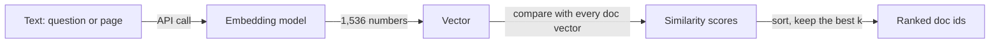
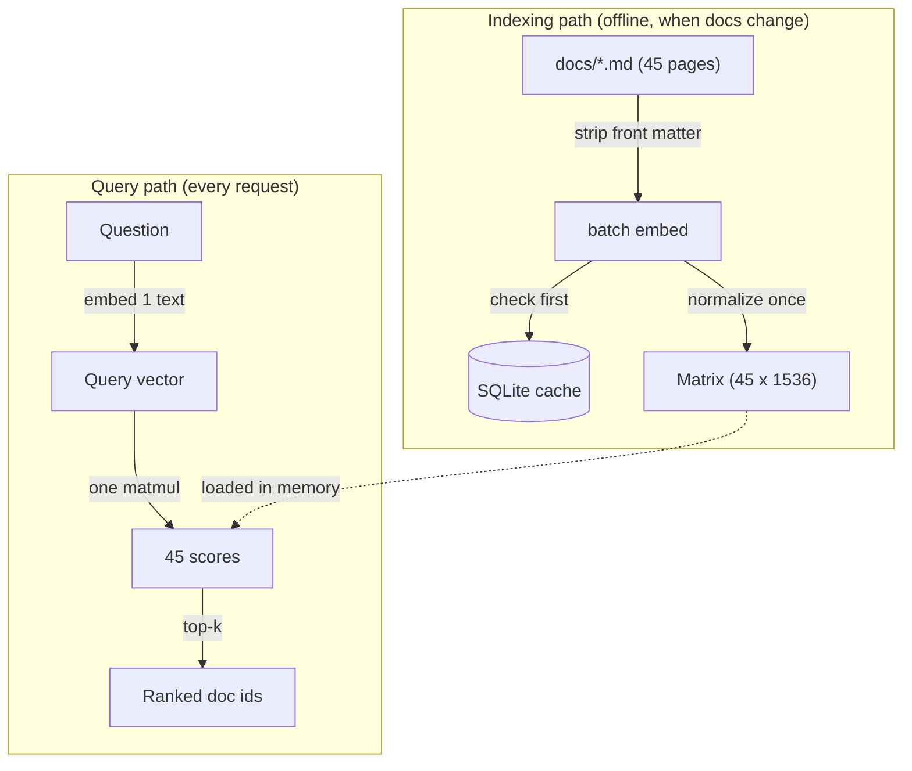
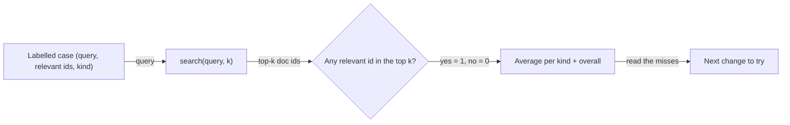

# Embeddings & Semantic Similarity

A maintainer types "my task got executed two times" into Atlas, and keyword search comes back with the cron page, the idempotency page and the flows page. The page that answers the question is called "Troubleshooting: jobs running twice", and it shares almost no words with the question. You need search that matches meaning, not spelling. Today you build it with embeddings and NumPy, then measure it on 20 labelled questions so every later RAG change in this phase has a number to beat.

## At a Glance

- **Time:** ~2 h core (+ optional Go Deeper) · **Depth:** working
- **Prerequisites:** [Day 12: The OpenAI SDK in Production Code](../../Phase_2_Building_with_LLM_APIs/Day_012_openai_sdk_production/openai_sdk_production.md), [Day 20: Your First Eval Set](../../Phase_2_Building_with_LLM_APIs/Day_020_first_eval_set/first_eval_set.md); primers [A06: NumPy & vectors](../../Appendix_Primers/A06_numpy_vectors.md) and [A12: Eval metrics basics](../../Appendix_Primers/A12_eval_metrics_basics.md)
- **You'll build:** `embed.py` (batched, cached, normalized embeddings plus `top_k()`), semantic search over the 45 Orbit doc pages, and a hit@k report on the dev split of `eval/retrieval_queries.jsonl`
- **Stops at:** training or fine-tuning embedding models
- **Fast path:** Already know embeddings and cosine similarity? Read [Is It Any Good?](#is-it-any-good-labelled-queries-and-hitk), run the `keyword_baseline`, `embed`, `retrieval` and `hit_at_k` scripts, and do Exercise 2 (≈40 min)
- **Cost:** ≈ $0.01 on `text-embedding-3-small` (prices as of 2026-11, [verify](https://developers.openai.com/api/docs/pricing))
- **New terms:** embedding, cosine similarity, normalization, top-k, hit@k

> **Coming from Software Engineering?** An embedding is a hash function for meaning, with one twist. A cryptographic hash scatters similar inputs to wildly different outputs; an embedding does the reverse, so "job ran twice" and "duplicate execution" land *near* each other. Search becomes a nearest-neighbour lookup instead of a `WHERE text LIKE '%twice%'`. The labelled query set you build today is a unit-test fixture for search: an answer key you run after every change, the way you run `pytest` after a refactor. Cache embeddings the way you would cache any pure, expensive function: the key is every input that changes the output (here, model + dimensions + text).

## Keyword Search Misses Meaning

Start with the search most engineers write first: count how many question words appear on each page, rank by the count. No model, no API key. Save it as `keyword_baseline.py`; the evaluation later imports it.

```python
# script_id: day_023_embeddings/keyword_baseline
# Word-overlap search over the Orbit docs: the baseline embeddings must beat. Offline, $0.
# Install: none (stdlib) · Env: ORBIT_DATA (optional, path to datasets/orbit)
import os
import re
from pathlib import Path

DATA_DIR = Path(os.environ.get("ORBIT_DATA", "datasets/orbit"))
STOP = {"a", "an", "the", "my", "i", "is", "it", "of", "to", "do", "does", "why", "what",
        "how", "in", "on", "and", "for", "was", "get", "got", "did"}


def words(text: str) -> set[str]:
    return set(re.findall(r"[a-z0-9_]+", text.lower()))


PAGES = {p.stem: words(p.read_text(encoding="utf-8")) for p in sorted((DATA_DIR / "docs").glob("*.md"))}


def keyword_search(query: str, k: int = 3) -> list[tuple[int, str]]:
    q = words(query) - STOP
    return sorted(((len(q & page), doc) for doc, page in PAGES.items()), reverse=True)[:k]


if __name__ == "__main__":
    for query in ["why does my job run twice", "my task got executed two times", "ORB-1101"]:
        print(f"{query!r:35} -> {keyword_search(query)}")
```

Output:

```text
'why does my job run twice'         -> [(3, 'troubleshooting-duplicates'), (3, 'troubleshooting-broker'), (3, 'scheduling-cron')]
'my task got executed two times'    -> [(2, 'scheduling-cron'), (2, 'idempotency'), (2, 'flows-steps-and-state')]
'ORB-1101'                          -> [(2, 'troubleshooting-duplicates'), (2, 'retries-and-backoff'), (2, 'performance-tuning')]
```

The first query only "works" because a three-way tie breaks its way (ties sort by page name). The paraphrase misses entirely: the right page says "running twice" and "lease", never "executed" or "two times". But a literal code like `ORB-1101` gives keyword search something concrete to match, and it surfaces a relevant page, if only on a tie. Hold that thought for the evaluation.

## Coordinates for Meaning

Picture a map where every text gets a pin, placed so that texts about the same thing sit close together: "job ran twice", "duplicate execution" and "my task got executed two times" all land in the same neighbourhood, while "install Orbit on Python 3.14" lands far away. Search becomes: drop a pin for the question, then find the nearest pins.

The real map has many more than two directions. `text-embedding-3-small` gives every text 1,536 coordinates, so the "pin" is a **vector** (a list of numbers) with 1,536 **dimensions** (how many numbers are in the list). You never read those numbers; you only compare them.



## Three Arrows by Hand

Before trusting a library, check the comparison by hand with three 2-D arrows: `a = [1, 1]`, `b = [2, 2]`, `c = [1, 0]`.

- **Euclidean distance** (straight-line distance between the tips): a→b is √((2−1)² + (2−1)²) = √2 ≈ 1.414; a→c is √(0² + 1²) = 1. By distance, `c` is closer to `a`.
- **Cosine similarity** (how much two arrows point the same way, from −1 to 1): `b` points exactly where `a` points, so cos = 1. `a` and `c` are 45° apart, so cos = 0.707. By direction, `b` is closer.

They disagree because `b` is longer. Now **normalize** (rescale each vector to length 1): `a` and `b` both become `[0.707, 0.707]`, and the distance between them drops to 0. After normalizing, both measures agree on the ranking.

```python
# script_id: day_023_embeddings/toy_vectors
# Check the hand calculation. Offline, $0.
# Install: uv add numpy
import numpy as np

a, b, c = np.array([1.0, 1.0]), np.array([2.0, 2.0]), np.array([1.0, 0.0])


def cosine(u: np.ndarray, v: np.ndarray) -> float:
    return float(u @ v / (np.linalg.norm(u) * np.linalg.norm(v)))


def euclidean(u: np.ndarray, v: np.ndarray) -> float:
    return float(np.linalg.norm(u - v))


def unit(v: np.ndarray) -> np.ndarray:
    return v / np.linalg.norm(v)


print(f"{'pair':<6}{'cosine':>8}{'euclid':>8}{'euclid(unit)':>14}")
for name, v in [("a-b", b), ("a-c", c)]:
    print(f"{name:<6}{cosine(a, v):>8.3f}{euclidean(a, v):>8.3f}{euclidean(unit(a), unit(v)):>14.3f}")
```

Output:

```text
pair    cosine  euclid  euclid(unit)
a-b      1.000   1.414         0.000
a-c      0.707   1.000         0.765
```

So the course normalizes once and then uses the plain dot product: for unit vectors, the dot product *is* the cosine, and Euclidean distance ranks the same way. OpenAI's embeddings guide says its vectors already have length 1; normalizing again is cheap insurance if you swap providers.

## Name the Parts

- **Embedding:** the fixed-length vector a model returns for a piece of text. Same model, same text, same length every time, whether the input is three words or three pages.
- **Cosine similarity:** the score for "how much do these two vectors point the same way". With text embeddings, higher means more related.
- **Normalization:** dividing a vector by its length so it has length 1. Do it once, when you build the index, and every comparison afterwards is a single multiply-and-sum.
- **Top-k:** keep the `k` highest-scoring documents. Search returns a ranked list, not a yes/no answer.
- **hit@k** (did any right answer appear in the top k?): the first retrieval metric, defined in the evaluation section below.

A score is a *ranking signal*, not a probability. With `text-embedding-3-small`, the best match for a question might score 0.41 and still be exactly right; the same pair under another model might score 0.8. Compare scores within one model and one query. Never hard-code "0.8 means relevant".

## Your First Embeddings

Embed the question and three page titles in one call, then score each title against the question.

```python
# script_id: day_023_embeddings/first_embeddings
# One question vs three Orbit page titles. ≈ $0.000001 (as of 2026-11, verify).
# Install: uv add "openai>=3.46,<4" numpy · Env: OPENAI_API_KEY, ATLAS_EMBED_MODEL (optional)
import os

import numpy as np
from openai import OpenAI

EMBED_MODEL = os.environ.get("ATLAS_EMBED_MODEL", "text-embedding-3-small")
client = OpenAI()

question = "my task got executed two times"
titles = ["Troubleshooting: jobs running twice", "Cron schedules", "Installation"]
resp = client.embeddings.create(model=EMBED_MODEL, input=[question, *titles])
rows = sorted(resp.data, key=lambda d: d.index)          # match each vector to its input
vecs = np.array([d.embedding for d in rows], dtype=np.float32)
q, docs = vecs[0], vecs[1:]
print(f"dims={vecs.shape[1]} · |q|={np.linalg.norm(q):.3f} · tokens={resp.usage.prompt_tokens}")
for title, score in sorted(zip(titles, docs @ q), key=lambda p: -p[1]):
    print(f"{score:.3f}  {title}")
```

Illustrative output (your numbers will differ):

```text
dims=1536 · |q|=1.000 · tokens=15
0.512  Troubleshooting: jobs running twice
0.243  Cron schedules
0.118  Installation
```

`input` takes a list, so one call embeds all four strings. Each item in `resp.data` carries an `index`; sort by it before pairing vectors with inputs. `usage.prompt_tokens` is the whole bill: embeddings have no output tokens. Day 12's `CostTracker` reads Responses-style usage (`input_tokens`/`output_tokens`), so today you keep a small separate meter.

## Turn a Knob, Break It

The `text-embedding-3-*` models accept `dimensions=`, which returns a shorter vector. Shorter vectors are cheaper to store and faster to compare, and they lose some detail. Request 256 numbers instead of 1,536 and compare the scores; then try to mix the two sizes.

```python
# script_id: day_023_embeddings/break_it
# The dimensions knob, and the error you get when vector sizes mix. ≈ $0.000002.
# Install: uv add "openai>=3.46,<4" numpy · Env: OPENAI_API_KEY
import numpy as np
from openai import OpenAI

client = OpenAI()
texts = ["my task got executed two times", "Troubleshooting: jobs running twice", "Cron schedules"]


def vectors(dimensions: int) -> np.ndarray:
    resp = client.embeddings.create(model="text-embedding-3-small", input=texts, dimensions=dimensions)
    m = np.array([d.embedding for d in sorted(resp.data, key=lambda d: d.index)], dtype=np.float32)
    return m / np.linalg.norm(m, axis=1, keepdims=True)    # unit length, so @ is the cosine


full, small = vectors(1536), vectors(256)
print("1536-d scores:", np.round(full[1:] @ full[0], 3))
print(" 256-d scores:", np.round(small[1:] @ small[0], 3))
try:
    np.dot(full[0], small[1])          # a 1536-d query against a 256-d document
except ValueError as err:
    print("ValueError:", err)
```

Illustrative output (your numbers will differ; the error text is real NumPy 2.4 output):

```text
1536-d scores: [0.512 0.243]
 256-d scores: [0.547 0.261]
ValueError: shapes (1536,) and (256,) not aligned: 1536 (dim 0) != 256 (dim 0)
```

The scores shift but the ranking holds here. Remember the error: real systems hit it when a cache or database row holds vectors from a different model or `dimensions` setting than the query. With the `@` operator the message reads `matmul: Input operand 1 has a mismatch in its core dimension 0 ... (size 256 is different from 1536)`. The cure is a rule, not a try/except: **a vector is only comparable with vectors from the same model and the same `dimensions`.** Changing either means re-embedding everything ([Day 88](../../Phase_9_Production/Day_088_operating_ai_systems/operating_ai_systems.md) covers running that migration in production).

## Searching the Orbit Docs

Now embed all 45 Orbit doc pages once, keep the vectors in one matrix, and answer each question with one matrix multiply. The work splits into two paths. The **indexing path** runs offline whenever the docs change. The **query path** runs on every request and must be fast.



Today the "index" is an in-memory NumPy array, fine up to tens of thousands of vectors; [Day 26](../../Phase_3_RAG/Day_026_pgvector_search/pgvector_search.md) moves it into Postgres. You also embed whole pages: every Orbit page is under 2,000 tokens, well inside the model's 8,192-token limit per input. Real corpora need splitting: [Day 25](../../Phase_3_RAG/Day_025_chunking/chunking.md).

### The `embed` module

Save this as `embed.py`; the next scripts import it. It defines the names the rest of Phase 3 copies: `EMBED_MODEL`, `EMBED_DIM`, `EmbeddingCache`, `embed()`, `embed_query()`, `cosine()` and `top_k()`. First the config, the client, a meter for embedding spend and the cache.

```python
# script_id: day_023_embeddings/embed
# embed.py: batched, cached, normalized embeddings + top_k. Becomes atlas/embed.py in Capstone R2.
# Install: uv add "openai>=3.46,<4" numpy
# Env: OPENAI_API_KEY, ATLAS_EMBED_MODEL, ORBIT_DATA (optional). Writes .cache/embeddings.sqlite.
import hashlib
import os
import sqlite3
from collections.abc import Sequence
from pathlib import Path

import numpy as np
from openai import OpenAI

DATA_DIR = Path(os.environ.get("ORBIT_DATA", "datasets/orbit"))
EMBED_MODEL = os.environ.get("ATLAS_EMBED_MODEL", "text-embedding-3-small")
EMBED_DIM = 1536   # default for -3-small; -3-large returns 3072 unless you pass dimensions=
# USD per 1M input tokens, as of 2026-11; verify at https://developers.openai.com/api/docs/pricing
EMBED_PRICES_PER_1M = {"text-embedding-3-small": 0.02, "text-embedding-3-large": 0.13}

client = OpenAI(timeout=60, max_retries=3)


class EmbedMeter:
    """Embeddings bill input tokens only, so Day 12's CostTracker doesn't fit; count them here."""

    def __init__(self) -> None:
        self.tokens, self.usd = 0, 0.0

    def record(self, usage, model: str) -> None:
        self.tokens += usage.prompt_tokens
        self.usd += usage.prompt_tokens * EMBED_PRICES_PER_1M.get(model, 0.0) / 1_000_000


meter = EmbedMeter()
```

The cache is a pure-function memo on disk. Its key must include everything that changes the vector: the model, the `dimensions` setting and the text. Leave the model out and a 256-d vector cached last week gets served to a 1,536-d query, which is the `ValueError` from the previous section, now hiding inside your cache.

```python
# script_id: day_023_embeddings/embed
class EmbeddingCache:
    """SQLite memo: sha256(model|dimensions|text) -> float32 bytes."""

    def __init__(self, path: Path = Path(".cache/embeddings.sqlite")) -> None:
        path.parent.mkdir(parents=True, exist_ok=True)
        self.db = sqlite3.connect(path)
        self.db.execute("CREATE TABLE IF NOT EXISTS emb (key TEXT PRIMARY KEY, model TEXT, dims INTEGER, vec BLOB)")

    @staticmethod
    def key(model: str, dimensions: int | None, text: str) -> str:
        return hashlib.sha256(f"{model}|{dimensions}|{text}".encode()).hexdigest()

    def get(self, model: str, dimensions: int | None, text: str) -> np.ndarray | None:
        row = self.db.execute("SELECT vec FROM emb WHERE key = ?", (self.key(model, dimensions, text),)).fetchone()
        return None if row is None else np.frombuffer(row[0], dtype=np.float32)

    def put_many(self, model: str, dimensions: int | None, items: list[tuple[str, np.ndarray]]) -> None:
        self.db.executemany("INSERT OR REPLACE INTO emb VALUES (?, ?, ?, ?)",
                            [(self.key(model, dimensions, t), model, dimensions, v.astype(np.float32).tobytes())
                             for t, v in items])
        self.db.commit()
```

`embed()` is the workhorse. It looks up each text in the cache, sends only the misses in batches, sorts each batch's results by `index`, normalizes, and returns one float32 array in input order.

```python
# script_id: day_023_embeddings/embed
def embed(texts: Sequence[str], *, model: str = EMBED_MODEL, dimensions: int | None = None,
          batch_size: int = 256, cache: "EmbeddingCache | None" = None) -> np.ndarray:
    """Return an (n, d) float32 array of unit vectors, row i for texts[i]."""
    texts = list(texts)
    if any(not t.strip() for t in texts):
        raise ValueError("blank text in embed() input; filter it out first")
    out: list[np.ndarray | None] = [cache.get(model, dimensions, t) if cache else None for t in texts]
    todo = [i for i, v in enumerate(out) if v is None]
    extra = {"dimensions": dimensions} if dimensions else {}   # omit the kwarg, don't send null
    for start in range(0, len(todo), batch_size):
        idx = todo[start:start + batch_size]
        resp = client.embeddings.create(model=model, input=[texts[i] for i in idx], **extra)
        meter.record(resp.usage, model)
        fresh = []
        for d in sorted(resp.data, key=lambda d: d.index):
            v = np.asarray(d.embedding, dtype=np.float32)
            out[idx[d.index]] = v = v / np.linalg.norm(v)    # already ~unit; renormalizing is cheap insurance
            fresh.append((texts[idx[d.index]], v))
        if cache:
            cache.put_many(model, dimensions, fresh)
    return np.vstack(out)


def embed_query(text: str, **kwargs) -> np.ndarray:
    return embed([text], **kwargs)[0]
```

Last, the comparison helpers. Because every row is a unit vector, `matrix @ query_vec` gives all 45 cosine scores at once; there is no loop over documents.

```python
# script_id: day_023_embeddings/embed
def cosine(a: np.ndarray, b: np.ndarray) -> float:
    denom = np.linalg.norm(a) * np.linalg.norm(b)
    return 0.0 if denom == 0 else float(a @ b / denom)    # a zero vector would give nan


def top_k(query_vec: np.ndarray, matrix: np.ndarray, k: int = 5) -> list[tuple[int, float]]:
    """(row index, score) pairs, best first. Rows and query must be unit vectors."""
    scores = matrix @ query_vec
    order = np.argsort(-scores)[:k]
    return [(int(i), float(scores[i])) for i in order]
```

The batch size of 256 is a conservative choice. The API also caps how many inputs and how many total tokens one request may carry; ⚠ check the current limits in the [embeddings guide](https://developers.openai.com/api/docs/guides/embeddings) before raising it.

### Build the index and search it

The loader strips the YAML front matter with a three-line stand-in (split on `---`); [Day 24](../../Phase_3_RAG/Day_024_document_ingestion/document_ingestion.md) replaces it with a proper parser. The doc id is the file stem, which matches the `id:` field on every Orbit page and the ids used in the eval file.

```python
# script_id: day_023_embeddings/semantic_search
# Semantic search over whole Orbit pages. First run ≈ $0.0013, reruns $0 (cache).
# Install: uv add "openai>=3.46,<4" numpy · Env: OPENAI_API_KEY, ORBIT_DATA. Imports embed.py.
from collections.abc import Callable
from pathlib import Path

import numpy as np

from embed import DATA_DIR, EmbeddingCache, embed, embed_query, meter, top_k


def load_pages(docs_dir: Path = DATA_DIR / "docs") -> tuple[list[str], list[str]]:
    ids, texts = [], []
    for path in sorted(docs_dir.glob("*.md")):
        _, _front_matter, body = path.read_text(encoding="utf-8").split("---", 2)  # stand-in; Day 24
        ids.append(path.stem)
        texts.append(body.strip())
    return ids, texts


def build_index(cache: EmbeddingCache | None = None) -> tuple[list[str], np.ndarray]:
    doc_ids, texts = load_pages()
    return doc_ids, embed(texts, cache=cache)


def make_search(doc_ids: list[str], matrix: np.ndarray, cache: EmbeddingCache | None = None
                ) -> Callable[[str, int], list[str]]:
    def search(query: str, k: int = 5) -> list[str]:
        return [doc_ids[i] for i, _ in top_k(embed_query(query, cache=cache), matrix, k)]
    return search
```

```python
# script_id: day_023_embeddings/semantic_search
if __name__ == "__main__":
    cache = EmbeddingCache()
    doc_ids, matrix = build_index(cache)
    print(f"{len(doc_ids)} pages · matrix {matrix.shape} · {meter.tokens:,} tokens billed · "
          f"${meter.usd:.4f} (as of 2026-11, verify)")
    for q in ["my task got executed two times", "how do I see job metrics in Prometheus", "ORB-1101"]:
        hits = top_k(embed_query(q, cache=cache), matrix, k=3)
        print(f"{q!r}\n   " + " | ".join(f"{doc_ids[i]} {s:.2f}" for i, s in hits))
```

Run it twice. Illustrative output, first run (your numbers will differ):

```text
45 pages · matrix (45, 1536) · 63,928 tokens billed · $0.0013 (as of 2026-11, verify)
'my task got executed two times'
   troubleshooting-duplicates 0.47 | idempotency 0.41 | leases-and-heartbeats 0.38
'how do I see job metrics in Prometheus'
   observability-metrics 0.58 | dashboard 0.41 | observability-tracing 0.39
'ORB-1101'
   error-codes 0.36 | troubleshooting-broker 0.33 | performance-tuning 0.31
```

The second run (a fresh process) prints `0 tokens billed · $0.0000`: every page and query comes from the cache. In this run the paraphrase that broke keyword search finds the right page first, and the error code doesn't. Three queries prove nothing either way, so keep reading.

## Is It Any Good? Labelled Queries and hit@k

Day 20 taught the habit: before tuning anything, score the system on questions with known right answers. Orbit ships a set for retrieval: `eval/retrieval_queries.jsonl` has 40 cases, each with a `query`, the `relevant_doc_ids` a maintainer marked as correct, and a `kind`:

```text
{"id": "rq-005", "query": "max_payload_kb", "relevant_doc_ids": ["configuration-reference", "concepts-jobs", "flows-steps-and-state"], "kind": "exact_term"}
{"id": "rq-017", "query": "why did my job run twice", "relevant_doc_ids": ["troubleshooting-duplicates", "leases-and-heartbeats", "idempotency"], "kind": "semantic"}
```

The three kinds are `exact_term` (error codes, config keys, CLI commands), `semantic` (paraphrased questions) and `multi_hop` (questions that need two or three pages together).

Split the 40 cases in two. You tune against the **dev split** (20 cases) from Day 23 to Day 28. The **test split** (the other 20) stays untouched until [Day 29](../../Phase_3_RAG/Day_029_retrieval_evaluation/retrieval_evaluation.md) takes a baseline, so you can't overfit to it. The split is deterministic: sort by id within each kind and take every other case, which keeps the mix of kinds the same in both halves.

The metric is **hit@k**: for each query, did *any* relevant page appear in the top k results? Averaged over queries, it gives a hit rate between 0 and 1. It is the bluntest retrieval metric, which is why it comes first; Day 29 adds recall and MRR (mean reciprocal rank).



```python
# script_id: day_023_embeddings/retrieval
# retrieval.py: labelled retrieval cases + hit@k. Becomes atlas/evals/retrieval.py. Offline, $0.
# Install: none (stdlib) · Env: ORBIT_DATA (optional)
import json
import os
from collections import defaultdict
from collections.abc import Callable
from dataclasses import dataclass
from pathlib import Path
from typing import Literal

DATA_DIR = Path(os.environ.get("ORBIT_DATA", "datasets/orbit"))


@dataclass(frozen=True)
class RetrievalCase:
    id: str
    query: str
    relevant_doc_ids: list[str]
    kind: str   # "exact_term" | "semantic" | "multi_hop"


def load_retrieval_cases(split: Literal["dev", "test", "all"] = "dev", path: Path | None = None) -> list[RetrievalCase]:
    path = path or DATA_DIR / "eval" / "retrieval_queries.jsonl"
    rows = [json.loads(line) for line in path.read_text(encoding="utf-8").splitlines() if line.strip()]
    cases = [RetrievalCase(r["id"], r["query"], list(r["relevant_doc_ids"]), r["kind"]) for r in rows]
    if split == "all":
        return cases
    by_kind: dict[str, list[RetrievalCase]] = defaultdict(list)
    for c in sorted(cases, key=lambda c: c.id):
        by_kind[c.kind].append(c)
    keep = 0 if split == "dev" else 1          # every other case within each kind
    return [c for group in by_kind.values() for i, c in enumerate(group) if i % 2 == keep]
```

```python
# script_id: day_023_embeddings/retrieval
def hit_at_k(ranked_doc_ids: list[str], relevant: set[str], k: int) -> bool:
    return any(doc in relevant for doc in ranked_doc_ids[:k])


def hit_rate(cases: list[RetrievalCase], search_fn: Callable[[str, int], list[str]], k: int = 5) -> dict[str, float]:
    """Share of cases with a hit in the top k: 'overall' plus one key per kind."""
    hits: dict[str, list[bool]] = defaultdict(list)
    for c in cases:
        ok = hit_at_k(search_fn(c.query, k), set(c.relevant_doc_ids), k)
        hits["overall"].append(ok)
        hits[c.kind].append(ok)
    return {name: sum(v) / len(v) for name, v in hits.items()}


if __name__ == "__main__":
    dev = load_retrieval_cases("dev")
    counts = {kind: sum(c.kind == kind for c in dev) for kind in ("exact_term", "semantic", "multi_hop")}
    print(f"dev={len(dev)} test={len(load_retrieval_cases('test'))} · dev by kind: {counts}")
    print("sanity:", hit_at_k(["faq", "idempotency"], {"idempotency"}, k=1), hit_at_k(["faq", "idempotency"], {"idempotency"}, k=2))
```

Output:

```text
dev=20 test=20 · dev by kind: {'exact_term': 8, 'semantic': 7, 'multi_hop': 5}
sanity: False True
```

Now score both searches on the dev split, side by side, at k = 1 and k = 5, and print the embedding misses. A new method only counts as better if it beats the baseline on the same cases. The three extra cases at the bottom are yours: write questions the way *you* would phrase them, look up the right pages, and add them. Labelling your own queries is this phase's most useful habit.

```python
# script_id: day_023_embeddings/hit_at_k
# Keyword vs embeddings: hit@1 / hit@5 on the dev split, by kind, plus the misses. ≈ $0.00002 (pages cached).
# Install: uv add "openai>=3.46,<4" numpy · Env: OPENAI_API_KEY, ORBIT_DATA.
# Imports keyword_baseline, embed, retrieval, semantic_search.
from embed import EmbeddingCache, meter
from keyword_baseline import keyword_search
from retrieval import RetrievalCase, hit_at_k, hit_rate, load_retrieval_cases
from semantic_search import build_index, make_search

cache = EmbeddingCache()
search = make_search(*build_index(cache), cache=cache)
cases = load_retrieval_cases("dev") + [   # your own labelled questions (edit these)
    RetrievalCase("my-1", "my worker keeps using more and more RAM", ["troubleshooting-memory"], "semantic"),
    RetrievalCase("my-2", "run a job 10 minutes from now", ["scheduling-delays"], "semantic"),
    RetrievalCase("my-3", "prefetch", ["configuration-reference", "troubleshooting-memory"], "exact_term"),
]

methods = {"keyword": lambda q, k: [doc for _, doc in keyword_search(q, k)], "embeddings": search}
for k in (1, 5):
    for method, fn in methods.items():
        report = hit_rate(cases, fn, k=k)
        print(f"hit@{k} {method:<10} " + " · ".join(f"{name} {score:.2f}" for name, score in report.items()))

print("embedding misses at k=5:")
for c in cases:
    got = search(c.query, 5)
    if not hit_at_k(got, set(c.relevant_doc_ids), 5):
        print(f"  {c.id} [{c.kind}] {c.query!r} -> {got[:3]}")
print(f"{meter.tokens:,} tokens billed this run")
```

Output. The `keyword` rows are measured on the course dataset (offline, deterministic). The `embeddings` rows, misses and token count are illustrative until you run it with a key; your numbers will differ:

```text
hit@1 keyword    overall 0.57 · exact_term 0.44 · semantic 0.56 · multi_hop 0.80
hit@1 embeddings overall 0.52 · exact_term 0.22 · semantic 0.89 · multi_hop 0.40
hit@5 keyword    overall 0.87 · exact_term 0.89 · semantic 0.78 · multi_hop 1.00
hit@5 embeddings overall 0.83 · exact_term 0.56 · semantic 1.00 · multi_hop 1.00
embedding misses at k=5:
  rq-005 [exact_term] 'max_payload_kb' -> ['performance-tuning', 'results-backend', 'api-reference-job']
  rq-009 [exact_term] 'ORB-2101 WorkerOOM' -> ['scaling-workers', 'concepts-workers', 'deployment-kubernetes']
  rq-013 [exact_term] 'ORB-2001 IdempotencyConflict' -> ['faq', 'retries-and-backoff', 'concepts-jobs']
  rq-015 [exact_term] 'ORB-1802 UnknownConfigKey' -> ['installation', 'migrating-2-to-3', 'cli-reference']
120 tokens billed this run
```

The small token count assumes the `semantic_search` script already filled the cache with the 45 pages. On a cold cache this script bills the pages (about 64k tokens) as well.

Read the table one slice at a time, not just the `overall` column.

- **Keyword search is a stronger baseline than its reputation** at k = 5: whole pages are long, so most questions share a few words with the right page. But check the ties. For rq-019 the top three pages all score 12, and the alphabet picks the winner.
- **`semantic` is where embeddings have to earn their cost.** Check your hit@1 there: ranking the right page *first* for a paraphrase is the job keyword overlap does worst.
- **`exact_term` is the expected weak slice for embeddings.** An error code like `ORB-2101` or a key like `max_payload_kb` has no "meaning" to place on the map, while keyword search matches it literally.

If embeddings don't beat keywords overall on your run, your code isn't broken. That's the finding: no method wins every slice, and only a labelled set shows which loses where. Don't patch it today. [Day 27](../../Phase_3_RAG/Day_027_hybrid_search/hybrid_search.md) combines both and uses these slices to prove the gain. Write your table down: hit@k by kind for both methods is the baseline Days 25 to 27 must beat.

## Trade-offs and When NOT to Use Embeddings

| Decision | Option A | Option B | Rule of thumb |
|---|---|---|---|
| Model | `text-embedding-3-small`: 1,536 dims, $0.02 per 1M tokens | `text-embedding-3-large`: 3,072 dims, $0.13 per 1M tokens | Start small. Switch only if your labelled set shows a gain worth 6.5× the price (Stretch exercise). Prices as of 2026-11, [verify](https://developers.openai.com/api/docs/pricing). |
| Vector size | Default dimensions | `dimensions=256`/`512` | Smaller saves storage and compare time; measure the hit@k you lose before shipping it. |
| Metric | Cosine | Dot product / Euclidean | On normalized vectors all three rank identically. Normalize once and use the dot product. |
| Query type | Paraphrased, natural-language questions | Exact IDs, error codes, config keys | Embeddings for the first, keyword search for the second; most real systems need both ([Day 27](../../Phase_3_RAG/Day_027_hybrid_search/hybrid_search.md)). |
| Changing models | Keep the current model | Switch models | Every stored vector must be re-embedded; old and new vectors can't be compared ([Day 88](../../Phase_9_Production/Day_088_operating_ai_systems/operating_ai_systems.md)). |

Skip embeddings when the lookup is exact (an issue number: use a database index), when the whole corpus fits comfortably in one prompt ([Day 32](../../Phase_3_RAG/Day_032_long_context_vs_rag/long_context_vs_rag.md) weighs that), or when the filter is structured, like "pages for version 3.x" (a metadata filter, Day 26–27).

### In production

- Cache keys include model + `dimensions` + text, and every stored vector carries the model name next to it.
- Batch requests and send only cache misses; embedding the corpus should be a cheap, repeatable job.
- Normalize once at index time; the query path is then one matrix multiply (or one database query from Day 26).
- Keep the labelled query set in the repo and rerun hit@k by kind on every change to models, chunking or ranking.
- Filter out blank strings and over-long inputs before the API call, not after a 400 error.

## Go Deeper (optional)

<details>
<summary>Go deeper: the cosine formula, and why normalized vectors make every metric agree</summary>

**Words.** Cosine similarity measures the angle between two arrows and ignores their lengths. Two arrows pointing the same way score 1; at right angles, 0; opposite, −1.

**Toy numbers.** For `a = [1, 1]` and `c = [1, 0]`: the dot product is 1·1 + 1·0 = 1. The lengths are √2 and 1. So cos = 1 / (√2 · 1) = 0.707, which is cos 45°.

**Formula.** cos(a, b) = (a · b) / (‖a‖ ‖b‖), where a · b = Σ aᵢbᵢ and ‖a‖ = √(a · a).

If ‖a‖ = ‖b‖ = 1, the denominator is 1, so **cosine = dot product**. And for unit vectors the squared Euclidean distance is ‖a − b‖² = a·a − 2a·b + b·b = 2 − 2·cos(a, b). Distance goes down exactly when cosine goes up, so the ranking is identical. That's the whole reason you normalize once: afterwards, the cheapest operation (a dot product) gives you the answer every metric agrees on.

```python
# script_id: day_023_embeddings/unit_identities
# Check cos = dot and |a-b|^2 = 2 - 2cos on random unit vectors. Offline, $0.
# Install: uv add numpy
import numpy as np

rng = np.random.default_rng(0)
a, b = rng.normal(size=1536), rng.normal(size=1536)
a, b = a / np.linalg.norm(a), b / np.linalg.norm(b)
cos = a @ b / (np.linalg.norm(a) * np.linalg.norm(b))
print(f"cos={cos:.6f} dot={a @ b:.6f} |a-b|^2={np.sum((a - b) ** 2):.6f} 2-2cos={2 - 2 * cos:.6f}")
```

A side effect worth knowing: two random 1,536-d vectors score close to 0, because in high dimensions random directions are nearly perpendicular. Real text embeddings don't spread out that evenly, which is one reason absolute scores differ so much between models.

</details>

<details>
<summary>Go deeper: shrinking vectors (dimensions, truncation, storage)</summary>

**Storage math.** A float32 is 4 bytes, so one 1,536-d vector is 6,144 bytes. The 45 Orbit pages need about 276 KB. One million chunks need about 6.1 GB before any index overhead, and `text-embedding-3-large` at 3,072 dims doubles that. This is where the size knobs start to matter.

**Three ways to shrink:**

1. **Ask for fewer dimensions** with `dimensions=`. OpenAI's embeddings guide describes this as shortening a vector while keeping its concept-representing properties; how much quality you keep on *your* data is something you measure. The guide only says to re-normalize when you shorten a vector yourself; `embed()` re-normalizes every vector anyway, so you are safe either way.
2. **Truncate yourself**: keep the first n numbers of a stored vector. OpenAI's guide allows this, but the result is no longer length 1, so you must re-normalize, or the dot product stops being the cosine. Prefer `dimensions=`; it's one less thing to get wrong.
3. **Store half precision.** `matrix.astype(np.float16)` halves memory and usually changes rankings very little (check on your labelled set); pgvector's `halfvec` type does the same in the database, and it is how you index vectors with more than 2,000 dimensions there ([Day 26](../../Phase_3_RAG/Day_026_pgvector_search/pgvector_search.md)).

Whichever you pick, it is a model-level decision: the `dimensions` value goes into the cache key and next to every stored vector, and you evaluate it on the labelled set like any other change (Exercise 2 does this for 512).

</details>

<details>
<summary>Go deeper: other jobs for embeddings, and the whole-page problem</summary>

Search is the headline use, but the same "nearest pins" operation powers several other features teams build:

- **Deduplication.** Embed issue titles and flag pairs above a tuned similarity threshold (Exercise 3 checks this against Orbit's `duplicate_of` labels).
- **Classification by example.** Embed a handful of labelled examples per class, then label a new text by its nearest examples. It's a cheap first triage step before you call an LLM.
- **Routing and caching.** Send a question to the handler whose example questions sit closest, or reuse an earlier answer when a new question lands very close to an old one. That second idea is a semantic cache, owned by [Day 85](../../Phase_9_Production/Day_085_caching_cost_scale/caching_cost_scale.md), where the hard part is choosing the threshold safely.

**The whole-page problem.** Today you embedded whole pages. A page about leases also covers heartbeats, metrics and timeouts, and its single vector is a blend of all of them, so a narrow question matches it less sharply than it would match the one paragraph that answers it. It also means the RAG answer step would have to read the whole page. Splitting pages into smaller, focused pieces fixes both, and the hit@k script you wrote today is how [Day 25](../../Phase_3_RAG/Day_025_chunking/chunking.md) will compare chunking strategies.

</details>

## Common Pitfalls

- **Cache key without the model or `dimensions`.** Symptom: `ValueError: shapes (1536,) and (256,) not aligned: 1536 (dim 0) != 256 (dim 0)` long after you changed a setting, or worse, silently bad rankings when two models share a size. Cause: the cache returns vectors made under old settings. Fix: key on `sha256(model|dimensions|text)`, as `EmbeddingCache.key()` does.
- **Pairing vectors with inputs by position alone.** Symptom: plausible but wrong results. Cause: you zipped `resp.data` with your inputs without looking at `index`. Fix: `sorted(resp.data, key=lambda d: d.index)`, then map back through the batch's index list.
- **Treating a score as a probability.** Symptom: a filter like `score > 0.8` returns nothing on one model and everything on another. Cause: absolute scores depend on the model. Fix: rank, take the top k, and pick any threshold by measuring it on labelled data.
- **Blank strings in a batch.** Symptom: the API rejects the request with a 400 `BadRequestError` (⚠ verify the exact message against the current API). Cause: an empty page or whitespace-only text. Fix: filter blanks before calling; `embed()` raises a clear `ValueError` instead.
- **Inputs over 8,192 tokens.** Symptom: the request fails for one long document. Cause: the per-input limit of the embedding models. Fix: split long documents ([Day 25](../../Phase_3_RAG/Day_025_chunking/chunking.md)); count tokens first with Day 4's `count_tokens()`.

> **Where we stop:** We use embedding models as a service and don't train or fine-tune them, because a good off-the-shelf model plus a labelled query set covers most product work; [Day 94](../../Phase_10_Open_Models_and_Fine_Tuning/Day_094_should_you_finetune/should_you_finetune.md) covers when fine-tuning pays off at all, and [Day 29](../../Phase_3_RAG/Day_029_retrieval_evaluation/retrieval_evaluation.md) shows how to compare models on your own data.

## Key Takeaways

- Keyword search matches spelling, so paraphrased questions miss; embeddings place texts with similar meaning close together, so search becomes "find the nearest vectors".
- On normalized vectors, cosine, dot product and Euclidean distance give the same ranking; normalize once at index time and score a whole corpus with one matrix multiply.
- `client.embeddings.create(model=..., input=[...])` embeds a batch; sort `data` by `index`, bill from `usage.prompt_tokens`, and cache on model + `dimensions` + text.
- Vectors are comparable only within one model and one `dimensions` setting; changing either means re-embedding everything, and mixing them fails with a shape error or, worse, silently.
- Measure on labelled queries, by kind, against a baseline: keyword overlap is strong on whole pages (often through ties), embeddings exist for paraphrases, and exact terms (error codes, config keys) are their expected weak slice. Day 27 combines both.

## Quick Reference

| API / pattern | What it does | When to use | Gotcha |
|---|---|---|---|
| `client.embeddings.create(model=, input=[...])` | One vector per input | Indexing and queries | Sort `resp.data` by `.index` |
| `dimensions=512` | Shorter vector from `-3-*` models | Storage or speed limits | New size = new index; omit the kwarg rather than pass `None` |
| `resp.usage.prompt_tokens` | Tokens billed | Cost tracking | No output tokens for embeddings |
| `v / np.linalg.norm(v)` | Normalize to length 1 | Once, at index time | A zero vector gives `nan` |
| `matrix @ q` then `np.argsort(-scores)[:k]` | All cosine scores, then top-k | In-memory search up to tens of thousands of vectors | Rows and `q` must share model and size |
| `EmbeddingCache` (key: model + dims + text) | Skip repeat API calls | Every rerun and every query | Leaving out model or dims serves stale vectors |
| `hit_rate(cases, search_fn, k)` | Share of queries with a hit in the top k, by kind | After every retrieval change | Tune on dev; leave test for Day 29 |

## Exercises

1. **Warm-up: k is a knob.** Report hit@3 alongside hit@1 and hit@5, by kind. Which kind gains most between k = 1 and k = 3?

<details>
<summary>Solution</summary>

```python
# script_id: day_023_embeddings/solution_ex1
# hit@1/3/5 by kind on the dev split. ≈ $0 after the first run (cache).
# Install: uv add "openai>=3.46,<4" numpy · Env: OPENAI_API_KEY, ORBIT_DATA. Imports embed, retrieval, semantic_search.
from embed import EmbeddingCache
from retrieval import hit_rate, load_retrieval_cases
from semantic_search import build_index, make_search

cache = EmbeddingCache()
search = make_search(*build_index(cache), cache=cache)
cases = load_retrieval_cases("dev")
for k in (1, 3, 5):
    report = hit_rate(cases, search, k=k)
    print(f"hit@{k}  " + " · ".join(f"{name} {score:.2f}" for name, score in report.items()))
```

Multi-hop questions usually gain most: their relevant pages are often second or third, not first. A larger k helps any search look better, so always report k next to the number.

</details>

2. **Core: trade size for quality.** Rebuild the index and the queries with `dimensions=512`. Compare hit@5 by kind with the 1,536-d run, and print the bytes per vector for each.

<details>
<summary>Solution</summary>

```python
# script_id: day_023_embeddings/solution_ex2
# 1536-d vs 512-d: hit@5 by kind and bytes per vector. ≈ $0.0013 once for the 512-d pages.
# Install: uv add "openai>=3.46,<4" numpy · Env: OPENAI_API_KEY, ORBIT_DATA. Imports embed, retrieval, semantic_search.
from embed import EmbeddingCache, embed, top_k
from retrieval import hit_rate, load_retrieval_cases
from semantic_search import load_pages

cache = EmbeddingCache()
doc_ids, texts = load_pages()
cases = load_retrieval_cases("dev")

for dims in (None, 512):                       # None = the model's default (1536)
    matrix = embed(texts, dimensions=dims, cache=cache)

    def search(query: str, k: int, matrix=matrix, dims=dims) -> list[str]:
        q = embed([query], dimensions=dims, cache=cache)[0]   # the query must use the same size
        return [doc_ids[i] for i, _ in top_k(q, matrix, k)]

    report = hit_rate(cases, search, k=5)
    print(f"{matrix.shape[1]:>4}-d · {matrix[0].nbytes:,} B/vector · "
          + " · ".join(f"{name} {score:.2f}" for name, score in report.items()))
```

Expect 6,144 vs 2,048 bytes per vector and a small (or zero) drop in hit@5 on this tiny set. Twenty queries is too few to detect a small loss; Day 29 adds more cases and finer metrics.

</details>

3. **Core: embeddings for dedup.** Embed the 240 issue titles in `issues/issues.jsonl`, list pairs whose cosine is above a threshold, and score them against the `duplicate_of` labels (precision: how many flagged pairs are real duplicates; recall: how many real duplicates you flagged). Try three thresholds.

<details>
<summary>Solution</summary>

```python
# script_id: day_023_embeddings/solution_ex3
# Duplicate-issue detection from title embeddings, scored against duplicate_of. ≈ $0.0001.
# Install: uv add "openai>=3.46,<4" numpy · Env: OPENAI_API_KEY, ORBIT_DATA. Imports embed.
import json

import numpy as np

from embed import DATA_DIR, EmbeddingCache, embed

lines = (DATA_DIR / "issues" / "issues.jsonl").read_text(encoding="utf-8").splitlines()
issues = [json.loads(line) for line in lines if line.strip()]
ids = [i["id"] for i in issues]
truth = {frozenset((i["id"], i["duplicate_of"])) for i in issues if i.get("duplicate_of")}

matrix = embed([i["title"] for i in issues], cache=EmbeddingCache())
sims = np.triu(matrix @ matrix.T, k=1)         # each pair once, no self-pairs

for threshold in (0.6, 0.7, 0.8):
    rows, cols = np.nonzero(sims >= threshold)
    found = {frozenset((ids[r], ids[c])) for r, c in zip(rows, cols)}
    tp = len(found & truth)
    print(f"threshold {threshold}: {len(found):>3} pairs · {tp:>2} real · "
          f"precision {tp / max(len(found), 1):.2f} · recall {tp / len(truth):.2f}")
```

A high threshold flags few pairs, mostly real (high precision, low recall); a low one flags many, mostly noise. The right threshold is model-specific, which is why you choose it against labels rather than guessing "0.8".

</details>

4. **Stretch (optional): is the large model worth it?** Run the dev split with `text-embedding-3-large` and compare hit@5 and the first-run cost with `-3-small`. Report the hit@5 gain per extra dollar.

<details>
<summary>Solution</summary>

```python
# script_id: day_023_embeddings/solution_ex4
# small vs large: hit@5 and first-run cost. ≈ $0.009 for the large pages (as of 2026-11, verify).
# Install: uv add "openai>=3.46,<4" numpy · Env: OPENAI_API_KEY, ORBIT_DATA. Imports embed, retrieval, semantic_search.
from embed import EmbeddingCache, embed, meter, top_k
from retrieval import hit_rate, load_retrieval_cases
from semantic_search import load_pages

cache = EmbeddingCache()
doc_ids, texts = load_pages()
cases = load_retrieval_cases("dev")
results = {}
for model in ("text-embedding-3-small", "text-embedding-3-large"):
    usd_before = meter.usd
    matrix = embed(texts, model=model, cache=cache)

    def search(query: str, k: int, matrix=matrix, model=model) -> list[str]:
        return [doc_ids[i] for i, _ in top_k(embed([query], model=model, cache=cache)[0], matrix, k)]

    results[model] = (hit_rate(cases, search, k=5)["overall"], meter.usd - usd_before)
    print(f"{model}: dims {matrix.shape[1]} · hit@5 {results[model][0]:.2f} · ${results[model][1]:.4f}")

(h_s, c_s), (h_l, c_l) = results.values()
if c_l > c_s:
    print(f"hit@5 gain per extra $: {(h_l - h_s) / (c_l - c_s):.1f}")
```

Costs come from `meter`, so they only show on a cold cache; delete `.cache/embeddings.sqlite` to measure again. At this scale both models cost fractions of a cent, so the real question is whether the gain holds on the full test set and at production volume, where the 6.5× price and 2× storage add up.

</details>

## References & Further Reading

- [OpenAI embeddings guide](https://developers.openai.com/api/docs/guides/embeddings): models, default dimensions, the `dimensions` parameter and input limits; the source for "vectors are normalized to length 1".
- [OpenAI pricing](https://developers.openai.com/api/docs/pricing): current per-token prices for both embedding models.
- [Primer A06: NumPy & vectors](../../Appendix_Primers/A06_numpy_vectors.md) and [Primer A12: Eval metrics basics](../../Appendix_Primers/A12_eval_metrics_basics.md): the course's own refreshers on vectors, precision and recall.

## What's Next

Today you embedded pages after a three-line front-matter hack. Real documents arrive as Markdown, HTML and PDF, with metadata you will need for filters later. Tomorrow, [Day 24: Ingesting Documents: Parsing PDFs, HTML & More](../../Phase_3_RAG/Day_024_document_ingestion/document_ingestion.md), builds one clean `Document` contract for all of them, so everything you embed from then on is clean text with reliable metadata.
