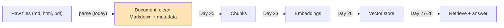
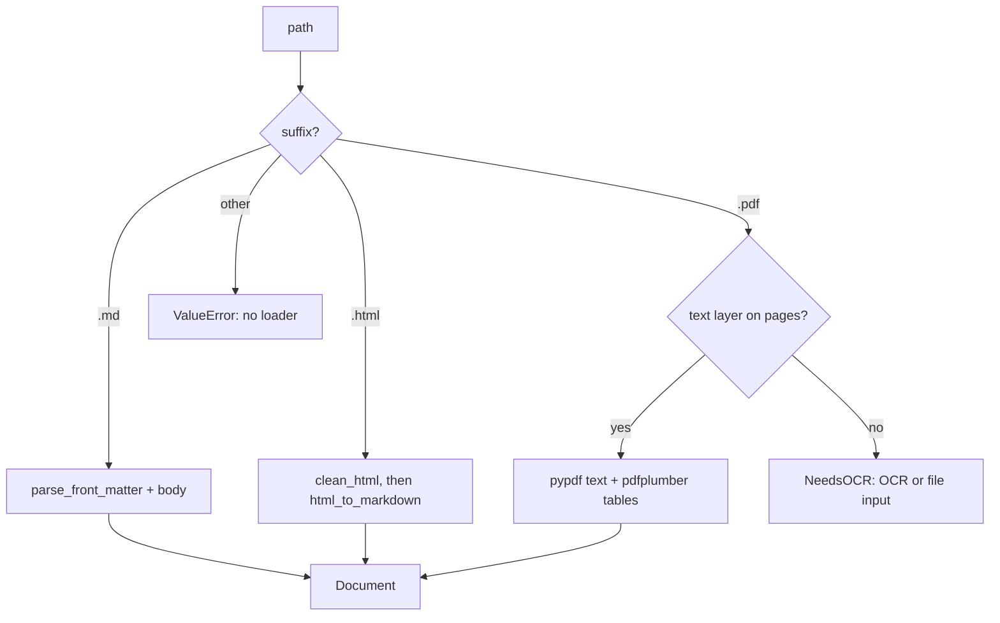
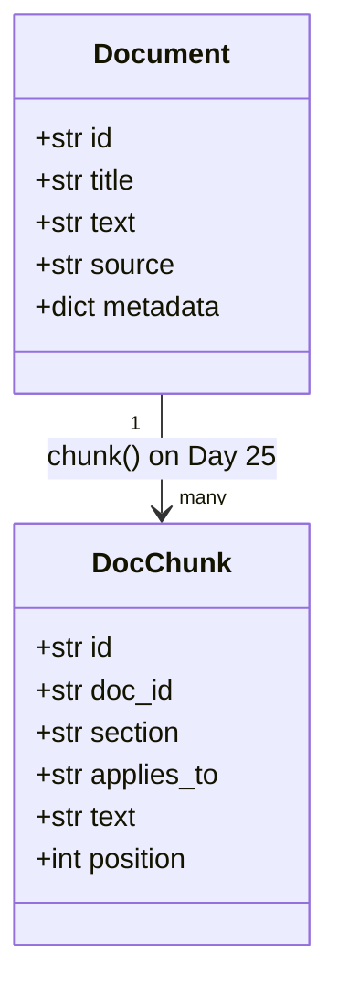

# Ingesting Documents: Parsing PDFs, HTML & More

Run the obvious one-liner, `BeautifulSoup(html).get_text()`, on Orbit's `quickstart.html` and the install command comes out as `Install Orbit¶ Copypython -m venv`, with the copy button's label glued onto it. A search for "how do I install Orbit?" then ranks the logo text from the nav bar above the real instructions. Chunking, search and answers all inherit whatever the parser got wrong, so today you build `load_document()`: every source arrives as clean Markdown, with its metadata intact.

## At a Glance

- **Time:** ~2 h core (+ optional Go Deeper) · **Depth:** working
- **Prerequisites:** [Day 14: Multimodal Inputs: Images, Files & Audio](../../Phase_2_Building_with_LLM_APIs/Day_014_multimodal_inputs/multimodal_inputs.md), [Day 23: Embeddings & Semantic Similarity](../Day_023_embeddings/embeddings.md); primer [A03 Python for this course](../../Appendix_Primers/A03_python_for_this_course.md) (dataclasses)
- **You'll build:** `atlas/ingest.py`, with `Document`, `parse_front_matter()`, `html_to_markdown()`, `pdf_to_markdown()`, `load_document()`, `load_corpus()` and `parse_fidelity()`
- **Stops at:** writing parsers. You wire existing parsers together; you don't build an OCR engine or a PDF library.
- **Fast path:** Already parse files for a living? Read [HTML Without the Junk](#html-without-the-junk) and [One Entry Point](#one-entry-point-load_document-and-load_corpus), then do Exercise 1 (~40 min).
- **Cost:** ≈ $0. Only the optional scanned-page call costs money: about a cent on `gpt-6-luna` (prices as of 2026-11, [verify](https://developers.openai.com/api/docs/pricing)).
- **New terms:** parser, front matter, text layer vs scanned PDF, OCR, parse fidelity

> **Coming from Software Engineering?** Ingestion is the Extract and Transform of ETL (extract, transform, load) for an AI knowledge base. You normalize every source into one schema before anything gets loaded. Each `.md`, `.html` or `.pdf` loader is an adapter behind one interface, the way a payments service hides Stripe and PayPal behind one `charge()`. The rule from data pipelines transfers directly: garbage in corrupts every later step, and it does so silently. A bad parse doesn't throw an exception. It only makes retrieval a bit worse, and nobody notices for weeks. So treat parse quality as something you measure, the way you'd measure a schema migration.

## Garbage In, Garbage Retrieved

Here is where today sits in the pipeline you are building through Phase 3:



First, the naive attempt. This script pulls all the text out of the HTML page, splits it into blocks at blank lines, and ranks the blocks against a question. Day 23's `embed()`/`top_k()` needs an API key, so the script uses word overlap as a stand-in. The parsing failure it shows is the same either way.

```python
# script_id: day_024_document_ingestion/garbage_in
# Install: uv add beautifulsoup4    Env: ORBIT_DATA (optional)    Services: none
import os, re
from pathlib import Path
from bs4 import BeautifulSoup

DATA_DIR = Path(os.environ.get("ORBIT_DATA", "datasets/orbit"))
html = (DATA_DIR / "docs_html" / "quickstart.html").read_text(encoding="utf-8")
text = BeautifulSoup(html, "html.parser").get_text()          # the "obvious" one-liner

blocks = [" ".join(b.split()) for b in re.split(r"\n\s*\n", text) if b.strip()]
print(f"{len(text.split())} words in {len(blocks)} blocks")
for junk in ["Accept all", "Subscribe", "Was this page helpful?", "Skip to content"]:
    print(f"  contains {junk!r}: {junk in text}")
step = next(b for b in blocks if "1. Install Orbit" in b)
print("install step:", step[step.index("1. Install"):][:58])

# Stand-in for Day 23's embed()/top_k(): word-overlap scoring, so no API key is needed.
QUERY = set(re.findall(r"\w+", "how do I install Orbit?".lower()))
def score(block: str) -> float:
    words = re.findall(r"\w+", block.lower())
    if not words:
        return 0.0
    return sum(w in QUERY for w in words) / len(words) ** 0.5

for b in sorted(blocks, key=score, reverse=True)[:3]:
    print(f"{score(b):.2f}  {b[:60]}")
```

```text
933 words in 57 blocks
  contains 'Accept all': True
  contains 'Subscribe': True
  contains 'Was this page helpful?': True
  contains 'Skip to content': True
install step: 1. Install Orbit¶ Copypython -m venv .venv && source .venv
1.00  Orbit
0.75  You need Python 3.10–3.12 and Docker (or any Redis 6.2+ you 
0.74  Time~10 minutes Orbit version3.2.1 (any 3.x works) Python3.1
```

There are three problems here. About a fifth of the words are cookie banner, newsletter, sidebar and footer. The top-ranked "document" is the logo. And the real install step has the permalink sign `¶` and the button label `Copy` fused into the shell command. An embedding of that block is an embedding of slightly wrong text, and every later step trusts it.

## One Clean Notebook

Picture someone handing you a messy printed manual: ads in the margins, a cookie notice on every page, tables, and a few photocopied pages. Your job is to copy it into a clean notebook. You keep the chapter titles, the tables and the code samples, and you skip the ads. At the top of every page you write where it came from and when.

That is all ingestion is. The clean notebook is the `Document`. "Keep the chapter titles" means you preserve structure, because Day 25 will split pages at headings. "Write where it came from" is metadata, which Day 27 filters on and Day 28 cites.

## Read Nine Lines of HTML by Hand

Before writing code, sort a tiny excerpt by hand. For each line, decide: keep it, or drop it?

```html
<div class="announce">Orbit 2.x reaches end of life on 2026-12-31.</div>   <!-- drop: banner -->
<nav class="topnav"><a href="/docs">Docs</a> <a href="/api">API</a></nav> <!-- drop: nav -->
<h2 id="1-install-orbit">1. Install Orbit<a class="headerlink">¶</a></h2> <!-- keep h2, drop ¶ -->
<pre><button class="copybtn">Copy</button><code class="language-bash">   <!-- drop the button -->
pip install "orbit[redis]&gt;=3.2.1"</code></pre>                          <!-- keep: code, as-is -->
<table><tr><th>Time</th><td>~10 minutes</td></tr></table>                  <!-- keep: as rows -->
<p>The worker must be able to import your job modules.</p>                 <!-- keep: paragraph -->
<div class="cookie-banner">We use cookies. <button>Accept all</button></div> <!-- drop: banner -->
<footer>&copy; 2026 The Orbit maintainers.</footer>                         <!-- drop: footer -->
```

The result should be about eight lines of Markdown: `## 1. Install Orbit`, a fenced `bash` block holding `pip install "orbit[redis]>=3.2.1"` (note the decoded `>`), a two-cell pipe table, and one paragraph. Everything the parser does today is that sort, done by rules.

## Name the Parts

- A **parser** turns bytes in some format into structured text. You will use three of them: PyYAML for front matter, Beautiful Soup for HTML, and pypdf plus pdfplumber for PDF.
- **Front matter** is a metadata block at the top of a file, between two `---` lines, written in YAML. Every Orbit page has one (`id`, `title`, `applies_to`, `updated`).
- A **text layer** means the PDF stores real characters, so you can select and copy them. A **scanned PDF** stores only a picture of each page, so text extraction returns `""`.
- **OCR** (optical character recognition) reads text out of an image. You need it, or a vision model, for scans.
- **Parse fidelity** is a 0–1 score of how closely your parsed output matches a trusted reference version of the same page. Orbit's HTML pages have Markdown twins, so you can measure it.

The loader is a dispatcher. It picks a parser by file type and always returns the same shape:



`Document` is the contract between today and tomorrow. Day 25 cuts each one into `DocChunk`s:



## Markdown First

Markdown is the simplest case and also the target format, so start there. This version is deliberately minimal.

```python
# script_id: day_024_document_ingestion/markdown_loader
# Install: uv add pyyaml    Env: ORBIT_DATA (optional)    Services: none
import os
from dataclasses import dataclass, field
from pathlib import Path
import yaml

@dataclass
class Document:
    id: str
    title: str
    text: str                                   # normalized Markdown body
    source: str                                 # where it came from (path or URL)
    metadata: dict[str, str] = field(default_factory=dict)

DATA_DIR = Path(os.environ.get("ORBIT_DATA", "datasets/orbit"))
path = DATA_DIR / "docs" / "error-codes.md"
_, head, body = path.read_text(encoding="utf-8").split("---\n", 2)   # front matter sits between the first two ---
meta = {k: str(v) for k, v in yaml.safe_load(head).items()}        # safe_load: plain data, never objects
doc = Document(meta.pop("id"), meta.pop("title"), body.strip(), str(path), meta)
print(doc.id, doc.metadata, f"{len(doc.text):,} chars")
print(doc.text[:60])
```

```text
error-codes {'section': 'Reference', 'applies_to': 'all', 'updated': '2026-11-05'} 6,133 chars
# Error codes

Every error Orbit raises or logs has a stable
```

Metadata values are stored as `str` on purpose. YAML turns `updated: 2026-11-05` into a `datetime.date`, and `applies_to: 3.0` would become the float `3.0`. Converting everything to strings at the boundary keeps the filters you write later predictable.

## Break It: Three Ways Parsing Goes Wrong

Each of these mistakes shows up in real tutorials. None of them raises an error.

```python
# script_id: day_024_document_ingestion/break_it
# Install: uv add pyyaml beautifulsoup4    Env: ORBIT_DATA (optional)    Services: none
import os
from collections import Counter
from pathlib import Path
import yaml
from bs4 import BeautifulSoup

DATA_DIR = Path(os.environ.get("ORBIT_DATA", "datasets/orbit"))
pages = sorted((DATA_DIR / "docs").glob("*.md"))

# 1. Hand-rolled "key: value" parsing keeps the quotes, so "3.x" and 3.x look like two versions.
naive, real = Counter(), Counter()
for p in pages:
    head = p.read_text(encoding="utf-8").split("---\n", 2)[1]
    naive[dict(line.split(": ", 1) for line in head.splitlines())["applies_to"]] += 1
    real[yaml.safe_load(head)["applies_to"]] += 1
print("naive:", dict(naive))
print("yaml: ", dict(real))

# 2. Collapsing ALL whitespace glues paragraphs and code into one line.
body = (DATA_DIR / "docs" / "quickstart.md").read_text(encoding="utf-8")
squashed = " ".join(body.split())
print("blank-line breaks:", body.count("\n\n"), "->", squashed.count("\n\n"))
print("code now reads:", squashed[squashed.index("```bash"):][:62])

# 3. get_text() turns a table into a run-on sentence.
html = (DATA_DIR / "docs_html" / "quickstart.html").read_text(encoding="utf-8")
table = BeautifulSoup(html, "html.parser").find("table")
print("table:", table.get_text(" ", strip=True)[:78])
```

```text
naive: {'"3.x"': 20, 'all': 11, '3.x': 4, '"all"': 9, '"2.x"': 1}
yaml:  {'3.x': 24, 'all': 20, '2.x': 1}
blank-line breaks: 48 -> 0
code now reads: ```bash python -m venv .venv && source .venv/bin/activate pip 
table: At a glance Time ~10 minutes Orbit version 3.2.1 (any 3.x works) Python 3.10–3
```

1. **Hand-rolled front matter.** Orbit's authors write `applies_to: "3.x"` on some pages and `applies_to: 3.x` on others. A `split(": ")` parser keeps the quotes, so a Day 27 filter on `applies_to == "3.x"` would find 4 of the 24 pages it should. YAML reads both spellings as the same string.
2. **Whitespace collapse.** `" ".join(text.split())` is a popular way to "clean" text. It also deletes every paragraph break, and Day 25's chunker splits on those. It flattens code into a single line too, so the shell command can no longer be copied.
3. **Flattened tables.** `get_text()` turns rows and columns into a sentence, so the model can no longer tell which value belongs to "Python".

Now start the real module. This first block is the Markdown path from above, made robust. It handles Windows line endings and files without front matter, and it adds a `parser` field to the metadata. When you upgrade a parser later, that field tells you which documents to re-parse.

```python
# script_id: day_024_document_ingestion/atlas/ingest
# atlas/ingest.py: every source in, one Document out. Install: uv add pyyaml beautifulsoup4 pypdf pdfplumber
# Env: ORBIT_DATA (dataset root), ORBIT_PDF_DIR (optional; where fixture_pdfs wrote PDFs)
import os, re, tempfile
from collections import Counter
from dataclasses import dataclass, field
from datetime import datetime, timezone
from difflib import SequenceMatcher
from pathlib import Path
import bs4, pdfplumber, pypdf, yaml
from bs4 import BeautifulSoup, Comment, NavigableString, Tag

DATA_DIR = Path(os.environ.get("ORBIT_DATA", "datasets/orbit"))
PDF_DIR = Path(os.environ.get("ORBIT_PDF_DIR", Path(tempfile.gettempdir()) / "orbit_docs_pdf"))

@dataclass
class Document:
    id: str
    title: str
    text: str                                   # normalized Markdown, whole page (Day 25 splits it)
    source: str                                 # path or URL of the original
    metadata: dict[str, str] = field(default_factory=dict)   # applies_to, section, updated, parser...

class NeedsOCR(ValueError):
    """The file has no text layer (a scan). Route it to OCR or native file input."""
def parse_front_matter(raw: str) -> tuple[dict, str]:
    raw = raw.replace("\r\n", "\n")             # Windows line endings break the "---" match
    if not raw.startswith("---\n"):
        return {}, raw
    head, sep, body = raw[4:].partition("\n---\n")
    if not sep:                                 # an opening fence but no closing one: all body
        return {}, raw
    meta = yaml.safe_load(head) or {}
    return {k: str(v) for k, v in meta.items()}, body.lstrip("\n")

def load_markdown(path: Path) -> Document:
    meta, body = parse_front_matter(path.read_text(encoding="utf-8"))
    title = meta.pop("title", path.stem)
    meta["parser"] = f"pyyaml {yaml.__version__}"
    return Document(meta.pop("id", path.stem), title, body.strip(), str(path), meta)
```

## HTML Without the Junk

Real HTML pages are mostly not content. Orbit's five `docs_html/` pages come from four different documentation themes, and each one hides boilerplate in its own place. (Boilerplate means the nav bars, footers, banners and ads that repeat on every page.) The strategy has three steps:

1. **Read metadata first.** `<meta name="orbit:applies-to">` and `<time datetime>` sit inside elements you are about to delete.
2. **Delete by exact name.** Remove whole tags (`nav`, `footer`, `script`, `button`, ...), then elements whose `id` or `class` is on an explicit list. An exact list is less clever than a regex, and that's the point: a regex like `ad` also matches `heading`, `header` and `download`.
3. **Prefer the main container.** Use `<article>`, then `<main>`, then `<body>`. Whatever survives the deletion inside it is content.

```python
# script_id: day_024_document_ingestion/atlas/ingest
# Drop whole elements by tag, id or class. Match exact names: a regex like "ad" also hits "heading".
JUNK_TAGS = ["script", "style", "noscript", "template", "svg", "nav", "header", "footer",
             "aside", "form", "button"]
JUNK_IDS = {"cookie-banner", "cookie-consent", "announce-bar", "feedback", "newsletter-modal"}
JUNK_CLASSES = {"cookie-banner", "cookiebar", "cookie-notice", "announce", "sponsor", "feedback",
                "modal", "page-meta", "headerlink", "breadcrumbs", "rating", "prev-next",
                "rst-footer-buttons", "version-warning"}
META_KEYS = {"orbit:doc-id": "id", "orbit:applies-to": "applies_to", "docsearch:section": "section"}

def clean_html(html: str) -> tuple[BeautifulSoup, dict[str, str]]:
    """Return the soup with boilerplate removed, plus metadata read BEFORE removal."""
    soup = BeautifulSoup(html, "html.parser")
    meta = {META_KEYS[m["name"]]: m.get("content", "")
            for m in soup.find_all("meta", attrs={"name": True}) if m["name"] in META_KEYS}
    if t := soup.find("time", attrs={"datetime": True}):
        meta["updated"] = t["datetime"][:10]
    for c in soup.find_all(string=lambda s: isinstance(s, Comment)):
        c.extract()                              # HTML comments are strings too; drop them
    for tag in soup(JUNK_TAGS):
        tag.decompose()
    for tag in soup.find_all(True):
        if tag.decomposed:                       # its parent was already removed
            continue
        if (tag.get("id") in JUNK_IDS or set(tag.get("class") or []) & JUNK_CLASSES
                or tag.get("role") == "dialog"):
            tag.decompose()
    return soup, meta
```

Next comes conversion. HTML is a tree, and the Markdown you want is a list of blocks: a heading, a paragraph, a code fence, a table. Inline elements (`<code>`, `<strong>`, `<a>`) become inline Markdown, and whitespace is collapsed *inside* each block only. That is the fix for break #2. The table helper takes plain rows, so the PDF path can reuse it.

```python
# script_id: day_024_document_ingestion/atlas/ingest
def inline(el: Tag) -> str:
    """Text of one block, keeping `code` and **bold**. Whitespace collapses INSIDE the block only."""
    parts = []
    for c in el.children:
        if isinstance(c, NavigableString):
            parts.append(str(c))
        elif c.name == "code":
            parts.append(f"`{c.get_text()}`")
        elif c.name in ("strong", "b"):
            parts.append(f"**{inline(c)}**")
        else:
            parts.append(inline(c))              # links keep their text; the URL is dropped
    return " ".join("".join(parts).split())

def rows_to_md(rows: list[list[str | None]]) -> str:
    """Pipe table from rows of cells. Shared by HTML tables and pdfplumber tables."""
    rows = [[(c or "").replace("|", "\\|").replace("\n", " ") for c in r] for r in rows if r]
    if not rows:
        return ""
    width = max(len(r) for r in rows)
    rows = [r + [""] * (width - len(r)) for r in rows]
    lines = ["| " + " | ".join(rows[0]) + " |", "|" + "---|" * width]
    return "\n".join(lines + ["| " + " | ".join(r) + " |" for r in rows[1:]])

def code_lang(pre: Tag) -> str:
    """Language from class="language-bash" on <code>, or a wrapper's class="highlight-toml"."""
    for el in (pre.find("code"), pre, pre.parent):
        for cls in (el.get("class") or []) if isinstance(el, Tag) else []:
            if m := re.match(r"(?:language|highlight)-(\w+)", cls):
                return m.group(1)
    return ""
```

The tree walk below is the whole converter. Code goes through untouched (`get_text()` on a `<pre>` keeps newlines and indentation, and the copy button is already gone). Admonitions such as "Note" boxes become blockquotes, so their emphasis survives. Any container it doesn't recognize, such as `div`, `section` or `article`, it walks into rather than skipping.

```python
# script_id: day_024_document_ingestion/atlas/ingest
def to_blocks(el: Tag) -> list[str]:
    """Walk the tree. Each block element becomes one Markdown block."""
    out: list[str] = []
    for c in el.children:
        if isinstance(c, NavigableString):
            if c.strip():
                out.append(" ".join(c.split()))
        elif re.fullmatch(r"h[1-6]", c.name):
            out.append("#" * int(c.name[1]) + " " + inline(c))
        elif c.name == "p":
            if text := inline(c):
                out.append(text)
        elif c.name == "pre":                     # code: keep every space and newline
            code = c.get_text().strip("\n")
            out.append(f"```{code_lang(c)}\n{code}\n```")
        elif c.name in ("ul", "ol"):
            items = c.find_all("li", recursive=False)
            marks = [f"{i}." if c.name == "ol" else "-" for i in range(1, len(items) + 1)]
            out.append("\n".join(f"{m} {inline(li)}" for m, li in zip(marks, items)))
        elif c.name == "table":
            out.append(rows_to_md([[inline(x) for x in tr.find_all(["th", "td"])]
                                   for tr in c.find_all("tr")]))
        elif c.name == "blockquote" or "admonition" in (c.get("class") or []):
            out.append("\n".join("> " + ln for ln in "\n\n".join(to_blocks(c)).splitlines()))
        else:
            out.extend(to_blocks(c))              # div, section, article...: look inside
    return out
```

How do you know the converter is good? You measure it. Orbit publishes each HTML page's Markdown source, so `parse_fidelity()` compares the two word by word with `difflib.SequenceMatcher`. Link targets are ignored, because HTML URLs and Markdown paths differ by design. A score of 1.0 means the same words in the same order. Every point lost is junk that got in or content that got dropped.

```python
# script_id: day_024_document_ingestion/atlas/ingest
def soup_to_markdown(soup: BeautifulSoup) -> str:
    root = soup.find("article") or soup.find("main") or soup.body or soup   # main content first
    md = "\n\n".join(b for b in to_blocks(root) if b)
    return re.sub(r"\n{3,}", "\n\n", md).strip()

def html_to_markdown(html: str) -> str:
    return soup_to_markdown(clean_html(html)[0])

def load_html(path: Path) -> Document:
    soup, meta = clean_html(path.read_text(encoding="utf-8"))
    text = soup_to_markdown(soup)
    title = next((ln[2:] for ln in text.splitlines() if ln.startswith("# ")), path.stem)
    meta.setdefault("applies_to", "unknown")      # never guess a value you will filter on
    meta["parser"] = f"beautifulsoup4 {bs4.__version__}"
    return Document(meta.pop("id", path.stem), title, text, str(path), meta)

def _words(md: str) -> list[str]:
    return re.findall(r"\w+", re.sub(r"\]\([^)]*\)", "]", md).lower())   # ignore link targets

def parse_fidelity(parsed: str, reference: str) -> float:
    """0-1 word-sequence similarity to a trusted reference (1.0 = same words in the same order)."""
    a, b = _words(parsed), _words(reference)
    return round(SequenceMatcher(None, a, b, autojunk=False).ratio(), 3)
```

Now score both parsers on all five pages. This script imports the finished module, so run it after you've saved the rest of `atlas/ingest.py` below.

```python
# script_id: day_024_document_ingestion/fidelity_compare
# Install: as atlas/ingest    Needs: atlas/ingest.py from this lesson    Services: none
from bs4 import BeautifulSoup
from atlas.ingest import DATA_DIR, html_to_markdown, parse_fidelity, parse_front_matter

print(f"{'page':<20} {'naive':>6} {'ours':>6}")
for path in sorted((DATA_DIR / "docs_html").glob("*.html")):
    html = path.read_text(encoding="utf-8")
    md = (DATA_DIR / "docs" / f"{path.stem}.md").read_text(encoding="utf-8")
    ref = parse_front_matter(md)[1]                       # compare bodies, not front matter
    naive = BeautifulSoup(html, "html.parser").get_text()
    print(f"{path.stem:<20} {parse_fidelity(naive, ref):>6} "
          f"{parse_fidelity(html_to_markdown(html), ref):>6}")
```

```text
page                  naive   ours
broker-redis          0.838  0.992
dashboard-auth-oidc   0.865  0.994
error-codes           0.874  0.948
quickstart            0.816  0.976
retries-and-backoff   0.866  0.977
```

`error-codes` scores lowest because its theme uses class names the junk list doesn't know (`permalink`, `crumbs`). Exercise 2 fixes that with one rule and measures the change. That is the habit to build: **every parser change gets a before/after number.**

## PDFs: Text, Tables, Pages

A PDF is a set of drawing instructions: put these glyphs at these coordinates. It has no paragraphs, headings or tables, only ink at positions. Extraction libraries rebuild lines from the positions. That works well for single-column text, and less well for tables and multi-column layouts.

The Orbit dataset ships no PDFs, so this script makes two from scratch with the standard library and pdfplumber. One is a two-page text-layer PDF with a drawn table. The other is a "scan" of page 1: the page rendered to an image and saved as an image-only PDF. You don't need to follow the PDF syntax. Run it once.

```python
# script_id: day_024_document_ingestion/fixture_pdfs
# Writes release-notes.pdf (text layer + table) and release-notes-scan.pdf (image only).
# Install: uv add pdfplumber    Env: ORBIT_PDF_DIR (optional; default: your temp dir)
import os, tempfile
from pathlib import Path
import pdfplumber

PDF_DIR = Path(os.environ.get("ORBIT_PDF_DIR", Path(tempfile.gettempdir()) / "orbit_docs_pdf"))

def esc(s): return s.replace("\\", "\\\\").replace("(", "\\(").replace(")", "\\)")
def text(x, y, size, s): return f"BT /F1 {size} Tf {x} {y} Td ({esc(s)}) Tj ET"
def table(x, y, widths, rows, h=20):
    ops = []
    for r, row in enumerate(rows):
        cx, cy = x, y - (r + 1) * h
        for w, cell in zip(widths, row):
            ops += [f"{cx} {cy} {w} {h} re S", text(cx + 5, cy + 6, 10, cell)]
            cx += w
    return ops

def build_pdf(pages):
    objs = ["<< /Type /Catalog /Pages 2 0 R >>", "", "<< /Type /Font /Subtype /Type1 /BaseFont /Helvetica >>"]
    kids = []
    for ops in pages:
        stream = "\n".join(ops)
        objs.append(f"<< /Length {len(stream)} >>\nstream\n{stream}\nendstream")
        objs.append(f"<< /Type /Page /Parent 2 0 R /MediaBox [0 0 612 792] "
                    f"/Resources << /Font << /F1 3 0 R >> >> /Contents {len(objs)} 0 R >>")
        kids.append(f"{len(objs)} 0 R")
    objs[1] = f"<< /Type /Pages /Kids [{' '.join(kids)}] /Count {len(kids)} >>"
    out, offsets = bytearray(b"%PDF-1.4\n"), []
    for i, body in enumerate(objs, start=1):
        offsets.append(len(out))
        out += f"{i} 0 obj\n{body}\nendobj\n".encode("latin-1")
    xref = len(out)
    out += f"xref\n0 {len(objs) + 1}\n0000000000 65535 f \n".encode()
    out += "".join(f"{o:010d} 00000 n \n" for o in offsets).encode()
    out += f"trailer\n<< /Size {len(objs) + 1} /Root 1 0 R >>\nstartxref\n{xref}\n%%EOF\n".encode()
    return bytes(out)
```

```python
# script_id: day_024_document_ingestion/fixture_pdfs
page1 = [text(72, 720, 18, "Orbit Release Notes"),
         text(72, 690, 11, "Orbit follows semantic versioning. Breaking changes only land in majors."),
         text(72, 660, 13, "Supported versions")]
page1 += table(72, 645, [90, 110, 200], [["Version", "Released", "Status"], ["3.2.1", "2026-10-20", "Current"],
                                         ["3.2.0", "2026-09-15", "Supported"], ["2.9.0", "2025-11-20", "Security fixes until EOL"]])
page2 = [text(72, 720, 13, "3.2.1 (2026-10-20)"),
         text(72, 700, 11, "orbit doctor now checks that the result backend is reachable."),
         text(72, 684, 11, "ScheduleDrift (ORB-1402) is no longer logged for runs under one second late.")]
PDF_DIR.mkdir(parents=True, exist_ok=True)
text_pdf = PDF_DIR / "release-notes.pdf"
text_pdf.write_bytes(build_pdf([page1, page2]))
with pdfplumber.open(text_pdf) as pdf:
    img = pdf.pages[0].to_image(resolution=110).original
img.convert("RGB").save(PDF_DIR / "release-notes-scan.pdf", "PDF", resolution=110)
for p in sorted(PDF_DIR.glob("*.pdf")): print(p.name, p.stat().st_size, "bytes")
```

```text
release-notes-scan.pdf 43191 bytes
release-notes.pdf 1957 bytes
```

Two libraries, each doing what it's best at. **pypdf** (version 7; never the old `PyPDF2` name) extracts text quickly. On the table page it returns `3.2.1 2026-10-20 Current`, with the grid gone. **pdfplumber** sees the drawn lines and returns the table as rows. So for each page: get pypdf's text, and if there are tables, take the page *minus* the table areas (`outside_bbox`) plus each table as a pipe table. A page with fewer than 20 characters has no text layer, so record its number instead of indexing an empty string.

```python
# script_id: day_024_document_ingestion/atlas/ingest
MIN_CHARS = 20   # fewer real characters than this on a page means "probably an image"

def pdf_to_markdown(path: Path) -> tuple[str, list[int]]:
    """Text-layer PDF -> Markdown with page markers. Returns (text, page numbers with no text)."""
    parts, empty = [], []
    reader = pypdf.PdfReader(path)              # first: a broken file fails here with PdfReadError
    with pdfplumber.open(path) as pdf:
        pages = zip(reader.pages, pdf.pages)
        for n, (page, plumb) in enumerate(pages, start=1):
            text = (page.extract_text() or "").strip()        # fast path: pypdf
            if len(text) < MIN_CHARS:
                empty.append(n)
                continue
            if tables := plumb.find_tables():   # pypdf flattens a grid into one line per row
                rest = plumb
                for t in tables:
                    rest = rest.outside_bbox(t.bbox)          # the page minus its tables
                text = "\n\n".join([(rest.extract_text() or "").strip()]
                                   + [rows_to_md(t.extract()) for t in tables])
            parts.append(f"<!-- page {n} -->\n{text}")        # keeps page numbers for citations
    return "\n\n".join(parts), empty

def load_pdf(path: Path) -> Document:
    text, empty = pdf_to_markdown(path)
    if not text:
        raise NeedsOCR(f"{path.name}: no text layer on any page (scanned?)")
    meta = {"applies_to": "unknown", "pages": str(text.count("<!-- page ") + len(empty)),
            "empty_pages": ",".join(map(str, empty)),
            "parser": f"pypdf {pypdf.__version__} + pdfplumber {pdfplumber.__version__}"}
    title = text.splitlines()[1]                              # first line after the page marker
    return Document(path.stem, title, text, str(path), meta)
```

The `<!-- page 2 -->` markers are HTML comments. They don't show when Markdown renders, but they carry the page number through chunking, so on Day 28 Atlas can cite "release-notes, p. 2". Tables are moved to the end of their page. Retrieval doesn't mind; if you need exact reading order, see Go Deeper.

## Scans and Hard Layouts

`release-notes-scan.pdf` looks the same as page 1, but `extract_text()` returns `""` because there are no characters in it, only pixels. That is not a parser bug, and no PDF text library will fix it. You have three ways to go:

- **OCR.** Tesseract is the classic open-source engine. It needs a system install as well as a Python wrapper, so this lesson keeps it to prose (⚠ verify the install steps against the [Tesseract README](https://github.com/tesseract-ocr/tesseract)). OCR is good on clean scans and weak on tables and handwriting.
- **Model-based parsers.** Tools like Docling run layout and table models locally, and you get Markdown back. They're heavier to install and much better on complex layouts. See Go Deeper.
- **Native file input** ([Day 14](../../Phase_2_Building_with_LLM_APIs/Day_014_multimodal_inputs/multimodal_inputs.md)). Send the PDF to a vision-capable model and ask for Markdown. For PDFs the API sends both the extracted text and an image of each page, which is why it can read a scan. There is nothing to install, but you pay tokens per page, and the content leaves your machine.

This script converts the scan with one `input_file` call. Day 14 owns the details; the delta here is using the call as a *parser* and pricing it. It needs `OPENAI_API_KEY`, so it was not run for this lesson.

```python
# script_id: day_024_document_ingestion/file_input_fallback
# Install: uv add openai    Env: OPENAI_API_KEY, ATLAS_MODEL (optional), ORBIT_PDF_DIR (optional)
# Needs: release-notes-scan.pdf from fixture_pdfs. Cost: about a cent (as of 2026-11, verify).
import base64, os, tempfile
from pathlib import Path
from openai import OpenAI

MODEL = os.environ.get("ATLAS_MODEL", "gpt-6-luna")
PRICE_IN, PRICE_OUT = 0.10, 0.50   # USD per 1M tokens, gpt-6-luna, as of 2026-11; verify at the pricing page
PDF_DIR = Path(os.environ.get("ORBIT_PDF_DIR", Path(tempfile.gettempdir()) / "orbit_docs_pdf"))

client = OpenAI()                  # built on Day 12; reads OPENAI_API_KEY
scan = PDF_DIR / "release-notes-scan.pdf"
b64 = base64.b64encode(scan.read_bytes()).decode()
resp = client.responses.create(model=MODEL, input=[{"role": "user", "content": [
    {"type": "input_text", "text": "Transcribe this page to Markdown. Keep headings and "
                                   "tables as pipe tables. Output only the Markdown."},
    {"type": "input_file", "filename": scan.name,
     "file_data": f"data:application/pdf;base64,{b64}", "detail": "high"},   # scans need detail
]}])
u = resp.usage
print(resp.output_text)
print(f"tokens in={u.input_tokens} out={u.output_tokens} "
      f"cost≈${(u.input_tokens * PRICE_IN + u.output_tokens * PRICE_OUT) / 1e6:.4f}")
```

```text
# Orbit Release Notes        <- illustrative shape only; not run here, your output will differ
...
| Version | Released | Status |
|---|---|---|
| 3.2.1 | 2026-10-20 | Current |
...
tokens in=<n> out=<n> cost≈$<small>
```

Two caveats come with that output. Check it the same way you check any parser, with `parse_fidelity()` against a page you trust. And record `parser: <model id>` in its metadata, because a model can paraphrase or "fix" text where OCR would only misread it.

## One Entry Point: load_document() and load_corpus()

Now the dispatcher from the diagram. `load_document()` picks the loader and stamps `parsed_at`. `load_corpus()` loads everything and handles one more real-world problem: **the same page from two sources.** Orbit's five HTML pages are renders of Markdown pages you already have, and indexing both copies would put two copies in every result list. Documents are deduplicated by `id`, and the cleanest source wins.

```python
# script_id: day_024_document_ingestion/atlas/ingest
LOADERS = {".md": load_markdown, ".html": load_html, ".htm": load_html, ".pdf": load_pdf}

def load_document(path: Path) -> Document:
    """One entry point: pick a parser by file type, stamp provenance, return a Document."""
    loader = LOADERS.get(path.suffix.lower())
    if loader is None:
        raise ValueError(f"no loader for {path.suffix!r} files: {path}")
    doc = loader(path)
    doc.metadata["parsed_at"] = datetime.now(timezone.utc).isoformat(timespec="seconds")
    return doc

def load_corpus(root: Path = DATA_DIR) -> list[Document]:
    """Every page once. Same id from two sources? The first wins: Markdown, then HTML, then PDF."""
    paths = [*sorted((root / "docs").glob("*.md")), *sorted((root / "docs_html").glob("*.html")),
             *sorted(root.glob("docs_pdf/*.pdf")), *sorted(PDF_DIR.glob("*.pdf"))]
    docs: dict[str, Document] = {}
    for path in paths:
        try:
            doc = load_document(path)
        except NeedsOCR as e:
            print(f"skipped {e}")
            continue
        if doc.id in docs:
            print(f"duplicate {doc.id!r}: kept {Path(docs[doc.id].source).name}, skipped {path.name}")
            continue
        docs[doc.id] = doc
    return list(docs.values())

if __name__ == "__main__":
    docs = load_corpus()
    print(len(docs), "documents:", dict(Counter(Path(d.source).suffix for d in docs)))
    pdf = next(d for d in docs if d.source.endswith(".pdf"))
    print(pdf.metadata, "\n" + pdf.text[:400])
```

```text
duplicate 'broker-redis': kept broker-redis.md, skipped broker-redis.html
...                                   (4 more duplicates)
skipped release-notes-scan.pdf: no text layer on any page (scanned?)
46 documents: {'.md': 45, '.pdf': 1}
{'applies_to': 'unknown', 'pages': '2', 'empty_pages': '', 'parser': 'pypdf 7.0.0 + pdfplumber 0.11.10', 'parsed_at': '2026-11-07T04:18:03+00:00'}
<!-- page 1 -->
Orbit Release Notes
Orbit follows semantic versioning. Breaking changes only land in majors.
Supported versions

| Version | Released | Status |
|---|---|---|
| 3.2.1 | 2026-10-20 | Current |
| 3.2.0 | 2026-09-15 | Supported |
| 2.9.0 | 2025-11-20 | Security fixes until EOL |
...
```

(Your timestamps will differ. If you skipped `fixture_pdfs`, you'll see 45 documents.) You now have 46 clean `Document`s, one contract, and a number for parse quality. The scan isn't lost, either: it's reported, so you can route it.

## Choosing a Parser

| Your input | Use | Why | Watch out for |
|---|---|---|---|
| Markdown / text with front matter | PyYAML `safe_load` + the body | It's already the target format | Mixed quoting; never `yaml.load` |
| HTML you control or scrape | Beautiful Soup + explicit junk lists | Structure is in the tags | Every theme needs its own junk names; measure fidelity |
| Text-layer PDF, prose | pypdf | Fast, pure Python | Columns and reading order |
| Text-layer PDF with tables | pdfplumber (tables) + pypdf | Sees drawn table lines | Borderless tables need tuning |
| Scans, complex layouts | OCR, or a model-based parser (Docling) | Reads pixels; models understand layout | Install weight, speed |
| One-off question about one file | Send the file ([Day 14](../../Phase_2_Building_with_LLM_APIs/Day_014_multimodal_inputs/multimodal_inputs.md)); no index at all | Nothing to build | Token cost per page, every time |

Rule of thumb: if you'll ask *many* questions over *many* files, parse once and index. If it's one question about one file, send the file. [Day 32](../Day_032_long_context_vs_rag/long_context_vs_rag.md) puts numbers on this trade-off.

When **not** to parse it yourself: the source is already structured (an API returns JSON, a database has rows). Read the structure directly instead of rendering it to a document and parsing it back.

### In production

- **Keep the originals** (or their hashes and URLs) next to the parsed text, so you can re-parse without re-fetching.
- **Re-parse when the parser changes.** The `parser` metadata field tells you which documents an upgrade affects. Go Deeper shows hash-based incremental runs.
- **Track fidelity over time** on a few reference pages, like any regression test. A theme change on the docs site shows up as a score drop.
- **Fetching URLs is a security surface.** Restrict hosts (to prevent SSRF, where a server is tricked into fetching internal URLs) and respect robots rules; see [Day 71: Safe Output Handling](../../Phase_8_Safety_and_Security/Day_071_safe_output_handling/safe_output_handling.md). Today reads local files only.
- **Ingestion is where PII enters the index.** Redact it here, not after retrieval ([Day 73: Privacy & PII](../../Phase_8_Safety_and_Security/Day_073_privacy_pii/privacy_pii.md)).

## Go Deeper (optional)

<details><summary>Go deeper: why PDF text comes out scrambled</summary>

Open `release-notes.pdf` in a text editor and you'll find the content stream the fixture wrote:

```text
BT /F1 18 Tf 72 720 Td (Orbit Release Notes) Tj ET
72 625 90 20 re S
```

`BT … ET` is a text object: pick font `F1` at 18 pt, move to x=72, y=720, show this string. `re S` strokes a rectangle, which is a table cell border. That is everything the file knows. "Heading", "paragraph" and "table" aren't stored anywhere. An extractor sorts glyphs by position and guesses where lines and words begin and end. That guess breaks in predictable places:

- **Columns.** Two columns side by side can be read straight across, mixing lines from both.
- **Reading order.** The stream order is the order the authoring tool happened to draw things, which isn't necessarily the order a person reads.
- **Spacing.** Some generators place each glyph separately, so a word splits into letters or two words merge. pypdf's `space_width` parameter tunes the threshold.
- **Fonts without a Unicode map.** The glyphs render correctly, but extraction returns garbage or nothing. Treat that page like a scan.

pypdf's `extraction_mode="layout"` pads with spaces to keep horizontal positions (Exercise 4). It helps with columns and borderless tables, but it doesn't solve them.

</details>

<details><summary>Go deeper: recovering headings from font size</summary>

A PDF has no `#`, but headings are usually set in a bigger font. pdfplumber can return each word's size, so you can rebuild heading levels. The body size is the size used by the most *characters*. Counting lines instead would let the many short table rows win. Every larger size becomes a heading level.

```python
# script_id: day_024_document_ingestion/pdf_headings
# Install: uv add pdfplumber    Needs: release-notes.pdf from fixture_pdfs
import os, tempfile
from collections import Counter
from pathlib import Path
import pdfplumber

PDF_DIR = Path(os.environ.get("ORBIT_PDF_DIR", Path(tempfile.gettempdir()) / "orbit_docs_pdf"))

def lines_with_size(page) -> list[tuple[float, str]]:
    """Group words into lines by their top coordinate. Keep each line's largest font size."""
    lines: dict[int, list[dict]] = {}
    for w in page.extract_words(extra_attrs=["size"]):
        lines.setdefault(round(w["top"]), []).append(w)
    return [(max(w["size"] for w in ws), " ".join(w["text"] for w in ws))
            for _, ws in sorted(lines.items())]

with pdfplumber.open(PDF_DIR / "release-notes.pdf") as pdf:
    rows = [line for page in pdf.pages for line in lines_with_size(page)]
chars = Counter()
for size, text in rows:
    chars[size] += len(text)                        # weight by characters, not by line count
body = chars.most_common(1)[0][0]                   # the size most text uses = body text
levels = sorted({s for s, _ in rows if s > body}, reverse=True)   # bigger = higher heading
for size, text in rows:
    print(("#" * (levels.index(size) + 1) + " " if size in levels else "") + text)
```

```text
# Orbit Release Notes
Orbit follows semantic versioning. Breaking changes only land in majors.
## Supported versions
Version Released Status
3.2.1 2026-10-20 Current
...
## 3.2.1 (2026-10-20)
orbit doctor now checks that the result backend is reachable.
```

Real documents need more than this: bold text at body size, running headers and footers repeated on every page (drop lines that appear on most pages), and numbered headings. This is the point where a model-based parser starts to pay for its install size.

</details>

<details><summary>Go deeper: converters and model-based parsers</summary>

When your inputs include Word, PowerPoint and messy PDFs, a converter can replace several loaders:

- **MarkItDown** (Microsoft, beta) converts PDF, Office and HTML files to Markdown. In the version checked for this course (0.1.9, run during course research but not in this lesson; ⚠ verify on upgrade), `MarkItDown().convert("f.pdf")` returns a result whose `.markdown` holds the text; install `markitdown[pdf]` or `markitdown[all]`. PDF pages come back separated by a form-feed character (`\x0c`), so split on it if you want page numbers. [Repo](https://github.com/microsoft/markitdown).
- **Docling** (MIT) runs layout and table-structure models, keeps reading order, and exports Markdown: `DocumentConverter().convert(src).document.export_to_markdown()` (⚠ taken from the README, not run here; it pulls in heavy ML dependencies). [Repo](https://github.com/docling-project/docling).
- **unstructured** partitions documents into typed elements (title, narrative text, table) through `from unstructured.partition.auto import partition` (⚠ taken from the README for 0.27.36, not run here; Python 3.11 to 3.13 only).

Whichever you pick, put it behind the same `LOADERS` entry, record it in `metadata["parser"]`, and score it with `parse_fidelity()` on your own documents before you switch. Benchmarks on other people's PDFs don't tell you how it does on yours.

</details>

<details><summary>Go deeper: incremental re-ingestion</summary>

Re-parsing 45 pages is instant. Re-parsing 200,000 pages every night isn't. Fingerprint each file as its bytes plus a parser version, and only re-parse files whose fingerprint changed. Bump `PARSER_VERSION` when you change a rule (like Exercise 2's) and everything re-parses once.

```python
# script_id: day_024_document_ingestion/incremental
# Install: as atlas/ingest    Needs: atlas/ingest.py from this lesson    Services: none
import hashlib, json, os, tempfile
from pathlib import Path
from atlas.ingest import DATA_DIR, load_document

MANIFEST = Path(os.environ.get("ATLAS_MANIFEST", Path(tempfile.gettempdir()) / "atlas_manifest.json"))
PARSER_VERSION = "ingest-v1"      # bump when parsing rules change, and everything re-parses

def fingerprint(path: Path) -> str:
    return hashlib.sha256(path.read_bytes() + PARSER_VERSION.encode()).hexdigest()

def ingest_changed(paths: list[Path]) -> list[str]:
    seen = json.loads(MANIFEST.read_text()) if MANIFEST.exists() else {}
    changed = [p for p in paths if seen.get(str(p)) != fingerprint(p)]
    for p in changed:
        load_document(p)          # Day 26: re-chunk and upsert here
        seen[str(p)] = fingerprint(p)
    MANIFEST.write_text(json.dumps(seen, indent=1))
    return [p.name for p in changed]

paths = sorted((DATA_DIR / "docs").glob("*.md"))
MANIFEST.unlink(missing_ok=True)                    # start fresh for the demo
print("first run: ", len(ingest_changed(paths)), "parsed")
print("second run:", len(ingest_changed(paths)), "parsed")
```

```text
first run:  45 parsed
second run: 0 parsed
```

Two things to add before production. **Deletions:** paths in the manifest that no longer exist must be removed from the index too ([Day 26](../Day_026_pgvector_search/pgvector_search.md) has `Index.delete`). **Atomicity:** write the manifest only after the index upsert succeeds, or a crash leaves files marked as done that never got indexed.

</details>

## Common Pitfalls

- **A PDF returns `""`.** It's an image-only scan, not a parser bug. Detect it (fewer than about 20 characters per page) and route it to OCR or file input; never index the empty string.
- **`ModuleNotFoundError: No module named 'PyPDF2'`, or `import fitz` from an old tutorial.** `PyPDF2` is the retired name; use `pypdf` (7.x). `fitz` is PyMuPDF's legacy import name; this course doesn't use PyMuPDF, so check its own docs if you choose it (⚠ verify).
- **A class filter deletes real content.** A substring or regex match on `"ad"` hits `heading` and `download`. Match exact `id`/`class` names from an explicit list, and check fidelity after every change.
- **Paragraphs vanish.** `" ".join(text.split())` merges every block, and the chunker on Day 25 has nothing to split on. Collapse whitespace inside a block only, and keep `\n\n` between blocks. Never touch whitespace inside code.
- **Filters miss pages.** Hand-split front matter keeps quotes, so `"3.x"` and `3.x` count as different values. Use `yaml.safe_load` (never `yaml.load`, which can construct arbitrary objects) and convert values to `str`.
- **`pypdf.errors.PdfStreamError: Stream has ended unexpectedly` kills a batch job.** One corrupt file shouldn't stop 10,000. Catch per file, report, and continue (Exercise 3).

> **Where we stop:** You wired existing parsers into one loader; writing parsers, OCR engines or a crawler is out of scope. For crawling and scraping, read the [Day 71](../../Phase_8_Safety_and_Security/Day_071_safe_output_handling/safe_output_handling.md) safety notes first.

## Key Takeaways

- Parse quality caps retrieval quality. A bad parse never raises an error; it quietly ranks the logo above the install step.
- Normalize every source into one `Document` (Markdown text + `source` + metadata), so chunking, indexing and citing only ever deal with one shape.
- Keep structure: headings, code (whitespace intact) and tables as rows. Collapse whitespace only inside a block.
- An empty PDF page usually means no text layer. Detect it in code, then choose OCR, a model-based parser or native file input, and record the `parser` used.
- Measure parsing with a fidelity score against a trusted reference, and give every parser change a before/after number.

## Quick Reference

| API / pattern | Use it for | Gotcha |
|---|---|---|
| `yaml.safe_load(head)` | Front matter → dict | Dates and numbers come back typed; convert with `str()` |
| `BeautifulSoup(html, "html.parser")` | Parse HTML (stdlib backend) | `findAll`/`text=` are deprecated → `find_all`/`string=` |
| `tag.decompose()` | Delete an element and its children | Skip tags whose parent is already gone (`tag.decomposed`) |
| `pypdf.PdfReader(p).pages[i].extract_text()` | Fast PDF text | `""` on scans; `extraction_mode="layout"` keeps columns |
| `pdfplumber` `page.find_tables()` / `t.extract()` | Tables as rows | Needs drawn lines by default |
| `page.outside_bbox(t.bbox)` | Page text minus a table | Returns a cropped page; call `.extract_text()` on it |
| `{"type": "input_file", "file_data": ...}` | Scans → Markdown via a model | Costs tokens per page; content leaves your machine |
| `parse_fidelity(parsed, ref)` | Regression-test a parser | Needs a trusted reference page |

## Exercises

1. **Warm-up.** Add a `word_count` field to every `Document.metadata` from `load_corpus()`, and print the 5 longest pages.

<details><summary>Solution</summary>

```python
# script_id: day_024_document_ingestion/solution_ex1
from atlas.ingest import load_corpus

docs = load_corpus()
for d in docs:
    d.metadata["word_count"] = str(len(d.text.split()))   # metadata values stay str
for d in sorted(docs, key=lambda d: int(d.metadata["word_count"]), reverse=True)[:5]:
    print(f'{d.metadata["word_count"]:>6}  {d.id}')
```

```text
   949  broker-sqs
   921  concepts-workers
   921  migrating-2-to-3
   920  scheduling-cron
   908  leases-and-heartbeats
```

Metadata stays `dict[str, str]`, so store the count as a string and convert back to `int` to sort. Enrichment like this belongs at ingestion time, where you can see the whole document.

</details>

2. **Core.** Find the `docs_html` page with the lowest fidelity, and raise its score with one new rule. Print the score before and after, and check that no other page got worse.

<details><summary>Solution</summary>

```python
# script_id: day_024_document_ingestion/solution_ex2
import atlas.ingest as ing

def score(name: str) -> float:
    html = (ing.DATA_DIR / "docs_html" / f"{name}.html").read_text(encoding="utf-8")
    md = (ing.DATA_DIR / "docs" / f"{name}.md").read_text(encoding="utf-8")
    return ing.parse_fidelity(ing.html_to_markdown(html), ing.parse_front_matter(md)[1])

names = sorted(p.stem for p in (ing.DATA_DIR / "docs_html").glob("*.html"))
before = {n: score(n) for n in names}
worst = min(before, key=before.get)
# One rule: this theme marks permalinks, breadcrumbs and the page-info line with classes
# our list didn't know. Add the exact names (never a substring regex).
ing.JUNK_CLASSES |= {"permalink", "crumbs", "pageinfo"}
print(f"worst page {worst}: {before[worst]} -> {score(worst)}")
print("others unchanged:", all(score(n) >= before[n] for n in names if n != worst))
```

```text
worst page error-codes: 0.948 -> 0.956
others unchanged: True
```

The `role="presentation"` layout table at the top of the page is the next rule to try. Keep the check on the other pages: a rule that helps one theme can delete content in another.

</details>

3. **Core.** Make corpus loading resilient. A broken PDF, bad YAML, a non-UTF-8 file or an unknown file type should be reported, not crash the run.

<details><summary>Solution</summary>

```python
# script_id: day_024_document_ingestion/solution_ex3
import tempfile
from pathlib import Path
import yaml
from pypdf.errors import PyPdfError
from atlas.ingest import Document, load_document

def load_corpus_safe(paths: list[Path]) -> tuple[list[Document], dict[str, str]]:
    """Load what you can; report the rest. One bad file must not stop a 10,000-file job."""
    docs, failed = [], {}
    for path in paths:
        try:
            docs.append(load_document(path))
        # ValueError covers NeedsOCR, unknown suffixes and UnicodeDecodeError
        except (PyPdfError, yaml.YAMLError, ValueError) as e:
            failed[path.name] = f"{type(e).__name__}: {e}"
    return docs, failed

tmp = Path(tempfile.mkdtemp())
(tmp / "good.md").write_text("---\nid: good\ntitle: Good\n---\n# Good\n\nFine.\n")
(tmp / "bad-yaml.md").write_text("---\ntitle: [unclosed\n---\nbody\n")
(tmp / "latin1.md").write_bytes("caf\xe9".encode("latin-1"))
(tmp / "broken.pdf").write_bytes(b"not a pdf at all")
(tmp / "notes.docx").write_bytes(b"PK")
docs, failed = load_corpus_safe(sorted(tmp.iterdir()))
print("loaded:", [d.id for d in docs])
for name, why in failed.items():
    print(f"  {name:<12} {why.splitlines()[0][:60]}")
```

```text
loaded: ['good']
  bad-yaml.md  ParserError: while parsing a flow sequence
  broken.pdf   PdfStreamError: Stream has ended unexpectedly
  latin1.md    UnicodeDecodeError: 'utf-8' codec can't decode byte 0xe9 in
  notes.docx   ValueError: no loader for '.docx' files: /tmp/…/notes.docx
```

Catch specific exception families, not bare `Exception`, so real bugs in your own code still crash loudly. In production, write `failed` to a report your pipeline can alert on.

</details>

4. **Stretch (optional).** Compare pypdf's default `extraction_mode="plain"` with `"layout"` on the table page of `release-notes.pdf`. Can you split the layout output into cells?

<details><summary>Solution</summary>

```python
# script_id: day_024_document_ingestion/solution_ex4
import os, tempfile
from pathlib import Path
from pypdf import PdfReader

PDF_DIR = Path(os.environ.get("ORBIT_PDF_DIR", Path(tempfile.gettempdir()) / "orbit_docs_pdf"))
page = PdfReader(PDF_DIR / "release-notes.pdf").pages[0]
for mode in ("plain", "layout"):
    row = next(ln for ln in page.extract_text(extraction_mode=mode).splitlines() if "2.9.0" in ln)
    print(f"{mode:>6}: {row!r}")
# Layout mode pads with spaces to keep columns, so 2+ spaces is a usable column break.
print("cells: ", [c.strip() for c in row.split("  ") if c.strip()])
```

```text
 plain: '2.9.0 2025-11-20 Security fixes until EOL'
layout: ' 2.9.0                2025-11-20                Security fixes until EOL'
cells:  ['2.9.0', '2025-11-20', 'Security fixes until EOL']
```

Plain mode makes "Security fixes until EOL" indistinguishable from three more columns. Layout mode keeps the gaps, so "two or more spaces" works as a column break. It breaks on wrapped cells and single-space gaps, though, so pdfplumber stays the tool for real tables.

</details>

## References & Further Reading

- [OpenAI: File inputs](https://developers.openai.com/api/docs/guides/file-inputs): how `input_file` handles PDFs (text + page images), size limits and `detail`.
- [pypdf CHANGELOG](https://github.com/py-pdf/pypdf/blob/main/CHANGELOG.md): what changed in 7.0 (Python 3.10+, deprecations now errors) before you upgrade.
- [pdfplumber](https://github.com/jsvine/pdfplumber): table settings, `find_tables`, cropping and visual debugging of what the extractor sees.
- [MarkItDown](https://github.com/microsoft/markitdown): one converter for PDF, Office and HTML to Markdown.
- [Docling](https://github.com/docling-project/docling): model-based layout and table parsing when rules stop scaling.
- [Tesseract](https://github.com/tesseract-ocr/tesseract): the open-source OCR engine, with install notes per platform.

## What's Next

You have 46 clean `Document`s, but each is a whole page, far too large to embed and retrieve as a single unit. In [Day 25: Chunking Strategies](../Day_025_chunking/chunking.md) you'll split them at the headings you preserved today, compare four chunkers on Atlas's labelled queries, and see how much hit@k depends on where you cut.
