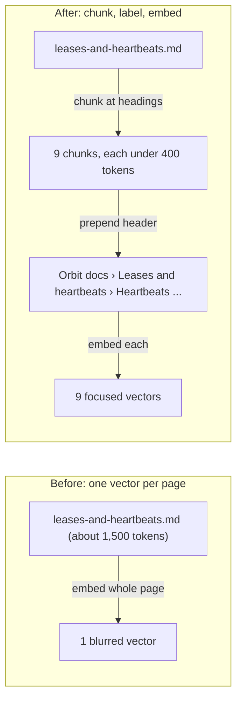
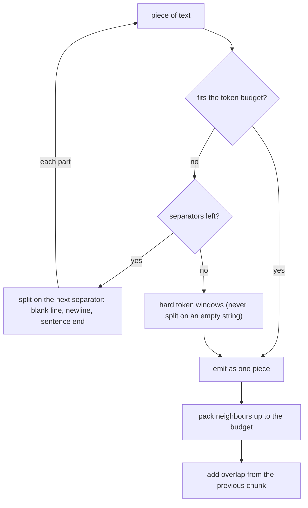
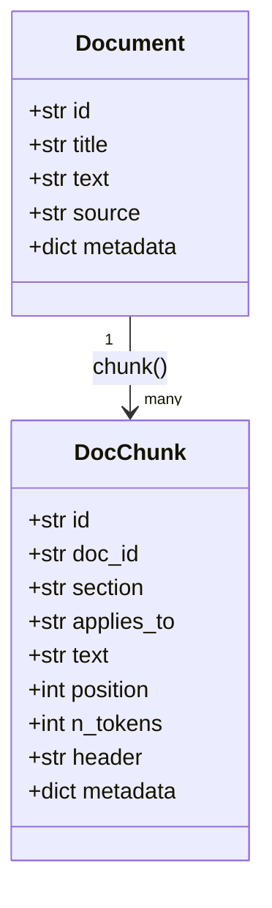

# Chunking Strategies

The Orbit `faq` page answers sixteen unrelated questions, so its single embedding is a
blur of all of them, and a question about one answer has to compete with the other fifteen. Whole
pages are also expensive: answering from one line of `configuration-reference` means sending about
1,600 tokens of page. Chunking decides what retrieval can find, so today you build three chunkers
and let Day 23's labelled queries pick the winner.

## At a Glance

- **Time:** ~2 h core (+ optional Go Deeper) · **Depth:** working
- **Prerequisites:** [Day 4: Tokens: How Models Read Text](../../Phase_1_How_LLMs_Work/Day_004_tokens/tokens.md),
  [Day 23: Embeddings & Semantic Similarity](../../Phase_3_RAG/Day_023_embeddings/embeddings.md),
  [Day 24: Ingesting Documents: Parsing PDFs, HTML & More](../../Phase_3_RAG/Day_024_document_ingestion/document_ingestion.md);
  primer [A06: NumPy & vectors](../../Appendix_Primers/A06_numpy_vectors.md) if `M @ q` looks odd
- **You'll build:** `chunk()` in `atlas/ingest.py` with fixed, recursive and Markdown-aware
  strategies, contextual chunk headers, and a `compare_chunkers()` table scored by hit@k
- **Stops at:** late chunking and learned segmenters (a pointer in Go Deeper, no code)
- **Fast path:** Already know chunking? Read §Which Chunker Wins? Measure It and do Exercise 2
  (about 40 min)
- **Cost:** ≈ $0.01 on `text-embedding-3-small` (prices as of 2026-11,
  [verify](https://developers.openai.com/api/docs/pricing)); $0 with the offline stand-in embedder
- **New terms:** chunk, chunk size (tokens), overlap, structure-aware chunking, contextual chunk header

> **Coming from Software Engineering?** Chunking is pagination for meaning. You pick a page size,
> and records that straddle a page boundary stay readable because neighbouring pages overlap a
> little, like a cursor that re-reads the last row. A heading path such as
> `Leases and heartbeats › Heartbeats` works like a breadcrumb, or a composite key that says where
> a row came from. What transfers: invariants ("no data lost", "loop terminates"), property tests,
> and storing the config that built an index.

## One Vector per Page Blurs Meaning

On [Day 23](../../Phase_3_RAG/Day_023_embeddings/embeddings.md) you embedded each of the 45 Orbit
pages as one vector and scored search with hit@k on labelled queries. That works when a page is
about one thing. Many pages aren't:

- `faq` covers payload limits, Windows support, OIDC loops, SQS idempotency and more. Its vector
  sits somewhere in the middle of all those topics, close to none of them.
- `configuration-reference` lists every config key. A question about `heartbeat_seconds` needs
  one table row, but the retriever hands back the whole page.

Two costs follow. **Recall** (finding the right text at all) suffers because a focused question
is compared against a blurred vector. **Context** suffers because whatever you retrieve gets
pasted into the prompt on [Day 28](../../Phase_3_RAG/Day_028_rag_pipeline/rag_pipeline.md): five
whole pages are roughly 7,000 tokens, while five 400-token chunks are 2,000.

## Index Cards, Not Books

Picture cutting a printed manual into index cards. Each card covers one idea. Each card repeats
the last line of the card before it, so a sentence that runs across the cut is still readable on
one card. And each card says at the top which chapter it came from, so a card reading "set it to
30" still makes sense on its own.

That's the whole lesson in three rules: **cut at sensible places**, **overlap a little**, and
**label every card**. The rest is choosing where "sensible" is and measuring whether it helped.

## Cut Twelve Sentences by Hand

Start with sentences as the unit. Take 12 short sentences about leases and
cut them into cards of 4 sentences. Sentences 4 and 5 belong together: "The default lease is 300
seconds. Heartbeats renew it every 30 seconds." A question like "how often is the 300-second lease
renewed?" needs both.

- **Overlap 0:** step forward 4 each time → cards 1–4, 5–8, 9–12. Sentences 4 and 5 land on
  different cards, so no single card answers the question.
- **Overlap 1:** step forward 4 − 1 = 3 each time → cards 1–4, 4–7, 7–10, 10–12. Card 2 holds
  sentences 4 and 5 together.

Notice the step, `size − overlap`: if overlap equals size, you never move forward.

```python
# script_id: day_025_chunking/hand_example
# Toy data, offline, $0. Size and overlap count sentences here; real chunkers count tokens.
SENTENCES = [
    "A worker claims a job from the broker.", "The broker gives the worker a lease.",
    "The lease is a deadline for finishing the job.", "The default lease is 300 seconds.",
    "Heartbeats renew it every 30 seconds.", "If heartbeats stop, the lease expires.",
    "An expired lease makes the job claimable again.", "A second worker may then run the job.",
    "That is why Orbit is at-least-once.", "Idempotent jobs make a second run harmless.",
    "Use an idempotency key to detect repeats.", "Store the key before the side effect.",
]

def cards(items: list[str], size: int, overlap: int) -> list[list[str]]:
    step = size - overlap                      # how far each new card moves forward
    return [items[i:i + size] for i in range(0, max(len(items) - overlap, 1), step)]

for overlap in (0, 1):
    result = cards(SENTENCES, size=4, overlap=overlap)
    print(f"size=4 overlap={overlap}: {len(result)} cards")
    for n, card in enumerate(result, 1):
        print(f"  card {n}: sentences {SENTENCES.index(card[0]) + 1}-{SENTENCES.index(card[-1]) + 1}")
    together = [n for n, c in enumerate(result, 1) if SENTENCES[3] in c and SENTENCES[4] in c]
    print(f"  cards holding sentences 4 and 5 together: {together or 'none'}")
```

Output:

```text
size=4 overlap=0: 3 cards
  card 1: sentences 1-4
  card 2: sentences 5-8
  card 3: sentences 9-12
  cards holding sentences 4 and 5 together: none
size=4 overlap=1: 4 cards
  card 1: sentences 1-4
  card 2: sentences 4-7
  card 3: sentences 7-10
  card 4: sentences 10-12
  cards holding sentences 4 and 5 together: [2]
```

## Name the Parts

- A **chunk** is a contiguous slice of a document that you embed, store and retrieve as one unit.
- **Chunk size** is the maximum length of a chunk, counted in **tokens** (the unit models count,
  about ¾ of an English word; see [Day 4](../../Phase_1_How_LLMs_Work/Day_004_tokens/tokens.md)).
  Count tokens, not characters, because model limits and prices are in tokens.
- **Overlap** is text repeated between neighbouring chunks, also counted in tokens.
- **Structure-aware chunking** cuts where the document already has seams: headings, paragraphs,
  code fences, tables. The **heading path** is the chain of headings above a passage.
- A **contextual chunk header** is a short label such as
  `Orbit docs › Leases and heartbeats › Heartbeats (applies to all)` that you prepend to the text
  you *embed*, so a chunk that says "set it to 30" still matches a query about heartbeats.



## A Token-Aware Fixed Chunker

The simplest real chunker: slide a window of `max_tokens` tokens across the text, stepping
`max_tokens − overlap` tokens each time. One detail matters more than it looks. Don't decode token
slices back into text: a token can be half of a multi-byte character, and decoding half a
character produces `�`. Instead, ask tiktoken where each token *starts* in the original string
(`decode_with_offsets`) and slice the original string. That makes "no text lost" true by
construction, and you can prove it: with overlap 0, the chunks joined back together must equal the
input exactly.

```python
# script_id: day_025_chunking/fixed_chunker
# Install: uv add tiktoken · Env: ORBIT_DATA (optional) · Offline, $0
import os
from pathlib import Path

import tiktoken

DATA_DIR = Path(os.environ.get("ORBIT_DATA", "datasets/orbit"))
enc = tiktoken.get_encoding("o200k_base")       # Day 4's stand-in tokenizer: counts are approximate

def fixed_chunks(text: str, max_tokens: int = 400, overlap: int = 50) -> list[str]:
    if not 0 <= overlap < max_tokens:            # step must be >= 1 or the loop never advances
        raise ValueError(f"need 0 <= overlap < max_tokens, got overlap={overlap}, max_tokens={max_tokens}")
    tokens = enc.encode(text, disallowed_special=())
    if not tokens:
        return []
    _, starts = enc.decode_with_offsets(tokens)  # character offset where each token begins
    starts.append(len(text))
    step = max_tokens - overlap
    return [text[starts[i]:starts[min(i + max_tokens, len(tokens))]]
            for i in range(0, max(len(tokens) - overlap, 1), step)]

if __name__ == "__main__":
    page = (DATA_DIR / "docs" / "leases-and-heartbeats.md").read_text(encoding="utf-8")
    chunks = fixed_chunks(page)
    sizes = [len(enc.encode(c, disallowed_special=())) for c in chunks]
    lost = len(page) - len("".join(fixed_chunks(page, overlap=0)))
    print(f"{len(chunks)} chunks · max {max(sizes)} tokens · {lost} chars lost")
```

Output:

```text
5 chunks · max 400 tokens · 0 chars lost
```

The loop runs `ceil((n − overlap) / step)` times, which is finite because the guard keeps
`step ≥ 1`. Re-encoding a slice can come out a token longer or shorter than its window, because
tokenization at the cut edges differs slightly; treat the size as "about 400".

## Break It: Three Ways Chunkers Fail

**1. Overlap ≥ size.** Without the guard, `step = 0` and `range()` raises, or a hand-written
`while` loop spins forever. With the guard you get a clear error. **2. A code fence cut in half.**
A token window doesn't know what a ```` ``` ```` fence is. Cut a `toml` example in half and one
chunk holds the opening fence plus half the keys, the next holds the rest with no fence. Both read
badly and embed badly. **3. A naive heading regex.** Lines inside a fence such as
`# orbit.toml (3.x)` look like Markdown headings. A chunker that splits on `^#` treats a code
comment as a new section.

```python
# script_id: day_025_chunking/break_it
# Offline, $0. Imports fixed_chunker.py from this lesson (same folder).
import re

from fixed_chunker import DATA_DIR, fixed_chunks

try:
    fixed_chunks("any text", max_tokens=100, overlap=100)
except ValueError as err:
    print(f"ValueError: {err}")

page = (DATA_DIR / "docs" / "leases-and-heartbeats.md").read_text(encoding="utf-8")
chunks = fixed_chunks(page, max_tokens=120, overlap=0)
split = [i for i, c in enumerate(chunks) if c.count("```") % 2]    # odd count = a fence was cut
print(f"{len(chunks)} chunks, {len(split)} with a fence cut in half: {split}")

naive = [ln for ln in page.splitlines() if re.match(r"#{1,6} ", ln)]
real, in_fence = [], False
for ln in page.splitlines():
    if ln.startswith("```"):
        in_fence = not in_fence
    elif not in_fence and re.match(r"#{1,6} ", ln):
        real.append(ln)
print("naive regex also treats these as headings:", sorted(set(naive) - set(real)))
```

Output:

```text
ValueError: need 0 <= overlap < max_tokens, got overlap=100, max_tokens=100
13 chunks, 2 with a fence cut in half: [2, 3]
naive regex also treats these as headings: ['# orbit.toml (3.x)']
```

There's a fourth trap worth a script of its own: **characters are not tokens.** The rule "400
tokens ≈ 1,600 characters" holds for English prose only, and how badly it breaks depends on the
language *and* the tokenizer. Orbit's tracker has issues in Hindi (#63) and Japanese (#188). The
script compares `o200k_base` with `cl100k_base`, the encoding `text-embedding-3-small` counts with.

```python
# script_id: day_025_chunking/chars_vs_tokens
# Offline, $0. Imports fixed_chunker.py from this lesson (same folder).
import json

import tiktoken

from fixed_chunker import DATA_DIR, enc

issues = {i["id"]: i for i in map(json.loads, (DATA_DIR / "issues" / "issues.jsonl")
                                  .read_text(encoding="utf-8").splitlines())}

def prose(text: str) -> str:
    """Keep the non-English lines; logs and code in the issue are English and would dilute it."""
    return "\n".join(ln for ln in text.splitlines() if any(ord(ch) > 0x2FF for ch in ln))

samples = {
    "English (docs page)": (DATA_DIR / "docs" / "leases-and-heartbeats.md").read_text(encoding="utf-8"),
    "Hindi (issue 63)": prose(issues[63]["title"] + "\n" + issues[63]["body"]),
    "Japanese (issue 188)": prose(issues[188]["title"] + "\n" + issues[188]["body"]),
}
cl100k = tiktoken.get_encoding("cl100k_base")    # the encoding text-embedding-3-* count with
for name, text in samples.items():
    rate = {e.name: len(text) / len(e.encode(text, disallowed_special=())) for e in (enc, cl100k)}
    print(f"{name:21} chars/token: o200k {rate['o200k_base']:3.1f} · cl100k {rate['cl100k_base']:3.1f}"
          f" -> 400 cl100k tokens ≈ {400 * rate['cl100k_base']:,.0f} chars")
```

Output:

```text
English (docs page)   chars/token: o200k 3.9 · cl100k 3.8 -> 400 cl100k tokens ≈ 1,534 chars
Hindi (issue 63)      chars/token: o200k 3.6 · cl100k 1.6 -> 400 cl100k tokens ≈ 626 chars
Japanese (issue 188)  chars/token: o200k 1.8 · cl100k 1.3 -> 400 cl100k tokens ≈ 520 chars
```

In `cl100k_base`, a 1,600-character chunk of Hindi or Japanese is 1,000 to 1,200 tokens, close to
three times the English budget. The fix is the one you already have: size chunks in tokens, with
the tokenizer of the model that reads them, never in characters.

## Recursive and Markdown-Aware Chunking

A fixed window cuts wherever the count runs out. A **recursive** chunker tries the coarsest seam
first and only goes finer when a piece is still too big: paragraphs (`\n\n`), then lines (`\n`),
then sentences (`. `), and only as a last resort raw token windows. The pieces are then packed
back together greedily up to the budget, so you don't end up with hundreds of one-line chunks.



Two details fix common bugs. First, the bottom of the
recursion falls back to token windows, because `text.split("")` raises
`ValueError: empty separator`. Second, overlap is applied *after* packing, as its own step,
so the recursive path gets overlap too. To leave room for it, packing uses a budget of
`max_tokens − overlap`, and the overlap snaps forward to a line start so a chunk never begins
halfway through a table row.

The **Markdown-aware** chunker goes one level higher. It first cuts the page into sections at
headings (skipping lines inside fences), records each section's heading path, and folds a tiny
parent section, such as a lone `## General` line, into its first child. Inside a section it
splits into blocks at blank lines, but a fenced code block or a table is one unbreakable block.
Only a block that is bigger than the whole budget, such as a huge log, gets cut inside.

Every function below returns `(start, end)` character offsets into `Document.text` rather than
copies of the text. That keeps each chunk an exact slice of the original, which is what lets you
test "no text lost" and later quote chunks verbatim as citations.

```python
# script_id: day_025_chunking/chunker
"""atlas/ingest.py, Day 25 additions: split Documents into DocChunks.

This lesson saves it as chunker.py; compare.py and the exercises import it.
Install: uv add tiktoken pydantic
Env:     ORBIT_DATA (optional, defaults to datasets/orbit). Offline, $0.
"""
import os
import re
from dataclasses import dataclass, field
from functools import lru_cache
from pathlib import Path
from typing import Any, Callable, Literal, Sequence

import tiktoken
from pydantic import BaseModel, Field

DATA_DIR = Path(os.environ.get("ORBIT_DATA", "datasets/orbit"))

@lru_cache(maxsize=1)
def _enc() -> tiktoken.Encoding:
    return tiktoken.get_encoding("o200k_base")   # Day 4's stand-in; counts are approximate

def count_tokens(text: str) -> int:              # built on Day 4
    return len(_enc().encode(text, disallowed_special=()))

@dataclass
class Document:                                  # built on Day 24 (compact copy)
    id: str
    title: str
    text: str                                    # normalized Markdown body
    source: str
    metadata: dict[str, str] = field(default_factory=dict)

def load_corpus(root: Path = DATA_DIR) -> list[Document]:
    """Compact Day 24 stand-in: Markdown pages with flat `key: value` front matter."""
    docs = []
    for path in sorted((root / "docs").glob("*.md")):
        _, head, body = path.read_text(encoding="utf-8").split("---", 2)
        meta = {}
        for line in head.strip().splitlines():
            key, _, value = line.partition(":")
            meta[key.strip()] = value.split(" #")[0].strip().strip('"')   # drop inline comments
        docs.append(Document(meta["id"], meta["title"], body.lstrip("\n"), str(path), meta))
    return docs
```

`DocChunk` keeps [Day 15](../../Phase_2_Building_with_LLM_APIs/Day_015_pydantic_for_llms/pydantic_for_llms.md)'s
fields and gains four. Next comes the token-window helper, shared by the fixed strategy and the
recursive fallback.

```python
# script_id: day_025_chunking/chunker
class DocChunk(BaseModel):          # atlas/schemas.py: Day 15 fields, then Day 25 additions
    id: str
    doc_id: str
    section: str
    applies_to: str
    text: str                       # exact slice of Document.text: what you show and cite
    position: int = 0
    n_tokens: int = 0
    header: str = ""                # embedded together with the text, never shown as the text
    metadata: dict[str, Any] = Field(default_factory=dict)

Span = tuple[int, int]              # [start, end) character offsets into Document.text

def _check(max_tokens: int, overlap: int) -> None:
    if not 0 <= overlap < max_tokens:   # step = max_tokens - overlap must be >= 1 to terminate
        raise ValueError(f"need 0 <= overlap < max_tokens, got overlap={overlap}, max_tokens={max_tokens}")

def token_spans(text: str, max_tokens: int, overlap: int = 0, base: int = 0) -> list[Span]:
    """Fixed windows of max_tokens tokens, as offsets into the original string."""
    _check(max_tokens, overlap)
    tokens = _enc().encode(text, disallowed_special=())
    if not tokens:
        return []
    _, starts = _enc().decode_with_offsets(tokens)
    starts.append(len(text))
    step = max_tokens - overlap
    return [(base + starts[i], base + starts[min(i + max_tokens, len(tokens))])
            for i in range(0, max(len(tokens) - overlap, 1), step)]

def fixed_chunker(doc: Document, max_tokens: int, overlap: int) -> list[tuple[str, int, int]]:
    return [(doc.title, s, e) for s, e in token_spans(doc.text, max_tokens, overlap)]
```

The recursive strategy: split at the coarsest separator that works, pack, then add overlap.

```python
# script_id: day_025_chunking/chunker
SEPARATORS = ("\n\n", "\n", ". ")   # coarse to fine; token windows are the last resort

def _split_keep(text: str, sep: str) -> list[str]:
    """Split on sep but keep it on the left piece, so the pieces re-join to exactly `text`."""
    parts = text.split(sep)
    return [p for p in [p + sep for p in parts[:-1]] + [parts[-1]] if p]

def recursive_spans(text: str, budget: int, base: int = 0,
                    seps: Sequence[str] = SEPARATORS) -> list[Span]:
    if count_tokens(text) <= budget:
        return [(base, base + len(text))] if text else []
    if not seps:                    # nothing left to split on: token windows, never split("")
        return token_spans(text, budget, 0, base)
    spans, pos = [], base
    for piece in _split_keep(text, seps[0]):
        spans += recursive_spans(piece, budget, pos, seps[1:])
        pos += len(piece)
    return spans

def pack(text: str, spans: list[Span], budget: int) -> list[Span]:
    """Greedily merge neighbouring spans while the merged slice still fits the budget."""
    out: list[Span] = []
    for s, e in spans:
        if out and count_tokens(text[out[-1][0]:e]) <= budget:
            out[-1] = (out[-1][0], e)
        else:
            out.append((s, e))
    return out

def add_overlap(text: str, spans: list[Span], overlap: int) -> list[Span]:
    """Start each span `overlap` tokens early, inside the previous one. Runs AFTER packing."""
    out = spans[:1]
    for (ps, pe), (s, e) in zip(spans, spans[1:]):
        tokens = _enc().encode(text[ps:pe], disallowed_special=())
        if overlap == 0 or not tokens:
            out.append((s, e))
            continue
        _, starts = _enc().decode_with_offsets(tokens)
        start = ps + starts[max(0, len(tokens) - overlap)]
        nl = text.find("\n", start, pe)         # snap to a line start: overlap never begins mid-row
        if nl != -1 and text[nl + 1:pe].strip():
            start = nl + 1
        out.append((min(s, start), e))
    return out

def recursive_chunker(doc: Document, max_tokens: int, overlap: int) -> list[tuple[str, int, int]]:
    budget = max_tokens - overlap   # leave room for the overlap added afterwards
    spans = add_overlap(doc.text, pack(doc.text, recursive_spans(doc.text, budget), budget), overlap)
    return [(doc.title, s, e) for s, e in spans]
```

The Markdown strategy reuses `recursive_spans`, `pack` and `add_overlap`, and adds sections and
blocks. Overlap applies only between chunks of the same section: a heading is already a clean
break.

```python
# script_id: day_025_chunking/chunker
HEADING = re.compile(r"(#{1,6}) +(.+)")

def md_sections(text: str) -> list[tuple[str, int, int]]:
    """(heading path, start, end) per section. Lines inside ``` fences are never headings."""
    sections, path, start, pos, in_fence = [], [], 0, 0, False
    for line in text.splitlines(keepends=True):
        if line.startswith("```"):
            in_fence = not in_fence
        elif not in_fence and (m := HEADING.match(line)):
            if pos > start:
                sections.append((" › ".join(t for _, t in path), start, pos))
            level = len(m.group(1))
            path = [(lv, t) for lv, t in path if lv < level] + [(level, m.group(2).strip())]
            start = pos
        pos += len(line)
    sections.append((" › ".join(t for _, t in path), start, len(text)))
    return sections

def md_blocks(text: str, start: int, end: int) -> list[Span]:
    """Blocks end at blank lines, except inside a fence; a table has no blank lines, so it stays whole."""
    blocks, block_start, pos, in_fence = [], start, start, False
    for line in text[start:end].splitlines(keepends=True):
        pos += len(line)
        if line.startswith("```"):
            in_fence = not in_fence
        elif not in_fence and not line.strip():
            blocks.append((block_start, pos))
            block_start = pos
    return blocks + ([(block_start, pos)] if pos > block_start else [])

def markdown_chunker(doc: Document, max_tokens: int, overlap: int,
                     min_tokens: int = 40) -> list[tuple[str, int, int]]:
    budget, merged = max_tokens - overlap, []
    for path, s, e in md_sections(doc.text):     # fold a tiny parent ("## General") into its first child
        parent = merged[-1] if merged else None
        if (parent and path.startswith(parent[0] + " › ")
                and count_tokens(doc.text[parent[1]:parent[2]]) < min_tokens):
            merged[-1] = (path, parent[1], e)
        else:
            merged.append((path, s, e))
    out = []
    for path, s, e in merged:
        pieces = [sp for bs, be in md_blocks(doc.text, s, e)   # only an oversized block is cut inside
                  for sp in recursive_spans(doc.text[bs:be], budget, bs)]
        spans = add_overlap(doc.text, pack(doc.text, pieces, budget), overlap)
        out += [(path or doc.title, a, b) for a, b in spans]
    return out
```

## Contextual Chunk Headers

Packing leaves chunks like this one, the tail of the *Sizing the two settings* table in
`leases-and-heartbeats`:

```text
| CPU-heavy jobs using GIL-holding native code | 900–1800 | 60 |
| Flaky network to the broker | 600 | 30 |
```

The column names (`lease_seconds`, `heartbeat_seconds`) sit in the previous chunk, so embedded
alone, nothing here says what the numbers mean or which page they came from. The fix is a
**contextual chunk header**: a breadcrumb built from metadata you already have (site, page title,
heading path, version), prepended to the text you embed. The demo at the end of this section
prints this exact chunk with its header.

Keep the header out of `DocChunk.text`. The header helps the *retriever* match; the text is what
you show the reader and quote as a citation on Day 28. So `embed_text()` joins them only at embedding time.
These headers are static and free;
[Day 31](../../Phase_3_RAG/Day_031_reranking_contextual_retrieval/reranking_contextual_retrieval.md)
has an LLM write per-chunk context instead, at one model call per chunk.

Here is the contract that [Day 26](../../Phase_3_RAG/Day_026_pgvector_search/pgvector_search.md)
stores in Postgres:



The last block wires the strategies into one entry point. `CHUNKERS` is a registry: any function
with the shape `(doc, max_tokens, overlap) -> [(section, start, end)]` can plug in, which is how
Go Deeper adds `"semantic"` without touching `chunk()`. Each chunk records the strategy and
parameters that made it, and ids are `f"{doc_id}#{position}"` for now (Day 26 switches to
content-hash ids).

```python
# script_id: day_025_chunking/chunker
Chunker = Callable[[Document, int, int], list[tuple[str, int, int]]]
CHUNKERS: dict[str, Chunker] = {"fixed": fixed_chunker, "recursive": recursive_chunker,
                                "markdown": markdown_chunker}   # "semantic" registers in Go Deeper

def make_header(doc: Document, section: str) -> str:
    trail = section if section.startswith(doc.title) else f"{doc.title} › {section}"
    return f"Orbit docs › {trail} (applies to {doc.metadata.get('applies_to', 'all')})"

def chunk(doc: Document, *, strategy: Literal["fixed", "recursive", "markdown", "semantic"] = "markdown",
          max_tokens: int = 400, overlap: int = 50, add_header: bool = True) -> list[DocChunk]:
    _check(max_tokens, overlap)
    if strategy not in CHUNKERS:
        raise ValueError(f"unknown strategy {strategy!r}; registered: {sorted(CHUNKERS)}")
    params = {"strategy": strategy, "max_tokens": max_tokens, "overlap": overlap}
    applies_to = doc.metadata.get("applies_to", "all")
    return [DocChunk(id=f"{doc.id}#{i}", doc_id=doc.id, section=section, applies_to=applies_to,
                     text=doc.text[s:e], position=i, n_tokens=count_tokens(doc.text[s:e]),
                     header=make_header(doc, section) if add_header else "",
                     metadata={**params, "start": s, "end": e})   # store the recipe with the chunk
            for i, (section, s, e) in enumerate(CHUNKERS[strategy](doc, max_tokens, overlap))]

def embed_text(c: DocChunk) -> str:
    """What the embedding model sees: header + text. Show and cite c.text alone."""
    return f"{c.header}\n\n{c.text.strip()}" if c.header else c.text.strip()

def ranked_doc_ids(chunks: Sequence[DocChunk]) -> list[str]:
    """Best-first chunks -> best-first doc ids, each once (hit@k is scored per page)."""
    return list(dict.fromkeys(c.doc_id for c in chunks))

def rejoin(chunks: Sequence[DocChunk]) -> str:
    """Undo the overlap: each chunk contributes only the text past what came before."""
    out, covered = [], 0
    for c in chunks:
        out.append(c.text[max(0, covered - c.metadata["start"]):])
        covered = c.metadata["end"]
    return "".join(out)
```

Run it over all 45 pages. `rejoin(chunk(d)) == d.text` is the "no text lost" invariant, checked
for every page and strategy; "cuts inside fences" counts chunk boundaries that land inside a fence.

```python
# script_id: day_025_chunking/chunker
def inside_fence(text: str, pos: int) -> bool:
    return text[:pos].count("```") % 2 == 1      # odd number of fence markers before pos

if __name__ == "__main__":
    docs = load_corpus()
    for strategy in CHUNKERS:
        per_doc = [chunk(d, strategy=strategy) for d in docs]
        chunks = [c for cs in per_doc for c in cs]
        lossless = all(rejoin(cs) == d.text for cs, d in zip(per_doc, docs))
        cuts = sum(inside_fence(d.text, c.metadata[k]) for cs, d in zip(per_doc, docs)
                   for c in cs for k in ("start", "end"))
        print(f"{strategy:9} {len(chunks):4} chunks · avg {sum(c.n_tokens for c in chunks) / len(chunks):3.0f}"
              f" · max {max(c.n_tokens for c in chunks)} tokens · cuts inside fences {cuts:2} · lossless={lossless}")
    leases = next(d for d in docs if d.id == "leases-and-heartbeats")
    sample = chunk(leases)[4]
    print(f"\n{sample.id} · {sample.n_tokens} tokens\n{embed_text(sample)[:300]}")
```

Output:

```text
fixed      199 chunks · avg 359 · max 400 tokens · cuts inside fences 48 · lossless=True
recursive  221 chunks · avg 318 · max 396 tokens · cuts inside fences 33 · lossless=True
markdown   423 chunks · avg 152 · max 365 tokens · cuts inside fences  2 · lossless=True

leases-and-heartbeats#4 · 81 tokens
Orbit docs › Leases and heartbeats › Sizing the two settings (applies to all)

| CPU-heavy jobs using GIL-holding native code | 900–1800 | 60 |
| Flaky network to the broker | 600 | 30 |

> **Note:** `timeout` on a job and the lease are independent. A job with `timeout="20m"`
> needs working heartbe
```

## Which Chunker Wins? Measure It

Opinions about chunk size are cheap; Day 23's labelled queries aren't. The comparison embeds every
strategy's chunks, searches with each dev-split query, and scores **doc-level** hit@k: a query
hits if one of its `relevant_doc_ids` is among the top k *pages*. Deduping with
`ranked_doc_ids` stops three chunks of one page from filling the top 5, so scores stay comparable
with Day 23's page baseline.

The embedder is a parameter. `openai_embed` is a compact copy of Day 23's batched, cached
`embed()`. `local_embed` is an offline stand-in, a hashed bag of words, so the harness runs with
no key and no cost. It measures *word overlap*, not meaning, so treat its numbers as a smoke test
of the wiring.

```python
# script_id: day_025_chunking/embedder
"""Interchangeable embedders with one shape: texts -> (n, d) float32 array with unit-length rows.

Install: uv add "openai>=3.46,<4" numpy tiktoken
Env:     OPENAI_API_KEY (openai_embed only), ATLAS_EMBED_MODEL (optional)
"""
import hashlib
import os
import re
import sqlite3
import zlib
from collections.abc import Callable, Sequence
from pathlib import Path

import numpy as np
import tiktoken
from openai import OpenAI

EMBED_MODEL = os.environ.get("ATLAS_EMBED_MODEL", "text-embedding-3-small")   # atlas/config.py (Day 23)
PRICE_PER_1M = 0.02    # USD, text-embedding-3-small; as of 2026-11, verify at https://developers.openai.com/api/docs/pricing
EmbedFn = Callable[[Sequence[str]], np.ndarray]
BILLED = {"tokens": 0}  # filled from resp.usage, the billing truth

def _normalize(m: np.ndarray) -> np.ndarray:
    norms = np.linalg.norm(m, axis=1, keepdims=True)
    return m / np.where(norms == 0, 1, norms)       # a zero row stays zero instead of nan

def embed_cost(texts: Sequence[str]) -> float:
    """Estimate before you pay: text-embedding-3-* tokenize with cl100k_base."""
    enc = tiktoken.get_encoding("cl100k_base")
    return sum(len(enc.encode(t, disallowed_special=())) for t in texts) * PRICE_PER_1M / 1e6

def local_embed(texts: Sequence[str], dim: int = 4096) -> np.ndarray:
    """Offline stand-in: hashed bag of words. Lexical, NOT semantic. For wiring, tests, $0 runs."""
    m = np.zeros((len(texts), dim), dtype=np.float32)
    for row, text in enumerate(texts):
        for word in re.findall(r"\w[\w.-]*\w|\w", text.lower()):
            m[row, zlib.crc32(word.encode()) % dim] += 1.0   # crc32 is stable across runs; hash() isn't
    return _normalize(np.log1p(m))
```

```python
# script_id: day_025_chunking/embedder
class EmbeddingCache:   # built on Day 23 (compact): key = sha256(model | dims | text)
    def __init__(self, path: Path = Path(".cache/embeddings.sqlite")):
        path.parent.mkdir(parents=True, exist_ok=True)
        self.db = sqlite3.connect(path)
        self.db.execute("CREATE TABLE IF NOT EXISTS emb (key TEXT PRIMARY KEY, vec BLOB)")

    def key(self, model: str, text: str, dims: int | None = None) -> str:
        return hashlib.sha256(f"{model}|{dims}|{text}".encode()).hexdigest()

    def get(self, key: str) -> np.ndarray | None:
        row = self.db.execute("SELECT vec FROM emb WHERE key = ?", (key,)).fetchone()
        return np.frombuffer(row[0], dtype=np.float32) if row else None

    def put(self, key: str, vec: np.ndarray) -> None:
        self.db.execute("INSERT OR REPLACE INTO emb VALUES (?, ?)", (key, vec.astype(np.float32).tobytes()))
        self.db.commit()

def openai_embed(texts: Sequence[str], model: str = EMBED_MODEL, batch_size: int = 64,
                 cache: EmbeddingCache | None = None) -> np.ndarray:
    """Batched and cached: only texts missing from the cache are sent and billed."""
    cache = cache or EmbeddingCache()
    keys = [cache.key(model, t) for t in texts]
    vecs = {k: v for k in set(keys) if (v := cache.get(k)) is not None}
    todo = [i for i, k in enumerate(keys) if k not in vecs]
    client = OpenAI() if todo else None             # a warm cache needs no key at all
    for b in range(0, len(todo), batch_size):
        idx = todo[b:b + batch_size]
        resp = client.embeddings.create(model=model, input=[texts[i] for i in idx])
        BILLED["tokens"] += resp.usage.prompt_tokens
        for i, d in zip(idx, resp.data):
            vecs[keys[i]] = np.asarray(d.embedding, dtype=np.float32)
            cache.put(keys[i], vecs[keys[i]])
    return _normalize(np.stack([vecs[k] for k in keys]))

def default_embedder() -> tuple[str, EmbedFn]:
    """Real embeddings when a key is set, the offline stand-in otherwise; callers never branch."""
    if os.environ.get("OPENAI_API_KEY"):
        return EMBED_MODEL, openai_embed
    return "local_embed (offline stand-in)", local_embed
```

Now the comparison. `strategies` maps a label to `chunk()` keyword arguments, so any
configuration (size, overlap, header on or off) is one dictionary entry. The page-level baseline
is the fixed strategy with a window larger than any page.

```python
# script_id: day_025_chunking/compare
"""Which chunker wins? Doc-level hit@1/@5 on the dev split, chunk counts and embedding cost.

Imports chunker.py and embedder.py from this lesson (same folder).
Env: OPENAI_API_KEY for real embeddings (≈ $0.01, as of 2026-11, verify); without it, $0 offline.
"""
import json
from collections import defaultdict
from dataclasses import dataclass

import numpy as np

from chunker import DATA_DIR, Document, chunk, embed_text, load_corpus, ranked_doc_ids
from embedder import EmbedFn, default_embedder, embed_cost

@dataclass
class RetrievalCase:                 # built on Day 23 (compact)
    id: str
    query: str
    relevant_doc_ids: list[str]
    kind: str                        # exact_term | semantic | multi_hop

def load_retrieval_cases(split: str = "dev") -> list[RetrievalCase]:
    """Day 23's deterministic split: every other case by id within each kind."""
    path = DATA_DIR / "eval" / "retrieval_queries.jsonl"
    by_kind: dict[str, list[RetrievalCase]] = defaultdict(list)
    for r in sorted(map(json.loads, path.read_text(encoding="utf-8").splitlines()), key=lambda r: r["id"]):
        by_kind[r["kind"]].append(RetrievalCase(r["id"], r["query"], r["relevant_doc_ids"], r["kind"]))
    if split == "all":
        return [c for cs in by_kind.values() for c in cs]
    return [c for cs in by_kind.values() for i, c in enumerate(cs) if i % 2 == (split == "test")]
```

```python
# script_id: day_025_chunking/compare
def compare_chunkers(docs: list[Document], cases: list[RetrievalCase], strategies: dict[str, dict],
                     k: int = 5, embed_fn: EmbedFn | None = None) -> list[dict]:
    """One row per strategy: chunk, embed, search every case, score doc-level hit@1 and hit@k."""
    embed_fn = embed_fn or default_embedder()[1]
    queries = embed_fn([c.query for c in cases])
    rows = []
    for label, kwargs in strategies.items():
        chunks = [c for d in docs for c in chunk(d, **kwargs)]
        texts = [embed_text(c) for c in chunks]
        sims = queries @ embed_fn(texts).T           # unit-length rows, so dot product = cosine
        hits = dict.fromkeys((1, k), 0)
        for case, row in zip(cases, sims):
            ranked = ranked_doc_ids([chunks[i] for i in np.argsort(-row)])
            for n in hits:
                hits[n] += bool(set(ranked[:n]) & set(case.relevant_doc_ids))
        rows.append({"strategy": label, "chunks": len(chunks),
                     "avg_tokens": round(sum(c.n_tokens for c in chunks) / len(chunks)),
                     "hit@1": hits[1] / len(cases), f"hit@{k}": hits[k] / len(cases),
                     "embed_usd": embed_cost(texts)})
    return rows

STRATEGIES = {
    "page (baseline)":   {"strategy": "fixed", "max_tokens": 8000, "overlap": 0, "add_header": False},
    "fixed 400/50":      {"strategy": "fixed", "add_header": False},
    "recursive 400/50":  {"strategy": "recursive", "add_header": False},
    "markdown 400/50":   {"strategy": "markdown", "add_header": False},
    "markdown + header": {"strategy": "markdown"},
}

if __name__ == "__main__":
    name, embed_fn = default_embedder()
    cases = load_retrieval_cases("dev")
    rows = compare_chunkers(load_corpus(), cases, STRATEGIES, embed_fn=embed_fn)
    print(f"embedder: {name} · {len(cases)} dev queries")
    print(f"{'strategy':18} {'chunks':>6} {'avg tok':>7} {'hit@1':>6} {'hit@5':>6} {'embed $':>8}")
    for r in rows:
        print(f"{r['strategy']:18} {r['chunks']:6} {r['avg_tokens']:7} {r['hit@1']:6.2f} "
              f"{r['hit@5']:6.2f} {r['embed_usd']:8.4f}")
```

Output from the offline stand-in (with `text-embedding-3-small` your numbers will differ):

```text
embedder: local_embed (offline stand-in) · 20 dev queries
strategy           chunks avg tok  hit@1  hit@5  embed $
page (baseline)        45    1415   0.70   0.95   0.0013
fixed 400/50          199     359   0.60   1.00   0.0014
recursive 400/50      221     318   0.70   1.00   0.0014
markdown 400/50       423     152   0.60   0.95   0.0013
markdown + header     423     152   0.75   0.95   0.0015
```

How to read the table: compare rows, not absolute numbers. With 20 queries, one query is 0.05,
so a one-query difference is noise. Here hit@5 is near the ceiling for every row (the top 5 of 45
pages is a generous target), so hit@1 carries the signal. The instructive row is
`markdown 400/50`: its 150-token sections are focused but lose the page's vocabulary, and hit@1
falls below the page baseline. The header gives that vocabulary back and makes it the best row.
Rerun with a key before you trust the ranking: a lexical stand-in rewards repeated words in ways
real embeddings don't. The `embed $` column is the indexing bill (re-paid on every
re-index); the per-question saving shows up later, in prompt tokens on Day 28. On
[Day 29](../../Phase_3_RAG/Day_029_retrieval_evaluation/retrieval_evaluation.md) you'll add
recall@k and MRR and a test split, so you're not tuning and grading on the same 20 queries.

## Trade-offs and When Not to Chunk

| Situation | Start with | Why |
|---|---|---|
| Docs with headings (Markdown, HTML converted on Day 24) | `markdown`, 300–500 tokens, overlap ~10–15 %, header on | Sections are the author's own topic boundaries |
| Flat prose (transcripts, emails, plain text) | `recursive`, same sizes | Paragraphs and sentences are the only seams |
| Logs, stack traces, code | `markdown` (keeps fences whole) or split by function | A half stack trace matches nothing well |
| Short, single-topic items (a ticket title, an FAQ answer, a product row) | Don't chunk: one item, one vector | Splitting a 100-token item only removes context |
| You need the whole page anyway (long-context model, small corpus) | Maybe no retrieval at all | [Day 32](../../Phase_3_RAG/Day_032_long_context_vs_rag/long_context_vs_rag.md) weighs it |

Those sizes are a **starting point to measure**, not a law: rerun `compare_chunkers()` on your
own labelled queries before you commit. Smaller chunks give sharper matches but less context per
hit; bigger chunks carry more context but blur again.

### In production

- Store the chunker name and parameters with the index (they're already in `DocChunk.metadata`);
  an index you can't rebuild exactly is an index you can't debug.
- Changing the chunker means re-chunking and re-embedding everything, which is a re-index. Day 26
  makes that idempotent; [Day 88](../../Phase_9_Production/Day_088_operating_ai_systems/operating_ai_systems.md)
  covers migrations.
- Keep the embedding input under the model limit (8,192 tokens per input for `text-embedding-3-*`,
  as of 2026-11, verify in the [embeddings guide](https://developers.openai.com/api/docs/guides/embeddings)).
- Library splitters (for example in LangChain or LlamaIndex) are fine once you know what they do;
  check that they count tokens, keep fences whole and apply overlap on every path.
- Hosted retrieval such as OpenAI vector stores chunks for you and takes a `chunking_strategy`
  argument; Day 32 compares it with your own pipeline.

## Go Deeper (optional)

<details><summary>Go deeper: why one vector per page blurs (toy maths)</summary>

In words: an embedding of a long text behaves roughly like an average of what the text talks
about, so every extra topic pulls the vector away from each individual one.

Toy numbers: pretend each FAQ answer points along its own axis, all at right angles, and the page
vector is their normalized sum. A query that matches answer 1 exactly has cosine 1.0 with a chunk
holding only answer 1. Against the page holding 2 answers it's 1/√2 ≈ 0.71; with 4 answers 0.5;
with 16 answers 0.25. A focused page that merely mentions the query's words can easily beat 0.25.

Formula: with orthonormal topic vectors t₁…tₙ and page vector p = (t₁ + … + tₙ)/√n,
cos(t₁, p) = 1/√n. Real embeddings aren't orthogonal and models don't literally average, so read
this as the direction of the effect, not its size. The comparison table is the real measurement.

</details>

<details><summary>Go deeper: semantic chunking with a percentile threshold</summary>

Semantic chunking embeds every sentence and cuts where neighbouring sentences stop being similar.
The classic mistake is a fixed threshold ("split below 0.75"). Similarity levels differ a lot
between embedding models and between documents, so a fixed number splits one page into 40 pieces
and another into one. Use a **percentile of this page's own similarities** instead: cutting at the
10th percentile means "split at the 10 % biggest topic shifts".

It costs one embedding per sentence, roughly the page's token count again, and it doesn't know
about fences or tables. Groups that are still too long get re-split by `recursive_spans`. This
version skips overlap to stay short.

```python
# script_id: day_025_chunking/semantic_optional
"""Semantic chunking; registers CHUNKERS["semantic"]. Imports chunker.py and embedder.py.
Env: OPENAI_API_KEY for real embeddings (≈ $0.0001 for 3 pages, as of 2026-11, verify); $0 offline.
"""
import re

import numpy as np

from chunker import CHUNKERS, Document, chunk, load_corpus, pack, recursive_spans
from embedder import default_embedder, embed_cost

SENTENCE_END = re.compile(r"(?<=[.!?])\s+|\n\s*\n")
NAME, EMBED = default_embedder()

def sentence_spans(text: str) -> list[tuple[int, int]]:
    cuts = [m.end() for m in SENTENCE_END.finditer(text)]
    return [(s, e) for s, e in zip([0] + cuts, cuts + [len(text)]) if text[s:e].strip()]

def semantic_chunker(doc: Document, max_tokens: int, overlap: int,
                     percentile: float = 10.0) -> list[tuple[str, int, int]]:
    sents = sentence_spans(doc.text)
    groups, start = [], 0
    if len(sents) > 2:
        vecs = EMBED([doc.text[s:e] for s, e in sents])
        sims = np.sum(vecs[:-1] * vecs[1:], axis=1)       # each sentence vs the next one
        cut = np.percentile(sims, percentile)             # relative to THIS page, not a fixed 0.75
        for (_, e), sim in zip(sents[:-1], sims):
            if sim < cut:
                groups.append((start, e))
                start = e
    groups.append((start, len(doc.text)))
    spans = [sp for s, e in groups for sp in pack(doc.text, recursive_spans(doc.text[s:e], max_tokens, s), max_tokens)]
    return [(doc.title, s, e) for s, e in spans]

CHUNKERS["semantic"] = semantic_chunker

if __name__ == "__main__":
    for doc in [d for d in load_corpus() if d.id in {"faq", "leases-and-heartbeats", "idempotency"}]:
        chunks = chunk(doc, strategy="semantic", overlap=0)
        cost = embed_cost([doc.text[s:e] for s, e in sentence_spans(doc.text)])
        print(f"{doc.id:22} {len(chunks):2} chunks · sentence embeddings ≈ ${cost:.5f} · via {NAME}")
        print("   starts:", " | ".join(c.text.strip()[:28].replace("\n", " ") for c in chunks[:4]))
```

Output from the offline stand-in (your cut points will differ with real embeddings):

```text
faq                     4 chunks · sentence embeddings ≈ $0.00003 · via local_embed (offline stand-in)
   starts: # Frequently asked questions | ### Does Orbit work on Windo | 3.2.1, released 2026-10-20.  | ### We see ORB-1901 on SQS
idempotency             4 chunks · sentence embeddings ≈ $0.00003 · via local_embed (offline stand-in)
   starts: # Idempotency  Orbit deliver | | Situation | Result of `.en | Orbit **fails closed**: if i | | Pattern | Use when | |---|
leases-and-heartbeats   5 chunks · sentence embeddings ≈ $0.00003 · via local_embed (offline stand-in)
   starts: # Leases and heartbeats  Lea | ```text t=0s     claim job j | 1. **The worker is really go | If the broker stops receivin
```

On Orbit's docs, which already have good headings, semantic chunking rarely beats the Markdown
chunker by enough to pay for itself. It earns its cost on long unstructured text such as meeting
transcripts. Add `"semantic"` to `STRATEGIES` in `compare.py` and see for yourself.

</details>

<details><summary>Go deeper: logs, tables, code, and what experts also do</summary>

- **Oversized fences.** When one fenced block is bigger than the budget, the Markdown chunker has
  to cut inside it. You can still repair the *embedded* text: if a chunk starts inside a fence
  (an odd number of fence markers in `doc.text[:start]`), prepend a fence line in `embed_text`,
  and close an unclosed one at the end. `DocChunk.text` stays an exact slice. Exercise 4 does this.
- **Long tables.** Splitting a table loses its header row, so every later chunk is a list of
  unlabelled cells. Repeat the header row (and the separator row) in the embedded text of each
  table chunk.
- **Code corpora.** Split by syntax, not by lines: one function or class per chunk, with the file
  path and class name as the header. Python's `ast` module gives you exact line ranges.
- **Parent-child (small-to-big) retrieval.** Embed small chunks for sharp matching, but hand the
  model the surrounding section. The `start`/`end` offsets you already store make that a slice.
- **Late chunking** (past today's stop line). Instead of embedding each chunk on its own, run an
  embedding model over the whole document once and pool its token-level vectors over each chunk's
  span, so every chunk vector "saw" the full page. It needs a long-context embedding model that
  exposes token-level outputs, which hosted APIs like `text-embedding-3-small` don't. In `chunk()`
  nothing changes, because it already returns spans; the change is in the embedder.

</details>

## Common Pitfalls

- **`ValueError: empty separator`** from the bottom of a home-made recursive splitter. Cause: the
  separator list ends in `""` and the code calls `text.split("")`. Fix: when separators run out,
  fall back to token windows, as `recursive_spans` does.
- **Overlap silently missing on one path.** Cause: overlap is implemented inside the fixed
  chunker only, and the recursive path never applies it. Fix: apply overlap as a separate step
  after packing, and test it (`rejoin()` plus a check that chunk *k* starts before chunk *k−1*
  ends).
- **hit@5 looks great but means nothing.** Cause: scoring chunk ids, so three chunks of one page
  fill the top 5. Fix: map chunks to pages with `ranked_doc_ids()` before scoring.
- **Citations start with "Orbit docs › …".** Cause: the header was written into `text`. Fix: keep
  it in `header` and join only in `embed_text()`.
- **Dozens of chunks that are one heading line.** Cause: every heading starts a new chunk, even an
  empty parent heading like `## General`. Fix: fold a parent section under `min_tokens` into its
  first child.
- **A `toml` comment becomes a section.** Cause: the heading regex runs on lines inside code
  fences. Fix: track fence state before matching headings.

> **Where we stop:** no late chunking, learned segmenters or LLM-written chunk context. Late
> chunking needs token-level outputs from an open embedding model (sketched in Go Deeper), and
> LLM context per chunk is
> [Day 31: Improving Retrieval: Reranking & Contextual Retrieval](../../Phase_3_RAG/Day_031_reranking_contextual_retrieval/reranking_contextual_retrieval.md).

## Key Takeaways

- One vector per multi-topic page blurs meaning and wastes context; chunks give each idea its own
  vector and keep prompts small.
- Size chunks in tokens, slice the original string by token offsets, and guard
  `0 ≤ overlap < max_tokens` so the chunker terminates and loses no text (`rejoin()` proves it).
- Structure-aware chunking cuts at headings and blank lines, never inside a fence or table, and
  records the heading path; a recursive splitter is the fallback for text without structure.
- A contextual chunk header (site › page › section, version) goes into the embedded text only,
  never into the text you show or cite.
- Pick a chunker with evidence: doc-level hit@k, chunk count and embedding cost on labelled
  queries, rerun whenever the corpus or embedder changes.

## Quick Reference

| API / pattern | When to use | Gotcha |
|---|---|---|
| `chunk(doc, strategy="markdown", max_tokens=400, overlap=50)` | Default for Markdown docs | `overlap >= max_tokens` raises `ValueError` |
| `strategy="recursive"` | Flat prose without headings | Overlap is a separate step after packing |
| `strategy="fixed"` | Baselines, or a uniform-text corpus | Cuts fences, tables and sentences |
| `enc.decode_with_offsets(tokens)` | Map token windows to string slices | Don't decode token slices: half characters become `�` |
| `embed_text(c)` | Building embedding input | Header in, but never in `c.text` |
| `ranked_doc_ids(chunks)` | Doc-level hit@k | Without it, one page fills the top k |
| `CHUNKERS["name"] = fn` | Plugging in a new strategy | `fn(doc, max_tokens, overlap) -> [(section, start, end)]` |
| `tiktoken.get_encoding("cl100k_base")` | Counting embedding tokens for `text-embedding-3-*` | `o200k_base` is the GPT-side stand-in; both are approximate for budgets |

## Exercises

1. **Warm-up: turn the size knob.** Rerun the comparison with the Markdown chunker (header on) at
   `max_tokens` 200, 400 and 800, with overlap one eighth of the size. Which size wins hit@1, and
   what happens to the chunk count?

<details><summary>Solution</summary>

```python
# script_id: day_025_chunking/solution_ex1
# Imports chunker.py, compare.py and embedder.py from this lesson. $0 offline; ≈ $0.01 with a key.
from chunker import load_corpus
from compare import compare_chunkers, load_retrieval_cases
from embedder import default_embedder

name, embed_fn = default_embedder()
strategies = {f"markdown {n}/{n // 8}": {"strategy": "markdown", "max_tokens": n, "overlap": n // 8}
              for n in (200, 400, 800)}
rows = compare_chunkers(load_corpus(), load_retrieval_cases("dev"), strategies, embed_fn=embed_fn)
print(f"embedder: {name}")
for r in rows:
    print(f"{r['strategy']:16} chunks {r['chunks']:4} · avg {r['avg_tokens']:3} tok · "
          f"hit@1 {r['hit@1']:.2f} · hit@5 {r['hit@5']:.2f}")
```

With the Markdown chunker, `max_tokens` is only a cap. Most Orbit sections are already under 400
tokens, so 800 barely changes the count (408 vs 423 offline): sections, not the budget, decide the
cuts. Dropping to 200 splits the longer sections and adds about a third more chunks. Size matters
far more for `fixed` and `recursive`; add them to the dictionary and compare.

</details>

2. **Core: where do headers help?** Run Markdown chunking with and without headers, scored
   separately on each query `kind`. Is the lift biggest on `exact_term` queries such as
   `heartbeat_seconds`, or on `semantic` ones?

<details><summary>Solution</summary>

```python
# script_id: day_025_chunking/solution_ex2
# Imports chunker.py, compare.py and embedder.py from this lesson. $0 offline; ≈ $0.01 with a key.
from chunker import load_corpus
from compare import compare_chunkers, load_retrieval_cases
from embedder import default_embedder

name, embed_fn = default_embedder()
docs, cases = load_corpus(), load_retrieval_cases("dev")
variants = {"no header": {"strategy": "markdown", "add_header": False},
            "header": {"strategy": "markdown"}}
print(f"embedder: {name}")
for kind in ("exact_term", "semantic", "multi_hop"):
    subset = [c for c in cases if c.kind == kind]
    rows = compare_chunkers(docs, subset, variants, embed_fn=embed_fn)
    cells = " · ".join(f"{r['strategy']}: hit@1 {r['hit@1']:.2f} hit@5 {r['hit@5']:.2f}" for r in rows)
    print(f"{kind:10} ({len(subset):2} queries)  {cells}")
```

Headers add the page title and section names to every chunk's vector. That helps most when the
query names something that appears in a heading but not in the chunk body, a common pattern for
config keys and error codes in reference pages. Small subsets swing a lot, so look at the
direction across kinds rather than one number. Day 27's keyword search is the real fix for exact
terms.

</details>

3. **Core: prove the chunker correct.** Write a property test: for random messy text (headings,
   fences, tables, Hindi and Japanese words, blank lines), every strategy and several
   size/overlap pairs must terminate, produce no empty chunks, satisfy `rejoin(chunks) == text`,
   and reject `overlap >= max_tokens`.

<details><summary>Solution</summary>

```python
# script_id: day_025_chunking/solution_ex3
"""Property test for chunk(). Run: python solution_ex3.py  (or: uv add pytest && pytest solution_ex3.py)"""
import random

from chunker import Document, chunk, rejoin

ATOMS = ["word", "ORB-1101", "heartbeat_seconds", "日本語の文", "हिन्दी", ". ", "\n", "\n\n",
         "\n## Heading\n", "\n```toml\n# not a heading\nkey = 1\n```\n", "\n| a | b |\n|---|---|\n"]

def random_doc(rng: random.Random) -> Document:
    text = "".join(rng.choice(ATOMS) + rng.choice(["", " "]) for _ in range(rng.randint(0, 400)))
    return Document("rand", "Random", text, "test", {"applies_to": "all"})

def test_lossless_and_terminates() -> None:
    rng = random.Random(25)
    for _ in range(40):
        doc = random_doc(rng)
        for strategy in ("fixed", "recursive", "markdown"):
            for max_tokens, overlap in ((16, 0), (40, 10), (64, 63)):
                chunks = chunk(doc, strategy=strategy, max_tokens=max_tokens, overlap=overlap)
                assert all(c.text for c in chunks), (strategy, max_tokens, overlap)
                assert rejoin(chunks) == doc.text, (strategy, max_tokens, overlap)

def test_bad_overlap_rejected() -> None:
    doc = Document("d", "D", "some text", "test")
    for overlap in (50, 80):
        try:
            chunk(doc, max_tokens=50, overlap=overlap)
        except ValueError:
            continue
        raise AssertionError(f"overlap={overlap} was accepted")

if __name__ == "__main__":
    test_lossless_and_terminates()
    test_bad_overlap_rejected()
    print("all properties hold")
```

The `(64, 63)` case is the nasty one: the packing budget is a single token, so it exercises the
token-window fallback and an overlap almost as large as the chunk. Random input finds the bugs
example-based tests miss, such as a separator vanishing at a join.

</details>

4. **Stretch: chunk a log-heavy issue.** Issue #227 is about 8,600 words, mostly logs inside code
   fences. Chunk it with `fixed` and `markdown`, count chunks with a split fence, check
   `rejoin()`, then repair the fences in the *embedded* text as Go Deeper describes.

<details><summary>Solution</summary>

```python
# script_id: day_025_chunking/solution_ex4
# Imports chunker.py from this lesson. Offline, $0.
import json

from chunker import DATA_DIR, DocChunk, Document, chunk, inside_fence, rejoin

rows = map(json.loads, (DATA_DIR / "issues" / "issues.jsonl").read_text(encoding="utf-8").splitlines())
issue = next(i for i in rows if i["id"] == 227)
version = issue["orbit_version"]
doc = Document(id="issue-227", title=issue["title"], text=issue["body"], source="issues.jsonl",
               metadata={"applies_to": f"{version.split('.')[0]}.x" if version else "all"})

def repaired(c: DocChunk) -> str:
    """Embedded text with fences re-opened/closed; c.text stays an exact slice."""
    text = c.text.strip()
    if inside_fence(doc.text, c.metadata["start"]):     # starts mid-fence: re-open it
        text = "```\n" + text
    if inside_fence(doc.text, c.metadata["end"]):       # ends mid-fence: close it
        text += "\n```"
    return text

for strategy in ("fixed", "markdown"):
    chunks = chunk(doc, strategy=strategy)
    cut = [c for c in chunks if inside_fence(doc.text, c.metadata["start"])
           or inside_fence(doc.text, c.metadata["end"])]
    broken = sum(repaired(c).count("```") % 2 for c in chunks)
    print(f"{strategy:8} {len(chunks):3} chunks · {len(cut):3} cut inside a fence · "
          f"unbalanced after repair {broken} · lossless={rejoin(chunks) == doc.text}")
```

Output:

```text
fixed     93 chunks ·  89 cut inside a fence · unbalanced after repair 0 · lossless=True
markdown 105 chunks ·  96 cut inside a fence · unbalanced after repair 0 · lossless=True
```

Issue #227 is mostly log text inside a few huge fences, so nearly every chunk starts or ends
inside one whichever strategy you pick: no chunker keeps a multi-thousand-token fence whole under
a 400-token budget. Structure pays off on the docs (2 fence cuts across 45 pages, against 48 for
`fixed`); on logs, the repair is what makes each embedded chunk well-formed, while `c.text` stays
an exact slice for citations.

</details>

## References & Further Reading

- [OpenAI: Embeddings guide](https://developers.openai.com/api/docs/guides/embeddings): model
  dimensions and the per-input token limit your chunk size must respect.
- [tiktoken model map](https://github.com/openai/tiktoken/blob/main/tiktoken/model.py): which
  encoding each model uses (`text-embedding-3-*` → `cl100k_base`; no GPT-6 entry yet).
- [OpenAI: Token counting](https://developers.openai.com/api/docs/guides/token-counting): exact
  counts from the API when local estimates aren't good enough.
- [OpenAI: Retrieval (vector stores)](https://developers.openai.com/api/docs/guides/retrieval): how
  a hosted service exposes chunking as a `chunking_strategy` setting; useful contrast for Day 32.
- [Anthropic: Contextual Retrieval](https://www.anthropic.com/research/contextual-retrieval): the
  LLM-written version of today's static headers, with measured gains; read before Day 31.
- [OpenAI: Pricing](https://developers.openai.com/api/docs/pricing): embedding prices for the cost
  column.

## What's Next

Your chunks now live in a Python list that disappears when the script ends. Tomorrow,
[Day 26: Vector Search with pgvector](../../Phase_3_RAG/Day_026_pgvector_search/pgvector_search.md)
stores them in Postgres with idempotent upserts and content-hash ids, so re-chunking a page
updates exactly the rows that changed.
