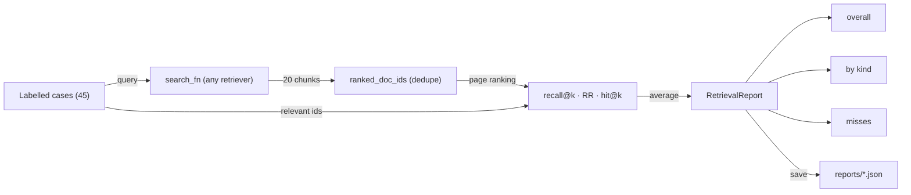
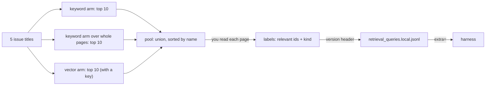
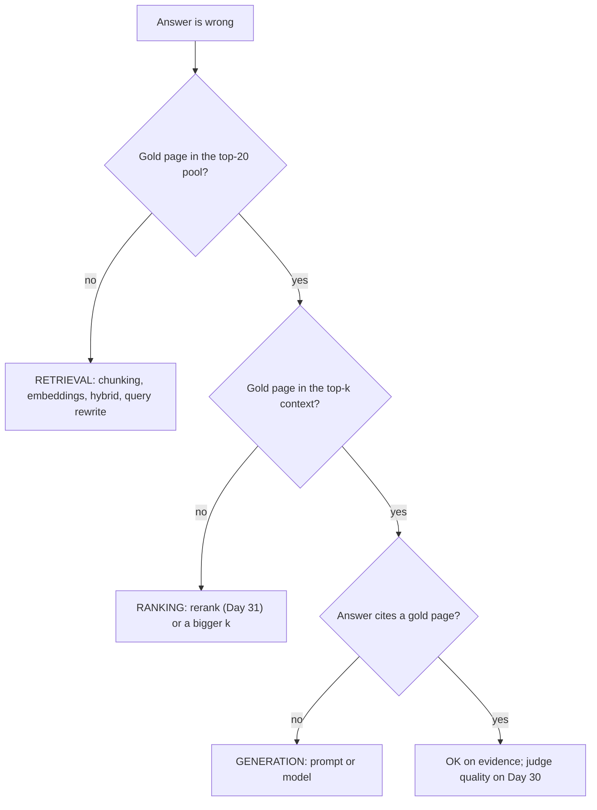

# Evaluating Retrieval: Recall@k, MRR and Failure Diagnosis

Three of Atlas's answers are wrong this morning, and the team is arguing about whether to swap the model, the prompt or the chunker. Most bad RAG answers start as retrieval failures, but you can't know which until you measure. Today you build the test suite for search, a baseline every later change must beat, and a diagnosis that tells you where each failure lives.

## At a Glance

- **Time:** ~2 h core (+ optional Go Deeper) · **Depth:** working
- **Prerequisites:** [Day 23: Embeddings & Semantic Similarity](../../Phase_3_RAG/Day_023_embeddings/embeddings.md), [Day 28: Building the RAG Pipeline](../../Phase_3_RAG/Day_028_rag_pipeline/rag_pipeline.md); primer [A12: Eval Metrics Basics](../../Appendix_Primers/A12_eval_metrics_basics.md) if precision and recall are new
- **You'll build:** `atlas/evals/retrieval.py` (`recall_at_k`, `reciprocal_rank`, `evaluate_retrieval`, `RetrievalReport`), a versioned local query file, `reports/retrieval_baseline.json`, and `diagnose()` for wrong answers
- **Stops at:** IR research metrics and significance testing (beyond a small-sample rule)
- **Fast path:** Already run evals at work? Read [Retrieval, Ranking or Generation?](#retrieval-ranking-or-generation) and do Exercise 3 (≈40 min)
- **Cost:** ≈ $0.02 on `gpt-6-luna` + `text-embedding-3-small` for the two scripts that call the API; every other script is offline and free (prices as of 2026-11, [verify](https://developers.openai.com/api/docs/pricing))
- **New terms:** recall@k, MRR (mean reciprocal rank), pooled labelling, baseline report, failure diagnosis

> **Coming from Software Engineering?** A labelled query set is the expected output of a unit test: for this input, these documents must come back. Recall@k is test coverage for "did we fetch it", and MRR is "how far down the page did the user have to scroll". A baseline report is a benchmark's control run: no change ships unless it beats it. Diagnosing a wrong answer as retrieval, ranking or generation is bisecting a pipeline (splitting it in half to find the stage that broke): check the output of each stage instead of guessing which one is broken.

## Whose Fault Is This Answer?

Imagine Atlas gets these three wrong: "What does ORB-1202 mean and how should I fix it?", "How do I work around the dashboard OIDC redirect loop behind a reverse proxy?" and "How often did Orbit 2.x workers send heartbeats?". One engineer wants a bigger model, one a new prompt, one smaller chunks. Each fix costs a day, and most will change nothing, because each answer broke at a different stage.

A RAG answer passes through three stages: **retrieve** a pool of chunks, **rank** them and keep the top few as context, then **generate** an answer from that context. If the right page never reached the model, no prompt can save the answer; if it reached the model and was ignored, a better retriever won't help. Measure each stage before touching any.

## A Test Suite for Search

Before you blame the writer, check whether the librarian brought the right books, and whether they were on top of the pile.

"Brought the right books" is **recall** (the share of the right items you found). "On top of the pile" is **rank**: how far down the list the first right item sits. You measure both against an answer key: for each test question, a human has written down which pages answer it. Orbit ships 40 such questions in `eval/retrieval_queries.jsonl`, the same set you used for hit@k on [Day 23](../../Phase_3_RAG/Day_023_embeddings/embeddings.md):

```text
{"id": "rq-005", "query": "max_payload_kb", "relevant_doc_ids": ["configuration-reference", "concepts-jobs", "flows-steps-and-state"], "kind": "exact_term"}
```

Each case has a `kind` (`exact_term`, `semantic` or `multi_hop`, which needs two or three pages), because retrievers fail differently on each.

## Score One Ranking by Hand

Take one query whose relevant pages are `{d1, d2}`. Your retriever returns five pages in this order:

| Position | 1 | 2 | 3 | 4 | 5 |
|---|---|---|---|---|---|
| Page | d3 | **d1** | d7 | **d2** | d9 |

- **recall@3:** the top 3 hold d1 only. 1 of 2 relevant pages found = **0.5**.
- **recall@5:** the top 5 hold d1 and d2 = **1.0**.
- **reciprocal rank:** the first relevant page sits at position 2, so 1 ÷ 2 = **0.5**.
- **hit@1:** is any relevant page at position 1? No = **0**.

Recall@5 says "perfect", hit@1 says "failed", and both are true: everything was found, but not on top.

## Name the Parts

- **recall@k:** for one query, `|relevant ∩ top k| ÷ |relevant|`. Averaged over queries, it answers "how much of the evidence makes it into the first k results?". Always say which k.
- **Reciprocal rank (RR):** 1 ÷ the position of the first relevant item (0 if none). **MRR** (mean reciprocal rank) is its average over queries. MRR = 1.0 means the first result is always right; 0.5 means it's typically second.
- **hit@k:** 1 if any relevant item is in the top k (Day 23); the most forgiving of the three.
- **Doc-level dedupe:** retrievers return *chunks*, but labels name *pages*. `ranked_doc_ids()` from [Day 25](../../Phase_3_RAG/Day_025_chunking/chunking.md) turns a chunk ranking into a page ranking where each page appears once, at its best position.
- **Baseline report:** today's numbers by query kind, with misses listed and the case set fingerprinted; later changes must beat it.



The harness takes a plain function `query -> list[Hit]`, so any retriever fits: BM25 (a keyword-ranking formula) today, pgvector, hybrid search, a reranker (a second-pass re-sorter) on [Day 31](../../Phase_3_RAG/Day_031_reranking_contextual_retrieval/reranking_contextual_retrieval.md), an agent's search tool later.

## Metrics in Twelve Lines

Today's code is a set of small modules that import each other. Save each block under the file name in its first comment (`metrics.py`, `corpus.py`, …) in one folder, and run everything from there. The metrics come first, with the worked example as executable checks:

```python
# script_id: day_029_retrieval_evaluation/metrics
# metrics.py: the three retrieval metrics plus Day 25's page dedupe. Save as metrics.py.
# Install: none (stdlib only) · Env vars: none · Services: none
from collections.abc import Iterable, Sequence


def recall_at_k(ranked: Sequence[str], relevant: set[str], k: int) -> float:
    """Share of the relevant docs that appear in the top k."""
    if not relevant:
        raise ValueError("a case needs at least one relevant doc")
    return len(set(ranked[:k]) & relevant) / len(relevant)


def reciprocal_rank(ranked: Sequence[str], relevant: set[str]) -> float:
    """1 / position of the first relevant doc; 0.0 if none was returned."""
    for position, doc_id in enumerate(ranked, start=1):
        if doc_id in relevant:
            return 1 / position
    return 0.0


def hit_at_k(ranked: Sequence[str], relevant: set[str], k: int) -> float:
    """Built on Day 23: 1.0 if any relevant doc is in the top k."""
    return float(any(doc_id in relevant for doc_id in ranked[:k]))


def ranked_doc_ids(hits: Iterable) -> list[str]:
    """Built on Day 25: chunk hits -> page ids, best first, each page once."""
    return list(dict.fromkeys(h.doc_id for h in hits))


# The worked example from the section above, as executable checks
ranked, relevant = ["d3", "d1", "d7", "d2", "d9"], {"d1", "d2"}
assert recall_at_k(ranked, relevant, 3) == 0.5
assert recall_at_k(ranked, relevant, 5) == 1.0
assert reciprocal_rank(ranked, relevant) == 0.5
assert hit_at_k(ranked, relevant, 1) == 0.0
if __name__ == "__main__":
    print("all checks passed")
```

```text
all checks passed
```

`recall_at_k` raises on an empty relevant set: a case with no labels is a broken test, not a failing retriever. `reciprocal_rank` scans the whole list, so pass the full pool, not only the top k.

## The Corpus Under Test

So the lesson runs without an API key or a database, `corpus.py` carries compact copies of earlier days: Orbit's 45 pages split at `## ` headings (Day 25), a stdlib BM25 keyword index (the classic keyword-ranking formula from [Day 27](../../Phase_3_RAG/Day_027_hybrid_search/hybrid_search.md)), and Day 23's case loader. Have your Day 26–27 `Index`? Pass its `search` instead.

```python
# script_id: day_029_retrieval_evaluation/corpus
# corpus.py: compact copies of Days 23-27 so today's lesson runs offline. Save as corpus.py.
# Install: none (stdlib only) · Env: ORBIT_DATA (optional) · Services: none
import json
import math
import os
import re
from collections import Counter
from dataclasses import dataclass
from pathlib import Path

DATA_DIR = Path(os.environ.get("ORBIT_DATA", "datasets/orbit"))
TOKEN_RE = re.compile(r"[a-z0-9_]+(?:[-.][a-z0-9_]+)*")  # keeps orb-1202, max_payload_kb


@dataclass(frozen=True)
class Hit:  # built on Day 26: one search result
    chunk_id: str  # "idempotency#2" = page id + chunk position
    doc_id: str
    text: str
    score: float = 0.0


def load_chunks() -> list[Hit]:
    """Day 25's heading chunker, compact: one chunk per '## ' section of each page."""
    chunks = []
    for path in sorted((DATA_DIR / "docs").glob("*.md")):
        body = path.read_text(encoding="utf-8").split("---", 2)[-1]  # drop front matter
        for i, part in enumerate(re.split(r"\n(?=## )", body)):
            if part.strip():
                chunks.append(Hit(f"{path.stem}#{i}", path.stem, part.strip()))
    if not chunks:
        raise FileNotFoundError(f"no pages under {DATA_DIR / 'docs'}; set ORBIT_DATA")
    return chunks


def tokenize(text: str) -> list[str]:
    return TOKEN_RE.findall(text.lower())
```

```python
# script_id: day_029_retrieval_evaluation/corpus
class KeywordIndex:
    """Day 27's stdlib BM25 over chunks. Any object with .search(query, k) works today."""

    def __init__(self, chunks: list[Hit], k1: float = 1.5, b: float = 0.75):
        self.chunks, self.k1, self.b = chunks, k1, b
        self.tfs = [Counter(tokenize(c.text)) for c in chunks]
        self.lens = [sum(tf.values()) for tf in self.tfs]
        self.avg_len = sum(self.lens) / len(self.lens)
        df = Counter(term for tf in self.tfs for term in tf)
        n = len(chunks)
        self.idf = {t: math.log(1 + (n - d + 0.5) / (d + 0.5)) for t, d in df.items()}

    def search(self, query: str, k: int = 20) -> list[Hit]:
        terms, scored = set(tokenize(query)), []
        for chunk, tf, length in zip(self.chunks, self.tfs, self.lens):
            norm = self.k1 * (1 - self.b + self.b * length / self.avg_len)
            score = sum(self.idf[t] * tf[t] * (self.k1 + 1) / (tf[t] + norm)
                        for t in terms if t in tf)
            if score > 0:
                scored.append((score, chunk))
        scored.sort(key=lambda pair: -pair[0])
        return [Hit(c.chunk_id, c.doc_id, c.text, round(s, 3)) for s, c in scored[:k]]
```

The loader is strict on purpose: a label naming a missing page would silently score as a miss forever.

```python
# script_id: day_029_retrieval_evaluation/corpus
@dataclass(frozen=True)
class RetrievalCase:  # built on Day 23
    id: str
    query: str
    relevant: frozenset[str]
    kind: str  # exact_term | semantic | multi_hop


def load_retrieval_cases(split: str = "all", *, extra: Path | None = None) -> list[RetrievalCase]:
    """Load the labelled queries (+ your local file). Fails loudly on unknown doc ids."""
    files = [DATA_DIR / "eval" / "retrieval_queries.jsonl"]
    files += [extra] if extra and extra.exists() else []
    known = {p.stem for p in (DATA_DIR / "docs").glob("*.md")}
    cases = []
    for path in files:
        for line in path.read_text(encoding="utf-8").splitlines():
            row = json.loads(line) if line.strip() else {}
            if "query" not in row:
                continue  # blank line or the version header
            unknown = set(row["relevant_doc_ids"]) - known
            assert not unknown, f"{row['id']}: unknown doc ids {sorted(unknown)}"
            cases.append(RetrievalCase(row["id"], row["query"],
                                       frozenset(row["relevant_doc_ids"]), row["kind"]))
    if split == "all":
        return cases
    # Day 23's deterministic split: even-numbered ids are the frozen test set
    return [c for c in cases if (int(c.id.split("-")[-1]) % 2 == 0) == (split == "test")]


if __name__ == "__main__":
    print(len(load_chunks()), "chunks ·", len(load_retrieval_cases()), "cases")
```

```text
349 chunks · 40 cases
```

## Break It: Three Ways to Get a Wrong Number

Retrieval metrics go wrong in ways that look plausible. Here are the three most common ones, run on real Orbit data:

```python
# script_id: day_029_retrieval_evaluation/break_it
# Three ways to get a wrong retrieval number. Needs metrics.py and corpus.py beside it.
# Install: none (stdlib only) · Env: ORBIT_DATA (optional) · Services: none
import json
import statistics
import tempfile
from pathlib import Path

from corpus import KeywordIndex, load_chunks, load_retrieval_cases
from metrics import ranked_doc_ids, recall_at_k

index = KeywordIndex(load_chunks())
cases = load_retrieval_cases()

# 1. Scoring chunks instead of pages: duplicates eat the top-5 slots
case = next(c for c in cases if c.id == "rq-023")  # does --queues order matter?
hits = index.search(case.query, k=20)
chunk_docs = [h.doc_id for h in hits]  # one entry per chunk, so pages repeat
naive = sum(d in case.relevant for d in chunk_docs[:5]) / len(case.relevant)
print("top-5 chunks :", chunk_docs[:5])
print("top-5 pages  :", ranked_doc_ids(hits)[:5])
print(f"naive recall@5 {naive:.2f} · deduped recall@5 "
      f"{recall_at_k(ranked_doc_ids(hits), set(case.relevant), 5):.2f}")

# 2. A generous k makes every system look good
for k in (5, 20):
    mean = statistics.mean(
        recall_at_k(ranked_doc_ids(index.search(c.query, k=20)), set(c.relevant), k) for c in cases)
    print(f"recall@{k:<2} = {mean:.3f}")

# 3. A label that points at a page that doesn't exist (a typo or a renamed file)
bad = {"id": "local-001", "query": "x", "relevant_doc_ids": ["idempotency-keys"], "kind": "semantic"}
with tempfile.TemporaryDirectory() as tmp:
    path = Path(tmp) / "bad.jsonl"
    path.write_text(json.dumps(bad) + "\n", encoding="utf-8")
    try:
        load_retrieval_cases(extra=path)
    except AssertionError as err:
        print("AssertionError:", err)
```

```text
top-5 chunks : ['concepts-queues-priorities', 'contributing', 'concepts-queues-priorities', 'concepts-workers', 'concepts-queues-priorities']
top-5 pages  : ['concepts-queues-priorities', 'contributing', 'concepts-workers', 'concepts-jobs', 'scaling-workers']
naive recall@5 3.00 · deduped recall@5 1.00
recall@5  = 0.821
recall@20 = 0.917
AssertionError: local-001: unknown doc ids ['idempotency-keys']
```

1. **Chunk-level counting.** Three chunks of `concepts-queues-priorities` sit in the top 5, so counting chunk matches gives an impossible recall of 3.00. Subtler versions let one page crowd others out of the "top 5". Dedupe to pages first, always.
2. **A generous k.** The same retriever scores 0.82 at k = 5 and 0.92 at k = 20. Your prompt holds about 6 chunks, so recall@20 describes evidence the model never sees. Report the k that matches your context size.
3. **A broken label.** A typo or renamed page id would count as a permanent miss; the loader stops you.

## Growing the Labelled Set

Forty queries is a start, not a test suite. Every case makes the baseline harder to fool, and issue titles are a free source of real questions.

The trap is *how* you find the relevant pages. Label only from your current retriever's top 10 and the labels quietly favour it: a better retriever that surfaces a page yours missed gets marked wrong. **Pooled labelling** (collecting candidates from several systems before labelling) fixes this: take the top 10 from each arm, merge them, hide which arm found what, and judge every page in the pool. It's how large search benchmarks build their answer keys.



Offline, the two arms are BM25 over chunks and BM25 over whole pages: different enough to disagree. With `OPENAI_API_KEY` set, the script also pools from the vector arm you'll build in the next section, which is the arm that matters most because it finds pages with no shared words.

```python
# script_id: day_029_retrieval_evaluation/labelling
# Pool candidates from several retrievers, label them, write a versioned local case file.
# Install: none (stdlib only) · Env: ORBIT_DATA; OPENAI_API_KEY adds the vector arm · Services: none
import json
import os
from datetime import date

from corpus import DATA_DIR, Hit, KeywordIndex, load_chunks
from harness import LOCAL_CASES
from metrics import ranked_doc_ids

chunks = load_chunks()
pages: dict[str, str] = {}
for c in chunks:  # a second, different system: BM25 over whole pages
    pages[c.doc_id] = pages.get(c.doc_id, "") + "\n" + c.text
ARMS = {"keyword_chunks": KeywordIndex(chunks).search,
        "keyword_pages": KeywordIndex([Hit(d, d, t) for d, t in pages.items()]).search}
if os.environ.get("OPENAI_API_KEY"):  # the arm that matters most; needs vector_arm.py
    from vector_arm import VectorIndex
    ARMS["vector"] = VectorIndex(chunks).search

lines = (DATA_DIR / "issues" / "issues.jsonl").read_text(encoding="utf-8").splitlines()
issues = {row["id"]: row for row in map(json.loads, lines)}
QUERY_ISSUES = [186, 168, 174, 240, 216]  # real maintainer questions, phrased by users


def pool(query: str, depth: int = 10) -> list[str]:
    """Union of every arm's top pages, sorted by name so you can't tell who found what."""
    found = {d for search in ARMS.values() for d in ranked_doc_ids(search(query, k=40))[:depth]}
    return sorted(found)


for n in QUERY_ISSUES:
    candidates = pool(issues[n]["title"])
    print(f"#{n} {issues[n]['title'][:60]!r}: {len(candidates)} to judge")
    print("   ", ", ".join(candidates))
```

```text
#186 'Postgres broker: every job waits ~5 seconds before it starts': 13 to judge
    api-reference-orbit, broker-postgres, concepts-queues-priorities, deployment-docker, leases-and-heartbeats, migrating-2-to-3, performance-tuning, results-backend, retries-and-backoff, scaling-workers, scheduling-cron, scheduling-delays, troubleshooting-broker
#168 'Does idempotency_key prevent duplicates on SQS standard queu': 13 to judge
    ...
```

Now the human part: open each candidate and decide whether it helps answer the question. For #186, `troubleshooting-broker` has a "Postgres LISTEN/NOTIFY misses events under load" section and `broker-postgres` describes the polling fallback, so both are relevant; `scheduling-delays` shares the word "seconds" and nothing else. Do a second pass the next day on the five cases. If your two passes disagree, the question is ambiguous, so rewrite it or drop it.

```python
# script_id: day_029_retrieval_evaluation/labelling
# Your judgments after reading each candidate page: (issue, kind, relevant doc ids).
LABELS = [
    (186, "semantic", ["broker-postgres", "troubleshooting-broker"]),
    (168, "multi_hop", ["broker-sqs", "idempotency", "faq"]),
    (174, "semantic", ["results-backend", "configuration-reference"]),
    (240, "exact_term", ["scheduling-cron", "error-codes"]),
    (216, "multi_hop", ["retries-and-backoff", "api-reference-job"]),
]
header = {"version": "local-v1", "labelled_on": date.today().isoformat(),
          "pooled_from": sorted(ARMS), "pool_depth": 10}
rows = [{"id": f"local-{i:03d}", "query": issues[n]["title"], "relevant_doc_ids": rel,
         "kind": kind} for i, (n, kind, rel) in enumerate(LABELS, start=1)]
for row in rows:  # a label outside the pool means the pool was too shallow, or a typo
    outside = set(row["relevant_doc_ids"]) - set(pool(row["query"]))
    assert not outside, f"{row['id']}: {outside} not in the pool"
LOCAL_CASES.parent.mkdir(parents=True, exist_ok=True)
LOCAL_CASES.write_text("\n".join(json.dumps(r) for r in [header, *rows]) + "\n", encoding="utf-8")
print(f"wrote {len(rows)} cases to {LOCAL_CASES} ({header['version']})")
```

```text
wrote 5 cases to eval/retrieval_queries.local.jsonl (local-v1)
```

The first line of the file is a version header (`local-v1`, the date, which arms were pooled). The loader skips it, but anyone reading a report can tell which label set produced it. These five cases stay small on purpose: [Day 43](../../Phase_5_Evaluation_and_Observability/Day_043_eval_datasets/eval_datasets.md) grows the full dataset with synthetic and production cases.

## The Harness and a Baseline

Three small pieces: a report type, the loop, and save/compare helpers. The report fingerprints the case set so nobody compares a 40-case run with a 45-case run by accident:

```python
# script_id: day_029_retrieval_evaluation/harness
# harness.py: atlas/evals/retrieval.py for today. Needs metrics.py and corpus.py beside it.
# Install: none (stdlib only) · Env: ORBIT_DATA (optional) · Services: none
import hashlib
import json
import statistics
from collections.abc import Callable, Sequence
from dataclasses import asdict, dataclass
from pathlib import Path

from corpus import Hit, KeywordIndex, RetrievalCase, load_chunks, load_retrieval_cases
from metrics import hit_at_k, ranked_doc_ids, recall_at_k, reciprocal_rank

LOCAL_CASES = Path("eval/retrieval_queries.local.jsonl")  # your labels live in your repo
SearchFn = Callable[[str], list[Hit]]


@dataclass
class RetrievalReport:
    k: int
    n: int
    recall: float
    mrr: float
    hit_rate: float
    by_kind: dict[str, dict[str, float]]
    misses: list[dict]
    name: str = ""
    cases_version: str = ""  # fingerprint of the case set: compare like with like


def cases_version(cases: Sequence[RetrievalCase]) -> str:
    blob = json.dumps(sorted((c.id, c.query, sorted(c.relevant)) for c in cases))
    return f"{len(cases)} cases · sha1 {hashlib.sha1(blob.encode()).hexdigest()[:8]}"
```

The loop scores every case, then averages overall and per kind. Misses keep the query, the missing pages and what came back instead, because a list of misses is what you'll actually read when deciding what to fix:

```python
# script_id: day_029_retrieval_evaluation/harness
def _summary(rows: list[dict]) -> dict[str, float]:
    return {"n": len(rows),
            "recall": round(statistics.mean(r["recall"] for r in rows), 3),
            "mrr": round(statistics.mean(r["rr"] for r in rows), 3),
            "hit_rate": round(statistics.mean(r["hit"] for r in rows), 3)}


def evaluate_retrieval(search_fn: SearchFn, cases: Sequence[RetrievalCase], *,
                       k: int = 5, name: str = "") -> RetrievalReport:
    """Run every case through any search function and score the page ranking."""
    rows = []
    for case in cases:
        ranked = ranked_doc_ids(search_fn(case.query))  # MRR looks at the whole list
        relevant = set(case.relevant)
        rows.append({"id": case.id, "kind": case.kind, "query": case.query,
                     "recall": recall_at_k(ranked, relevant, k),
                     "rr": reciprocal_rank(ranked, relevant),
                     "hit": hit_at_k(ranked, relevant, k),
                     "missing": sorted(relevant - set(ranked[:k])), "got": ranked[:k]})
    overall = _summary(rows)
    by_kind = {kind: _summary([r for r in rows if r["kind"] == kind])
               for kind in sorted({r["kind"] for r in rows})}
    misses = [{key: r[key] for key in ("id", "kind", "query", "missing", "got")}
              for r in rows if r["missing"]]
    return RetrievalReport(k, len(rows), overall["recall"], overall["mrr"], overall["hit_rate"],
                           by_kind, misses, name, cases_version(cases))
```

```python
# script_id: day_029_retrieval_evaluation/harness
def save_report(report: RetrievalReport, path: Path) -> None:
    path.parent.mkdir(parents=True, exist_ok=True)
    path.write_text(json.dumps(asdict(report), indent=2), encoding="utf-8")


def compare_reports(*named: tuple[str, RetrievalReport]) -> str:
    """A Markdown table: one row per system, recall@k per query kind."""
    kinds = sorted({kind for _, r in named for kind in r.by_kind})
    k = named[0][1].k
    lines = [f"| system | n | recall@{k} | MRR | hit@{k} | " + " | ".join(kinds) + " |",
             "|---" * (5 + len(kinds)) + "|"]
    for label, r in named:
        per_kind = " | ".join(f"{r.by_kind[x]['recall']:.2f}" if x in r.by_kind else "-"
                              for x in kinds)
        lines.append(f"| {label} | {r.n} | {r.recall:.2f} | {r.mrr:.2f} | "
                     f"{r.hit_rate:.2f} | {per_kind} |")
    return "\n".join(lines)


if __name__ == "__main__":
    cases = load_retrieval_cases(extra=LOCAL_CASES)
    index = KeywordIndex(load_chunks())
    report = evaluate_retrieval(lambda q: index.search(q, k=20), cases, k=5, name="keyword")
    print(report.cases_version)
    print(compare_reports(("keyword (BM25)", report)))
    for miss in report.misses[:4]:
        print(f"MISS {miss['id']} [{miss['kind']}] {miss['query'][:45]!r} missing={miss['missing']}")
    save_report(report, Path("reports/retrieval_keyword.json"))
```

```text
45 cases · sha1 c8f50baf
| system | n | recall@5 | MRR | hit@5 | exact_term | multi_hop | semantic |
|---|---|---|---|---|---|---|---|
| keyword (BM25) | 45 | 0.81 | 0.82 | 0.98 | 0.78 | 0.79 | 0.85 |
MISS rq-001 [exact_term] 'ORB-1101' missing=['error-codes', 'troubleshooting-duplicates']
MISS rq-005 [exact_term] 'max_payload_kb' missing=['flows-steps-and-state']
MISS rq-006 [exact_term] 'ORB-1503 FlowStateCorrupt' missing=['flows-error-handling', 'flows-steps-and-state']
MISS rq-008 [exact_term] 'orbit migrate-config orbit.ini' missing=['migrating-2-to-3']
```

(Your numbers will differ with other labels or chunker.) Read the misses before the averages. Keyword search misses `error-codes` on a query that is literally an error code. Why? `ORB-1101` appears in 27 chunks across 21 pages, so every one of them gets about the same term score, and BM25's length normalisation hands the win to short chunks that mention the code in passing. The page that *defines* it lands at position 11. That's a ranking problem you'd attack with chunk headers ([Day 25](../../Phase_3_RAG/Day_025_chunking/chunking.md)) or a reranker (Day 31), and four lines of misses showed it.

### Vector and hybrid arms (needs a key)

Atlas's real retriever is hybrid: vectors plus keywords fused with RRF (reciprocal rank fusion, summing `1 / (60 + rank)` across lists; [Day 27](../../Phase_3_RAG/Day_027_hybrid_search/hybrid_search.md)). This script embeds the chunks once (cached, ≈ $0.001), runs all three arms through the *same* harness, and saves the hybrid report as `reports/retrieval_baseline.json` for Day 31.

```python
# script_id: day_029_retrieval_evaluation/vector_arm
# vector_arm.py: Day 23's embeddings + Day 27's RRF, so you can compare all three arms.
# Install: uv add "openai>=3.46,<4" numpy · Env: OPENAI_API_KEY, ORBIT_DATA · Services: none
import hashlib
import json
import os
from pathlib import Path

import numpy as np
from openai import OpenAI

from corpus import Hit, KeywordIndex, load_chunks, load_retrieval_cases
from harness import LOCAL_CASES, compare_reports, evaluate_retrieval, save_report

EMBED_MODEL = os.environ.get("ATLAS_EMBED_MODEL", "text-embedding-3-small")
CACHE = Path(".cache/embeddings.json")  # re-runs cost $0
client = OpenAI()  # reads OPENAI_API_KEY
_cache: dict[str, list[float]] = json.loads(CACHE.read_text()) if CACHE.exists() else {}


def embed(texts: list[str]) -> np.ndarray:
    """Embed with a content-hash cache; only unseen texts go to the API, 100 per call."""
    keys = [hashlib.sha256(f"{EMBED_MODEL}|{t}".encode()).hexdigest() for t in texts]
    todo = list({key: t for key, t in zip(keys, texts) if key not in _cache}.items())
    for i in range(0, len(todo), 100):
        batch = todo[i:i + 100]
        resp = client.embeddings.create(model=EMBED_MODEL, input=[t for _, t in batch])
        _cache.update({key: d.embedding for (key, _), d in zip(batch, resp.data)})
    if todo:
        CACHE.parent.mkdir(parents=True, exist_ok=True)
        CACHE.write_text(json.dumps(_cache))
    return np.asarray([_cache[key] for key in keys], dtype=np.float32)
```

```python
# script_id: day_029_retrieval_evaluation/vector_arm
class VectorIndex:
    def __init__(self, chunks: list[Hit]):
        self.chunks, self.matrix = chunks, embed([c.text for c in chunks])

    def search(self, query: str, k: int = 20) -> list[Hit]:
        sims = self.matrix @ embed([query])[0]  # OpenAI vectors are unit length: dot = cosine
        top = np.argsort(-sims)[:k]
        return [Hit(self.chunks[i].chunk_id, self.chunks[i].doc_id, self.chunks[i].text,
                    round(float(sims[i]), 4)) for i in top]


class HybridIndex:
    """Day 27: fuse both rankings with reciprocal rank fusion (k = 60)."""

    def __init__(self, chunks: list[Hit]):
        self.vector, self.keyword = VectorIndex(chunks), KeywordIndex(chunks)

    def search(self, query: str, k: int = 20) -> list[Hit]:
        scores: dict[str, float] = {}
        best: dict[str, Hit] = {}
        for ranking in (self.vector.search(query, 20), self.keyword.search(query, 20)):
            for rank, hit in enumerate(ranking, start=1):
                scores[hit.chunk_id] = scores.get(hit.chunk_id, 0.0) + 1 / (60 + rank)
                best.setdefault(hit.chunk_id, hit)
        order = sorted(scores, key=scores.get, reverse=True)[:k]
        return [Hit(c, best[c].doc_id, best[c].text, round(scores[c], 4)) for c in order]
```

```python
# script_id: day_029_retrieval_evaluation/vector_arm
if __name__ == "__main__":
    chunks, cases = load_chunks(), load_retrieval_cases(extra=LOCAL_CASES)
    embed([c.query for c in cases])  # warm the cache in a few batched calls
    hybrid = HybridIndex(chunks)
    arms = {"keyword": hybrid.keyword, "vector": hybrid.vector, "hybrid": hybrid}
    reports = {name: evaluate_retrieval(lambda q, ix=ix: ix.search(q, k=20), cases, k=5, name=name)
               for name, ix in arms.items()}
    print(reports["hybrid"].cases_version)
    print(compare_reports(*reports.items()))
    save_report(reports["hybrid"], Path("reports/retrieval_baseline.json"))  # Day 31 starts here
```

```text
45 cases · sha1 c8f50baf
| system | n | recall@5 | MRR | hit@5 | exact_term | multi_hop | semantic |
|---|---|---|---|---|---|---|---|
| keyword | 45 | 0.81 | 0.82 | 0.98 | 0.78 | 0.79 | 0.85 |
| vector | 45 | … | … | … | … | … | … |
| hybrid | 45 | … | … | … | … | … | … |
```

Fill in the last two rows from your own run. What to look for: vectors usually win `semantic`, keywords win `exact_term`, and hybrid should match the better arm on each kind; if it loses one, read its misses before tuning. `multi_hop` is usually the weakest row, because one query must pull in two or three pages.

## Retrieval, Ranking or Generation?

The harness measures search on its own; the diagnosis tells you which stage broke for one wrong *answer*. You use the 30 questions in `eval/qa_gold.jsonl`; each has gold `citations`, the pages a correct answer must draw on. Every one of the 30 has at least one citation, but [Day 30](../../Phase_3_RAG/Day_030_answer_evaluation/answer_evaluation.md) adds unanswerable questions with none, so `diagnose()` refuses them instead of mislabelling an abstention.



Two of the three checks need no model at all, only the retriever's output, which is why they cost $0. The record of one run, `RagRun`, keeps every stage's output so the checks can look at each.

```python
# script_id: day_029_retrieval_evaluation/diagnose
# diagnose.py: retrieval, ranking or generation? Needs corpus.py and metrics.py beside it.
# Install: uv add pydantic · Env: ORBIT_DATA (optional) · Services: none (the demo is offline)
import json
from collections import Counter
from dataclasses import dataclass
from typing import Literal

from pydantic import BaseModel

from corpus import DATA_DIR, Hit, KeywordIndex, load_chunks
from metrics import ranked_doc_ids

Bucket = Literal["retrieval", "ranking", "generation", "ok"]


class Citation(BaseModel):  # built on Day 15
    doc_id: str
    quote: str


class Answer(BaseModel):
    answer: str
    citations: list[Citation]


@dataclass(frozen=True)
class QACase:
    id: str
    question: str
    answer: str
    citations: list[str]  # gold doc ids a correct answer must draw on
    applies_to: str


def load_qa_cases() -> list[QACase]:
    lines = (DATA_DIR / "eval" / "qa_gold.jsonl").read_text(encoding="utf-8").splitlines()
    return [QACase(**json.loads(line)) for line in lines if line.strip()]
```

```python
# script_id: day_029_retrieval_evaluation/diagnose
@dataclass
class RagRun:
    question: str
    answer: Answer | None  # None until the generation step runs
    hits: list[Hit]  # the whole retrieved pool (20)
    context_ids: list[str]  # chunk ids that went into the prompt
    latency_s: float = 0.0
    cost_usd: float = 0.0


def locate(case: QACase, run: RagRun) -> Bucket | None:
    """The two checks that need no model: did a gold page reach the pool, then the prompt?"""
    gold = set(case.citations)
    if not gold:
        raise ValueError(f"{case.id}: no gold citations; skip unanswerable cases")
    if not gold & set(ranked_doc_ids(run.hits)):
        return "retrieval"
    context = set(run.context_ids)
    if not gold & {h.doc_id for h in run.hits if h.chunk_id in context}:
        return "ranking"
    return None  # the evidence reached the model


def diagnose(case: QACase, run: RagRun) -> Bucket:
    if (bucket := locate(case, run)) is not None:
        return bucket
    cited = {c.doc_id for c in run.answer.citations} if run.answer else set()
    return "ok" if set(case.citations) & cited else "generation"
```

The offline demo runs only the free checks, with BM25 retrieval and a 6-chunk context:

```python
# script_id: day_029_retrieval_evaluation/diagnose
if __name__ == "__main__":
    index, counts, examples = KeywordIndex(load_chunks()), Counter(), {}
    for case in load_qa_cases():
        hits = index.search(case.question, k=20)
        run = RagRun(case.question, None, hits, [h.chunk_id for h in hits[:6]])
        bucket = locate(case, run) or "reached context"
        counts[bucket] += 1
        examples.setdefault(bucket, case)
    for bucket, n in counts.most_common():
        print(f"{bucket:<16} {n:>2}   e.g. {examples[bucket].id}: {examples[bucket].question[:50]}")
```

```text
reached context  28   e.g. qa-001: What are the default values of lease_seconds and h
ranking           2   e.g. qa-004: What does ORB-1202 mean and how should I fix it?
```

No question fails at retrieval: every gold page is somewhere in the top 20. Two fail at ranking, including the hook's ORB-1202 question: the evidence exists, below position 6. Swapping the model would not have fixed it, and this cost $0 to learn.

For the third bucket you need generated answers. `run_rag()` is Day 28's `ask()` split open so every stage is recorded, with structured outputs returning an `Answer` with citations ([Day 15](../../Phase_2_Building_with_LLM_APIs/Day_015_pydantic_for_llms/pydantic_for_llms.md)):

```python
# script_id: day_029_retrieval_evaluation/rag_run
# Day 28's ask() split open so every stage is recorded, then all 30 questions diagnosed.
# Install: uv add "openai>=3.46,<4" pydantic numpy · Env: OPENAI_API_KEY, ORBIT_DATA,
#   ATLAS_INDEX=hybrid (optional, uses vector_arm.py) · Services: none
import os
import time
from collections import Counter

from openai import OpenAI

from corpus import KeywordIndex, load_chunks
from diagnose import Answer, QACase, RagRun, diagnose, load_qa_cases

MODEL = os.environ.get("ATLAS_MODEL", "gpt-6-luna")
PRICE_IN, PRICE_OUT = 0.10 / 1e6, 0.50 / 1e6  # gpt-6-luna $/token, as of 2026-11, verify
IDK_TEXT = "I don't know based on the Orbit docs."
RAG_INSTRUCTIONS = (
    "Answer the maintainer's question using only the sources. Cite every source you use by "
    f"its id with a short exact quote. If the sources don't answer it, reply '{IDK_TEXT}' "
    "with no citations.")
client = OpenAI()
```

```python
# script_id: day_029_retrieval_evaluation/rag_run
def run_rag(question: str, *, index, k: int = 6, pool: int = 20) -> RagRun:
    """Retrieve a pool, keep the top k chunks as context, generate, and record everything."""
    start = time.perf_counter()
    hits = index.search(question, k=pool)
    context = hits[:k]
    sources = "\n\n".join(f'<source id="{h.doc_id}">\n{h.text}\n</source>' for h in context)
    resp = client.responses.parse(model=MODEL, instructions=RAG_INSTRUCTIONS,
                                  input=f"{sources}\n\nQuestion: {question}", text_format=Answer)
    cost = resp.usage.input_tokens * PRICE_IN + resp.usage.output_tokens * PRICE_OUT
    return RagRun(question, resp.output_parsed, hits, [h.chunk_id for h in context],
                  round(time.perf_counter() - start, 2), cost)


if __name__ == "__main__":
    if os.environ.get("ATLAS_INDEX") == "hybrid":
        from vector_arm import HybridIndex
        index = HybridIndex(load_chunks())
    else:
        index = KeywordIndex(load_chunks())
    counts: Counter[str] = Counter()
    examples: dict[str, QACase] = {}
    total = 0.0
    for case in load_qa_cases():
        run = run_rag(case.question, index=index)
        bucket = diagnose(case, run)
        counts[bucket] += 1
        examples.setdefault(bucket, case)
        total += run.cost_usd
    for bucket, n in counts.most_common():
        print(f"{bucket:<11} {n:>2}   e.g. {examples[bucket].id}: {examples[bucket].question[:50]}")
    print(f"cost ${total:.4f}")
```

```text
ok          …   e.g. qa-001: What are the default values of lease_seconds and h
ranking      2   e.g. qa-004: What does ORB-1202 mean and how should I fix it?
generation  …   e.g. …
cost $0.0…
```

Your run splits the 28 "reached context" questions into `ok` and `generation`; with the same index, the other counts match the offline demo. A `generation` case means the model had the evidence and didn't use it: read prompt and answer side by side. "ok" means *cited the right page*, not *said the right thing*; that's Day 30's job.

| Bucket | What it means | First knob to turn |
|---|---|---|
| retrieval | gold page not in the pool | chunking, embeddings, hybrid weights, query rewriting |
| ranking | in the pool, not in the context | rerank (Day 31), larger `k` (costs tokens) |
| generation | in the context, not cited | prompt, citation rules, a stronger model |
| ok | cited a gold page | move on to answer-quality judges (Day 30) |

## Trade-offs: What Each Number Can't See

| Metric | Catches | Misses | Use it for |
|---|---|---|---|
| recall@k | evidence that never reaches the top k | order inside the top k | "is the context complete?" (multi-hop) |
| MRR | how far down the first right page sits | every relevant page after the first | "is the best page on top?" (single-answer) |
| hit@k | total failures | partial coverage | a quick smoke test |
| all three | retrieval quality | whether the *answer* is right | pair with [Day 30](../../Phase_3_RAG/Day_030_answer_evaluation/answer_evaluation.md) |

- **Small samples move in big steps.** At n = 45, one query is worth about 2 points of hit rate. A "2-point improvement" can be one query flipping. Report counts next to percentages ("41/45 → 42/45"), and read the [A12 primer](../../Appendix_Primers/A12_eval_metrics_basics.md) on sampling noise before you celebrate.
- **Know which k a fix can move.** A reranker reorders its pool: recall@20 can't change (same 20 chunks), but recall@5 and MRR *can* rise as relevant pages move up. Write-ups claiming "reranking doesn't change recall@5" confuse the two; Day 31 shows recall@pool flat while recall@5 climbs.

When *not* to bother: a corpus small enough to fit in the prompt has no retrieval step to measure ([Day 32](../../Phase_3_RAG/Day_032_long_context_vs_rag/long_context_vs_rag.md)). And retrieval metrics can't pick a prompt; they never see it.

### In production

- Re-run the harness on every chunker, embedding or index change, and on new document batches.
- Slice by query kind (and by version, see Exercise 2); an overall average hides the slice that regressed.
- Keep a frozen test split (`load_retrieval_cases("test")`) that nobody tunes against; [Day 47](../../Phase_5_Evaluation_and_Observability/Day_047_evals_in_ci/evals_in_ci.md) turns it into a CI gate.
- Store `cases_version` with every report and refuse to compare reports whose fingerprints differ.
- Turn production retrieval failures into labelled cases; [Day 44](../../Phase_5_Evaluation_and_Observability/Day_044_error_analysis/error_analysis.md) builds that loop.

## Go Deeper (optional)

<details><summary>Go deeper: precision@k and NDCG@k</summary>

**Precision@k** asks the opposite question to recall: of the k results you showed, what share were relevant? In the worked example, the top 3 hold one relevant page out of three shown, so precision@3 = 0.33. It matters when context is expensive or noisy: five irrelevant chunks next to one good one can distract the model.

**NDCG@k** (normalised discounted cumulative gain) rewards putting relevant items *high*. Think of a teacher grading a results page: each relevant item earns points, and the points shrink the lower it sits, by `1 / log2(position + 1)`. Position 1 earns 1.0, position 2 earns 0.63, position 4 earns 0.43. Then divide by the score of the perfect ordering, so 1.0 means "already ideal". In the worked example: earned = 0.63 (d1 at 2) + 0.43 (d2 at 4) = 1.06; ideal = 1.0 + 0.63 = 1.63; NDCG@5 = 0.65.

```python
# script_id: day_029_retrieval_evaluation/precision_ndcg
# Install: none (stdlib only) · Env vars: none · Services: none
import math

ranked, relevant = ["d3", "d1", "d7", "d2", "d9"], {"d1", "d2"}


def precision_at_k(ranked: list[str], relevant: set[str], k: int) -> float:
    return len(set(ranked[:k]) & relevant) / k  # divide by what you showed, not what exists


def ndcg_at_k(ranked: list[str], relevant: set[str], k: int) -> float:
    dcg = sum(1 / math.log2(pos + 1) for pos, d in enumerate(ranked[:k], start=1) if d in relevant)
    ideal = sum(1 / math.log2(pos + 1) for pos in range(1, min(len(relevant), k) + 1))
    return dcg / ideal


print(f"precision@3 {precision_at_k(ranked, relevant, 3):.3f}")  # 1 of 3 shown is relevant
print(f"precision@5 {precision_at_k(ranked, relevant, 5):.3f}")
print(f"NDCG@5      {ndcg_at_k(ranked, relevant, 5):.3f}")
print(f"NDCG@5 if d1, d2 were on top: {ndcg_at_k(['d1', 'd2', 'd3', 'd7', 'd9'], relevant, 5):.3f}")
```

```text
precision@3 0.333
precision@5 0.400
NDCG@5      0.651
NDCG@5 if d1, d2 were on top: 1.000
```

NDCG really pays off with **graded** labels (2 = answers it, 1 = related), which is the Stretch exercise. The cost is labelling effort: graded judgments take longer and two people disagree more often.

</details>

<details><summary>Go deeper: pooling bias and how big benchmarks label</summary>

Large search benchmarks (the TREC evaluations run by NIST are the classic example) can't judge every document for every query, so they pool: each participating system submits its top results, the union is judged by assessors, and anything outside the pool is assumed irrelevant. Two consequences carry over to your 45 cases:

- **Unjudged is not irrelevant.** A new retriever that finds a good page nobody pooled gets *penalised* for it. When a new arm's misses list contains pages you've never judged, judge them and add them to the labels before trusting the comparison.
- **Pool depth bounds what you can claim.** If you pooled the top 10, your recall@20 numbers lean on pages nobody looked at below position 10.

The textbook treatment is the evaluation chapter of Manning, Raghavan and Schütze, *Introduction to Information Retrieval* (Cambridge University Press, 2008), free online from Stanford.

</details>

<details><summary>Go deeper: is the difference real? Count wins and losses</summary>

Two systems score 0.81 and 0.84 recall@5 on the same 45 cases. Before reading anything into it, line them up query by query: how many cases improved, how many got worse, how many tied? If one system is better on 6 cases and worse on 1, that's a pattern. If it's better on 4 and worse on 3, that's noise with a nice average. This is a paired comparison: both systems saw the *same* queries, so you compare per query instead of comparing two averages. It's a two-line change to `evaluate_retrieval` (keep the per-case rows) and it catches most false wins. Formal significance tests are out of scope here; Day 47 comes back to this when it sets CI gates.

</details>

## Common Pitfalls

- **Labels that favour one system.** Symptom: new retrievers "lose" on cases where their results look fine. Cause: labels came from one arm. Fix: pool from every arm, judge blind.
- **"Recall" with no k.** Symptom: the dashboard says 0.92 while users complain. Cause: it's recall@20 and the prompt holds 6 chunks. Fix: report the k matching your context, in every header.
- **Comparing different case sets.** Symptom: a "regression" appears the day someone adds `retrieval_queries.local.jsonl`. Cause: 40 cases vs 45. Fix: compare only reports with the same `cases_version`.
- **Calling one query an improvement.** Symptom: 0.80 → 0.82 announced as a win. Cause: at n = 45 that's one query. Fix: report counts and per-query wins/losses.
- **Diagnosing unanswerable questions.** Symptom: abstentions show up as `generation` failures. Cause: no gold page exists. Fix: `diagnose()` raises `ValueError: …: no gold citations; skip unanswerable cases`; filter those cases first and score them on Day 30.
- **Wrong data path.** `FileNotFoundError: no pages under datasets/orbit/docs; set ORBIT_DATA`. Fix: run from the project root or export `ORBIT_DATA`.

> **Where we stop:** no research-grade IR metrics (MAP, mean average precision; graded relevance at scale) or significance testing beyond the small-sample rule; the curious can read the evaluation chapter of *Introduction to Information Retrieval*, and Day 31 uses today's harness to fix what it found.

## Key Takeaways

- Most wrong RAG answers break at retrieval or ranking, and you find out which by checking each stage's output, not by swapping the model.
- recall@k measures how much of the evidence reaches the top k; MRR measures how high the first right page sits; state k every time and dedupe chunks to pages first.
- Grow the labelled set by pooling candidates from several retrievers and judging them blind, and version the file so reports are comparable.
- `evaluate_retrieval()` takes any `query -> hits` function and returns a report by kind with misses; the misses list is where fixes come from.
- Retrieval metrics can't see answer quality, and at n = 45 one query is about 2 points, so report counts and pair today's numbers with Day 30's answer checks.

## Quick Reference

| API / pattern | When to use | Gotcha |
|---|---|---|
| `recall_at_k(ranked, relevant, k)` | is the evidence complete in the top k? | page ids, not chunk ids; empty `relevant` raises |
| `reciprocal_rank(ranked, relevant)` | is the best page on top? | pass the whole pool, not only the top k |
| `ranked_doc_ids(hits)` | chunk ranking → page ranking | skip it and recall can exceed 1.0 |
| `evaluate_retrieval(search_fn, cases, k=5)` | baseline or A/B of any retriever | search_fn should return the full pool (20) |
| `compare_reports(("a", r1), ("b", r2))` | one Markdown table for a PR | only compare equal `cases_version` |
| `load_retrieval_cases(split, extra=path)` | add your local labels | unknown doc ids fail at load time |
| `locate()` / `diagnose(case, run)` | why is *this* answer wrong? | "ok" means cited gold, not correct |
| pooled labelling | adding cases | judge every pooled page, blind to the arm |

## Exercises

1. **Warm-up.** Print recall@1, @3, @5 and @10 for one retriever as a single row. Which k would you report for a 6-chunk prompt, and why does the story change so much between @1 and @10?

<details>
<summary>Solution</summary>

```python
# script_id: day_029_retrieval_evaluation/solution_ex1
# Install: none · Env: ORBIT_DATA · Needs corpus.py, metrics.py, harness.py beside it
from corpus import KeywordIndex, load_chunks, load_retrieval_cases
from harness import LOCAL_CASES, evaluate_retrieval

index = KeywordIndex(load_chunks())  # with a key: from vector_arm import HybridIndex
cases = load_retrieval_cases(extra=LOCAL_CASES)
search = lambda q: index.search(q, k=20)  # noqa: E731  one pool, cut at different k
row = {k: evaluate_retrieval(search, cases, k=k).recall for k in (1, 3, 5, 10)}
print("keyword  " + " · ".join(f"recall@{k} {v:.2f}" for k, v in row.items()))
```

```text
keyword  recall@1 0.39 · recall@3 0.71 · recall@5 0.81 · recall@10 0.91
```

Report @5 or @6 (the context size). Recall@1 is low partly by definition: a multi-hop case with three relevant pages can score at most 0.33 at k = 1.

</details>

2. **Core.** Add a breakdown by Orbit version (`applies_to`: `2.x`, `3.x`, `all`). Retrieval cases don't carry the field, so derive it from the front matter of each case's relevant pages, and write a reusable `by_slice()` that works for any grouping.

<details>
<summary>Solution</summary>

```python
# script_id: day_029_retrieval_evaluation/solution_ex2
# Install: none · Env: ORBIT_DATA · Needs corpus.py, metrics.py, harness.py beside it
import re
from collections import defaultdict
from collections.abc import Callable

from corpus import DATA_DIR, KeywordIndex, RetrievalCase, load_chunks, load_retrieval_cases
from harness import LOCAL_CASES, RetrievalReport, SearchFn, evaluate_retrieval


def page_version(doc_id: str) -> str:
    text = (DATA_DIR / "docs" / f"{doc_id}.md").read_text(encoding="utf-8")
    match = re.search(r'^applies_to:\s*"?([^"\s#]+)', text, re.M)  # quoted or not, # comments
    return match.group(1) if match else "all"


def case_version(case: RetrievalCase) -> str:
    versions = {page_version(d) for d in case.relevant}
    return "2.x" if "2.x" in versions else "3.x" if "3.x" in versions else "all"


def by_slice(search_fn: SearchFn, cases: list[RetrievalCase],
             slice_fn: Callable[[RetrievalCase], str], k: int = 5) -> dict[str, RetrievalReport]:
    groups: dict[str, list[RetrievalCase]] = defaultdict(list)
    for case in cases:
        groups[slice_fn(case)].append(case)
    return {name: evaluate_retrieval(search_fn, group, k=k) for name, group in sorted(groups.items())}


index = KeywordIndex(load_chunks())
slices = by_slice(lambda q: index.search(q, k=20), load_retrieval_cases(extra=LOCAL_CASES),
                  case_version)
for name, r in slices.items():
    print(f"applies_to={name:<4} n={r.n:<3} recall@5 {r.recall:.2f} · MRR {r.mrr:.2f}")
```

```text
applies_to=2.x  n=2   recall@5 1.00 · MRR 1.00
applies_to=3.x  n=30  recall@5 0.81 · MRR 0.78
applies_to=all  n=13  recall@5 0.80 · MRR 0.87
```

The `2.x` slice is n = 2: a perfect score that means almost nothing. A slice with fewer than ~10 cases is a reason to label more, not a result.

</details>

3. **Core.** Re-run the diagnosis with a 3-chunk context instead of 6. How many questions that reached the model at k = 6 become `ranking` failures at k = 3? (Offline, use `locate()`; with a key, confirm with `run_rag(..., k=3)` and `diagnose()`.)

<details>
<summary>Solution</summary>

```python
# script_id: day_029_retrieval_evaluation/solution_ex3
# Install: uv add pydantic · Env: ORBIT_DATA · Needs corpus.py, metrics.py, diagnose.py
from corpus import KeywordIndex, load_chunks
from diagnose import RagRun, load_qa_cases, locate

index = KeywordIndex(load_chunks())
moved = []
for case in load_qa_cases():
    hits = index.search(case.question, k=20)  # same pool; only the context cut changes
    at6 = locate(case, RagRun(case.question, None, hits, [h.chunk_id for h in hits[:6]]))
    at3 = locate(case, RagRun(case.question, None, hits, [h.chunk_id for h in hits[:3]]))
    if at6 is None and at3 == "ranking":
        moved.append(case.id)
print(f"{len(moved)} questions lose their evidence at k=3: {moved}")
# With a key, confirm end to end: run_rag(q, index=index, k=3) + diagnose(), then compare
# how many "ok" turned into "ranking" against the k=6 run.
```

```text
4 questions lose their evidence at k=3: ['qa-007', 'qa-019', 'qa-024', 'qa-029']
```

Two of the hook's three questions (OIDC redirect loop, 2.x heartbeats) are in the list. Shrinking context saves tokens but turns answers into ranking failures, which is exactly the trade a reranker on Day 31 lets you escape.

</details>

4. **Stretch (optional, uses Go Deeper).** Implement NDCG@5 with graded labels (2 = answers it, 1 = related) and score three Orbit queries.

<details>
<summary>Solution</summary>

```python
# script_id: day_029_retrieval_evaluation/solution_ex4
# Install: none · Env: ORBIT_DATA · Needs corpus.py, metrics.py beside it
import math

from corpus import KeywordIndex, load_chunks
from metrics import ranked_doc_ids


def dcg(gains: list[int]) -> float:
    return sum(g / math.log2(position + 1) for position, g in enumerate(gains, start=1))


def ndcg_at_k(ranked: list[str], grades: dict[str, int], k: int = 5) -> float:
    ideal = dcg(sorted(grades.values(), reverse=True)[:k])
    return dcg([grades.get(d, 0) for d in ranked[:k]]) / ideal if ideal else 0.0


# 2 = this page answers it, 1 = related and useful, missing = 0
GRADED = {
    "why did my job run twice": {"troubleshooting-duplicates": 2, "idempotency": 1,
                                 "leases-and-heartbeats": 1},
    "max_payload_kb": {"configuration-reference": 2, "concepts-jobs": 1,
                       "flows-steps-and-state": 1},
    "how long does Orbit keep a job's return value": {"results-backend": 2},
}
assert ndcg_at_k(["a", "b"], {"a": 2, "b": 1}) == 1.0  # the ideal order scores 1
index = KeywordIndex(load_chunks())
for query, grades in GRADED.items():
    ranked = ranked_doc_ids(index.search(query, k=20))
    print(f"NDCG@5 {ndcg_at_k(ranked, grades):.3f}  {query!r}  top={ranked[:3]}")
```

```text
NDCG@5 0.776  'why did my job run twice'  top=['troubleshooting-duplicates', 'faq', 'flows-steps-and-state']
NDCG@5 0.521  'max_payload_kb'  top=['results-backend', 'concepts-jobs', 'configuration-reference']
NDCG@5 0.631  "how long does Orbit keep a job's return value"  top=['index', 'results-backend', 'deployment-docker']
```

`max_payload_kb` scores lowest: the page that defines the key (grade 2) sits at position 3 behind two pages that mention it. Recall@5 can't see that; NDCG can.

</details>

## References & Further Reading

- [OpenAI embeddings guide](https://developers.openai.com/api/docs/guides/embeddings): the embedding call and vector properties behind `vector_arm.py` (unit length, `dimensions=`).
- [pgvector-python RRF hybrid search example](https://github.com/pgvector/pgvector-python/blob/master/examples/hybrid_search/rrf.py): the official version of the fusion step in `HybridIndex`.
- [Anthropic: Contextual retrieval](https://www.anthropic.com/research/contextual-retrieval): a practitioner write-up that reports every change as a top-20 retrieval failure rate; a good model for "measure, then fix".
- [OpenAI pricing](https://developers.openai.com/api/docs/pricing): check the per-token prices used in `rag_run.py` before quoting costs.
- [A12: Eval Metrics Basics](../../Appendix_Primers/A12_eval_metrics_basics.md): precision, recall and why small samples mislead, with runnable examples.
- Manning, Raghavan and Schütze, *Introduction to Information Retrieval*, chapter 8 "Evaluation in information retrieval": the standard definitions of every metric here, free on the Stanford NLP site.

## What's Next

You can now prove whether Atlas *found* the evidence; tomorrow you check whether it *used* it well. [Day 30: Evaluating RAG Answers](../../Phase_3_RAG/Day_030_answer_evaluation/answer_evaluation.md) adds binary LLM judges and code checks for faithfulness and correctness, built on today's `QACase` and `run_rag()`.
