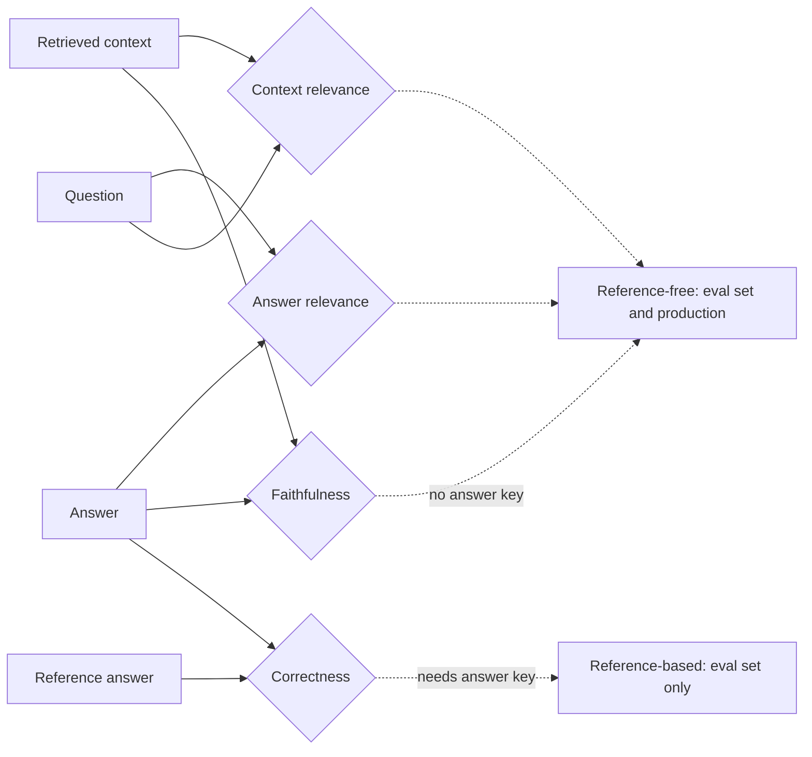
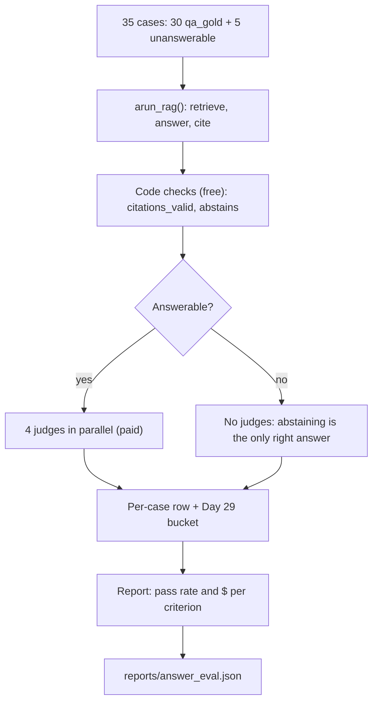
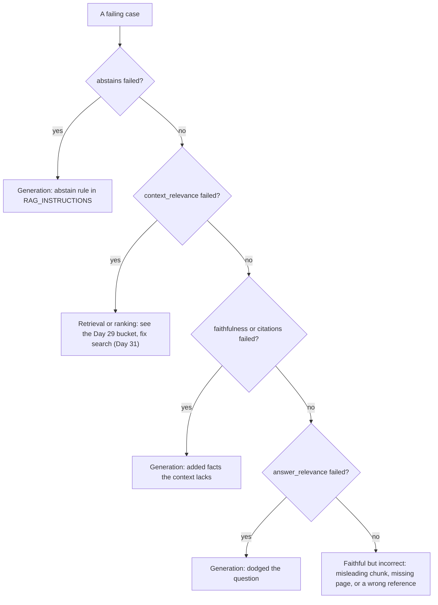

# Evaluating RAG Answers

Yesterday's retrieval numbers look healthy: recall@5 is 0.86 and, for the question "What is the default `lease_seconds`?", the right page sits in the context. Atlas still answers "600". The docs say 300; the 600 comes from a Kubernetes example that overrides the default. Retrieval metrics can't see that mistake, because it happens after retrieval. Today you build a small, hand-made judge suite that checks the answer itself and tells "made it up", "didn't answer" and "read the wrong pages" apart.

## At a Glance

- **Time:** ~2 h core (+ optional Go Deeper) · **Depth:** intro
- **Prerequisites:** [Day 16: Structured Outputs](../../Phase_2_Building_with_LLM_APIs/Day_016_structured_outputs/structured_outputs.md), [Day 20: Your First Eval Set](../../Phase_2_Building_with_LLM_APIs/Day_020_first_eval_set/first_eval_set.md), [Day 28: Building the RAG Pipeline: Grounded Answers with Citations](../../Phase_3_RAG/Day_028_rag_pipeline/rag_pipeline.md), [Day 29: Evaluating Retrieval](../../Phase_3_RAG/Day_029_retrieval_evaluation/retrieval_evaluation.md); primers [Async Python I](../../Appendix_Primers/A04a_async_python_basics.md) and [Eval metrics basics](../../Appendix_Primers/A12_eval_metrics_basics.md)
- **You'll build:** `atlas/evals/answers.py`: four binary judges plus two code checks, run over 30 `qa_gold` questions and 5 unanswerable ones, with pass rate and cost per criterion
- **Stops at:** judge validation, agreement statistics and bias tests ([Day 46](../../Phase_5_Evaluation_and_Observability/Day_046_judge_validation/judge_validation.md))
- **Fast path:** Already write evals? Read [A Faithfulness Judge in 20 Lines](#a-faithfulness-judge-in-20-lines) and [The Answer Eval Suite](#the-answer-eval-suite), then do Exercise 3 (≈40 min)
- **Cost:** ≈ $0.07–0.10 per full run on `gpt-6-luna` (35 answers + up to 4 judges each; prices as of 2026-11, [verify](https://developers.openai.com/api/docs/pricing)). `EVAL_LIMIT=10` cuts it to ≈ $0.02
- **New terms:** faithfulness, answer relevance, context relevance, LLM-as-judge (binary), reference-based vs reference-free

> **Coming from Software Engineering?** Answer judges are a linter and CI quality gate for prose. You run the cheap, deterministic checks first (does every citation point at a real retrieved quote?), and you call a model only for what code can't parse (does this sentence follow from that paragraph?). A reference-based check is a golden-file test: compare the output with a known-good answer, which only works on your eval set. A reference-free check is an invariant or property test: "every claim is backed by the context" holds for any input, so you can also run it on production traffic. The difference from a linter: the judge is itself a model, so treat its verdicts as a careful reviewer's opinion and spot-check them.

## Right Pages, Wrong Answer

Here is the case from the hook, as Day 29's tools see it. The question is `qa-001` from `eval/qa_gold.jsonl`:

```text
question   What are the default values of lease_seconds and heartbeat_seconds in orbit.toml?
reference  In the [worker] section, lease_seconds defaults to 300 and heartbeat_seconds defaults to 30. ...
context    configuration-reference ✓  leases-and-heartbeats ✓  deployment-kubernetes
answer     The default lease_seconds is 600 and heartbeat_seconds is 30 [deployment-kubernetes].
D29        recall@5 = 1.0 · bucket = ok
```

Both gold pages were retrieved and the answer even cites a real page, so every retrieval metric is green. The answer is still wrong. To catch it, you need checks that read the answer.

## Four Questions for Every Answer

Think of grading an open-book exam. For each answer you'd ask four things:

1. **Did they use the book?** Every claim should come from the pages they had open, not from memory or imagination. This is **faithfulness**: every claim in the answer is supported by the retrieved context.
2. **Did they answer what was asked?** A true, well-sourced paragraph about heartbeats doesn't answer a question about leases. This is **answer relevance**: the answer addresses the question.
3. **Did they open the right pages?** If the needed facts weren't in the book they opened, nobody could answer well. This is **context relevance**: the retrieved context contains what's needed to answer.
4. **Does it match the answer key?** This is **correctness**: the answer agrees with a known-good **reference answer** on the facts that matter.

These are independent. An answer can be faithful but irrelevant, relevant but made up, or faithful to a misleading page and still wrong.

## Grade Three Answers by Hand

Take one question and one context from the `leases-and-heartbeats` page, then three candidate answers. Grade each against the four questions yourself before reading the table.

- **Question:** "What is the default `lease_seconds`, and what happens when a lease expires?"
- **Context:** "`lease_seconds = 300 # deadline if no heartbeat arrives` … If the deadline passes without an acknowledgement, the broker … makes the job claimable again. Another worker runs it."
- **Reference:** "300 seconds; the job becomes claimable again and another worker may run it."

| Answer | Faithful | Relevant | Context relevant | Correct |
|---|---|---|---|---|
| A: "It defaults to 300 s. When it expires, the job becomes claimable again and another worker can run it." | PASS | PASS | PASS | PASS |
| B: "It defaults to 600 s. Expired jobs move to the dead-letter queue." | FAIL | PASS | PASS | FAIL |
| C: "Heartbeats renew the lease every `heartbeat_seconds`." | PASS | FAIL | PASS | FAIL |

Answer B answers the question with invented facts. Answer C is true and grounded but dodges the question. Context relevance passes for all three because they share one context. Notice that the first three columns needed no reference, while correctness did. Here is the grid as data, so you can see the failure signatures side by side:

```python
# script_id: day_030_answer_evaluation/hand_grades
# The hand-graded grid from this section, as data. No install, no API key.
CRITERIA = ("faithful", "relevant", "context", "correct")
GRADES = {
    "A (good)":      (True, True, True, True),
    "B (invented)":  (False, True, True, False),
    "C (off-topic)": (True, False, True, False),
}
MEANING = {
    "faithful": "made it up",
    "relevant": "didn't answer",
    "context": "wrong pages",
    "correct": "disagrees with the answer key",
}

print(f"{'answer':<15}" + "".join(f"{c:>10}" for c in CRITERIA))
for name, row in GRADES.items():
    print(f"{name:<15}" + "".join(f"{'PASS' if ok else 'FAIL':>10}" for ok in row))
for name, row in GRADES.items():
    fails = [MEANING[c] for c, ok in zip(CRITERIA, row) if not ok]
    print(f"{name}: {', '.join(fails) or 'nothing to fix'}")
```

```text
answer           faithful  relevant   context   correct
A (good)             PASS      PASS      PASS      PASS
B (invented)         FAIL      PASS      PASS      FAIL
C (off-topic)        PASS      FAIL      PASS      FAIL
A (good): nothing to fix
B (invented): made it up, disagrees with the answer key
C (off-topic): didn't answer, disagrees with the answer key
```

## Name the Parts

- **LLM-as-judge:** a model call that grades another model's output against one written criterion. Today's judges are **binary**: each returns pass or fail with a short reason, never a 1–5 score. A pass/fail rule forces you to define what "good" means, and you can compare a pass rate directly between runs.
- **Reference-free vs reference-based:** faithfulness, answer relevance and context relevance need only the question, the context and the answer, so they can run on any live request. Correctness needs a reference answer, so it runs only on your eval set.
- **Judge inputs:** each judge must see exactly what its question is about. A faithfulness judge that never sees the context can only guess.
- **False positive:** the judge passes a bad answer. This is the failure that hurts, because a green dashboard hides the bug.

Context relevance overlaps with Day 29's recall: recall asks "did the gold page arrive?", context relevance asks "does what arrived contain the facts?" It works without labelled pages, which is why it's useful in production.



## A Faithfulness Judge in 20 Lines

A judge is a structured-output call ([Day 16](../../Phase_2_Building_with_LLM_APIs/Day_016_structured_outputs/structured_outputs.md)) whose schema is a `Verdict`. Field order matters: structured outputs produce keys in the schema's order, so putting `reason` before `passed` makes the model write its evidence first and decide second.

```python
# script_id: day_030_answer_evaluation/faithfulness_judge
# Minimal binary faithfulness judge. Install: uv add "openai>=3.46,<4" pydantic
# Env: OPENAI_API_KEY; ATLAS_MODEL (optional). Cost: one call, well under $0.01 (as of 2026-11, verify)
import os
from openai import OpenAI
from pydantic import BaseModel

MODEL = os.environ.get("ATLAS_MODEL", "gpt-6-luna")
client = OpenAI()

class Verdict(BaseModel):
    reason: str   # first: the model writes its evidence before it decides
    passed: bool

CONTEXT = "[worker]\nlease_seconds = 300       # deadline if no heartbeat arrives\nheartbeat_seconds = 30"
ANSWER = "It defaults to 600 s. Expired jobs move to the dead-letter queue."
resp = client.responses.parse(
    model=MODEL,
    instructions="You check answers for faithfulness. PASS only if every claim in <answer> is "
                 "supported by <context>. Give a one-sentence reason, then the verdict.",
    input=f"<context>\n{CONTEXT}\n</context>\n<answer>\n{ANSWER}\n</answer>",
    text_format=Verdict,
)
print(resp.output_parsed)
```

```text
reason='The answer says the default is 600 s; the context sets lease_seconds = 300, and it never mentions the dead-letter queue.' passed=False
```

(Illustrative output; your wording will differ.) If the model refuses or runs out of tokens, `output_parsed` is `None`; the suite below handles that.

## Break It

Two changes make a judge useless while it still looks fine. The script below takes five correct statements from the leases page and, for each one, a copy with one planted false fact. It grades all ten twice: with the page as context, and without any context.

```python
# script_id: day_030_answer_evaluation/break_it
# Planted errors, judged with and without context; then the same answers on a 1-5 scale.
# Install: uv add "openai>=3.46,<4" pydantic · Env: OPENAI_API_KEY, ORBIT_DATA (optional)
# Cost: 25 short calls, ≈ $0.01 (as of 2026-11, verify)
import os
from pathlib import Path
from openai import OpenAI
from pydantic import BaseModel

MODEL = os.environ.get("ATLAS_MODEL", "gpt-6-luna")
DATA_DIR = Path(os.environ.get("ORBIT_DATA", "datasets/orbit"))
client = OpenAI()
PAGE = (DATA_DIR / "docs" / "leases-and-heartbeats.md").read_text(encoding="utf-8")

class Verdict(BaseModel):
    reason: str
    passed: bool

PAIRS = [  # (correct, same sentence with one planted error)
    ("lease_seconds defaults to 300.", "lease_seconds defaults to 600."),
    ("When a lease expires, the job becomes claimable again.", "When a lease expires, the job is deleted."),
    ("Orbit prefers running a job twice to never running it.", "Orbit 3.2 guarantees a job never runs twice."),
    ("orbit doctor warns when heartbeat_seconds exceeds a third of lease_seconds.",
     "orbit doctor refuses to start a worker when heartbeat_seconds exceeds a third of lease_seconds."),
    ("2.x workers heartbeated at one tenth of the lease.", "2.x workers heartbeated every 10 seconds."),
]
RULE = "PASS only if every claim in <answer> is supported by <context>. Reason first, then verdict."

def passes(answer: str, context: str | None) -> bool:
    ctx = f"<context>\n{context}\n</context>\n" if context else ""
    r = client.responses.parse(model=MODEL, instructions=RULE, text_format=Verdict,
                               input=f"{ctx}<answer>\n{answer}\n</answer>")
    return bool(r.output_parsed and r.output_parsed.passed)

for label, ctx in (("with context", PAGE), ("without context", None)):
    clean = sum(passes(good, ctx) for good, _ in PAIRS)
    caught = sum(not passes(bad, ctx) for _, bad in PAIRS)
    print(f"{label:<16} clean passed {clean}/5 · planted caught {caught}/5")
```

```text
with context     clean passed 5/5 · planted caught 5/5
without context  clean passed 1/5 · planted caught 4/5
```

These counts are illustrative; your numbers will differ, and that's the point. Without context, the judge has no evidence about a fictional library, so it either fails everything ("nothing supports this") or grades plausibility. Either way it can't tell the clean column from the planted one. A judge that can't separate good from bad isn't measuring anything, however strict it looks.

The second break: swap pass/fail for "rate 1–5". Append this to the same script:

```python
# script_id: day_030_answer_evaluation/break_it
class Score(BaseModel):
    reason: str
    score: int  # 1 (bad) .. 5 (excellent)

def rate(answer: str) -> int:
    r = client.responses.parse(model=MODEL, text_format=Score,
                               instructions="Rate this answer from 1 (bad) to 5 (excellent) for "
                                            "faithfulness to <context>. Reason first.",
                               input=f"<context>\n{PAGE}\n</context>\n<answer>\n{answer}\n</answer>")
    return r.output_parsed.score if r.output_parsed else 0

print("1-5 scores for the planted answers:", [rate(bad) for _, bad in PAIRS])
```

```text
1-5 scores for the planted answers: [2, 2, 4, 3, 4]
```

(Illustrative; yours will differ.) Each planted answer contains a false fact, yet some get a 3 or 4 because "most of it is right". Now you have to pick a threshold, and the scores drift between runs and models. A binary rule ("any unsupported claim is a FAIL") gives you a number you can act on.

## The Answer Eval Suite

Now scale up to the real thing: Atlas answers 35 questions, two code checks and four judges grade each answer, and a report gives the pass rate and cost per criterion. The flow follows the CI rule from the callout: free checks first, paid checks second.



The code lives in three lesson-local files. Save each block under the file name in its first comment, in one folder, and run from there.

### rag.py: a compact stand-in for Days 28–29

Your real `ask()` from Day 28 runs on Postgres. To keep today self-contained, `rag.py` rebuilds the pieces in memory: Day 15's `Answer`/`Citation`, Day 29's `RagRun`, and a BM25 keyword index (BM25 is the classic keyword-ranking formula from Day 27) over the doc sections. Everything else takes a `predict` function, so you can swap in your real pipeline later.

```python
# script_id: day_030_answer_evaluation/rag
# rag.py: compact stand-in for Days 28-29 (ask(), RagRun, diagnose()). Swap in your real atlas.rag.
# Install: uv add "openai>=3.46,<4" pydantic rank-bm25
# Env: OPENAI_API_KEY; ATLAS_MODEL, ORBIT_DATA (optional). No database: the index is in memory.
import json
import os
import re
import time
from dataclasses import dataclass
from pathlib import Path

from openai import AsyncOpenAI
from pydantic import BaseModel
from rank_bm25 import BM25Okapi

MODEL = os.environ.get("ATLAS_MODEL", "gpt-6-luna")
DATA_DIR = Path(os.environ.get("ORBIT_DATA", "datasets/orbit"))
PRICES = {"gpt-6-luna": (0.10, 0.50)}  # USD per 1M input/output tokens; as of 2026-11, verify
aclient = AsyncOpenAI()

def cost_usd(usage, model: str = MODEL) -> float:
    """Rough cost of one call (compact Day 12 tracker; ignores cache discounts)."""
    price_in, price_out = PRICES.get(model, (0.0, 0.0))
    return (usage.input_tokens * price_in + usage.output_tokens * price_out) / 1e6

class Citation(BaseModel):
    doc_id: str
    quote: str   # exact text copied from the source

class Answer(BaseModel):
    text: str
    citations: list[Citation]
```

The index: one chunk per `## ` section of each doc page, scored with BM25.

```python
# script_id: day_030_answer_evaluation/rag
@dataclass
class Hit:
    doc_id: str
    text: str
    score: float = 0.0

@dataclass
class RagRun:                 # Day 29's record of one pipeline run
    question: str
    answer: Answer
    hits: list[Hit]           # the whole candidate pool, best first
    context_ids: list[str]    # doc_ids of the top-k hits that reached the prompt
    latency_s: float
    cost_usd: float
    context: str = ""         # new today: the exact text the generator saw (judges need it)

def tokenize(text: str) -> list[str]:
    return re.findall(r"[a-z0-9_]+", text.lower())

def load_chunks(data_dir: Path = DATA_DIR) -> list[Hit]:
    chunks = []
    for path in sorted((data_dir / "docs").glob("*.md")):
        body = re.sub(r"\A---\n.*?\n---\n", "", path.read_text(encoding="utf-8"), flags=re.S)
        chunks += [Hit(path.stem, s.strip()) for s in re.split(r"\n(?=## )", body) if s.strip()]
    return chunks

class KeywordIndex:
    """In-memory BM25: a stand-in for Day 27's Index.hybrid_search()."""
    def __init__(self, chunks: list[Hit]) -> None:
        self.chunks = chunks
        self.bm25 = BM25Okapi([tokenize(c.text) for c in chunks])

    def search(self, query: str, k: int = 20) -> list[Hit]:
        scores = self.bm25.get_scores(tokenize(query))
        best = sorted(range(len(scores)), key=lambda i: -scores[i])[:k]
        return [Hit(self.chunks[i].doc_id, self.chunks[i].text, float(scores[i])) for i in best]
```

Generation, citation checking and diagnosis, compacted from Days 28–29:

```python
# script_id: day_030_answer_evaluation/rag
IDK_TEXT = "I can't find that in the Orbit docs."
RAG_INSTRUCTIONS = (
    "You are Atlas, a support assistant for the Orbit job library. Answer ONLY from the sources "
    "in <context>. Cite each claim with its doc_id and an exact quote of at most 25 words. "
    f"If the sources don't contain the answer, reply exactly '{IDK_TEXT}' with no citations.")

def verify_citations(answer: Answer, hits: list[Hit]) -> list[Citation]:
    """Day 28: return the citations whose quote is NOT in a context chunk of that doc."""
    norm = lambda s: " ".join(s.split()).lower()
    return [c for c in answer.citations
            if not any(c.doc_id == h.doc_id and norm(c.quote) in norm(h.text) for h in hits)]

async def arun_rag(question: str, *, index: KeywordIndex, k: int = 6, pool: int = 20,
                   model: str = MODEL) -> RagRun:
    start = time.perf_counter()
    hits = index.search(question, k=pool)
    context = "\n\n".join(f'<source doc_id="{h.doc_id}">\n{h.text}\n</source>' for h in hits[:k])
    resp = await aclient.responses.parse(
        model=model, instructions=RAG_INSTRUCTIONS, text_format=Answer, reasoning={"effort": "low"},
        input=f"<context>\n{context}\n</context>\n\nQuestion: {question}")
    answer = resp.output_parsed or Answer(text=IDK_TEXT, citations=[])  # refusal/incomplete → abstain
    return RagRun(question, answer, hits, [h.doc_id for h in hits[:k]],
                  time.perf_counter() - start, cost_usd(resp.usage, model), context)

def diagnose(case: dict, run: RagRun) -> str:
    """Day 29: which stage lost the gold page? Cases with no gold citations return 'ok'."""
    gold = set(case.get("citations", []))
    if not gold:
        return "ok"
    if not gold & {h.doc_id for h in run.hits}:
        return "retrieval"
    if not gold & set(run.context_ids):
        return "ranking"
    return "generation" if not gold & {c.doc_id for c in run.answer.citations} else "ok"

def load_qa_cases(path: Path | None = None) -> list[dict]:
    """qa_gold rows as plain dicts (Day 20's case shape); answerable unless the row says otherwise."""
    path = path or DATA_DIR / "eval" / "qa_gold.jsonl"
    lines = path.read_text(encoding="utf-8").splitlines()
    return [{"answerable": True, **json.loads(line)} for line in lines if line.strip()]
```

### answers.py: judges and code checks

This is the file Atlas keeps (`atlas/evals/answers.py`). Each criterion gets a binary prompt and a list of the inputs it requires; `ajudge()` refuses to run without them, which blocks the no-context bug from [Break It](#break-it).

```python
# script_id: day_030_answer_evaluation/answers
# answers.py: atlas/evals/answers.py, four binary judges + two code checks.
# Install: uv add "openai>=3.46,<4" pydantic rank-bm25 · Env: OPENAI_API_KEY; ATLAS_JUDGE_MODEL (optional)
import asyncio
import inspect
import os
from collections import Counter
from dataclasses import dataclass
from typing import Awaitable, Callable, Literal

from pydantic import BaseModel
from rag import IDK_TEXT, MODEL, RagRun, aclient, arun_rag, cost_usd, diagnose, verify_citations

JUDGE_MODEL = os.environ.get("ATLAS_JUDGE_MODEL", MODEL)
Criterion = Literal["faithfulness", "answer_relevance", "context_relevance", "correctness"]

class Verdict(BaseModel):
    reason: str    # evidence first (schema key order), so the verdict follows it
    passed: bool

JUDGE_SYSTEM = ("You grade one output of a support assistant on ONE criterion. In `reason`, quote "
                "the evidence in one or two sentences; then set `passed`. When unsure, FAIL.")
JUDGE_PROMPTS: dict[Criterion, str] = {
    "faithfulness": "Is every factual claim in <answer> stated in, or directly implied by, "
                    "<context>? A plausible claim missing from <context> is a FAIL. An answer that "
                    "says it can't find the information is a PASS.",
    "answer_relevance": "Does <answer> directly answer what <question> asks? Ignore whether it is "
                        "true. A refusal, a deflection or an answer to another question is a FAIL.",
    "context_relevance": "Does <context> contain the information needed to answer <question>? "
                         "Ignore any answer.",
    "correctness": "Does <answer> agree with <reference> on every fact the question asks about? "
                   "Extra correct detail is fine. A wrong or missing number, version, name or "
                   "yes/no is a FAIL.",
}
REQUIRES: dict[Criterion, tuple[str, ...]] = {
    "faithfulness": ("answer", "context"), "answer_relevance": ("answer",),
    "context_relevance": ("context",), "correctness": ("answer", "reference")}
COSTS: Counter[str] = Counter()   # judge $ per criterion (Day 12's CostTracker does this properly)
```

The judge itself. It sends only the inputs the criterion needs, so the context-relevance judge never sees the answer and can't be swayed by it:

```python
# script_id: day_030_answer_evaluation/answers
async def ajudge(criterion: Criterion, *, question: str, answer: str = "",
                 context: str | None = None, reference: str | None = None,
                 model: str = JUDGE_MODEL) -> Verdict:
    given = {"answer": answer, "context": context, "reference": reference}
    missing = [name for name in REQUIRES[criterion] if not given[name]]
    if missing:
        raise ValueError(f"{criterion} judge needs {missing}; without them it can only guess")
    parts = [f"<question>\n{question}\n</question>"]
    parts += [f"<{name}>\n{given[name]}\n</{name}>" for name in REQUIRES[criterion]]
    resp = await aclient.responses.parse(
        model=model, instructions=JUDGE_SYSTEM, text_format=Verdict, reasoning={"effort": "low"},
        input=f"Criterion: {JUDGE_PROMPTS[criterion]}\n\n" + "\n".join(parts))
    COSTS[criterion] += cost_usd(resp.usage, model)
    # No parsed verdict (refusal or truncation) counts as a FAIL, so it shows up in the report.
    return resp.output_parsed or Verdict(reason=f"no verdict (status={resp.status})", passed=False)

def judge(criterion: Criterion, **kwargs) -> Verdict:
    """Sync wrapper for scripts. Inside a running event loop (e.g. Jupyter), await ajudge() instead."""
    return asyncio.run(ajudge(criterion, **kwargs))
```

The two code checks use Day 20's `CheckResult` shape. A check returns `None` when it doesn't apply, and the runner skips it. The five unanswerable questions are about things the Orbit docs never mention (searching the docs folder for each topic finds nothing). `check_abstains` runs on every case, so it also catches the opposite bug: abstaining on a question the docs do answer.

```python
# script_id: day_030_answer_evaluation/answers
@dataclass
class CheckResult:        # Day 20's shape
    name: str
    passed: bool
    detail: str = ""

Check = Callable[[dict, RagRun], "CheckResult | None | Awaitable[CheckResult | None]"]

def abstained(run: RagRun) -> bool:
    return run.answer.text.strip() == IDK_TEXT and not run.answer.citations

def check_citations_valid(case: dict, run: RagRun) -> CheckResult | None:
    if abstained(run):
        return None                       # nothing cited, nothing to verify
    context_hits = run.hits[: len(run.context_ids)]   # context_ids come from hits[:k], in order
    bad = verify_citations(run.answer, context_hits)
    ok = bool(run.answer.citations) and not bad
    return CheckResult("citations_valid", ok, f"{len(bad)} bad: {[c.doc_id for c in bad]}"
                       if run.answer.citations else "answer has no citations")

def check_abstains(case: dict, run: RagRun) -> CheckResult:
    should = not case["answerable"]
    return CheckResult("abstains", abstained(run) == should, f"abstained={abstained(run)}, should={should}")

UNANSWERABLE = [{"id": f"unans-{i}", "question": q, "answer": "", "citations": [], "answerable": False}
                for i, q in enumerate([
                    "What open-source license is Orbit released under?",
                    "How do I pin Orbit workers to specific GPUs?",
                    "Is there an official TypeScript client for enqueueing Orbit jobs?",
                    "How do I run Orbit workers on AWS Lambda?",
                    "How do I migrate my Celery tasks to Orbit?"], start=1)]
```

Last, the runner. Judges become checks through `judge_check()`, so the four judges and two code checks share one list. `answer_eval()` is Day 20's `run_eval` loop made async ([Async Python I](../../Appendix_Primers/A04a_async_python_basics.md)): a semaphore keeps at most five cases in flight, and each case runs its judges in parallel.

```python
# script_id: day_030_answer_evaluation/answers
def judge_check(criterion: Criterion) -> Check:
    async def check(case: dict, run: RagRun) -> CheckResult | None:
        if not case["answerable"]:
            return None                   # unanswerable: only check_abstains applies
        v = await ajudge(criterion, question=case["question"], answer=run.answer.text,
                         context=run.context, reference=case["answer"])
        return CheckResult(criterion, v.passed, v.reason)
    return check

def rag_answer_checks() -> list[Check]:
    return [check_citations_valid, check_abstains, *(judge_check(c) for c in JUDGE_PROMPTS)]

async def _apply(check: Check, case: dict, run: RagRun) -> CheckResult | None:
    result = check(case, run)
    return await result if inspect.isawaitable(result) else result

async def answer_eval(cases: list[dict], *, index, predict=arun_rag,
                      checks: list[Check] | None = None, concurrency: int = 5) -> dict:
    checks = checks or rag_answer_checks()
    sem = asyncio.Semaphore(concurrency)

    async def one(case: dict) -> dict:
        async with sem:
            run = await predict(case["question"], index=index)
            results = await asyncio.gather(*(_apply(c, case, run) for c in checks))
        return {"id": case["id"], "question": case["question"], "answer": run.answer.text,
                "bucket": diagnose(case, run), "cost_usd": run.cost_usd,
                "checks": {r.name: {"passed": r.passed, "detail": r.detail} for r in results if r}}

    rows = await asyncio.gather(*(one(c) for c in cases))
    summary: dict[str, dict[str, int]] = {}
    for row in rows:
        for name, r in row["checks"].items():
            s = summary.setdefault(name, {"passed": 0, "n": 0})
            s["passed"], s["n"] = s["passed"] + r["passed"], s["n"] + 1
    return {"model": MODEL, "judge_model": JUDGE_MODEL, "summary": summary, "rows": rows,
            "generation_usd": sum(r["cost_usd"] for r in rows), "judge_usd": dict(COSTS)}

def format_report(report: dict) -> str:
    lines = [f"{'check':<18}{'pass':>8}{'rate':>7}{'judge $':>10}"]
    for name, s in report["summary"].items():
        cost = f"{report['judge_usd'][name]:.4f}" if name in report["judge_usd"] else "-"
        lines.append(f"{name:<18}{s['passed']:>4}/{s['n']:<3}{s['passed'] / s['n']:>7.2f}{cost:>10}")
    total = report["generation_usd"] + sum(report["judge_usd"].values())
    lines.append(f"{len(report['rows'])} cases · generation ${report['generation_usd']:.4f} · total ${total:.4f}")
    return "\n".join(lines)
```

### Run it

```python
# script_id: day_030_answer_evaluation/run_answer_eval
# run_answer_eval.py: score Atlas on 30 qa_gold + 5 unanswerable questions.
# Needs rag.py and answers.py in the same folder; calls the API through them (AsyncOpenAI()).
# Env: OPENAI_API_KEY; EVAL_LIMIT=10 runs a cheap sample of qa_gold. Cost ≈ $0.07-0.10 (as of 2026-11, verify)
import asyncio
import json
import os
from pathlib import Path

from answers import UNANSWERABLE, answer_eval, format_report
from rag import KeywordIndex, load_chunks, load_qa_cases

async def main() -> None:
    limit = int(os.environ.get("EVAL_LIMIT", "0")) or None
    cases = load_qa_cases()[:limit] + UNANSWERABLE
    report = await answer_eval(cases, index=KeywordIndex(load_chunks()))
    print(format_report(report))
    out = Path("reports/answer_eval.json")
    out.parent.mkdir(exist_ok=True)
    out.write_text(json.dumps(report, indent=2), encoding="utf-8")
    print(f"saved {out}")

if __name__ == "__main__":
    asyncio.run(main())
```

```text
check                 pass   rate   judge $
citations_valid     27/29    0.93         -
abstains            33/35    0.94         -
faithfulness        27/30    0.90    0.0094
answer_relevance    28/30    0.93    0.0061
context_relevance   25/30    0.83    0.0088
correctness         24/30    0.80    0.0079
35 cases · generation $0.0410 · total $0.0732
saved reports/answer_eval.json
```

This report is illustrative, not a recorded run; your numbers will differ. Three things to notice. Denominators differ, because each check counts only the cases it applies to. The judges cost about as much as the answers themselves, so a full suite roughly doubles the price of a run. And `abstains 33/35` hides two different bugs: an invented answer to an unanswerable question, or an "I can't find that" on a question the docs answer. Read the `detail` field to see which.

## Reading the Results

A pass rate tells you how often; it doesn't tell you where to fix things. Combine each failing case's verdicts with its Day 29 bucket, in a fixed order:



The last branch is the hook's case: "600" is faithful to the Kubernetes chunk, which overrides the lease, and correctness fails because that chunk answers a different question. The fix there is ranking or chunk metadata, not the prompt. This script applies the tree to your saved report. It runs offline and falls back to demo rows if you haven't run the suite yet:

```python
# script_id: day_030_answer_evaluation/locate_failure
# Group failing cases by where to look next. Reads reports/answer_eval.json; no API key needed.
import json
from collections import defaultdict
from pathlib import Path

DEMO = [  # shape of a saved row, used only when there is no report yet
    {"id": "qa-001", "bucket": "ok", "checks": {"faithfulness": {"passed": True},
                                                "correctness": {"passed": False}}},
    {"id": "qa-011", "bucket": "ranking", "checks": {"context_relevance": {"passed": False}}},
    {"id": "unans-2", "bucket": "ok", "checks": {"abstains": {"passed": False}}},
]

def where_to_look(bucket: str, failed: set[str]) -> str:
    if "abstains" in failed:
        return "generation: abstain rule"
    if "context_relevance" in failed:
        return f"{bucket if bucket in ('retrieval', 'ranking') else 'retrieval'}: fix search"
    if failed & {"faithfulness", "citations_valid"}:
        return "generation: unfaithful"
    if "answer_relevance" in failed:
        return "generation: dodged"
    return "faithful but incorrect: check chunks and reference"

path = Path("reports/answer_eval.json")
rows = json.loads(path.read_text(encoding="utf-8"))["rows"] if path.exists() else DEMO
groups: dict[str, list[str]] = defaultdict(list)
for row in rows:
    failed = {name for name, r in row["checks"].items() if not r["passed"]}
    if failed:
        groups[where_to_look(row["bucket"], failed)].append(row["id"])
for place, ids in sorted(groups.items(), key=lambda kv: -len(kv[1])):
    print(f"{place:<52}{len(ids):>3}  {', '.join(ids)}")
```

```text
faithful but incorrect: check chunks and reference    1  qa-001
ranking: fix search                                   1  qa-011
generation: abstain rule                              1  unans-2
```

That's the demo output. On your report, read five failing and five passing verdicts in full and ask, "Would I have graded it the same?" Note every disagreement. Measuring how far to trust the judge properly is [Day 46](../../Phase_5_Evaluation_and_Observability/Day_046_judge_validation/judge_validation.md); for now, the habit of reading verdicts is enough.

> **Libraries: RAGAS and DeepEval.** Both packages ship RAG metrics with names close to today's: faithfulness, answer (or response) relevancy, context precision and context recall. Their versions are scores from 0 to 1 built from several model calls, not one binary verdict. DeepEval 4.3 is maintained and works with OpenAI SDK 3.x; pass an explicit `model=` and see the stretch exercise. RAGAS 0.4.3 has stalled: its `evaluate()` is deprecated in favour of an `@experiment` decorator, and a fresh install currently breaks and downgrades `openai`, so give it its own environment if you try it. Today's judges are hand-built on purpose: you can read every prompt, and the code is yours to version.

## Choosing a Check

| Check type | Cost per case | Speed | Trust | Use it for |
|---|---|---|---|---|
| Code check (citations, abstain, regex) | $0 | ms | High, for what it covers | Anything you can state as a rule |
| Binary LLM judge | ≈ $0.0003 on `gpt-6-luna` (as of 2026-11, verify) | 1–5 s | Medium; spot-check it | Faithfulness, relevance, correctness |
| Human review | minutes of a maintainer's time | slow | Highest; the ground truth | Building references, checking the judge |

Rule of thumb: if a rule can be written in code, write it in code. Use a judge for meaning, and use humans to keep the judge honest. Don't run the reference-based correctness judge on live traffic: there's no reference there.

### In production

- Run the three reference-free judges on a sample of real traffic, not every request ([Day 86](../../Phase_9_Production/Day_086_monitoring_feedback/monitoring_feedback.md)).
- Order checks cheapest first and skip paid judges when a code check already failed the case.
- Version judge prompts like any prompt ([Day 21](../../Phase_2_Building_with_LLM_APIs/Day_021_prompts_as_code/prompts_as_code.md)), and log the prompt version and judge model with every verdict.
- A judge-prompt change can move pass rates as much as an app change. Re-run the baseline when it changes.
- Gate releases on these pass rates in Capstone R2 ([Day 34](../../Phase_3_RAG/Day_034_capstone_r2_ask/capstone_r2_ask.md)).

## Go Deeper (optional)

<details><summary>Go deeper: claim-level faithfulness</summary>

A single faithfulness verdict hides how much of an answer is wrong. A three-sentence answer with one invented clause fails the same way as one that's invented end to end. Claim-level faithfulness splits the answer into short, self-contained claims, checks each against the context, and reports the supported fraction. Library faithfulness metrics commonly work this way (⚠ verify against the library you use).

It costs two calls instead of one, and the claim splitter can itself make mistakes (merging two facts, or dropping a number), so keep the binary judge as the gate and use the fraction to rank which failures to read first.

```python
# script_id: day_030_answer_evaluation/claim_faithfulness
# Claim-level faithfulness: split into claims, verify each in one batched call.
# Install: uv add "openai>=3.46,<4" pydantic · Env: OPENAI_API_KEY; ATLAS_MODEL (optional)
import os
from openai import OpenAI
from pydantic import BaseModel

MODEL = os.environ.get("ATLAS_MODEL", "gpt-6-luna")
client = OpenAI()

class Claims(BaseModel):
    claims: list[str]

class ClaimVerdict(BaseModel):
    claim: str
    reason: str      # the supporting line from the context, or "none"
    supported: bool

class ClaimReport(BaseModel):
    verdicts: list[ClaimVerdict]

def claim_faithfulness(answer: str, context: str) -> tuple[float, list[ClaimVerdict]]:
    split = client.responses.parse(model=MODEL, input=answer, text_format=Claims,
        instructions="Split the text into short, self-contained factual claims. Copy numbers exactly.")
    claims = split.output_parsed.claims if split.output_parsed else []
    listed = "\n".join(f"- {c}" for c in claims)
    check = client.responses.parse(model=MODEL, text_format=ClaimReport,
        instructions="For each claim, quote the supporting line from <context> in `reason` (or "
                     "'none'), then set `supported`.",
        input=f"<context>\n{context}\n</context>\n<claims>\n{listed}\n</claims>")
    verdicts = check.output_parsed.verdicts if check.output_parsed else []
    return (sum(v.supported for v in verdicts) / len(verdicts) if verdicts else 1.0), verdicts

ctx = "[worker]\nlease_seconds = 300\nheartbeat_seconds = 30  # renewal interval"
score, verdicts = claim_faithfulness("lease_seconds is 300, heartbeats run every 30 s, "
                                     "and leases are stored in etcd.", ctx)
print(f"supported fraction {score:.2f}")
for v in verdicts:
    print(f"  {'✓' if v.supported else '✗'} {v.claim}")
```

```text
supported fraction 0.67
  ✓ lease_seconds is 300.
  ✓ Heartbeats run every 30 seconds.
  ✗ Leases are stored in etcd.
```

</details>

<details><summary>Go deeper: why binary verdicts beat a 1–5 scale</summary>

In words: a scale asks the judge to decide *how* good an answer is, and models are inconsistent about the gaps between numbers. A binary verdict asks one question with one threshold, written down in the prompt.

Toy numbers: suppose a judge gives a planted-error answer a 3 on one run and a 4 on the next, and your threshold is "≥ 4 passes". That answer flips between pass and fail on noise alone. Over 30 cases with a few such borderline scores, your pass rate can move several points between identical runs, which is the same size as the improvement you're trying to measure. The binary rule "any unsupported claim fails" moves the threshold into the prompt, where you can read and version it.

Scales still have uses: ranking which of two drafts is better (that's pairwise judging, [Day 45](../../Phase_5_Evaluation_and_Observability/Day_045_llm_as_judge/llm_as_judge.md)), or a rough "how bad" signal for triage, like the claim fraction above. For a gate, keep it binary.

</details>

<details><summary>Go deeper: judge cost and where it goes</summary>

Each judge call re-sends the context. With 6 chunks of about 300 tokens, the faithfulness and context-relevance prompts are around 2,000 input tokens, while answer relevance (question + answer only) is a few hundred. At `gpt-6-luna` list prices ($0.10 per 1M input, $0.50 per 1M output, as of 2026-11, [verify](https://developers.openai.com/api/docs/pricing)), a 2,000-token judge call with 150 output tokens costs about $0.0003. Four judges on 30 cases come to roughly 120 calls, or a few cents.

Three levers, in order of safety:

1. **Sample.** `EVAL_LIMIT=10` while you iterate; run the full set before you merge.
2. **Skip when decided.** If `check_citations_valid` fails, the case already fails; skip the faithfulness judge.
3. **Batch.** OpenAI's Batch API halves the price for jobs that can wait (as of 2026-11, verify), which suits nightly eval runs.

Prompt caching ([Day 18](../../Phase_2_Building_with_LLM_APIs/Day_018_cost_latency_caching/cost_latency_caching.md)) helps only when calls share a long identical prefix. Put the fixed judge instructions first and the case-specific context last.

</details>

## Common Pitfalls

- **The judge passes everything.** Cause: it sees only the question and answer, so it grades plausibility. Fix: pass the exact context the generator saw (`RagRun.context`); `ajudge()` raises `ValueError: faithfulness judge needs ['context']` when it's missing.
- **Verdict first, reasons after.** With `passed` before `reason`, the model commits to a verdict and then rationalises it. Structured outputs emit keys in schema order, so declare `reason` first.
- **`temperature=0` for a deterministic judge.** OpenAI's latest-model guide says to remove `temperature`, `top_p` and `top_logprobs` unless reasoning effort is `none`; sending them with the default effort makes the call fail (⚠ check the error message you get against the current docs). Drop `temperature`, or use `reasoning={"effort": "none"}` on `gpt-6-luna`, which accepts it ([Day 6](../../Phase_1_How_LLMs_Work/Day_006_sampling_reasoning_effort/sampling_reasoning_effort.md)).
- **The same model writes and grades.** A model tends to prefer its own outputs (self-preference). Note which model judged, try `ATLAS_JUDGE_MODEL` set to a different model, and measure the effect on Day 46.
- **Unanswerable cases scored for correctness.** An empty reference makes the correctness judge fail every correct abstention. Route those cases to `check_abstains` only, as `judge_check()` does.

> **Where we stop:** these are v0 judges with no agreement statistics, bias tests or pairwise comparisons. Validating a judge against human labels is [Day 46](../../Phase_5_Evaluation_and_Observability/Day_046_judge_validation/judge_validation.md), and the full judge discipline is [Day 45](../../Phase_5_Evaluation_and_Observability/Day_045_llm_as_judge/llm_as_judge.md).

## Key Takeaways

- Retrieval metrics stop at the context. A RAG answer can have perfect recall and still be wrong, so you need checks on the answer itself.
- Four separate questions grade an answer: faithfulness (claims backed by the context), answer relevance (answers the question), context relevance (the context holds the facts) and correctness (matches the reference). Only correctness needs a reference answer.
- A judge is a structured-output call returning `Verdict(reason, passed)`: binary, reason first, and given exactly the inputs its criterion needs.
- A judge without context, or on a 1–5 scale, still returns numbers but can't separate planted errors from clean answers. Test a judge with deliberate errors before you trust it.
- Run free code checks first and paid judges second, report pass rate and cost per criterion, and read failures alongside the Day 29 bucket to find the stage to fix.

## Quick Reference

| API / pattern | When to use | Gotcha |
|---|---|---|
| `class Verdict(BaseModel): reason: str; passed: bool` | Every judge | Keep `reason` first; Day 45 reuses this exact shape |
| `await aclient.responses.parse(..., text_format=Verdict)` | Async judge call | `output_parsed` can be `None`: treat it as a FAIL |
| `REQUIRES[criterion]` | Decide judge inputs | Faithfulness needs the context; correctness needs the reference |
| `check_citations_valid`, `check_abstains` | Before any judge | Free and deterministic; `None` means "doesn't apply" |
| `asyncio.Semaphore(5)` + `gather` | Fan out 35 cases × 4 judges | Without a limit you hit rate limits |
| `answer_eval(cases, index=..., predict=...)` | Swap in your real `ask()` | `predict` must return a `RagRun` with `.context` filled in |
| `ATLAS_JUDGE_MODEL` | Judge with a different model | Same model judging itself → self-preference |

## Exercises

1. **Warm-up.** Print every failing case from `reports/answer_eval.json` with its Day 29 bucket and each failed check's `reason`/`detail`, so you can read verdicts quickly.

<details><summary>Solution</summary>

```python
# script_id: day_030_answer_evaluation/solution_ex1
# Print failing cases with bucket and judge reasons. Reads reports/answer_eval.json; no API key.
import json
from pathlib import Path

path = Path("reports/answer_eval.json")
if not path.exists():
    print("No report yet: run run_answer_eval.py first.")
else:
    for row in json.loads(path.read_text(encoding="utf-8"))["rows"]:
        failed = {n: r for n, r in row["checks"].items() if not r["passed"]}
        if failed:
            print(f"\n{row['id']} [{row['bucket']}] {row['question']}")
            print(f"  answer: {row['answer'][:120]}")
            for name, r in failed.items():
                print(f"  ✗ {name}: {r['detail']}")
```

Reading these is the habit; Day 44 turns it into a method.

</details>

2. **Core.** Write three more unanswerable questions (try one with a false premise, such as asking which release added a feature Orbit doesn't have) and run only `check_abstains` on them.

<details><summary>Solution</summary>

```python
# script_id: day_030_answer_evaluation/solution_ex2
# Negative tests: does Atlas abstain? Calls the API through rag.py (AsyncOpenAI()). Cost < $0.01.
import asyncio
from answers import answer_eval, check_abstains
from rag import KeywordIndex, load_chunks

EXTRA = [{"id": f"extra-{i}", "question": q, "answer": "", "citations": [], "answerable": False}
         for i, q in enumerate([
             "Which Orbit release added Kafka support?",          # false premise
             "What is the address of Orbit's Slack workspace?",
             "How do I export Orbit metrics to Datadog?"], start=1)]

async def main() -> None:
    report = await answer_eval(EXTRA, index=KeywordIndex(load_chunks()), checks=[check_abstains])
    for row in report["rows"]:
        r = row["checks"]["abstains"]
        print(f"{'PASS' if r['passed'] else 'FAIL'} {row['question']}\n     → {row['answer'][:100]}")

asyncio.run(main())
```

The false-premise question is the one most likely to fail: the model wants to name a version. If it does, add "If the question assumes a feature the sources don't mention, abstain" to `RAG_INSTRUCTIONS` and re-run.

</details>

3. **Core.** Sensitivity check: take five `qa_gold` reference answers that contain a number, plant a wrong number in each, and report how many the correctness judge catches. Also judge the unchanged answers, to confirm they still pass.

<details><summary>Solution</summary>

```python
# script_id: day_030_answer_evaluation/solution_ex3
# Planted wrong numbers vs the correctness judge. Calls the API via answers.py (AsyncOpenAI()).
# Cost: 10 judge calls, < $0.01 (as of 2026-11, verify)
import asyncio
import re
from answers import ajudge
from rag import load_qa_cases

def plant(text: str) -> str | None:
    """Replace the first number with a different one (300 → 601). None if there is no number."""
    m = re.search(r"\d+", text)
    return None if not m else text[:m.start()] + str(int(m.group()) * 2 + 1) + text[m.end():]

async def passes(case: dict, answer: str) -> bool:
    v = await ajudge("correctness", question=case["question"], answer=answer, reference=case["answer"])
    return v.passed

async def main() -> None:
    cases = [c for c in load_qa_cases() if plant(c["answer"])][:5]
    clean = await asyncio.gather(*(passes(c, c["answer"]) for c in cases))
    planted = await asyncio.gather(*(passes(c, plant(c["answer"])) for c in cases))
    print(f"clean passed {sum(clean)}/5 · planted caught {sum(not p for p in planted)}/5")

asyncio.run(main())
```

Anything under 5/5 caught means the judge prompt tolerates wrong numbers; tighten the correctness wording and re-run.

</details>

4. **Stretch (optional, past the stop line; see the Libraries box).** Score five cases from your report with DeepEval's `GEval` correctness metric and compare its pass/fail with your correctness judge's verdict on the same cases.

<details><summary>Solution</summary>

```python
# script_id: day_030_answer_evaluation/solution_ex4
# test_deepeval_correctness.py: run `pytest -q -s`. DeepEval calls OpenAI() itself (Chat Completions).
# Install (own venv recommended): uv add "deepeval==4.3.3" pytest  (written for 4.3.3; names change)
# Env: OPENAI_API_KEY (GEval raises at import without it), DEEPEVAL_TELEMETRY_OPT_OUT=1
import json
import os
from pathlib import Path
import pytest
from deepeval import assert_test
from deepeval.metrics import GEval
from deepeval.test_case import LLMTestCase, SingleTurnParams

JUDGE_MODEL = os.environ.get("ATLAS_JUDGE_MODEL", "gpt-6-luna")
DATA_DIR = Path(os.environ.get("ORBIT_DATA", "datasets/orbit"))
GOLD = {c["id"]: c for c in map(json.loads, (DATA_DIR / "eval/qa_gold.jsonl").read_text().splitlines())}
ROWS = [r for r in json.loads(Path("reports/answer_eval.json").read_text())["rows"] if r["id"] in GOLD][:5]

correctness = GEval(
    name="Correctness",
    criteria="Does the actual output agree with the expected output on every key fact? "
             "Extra correct detail is fine.",
    evaluation_params=[SingleTurnParams.ACTUAL_OUTPUT, SingleTurnParams.EXPECTED_OUTPUT],
    model=JUDGE_MODEL, threshold=0.7)

@pytest.mark.parametrize("row", ROWS, ids=[r["id"] for r in ROWS])
def test_matches_reference(row: dict) -> None:
    print(f"\n{row['id']}: our judge passed={row['checks'].get('correctness', {}).get('passed')}")
    assert_test(LLMTestCase(input=row["question"], actual_output=row["answer"],
                            expected_output=GOLD[row["id"]]["answer"]), [correctness])
```

Count the cases where pytest's PASS/FAIL differs from "our judge passed". GEval returns a 0–1 score against a threshold, so borderline answers are where the two disagree.

</details>

## References & Further Reading

- [OpenAI: Structured outputs](https://developers.openai.com/api/docs/guides/structured-outputs): `responses.parse`, refusals, and the "Key ordering" note behind `reason`-before-`passed`.
- [OpenAI: Evaluation best practices](https://developers.openai.com/api/docs/guides/evaluation-best-practices): the provider's guidance on designing evals and model graders.
- [Anthropic: Demystifying evals for AI agents](https://www.anthropic.com/engineering/demystifying-evals-for-ai-agents): practitioner view of graders, code checks versus model checks, and reading transcripts.
- [DeepEval on GitHub](https://github.com/confident-ai/deepeval): `GEval` and the pytest integration used in Exercise 4.
- [RAGAS on GitHub](https://github.com/vibrantlabsai/ragas): the moved repo; check its README for the `@experiment` API before you adopt it.
- [OpenAI pricing](https://developers.openai.com/api/docs/pricing): verify the per-token prices behind every cost estimate here.

## What's Next

Your report now tells you where answers fail, and a good share of failures trace back to the wrong chunks ranking too low. Tomorrow, [Day 31: Improving Retrieval: Reranking & Contextual Retrieval](../../Phase_3_RAG/Day_031_reranking_contextual_retrieval/reranking_contextual_retrieval.md) attacks that directly, and you'll use Day 29's metrics to prove each retrieval change helps, then re-run today's answer suite on the final configuration to confirm the answers improved too.
