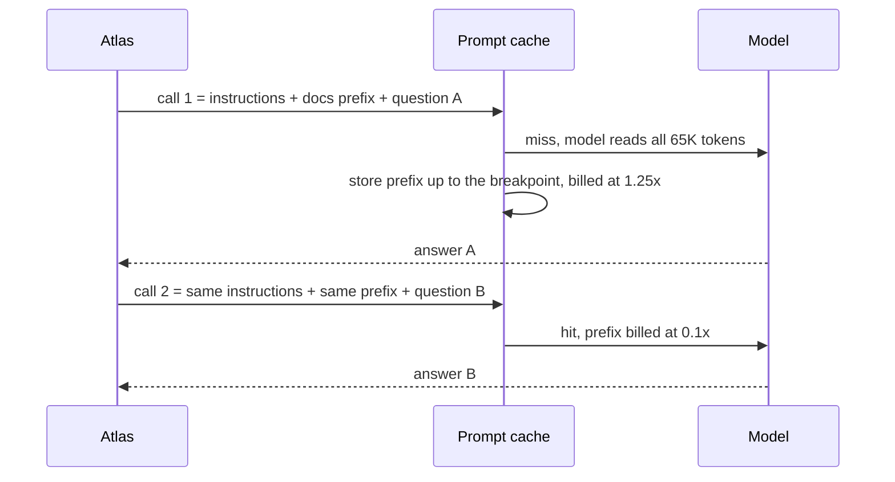
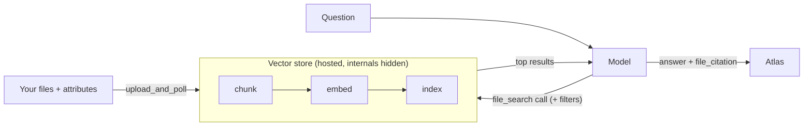
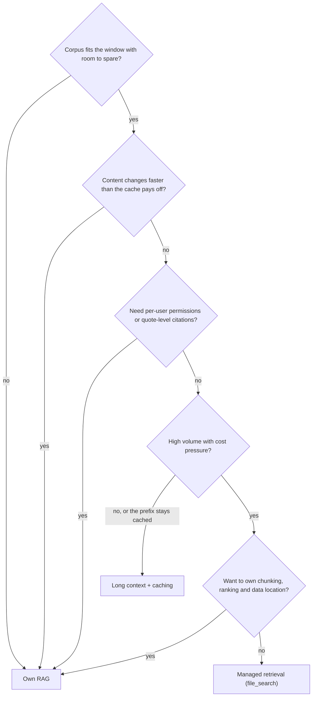

# Long Context vs RAG & Managed Retrieval

The whole Orbit doc set is about 65,000 tokens, and the course's default model accepts up to 922,000 input tokens per request. So why did you spend nine days building retrieval? Sometimes the right answer is "don't build RAG at all". Today you measure when that's true, when your own pipeline still wins, and when a hosted retrieval service beats both.

## At a Glance

- **Time:** ~2 h core (+ optional Go Deeper) · **Depth:** working
- **Prerequisites:** [Day 18: Cost & Latency Engineering: Caching, Batch & Budgets](../../Phase_2_Building_with_LLM_APIs/Day_018_cost_latency_caching/cost_latency_caching.md), [Day 29: Evaluating Retrieval](../../Phase_3_RAG/Day_029_retrieval_evaluation/retrieval_evaluation.md); recommended: [Day 28: Building the RAG Pipeline](../../Phase_3_RAG/Day_028_rag_pipeline/rag_pipeline.md), [Day 30: Evaluating RAG Answers](../../Phase_3_RAG/Day_030_answer_evaluation/answer_evaluation.md)
- **You'll build:** the same 30 Orbit questions answered three ways (whole corpus in the prompt, your own RAG, hosted `file_search`), compared on correctness, citations, $/question and latency
- **Stops at:** vendor-specific tuning of hosted retrieval beyond filters and result count
- **Fast path:** Already price LLM calls in your head? Read [Price One Question by Hand](#price-one-question-by-hand) and [the decision table](#trade-offs-and-the-decision-table), then do Exercise 2 (≈30 min)
- **Cost:** ≈ $0.30–0.50 on `gpt-6-luna` + `text-embedding-3-small` (prices as of 2026-11, [verify](https://developers.openai.com/api/docs/pricing)). Tight budget: skip the needle test and run 10 questions instead of 30 (≈ $0.15)
- **New terms:** long-context prompting, lost in the middle, managed retrieval (vector store + `file_search`), long-context surcharge, cache hit rate (recap from Day 18)

> **Coming from Software Engineering?** Long context vs RAG is "load the whole table into memory" vs "query an index". If the table is small and read-mostly, an in-memory scan beats maintaining an index; once it grows or needs row-level permissions, you want the index. Managed retrieval is a hosted search service, like managed Elasticsearch: less code and less control, plus a per-call bill and some lock-in. Prompt caching is a CDN (content delivery network, a cache in front of your origin server) for a prompt prefix: identical bytes are cheap to serve again, and one changed byte near the top is a cache miss.

## Do We Even Need RAG?

Start with a number, not an opinion: how big is the knowledge? Everything today reads Orbit's docs through one small module, `corpus.py`, with compact copies of Day 24's loader and Day 15's `Answer` schema. It needs no API key.

```python
# script_id: day_032_long_context_vs_rag/corpus
# corpus.py: shared helpers for today. No API key needed.
# Built on Day 24 (Document, load_corpus), Day 15 (Citation, Answer), Days 12/18 (cost from usage).
# Install: uv add "openai>=3.46,<4" pydantic numpy
# Env: ORBIT_DATA (optional, path to datasets/orbit), ATLAS_MODEL (optional)
import os
import re
from dataclasses import dataclass, field
from pathlib import Path

from pydantic import BaseModel

MODEL = os.environ.get("ATLAS_MODEL", "gpt-6-luna")
EMBED_MODEL = os.environ.get("ATLAS_EMBED_MODEL", "text-embedding-3-small")
DATA_DIR = Path(os.environ.get("ORBIT_DATA", "datasets/orbit"))


@dataclass(frozen=True)
class Document:
    id: str
    title: str
    applies_to: str              # "3.x", "2.x" or "all"
    text: str                    # body without front matter


def _front_matter(raw: str) -> tuple[dict[str, str], str]:
    """Split '---' front matter from the body. Tolerates quotes and inline '# comments'."""
    m = re.match(r"^---\n(.*?)\n---\n", raw, re.S)
    if not m:
        return {}, raw
    meta = {}
    for line in m.group(1).splitlines():
        key, _, value = line.partition(":")
        meta[key.strip()] = value.split(" #")[0].strip().strip('"')
    return meta, raw[m.end():]


def load_corpus(folder: Path | None = None) -> list[Document]:
    docs = []
    for path in sorted((folder or DATA_DIR / "docs").glob("*.md")):
        meta, body = _front_matter(path.read_text(encoding="utf-8"))
        docs.append(Document(meta.get("id", path.stem), meta.get("title", path.stem),
                             meta.get("applies_to", "all"), body.strip()))
    return docs
```

The same file also holds the schemas and a cost function. `request_cost()` is Day 18's pricing logic plus the two things that are new today: the long-context surcharge and the per-call fee for `file_search`.

```python
# script_id: day_032_long_context_vs_rag/corpus
class Citation(BaseModel):
    doc_id: str
    quote: str                   # exact words from the doc; "" when the source is file-level


class Answer(BaseModel):
    text: str
    citations: list[Citation]


# USD per 1M tokens, as of 2026-11. Verify at https://developers.openai.com/api/docs/pricing
PRICES_PER_1M = {"gpt-6-luna": {"input": 0.10, "cached": 0.01, "write_30m": 0.125, "output": 0.50}}
FILE_SEARCH_PER_CALL = 2.50 / 1000           # $2.50 per 1k file_search calls
LONG_CONTEXT_THRESHOLD = 272_000             # above this, the WHOLE request is repriced


def request_cost(input_tokens: int, output_tokens: int, *, cached: int = 0, written: int = 0,
                 file_search_calls: int = 0, model: str = MODEL) -> float:
    """USD for one request. `cached` and `written` are subsets of `input_tokens` (Day 18)."""
    p = PRICES_PER_1M[model]
    in_x, out_x = (2.0, 1.5) if input_tokens > LONG_CONTEXT_THRESHOLD else (1.0, 1.0)
    fresh = input_tokens - cached - written
    usd_in = (fresh * p["input"] + cached * p["cached"] + written * p["write_30m"]) * in_x
    return (usd_in + output_tokens * p["output"] * out_x) / 1e6 + file_search_calls * FILE_SEARCH_PER_CALL


@dataclass
class Tracker:
    """Day 12's CostTracker, cut down to one row per call."""
    rows: list[dict] = field(default_factory=list)

    def add(self, usage, *, file_search_calls: int = 0, model: str = MODEL) -> float:
        d = usage.input_tokens_details
        cached, written = d.cached_tokens or 0, d.cache_write_tokens or 0
        usd = request_cost(usage.input_tokens, usage.output_tokens, cached=cached, written=written,
                           file_search_calls=file_search_calls, model=model)
        self.rows.append({"input": usage.input_tokens, "cached": cached, "usd": usd})
        return usd


TRACKER = Tracker()
```

The last block of `corpus.py` is a demo that only runs when you execute the file directly. It prints the corpus size and the hand-priced table from the next section.

```python
# script_id: day_032_long_context_vs_rag/corpus
if __name__ == "__main__":
    docs = load_corpus()
    chars = sum(len(d.text) for d in docs)
    print(f"{len(docs)} docs · {chars:,} chars · ≈{chars // 4:,} tokens (rough: chars / 4)")
    q_in, out = 65_000, 400              # whole corpus + question; short answer incl. reasoning
    print(f"long context, uncached  ${request_cost(q_in, out):.4f}")
    print(f"long context, 1st call  ${request_cost(q_in, out, written=64_900):.4f}  (cache write)")
    print(f"long context, cached    ${request_cost(q_in, out, cached=64_900):.4f}")
    print(f"own RAG, 6 chunks       ${request_cost(3_000, out):.4f}")
    print(f"file_search, 1 call     ${request_cost(5_000, out, file_search_calls=1):.4f}")
    print(f"300K corpus, uncached   ${request_cost(300_000, out):.4f}  (>272K: 2x in, 1.5x out)")
```

```text
45 docs · 244,720 chars · ≈61,180 tokens (rough: chars / 4)
long context, uncached  $0.0067
long context, 1st call  $0.0083  (cache write)
long context, cached    $0.0009
own RAG, 6 chunks       $0.0005
file_search, 1 call     $0.0032
300K corpus, uncached   $0.0603  (>272K: 2x in, 1.5x out)
```

Characters divided by four is a rough guess. The token-count endpoint from [Day 4](../../Phase_1_How_LLMs_Work/Day_004_tokens/tokens.md) gives the exact input size without generating anything.

```python
# script_id: day_032_long_context_vs_rag/count_corpus
# Exact input-token count for the whole doc set, using the token-count endpoint (Day 4).
# Install: uv add "openai>=3.46,<4" pydantic · Env: OPENAI_API_KEY, ORBIT_DATA
from openai import OpenAI

from corpus import MODEL, load_corpus

client = OpenAI()
docs = load_corpus()
text = "\n\n".join(f"# {d.id}\n{d.text}" for d in docs)
n = client.responses.input_tokens.count(model=MODEL, input=text)
print(f"docs: {len(docs)} · input_tokens: {n.input_tokens:,}")
print(f"share of the 922,000-token max input: {n.input_tokens / 922_000:.1%}")
```

```text
docs: 45 · input_tokens: 6x,xxx
share of the 922,000-token max input: 7.x%
```

An offline `tiktoken` estimate with `o200k_base` gives about 65K (approximate for GPT-6). Orbit's docs use under a tenth of the input limit: on size alone, you don't need RAG here.

## Whole Manual, Right Pages, or a Librarian

A new colleague has a question about Orbit. You can help three ways:

1. **Hand them the whole manual.** They read everything, every time. Nothing gets missed because of a bad search, but reading takes time and you pay for every page on every question.
2. **Hand them the right pages.** You keep an index, look up the relevant pages and pass those over. It's cheap per question, but if your index picks the wrong pages, they never see the answer. That's the RAG system you built on Days 23–31.
3. **Pay a librarian service.** You give the service your manual once. It builds and runs its own index, and you pay per lookup. Less work for you, but you can't see how it picks pages, and the books live in its building.

Each fails in its own way: the whole manual costs money at volume and readers skim the middle; the right pages fail when retrieval misses; the librarian fails when you need control it doesn't offer, such as per-reader permissions.

## Price One Question by Hand

Before you write code, price one Orbit question with each approach. Use the [Day 18](../../Phase_2_Building_with_LLM_APIs/Day_018_cost_latency_caching/cost_latency_caching.md) rules and the `gpt-6-luna` prices: $0.10 per 1M input tokens, $0.01 per 1M cached reads, $0.125 per 1M cache writes (30-minute TTL, time to live), $0.50 per 1M output tokens. Assume 400 output tokens per answer, including reasoning.

| Approach | Input tokens | Arithmetic | ≈ $/question |
|---|---|---|---|
| Long context, no cache | 65,000 | 65,000 × $0.10/1M + 400 × $0.50/1M | $0.0067 |
| Long context, first call (cache write) | 64,900 written + 100 fresh | 64,900 × $0.125/1M + … | $0.0083 |
| Long context, cache hit | 64,900 cached + 100 fresh | 64,900 × $0.01/1M + … | $0.0009 |
| Own RAG (6 chunks) | 3,000 | 3,000 × $0.10/1M + output | $0.0005 |
| `file_search` (1 call) | ≈ 5,000 (results are input) | $0.0025 fee + tokens | $0.0032 |

*Prices as of 2026-11, [verify at the pricing page](https://developers.openai.com/api/docs/pricing). The `file_search` input size depends on how many results come back; measure it in your own runs.*

Three things stand out. A cache hit makes long context about twice the price of own RAG, not ten times. The first call costs *more* than no caching, because writes bill at 1.25×; caching pays from the second call within the TTL. And the hosted tool's per-call fee is bigger than all the tokens in a cheap-model RAG call.

Now grow the corpus. Above **272,000 input tokens**, the *whole* request bills at 2× input and cache rates and 1.5× output. A 300,000-token prompt on Luna costs about $0.06 uncached: nine times the Orbit price for under five times the tokens, and a clear signal to switch to retrieval.

## Name the Parts

- **Context window:** the most tokens a model reads at once. For the GPT-6 family it's 1,050,000 tokens in total, with at most 922,000 of input (see [Day 5](../../Phase_1_How_LLMs_Work/Day_005_transformers_attention/transformers_attention.md) and [Day 7](../../Phase_1_How_LLMs_Work/Day_007_choosing_a_model/choosing_a_model.md)).
- **Long-context prompting:** putting the whole knowledge source in the prompt and asking questions over it, with no retrieval step.
- **Lost in the middle:** models use facts near the start and end of a long prompt more reliably than facts in the middle (Liu et al., 2023, "Lost in the Middle: How Language Models Use Long Contexts", on arXiv). The strength varies by model and length, so you test it below.
- **Long-context surcharge:** a higher price above a size threshold, here 272K input tokens for the whole request.
- **Cache hit rate:** the share of input tokens served from the prompt cache. Caching is automatic for prefixes of at least 1,024 tokens; Day 18 owns the details.
- **Managed retrieval:** a **vector store** (a hosted index of your files that the provider chunks, embeds and searches) plus the **`file_search`** tool, which lets the model query that store during a Responses call.

The cache is what makes long context affordable, and it only works if the start of the prompt is byte-identical across calls:



So the rule for the prompt layout is: stable content first, the varying question last.

## Long Context in One Call

Here is the whole "architecture": every doc, sorted by id, in one developer message; the question in a user message after it; Day 16's `responses.parse(text_format=Answer)` for a typed result. The `prompt_cache_breakpoint` ends the reusable prefix right before the question, so every question can reuse the cached docs. The default implicit breakpoint at the end of the last message stays on too, unless you set `prompt_cache_options={"mode": "explicit"}`.

```python
# script_id: day_032_long_context_vs_rag/long_context
# long_context.py: answer from the WHOLE corpus in one call, with a cache-friendly prefix.
# Install: uv add "openai>=3.46,<4" pydantic · Env: OPENAI_API_KEY, ORBIT_DATA
from collections.abc import Sequence

from openai import OpenAI

from corpus import MODEL, TRACKER, Answer, Document, load_corpus

client = OpenAI()
LC_INSTRUCTIONS = ("You are Atlas, the Orbit maintainers' assistant. Answer only from the Orbit docs "
                   "provided. Cite each claim with its doc id and an exact quote from that doc. If the "
                   "docs don't answer the question, say you don't know and return no citations.")


def corpus_prefix(docs: Sequence[Document], *, keep_order: bool = False) -> str:
    """All docs in one string. Sorted by id unless told otherwise, so the bytes never change."""
    ordered = docs if keep_order else sorted(docs, key=lambda d: d.id)
    body = "\n\n".join(f'<doc id="{d.id}" applies_to="{d.applies_to}">\n{d.text}\n</doc>' for d in ordered)
    return f"Orbit documentation ({len(docs)} pages):\n\n{body}"


def ask_long_context(question: str, docs: Sequence[Document], *, model: str = MODEL,
                     instructions: str = LC_INSTRUCTIONS, keep_order: bool = False) -> Answer:
    resp = client.responses.parse(
        model=model, instructions=instructions, text_format=Answer, reasoning={"effort": "low"},
        input=[
            {"role": "developer", "content": [{
                "type": "input_text", "text": corpus_prefix(docs, keep_order=keep_order),
                "prompt_cache_breakpoint": {"mode": "explicit"}}]},   # reusable prefix ends here
            {"role": "user", "content": question},                     # varies per call, so it goes last
        ])
    TRACKER.add(resp.usage, model=model)
    return resp.output_parsed or Answer(text="(no answer: refused or incomplete)", citations=[])
```

Ask two different questions in a row and look at the usage:

```python
# script_id: day_032_long_context_vs_rag/long_context
if __name__ == "__main__":
    docs = load_corpus()
    for q in ["What are the default lease_seconds and heartbeat_seconds?",
              "Which Orbit release fixed the Redis reconnect storm?"]:
        answer = ask_long_context(q, docs)
        row = TRACKER.rows[-1]
        print(f"{answer.text[:60]}… | cites {[c.doc_id for c in answer.citations]}")
        print(f"   input {row['input']:,} · cached {row['cached']:,} · ${row['usd']:.4f}")
```

```text
In the [worker] section, lease_seconds defaults to 300 and h… | cites ['configuration-reference', 'leases-and-heartbeats']
   input 65,6xx · cached 0 · $0.0083
3.1.2 fixed the reconnect storm that 3.1.0 introduced; recon… | cites ['changelog', 'broker-redis']
   input 65,6xx · cached 65,5xx · $0.0009
```

*Illustrative, from the documented caching rules, not a recorded run: check `cached` in yours.* Call 1 wrote the cache; call 2 asked something different and still read almost every token from it. No chunker, no embeddings, no database.

## Break It: Lose the Cache, Hide the Needle

Two small layout mistakes undo the savings. The first puts the question before the docs; the second keeps the docs first but changes their order on every call (for example, iterating a `set`, or listing files in whatever order the filesystem returns).

```python
# script_id: day_032_long_context_vs_rag/break_prefix
# Two ways to lose the cache. ≈ $0.03. max_output_tokens is small because only usage matters here.
# Install: uv add "openai>=3.46,<4" pydantic · Env: OPENAI_API_KEY, ORBIT_DATA
import random

from openai import OpenAI

from corpus import MODEL, load_corpus
from long_context import LC_INSTRUCTIONS, corpus_prefix

client = OpenAI()
docs = load_corpus()
QUESTIONS = ["What is the default heartbeat_seconds?", "What does ORB-2001 mean?"]


def cached_tokens(input_items: list[dict]) -> int:
    resp = client.responses.create(model=MODEL, instructions=LC_INSTRUCTIONS, input=input_items,
                                   reasoning={"effort": "low"}, max_output_tokens=200)
    return resp.usage.input_tokens_details.cached_tokens or 0


for q in QUESTIONS:       # question FIRST: the prompt differs right after the instructions
    print("question first:", cached_tokens([{"role": "user", "content": q},
                                            {"role": "developer", "content": corpus_prefix(docs)}]))
for q in QUESTIONS:       # docs first, but shuffled: same pages, different bytes
    shuffled = corpus_prefix(random.sample(docs, k=len(docs)), keep_order=True)
    print("shuffled docs: ", cached_tokens([{"role": "developer", "content": shuffled},
                                            {"role": "user", "content": q}]))
```

```text
question first: 0
question first: 0
shuffled docs:  0
shuffled docs:  0
```

Every call pays full price, plus a cache write nobody reads. The instructions alone are under the 1,024-token minimum, so nothing before the point of difference is cacheable. A timestamp or user name at the top does the same damage.

The second experiment is about quality. A **needle test** hides one known fact in a big prompt and checks whether the model finds it. Move `idempotency.md` to the start, middle or end of the prefix and ask five questions it answers. One small experiment, not a benchmark.

```python
# script_id: day_032_long_context_vs_rag/needle
# Position test: one doc at start / middle / end of the prefix, 5 probes each. ≈ $0.04
# Needs OPENAI_API_KEY: long_context.py builds the OpenAI() client. Env: ORBIT_DATA
from corpus import TRACKER, load_corpus
from long_context import ask_long_context

NEEDLE_ID = "idempotency"
PROBES = [  # (question, accepted substrings); every fact comes from idempotency.md
    ("By default, how long does Orbit keep idempotency records?", ("7 days", "seven days")),
    ("What key does Orbit store for send_receipt with order_id A-1001?", ("send_receipt:A-1001",)),
    ("What does a worker log when it skips an already-succeeded delivery?", ("skipped duplicate delivery",)),
    ("Which error does enqueue raise if the result backend can't be reached to check a key?", ("ORB-1601",)),
    ("Which error means an idempotency key was reused with different arguments?", ("ORB-2001",)),
]


def arrange(docs: list, where: str) -> list:
    rest = sorted((d for d in docs if d.id != NEEDLE_ID), key=lambda d: d.id)
    i = {"start": 0, "middle": len(rest) // 2, "end": len(rest)}[where]
    return rest[:i] + [d for d in docs if d.id == NEEDLE_ID] + rest[i:]


docs = load_corpus()
for where in ("start", "middle", "end"):
    ordered = arrange(docs, where)
    hits = sum(any(s.lower() in ask_long_context(q, ordered, keep_order=True).text.lower() for s in ok)
               for q, ok in PROBES)
    print(f"needle at {where:<6}: {hits}/{len(PROBES)}")
print(f"spent ${sum(r['usd'] for r in TRACKER.rows):.3f}")
```

```text
needle at start : 5/5
needle at middle: 5/5
needle at end   : 5/5
spent $0.04
```

*Illustrative, not a recorded run.* No position effect at 65K tokens would be a real result: the effect tends to appear with much longer prompts or many similar distractors. Two facts (ORB-1601, ORB-2001) also appear in `error-codes.md`, which makes the test easier. Read a clean grid as "fine at this size", not "fine at any size"; [Go Deeper](#go-deeper-optional) shows how to make it harder.

## Managed Retrieval with `file_search`

The third option hands the index to OpenAI. You create a **vector store**, upload files into it (OpenAI chunks, embeds and indexes them), and attach the `file_search` tool to a Responses call. The model decides when to search, reads the top results, and answers with `file_citation` annotations that point back to files.



Everything inside the box you built by hand on Days 24–27, and no longer control. Build `hosted_kb.py` in three blocks. First, create the store and upload each doc with **attributes** (per-file key/value metadata you can filter on).

```python
# script_id: day_032_long_context_vs_rag/hosted_kb
# hosted_kb.py: managed retrieval. OpenAI chunks, embeds and indexes; you upload and query.
# Install: uv add "openai>=3.46,<4" pydantic · Env: OPENAI_API_KEY, ORBIT_DATA
# Bills $2.50/1k file_search calls + $0.10/GB-day storage past 1 GB free (as of 2026-11, verify).
from collections.abc import Sequence

from openai import OpenAI

from corpus import MODEL, TRACKER, Answer, Citation, Document, load_corpus

client = OpenAI()


def create_kb(docs: Sequence[Document], *, name: str = "atlas-kb") -> str:
    """Upload every doc with filterable attributes; return the vector store id."""
    vs = client.vector_stores.create(name=name,
                                     expires_after={"anchor": "last_active_at", "days": 2})  # safety net
    try:
        for d in docs:
            vs_file = client.vector_stores.files.upload_and_poll(
                vector_store_id=vs.id,
                file=(f"{d.id}.md", d.text.encode("utf-8")),        # the filename comes back in citations
                attributes={"doc_id": d.id, "applies_to": d.applies_to})
            if vs_file.status != "completed":                       # failed/cancelled: don't query a half index
                raise RuntimeError(f"{d.id}: indexing ended '{vs_file.status}': {vs_file.last_error}")
    except Exception:
        delete_kb(vs.id)                                            # don't leave a half-built store billing
        raise
    return vs.id
```

`upload_and_poll` waits for each file to finish indexing, so building the store for 45 files can take a minute or more. Second, ask. Two details matter: `include=["file_search_call.results"]` (results aren't returned otherwise) and mapping `file_citation` annotations to Day 15 `Citation`s.

```python
# script_id: day_032_long_context_vs_rag/hosted_kb
FS_INSTRUCTIONS = ("You are Atlas. Answer only from the file_search results about Orbit. "
                   "If they don't answer the question, say you don't know.")


def ask_file_search(question: str, vs_id: str, *, filters: dict | None = None,
                    max_num_results: int = 4, model: str = MODEL, verbose: bool = False) -> Answer:
    tool = {"type": "file_search", "vector_store_ids": [vs_id], "max_num_results": max_num_results}
    if filters:
        tool["filters"] = filters                                   # matched against per-file attributes
    resp = client.responses.create(model=model, instructions=FS_INSTRUCTIONS, input=question,
                                   tools=[tool], include=["file_search_call.results"],
                                   reasoning={"effort": "low"})
    calls = [item for item in resp.output if item.type == "file_search_call"]
    TRACKER.add(resp.usage, file_search_calls=len(calls), model=model)
    for call in calls if verbose else []:                          # what the model actually read
        print("   searched:", [(r.filename, round(r.score or 0, 2)) for r in call.results or []])
    cited: dict[str, Citation] = {}
    for item in resp.output:
        if item.type != "message":
            continue
        for part in item.content:                                  # output_text or refusal parts
            for ann in getattr(part, "annotations", None) or []:
                if ann.type == "file_citation":                    # file-level: there is no quote to check
                    doc_id = ann.filename.removesuffix(".md")
                    cited[doc_id] = Citation(doc_id=doc_id, quote="")
    return Answer(text=resp.output_text, citations=list(cited.values()))
```

Third, clean up. Deleting the store stops the storage meter, but the uploaded files stay in your project's Files list until you delete them as well. The demo runs in `try`/`finally` so a crash still cleans up.

```python
# script_id: day_032_long_context_vs_rag/hosted_kb
def delete_kb(vs_id: str) -> None:
    """Delete the store AND the uploaded files behind it."""
    file_ids = [f.id for f in client.vector_stores.files.list(vector_store_id=vs_id)]
    deleted = client.vector_stores.delete(vs_id)
    for file_id in file_ids:
        client.files.delete(file_id)
    print(f"deleted: {deleted.deleted} · files removed: {len(file_ids)}")


if __name__ == "__main__":
    vs_id = create_kb(load_corpus())
    try:
        current = {"type": "in", "key": "applies_to", "value": ["3.x", "all"]}   # skip 2.x-only pages
        answer = ask_file_search("How do I stop a job from running twice?", vs_id, filters=current, verbose=True)
        print(answer.text[:200])
        print("cited:", [c.doc_id for c in answer.citations], f"· ${TRACKER.rows[-1]['usd']:.4f}")
    finally:
        delete_kb(vs_id)
```

```text
   searched: [('idempotency.md', 0.71), ('troubleshooting-duplicates.md', 0.66), ('leases-and-heartbeats.md', 0.52), ('faq.md', 0.47)]
Give the job an idempotency key, e.g. @app.job(idempotency_key="order_id"), so repeated enqueues return the same job…
cited: ['idempotency', 'troubleshooting-duplicates'] · $0.0034
deleted: True · files removed: 45
```

*Illustrative, not a recorded run.* You got chunking, embeddings, an index and a working filter in about 60 lines. You lost control: `file_citation` points at a whole file, so [Day 28](../../Phase_3_RAG/Day_028_rag_pipeline/rag_pipeline.md)'s quote check has nothing to verify, and you can't change the chunker or add the [Day 31](../../Phase_3_RAG/Day_031_reranking_contextual_retrieval/reranking_contextual_retrieval.md) reranker. The other hosted tools come on [Day 38](../../Phase_4_Tools_and_MCP/Day_038_built_in_tools/built_in_tools.md).

## Three Ways, One Table

The third contestant is your own pipeline. The full Day 28 `ask()` runs on Postgres; here is a compact copy over an in-memory index so this lesson runs without Docker. It chunks by `##` heading (Day 25), embeds with `text-embedding-3-small` (Day 23), takes the top 6 chunks by cosine similarity, and verifies quotes like Day 28.

```python
# script_id: day_032_long_context_vs_rag/own_rag
# own_rag.py: compact Day 28 ask() over an in-memory index (no Postgres needed).
# Install: uv add "openai>=3.46,<4" pydantic numpy · Env: OPENAI_API_KEY, ORBIT_DATA
import re
from functools import cache

import numpy as np
from openai import OpenAI

from corpus import EMBED_MODEL, MODEL, TRACKER, Answer, Document, load_corpus

client = OpenAI()
RAG_INSTRUCTIONS = ("Answer only from the sources. Cite each claim with its doc_id and an exact quote "
                    "copied from that source. If the sources don't answer it, say you don't know.")


def chunk(doc: Document) -> list[tuple[str, str]]:
    """(doc_id, text) per '## ' section; the page title rides along as context (Day 25)."""
    return [(doc.id, f"{doc.title}\n{part.strip()}")
            for part in re.split(r"\n(?=## )", doc.text) if part.strip()]


def embed(texts: list[str]) -> np.ndarray:
    vectors = []
    for i in range(0, len(texts), 100):                     # modest batches per request
        resp = client.embeddings.create(model=EMBED_MODEL, input=texts[i:i + 100])
        vectors += [d.embedding for d in resp.data]
    return np.array(vectors)                                 # unit length, so dot product = cosine


@cache
def _index() -> tuple[list[tuple[str, str]], np.ndarray]:
    chunks = [c for d in load_corpus() for c in chunk(d)]
    return chunks, embed([text for _, text in chunks])
```

```python
# script_id: day_032_long_context_vs_rag/own_rag
def _norm(s: str) -> str:
    return " ".join(s.split()).lower()


def verify_citations(answer: Answer, sources: list[tuple[str, str]]) -> Answer:
    """Keep only citations whose quote really appears in a retrieved source (Day 28)."""
    ok = [c for c in answer.citations
          if any(c.doc_id == doc_id and _norm(c.quote) in _norm(text) for doc_id, text in sources)]
    return answer.model_copy(update={"citations": ok})


def ask(question: str, *, k: int = 6, model: str = MODEL) -> Answer:
    chunks, vectors = _index()
    top = np.argsort(vectors @ embed([question])[0])[::-1][:k]
    sources = [chunks[i] for i in top]
    context = "\n\n".join(f'<source doc_id="{d}">\n{t}\n</source>' for d, t in sources)
    resp = client.responses.parse(model=model, instructions=RAG_INSTRUCTIONS, text_format=Answer,
                                  reasoning={"effort": "low"}, input=f"{context}\n\nQuestion: {question}")
    TRACKER.add(resp.usage, model=model)                     # embeddings cost ~$0.02/1M: ignored here
    answer = resp.output_parsed or Answer(text="(no answer)", citations=[])
    return verify_citations(answer, sources)


if __name__ == "__main__":
    print(ask("What is the default lease_seconds?"))
```

Now the comparison. `compare_approaches()` takes a dict of name → function, so adding a fourth contestant later (say, Day 31's reranked pipeline) is one line. `p50` is the median latency: half the questions finish faster. Correctness uses a compact copy of the Day 30 correctness judge; "cites gold" means at least one citation names a doc from the gold set. Judge calls go around the tracker, so `$/question` measures only the approach.

```python
# script_id: day_032_long_context_vs_rag/three_ways
# Same 30 qa_gold questions, three approaches, one table. ≈ $0.20 (as of 2026-11, verify).
# Install: uv add "openai>=3.46,<4" pydantic numpy · Env: OPENAI_API_KEY, ORBIT_DATA
import json
import statistics
import time
from collections.abc import Callable

from openai import OpenAI
from pydantic import BaseModel

from corpus import DATA_DIR, MODEL, TRACKER, Answer, load_corpus
from hosted_kb import ask_file_search, create_kb, delete_kb
from long_context import ask_long_context
from own_rag import ask

client = OpenAI()


class Verdict(BaseModel):            # Day 30: reason first, then a binary verdict
    reason: str
    passed: bool


def judge_correct(question: str, reference: str, answer: str) -> bool:
    resp = client.responses.parse(
        model=MODEL, text_format=Verdict, reasoning={"effort": "low"},
        instructions="Grade the answer. Pass only if it states the reference's key facts and "
                     "contradicts none of them. Extra correct detail is fine.",
        input=f"Question: {question}\nReference: {reference}\nAnswer: {answer}")
    return bool(resp.output_parsed and resp.output_parsed.passed)
```

```python
# script_id: day_032_long_context_vs_rag/three_ways
def compare_approaches(cases: list[dict], approaches: dict[str, Callable[[str], Answer]]) -> list[dict]:
    table = []
    for name, answer_fn in approaches.items():
        correct = cites_gold = 0
        first_row, latencies = len(TRACKER.rows), []
        for case in cases:
            t0 = time.perf_counter()
            answer = answer_fn(case["question"])
            latencies.append(time.perf_counter() - t0)
            correct += judge_correct(case["question"], case["answer"], answer.text)
            cites_gold += any(c.doc_id in case["citations"] for c in answer.citations)
        usd = sum(r["usd"] for r in TRACKER.rows[first_row:])
        table.append({"approach": name, "correct": correct / len(cases), "cites_gold": cites_gold / len(cases),
                      "usd_per_q": usd / len(cases), "p50_s": statistics.median(latencies)})
    return table


if __name__ == "__main__":
    lines = (DATA_DIR / "eval/qa_gold.jsonl").read_text(encoding="utf-8").splitlines()
    cases = [json.loads(line) for line in lines if line.strip()]
    docs = load_corpus()
    ask("What is Orbit?")                     # builds the in-memory index once, outside the timings
    vs_id = create_kb(docs)                   # setup time isn't in the latency column either
    try:
        rows = compare_approaches(cases, {"long_context": lambda q: ask_long_context(q, docs),
                                          "own_rag": ask,
                                          "file_search": lambda q: ask_file_search(q, vs_id)})
    finally:
        delete_kb(vs_id)
    print("| approach | correct | cites gold doc | $/question | p50 s |\n|---|---|---|---|---|")
    for r in rows:
        print(f"| {r['approach']} | {r['correct']:.0%} | {r['cites_gold']:.0%} | ${r['usd_per_q']:.4f} | {r['p50_s']:.1f} |")
```

Illustrative output (the shape you'll see; run it for your own numbers):

```text
| approach | correct | cites gold doc | $/question | p50 s |
|---|---|---|---|---|
| long_context | 90% | 93% | $0.0012 | 4.1 |
| own_rag | 83% | 87% | $0.0005 | 2.2 |
| file_search | 80% | 83% | $0.0033 | 3.0 |
```

Read the table in order. **Correctness first:** if long context wins clearly, retrieval misses are costing you answers (Day 29's "retrieval" bucket). **Then $/question:** a warm cache keeps long context within a small multiple of own RAG; `file_search` pays its fee every call. **Then latency:** 65K tokens read slower than 3K, even cached. **Then what the table can't show:** setup steps and control (ACL, chunking, version filters, quote-level citations).

## Trade-offs and the Decision Table

The flowchart turns the trade-offs into one decision:



| Factor | Long context + caching | Own RAG (Days 23–31) | Managed `file_search` |
|---|---|---|---|
| Corpus size | Up to ~272K tokens before the surcharge; 922K hard limit | Any size | Large; storage billed past 1 GB free |
| Update rate | Every edit rewrites the cache (1.25× on the next call) | Re-index only changed docs | Re-upload changed files |
| Permissions (ACL, access-control list) | One prefix per audience; no per-user filtering | `groups=` filter before ranking (Day 27) | Attribute filters; per-tenant stores |
| Version filters | Tell the model in the prompt (it may still mix versions) | `applies_to` in the query | `filters` on attributes |
| Citation granularity | Quotes, checked against the whole corpus | Quotes, checked against retrieved chunks | File-level only |
| Volume | Cheap only while the cache stays warm | Cheapest per question | Per-call fee dominates at volume |
| Latency | Slowest: reads the whole prefix | Fastest; you control k | In between; one extra tool round |
| Ops effort | None | Highest: database, ingestion, evals | Low: upload, poll, delete |
| Data location | Sent on every call | Your database | Stored by the provider |

Rules of thumb: a small, stable corpus shared by everyone starts with long context and caching. Build your own RAG for permissions, quote-level citations, or retrieval you measure and tune. Managed retrieval fits the middle.

### In production

- **Retention:** vector stores keep your files until you delete them; Responses calls are stored by default. Day 73 owns `store=False` and retention: [Day 73: Privacy & PII](../../Phase_8_Safety_and_Security/Day_073_privacy_pii/privacy_pii.md).
- **Tenants:** one vector store per tenant (or attribute filters you never let a user choose) keeps data apart; [Day 83](../../Phase_9_Production/Day_083_auth_multitenancy_quotas/auth_multitenancy_quotas.md) owns tenant isolation.
- **Budget at volume:** multiply your measured $/question by monthly traffic before you choose (Exercise 2). At 100k questions a month, $0.0025 per call is $250 in tool fees alone.
- **Exit plan:** keep your source files and `Document` loader as the source of truth, so moving off a hosted store means re-uploading, not rescuing data.
- **Expiry:** set `expires_after` on every store you create from scripts, so a forgotten store stops billing on its own.

## Go Deeper (optional)

<details>
<summary>Go deeper: cache break-even math and TTL choice</summary>

In words first: a cache write costs a bit more than a normal read, and every later hit costs a tenth. So caching pays as soon as you reuse the prefix once.

Toy numbers for a prefix of P tokens at input price p: with no cache, n questions cost n·p·P. With a 30-minute cache, they cost 1.25·p·P for the write plus 0.1·p·P for each of the other n − 1. Caching wins when 1.25 + 0.1(n − 1) < n, which is n > 1.28. Two questions inside the TTL are enough.

The 12-hour TTL writes at 2.5×, so it needs 2.5 + 0.1(n − 1) < n, which is n > 2.67: three questions inside 12 hours. Pick it when traffic is sparse but steady (a team tool used a few times an hour), and keep the default 30 minutes when traffic is dense. Both multipliers are as of 2026-11 (⚠ verify at the [prompt caching guide](https://developers.openai.com/api/docs/guides/prompt-caching), which also says how reads affect expiry).

Hit rate is what the bill really depends on. If an edit to any doc changes the prefix, every edit costs one full write. A corpus edited ten times a day at low traffic can end up paying the write premium on most calls, which is the "changes faster than the cache pays off" branch of the flowchart.

</details>

<details>
<summary>Go deeper: score the hosted retriever on its own</summary>

`file_search` mixes retrieval and generation, so a wrong answer doesn't tell you which half failed. `vector_stores.search` queries the store directly, with no model call, and returns scored results you can grade the way Day 29 graded your own index.

```python
# script_id: day_032_long_context_vs_rag/kb_search
# Retrieval-only check of the hosted index: hit@5 on qa_gold citations, no model in the loop.
# Needs OPENAI_API_KEY: hosted_kb.py builds the OpenAI() client. ⚠ verify search pricing.
import json

from corpus import DATA_DIR, load_corpus
from hosted_kb import client, create_kb, delete_kb

lines = (DATA_DIR / "eval/qa_gold.jsonl").read_text(encoding="utf-8").splitlines()
cases = [json.loads(line) for line in lines if line.strip()]
vs_id = create_kb(load_corpus())
try:
    hits = 0
    for case in cases:
        page = client.vector_stores.search(vector_store_id=vs_id, query=case["question"],
                                           max_num_results=5)
        ranked = [r.filename.removesuffix(".md") for r in page]
        hits += any(doc_id in case["citations"] for doc_id in ranked)
    print(f"hosted hit@5 on {len(cases)} questions: {hits / len(cases):.0%}")
finally:
    delete_kb(vs_id)
```

Compare the number with your Day 29 baseline. The knobs the hosted store gives you are few and documented: `max_num_results`, `filters`, and `ranking_options` with `ranker`, `score_threshold` and `hybrid_search` (`embedding_weight`, `text_weight`); `vector_stores.search` also takes `rewrite_query`. You can set a `chunking_strategy` when you create the store or upload a file. That's the whole tuning surface, which is the point of a managed service and the reason this lesson stops here.

</details>

<details>
<summary>Go deeper: harder needle tests and the hybrid pattern</summary>

A clean needle grid at 65K tokens doesn't mean long prompts are always safe. To make the test bite:

- **Grow the haystack.** Add the 240 issues (Exercise 4) or repeat the docs with small edits so the prompt reaches 200K+ tokens.
- **Add near-duplicates.** Put the 2.x environment-variable page next to the 3.x configuration page and ask version-specific questions. Distractors that look right hurt more than unrelated filler.
- **Ask for two facts at once** from different positions. Multi-fact questions fail sooner than single lookups.

Practitioners also combine the two approaches. Retrieve at the **document** level instead of the chunk level, then put the top few whole documents in the prompt. You keep RAG's scale and permission filters, the model sees full pages instead of fragments, and the prompt stays far below the surcharge threshold. Day 49 ([Context Engineering](../../Phase_6_Agents/Day_049_context_engineering/context_engineering.md)) builds on this idea of choosing what goes into the window.

</details>

## Common Pitfalls

- **No search results to inspect.** `file_search_call.results` is `None` because results aren't returned by default. Add `include=["file_search_call.results"]` to the call.
- **Empty or partial answers right after upload.** You queried before indexing finished. Use `upload_and_poll` (or `create_and_poll`) and check `status == "completed"` for every file; a file can end `failed` with a `last_error`.
- **A storage bill for a store you forgot.** Vector stores bill daily past the free GB until deleted. Call `delete_kb()` in a `finally`, set `expires_after={"anchor": "last_active_at", "days": N}`, and delete the uploaded files too.
- **`cached_tokens` is always 0.** Something variable (a date, the user's name, the question, an unsorted doc list) sits before the stable content. Put the stable prefix first, sort it, and keep the varying part last.
- **Treating `file_citation` as a quote.** It carries `file_id`, `filename` and `index`, not the cited words. Day 28's quote check can't run on it; if you need verifiable quotes, use your own RAG or long context with `Answer` citations.

> **Where we stop:** we don't tune hosted retrieval beyond filters and result count, because each vendor's knobs differ and change often; see the [retrieval guide](https://developers.openai.com/api/docs/guides/retrieval) for chunking strategies and ranking options.

## Key Takeaways

- Measure first: count the corpus with the token-count endpoint. Orbit's ≈65K tokens use under a tenth of the 922K input limit, so size alone doesn't force RAG.
- Price one question three ways before building: cached long context is within a small multiple of own RAG, the first call pays a 1.25× write premium, `file_search` adds $0.0025 per call, and above 272K input tokens the whole request costs 2× input and 1.5× output (as of 2026-11, verify).
- The cache only works on an identical prefix: stable, sorted docs first, the question last, and `cached_tokens` in `usage` as the proof.
- Managed retrieval trades control for less code: you upload files with attributes, filter on them, read file-level citations, and must delete the store and files to stop billing.
- Decide with your own eval table plus the columns it can't show: permissions, citation granularity, update rate, volume, latency, ops effort and data location.

## Quick Reference

| API / pattern | When to use | Gotcha |
|---|---|---|
| `client.responses.input_tokens.count(model=, input=)` | Size a corpus before choosing an approach | Counts input only; add output yourself |
| Docs in a developer message + `prompt_cache_breakpoint`, question last | Long context over a stable corpus | Prefix must be byte-identical; ≥1,024 tokens to cache |
| `usage.input_tokens_details.cached_tokens` / `.cache_write_tokens` | Prove cache hits and price writes | `cached_tokens` excludes tokens billed as writes |
| `vector_stores.create(name=, expires_after=)` | Create a hosted index | Storage bills until deleted or expired |
| `vector_stores.files.upload_and_poll(vector_store_id=, file=, attributes=)` | Upload + wait for indexing | Check `status == "completed"` per file |
| `{"type": "file_search", "vector_store_ids": [...], "filters": ..., "max_num_results": n}` | Managed retrieval inside a Responses call | Add `include=["file_search_call.results"]` to see results |
| `{"type": "in", "key": "applies_to", "value": ["3.x", "all"]}` | Filter on per-file attributes | Attributes are set at upload time |
| `vector_stores.delete(id)` + `files.delete(id)` | Clean up | Deleting the store leaves the files |

## Exercises

1. **Warm-up: break the cache with the instructions.** Ask two questions with `ask_long_context()`, then ask the second again with one sentence added to `LC_INSTRUCTIONS`. Instructions come before the docs, so the edit changes the prefix.

<details>
<summary>Solution</summary>

```python
# script_id: day_032_long_context_vs_rag/solution_ex1
# Needs OPENAI_API_KEY: long_context.py builds the OpenAI() client. ≈ $0.02
from corpus import TRACKER, load_corpus
from long_context import LC_INSTRUCTIONS, ask_long_context

docs = load_corpus()
ask_long_context("What is the default lease_seconds?", docs)                  # writes the cache
ask_long_context("What is the default heartbeat_seconds?", docs)              # reads it
ask_long_context("What is the default heartbeat_seconds?", docs,
                 instructions=LC_INSTRUCTIONS + " Answer in one sentence.")   # new prefix
for label, row in zip(["first call", "same instructions", "edited instructions"], TRACKER.rows):
    print(f"{label:<20} cached {row['cached']:>7,} · ${row['usd']:.4f}")
```

The third call shows `cached 0` and the write price again: instructions are part of the prefix, so treat them like code under version control (Day 21) and change them deliberately.

</details>

2. **Core: the monthly bill.** Using your measured $/question from `three_ways` (or the hand prices), compute the monthly cost of 100k questions per approach, including `file_search` storage.

<details>
<summary>Solution</summary>

```python
# script_id: day_032_long_context_vs_rag/solution_ex2
# Monthly bill at 100k questions. No API key needed. Prices as of 2026-11, verify.
from corpus import request_cost

QUESTIONS_PER_MONTH = 100_000
per_question = {                       # paste your measured $/question from three_ways here
    "long_context (warm cache)": request_cost(65_000, 400, cached=64_900),
    "own_rag": request_cost(3_000, 400),
    "file_search": request_cost(5_000, 400, file_search_calls=1),
}
STORE_GB, FREE_GB, USD_PER_GB_DAY = 0.001, 1.0, 0.10      # Orbit's docs are well inside the free GB
storage = max(0.0, STORE_GB - FREE_GB) * USD_PER_GB_DAY * 30
for name, usd in per_question.items():
    extra = storage if name == "file_search" else 0.0
    print(f"{name:<26} ${usd * QUESTIONS_PER_MONTH + extra:>8,.2f} / month")
```

```text
long_context (warm cache)  $   85.90 / month
own_rag                    $   50.00 / month
file_search                $  320.00 / month
```

Own RAG looks cheapest, but add your Postgres hosting and the engineering time; long context assumes the cache stays warm, which 100k questions a month (about two a minute) makes likely.

</details>

3. **Core: version filters.** Upload the docs, then ask "Which environment variable sets worker concurrency, and what is its default?" twice: once filtered to `["3.x", "all"]` and once to `["2.x", "all"]`. Compare the citations and answers.

<details>
<summary>Solution</summary>

```python
# script_id: day_032_long_context_vs_rag/solution_ex3
# Needs OPENAI_API_KEY: hosted_kb.py builds the OpenAI() client. ≈ $0.01
from corpus import load_corpus
from hosted_kb import ask_file_search, create_kb, delete_kb

QUESTION = "Which environment variable sets worker concurrency, and what is its default?"
vs_id = create_kb(load_corpus())
try:
    for label, versions in [("3.x user", ["3.x", "all"]), ("2.x user", ["2.x", "all"])]:
        only = {"type": "in", "key": "applies_to", "value": versions}
        answer = ask_file_search(QUESTION, vs_id, filters=only)
        print(f"{label}: cites {[c.doc_id for c in answer.citations]}\n   {answer.text[:160]}")
finally:
    delete_kb(vs_id)
```

The 2.x user gets `ORBIT_CONCURRENCY` (default 4) from `environment-variables-2x`; the 3.x user should hear that 3.x ignores those variables and reads `orbit.toml`. The filter runs before ranking, the same "filter, then rank" rule as Day 27.

</details>

4. **Stretch (optional): grow the prefix.** Add the 240 issues (title + body) to the long-context corpus and re-measure input tokens, cost, latency and citations for one question, cold and warm.

<details>
<summary>Solution</summary>

```python
# script_id: day_032_long_context_vs_rag/solution_ex4
# Needs OPENAI_API_KEY: long_context.py builds the OpenAI() client. ≈ $0.06
import json
import time

from corpus import DATA_DIR, TRACKER, Document, load_corpus
from long_context import ask_long_context

docs = load_corpus()
lines = (DATA_DIR / "issues/issues.jsonl").read_text(encoding="utf-8").splitlines()
issues = [json.loads(line) for line in lines if line.strip()]
issue_docs = [Document(f"issue-{i['id']}", i["title"], "all", f"{i['title']}\n\n{i['body']}") for i in issues]
QUESTION = "Why is the --concurrency flag ignored on 2.8.0?"
for label, corpus in [("docs only", docs), ("docs + 240 issues", docs + issue_docs)]:
    for attempt in ("cold", "warm"):                # the second call reads the cache
        t0 = time.perf_counter()
        answer = ask_long_context(QUESTION, corpus)
        row = TRACKER.rows[-1]
        print(f"{label:<18} {attempt}: input {row['input']:>7,} · cached {row['cached']:>7,} · "
              f"${row['usd']:.4f} · {time.perf_counter() - t0:.1f}s · {[c.doc_id for c in answer.citations]}")
```

Expect several times the input tokens, cost and latency, with an answer that can now cite issue #1. Watch two things: whether the total stays under 272K (add comments too and it may not), and that issues are maintainers-only data (Day 27). Long context can't filter per user, so this prompt is only safe for maintainers.

</details>

## References & Further Reading

- [OpenAI: File search](https://developers.openai.com/api/docs/guides/tools-file-search): the `file_search` tool, `include`, citations and filters, from the source.
- [OpenAI: Retrieval and vector stores](https://developers.openai.com/api/docs/guides/retrieval): attributes, metadata filters, chunking strategies and direct search.
- [OpenAI: Prompt caching](https://developers.openai.com/api/docs/guides/prompt-caching): minimum prefix, breakpoints, TTLs and write/read pricing.
- [OpenAI: Token counting](https://developers.openai.com/api/docs/guides/token-counting): the exact input-token endpoint used in the first section.
- [OpenAI: Pricing](https://developers.openai.com/api/docs/pricing): file search fees, storage, and the long-context price column; check before quoting numbers.
- [OpenAI: gpt-6-luna model page](https://developers.openai.com/api/docs/models/gpt-6-luna): context window, max input and output limits for the course default.

## What's Next

You've now seen that documents don't always need retrieval. Tomorrow the knowledge isn't documents at all: [Day 33: RAG over Structured Data: Text-to-SQL, Tables & Graphs](../../Phase_3_RAG/Day_033_text_to_sql/text_to_sql.md) answers questions from Orbit's issue database by generating SQL safely and checking that it ran correctly.
