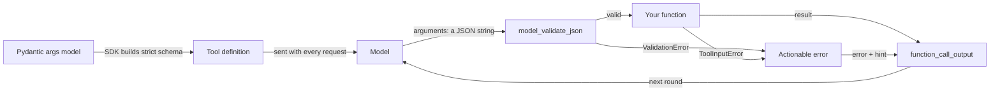
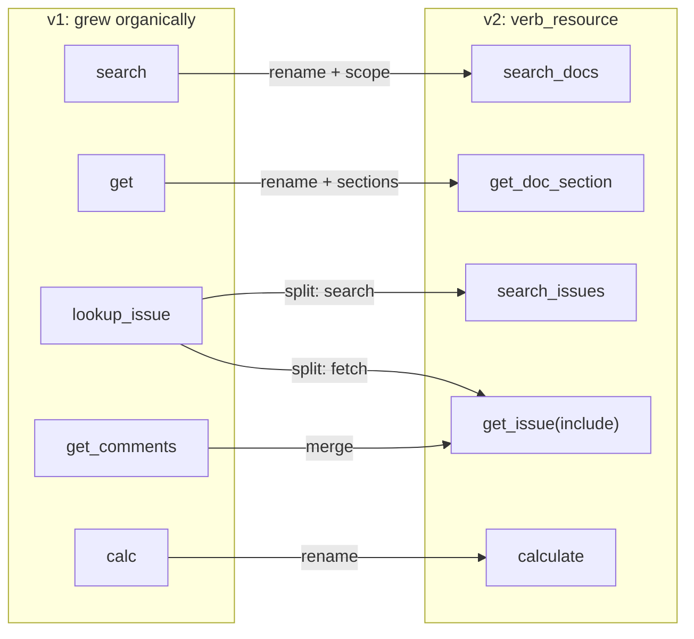
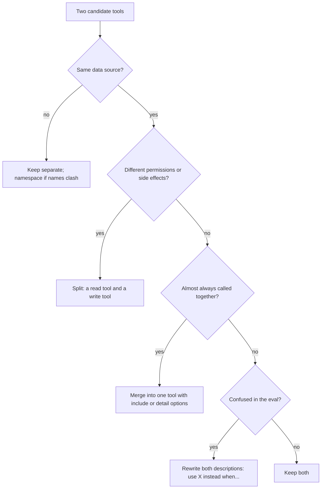

# Designing Tools: Schemas, Strict Mode & Descriptions

Atlas's first toolset grew one tool at a time: `search`, `get`, `lookup_issue`, `get_comments`, `calc`. Ask it "What does ORB-1202 mean?" and the model calls `lookup_issue("ORB-1202")`, because nothing told it that error codes live in the docs. The model and the prompt stay the same; only the tools change. Today you redesign them and measure the difference with an eval.

## At a Glance

- **Time:** ~2 h core (+ optional Go Deeper) · **Depth:** working
- **Prerequisites:** [Day 35: Function Calling: The Tool Loop](../Day_035_function_calling/function_calling.md), [Day 20: Your First Eval Set](../../Phase_2_Building_with_LLM_APIs/Day_020_first_eval_set/first_eval_set.md); helpful: [Day 15: Pydantic for LLM Apps](../../Phase_2_Building_with_LLM_APIs/Day_015_pydantic_for_llms/pydantic_for_llms.md)
- **You'll build:** `atlas/tools.py` v2: a `@tool` registry that turns Pydantic models into strict tool schemas, a validating `dispatch()` that returns actionable errors, the v2 Orbit toolset, and a 20-case tool-choice eval that scores v1 against v2.
- **Stops at:** designing tens of tools. Tool search for huge toolsets is an optional aside in Go Deeper.
- **Fast path:** Already design clean REST APIs and know Day 35's loop? Read "The Tool Design Checklist" and "Measure It", run `tool_eval`, then do Exercise 2 (~45 min).
- **Cost:** ≈ $0.05 on `gpt-6-luna` for the 120 eval calls (prices as of 2026-11, [verify](https://developers.openai.com/api/docs/pricing)). Every script except `first_pydantic_tool` and `tool_eval` runs offline.
- **New terms:** strict mode, namespacing, actionable error, tool consolidation, tool-choice accuracy

> **Coming from Software Engineering?** A tool is a public API whose only client reads the docs literally, on every single call, and never asks a follow-up question. Generating the schema from a Pydantic model is FastAPI generating OpenAPI (a machine-readable API description) from type hints. Tool names are endpoint naming. An actionable error is a good 4xx body that says how to fix the request. Consolidation is choosing coarse-grained endpoints (one call does a whole task) over chatty ones. Your API-ergonomics instincts transfer, and here you can measure them with an eval.

## Same Model, Better Tools

Here is the v1 toolset from Day 35, as the model sees it:

| Name | Description | Arguments |
|---|---|---|
| `search` | "Search." | `q: str` |
| `get` | "Get a document." | `id: str` |
| `lookup_issue` | "Look up an issue." | `q: str` |
| `get_comments` | "Get comments." | `issue_id: int` |
| `calc` | "Calculator." | `expr: str` |

Three questions go wrong in predictable ways:

- **"What does ORB-1202 mean?"** `ORB-1202` looks like an issue key, so the model calls `lookup_issue`. Error codes are documented in `docs/error-codes.md`.
- **"Have users reported a reconnect storm on 3.1.0?"** Does `search` cover issues? Nothing says, so it's a coin flip.
- **"Any open issues about DST?"** `lookup_issue` has no state filter, and returns full issue bodies, so the answer costs thousands of tokens.

## Tools Are the Model's Only UI

Think of a shared kitchen. A drawer labelled "spoons" gets used correctly; one labelled "misc 2" gets opened, rummaged and closed. A note on the wrong drawer saying "knives are left of the sink" saves the next person a search.

The model's whole view of a tool is three things, sent as input tokens with every request:

1. **The name**, such as `search_docs`.
2. **The description**, free text written by you.
3. **The parameter schema**, JSON Schema with a description per field.

It never sees your function body or your database. Everything it needs to pick a tool and fill in its arguments must be in those three places: the description *is* the prompt for that decision.

## Reading a Strict Schema by Hand

Before generating anything, read one. This is the `search_issues` tool that today's first script prints, in the flat Responses shape from Day 35:

```json
{
  "type": "function",
  "name": "search_issues",
  "strict": true,
  "parameters": {
    "properties": {
      "query": {"description": "Keywords or an exact term, e.g. 'ORB-1402' or 'ran twice'.",
                "title": "Query", "type": "string"},
      "state": {"anyOf": [{"enum": ["open", "closed"], "type": "string"}, {"type": "null"}],
                "description": "Only open or closed issues; null for both.", "title": "State"},
      "limit": {"default": 5, "description": "Maximum issues to return.",
                "maximum": 20, "minimum": 1, "title": "Limit", "type": "integer"}
    },
    "required": ["query", "state", "limit"],
    "title": "IssuesSearchArgs",
    "type": "object",
    "additionalProperties": false
  },
  "description": "Search Orbit's issue tracker for bug reports and user questions."
}
```

Things to notice, one per line:

- **`"strict": true`** asks the API to guarantee the arguments match this schema. **Strict mode** reuses the constrained decoding behind Structured Outputs ([Day 16](../../Phase_2_Building_with_LLM_APIs/Day_016_structured_outputs/structured_outputs.md)), so you never get almost-JSON or a missing field.
- **`required` lists every field**, even `state` and `limit`. Under strict, "optional" can't mean "may be absent".
- **`state` is `anyOf [enum, null]`**. That's how strict spells optional: the model must send the key, and sends `null` when it has no filter.
- **`limit` keeps `"default": 5`** as documentation only. It's still required, so the model always sends a number.
- **`minimum`/`maximum` survive.** They're in the strict subset, so the model can't send `limit: 50`.
- **`additionalProperties: false`** forbids invented keys like `"sort": "newest"`.

Check yourself: if the model wants all open issues about DST, what does it send? `{"query": "DST", "state": "open", "limit": 5}`, with all three keys present.

## From Pydantic Model to Tool

You won't write that JSON by hand. The OpenAI SDK builds it from a Pydantic model, the same way FastAPI builds OpenAPI. The parts:

| Pydantic | JSON Schema | Under strict mode |
|---|---|---|
| `str`, `int`, `float`, `bool` | `string`, `integer`, `number`, `boolean` | as-is |
| `list[str]` | `array` + `items` | as-is; `minItems`/`maxItems` are supported |
| `Literal["open", "closed"]` | `enum` (an **enum** is a fixed list of allowed values) | as-is; ≤1,000 enum values per schema |
| `X \| None = None` | `anyOf [X, null]` | listed in `required`; the SDK drops `default: null` |
| `int = 5` | `"default": 5` | still in `required`; the model always sends a value |
| `Field(ge=1, le=20)` | `minimum`, `maximum` | supported |
| `Field(description=...)` | `description` | as-is; this is what the model reads |
| nested `BaseModel` | `$defs` + `$ref` | supported; each object gets `additionalProperties: false` |
| `dict[str, str]` | object with `additionalProperties: {schema}` | **rejected**: every object needs `additionalProperties: false` |

The helper is `openai.pydantic_responses_function_tool(model, *, name=None, description=None)`. It returns the flat Responses tool with `strict: True`. If you omit `name` it uses the class name, and if you omit `description` it uses the model's docstring.



Pydantic describes the arguments to the model, then checks what comes back. This script prints the tool from the previous section, offline:

```python
# script_id: day_036_tool_design/schema_preview
# Print the strict Responses tool the SDK generates from a Pydantic model. Runs offline (no key).
# Install: uv add "openai>=3.46,<4" pydantic
import json
from typing import Literal

from openai import pydantic_responses_function_tool
from pydantic import BaseModel, Field


class IssuesSearchArgs(BaseModel):
    query: str = Field(description="Keywords or an exact term, e.g. 'ORB-1402' or 'ran twice'.")
    state: Literal["open", "closed"] | None = Field(None, description="Only open or closed issues; null for both.")
    limit: int = Field(5, ge=1, le=20, description="Maximum issues to return.")


tool = pydantic_responses_function_tool(
    IssuesSearchArgs,
    name="search_issues",
    description="Search Orbit's issue tracker for bug reports and user questions.",
)
print(json.dumps(tool, indent=2))
```

```text
{
  "type": "function",
  "name": "search_issues",
  "strict": true,
  "parameters": {
    "properties": {
... (the rest matches the JSON in "Reading a Strict Schema by Hand")
```

## Your First Pydantic Tool

Now let the model fill it in. `client.responses.parse()` accepts these tools and gives every function-call item a `parsed_arguments` attribute holding a model instance, so you get typed arguments instead of a JSON string.

```python
# script_id: day_036_tool_design/first_pydantic_tool
# One question -> one typed tool call. Needs OPENAI_API_KEY; ATLAS_MODEL is optional.
# Install: uv add "openai>=3.46,<4" pydantic
import os
from typing import Literal

from openai import OpenAI, pydantic_responses_function_tool
from pydantic import BaseModel, Field

MODEL = os.environ.get("ATLAS_MODEL", "gpt-6-luna")
client = OpenAI()


class IssuesSearchArgs(BaseModel):
    query: str = Field(description="Keywords or an exact term, e.g. 'ORB-1402' or 'ran twice'.")
    state: Literal["open", "closed"] | None = Field(None, description="Only open or closed issues; null for both.")
    limit: int = Field(5, ge=1, le=20, description="Maximum issues to return.")


search_issues = pydantic_responses_function_tool(
    IssuesSearchArgs, name="search_issues", description="Search Orbit's issue tracker for bug reports.")
resp = client.responses.parse(model=MODEL, input="Find open issues that mention ORB-1101.", tools=[search_issues])
for item in resp.output:
    if item.type == "function_call":
        print(item.name, repr(item.parsed_arguments))
```

```text
search_issues IssuesSearchArgs(query='ORB-1101', state='open', limit=5)
```

Your query wording may differ. `parsed_arguments` is filled only by `responses.parse()` (or `responses.stream()`); with `responses.create()` you get the raw string and validate it yourself, as `dispatch()` will. Don't confuse the helper with `pydantic_function_tool()`, which returns the Chat Completions nested shape.

## Break It: Strict Mode's Limits

Strict mode is a shape guarantee, so know where it ends. The function-calling guide states two rules: `additionalProperties: false` on every object, and every property in `required`. Break either with `strict: true` and the API rejects the request with HTTP 400 (`openai.BadRequestError`), "with details about the missing constraints". This script checks both rules locally, so a unit test catches it first.

```python
# script_id: day_036_tool_design/strict_limits
# Strict mode's limits, offline: a local rule check, a schema strict can't express, a valid-but-wrong call.
# Install: uv add "openai>=3.46,<4" pydantic    Env: ORBIT_DATA (default datasets/orbit)
import json
import os
import sqlite3
from contextlib import closing
from pathlib import Path

from openai import pydantic_responses_function_tool
from pydantic import BaseModel, Field

DATA_DIR = Path(os.environ.get("ORBIT_DATA", "datasets/orbit"))


def strict_problems(schema: dict, path: str = "$") -> list[str]:
    """Check the two documented strict rules before the API sees the schema."""
    problems = []
    if schema.get("type") == "object":
        props = schema.get("properties", {})
        if schema.get("additionalProperties") is not False:
            problems.append(f"{path}: additionalProperties must be false")
        if missing := sorted(set(props) - set(schema.get("required", []))):
            problems.append(f"{path}: not in required: {missing}")
        for key, sub in props.items():
            problems += strict_problems(sub, f"{path}.{key}")
    for i, sub in enumerate(schema.get("anyOf", [])):
        problems += strict_problems(sub, f"{path}.anyOf[{i}]")
    if isinstance(schema.get("items"), dict):
        problems += strict_problems(schema["items"], f"{path}[]")
    for name, sub in schema.get("$defs", {}).items():
        problems += strict_problems(sub, f"$defs.{name}")
    return problems
```

Three ways to hit the limits:

```python
# script_id: day_036_tool_design/strict_limits
# (a) Hand-written: `state` is optional the plain JSON Schema way, which strict rejects.
hand_written = {"type": "object", "additionalProperties": False,
                "properties": {"query": {"type": "string"}, "state": {"type": "string"}},
                "required": ["query"]}
print("(a)", strict_problems(hand_written))


# (b) A free-form map: Pydantic accepts it and the SDK emits it, but strict can't express it.
class LabelArgs(BaseModel):
    issue_id: int
    labels: dict[str, str] = Field(description="label name -> value")


print("(b)", strict_problems(pydantic_responses_function_tool(LabelArgs, name="set_labels")["parameters"]))


# (c) Valid shape, wrong fact: strict guarantees an int, not an issue that exists.
class IssueArgs(BaseModel):
    issue_id: int = Field(description="Issue number, e.g. 143.")


args = IssueArgs.model_validate_json('{"issue_id": 99999}')  # passes: 99999 IS an int
with closing(sqlite3.connect(f"file:{DATA_DIR / 'issues' / 'orbit.db'}?mode=ro", uri=True)) as db:
    row = db.execute("SELECT title FROM issues WHERE id = ?", (args.issue_id,)).fetchone()
    top = db.execute("SELECT max(id) FROM issues").fetchone()[0]
if row is None:
    print("(c)", json.dumps({"error": f"No issue #{args.issue_id}.",
                             "hint": f"Issue ids run 1-{top}; use search_issues to find one by topic."}))
```

```text
(a) ["$: not in required: ['state']"]
(b) ['$.labels: additionalProperties must be false']
(c) {"error": "No issue #99999.", "hint": "Issue ids run 1-240; use search_issues to find one by topic."}
```

Case (b) is sneaky: the SDK builds the schema without complaint, and the 400 arrives on the first real request. Change the shape instead, for example `labels: list[Label]` with `name` and `value` fields.

So, three limits to remember:

1. **Shape, not facts.** Strict guarantees `issue_id` is an integer, not that issue 99999 exists. Every tool still validates against reality and says what to do instead (case c).
2. **Not every schema fits.** Free-form maps, open objects and a non-object root are out. Supported keywords are a subset (see the structured-outputs guide's "supported schemas"), and there are size caps: 5,000 properties, 10 nesting levels, 1,000 enum values.
3. **No cross-field rules.** "`since` must be before `until`" or "give `issue_id` or `query`, not both" can't be said in the strict subset. Check them in code.

## The `@tool` Decorator and a Validating `dispatch()`

In Day 35 you hand-wrote each schema next to its function. That drifts: someone renames an argument and forgets the schema. Instead, keep one source of truth per tool, a Pydantic args model plus a function whose docstring is the description, and let a decorator register both. Today's code lives in one module, `atlas_tools.py` (Atlas's `atlas/tools.py`), which later scripts import.

```python
# script_id: day_036_tool_design/atlas_tools
# atlas/tools.py v2: @tool registry, validating dispatch(), the v2 Orbit toolset and the v1 set for the eval.
# Install: uv add "openai>=3.46,<4" pydantic tiktoken    Env: ORBIT_DATA (default datasets/orbit)
# Services: none; reads docs/*.md and a read-only orbit.db. Runs offline. Save as atlas_tools.py.
import ast
import difflib
import inspect
import json
import operator
import os
import re
import sqlite3
from contextlib import closing
from dataclasses import dataclass
from functools import lru_cache
from pathlib import Path
from typing import Any, Callable, Literal

import tiktoken
from openai import pydantic_responses_function_tool
from pydantic import BaseModel, Field, ValidationError

DATA_DIR = Path(os.environ.get("ORBIT_DATA", "datasets/orbit"))


@dataclass
class ToolSpec:
    name: str
    args_model: type[BaseModel]
    fn: Callable[[Any], Any]
    description: str
    side_effect: bool = False  # metadata only today; Day 37 puts these tools behind approval

    def as_tool(self) -> dict:
        return pydantic_responses_function_tool(self.args_model, name=self.name, description=self.description)
```

The registry and the decorator. `registry=` lets the v1 tools live in their own dict for the eval:

```python
# script_id: day_036_tool_design/atlas_tools
REGISTRY: dict[str, ToolSpec] = {}  # v2: the canonical Atlas tools
LEGACY: dict[str, ToolSpec] = {}    # v1: kept only so the eval can compare


class ToolInputError(Exception):
    """A well-formed call that can't be served. `hint` tells the model what to do instead."""

    def __init__(self, error: str, hint: str) -> None:
        super().__init__(error)
        self.hint = hint


def tool(args_model: type[BaseModel], *, name: str | None = None, side_effect: bool = False,
         registry: dict[str, ToolSpec] = REGISTRY) -> Callable:
    """Register fn(args) as a tool. The docstring becomes the description the model reads."""
    def register(fn: Callable) -> Callable:
        spec = ToolSpec(name or fn.__name__, args_model, fn, inspect.cleandoc(fn.__doc__ or ""), side_effect)
        if spec.name in registry:
            raise ValueError(f"duplicate tool name {spec.name!r}")  # names are a contract
        registry[spec.name] = spec
        return fn
    return register


def tool_defs(registry: dict[str, ToolSpec] = REGISTRY) -> list[dict]:
    """The definitions you send as `tools=`; regenerated, never hand-edited."""
    return [spec.as_tool() for spec in registry.values()]
```

`dispatch()` is where Pydantic checks the model's side of the contract. It never raises for bad input. Every failure becomes an **actionable error**: a short JSON object with an `error` (what went wrong) and a `hint` (what to call instead), which goes back to the model as the tool output.

```python
# script_id: day_036_tool_design/atlas_tools
def _err(error: str, hint: str) -> str:
    return json.dumps({"error": error, "hint": hint})


def dispatch(name: str, arguments: str, registry: dict[str, ToolSpec] = REGISTRY) -> str:
    """Validate, run, and return a string the model can read. Bad input never raises."""
    spec = registry.get(name)
    if spec is None:
        return _err(f"Unknown tool {name!r}.", f"Available tools: {', '.join(registry)}.")
    try:
        args = spec.args_model.model_validate_json(arguments)
    except ValidationError as exc:
        where = "; ".join(f"{'.'.join(map(str, e['loc'])) or 'arguments'}: {e['msg']}" for e in exc.errors())
        return _err(f"Invalid arguments for {name}: {where}.", "Fix those fields and call again.")
    try:
        result = spec.fn(args)
    except ToolInputError as exc:
        return _err(str(exc), exc.hint)
    return result if isinstance(result, str) else json.dumps(result, ensure_ascii=False)
```

Only `ToolInputError` and `ValidationError` are caught; a real bug (a `KeyError`, a broken query) should still crash loudly in development. Day 37 adds timeouts, retries and typed error kinds.

## The Tool Design Checklist

Here is the checklist, applied to Atlas. Each item fixes one of the v1 failures.

1. **One naming scheme: `verb_resource`.** `search_docs`, `get_doc_section`, `search_issues`, `get_issue`. The verb says read or write; the resource says which system. Two tools named `search` and `find` are vague twins, and the model picks between them at random.
2. **Namespace once sources mix.** **Namespacing** means prefixing a tool with the system it belongs to. With only Orbit's tracker, `search_issues` is clear. Once GitHub's tools arrive through MCP ([Day 39](../Day_039_mcp_clients/mcp_clients.md)), use `github_search_issues` and `orbit_search_issues`.
3. **Descriptions say what, when, when NOT, and give an example.** "Search." tells the model nothing. `search_docs` now says it covers ORB-xxxx error codes and config keys, and that bug reports belong to `search_issues`. The "when NOT" line is the one that fixes ORB-1202.
4. **Enums over free text.** `state: "open" | "closed" | null` and `detail: "concise" | "detailed"` can't be misspelled, and the model sees every legal value.
5. **Token-efficient outputs.** Return ids and titles by default (`detail="concise"`), truncate long text, and point to the next call ("Call get_issue(issue_id) for the body"). Tool output is input tokens on the next round.
6. **Actionable errors.** "Unknown doc_id 'retries'. Closest: 'retries-and-backoff'. Call search_docs first." beats `KeyError: 'retries'`. The model reads the hint and fixes its next call.
7. **Consolidate what's always used together.** **Tool consolidation** means merging tools that are always called in sequence into one coarse-grained tool. v1 needed `lookup_issue` then `get_comments` (and labels had no tool at all). v2 has `get_issue(issue_id, include=["body", "comments", "labels"])`: one round instead of three.



First the docs tools. `search_docs` is a stdlib keyword scorer standing in for the Phase 3 index; today, the description is what matters.

```python
# script_id: day_036_tool_design/atlas_tools
@lru_cache(maxsize=1)
def load_docs() -> dict[str, dict]:
    """doc_id -> {title, applies_to, heads, body}, parsed from each page's front matter."""
    docs = {}
    for path in sorted((DATA_DIR / "docs").glob("*.md")):
        _, front, body = path.read_text(encoding="utf-8").split("---", 2)
        meta = {k.strip(): v.strip().strip('"') for k, v in (ln.split(":", 1) for ln in front.strip().splitlines())}
        heads = " ".join(ln for ln in body.splitlines() if ln.startswith("#")).lower()
        docs[path.stem] = {"title": meta.get("title", path.stem), "applies_to": meta.get("applies_to", "all"),
                           "heads": heads, "body": body}
    return docs


STOP = {"the", "and", "for", "what", "does", "how", "with", "mean", "about", "are", "any", "has", "anyone"}


def keywords(text: str) -> list[str]:
    return [w for w in re.findall(r"[a-z0-9_]+(?:-[a-z0-9_]+)*", text.lower()) if len(w) > 2 and w not in STOP]


def rank_docs(query: str, k: int) -> list[tuple[int, str]]:
    words = keywords(query)
    # capped body hits + bonuses for title and headings, so one page defining "ORB-1202" beats ten mentions
    scored = [(sum(min(d["body"].lower().count(w), 3) + 5 * (w in d["title"].lower()) + 5 * (w in d["heads"])
                   for w in words), doc_id)
              for doc_id, d in load_docs().items()]
    return sorted((s for s in scored if s[0] > 0), reverse=True)[:k]


class DocsSearchArgs(BaseModel):
    query: str = Field(description="Keywords or an exact term, e.g. 'ORB-1202' or 'lease_seconds'.")
    k: int = Field(3, ge=1, le=10, description="How many pages to return.")


@tool(DocsSearchArgs)
def search_docs(args: DocsSearchArgs) -> dict:
    """Search Orbit's documentation: how-to guides, configuration keys, CLI flags and ORB-xxxx error codes.
    Use for "how do I...", "what does X mean" and "what is the default for Y".
    Do NOT use for bug reports or what users experienced: use search_issues.
    Returns doc_id, title and a one-line snippet; call get_doc_section(doc_id) for the text."""
    words, hits = keywords(args.query), []
    for _, doc_id in rank_docs(args.query, args.k):
        doc = load_docs()[doc_id]
        line = next((ln for ln in doc["body"].splitlines() if any(w in ln.lower() for w in words)), "")
        hits.append({"doc_id": doc_id, "title": doc["title"], "snippet": line.strip()[:160]})
    return {"results": hits}
```

`get_doc_section` shows actionable errors in practice: a guessed `doc_id` gets the closest real one, and a wrong heading gets the list of real headings.

```python
# script_id: day_036_tool_design/atlas_tools
class DocSectionArgs(BaseModel):
    doc_id: str = Field(description="A doc_id from search_docs, e.g. 'retries-and-backoff'.")
    heading: str | None = Field(None, description="A '## ' heading to return only that section; null for the page start.")


@tool(DocSectionArgs)
def get_doc_section(args: DocSectionArgs) -> dict:
    """Read one Orbit doc page, or one '## ' section of it, by doc_id. Use after search_docs,
    or when the user names a page. Returns at most 1,500 characters."""
    docs = load_docs()
    if args.doc_id not in docs:
        close = [d for d in docs if args.doc_id in d] or difflib.get_close_matches(args.doc_id, docs, n=1, cutoff=0.4)
        hint = f"Closest: {close[0]!r}. " if close else ""
        raise ToolInputError(f"Unknown doc_id {args.doc_id!r}.", hint + "Call search_docs first to get a valid doc_id.")
    sections = re.split(r"(?m)^## ", docs[args.doc_id]["body"])
    text = sections[0]
    if args.heading:
        match = [s for s in sections[1:] if s.lower().startswith(args.heading.lower())]
        if not match:
            heads = [s.splitlines()[0] for s in sections[1:]]
            raise ToolInputError(f"No section {args.heading!r} in {args.doc_id}.", f"Real headings: {heads}.")
        text = "## " + match[0]
    return {"doc_id": args.doc_id, "text": text[:1500], "truncated": len(text) > 1500}
```

The issue tools. `search_issues` gets the `detail` enum, and every query goes through `?` placeholders on a read-only connection, as in [Day 33](../../Phase_3_RAG/Day_033_text_to_sql/text_to_sql.md).

```python
# script_id: day_036_tool_design/atlas_tools
def connect_ro() -> sqlite3.Connection:  # built on Day 33: the file refuses writes
    return sqlite3.connect(f"file:{DATA_DIR / 'issues' / 'orbit.db'}?mode=ro", uri=True)


class IssuesSearchArgs(BaseModel):
    query: str = Field(description="Keywords or an exact term, e.g. 'DST ran twice' or 'ORB-1402'.")
    state: Literal["open", "closed"] | None = Field(None, description="Only open or closed issues; null for both.")
    limit: int = Field(5, ge=1, le=20, description="Maximum issues to return.")
    detail: Literal["concise", "detailed"] = Field(
        "concise", description="'concise': id, title, state. 'detailed' adds the first 600 characters of the body.")


@tool(IssuesSearchArgs)
def search_issues(args: IssuesSearchArgs) -> dict:
    """Search Orbit's issue tracker: bug reports, feature requests and what users experienced.
    Use for "has anyone reported...", "are there open issues about..." or a symptom seen in production.
    Do NOT use for how-to questions or error-code meanings: use search_docs. To read one issue, use get_issue."""
    words = keywords(args.query)[:6] or [args.query.lower()]
    score = " + ".join(["(lower(title || ' ' || body) LIKE ?)"] * len(words))  # placeholders only
    where = f"({score}) > 0" + (" AND state = ?" if args.state else "")
    sql = f"SELECT id, title, state, body FROM issues WHERE {where} ORDER BY ({score}) DESC, id DESC LIMIT ?"
    likes = [f"%{w}%" for w in words]
    with closing(connect_ro()) as db:
        rows = db.execute(sql, likes + ([args.state] if args.state else []) + likes + [args.limit]).fetchall()
    hits = [{"id": i, "title": t, "state": s} | ({"body": b[:600]} if args.detail == "detailed" else {})
            for i, t, s, b in rows]
    return {"results": hits, "hint": "Call get_issue(issue_id) for the body, comments and labels."}
```

`get_issue` is the consolidated tool. The `include` list replaces two v1 tools and a missing third.

```python
# script_id: day_036_tool_design/atlas_tools
class IssueArgs(BaseModel):
    issue_id: int = Field(description="Issue number, e.g. 143. Not an ORB-xxxx error code.")
    include: list[Literal["body", "comments", "labels"]] = Field(
        default_factory=lambda: ["body"], description="Parts to add to id, title and state.")


@tool(IssueArgs)
def get_issue(args: IssueArgs) -> dict:
    """Fetch one Orbit issue by number, optionally with its body, first comments and labels.
    Use when the user gives an issue number, or after search_issues. Long text is truncated."""
    with closing(connect_ro()) as db:
        row = db.execute("SELECT id, title, state, body FROM issues WHERE id = ?", (args.issue_id,)).fetchone()
        if row is None:
            top = db.execute("SELECT max(id) FROM issues").fetchone()[0]
            raise ToolInputError(f"No issue #{args.issue_id}.", f"Issue ids run 1-{top}. For an ORB-xxxx code "
                                 "use search_docs; to find issues by topic use search_issues.")
        out: dict[str, Any] = {"id": row[0], "title": row[1], "state": row[2]}
        if "body" in args.include:
            out["body"] = row[3][:800]
        if "comments" in args.include:
            out["comments"] = [{"author": a, "text": b[:300]} for a, b in db.execute(
                "SELECT author, body FROM comments WHERE issue_id = ? ORDER BY position LIMIT 3", (row[0],))]
        if "labels" in args.include:
            out["labels"] = [n for (n,) in db.execute(
                "SELECT l.name FROM labels l JOIN issue_labels il ON il.label_id = l.id WHERE il.issue_id = ?",
                (row[0],))]
    return out
```

`calculate` walks the expression's syntax tree (AST) instead of calling `eval()`, which would run any Python the model wrote. Its description tells the model to use it for any arithmetic; without that line, models often do the maths in their head.

```python
# script_id: day_036_tool_design/atlas_tools
class CalcArgs(BaseModel):
    expression: str = Field(description="Arithmetic only: numbers, + - * / // % ** and parentheses, e.g. '(2+4+8)*1250'.")


_OPS = {ast.Add: operator.add, ast.Sub: operator.sub, ast.Mult: operator.mul, ast.Div: operator.truediv,
        ast.FloorDiv: operator.floordiv, ast.Mod: operator.mod, ast.Pow: operator.pow}


def _eval(node: ast.AST) -> float:
    if isinstance(node, ast.Constant) and type(node.value) in (int, float):
        return node.value
    if isinstance(node, ast.UnaryOp) and isinstance(node.op, ast.USub):
        return -_eval(node.operand)
    if isinstance(node, ast.BinOp) and type(node.op) in _OPS:
        left, right = _eval(node.left), _eval(node.right)
        if isinstance(node.op, ast.Pow) and abs(right) > 100:
            raise ToolInputError("Exponent too large.", "Keep exponents at or below 100.")
        return _OPS[type(node.op)](left, right)
    raise ToolInputError(f"Unsupported element: {type(node).__name__}.", "Use only numbers, + - * / // % ** and ( ).")


@tool(CalcArgs)
def calculate(args: CalcArgs) -> dict:
    """Evaluate an arithmetic expression exactly. Use it for ANY arithmetic (lease and heartbeat maths,
    retry delays, throughput) instead of computing in your head. Not for dates or unit conversion."""
    try:
        return {"expression": args.expression, "result": _eval(ast.parse(args.expression, mode="eval").body)}
    except (SyntaxError, ZeroDivisionError) as exc:
        raise ToolInputError(f"Cannot evaluate {args.expression!r}: {exc}.", "Send a plain arithmetic expression.") from exc
```

Last, the v1 tools, rebuilt only for comparison: terse names and descriptions, and whole issue bodies in the output. Then the generated definitions and a token counter for the eval.

```python
# script_id: day_036_tool_design/atlas_tools
class Q(BaseModel):
    q: str


class DocId(BaseModel):
    id: str


class IssueId(BaseModel):
    issue_id: int


@tool(Q, name="search", registry=LEGACY)
def v1_search(args: Q) -> dict:
    """Search."""
    return {"docs": [load_docs()[d]["body"][:3000] for _, d in rank_docs(args.q, 3)]}


@tool(DocId, name="get", registry=LEGACY)
def v1_get(args: DocId) -> str:
    """Get a document."""
    return load_docs().get(args.id, {}).get("body", "not found")


@tool(Q, name="lookup_issue", registry=LEGACY)
def v1_lookup_issue(args: Q) -> dict:
    """Look up an issue."""
    ids = [int(args.q.strip("#"))] if args.q.strip("#").isdigit() else \
        [h["id"] for h in search_issues(IssuesSearchArgs(query=args.q))["results"]]
    with closing(connect_ro()) as db:  # whole bodies: the v1 token bill
        return {"issues": [db.execute("SELECT id, title, state, body FROM issues WHERE id = ?", (i,)).fetchone()
                           for i in ids]}


@tool(IssueId, name="get_comments", registry=LEGACY)
def v1_get_comments(args: IssueId) -> dict:
    """Get comments."""
    return get_issue(IssueArgs(issue_id=args.issue_id, include=["comments"]))


@tool(CalcArgs, name="calc", registry=LEGACY)
def v1_calc(args: CalcArgs) -> dict:
    """Calculator."""
    return calculate(args)
```

```python
# script_id: day_036_tool_design/atlas_tools
TOOLS: list[dict] = tool_defs(REGISTRY)  # the v2 definitions you send as tools=
V1_TOOLS: list[dict] = tool_defs(LEGACY)


@lru_cache(maxsize=1)
def _encoding() -> tiktoken.Encoding:
    return tiktoken.get_encoding("o200k_base")


def count_tokens(text: str) -> int:
    """Built on Day 4: approximate for GPT-6. The input-token count endpoint gives exact numbers."""
    return len(_encoding().encode(text, disallowed_special=()))


if __name__ == "__main__":
    print([t["name"] for t in TOOLS])
    print(dispatch("search_docs", '{"query": "ORB-1202", "k": 2}'))
    print(dispatch("calculate", '{"expression": "300 / 30"}'))
```

```text
['search_docs', 'get_doc_section', 'search_issues', 'get_issue', 'calculate']
{"results": [{"doc_id": "error-codes", ...
{"expression": "300 / 30", "result": 10.0}
```

Now feed `dispatch()` the mistakes models really make: a guessed id, a heading that doesn't exist, an out-of-range number, an issue that doesn't exist, and a v1 name the model remembers from an old prompt.

```python
# script_id: day_036_tool_design/actionable_errors
# Five bad calls through dispatch(); each returns an error the model can act on. Runs offline.
# Install: uv add "openai>=3.46,<4" pydantic tiktoken    Needs atlas_tools.py next to this file.
from atlas_tools import dispatch

BAD_CALLS = [
    ("get_doc_section", '{"doc_id": "retries", "heading": null}'),
    ("get_doc_section", '{"doc_id": "retries-and-backoff", "heading": "Jitter"}'),
    # strict mode blocks limit=50, but non-strict paths (MCP in Day 39, tests) don't
    ("search_issues", '{"query": "DST", "state": "open", "limit": 50, "detail": "concise"}'),
    ("get_issue", '{"issue_id": 99999, "include": []}'),
    ("lookup_issue", '{"q": "ORB-1202"}'),
]
for name, arguments in BAD_CALLS:
    print(f"{name}: {dispatch(name, arguments)}")
```

```text
get_doc_section: {"error": "Unknown doc_id 'retries'.", "hint": "Closest: 'retries-and-backoff'. Call search_docs first to get a valid doc_id."}
get_doc_section: {"error": "No section 'Jitter' in retries-and-backoff.", "hint": "Real headings: ['Global policy: `[retries]`', 'Per-job policy: `@app.job(retries=...)`', 'Backoff strategies', 'What counts as a failed attempt', 'Permanent errors', 'What it looks like in the logs', 'Coming from 2.x', 'See also']."}
search_issues: {"error": "Invalid arguments for search_issues: limit: Input should be less than or equal to 20.", "hint": "Fix those fields and call again."}
get_issue: {"error": "No issue #99999.", "hint": "Issue ids run 1-240. For an ORB-xxxx code use search_docs; to find issues by topic use search_issues."}
lookup_issue: {"error": "Unknown tool 'lookup_issue'.", "hint": "Available tools: search_docs, get_doc_section, search_issues, get_issue, calculate."}
```

Finally, put numbers on item 5. The same five searches, as v1's whole-body output and as v2's two detail levels:

```python
# script_id: day_036_tool_design/concise_vs_detailed
# Tool-output tokens: v1 lookup_issue vs v2 search_issues (concise / detailed). Runs offline.
# Install: uv add "openai>=3.46,<4" pydantic tiktoken    Needs atlas_tools.py next to this file.
import json

from atlas_tools import LEGACY, count_tokens, dispatch

QUERIES = ["DST ran twice", "reconnect storm redis", "dashboard oidc", "ORB-1101 lease expired", "memory leak"]
print(f"{'query':24} {'v1':>6} {'concise':>8} {'detailed':>9}")
for q in QUERIES:
    v1 = dispatch("lookup_issue", json.dumps({"q": q}), LEGACY)
    v2 = {d: dispatch("search_issues", json.dumps({"query": q, "state": None, "limit": 5, "detail": d}))
          for d in ("concise", "detailed")}
    print(f"{q:24} {count_tokens(v1):>6} {count_tokens(v2['concise']):>8} {count_tokens(v2['detailed']):>9}")
```

```text
query                        v1  concise  detailed
DST ran twice              1691      196      1268
reconnect storm redis     34816      234      1128
dashboard oidc             1218      190       954
ORB-1101 lease expired     1632      173      1163
memory leak                1197      205      1128
```

Counts are approximate (`o200k_base`); they're stable because the data is local.
One v1 search for "reconnect storm" returns one very long issue in full: about 35,000 tokens, against about 230 for the concise v2 search. Tool output is the next round's input, so that is real money and real context.

## Measure It: A 20-Case Tool-Choice Eval

Design rules are hypotheses until measured. **Tool-choice accuracy** is the share of questions where the model picks the tool a careful human would (or correctly uses none). It's a code-based check as in [Day 20](../../Phase_2_Building_with_LLM_APIs/Day_020_first_eval_set/first_eval_set.md): expected tool name, or `None`.

The 20 cases mix 3 no-tool questions, 5 exact terms (ORB codes, config keys, a CLI command), 4 docs-vs-issues near misses ("how does X work" vs "has anyone reported X"), 2 arithmetic and 6 plain lookups. Every label must be unambiguous, or you measure your labelling instead of your tools. The instructions never mention a tool name, so the tools do the routing.

```python
# script_id: day_036_tool_design/tool_eval
# 20-case tool-choice eval, v1 vs v2 toolsets, x3 repeats (~120 calls). Needs OPENAI_API_KEY.
# Install: uv add "openai>=3.46,<4" pydantic tiktoken    Env: ATLAS_MODEL, ORBIT_DATA, REPEATS (default 3)
# Needs atlas_tools.py next to this file. Save as tool_eval.py.
import os
from statistics import mean

from openai import OpenAI

from atlas_tools import LEGACY, REGISTRY, TOOLS, V1_TOOLS, count_tokens, dispatch

MODEL = os.environ.get("ATLAS_MODEL", "gpt-6-luna")
client = OpenAI()
INSTRUCTIONS = "You are Atlas, an assistant for the maintainers of Orbit, a Python background-jobs library."
PRICES = {"gpt-6-luna": {"input": 0.10, "cached": 0.01, "output": 0.50}}  # $/1M tokens, as of 2026-11; verify


class CostTracker:  # built on Day 12: compact
    def __init__(self) -> None:
        self.total_usd = 0.0

    def record(self, model: str, input_tokens: int, output_tokens: int, cached: int = 0) -> float:
        p = PRICES.get(model, PRICES["gpt-6-luna"])
        usd = ((input_tokens - cached) * p["input"] + cached * p["cached"] + output_tokens * p["output"]) / 1e6
        self.total_usd += usd
        return usd
```

The cases, labelled with v2 names:

```python
# script_id: day_036_tool_design/tool_eval
TOOL_CHOICE_CASES = [  # expected_tool: a v2 name, or None = answer without a tool
    {"question": "Thanks, that's all for today!", "expected_tool": None},
    {"question": "Rewrite this to sound friendlier: 'Fix your config, it is wrong.'", "expected_tool": None},
    {"question": "In one sentence, what is a background job queue in general?", "expected_tool": None},
    {"question": "What does ORB-1202 mean?", "expected_tool": "search_docs"},
    {"question": "How do I fix ORB-1101 LeaseExpired?", "expected_tool": "search_docs"},
    {"question": "What is the default value of max_payload_kb?", "expected_tool": "search_docs"},
    {"question": "What does the heartbeat_seconds setting control?", "expected_tool": "search_docs"},
    {"question": "What does the orbit doctor command check?", "expected_tool": "search_docs"},
    {"question": "Has anyone reported jobs running twice on the DST change?", "expected_tool": "search_issues"},
    {"question": "How does Orbit handle cron schedules across a DST change?", "expected_tool": "search_docs"},
    {"question": "Have users reported a reconnect storm on 3.1.0?", "expected_tool": "search_issues"},
    {"question": "How do I configure exponential backoff for retries?", "expected_tool": "search_docs"},
    {"question": "Compute (2+4+8+16+32+64) * 1250 for our retry budget.", "expected_tool": "calculate"},
    {"question": "1840 jobs/min at 2.7 s each: what is 1840 * 2.7 / 60 worker slots?", "expected_tool": "calculate"},
    {"question": "Show me issue #143.", "expected_tool": "get_issue"},
    {"question": "What did people say in the comments on issue 161?", "expected_tool": "get_issue"},
    {"question": "Read the 'Backoff strategies' section of the retries-and-backoff page.", "expected_tool": "get_doc_section"},
    {"question": "Open the 'Heartbeats' section of the leases-and-heartbeats doc.", "expected_tool": "get_doc_section"},
    {"question": "Find open issues about dashboard OIDC login.", "expected_tool": "search_issues"},
    {"question": "How do I deploy Orbit workers on Kubernetes?", "expected_tool": "search_docs"},
]
```

v1 has different names, so a small map says which v2 job each v1 tool does. Then one request per case, and the compact runner from Day 20:

```python
# script_id: day_036_tool_design/tool_eval
V1_EQUIV = {"search": {"search_docs"}, "get": {"get_doc_section"}, "lookup_issue": {"search_issues", "get_issue"},
            "get_comments": {"get_issue"}, "calc": {"calculate"}}
TOOLSETS = {"v1": (V1_TOOLS, LEGACY, V1_EQUIV), "v2": (TOOLS, REGISTRY, {n: {n} for n in REGISTRY})}
tracker = CostTracker()


def choose(question: str, tools: list[dict]):
    """One request. Return the first function_call item, or None if the model answered directly."""
    resp = client.responses.create(model=MODEL, instructions=INSTRUCTIONS, input=question,
                                   tools=tools, parallel_tool_calls=False)
    u = resp.usage
    tracker.record(MODEL, u.input_tokens, u.output_tokens, u.input_tokens_details.cached_tokens)
    return next((i for i in resp.output if i.type == "function_call"), None)


def run_eval(cases: list[dict], task, check, repeats: int = 1) -> list[dict]:  # built on Day 20: compact
    rows = []
    for run in range(repeats):
        for case in cases:
            out = task(case)
            rows.append({"run": run, "case": case, "out": out, "ok": check(case, out)})
    return rows
```

The report runs each toolset, executes the chosen tool to count its output tokens, and lists the misses so you know what to fix:

```python
# script_id: day_036_tool_design/tool_eval
def score_toolset(label: str, repeats: int) -> dict:
    tools, registry, equiv = TOOLSETS[label]
    spent_before = tracker.total_usd

    def task(case: dict) -> dict:
        call = choose(case["question"], tools)
        if call is None:
            return {"tool": None, "tokens": 0}
        return {"tool": call.name, "tokens": count_tokens(dispatch(call.name, call.arguments, registry))}

    def check(case: dict, out: dict) -> bool:
        if case["expected_tool"] is None:
            return out["tool"] is None
        return case["expected_tool"] in equiv.get(out["tool"], set())

    rows = run_eval(TOOL_CHOICE_CASES, task, check, repeats)
    called = [r["out"]["tokens"] for r in rows if r["out"]["tool"]]
    return {"acc": [sum(r["ok"] for r in rows if r["run"] == k) for k in range(repeats)],
            "tokens": mean(called) if called else 0, "usd": tracker.total_usd - spent_before,
            "misses": sorted({(r["case"]["question"][:45], str(r["out"]["tool"])) for r in rows if not r["ok"]})}


if __name__ == "__main__":
    repeats = int(os.environ.get("REPEATS", "3"))
    print(f"{'toolset':8} {'correct per run':18} {'tool-output tokens':>19} {'$':>8}")
    for label in ("v1", "v2"):
        r = score_toolset(label, repeats)
        print(f"{label:8} {str(r['acc']):18} {r['tokens']:>19.0f} {r['usd']:>8.4f}")
        for question, picked in r["misses"]:
            print(f"   miss: {question!r} -> {picked}")
```

Illustrative output (the shape, not a recorded run; your numbers will differ):

```text
toolset  correct per run    tool-output tokens        $
v1       [12, 13, 12]                     3900   0.0120
   miss: 'What does ORB-1202 mean?' -> lookup_issue
   miss: 'How do I fix ORB-1101 LeaseExpired?' -> lookup_issue
   miss: 'Compute (2+4+8+16+32+64) * 1250 for our ret' -> None
   ...
v2       [18, 19, 18]                      230   0.0150
   miss: 'How does Orbit handle cron schedules across' -> search_issues
```

**Accuracy** is out of 20 per run; report the range, because 20 cases × 1 run is noisy ([A12: Eval Metrics Basics](../../Appendix_Primers/A12_eval_metrics_basics.md)). **Tool-output tokens** is what the *next* round pays to read the result. **$** covers this round only, and v2 can cost slightly more here, since longer descriptions are sent on every request. Trading a few hundred definition tokens for a better pick and thousands fewer output tokens is usually worth it, and now you have the numbers.

## Trade-offs and When Not to Tighten

Strict schemas and rich descriptions are the default for tools you own, but not everywhere:

| Situation | Do this |
|---|---|
| Your own tools, schema fits the strict subset | `pydantic_responses_function_tool` (strict on) + `dispatch()` validation |
| Third-party schemas you don't control (MCP servers, [Day 39](../Day_039_mcp_clients/mcp_clients.md)) | `"strict": False`, and still validate in `dispatch()` |
| You need a free-form map or a cross-field rule | Reshape (a list of `{name, value}` objects), or check it in the tool and return an actionable error |
| Two tools the model keeps confusing | Merge, or rewrite both descriptions with "use X instead when..." (decision below) |



Permissions win over convenience: `get_issue` and a future `add_label` touch the same table, but one writes, so they stay separate. That lets [Day 37](../Day_037_robust_tool_execution/robust_tool_execution.md) gate only the writer (today's `side_effect` flag).

### In production

- **Tool names are a contract.** Prompts, evals, logs and dashboards depend on them. Rename like an API: keep the old name working for a release, and watch for "Unknown tool" errors in the logs.
- **Descriptions are prompts.** Version them with your prompts ([Day 21](../../Phase_2_Building_with_LLM_APIs/Day_021_prompts_as_code/prompts_as_code.md)) and run the tool-choice eval in CI on every change.
- **Re-run the eval on every model migration;** a new model may read descriptions differently.
- **Log per call:** tool name, validation failures, output tokens. A spike in one tool's errors usually means a confusing description.
- **Keep the starting toolset small.** OpenAI's function-calling guide suggests fewer than 20 functions available at the start of a turn, as a soft rule, and says to evaluate with different counts.

## Go Deeper (optional)

<details><summary>Go deeper: huge toolsets with namespaces and tool search</summary>

Past a few dozen tools, sending every definition on every request costs tokens and accuracy. The Responses API has three pieces for this (from the [tool search guide](https://developers.openai.com/api/docs/guides/tools-tool-search); only `gpt-5.4` and later support `tool_search`):

- **`{"type": "namespace", "name", "description", "tools": [...]}`** groups related functions under one name, such as `orbit` or `github`. The guide recommends namespaces when the model must choose between tools that serve different systems.
- **`"defer_loading": True`** on a function hides its details until needed. In a namespace, the model starts with only the namespace's name and description. For a lone deferred function it still sees the name and description, so mostly the parameter schema is deferred.
- **`{"type": "tool_search"}`** lets the model load deferred tools. *Hosted* tool search runs on OpenAI's side and returns the loaded tools in the same response. *Client-executed* search (`"execution": "client"`) emits a `tool_search_call` that your code answers.

The guide's advice: keep each namespace under about 10 functions, write a short high-level namespace description, and put the detailed guidance in each function's description. The SDK helper takes the flag directly: `pydantic_responses_function_tool(Model, name=..., description=..., defer_loading=True)`.

```python
# script_id: day_036_tool_design/namespace_shape
# fragment
# The request shape only (⚠ verify against the current tool search guide before relying on it).
tools = [
    {"type": "namespace", "name": "orbit",
     "description": "Orbit docs, issue tracker and a calculator.",
     "tools": [pydantic_responses_function_tool(spec.args_model, name=spec.name,
                                                description=spec.description, defer_loading=True)
               for spec in REGISTRY.values()]},
    {"type": "tool_search"},
]
```

Atlas has five tools, so none of this pays off yet. Exercise 4 measures whether it helps.

</details>

<details><summary>Go deeper: what the SDK does with your model and the model's arguments</summary>

`pydantic_responses_function_tool` calls `pydantic_function_tool` and flattens its `"function": {...}` into the Responses shape. The schema comes from the SDK's `to_strict_json_schema(model)`, which adds `additionalProperties: false` to every object, lists every property in `required`, and drops `default: null`. It doesn't reject what strict can't express, such as the `dict[str, str]` field earlier; the API does.

On the way back, `responses.parse()` fills `parsed_arguments` three different ways (from the SDK source, `lib/_parsing/_responses.py`):

- a tool built by the Pydantic helper gets `model_parse_json(Model, arguments)`, a model instance;
- a plain dict tool with `"strict": True` gets `json.loads(arguments)`, a dict;
- a non-strict plain dict gets `None`.

The first path has a catch: if your args model has a validator that rejects the arguments, `responses.parse()` itself raises `ValidationError`, and you lose the whole response. That's why the eval and loop here use `responses.create()` and validate in `dispatch()`, where a failure becomes an actionable error instead of an exception.

Two token details: a docstring on the args model is copied into `parameters.description`, so documenting the same thing in the model docstring and the tool description pays twice. And every field gets a `title` key you never asked for. Neither matters for five tools; both add up at fifty.

Finally, if you omit `strict` in Responses, the API tries to normalise your schema to strict and quietly falls back to non-strict if it can't (the echoed tool then shows `strict: false`). Always send `strict: True` explicitly, so a bad schema fails loudly.

</details>

<details><summary>Go deeper: making a small tool-choice eval trustworthy</summary>

Twenty cases is enough to catch a broken description, not to rank two good ones. Ways teams make it more trustworthy:

- **Report ranges, not points.** With 3 repeats, "v2: 18–19 of 20" is honest; "v2: 95%" isn't.
- **Break down by category.** Accuracy on the docs-vs-issues near misses tells you more than the total, because that's where descriptions do the work.
- **Audit the misses before fixing tools.** Read each miss and ask whether a careful human would agree with your label. Fix the label if not; that's eval hygiene from [Day 20](../../Phase_2_Building_with_LLM_APIs/Day_020_first_eval_set/first_eval_set.md).
- **Count definition tokens exactly.** `client.responses.input_tokens.count(model=..., input=..., tools=...)` gives the exact input cost of a toolset, where tiktoken is only an approximation for GPT-6.
- **Watch for overfitting.** If you add each failing question's wording to the description, the eval goes up and real traffic doesn't. Keep a few held-out cases you never tune against.

Agents add multi-step trajectories on top of single choices; [Day 59](../../Phase_6_Agents/Day_059_evaluating_agents/evaluating_agents.md) grows this eval into tool-call evals for agents.

</details>

## Common Pitfalls

- **HTTP 400 `openai.BadRequestError` on the first request after adding a tool.** The schema breaks a strict rule: an optional field missing from `required`, no `additionalProperties: false`, or a `dict[...]` field. Generate schemas with `pydantic_responses_function_tool`, run `strict_problems()` in a unit test, and reshape maps into lists.
- **The loop crashes with `pydantic_core.ValidationError`.** You called `Model.model_validate_json()` outside a `try`. Return the error to the model as an actionable error (`dispatch()`), and it usually fixes the call next round.
- **Passing `pydantic_function_tool()` output to `responses.create()`.** That helper returns the Chat Completions nested shape (`{"type": "function", "function": {...}}`), which Responses doesn't accept. Use `pydantic_responses_function_tool()`.
- **Accuracy "improves", then regresses on the next run.** 20 cases × 1 run is noise. Repeat ×3 and compare ranges.
- **Vague twins (`search` vs `find`, `get` vs `lookup`).** The model picks one at random. Use distinct `verb_resource` names, and put "use X instead when..." in both descriptions.
- **Tool outputs dump whole records.** The v1 "reconnect storm" search returned an entire very long issue. Default to `detail="concise"` and point to the detailed call.

> **Where we stop:** we design and measure a handful of tools; managing tens of tools with namespaces, deferred loading and tool search is only sketched in Go Deeper (see the [tool search guide](https://developers.openai.com/api/docs/guides/tools-tool-search)).

## Key Takeaways

- The model sees only a tool's name, description and parameter schema, so those three are the design surface, and changing them changes behaviour as much as a prompt does.
- A strict schema lists every field in `required`, spells optional as `anyOf [X, null]`, and sets `additionalProperties: false` on every object; `pydantic_responses_function_tool` generates exactly that from a Pydantic model.
- Strict mode guarantees shape, not truth: free-form maps and cross-field rules don't fit, and an existing-looking `issue_id: 99999` still needs a check in code that returns an actionable error.
- The checklist: `verb_resource` names (namespaced once sources mix), what/when/when-NOT descriptions, enums, concise outputs with a pointer, actionable errors, and consolidation of tools always called together.
- Measure tool design with a labelled tool-choice eval: accuracy as a range over repeats, tool-output tokens and cost, before vs after, and re-run it on every description change and model migration.

## Quick Reference

| API / pattern | Use it for | Gotcha |
|---|---|---|
| `pydantic_responses_function_tool(Model, name=, description=)` | Strict flat Responses tool from a model | Not `pydantic_function_tool()` (Chat shape) |
| `client.responses.parse(..., tools=[...])` → `item.parsed_arguments` | Typed arguments in quick scripts | Raises `ValidationError` if a validator rejects the arguments |
| `Model.model_validate_json(call.arguments)` in `dispatch()` | Validating every call, any API | Catch `ValidationError`; return `{"error", "hint"}` |
| `X \| None = Field(None, description=...)` | An optional argument under strict | The model still sends the key, as `null` |
| `Literal[...]` | Fixed choices (`state`, `detail`, `include`) | ≤1,000 enum values per schema |
| `"strict": False` | Third-party schemas (MCP) | Validate yourself; nothing is guaranteed |
| `parallel_tool_calls=False` | One call per response (evals) | Zero or one call, never several |
| `{"type": "namespace"}`, `defer_loading`, `{"type": "tool_search"}` | Huge toolsets | `gpt-5.4`+ only; ⚠ verify before relying on it |

## Exercises

1. **Warm-up: version filter.** Add `applies_to: Literal["2.x", "3.x", "all"] | None` to `search_docs` without changing its name, re-print the schema of that field, and search for `ORBIT_BROKER_URL` with `applies_to="2.x"`.

<details><summary>Solution</summary>

`Literal` plus `None` becomes `anyOf [enum, null]`, and the field joins `required`. Pages marked `all` match every version. Because `ToolSpec` is a plain dataclass, you can swap the args model and function in place; the name and description, the contract, stay the same.

```python
# script_id: day_036_tool_design/solution_ex1
# Exercise 1: add applies_to to search_docs and re-print its schema. Runs offline.
# Needs atlas_tools.py next to this file.
import json
from typing import Literal

from pydantic import Field

import atlas_tools as at


class DocsSearchArgsV2(at.DocsSearchArgs):
    applies_to: Literal["2.x", "3.x", "all"] | None = Field(
        None, description="Only pages for this Orbit major version; null for any. Pages marked 'all' always match.")


def search_docs(args: DocsSearchArgsV2) -> dict:
    hits = at.search_docs(at.DocsSearchArgs(query=args.query, k=10))["results"]
    if args.applies_to:
        hits = [h for h in hits if at.load_docs()[h["doc_id"]]["applies_to"] in (args.applies_to, "all")]
    return {"results": hits[: args.k]}


spec = at.REGISTRY["search_docs"]
spec.args_model, spec.fn = DocsSearchArgsV2, search_docs
print(json.dumps(spec.as_tool()["parameters"]["properties"]["applies_to"]))
print(spec.as_tool()["parameters"]["required"])
print(at.dispatch("search_docs", '{"query": "ORBIT_BROKER_URL", "k": 2, "applies_to": "2.x"}')[:200])
```

```text
{"anyOf": [{"enum": ["2.x", "3.x", "all"], "type": "string"}, {"type": "null"}], "description": "Only pages for this Orbit major version; null for any. Pages marked 'all' always match.", "title": "Applies To"}
['query', 'k', 'applies_to']
{"results": [{"doc_id": "environment-variables-2x", "title": "Environment variables (2.x)", "snippet": "| `ORBIT_BROKER_URL` | URL string | none | `[orbit] broker_url` | `[broker] url` |"}, {"doc_id":
```

</details>

2. **Core: eval-driven tool design.** Run `tool_eval`, pick the v2 tool with the most misses, add 5 cases that target it (include one contrast case where a *different* tool is right), rewrite its description, and re-run v2 only.

<details><summary>Solution</summary>

This solution assumes `get_doc_section` lost to `search_docs` (the model searched even when the user named the page); swap in your own weakest tool. The contrast case keeps the fix honest: a description that grabs every docs question would pass the four new cases and fail it.

```python
# script_id: day_036_tool_design/solution_ex2
# Exercise 2: target the weakest tool with 5 cases, rewrite its description, re-run v2.
# Needs OPENAI_API_KEY, plus atlas_tools.py and tool_eval.py next to this file.
import atlas_tools as at
import tool_eval as ev  # its client.responses.create calls the API

ev.TOOL_CHOICE_CASES += [
    {"question": "Open the error-codes page.", "expected_tool": "get_doc_section"},
    {"question": "Show the 'Time zones and DST' section of scheduling-cron.", "expected_tool": "get_doc_section"},
    {"question": "Read the quickstart doc from the top.", "expected_tool": "get_doc_section"},
    {"question": "What does 'Sizing the two settings' in leases-and-heartbeats say?", "expected_tool": "get_doc_section"},
    {"question": "Which page explains the dead-letter queue?", "expected_tool": "search_docs"},  # contrast case
]
print("before:", ev.score_toolset("v2", repeats=3)["acc"], "of", len(ev.TOOL_CHOICE_CASES))

at.REGISTRY["get_doc_section"].description = (
    "Read one Orbit doc page, or one '## ' section, when you already know its doc_id: the user named the page "
    "(e.g. 'the retries-and-backoff page') or search_docs returned it. Don't search first in that case. "
    "Use search_docs instead when you don't know which page. Returns at most 1,500 characters.")
ev.TOOLSETS["v2"] = (at.tool_defs(at.REGISTRY), at.REGISTRY, ev.TOOLSETS["v2"][2])
print("after: ", ev.score_toolset("v2", repeats=3)["acc"], "of", len(ev.TOOL_CHOICE_CASES))
```

Expect the four targeted cases to move and the contrast case to hold (your numbers will differ). If the total doesn't move, read the misses before editing again.

</details>

3. **Core: recover from an empty search.** Unknown `doc_id`s and unknown issues already return actionable errors. Add the third case: make an empty `search_issues` result an actionable error, then run a capped Day 35 loop on a question with no matching issue and watch the model recover in one extra round.

<details><summary>Solution</summary>

The hint offers the model three moves: broaden the query, drop the filter, or say nothing was found. Swapping `spec.fn` keeps the name, schema and description unchanged.

```python
# script_id: day_036_tool_design/solution_ex3
# Exercise 3: make empty searches actionable, then watch the model recover in one extra round.
# Needs OPENAI_API_KEY, plus atlas_tools.py next to this file.
import os

from openai import OpenAI

import atlas_tools as at

MODEL = os.environ.get("ATLAS_MODEL", "gpt-6-luna")
client = OpenAI()
plain_search = at.REGISTRY["search_issues"].fn


def search_issues(args: at.IssuesSearchArgs) -> dict:
    out = plain_search(args)
    if not out["results"]:
        raise at.ToolInputError(f"No issues match {args.query!r} (state={args.state}).",
                                "Retry once with 1-2 broader keywords (an ORB code or component name), "
                                "drop the state filter, or tell the user no issue was found.")
    return out


at.REGISTRY["search_issues"].fn = search_issues
items = [{"role": "user", "content": "Any open issues about the flux capacitor overheating?"}]
for round_no in range(1, 4):  # the Day 35 loop, capped
    resp = client.responses.create(model=MODEL, input=items, tools=at.tool_defs())
    items += resp.output
    calls = [i for i in resp.output if i.type == "function_call"]
    if not calls:
        print(f"round {round_no}: answer: {resp.output_text}")
        break
    for call in calls:
        output = at.dispatch(call.name, call.arguments)
        print(f"round {round_no}: {call.name} {call.arguments} -> {output[:110]}")
        items.append({"type": "function_call_output", "call_id": call.call_id, "output": output})
```

```text
round 1: search_issues {"query":"flux capacitor overheating","state":"open",...} -> {"error": "No issues match 'flux capacitor overheating' (state=open).", ...
round 2: search_issues {"query":"overheating","state":null,...} -> {"error": "No issues match 'overheating' (state=None).", ...
round 3: answer: I couldn't find any Orbit issue, open or closed, about a flux capacitor overheating. ...
```

Illustrative; your rounds will differ. Some runs answer "nothing found" in round 2, which is also a correct recovery. What you shouldn't see is the model inventing an issue.

</details>

4. **Stretch (past the stop line, needs a key): namespace and tool search.** Wrap the v2 tools in an `orbit` namespace with `defer_loading=True`, add hosted `tool_search`, and compare request input tokens and tool-choice accuracy against the flat v2 set. ⚠ Verify the shapes against the current tool search guide first.

<details><summary>Solution</summary>

With five tools, expect the namespaced request to be smaller but accuracy to be no better; tool search pays off with many more tools. If the model returns a `tool_search_call` before the function call, `choose()` still finds the first `function_call` item.

```python
# script_id: day_036_tool_design/solution_ex4
# Exercise 4 (stretch): v2 tools in a namespace with deferred loading + hosted tool search.
# Needs OPENAI_API_KEY, plus atlas_tools.py and tool_eval.py next to this file. ⚠ verify against current docs.
from openai import pydantic_responses_function_tool

import atlas_tools as at
import tool_eval as ev

deferred = [pydantic_responses_function_tool(s.args_model, name=s.name, description=s.description, defer_loading=True)
            for s in at.REGISTRY.values()]
NAMESPACED = [{"type": "namespace", "name": "orbit",
               "description": "Orbit docs (guides, config keys, ORB-xxxx codes), issue tracker and a calculator.",
               "tools": deferred},
              {"type": "tool_search"}]

for label, tools in (("v2 flat", at.TOOLS), ("v2 namespace+search", NAMESPACED)):
    n = ev.client.responses.input_tokens.count(model=ev.MODEL, input="What does ORB-1202 mean?", tools=tools)
    print(f"{label:22} request input tokens: {n.input_tokens}")

ev.TOOLSETS["ns"] = (NAMESPACED, at.REGISTRY, {n: {n} for n in at.REGISTRY})
print("namespace accuracy per run:", ev.score_toolset("ns", repeats=3)["acc"])
```

</details>

## References & Further Reading

- [OpenAI: Function calling](https://developers.openai.com/api/docs/guides/function-calling): the tool shapes, strict mode rules and fallback, namespaces, and the "best practices for defining functions" list this checklist builds on.
- [OpenAI: Structured outputs](https://developers.openai.com/api/docs/guides/structured-outputs): the "supported schemas" section is the authoritative list of what strict mode can express.
- [OpenAI: Tool search](https://developers.openai.com/api/docs/guides/tools-tool-search): namespaces, `defer_loading`, hosted vs client-executed search, for when your toolset grows.
- [Anthropic: Writing effective tools for agents](https://www.anthropic.com/engineering/writing-tools-for-agents): provider-neutral advice on consolidation, namespacing, concise responses and helpful errors, with evals driving each change.
- [OpenAI: Pricing](https://developers.openai.com/api/docs/pricing): check current per-token prices before trusting the `PRICES` table.

## What's Next

Your tools are now clear to pick and hard to misuse, but they still run one at a time, a slow tool blocks the loop, and nothing stops a write. [Day 37: Robust Tool Execution: Parallel Calls, Errors & Approvals](../Day_037_robust_tool_execution/robust_tool_execution.md) builds a `ToolExecutor` on today's `@tool` registry, with parallel calls, typed error envelopes, timeouts and a deny-by-default approval gate for the `side_effect` tools.
