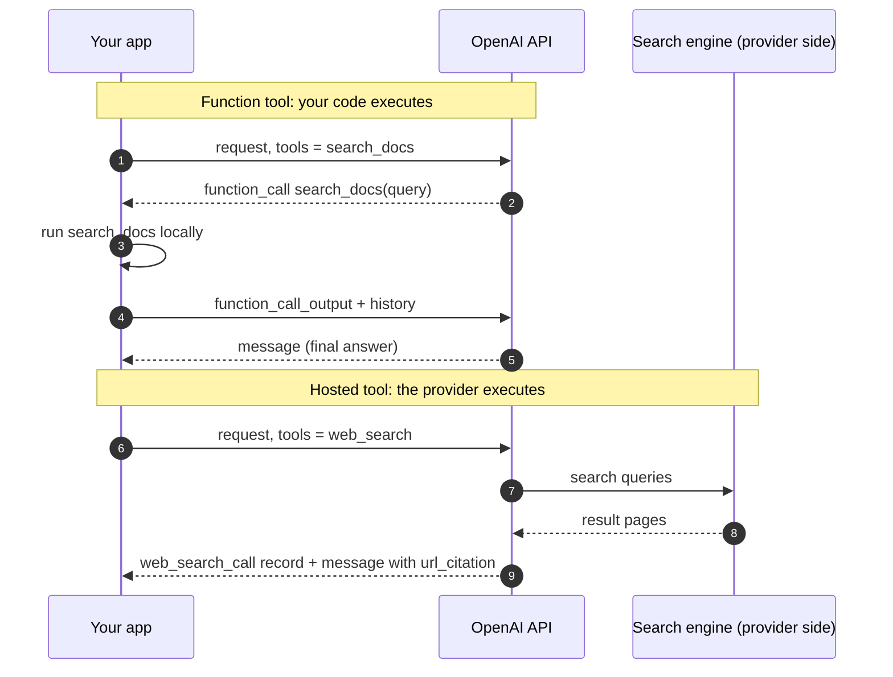
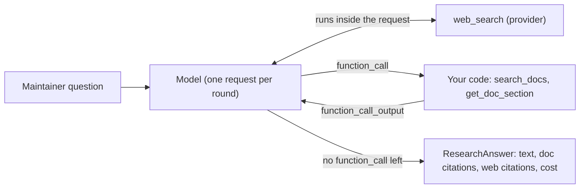
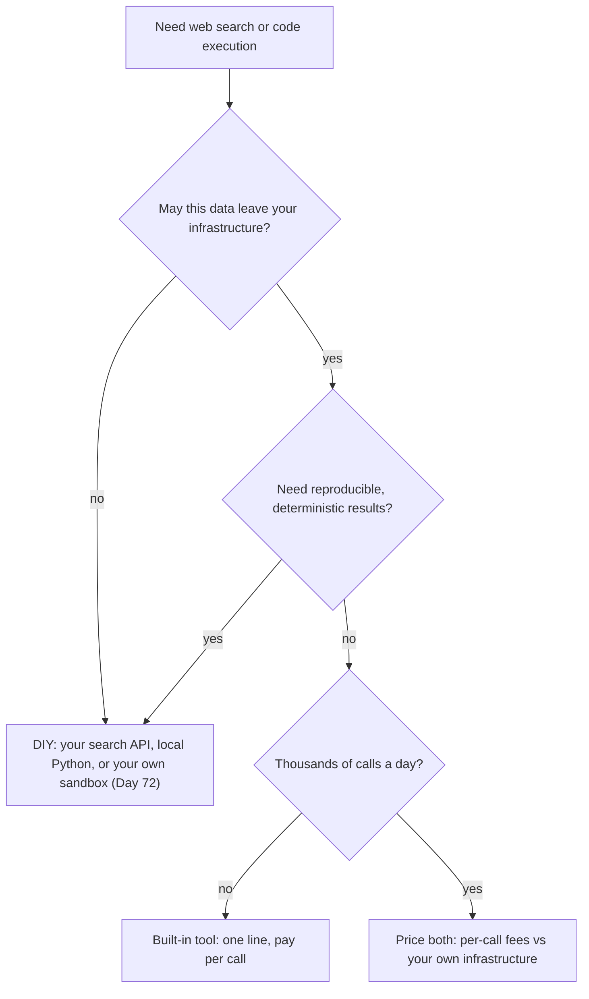

# Built-in Tools: Web Search & Code Interpreter

Issue #17 asks for Python 3.13 support, and a maintainer asks Atlas: "Which Pythons does Orbit 3.2 support, and is 3.13 still getting bugfixes upstream?" The Orbit docs answer the first half. The second half lives on python.org and changes over time. Building a scraper, a search API client and a citation formatter is a week of work. A hosted tool is one line in `tools`, at a per-call price you have to budget for.

## At a Glance

- **Time:** ~2 h core (+ optional Go Deeper) · **Depth:** working
- **Prerequisites:** [Day 35: Function Calling: The Tool Loop](../Day_035_function_calling/function_calling.md), [Day 36: Designing Tools: Schemas, Strict Mode & Descriptions](../Day_036_tool_design/tool_design.md); helpful: [Day 28: Building the RAG Pipeline: Grounded Answers with Citations](../../Phase_3_RAG/Day_028_rag_pipeline/rag_pipeline.md)
- **You'll build:** `research()`, a bounded loop that mixes hosted `web_search` with Atlas's own docs tools and returns doc citations, web citations and the run's cost; plus a code-interpreter analysis of Orbit's bug data and a $0 local version of the same analysis.
- **Stops at:** hosted tools inside a request or loop you control. Computer use and browser agents are [Day 72](../../Phase_8_Safety_and_Security/Day_072_sandboxing_computer_use/sandboxing_computer_use.md); multi-hop research agents are [Day 52](../../Phase_6_Agents/Day_052_agentic_rag/agentic_rag.md).
- **Fast path:** Already know function calling? Read "Name the Parts" and "Built-in vs DIY", then do Exercise 3 (~45 min).
- **Cost:** ≈ $0.20 on `gpt-6-luna`: about 10 searches, two code-interpreter sessions, plus tokens (prices as of 2026-11, [verify](https://developers.openai.com/api/docs/pricing)).
- **New terms:** hosted (built-in) tool, `web_search_call`, `url_citation` annotation, code interpreter container, programmatic tool calling (optional section)

> **Coming from Software Engineering?** Hosted tools are managed cloud services. Think of a managed queue versus running your own broker: no infrastructure, pay per call, less control. A function tool runs in *your* process: the model asks, your code executes, you send the result back. A hosted tool runs in the *provider's* process, inside the same API request. Your loop never sees a request to answer, only a record of what happened. Everything you know about vendor lock-in, data residency and per-request pricing applies unchanged.

## Questions Your Data Can't Answer

Run the Day 35 loop with Day 36's `search_docs` on the maintainer's question and it does half the job. `search_docs("python 3.13")` finds `installation.md`, which says Orbit 3.x supports Python 3.10, 3.11 and 3.12, and that 3.13 is "not yet supported". The upstream half ("is 3.13 still getting bugfixes?") isn't in any Orbit file. The model either says it doesn't know or, worse, answers from training data that may be a year old.

You could fix this the DIY way: pick a search API, sign up, fetch pages, strip HTML, chunk, rank, and track which sentence came from which URL. Or you can rent the whole pipeline from the provider.

## The Provider Runs These Tools

Picture two hotel concierges. Ask the first for a dinner reservation and they hand you a phone number: you make the call and report back. That's a **function tool**. The second picks up the phone, books the table, and hands you a note saying who they called and what was agreed. That's a **hosted tool** (also called a built-in tool): a tool the provider executes on its own servers during your request.

The difference shows up in your loop:



With the function tool, there are two round trips and your code does the work in the middle. With the hosted tool, there's one request. The search happened before the response came back, and the output tells you what was searched.

## Reading One Response by Hand

Before calling anything, read a response. Below is a trimmed output from a web search about the ORB-1901 SQS throttling error (issue #9). It's representative of the documented shape, and it's stored as a fixture so you can run it without a key. It has two items:

1. A `web_search_call` item: the record of a search. Its `action` says what kind (`search`, `open_page` or `find_in_page`) and, for searches, the query and the sources it read.
2. A `message` item whose `output_text` part carries `annotations`. Each annotation is metadata attached to a span of text. A `url_citation` annotation has `url`, `title`, `start_index` and `end_index`.

The indices are character offsets into the text. The first citation has `start_index: 116, end_index: 241`. Count along the text and `text[116:241]` is the inline link `([docs.aws.amazon.com](…high-throughput-fifo.html))`. It sits right after the claim it supports, "AWS offers a high-throughput mode for FIFO queues". So the offsets tell you *where* the citation is, and the words before it tell you *what* it backs up.

The script below loads that fixture into the SDK's own typed objects, so the helpers you write here work unchanged on live responses:

```python
# script_id: day_038_built_in_tools/recorded_response
# Read a recorded web-search response offline: no API key, no network.
# Install: uv add "openai>=3.46,<4"
import re
from dataclasses import dataclass

from openai.types.responses import Response

AWS = "https://docs.aws.amazon.com/AWSSimpleQueueService/latest/SQSDeveloperGuide/"
TEXT = ("FIFO queues have lower per-queue quotas than standard queues, and AWS offers a "
        "high-throughput mode for FIFO queues "
        f"([docs.aws.amazon.com]({AWS}high-throughput-fifo.html)). "
        "The current limits are published per Region "
        f"([docs.aws.amazon.com]({AWS}quotas-messages.html)).")
RECORDED = {"id": "resp_recorded", "object": "response", "model": "gpt-6-luna", "output": [
    {"type": "web_search_call", "id": "ws_1", "status": "completed",
     "action": {"type": "search", "query": "SQS FIFO throttling quotas high throughput",
                "sources": [{"type": "url", "url": AWS + "high-throughput-fifo.html"},
                            {"type": "url", "url": AWS + "quotas-messages.html"}]}},
    {"type": "message", "id": "msg_1", "role": "assistant", "status": "completed",
     "content": [{"type": "output_text", "text": TEXT, "annotations": [
         {"type": "url_citation", "start_index": 116, "end_index": 241,
          "url": AWS + "high-throughput-fifo.html",
          "title": "High throughput for FIFO queues in Amazon SQS"},
         {"type": "url_citation", "start_index": 287, "end_index": 407,
          "url": AWS + "quotas-messages.html", "title": "Amazon SQS message quotas"}]}]}]}

@dataclass(frozen=True)
class WebCitation:
    url: str
    title: str
    start_index: int
    end_index: int

def url_citations(response) -> list[WebCitation]:
    """Every url_citation on every output_text part; [] when the model didn't search."""
    return [WebCitation(a.url, a.title, a.start_index, a.end_index)
            for item in response.output if item.type == "message"
            for part in item.content if part.type == "output_text"
            for a in part.annotations if a.type == "url_citation"]

if __name__ == "__main__":
    resp = Response.construct(**RECORDED)  # recorded JSON -> the SDK's typed objects
    for c in url_citations(resp):
        claim = re.split(r"[,.] ", resp.output_text[:c.start_index].rstrip())[-1]  # last clause
        print(f"[{c.start_index}:{c.end_index}] {c.title}\n    backs: {claim}")
    searches = [i for i in resp.output if i.type == "web_search_call" and i.action.type == "search"]
    print(f"searches: {len(searches)} · sources read: {len(searches[0].action.sources)}")
```

```text
[116:241] High throughput for FIFO queues in Amazon SQS
    backs: and AWS offers a high-throughput mode for FIFO queues
[287:407] Amazon SQS message quotas
    backs: The current limits are published per Region
searches: 1 · sources read: 2
```

## Name the Parts

| | Function tool (Day 35) | Hosted tool (today) |
|---|---|---|
| Declared as | `{"type": "function", "name": …, "parameters": …}` | `{"type": "web_search"}`, `{"type": "code_interpreter", …}` |
| Who executes | Your code, in your process | The provider, inside the request |
| Output item | `function_call` (you must answer it) | `web_search_call`, `code_interpreter_call` (a record; never answer it) |
| Your loop sends back | `function_call_output` with the same `call_id` | Nothing |
| Cost | Tokens only | Tokens + a per-call or per-session fee |
| Data | Stays with you | Leaves your infrastructure |

Three more names you'll use all day:

- **`web_search_call`**: the output item that records one web action. Only `search` actions are billed as tool calls; `open_page` and `find_in_page` appear with reasoning models.
- **`url_citation` annotation**: the link between a span of answer text and the page that supports it. OpenAI's docs require any UI that shows web results to display these citations as clickable links.
- **Code interpreter container**: a sandbox (an isolated virtual machine that can't touch your machine) where the model writes and runs Python. It expires after 20 minutes idle.

By default the response leaves out bulky details. Ask for them with `include=[…]`: `"web_search_call.action.sources"` returns every URL the search read (usually more than the cited ones), and `"code_interpreter_call.outputs"` returns the code's logs and images.

## Minimal Web Search

The smallest live call: one tool, one question, then the answer and a numbered source list. It reuses the cheapest current model, set once for the whole course.

A note on outputs: every block after a live call in this lesson is a **sample**. Its shape follows the API reference, but its text, queries, token counts and timings are illustrative, not a recorded run. Only the offline scripts (`recorded_response`, `export_issue_stats`, `diy_aggregation`, Exercise 2) and the local lines of Exercise 3 print exactly what you'll see.

```python
# script_id: day_038_built_in_tools/web_search_minimal
# One hosted web search with citations. Install: uv add "openai>=3.46,<4"
# Env: OPENAI_API_KEY · ATLAS_MODEL (default gpt-6-luna) · Cost: one search ($0.01) + tokens
import os

from openai import OpenAI

MODEL = os.environ.get("ATLAS_MODEL", "gpt-6-luna")
client = OpenAI()

resp = client.responses.create(
    model=MODEL,
    tools=[{"type": "web_search"}],  # the whole integration
    input="Is Python 3.13 still receiving bugfix releases upstream? Cite sources.",
)
print(resp.output_text, "\n")
cites = [a for item in resp.output if item.type == "message"
         for part in item.content if part.type == "output_text"
         for a in part.annotations if a.type == "url_citation"]
for n, a in enumerate(cites, 1):
    print(f"[{n}] {a.title} — {a.url}")
```

```text
(today's answer about the 3.13 branch, with inline links; your wording and sources will differ)

[1] <page title> — https://<a python.org page>
[2] <page title> — https://<another python.org page>
```

The lesson deliberately doesn't print the upstream answer: it changes, and that is the point. Your code's job is to carry the citations through, so a maintainer can click and check.

## Turn a Knob, Then Break It

Now point the search at issue #9's question: ORB-1901 `BrokerRateLimited` on an SQS FIFO queue. Orbit's `broker-sqs.md` explains the cause and says AWS publishes the current quotas, so the numbers have to come from AWS. Four knobs matter:

| Knob | What it does | Atlas use |
|---|---|---|
| `filters.allowed_domains` | An allowlist (only these are permitted). No scheme; subdomains match | `["docs.aws.amazon.com"]`: no blog spam for AWS quotas |
| `search_context_size` | How much result text reaches the model: `low`, `medium` (default), `high` | `low` for lookups: fewer content tokens |
| `include=["web_search_call.action.sources"]` | Every URL the search read, not only the cited ones | Log it; audit what the answer was built from |
| `max_tool_calls` | Caps the total number of built-in tool calls in one response; extra attempts are ignored | Hard spend ceiling per request |

```python
# script_id: day_038_built_in_tools/web_search_knobs
# Domain allowlist, context size, full source list, a cap on hosted calls, and the fee.
# Install: uv add "openai>=3.46,<4" · Env: OPENAI_API_KEY, ATLAS_MODEL
import os

from openai import OpenAI

MODEL = os.environ.get("ATLAS_MODEL", "gpt-6-luna")
SEARCH_FEE_USD = 10 / 1000  # $10 per 1k searches, as of 2026-11; verify on the pricing page
client = OpenAI()

def web_search(question: str, *, domains: list[str] | None = None, max_calls: int = 3):
    tool = {"type": "web_search", "search_context_size": "low"}
    if domains:
        tool["filters"] = {"allowed_domains": domains}
    return client.responses.create(
        model=MODEL, tools=[tool], input=question,
        max_tool_calls=max_calls,                     # across ALL built-in tools in this response
        include=["web_search_call.action.sources"],  # every URL read, not only the cited ones
    )

resp = web_search("Orbit's SQS broker logs ORB-1901 BrokerRateLimited on a FIFO queue. What are "
                  "AWS's current FIFO throughput quotas, and how can they be raised?",
                  domains=["docs.aws.amazon.com"])
searches = [i for i in resp.output if i.type == "web_search_call" and i.action.type == "search"]
for s in searches:
    print("query:", s.action.query, "· sources:", len(s.action.sources or []))
print(f"searches: {len(searches)} · fee ≈ ${len(searches) * SEARCH_FEE_USD:.2f} + tokens "
      f"({resp.usage.input_tokens:,} in / {resp.usage.output_tokens:,} out)")
```

Sample output (illustrative):

```text
query: Amazon SQS FIFO queue throughput quota · sources: 6
query: SQS high throughput FIFO enable · sources: 5
searches: 2 · fee ≈ $0.02 + tokens (9,840 in / 412 out)
```

Your numbers will differ. Notice the input tokens: search results are fed to the model as content, so a search costs its fee *plus* thousands of input tokens. That's why `search_context_size="low"` is the default in Atlas.

Now break it. The naive way to read a citation is `msg.content[0].annotations[0]`. Ask something the model can answer from memory, and it won't search at all, because under `tool_choice="auto"` searching is optional:

```python
# script_id: day_038_built_in_tools/web_search_knobs
plain = client.responses.create(model=MODEL, tools=[{"type": "web_search"}],
                                input="What does FIFO stand for?")
msg = next(i for i in plain.output if i.type == "message")
try:
    print(msg.content[0].annotations[0].url)  # the naive version
except IndexError as exc:
    print(f"IndexError: {exc}  (searches: {sum(i.type == 'web_search_call' for i in plain.output)})")
```

Typical output (if the model happens to search anyway, you get a URL; ask again):

```text
IndexError: list index out of range  (searches: 0)
```

Two rules follow. Treat citations as a possibly empty list (that's why `url_citations()` returns `[]`). And if a question *must* be grounded on the web, force it with `tool_choice="required"`. The opposite failure is a broad question ("compare every managed queue's limits") that fans out into five or six searches. `max_tool_calls` caps it, and counting `web_search_call` items tells you what you paid for.

## Mixing Hosted and Your Own Tools

The maintainer's original question needs both kinds of tool: Orbit's docs for the first half and the web for the second. One request can carry both. The rule for your loop is short: **answer only `function_call` items.** Hosted calls are already done; you append them to the history like any other output item, and you never send a `function_call_output` for them.



`research()` is the Day 35 loop with three changes: a hosted tool in the list, a fee counter, and two citation lists kept side by side. The first block holds compact copies of Day 36's docs tools (keyword scoring here; your real `Index.search()` drops in later):

```python
# script_id: day_038_built_in_tools/research_helper
# research(): hosted web_search + Atlas's own docs tools in one bounded loop.
# Install: uv add "openai>=3.46,<4" · Env: OPENAI_API_KEY, ATLAS_MODEL, ORBIT_DATA
# Cost: ≈ $0.01 per search + luna tokens (as of 2026-11, verify on the pricing page)
import json
import os
import re
from dataclasses import dataclass, field
from pathlib import Path

from openai import OpenAI

MODEL = os.environ.get("ATLAS_MODEL", "gpt-6-luna")
DATA_DIR = Path(os.environ.get("ORBIT_DATA", "datasets/orbit"))
client = OpenAI()

# built on Day 36 (search_docs, get_doc_section), compact keyword versions
DOCS = {p.stem: p.read_text(encoding="utf-8").split("---\n", 2)[2]  # drop the front matter
        for p in sorted((DATA_DIR / "docs").glob("*.md"))}
STOP = {"the", "and", "for", "what", "which", "does", "with", "are", "still", "orbit"}

def search_docs(query: str, k: int = 3) -> list[dict]:
    terms = {t for t in re.findall(r"[a-z0-9.]+", query.lower()) if len(t) > 2} - STOP
    scored = sorted(((sum(body.lower().count(t) for t in terms), doc_id)
                     for doc_id, body in DOCS.items()), reverse=True)
    return [{"doc_id": d, "title": DOCS[d].strip().splitlines()[0].lstrip("# ")}
            for score, d in scored[:k] if score]

def get_doc_section(doc_id: str, heading: str | None = None) -> dict:
    if doc_id not in DOCS:
        return {"error": f"Unknown doc_id {doc_id!r}. Call search_docs first."}
    sections = re.split(r"\n(?=## )", DOCS[doc_id])
    hit = next((s for s in sections if heading and heading.lower() in s.splitlines()[0].lower()),
               None)
    return {"doc_id": doc_id, "text": (hit or DOCS[doc_id]).strip()[:3000]}
```

The second block declares the function tools as flat strict schemas, the result types, and the cost tracker. `CostTracker` is a compact copy of Day 12's, plus `add_tool_fee()` because hosted tools bill per call on top of tokens:

```python
# script_id: day_038_built_in_tools/research_helper
def fn_tool(name: str, description: str, props: dict) -> dict:
    return {"type": "function", "name": name, "description": description, "strict": True,
            "parameters": {"type": "object", "properties": props,
                           "required": list(props), "additionalProperties": False}}

DOC_TOOLS = [
    fn_tool("search_docs", "Find Orbit doc pages by keyword. Use for anything about Orbit itself.",
            {"query": {"type": "string"}}),
    fn_tool("get_doc_section", "Read an Orbit doc page by doc_id (from search_docs); "
            "heading picks one '## ' section, or null for the whole page.",
            {"doc_id": {"type": "string"}, "heading": {"type": ["string", "null"]}}),
]
REGISTRY = {"search_docs": search_docs, "get_doc_section": get_doc_section}

@dataclass(frozen=True)
class Citation:      # Day 15's Citation(doc_id, quote), compact
    doc_id: str
    quote: str

@dataclass(frozen=True)
class WebCitation:   # one url_citation, kept with its character offsets
    url: str
    title: str
    start_index: int
    end_index: int

@dataclass
class ResearchAnswer:
    text: str
    doc_citations: list[Citation]
    web_citations: list[WebCitation]
    web_calls: int
    cost_usd: float

PRICE_PER_1M = {"input": 0.10, "output": 0.50}  # gpt-6-luna, as of 2026-11; verify
SEARCH_FEE_USD = 0.01                            # $10 / 1k searches, as of 2026-11; verify

@dataclass
class CostTracker:   # Day 12's tracker, compact (ignores the cached-token discount)
    total_usd: float = 0.0
    fees: dict[str, float] = field(default_factory=dict)

    def record(self, response) -> None:
        u = response.usage
        self.total_usd += (u.input_tokens * PRICE_PER_1M["input"]
                           + u.output_tokens * PRICE_PER_1M["output"]) / 1e6

    def add_tool_fee(self, tool: str, usd: float) -> None:
        self.fees[tool] = self.fees.get(tool, 0.0) + usd
        self.total_usd += usd
```

The third block is the loop. Read the comments on `items += resp.output` and on the `for call in calls` line: they're the whole lesson in two lines.

```python
# script_id: day_038_built_in_tools/research_helper
INSTRUCTIONS = ("You are Atlas, an assistant for Orbit maintainers. Use search_docs and "
                "get_doc_section for facts about Orbit; use web search only for facts outside "
                "Orbit's docs. Keep the answer short and say which half came from where.")

def url_citations(response) -> list[WebCitation]:
    return [WebCitation(a.url, a.title, a.start_index, a.end_index)
            for item in response.output if item.type == "message"
            for part in item.content if part.type == "output_text"
            for a in part.annotations if a.type == "url_citation"]

def research(question: str, *, allowed_domains: list[str] | None = None, max_rounds: int = 4,
             tracker: CostTracker | None = None) -> ResearchAnswer:
    tracker = tracker or CostTracker()
    start = tracker.total_usd
    web = {"type": "web_search", "search_context_size": "low"}
    if allowed_domains:
        web["filters"] = {"allowed_domains": allowed_domains}
    items: list = [{"role": "user", "content": question}]
    doc_cites: list[Citation] = []
    web_calls = 0
    for _ in range(max_rounds):
        resp = client.responses.create(model=MODEL, instructions=INSTRUCTIONS, input=items,
                                       tools=[web, *DOC_TOOLS], max_tool_calls=3)
        tracker.record(resp)
        n = sum(1 for i in resp.output if i.type == "web_search_call" and i.action.type == "search")
        web_calls += n
        tracker.add_tool_fee("web_search", n * SEARCH_FEE_USD)
        items += resp.output  # hosted calls go back as history, already done
        calls = [i for i in resp.output if i.type == "function_call"]
        if not calls:         # nothing left for our code to run: this is the answer
            return ResearchAnswer(resp.output_text, doc_cites, url_citations(resp),
                                  web_calls, round(tracker.total_usd - start, 4))
        for call in calls:    # ONLY function_call items get a function_call_output
            result = REGISTRY[call.name](**json.loads(call.arguments))
            if "text" in result:
                doc_cites.append(Citation(result["doc_id"], result["text"][:120]))
            items.append({"type": "function_call_output", "call_id": call.call_id,
                          "output": json.dumps(result)})
    raise RuntimeError(f"no final answer after {max_rounds} rounds")
```

`max_tool_calls` caps hosted calls per request; `max_rounds` caps the loop. The doc citations here are the sections Atlas actually read. Day 28's quote-level citations plug in at the same spot. Errors from your own tools would get Day 37's envelopes; they're left out to keep the hosted-tool changes visible. The last block runs both questions:

```python
# script_id: day_038_built_in_tools/research_helper
def show(ans: ResearchAnswer) -> None:
    print(ans.text, "\n")
    for c in ans.doc_citations:
        print(f"  doc  {c.doc_id}: {' '.join(c.quote.split())[:60]}…")
    for n, w in enumerate(ans.web_citations, 1):
        print(f"  web  [{n}] {w.title} — {w.url}")
    print(f"  web searches: {ans.web_calls} · cost ≈ ${ans.cost_usd:.4f}\n")

if __name__ == "__main__":
    tracker = CostTracker()
    show(research("Which Python versions does Orbit 3.2 support, and is Python 3.13 still "
                  "getting bugfix releases upstream?", tracker=tracker))
    show(research("We see ORB-1901 BrokerRateLimited on an SQS FIFO queue. What does Orbit "
                  "recommend, and what are AWS's current FIFO quotas?",
                  allowed_domains=["docs.aws.amazon.com"], tracker=tracker))
    print("fees:", tracker.fees, f"· total ≈ ${tracker.total_usd:.4f}")
```

Sample output (the `doc` lines come from the Orbit data; the answer text, `web` lines and costs are illustrative):

```text
Orbit 3.2 supports Python 3.10, 3.11 and 3.12; 3.13 is not yet supported (Orbit docs). Upstream, … (web)

  doc  installation: # Installation Orbit is a pure-Python package published to PyP…
  web  [1] <python.org page title> — https://<python.org page>
  web searches: 1 · cost ≈ $0.0112

Orbit recommends standard queues unless you need strict ordering, spreading message groups, … (docs)

  doc  broker-sqs: ## FIFO queues and throttling (ORB-1901) FIFO queues give strict…
  web  [1] High throughput for FIFO queues in Amazon SQS — https://docs.aws.amazon.com/…
  web searches: 2 · cost ≈ $0.0215

fees: {'web_search': 0.03} · total ≈ $0.0327
```

Your wording, sources and costs will differ. Look at the cost lines: the per-search fee dominates. Luna's tokens cost about a tenth of a cent per call, while each search adds a full cent.

## Code Interpreter: Python in Their Sandbox

Web search brings outside text in. Code interpreter does the reverse: it lets the model *compute*. The model writes Python, runs it in a container on OpenAI's side, reads the output, and can fix and rerun its own code. That's useful for questions like "which component's bug count is trending up in 2026?", where the model would otherwise guess at arithmetic over hundreds of rows.

There are three steps: get the data into the container, run the request, and get the results out. First, export the data. Atlas never hands orbit.db to anyone. It exports one CSV of exactly what the question needs, over a read-only connection (Day 33's `connect_ro()`). This script needs no key:

```python
# script_id: day_038_built_in_tools/export_issue_stats
# Export one row per (bug, component) from orbit.db to CSV over a read-only connection.
# Env: ORBIT_DATA (default datasets/orbit) · no API key needed
import csv
import os
import sqlite3
from pathlib import Path

DATA_DIR = Path(os.environ.get("ORBIT_DATA", "datasets/orbit"))
DB = DATA_DIR / "issues" / "orbit.db"
SQL = """
SELECT i.id, substr(i.created_at, 1, 10), l.value, i.severity, i.state
FROM issues i
JOIN issue_labels il ON il.issue_id = i.id
JOIN labels l ON l.id = il.label_id AND l.kind = 'comp'
WHERE i.type = 'bug'
ORDER BY i.created_at
"""

def connect_ro() -> sqlite3.Connection:  # built on Day 33: writes through it fail
    return sqlite3.connect(f"file:{DB.resolve()}?mode=ro", uri=True)

def export_issue_stats(path: Path = Path("issues_by_component.csv")) -> Path:
    conn = connect_ro()
    try:
        rows = conn.execute(SQL).fetchall()
    finally:
        conn.close()
    with path.open("w", newline="", encoding="utf-8") as f:
        writer = csv.writer(f)
        writer.writerow(["issue_id", "created", "component", "severity", "state"])
        writer.writerows(rows)
    print(f"wrote {len(rows)} rows to {path}")
    return path

if __name__ == "__main__":
    export_issue_stats()
```

```text
wrote 128 rows to issues_by_component.csv
```

Next, create a container, upload the file into it, and point the tool at it. The tool's `container` field is required. You can pass `{"type": "auto", "memory_limit": "1g", "file_ids": [...]}` and let the API create one, or create it yourself, as below, so you hold its id and can delete it when you're done. `include=["code_interpreter_call.outputs"]` asks for the logs and images, which are left out by default.

```python
# script_id: day_038_built_in_tools/code_interpreter_demo
# Upload the CSV into a hosted container, let the model analyse it, save the chart it draws.
# Install: uv add "openai>=3.46,<4" · Env: OPENAI_API_KEY, ATLAS_MODEL, ORBIT_DATA
# Cost: one 1 GB container session ($0.03 per 20 min, as of 2026-11; verify) + tokens
import os
from pathlib import Path

from openai import OpenAI

from export_issue_stats import export_issue_stats  # the sibling script above

MODEL = os.environ.get("ATLAS_MODEL", "gpt-6-luna")
client = OpenAI()

csv_path = export_issue_stats()
container = client.containers.create(name="atlas-issue-stats", memory_limit="1g")
with csv_path.open("rb") as f:
    client.containers.files.create(container.id, file=f)

resp = client.responses.create(
    model=MODEL,
    tools=[{"type": "code_interpreter", "container": container.id}],
    tool_choice="required",                    # this demo must use the python tool
    include=["code_interpreter_call.outputs"],  # logs and images are opt-in
    instructions="Use the python tool. Keep the final answer to three sentences.",
    input="issues_by_component.csv has one row per bug and component. Which component's bug "
          "count is trending up in 2026? Compare Jan-Jun with Jul-Dec and save a bar chart as PNG.",
)
```

The model knows this tool as "the python tool", which is why the instructions call it that. Now read the results. `code_interpreter_call` items carry the code that ran plus its outputs. Files the model creates come back as `container_file_citation` annotations on the message, and you download them while the container is alive:

```python
# script_id: day_038_built_in_tools/code_interpreter_demo
for item in resp.output:
    if item.type == "code_interpreter_call":
        print("--- code ---\n" + (item.code or ""))
        for out in item.outputs or []:
            print("--- logs ---\n" + out.logs if out.type == "logs" else f"--- image: {out.url[:50]}…")
print("--- answer ---\n" + resp.output_text)

for item in (i for i in resp.output if i.type == "message"):
    for part in (p for p in item.content if p.type == "output_text"):
        for ann in (a for a in part.annotations if a.type == "container_file_citation"):
            name = Path(ann.filename).name  # never trust a path from the sandbox
            client.containers.files.content.retrieve(
                ann.file_id, container_id=ann.container_id).write_to_file(name)
            print("saved", name)
client.containers.delete(container.id)  # done: don't leave it idling until expiry
```

Sample output (the model's code and wording are illustrative; the counts are the real ones from the Orbit CSV):

```text
--- code ---
import pandas as pd
df = pd.read_csv("/mnt/data/issues_by_component.csv", parse_dates=["created"])
bugs = df[df.created.dt.year == 2026]
half = bugs.created.dt.month.le(6).map({True: "Jan-Jun", False: "Jul-Dec"})
print(bugs.groupby(["component", half]).size().unstack(fill_value=0))
--- logs ---
created        Jan-Jun  Jul-Dec
component
core                 5       12
cli                 11        6
…
--- answer ---
core is trending up: 5 bugs in Jan-Jun 2026 versus 12 in Jul-Dec. The chart is saved as …
saved bugs_by_half.png
```

The model's code, paths and wording will differ. The numbers shouldn't, because they come from executed code, not the model's guess. Notice what you can audit: the exact code that produced the claim. Treat it the way you'd treat a colleague's notebook: read it before you trust the chart.

## Built-in vs DIY

That aggregation is a dozen lines of stdlib Python, and you can run it locally for $0:

```python
# script_id: day_038_built_in_tools/diy_aggregation
# The same question with the stdlib: $0, deterministic, and the data never leaves.
import csv
from collections import Counter

from export_issue_stats import export_issue_stats

h1, h2 = Counter(), Counter()
with export_issue_stats().open(encoding="utf-8") as f:
    for row in csv.DictReader(f):
        if row["created"].startswith("2026"):
            (h1 if row["created"][5:7] <= "06" else h2)[row["component"]] += 1

print(f"{'component':<14}{'Jan-Jun':>8}{'Jul-Dec':>8}{'change':>8}")
for comp in sorted(h1 | h2, key=lambda c: (h2[c] - h1[c], c), reverse=True)[:4]:
    print(f"{comp:<14}{h1[comp]:>8}{h2[comp]:>8}{h2[comp] - h1[comp]:>+8}")
```

```text
wrote 128 rows to issues_by_component.csv
component      Jan-Jun Jul-Dec  change
core                 5      12      +7
scheduler            1       3      +2
auth                 1       3      +2
dashboard            3       4      +1
```

(Jul-Dec is partial: the dataset ends in November 2026.) So when do you pay to rent? Use this rule of thumb:



| Need | Built-in | DIY | Cost (as of 2026-11, verify) | Latency | Privacy | Control |
|---|---|---|---|---|---|---|
| Fresh web facts | `web_search` | Search API + fetcher + extractor + citation code | $10 / 1k searches + content tokens vs your API plan + your time | Seconds per search | Query text goes to the provider | Domain allowlist only |
| Analysis over a file | `code_interpreter` | Local pandas/stdlib, or your own sandbox ([Day 72](../../Phase_8_Safety_and_Security/Day_072_sandboxing_computer_use/sandboxing_computer_use.md)) | $0.03 per 1 GB session (20 min) + tokens vs $0 | Container start + model turns | The file is uploaded | You don't pick packages or versions |
| Search over your own files | `file_search` (owned by [Day 32](../../Phase_3_RAG/Day_032_long_context_vs_rag/long_context_vs_rag.md)) | Your RAG index (Days 26–28) | $2.50 / 1k calls + storage vs your DB | Low | Files stored with the provider | Chunking and ranking knobs only |

The pattern: built-in wins on time-to-first-answer and low volume, and DIY wins on privacy, determinism and price at scale. Rows that run the same question every hour (dashboards, nightly reports) belong in plain code. The model is worth paying for when the question changes every time.

### In production

- **Web pages are untrusted input.** A page can contain instructions aimed at your model. Keep hosted search away from side-effect tools and approvals, and see [Day 69](../../Phase_8_Safety_and_Security/Day_069_prompt_injection/prompt_injection.md).
- **Cap spend per request and per run:** `max_tool_calls` on every request, a round limit on the loop, and fees recorded in the tracker next to tokens.
- **Log sources**, not only citations (`include=["web_search_call.action.sources"]`), so you can audit an answer after the page changes.
- **Data leaves your infrastructure:** queries, uploaded CSVs and generated files sit with the provider. Retention controls are [Day 73](../../Phase_8_Safety_and_Security/Day_073_privacy_pii/privacy_pii.md).
- **Allowlist domains** for any question with an authoritative source (vendor docs, your status page).

## Go Deeper (optional)

<details><summary>Go deeper: programmatic tool calling</summary>

Your `research()` loop pays for every tool result twice: once when your code produces it and again when the whole result rides along in the next request's input. Ask about 20 issues and the model makes 20 `get_issue` calls, and all 20 results sit in its context even if it only needed one number from each.

**Programmatic tool calling** changes the shape. Instead of calling tools one at a time, the model writes a small program that calls them in loops or in parallel, filters the results, and returns only a compact summary. On OpenAI the program is **JavaScript**, run in a fresh, isolated V8 runtime that OpenAI hosts. The runtime has no Node.js, no network and no general filesystem. You enable it with a hosted tool and mark which of your tools a program may call:

```python
# script_id: day_038_built_in_tools/programmatic_config
# fragment: request config only (⚠ newest surface; verify against the guide before shipping)
tools = [
    {"type": "programmatic_tool_calling"},
    {"type": "function", "name": "get_issue", "strict": True,
     "description": "Fetch one Orbit issue by id: title, severity, state, components.",
     "parameters": {"type": "object", "properties": {"issue_id": {"type": "integer"}},
                    "required": ["issue_id"], "additionalProperties": False},
     "allowed_callers": ["programmatic"]},  # or ["direct", "programmatic"]
]
```

The output gains three item types. A `program` item holds the generated code and its `call_id`. Each tool call the program makes arrives as a normal `function_call` whose `caller.caller_id` points at the program. A `program_output` item carries the program's final `result` and `status`. Your loop barely changes: you still answer every `function_call` with a `function_call_output`, but you **copy its `caller` field unchanged**, because the service uses it to resume the right program. Keep going until a final `message` arrives.

When does it pay? The guide's rule: many calls with predictable control flow, where code can shrink the results before the model sees them (filter, join, count). Keep direct calls when each result needs fresh judgment, for writes and approval-gated actions (Day 37's gate has to see each call), and when you need the native citation output. Anthropic describes the same idea for MCP tools in "Code execution with MCP" (see References).

</details>

<details><summary>Go deeper: citation offsets survive only untouched text</summary>

`start_index` and `end_index` count characters in one `output_text` part's `text`. Three consequences:

- **Apply annotations before any transform.** Strip markdown, translate, or truncate first, and the offsets point at the wrong words. Render footnotes from the original text, then transform.
- **Edit from the end backwards.** Replacing a span changes the length of everything after it. Process citations in descending `start_index` order (Exercise 2) and the earlier offsets stay valid.
- **Offsets are per part.** `resp.output_text` joins every text part of every message. With one message and one part (the common case) the offsets line up with it. Otherwise, index into each `part.text` separately.

Titles and URLs come from web pages, so they're untrusted strings. Escape them before they reach HTML or markdown, and only render `https://` links. [Day 71](../../Phase_8_Safety_and_Security/Day_071_safe_output_handling/safe_output_handling.md) covers safe rendering.

</details>

<details><summary>Go deeper: the other hosted tools and remaining knobs</summary>

| Tool type | What it does | Where it's taught |
|---|---|---|
| `file_search` | Hosted RAG over vector stores you upload | [Day 32](../../Phase_3_RAG/Day_032_long_context_vs_rag/long_context_vs_rag.md) |
| `mcp` | OpenAI's servers call a remote MCP server for you (tokens only, no per-call fee) | [Day 39](../Day_039_mcp_clients/mcp_clients.md) |
| `computer` | The model drives a screen you host | [Day 72](../../Phase_8_Safety_and_Security/Day_072_sandboxing_computer_use/sandboxing_computer_use.md) |
| `image_generation`, `shell`, `apply_patch`, skills | Image output; a hosted shell (same container pricing); code edits; packaged skills | Not covered (⚠ verify in the tools guide) |

Web search knobs left out of the core: `user_location` (`{"type": "approximate", "country": "GB", ...}`; defaults to the US) biases results to a region. `external_web_access=False` restricts the tool to cached results (the default is live access). The docs also list `filters.blocked_domains` and `return_token_budget`. They're absent from SDK 3.46's typed dicts, so a type checker flags them (⚠ verify before use).

Code interpreter containers: memory tiers are `1g`, `4g`, `16g` and `64g`, priced at $0.03, $0.12, $0.48 and $1.92 per 20-minute session, billed per minute with a 5-minute minimum (as of 2026-11, verify). An expired container can't be revived: create a new one and re-upload. `client.containers.create(..., network_policy=...)` controls outbound network access from the sandbox.

</details>

## Common Pitfalls

- **Old blog code uses `web_search_preview`.** That's the legacy tool: it lacks `filters` and `external_web_access`, and on non-reasoning models it costs $25 per 1k calls instead of $10 (as of 2026-11, verify). Use `{"type": "web_search"}`.
- **A 400 error after you send a `function_call_output` for a `web_search_call`.** Hosted calls are already finished, and there's no call to answer. Filter on `item.type == "function_call"` before building outputs (⚠ exact error text: verify).
- **`IndexError: list index out of range` reading `annotations[0]`.** The model answered without searching. Treat citations as a list that may be empty, or set `tool_choice="required"` when an answer must be grounded.
- **Citations highlight the wrong words.** The text was edited (stripped, truncated, re-wrapped) before the offsets were applied. Apply annotations first, back to front.
- **A surprise bill.** Each search is a fee *plus* content tokens, and broad questions fan out into many searches. Set `max_tool_calls`, count `web_search_call` items, and record fees with `add_tool_fee()`.
- **`FileNotFoundError` in the code interpreter logs.** The file isn't in that container: you uploaded it to a different (or expired) container, or forgot `file_ids` in auto mode. Containers expire after 20 minutes idle, and generated files disappear with them, so download while it's active.

> **Where we stop:** hosted tools inside a request or a bounded loop you control. Browser and computer-use agents and sandbox security are [Day 72](../../Phase_8_Safety_and_Security/Day_072_sandboxing_computer_use/sandboxing_computer_use.md), and "search until satisfied" research agents are [Day 52](../../Phase_6_Agents/Day_052_agentic_rag/agentic_rag.md).

## Key Takeaways

- Hosted tools run on the provider's side inside one request. Your loop answers only `function_call` items, and hosted calls (`web_search_call`, `code_interpreter_call`) go back into the history as records.
- A `url_citation` is a character span (`start_index`, `end_index`) plus `url` and `title`. Read it from the untouched text, treat the list as possibly empty, and show it as a clickable link.
- `allowed_domains`, `search_context_size` and `max_tool_calls` are the three knobs that control quality and spend. Count `search` actions to know what you paid for.
- Code interpreter needs a container. You upload files into it, ask for `code_interpreter_call.outputs` to see logs and images, and download generated files from `container_file_citation` annotations before the container expires.
- Built-in wins on time-to-answer and low volume. DIY wins when data can't leave, when results must be reproducible, or at volume. Price both with per-call fees included.

## Quick Reference

| API / pattern | When to use | Gotcha |
|---|---|---|
| `tools=[{"type": "web_search"}]` | Facts outside your data that change over time | Search is optional under `tool_choice="auto"` |
| `"filters": {"allowed_domains": ["docs.aws.amazon.com"]}` | An authoritative source exists | No scheme; subdomains are included |
| `"search_context_size": "low"` | Lookups needing a few facts | `medium` is the default and costs more tokens |
| `include=["web_search_call.action.sources"]` | Auditing and logging | Sources outnumber citations |
| `max_tool_calls=3` | Every request with hosted tools | Counts all built-in tools together |
| `annotations` → `url_citation` | Rendering answers | Offsets are per text part; apply before edits |
| `{"type": "code_interpreter", "container": id}` | Analysis, charts, file conversion | `container` is required; 20-minute idle expiry |
| `client.containers.files.create(id, file=f)` | Put your file into the sandbox | The data leaves your infrastructure |
| `client.containers.files.content.retrieve(fid, container_id=cid)` | Save generated files | Do it before the container expires |
| Answer only `function_call` items | Mixing hosted and function tools | Never send outputs for hosted calls |

## Exercises

1. **Warm-up: what a domain filter changes.** Ask the ORB-1901 SQS FIFO question twice, unfiltered and restricted to `docs.aws.amazon.com`, with `max_tool_calls=3`. Print the number of searches, the fee, and the set of hosts in the sources.

<details><summary>Solution</summary>

```python
# script_id: day_038_built_in_tools/solution_ex1
# Env: OPENAI_API_KEY, ATLAS_MODEL · Cost: up to 6 searches ($0.06) + tokens
import os

from openai import OpenAI

MODEL = os.environ.get("ATLAS_MODEL", "gpt-6-luna")
client = OpenAI()
Q = ("Orbit's SQS broker logs ORB-1901 BrokerRateLimited on a FIFO queue. "
     "What are AWS's current FIFO throughput quotas?")

for domains in (None, ["docs.aws.amazon.com"]):
    tool = {"type": "web_search", "search_context_size": "low"}
    if domains:
        tool["filters"] = {"allowed_domains": domains}
    resp = client.responses.create(model=MODEL, tools=[tool], input=Q, max_tool_calls=3,
                                   include=["web_search_call.action.sources"])
    searches = [i for i in resp.output if i.type == "web_search_call" and i.action.type == "search"]
    hosts = {s.url.split("/")[2] for c in searches for s in (c.action.sources or []) if s.url}
    print(f"filter={domains} searches={len(searches)} fee≈${len(searches) * 0.01:.2f}")
    print("   hosts:", sorted(hosts))
```

There's no fixed output to compare against: searches and hosts change from run to run. Unfiltered, the hosts usually include blogs and Q&A sites next to AWS. Filtered, every source is under `docs.aws.amazon.com`. The answer gets narrower and more authoritative, and sometimes needs fewer searches.

</details>

2. **Core: footnotes from offsets.** Using the recorded fixture, render the answer as markdown: replace each cited span with `[^n]` (one number per unique URL) and append footnote lines with escaped titles.

<details><summary>Solution</summary>

```python
# script_id: day_038_built_in_tools/solution_ex2
# Offline: uses the recorded fixture from recorded_response (same folder).
from openai.types.responses import Response

from recorded_response import RECORDED, url_citations

def to_markdown(response) -> str:
    """Swap each cited span for [^n], back to front so earlier offsets stay valid."""
    text = response.output_text
    cites = url_citations(response)
    number: dict[str, int] = {}
    for c in sorted(cites, key=lambda c: c.start_index):
        number.setdefault(c.url, len(number) + 1)
    for c in sorted(cites, key=lambda c: c.start_index, reverse=True):
        text = text[:c.start_index] + f"[^{number[c.url]}]" + text[c.end_index:]
    titles = {c.url: c.title.replace("[", "(").replace("]", ")") for c in cites}
    notes = [f"[^{n}]: [{titles[url]}]({url})" for url, n in number.items()]
    return text + "\n\n" + "\n".join(notes)

print(to_markdown(Response.construct(**RECORDED)))
```

```text
FIFO queues have lower per-queue quotas than standard queues, and AWS offers a high-throughput mode for FIFO queues [^1]. The current limits are published per Region [^2].

[^1]: [High throughput for FIFO queues in Amazon SQS](https://docs.aws.amazon.com/AWSSimpleQueueService/latest/SQSDeveloperGuide/high-throughput-fifo.html)
[^2]: [Amazon SQS message quotas](https://docs.aws.amazon.com/AWSSimpleQueueService/latest/SQSDeveloperGuide/quotas-messages.html)
```

</details>

3. **Core: hosted vs local, side by side.** "Which component had the most S1 bugs created in 2026?" Answer it with code interpreter and with local stdlib code over the same CSV. Print the answer, wall time and cost of each.

<details><summary>Solution</summary>

```python
# script_id: day_038_built_in_tools/solution_ex3
# Env: OPENAI_API_KEY, ATLAS_MODEL, ORBIT_DATA · Cost: one $0.03 session + tokens (as of 2026-11, verify)
import csv
import os
import time
from collections import Counter

from openai import OpenAI

from export_issue_stats import export_issue_stats

MODEL = os.environ.get("ATLAS_MODEL", "gpt-6-luna")
Q = "Which component had the most S1 bugs created in 2026? Reply as 'component: count'."
path = export_issue_stats()

t = time.perf_counter()
with path.open(encoding="utf-8") as f:
    s1 = Counter(r["component"] for r in csv.DictReader(f)
                 if r["created"].startswith("2026") and r["severity"] == "S1")
print(f"local : {s1.most_common(1)} in {time.perf_counter() - t:.3f}s, $0")

client = OpenAI()
t = time.perf_counter()
box = client.containers.create(name="atlas-ex3", memory_limit="1g")
with path.open("rb") as f:
    client.containers.files.create(box.id, file=f)
resp = client.responses.create(model=MODEL, tool_choice="required",
                               tools=[{"type": "code_interpreter", "container": box.id}],
                               input=f"Use the python tool on issues_by_component.csv. {Q}")
client.containers.delete(box.id)
u = resp.usage
cost = 0.03 + (u.input_tokens * 0.10 + u.output_tokens * 0.50) / 1e6
print(f"hosted: {resp.output_text!r} in {time.perf_counter() - t:.1f}s, ≈${cost:.3f}")
```

Sample output (the `local` line is exact; the `hosted` time and cost are illustrative):

```text
wrote 128 rows to issues_by_component.csv
local : [('broker-redis', 3)] in 0.000s, $0
hosted: 'broker-redis: 3' in 14.2s, ≈$0.031
```

Same answer. The local version is about 10,000× faster and free, so for a fixed question like this one, DIY wins. Code interpreter earns its fee when the question is new each time.

</details>

4. **Stretch (optional, past the stop line; ⚠ verify the guide first).** Fetch 20 Orbit issues with `get_issue` and ask which have severity S1. Do it once with direct calls in a normal loop and once with programmatic tool calling, then compare total input tokens.

<details><summary>Solution</summary>

```python
# script_id: day_038_built_in_tools/solution_ex4
# fragment: loop sketch from the programmatic tool calling guide (⚠ verify before running)
# Reuses: json, client, MODEL, connect_ro() (export_issue_stats) and `tools` (programmatic_config).
def get_issue(issue_id: int) -> dict:
    conn = connect_ro()
    row = conn.execute("SELECT id, title, severity, state FROM issues WHERE id = ?",
                       (issue_id,)).fetchone()
    conn.close()
    return dict(zip(["id", "title", "severity", "state"], row)) if row else {"error": "not found"}

def run(question: str, tools: list) -> int:
    items, input_tokens = [{"role": "user", "content": question}], 0
    for _ in range(25):
        resp = client.responses.create(model=MODEL, input=items, tools=tools)
        input_tokens += resp.usage.input_tokens
        items += resp.output
        calls = [i for i in resp.output if i.type == "function_call"]
        if not calls and any(i.type == "message" for i in resp.output):
            return input_tokens
        for c in calls:
            out = {"type": "function_call_output", "call_id": c.call_id,
                   "output": json.dumps(get_issue(**json.loads(c.arguments)))}
            if c.caller is not None:
                out["caller"] = c.caller.model_dump(exclude_none=True)  # copy unchanged: resumes the program
            items.append(out)
    raise RuntimeError("no final message")

Q = "Fetch issues 1-20 with get_issue and list the ids with severity S1."
direct = [{**tools[1], "allowed_callers": ["direct"]}]
print("direct      :", run(Q, direct), "input tokens")
print("programmatic:", run(Q, tools), "input tokens")
```

With direct calls, every issue body lands in the context and is re-sent each round, so input tokens grow with every call. With the program, the issues stay in the V8 runtime and only the filtered list comes back. Expect a large gap, and measure it rather than trusting it.

</details>

## References & Further Reading

- [OpenAI: Web search tool guide](https://developers.openai.com/api/docs/guides/tools-web-search): config, filters, sources, and the citation display requirement.
- [OpenAI: Code Interpreter guide](https://developers.openai.com/api/docs/guides/tools-code-interpreter): containers, expiry, file handling and `container_file_citation`.
- [OpenAI: Programmatic Tool Calling guide](https://developers.openai.com/api/docs/guides/tools-programmatic-tool-calling): the runtime, `allowed_callers`, and when to prefer direct calls.
- [OpenAI: Pricing](https://developers.openai.com/api/docs/pricing): per-call fees for built-in tools and container sessions. Check before you budget.
- [Anthropic: Code execution with MCP](https://www.anthropic.com/engineering/code-execution-with-mcp): the same "let code call the tools" idea, argued from token costs.
- [AWS: High throughput for FIFO queues in Amazon SQS](https://docs.aws.amazon.com/AWSSimpleQueueService/latest/SQSDeveloperGuide/high-throughput-fifo.html): the page behind the ORB-1901 example.

## What's Next

Hosted tools are one way to borrow capabilities. The other is a standard plug. In [Day 39: MCP: Connecting to Tool Servers](../Day_039_mcp_clients/mcp_clients.md) you'll connect Atlas to tool servers over the Model Context Protocol, both as a hosted `mcp` tool and bridged into your own loop.
