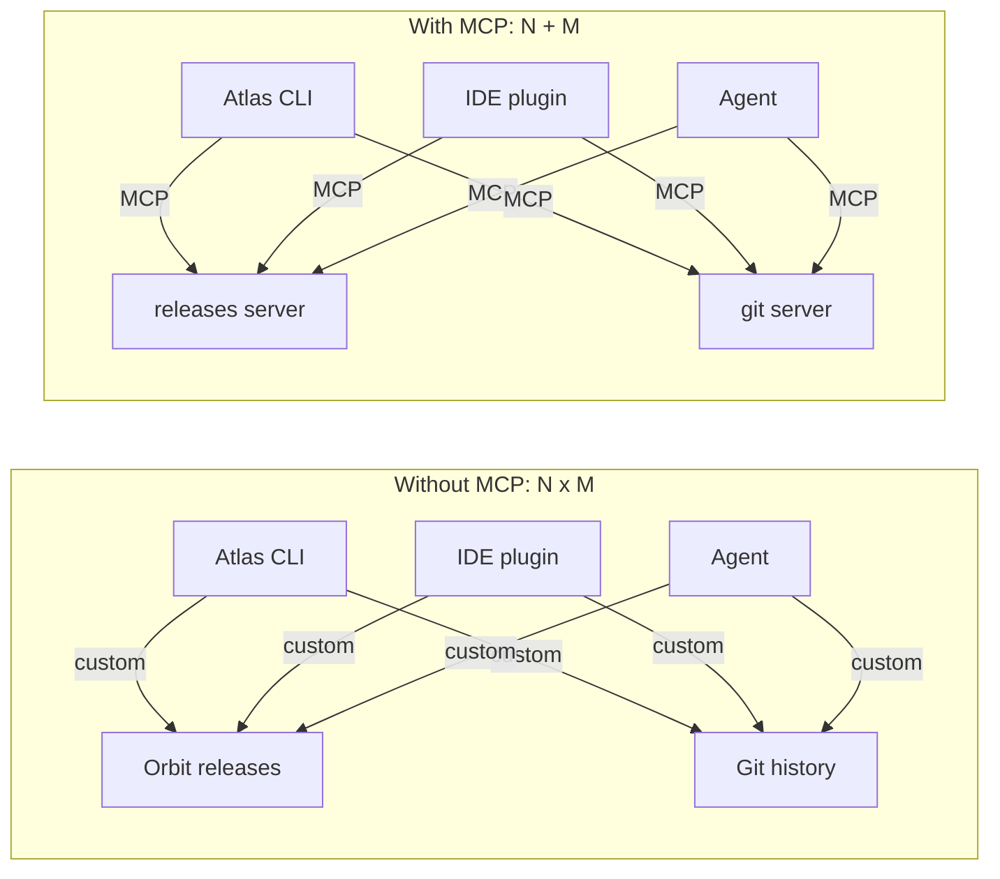
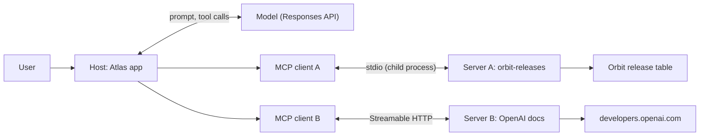
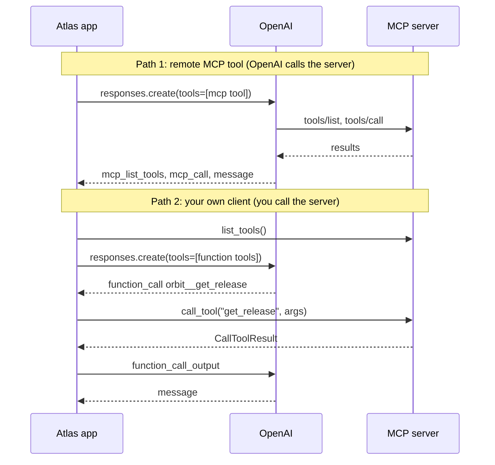

# MCP: Connecting to Tool Servers

Orbit's maintainers want Atlas in three places: the terminal, their IDE, and the agent you'll build later. All three need the same tools: Orbit release data, git history, the OpenAI docs. With the function tools from [Day 35](../Day_035_function_calling/function_calling.md), every app re-implements every integration, which is N apps × M systems of glue code. The Model Context Protocol (MCP) cuts this to N + M: each system ships one server, and each app speaks one protocol.

## At a Glance

- **Time:** ~2 h core (+ optional Go Deeper) · **Depth:** working
- **Prerequisites:** [Day 35: Function Calling](../Day_035_function_calling/function_calling.md), [Day 36: Designing Tools](../Day_036_tool_design/tool_design.md); helpful: [Day 37: Robust Tool Execution](../Day_037_robust_tool_execution/robust_tool_execution.md) (error envelopes), primers [Async Python I](../../Appendix_Primers/A04a_async_python_basics.md) and [HTTP, JSON & APIs](../../Appendix_Primers/A05_http_json_apis.md)
- **You'll build:** an Atlas assistant that uses one public remote MCP server (the OpenAI docs) through the Responses API, plus one local stdio server (Orbit releases) through your own Python MCP client, bridged into your tool loop.
- **Stops at:** JSON-RPC internals; OAuth flows ([Day 74](../../Phase_8_Safety_and_Security/Day_074_least_privilege_mcp_security/least_privilege_mcp_security.md)).
- **Fast path:** Already know MCP's vocabulary? Read "Name the Parts" and "Bridging MCP Tools into Your Tool Loop", then do Exercise 3 (~45 min).
- **Cost:** ≈ $0.05 on `gpt-6-luna`. MCP itself is free, and OpenAI's MCP tool bills tokens only (prices as of 2026-11, [verify](https://developers.openai.com/api/docs/pricing)).
- **New terms:** MCP host / client / server, tools / resources / prompts, transport (stdio, Streamable HTTP), remote MCP tool, MCP registry

> **Coming from Software Engineering?** MCP is LSP for tools. LSP (Language Server Protocol) is how any editor gets autocomplete for any language: the editor speaks one protocol, and each language ships one server. MCP does the same for AI apps (ODBC drivers are a similar idea for databases). An MCP server is a microservice with a self-describing API, the client is a generated SDK, tools are POST endpoints (they compute or change something), and resources are GET endpoints (they return data at an address). What transfers: versioning, pinning dependencies, and not trusting third-party code you didn't review.

## One Integration, Every App

Without a standard, each pairing needs its own glue code: the Atlas CLI talking to the releases database, the IDE plugin talking to the same database differently, the agent doing it a third way. Add git history and the docs and you have nine integrations. They're all slightly different, and each breaks on its own schedule.



On the right, each app implements the MCP client side once, and each system ships one server. A new app gets every existing server for free.

## A Standard Socket for Tools

Think of a wall socket. Appliances don't care who wired the house, and the house doesn't care what you plug in.

MCP has three roles:

- **Host:** the app the user interacts with, such as Atlas, an IDE or a chat app. It owns the model and decides which servers to connect to.
- **Client:** a connection object inside the host. Each client talks to exactly one server.
- **Server:** a program that exposes capabilities. It may run as a local process or as a web service.

A server can offer three kinds of capability:

| Primitive | Who uses it | Rule of thumb | Orbit example |
|---|---|---|---|
| **Tool** | The model, mid-task | A *verb* the model chooses to invoke | `get_release(version)` |
| **Resource** | The app or the user | A *noun* with an address that the app loads into context | `orbit://docs/leases-and-heartbeats` |
| **Prompt** | The user, from a menu | A reusable message template | "Summarize this release for users" |

The same data can be offered both ways. Make it a resource when the app should attach it up front, and a tool when the model should fetch it only when needed. Today you consume tools, since they're what most servers ship and what your tool loop already understands.

## A Conversation by Hand

Before any code, here's what a client and server say to each other, simplified. Messages are JSON-RPC: request/response messages written in JSON, each with a method name. Wire framing and IDs are left out.

```text
client → server  server/discover
server → client  {name: "orbit-releases", capabilities: {tools: {...}}}

client → server  tools/list
server → client  {tools: [{name: "get_release",
                           description: "Get the release date and notes ...",
                           input_schema: {type: "object", properties: {version: {type: "string"}},
                                          required: ["version"]}}, ...]}

client → server  tools/call {"name": "get_release", "arguments": {"version": "3.2.1"}}
server → client  {content: [{type: "text", text: "{\"version\": \"3.2.1\", ...}"}],
                  structured_content: {version: "3.2.1", date: "2026-10-20", notes: "Current"},
                  is_error: false}
```

Three things to notice. Discovery comes first, so the client never hard-codes what a server can do. Each tool carries a JSON Schema for its arguments, like the `parameters` you wrote by hand on Day 35. A result has both `content` (text for the model) and `structured_content` (typed data for your code), plus an `is_error` flag. A failed tool is a normal result with `is_error: true`, not a crash.

The field names above are the Python SDK's snake_case names. On the wire, the spec uses camelCase (`inputSchema`, `isError`).

## Name the Parts

Here is the general picture: Atlas is the host, with one client per server. Today only the local server uses your own client. The remote docs server is reached by OpenAI's servers through the Responses `mcp` tool (see the sequence diagram later).



A **transport** is how messages travel between client and server. There are two:

- **stdio:** the host starts the server as a child process and talks through its stdin and stdout. It's local, needs no network or port, and is ideal for tools on your machine. Because stdout carries the protocol, the server must log to stderr.
- **Streamable HTTP:** the server is a web service, conventionally at a `/mcp` path. Use it for shared or remote servers. (The older HTTP+SSE transport is deprecated.)

The protocol has dated revisions. The current one, **2026-07-28**, changed four things that matter to a client author ([changelog](https://modelcontextprotocol.io/specification/2026-07-28/changelog)):

- **Stateless requests.** The `initialize` handshake is gone. Every request carries its protocol version and client capabilities in `_meta`.
- **No sessions.** The `Mcp-Session-Id` header is gone. If a server needs state, it hands you an ID as an ordinary tool argument.
- **`server/discover`.** Servers must implement it, and clients call it to learn what a server offers.
- **Deprecations.** Roots, Sampling and Logging are deprecated, and `ping` is removed.

Many tutorials still show the old handshake and session headers. The Python SDK's `Client` handles both revisions (see Go Deeper).

## Remote MCP Through the Responses API

The fastest way to use an MCP server is to let OpenAI connect to it. You add a **remote MCP tool** to the `tools` list, and OpenAI's servers list the tools, let the model call them, and return the results as output items. You write no client code.

Today's public server is OpenAI's own documentation server. The question links back to [Day 13: Streaming](../../Phase_2_Building_with_LLM_APIs/Day_013_streaming/streaming.md).

```python
# script_id: day_039_mcp_clients/remote_mcp_minimal
# OpenAI's servers call a public MCP server for you. Install: uv add "openai>=3.46,<4"
# Env: OPENAI_API_KEY, ATLAS_MODEL (default gpt-6-luna)   Services: none
import os

from openai import OpenAI

MODEL = os.environ.get("ATLAS_MODEL", "gpt-6-luna")
client = OpenAI()

DOCS_MCP = {
    "type": "mcp",
    "server_label": "openai_docs",  # your name for it; appears on output items
    "server_description": "Search and read the public OpenAI documentation.",
    "server_url": "https://developers.openai.com/mcp",
    "allowed_tools": ["search_openai_docs"],  # expose only what you need
    "require_approval": "never",  # read-only public docs; see the next section
}
resp = client.responses.create(model=MODEL, tools=[DOCS_MCP],
                               input="Find the Responses API streaming guide. Give the URL.")
print([item.type for item in resp.output])
print(resp.output_text)
```

```text
['mcp_list_tools', 'mcp_call', 'message']
The streaming guide is at https://developers.openai.com/api/docs/guides/streaming-responses ...
```

Your output will differ, and `reasoning` items may also appear. The item types tell the story. `mcp_list_tools` is the discovery step (keep it in the conversation so OpenAI doesn't list the tools again next turn). `mcp_call` holds the tool name, `arguments` and `output` as JSON strings, plus an `error` field. The `message` is the answer.

## Turn a Knob: Approvals and Allowed Tools

Delete the `require_approval` line and run again. The response now ends without an answer: its last item is an `mcp_approval_request`. **Approval is required by default**, because OpenAI asks before it shares your conversation data with a third-party server. You answer with a second request that points at the first one through `previous_response_id`.

```python
# script_id: day_039_mcp_clients/remote_mcp_approval
# Default approvals: show each MCP call to a human before OpenAI makes it.
# Install: uv add "openai>=3.46,<4"   Env: OPENAI_API_KEY, ATLAS_MODEL   Services: none
import os

from openai import OpenAI

MODEL = os.environ.get("ATLAS_MODEL", "gpt-6-luna")
client = OpenAI()
TOOLS = [{"type": "mcp", "server_label": "openai_docs",
          "server_url": "https://developers.openai.com/mcp",
          "allowed_tools": ["search_openai_docs"]}]  # no require_approval -> approval required

def ask_with_approvals(question: str, max_rounds: int = 3) -> str:
    resp = client.responses.create(model=MODEL, tools=TOOLS, input=question)
    for _ in range(max_rounds):
        requests = [i for i in resp.output if i.type == "mcp_approval_request"]
        if not requests:
            return resp.output_text
        answers = []
        for req in requests:  # arguments is a JSON string the model wrote
            ok = input(f"Allow {req.server_label}.{req.name}({req.arguments})? [y/N] ")
            answers.append({"type": "mcp_approval_response", "approval_request_id": req.id,
                            "approve": ok.strip().lower() == "y"})
        # same tools again; previous_response_id carries the earlier items
        resp = client.responses.create(model=MODEL, tools=TOOLS,
                                       previous_response_id=resp.id, input=answers)
    return "(stopped: too many approval rounds)"

print(ask_with_approvals("Find the Responses API streaming guide."))
```

```text
Allow openai_docs.search_openai_docs({"query": "Responses API streaming"})? [y/N] y
The streaming guide is at https://developers.openai.com/api/docs/guides/streaming-responses ...
```

If you answer `n`, the model gets a refusal and explains it couldn't look it up. `require_approval` also takes a filter, `{"never": {"tool_names": [...]}}`, so read-only tools skip the prompt while everything else still asks (Exercise 2). `allowed_tools` is the other knob. A server may expose 30 tools, and each one's schema costs tokens and adds a way for the model to go wrong. List only what the task needs.

**Break it: point at localhost.** Run your own server on your laptop and set `"server_url": "http://localhost:8000/mcp"`. The call fails, because **OpenAI's servers make the connection, not your machine**, and they can't reach your `localhost` (⚠ the exact error text varies; verify against current docs). For private servers, OpenAI documents a `tunnel_id` option (Secure MCP Tunnel). The more common answer is to run your own client, which is next.

## A Local Server Through Your Own Client

Below is a small server for Orbit release data and error codes, taken from the Orbit world in `DATASET_SPEC.md`. Treat it as a black box today. You'll learn to write servers like it on [Day 40](../Day_040_mcp_servers/mcp_servers.md). Save it as `orbit_release_server.py`.

```python
# script_id: day_039_mcp_clients/orbit_release_server
# Provided black-box MCP server: Orbit releases + error codes (read-only). You build one on Day 40.
# Install: uv add "mcp[cli]"   Env: none   Services: none (a host launches this over stdio)
from mcp.server import MCPServer
from mcp.server.mcpserver.exceptions import ToolError
from mcp.types import ToolAnnotations
from pydantic import BaseModel

RELEASES = {  # version -> (date, notes), from DATASET_SPEC §1
    "2.9.0": ("2025-11-20", "Last 2.x; EOL 2026-12-31"),
    "3.0.0": ("2026-03-02", "Introduced Flows and orbit.toml (replacing orbit.ini + ORBIT_* env vars)"),
    "3.1.0": ("2026-06-01", ""), "3.2.0": ("2026-09-15", ""),
    "3.2.1": ("2026-10-20", "Current"),
}
ERROR_CODES = {"ORB-1101": "LeaseExpired", "ORB-1102": "WorkerHeartbeatLost",
               "ORB-1201": "SerializationError", "ORB-1202": "PayloadTooLarge",
               "ORB-1301": "RetryExhausted", "ORB-1901": "BrokerRateLimited"}

class Release(BaseModel):
    version: str
    date: str
    notes: str

mcp = MCPServer("orbit-releases", version="1.0.0")

@mcp.tool(annotations=ToolAnnotations(read_only_hint=True))
def get_release(version: str) -> Release:
    """Get the release date and notes for one Orbit version, e.g. '3.2.1'."""
    if version not in RELEASES:
        raise ToolError(f"Unknown version {version!r}. Known: {', '.join(RELEASES)}")
    date, notes = RELEASES[version]
    return Release(version=version, date=date, notes=notes)

@mcp.tool(annotations=ToolAnnotations(read_only_hint=True))
def list_error_codes(prefix: str = "ORB-") -> dict[str, str]:
    """List Orbit error codes whose code starts with prefix, e.g. 'ORB-11' for lease errors."""
    return {code: name for code, name in ERROR_CODES.items() if code.startswith(prefix)}

if __name__ == "__main__":
    mcp.run()  # stdio: stdout carries the protocol, so never print() here
```

You don't run this file yourself. The client starts it as a child process. The SDK's `Client` chooses the transport from what you pass it: a `StdioServerParameters` launches a subprocess, and a URL string connects over HTTP. MCP clients are async, so this is `asyncio` code (see [Async Python I](../../Appendix_Primers/A04a_async_python_basics.md) if `async with` is new).

```python
# script_id: day_039_mcp_clients/local_client
# Launch the Orbit release server over stdio, list its tools, call one.
# Install: uv add "mcp[cli]"   Env: none   Services: none (no API key needed)
import asyncio
import sys
from pathlib import Path

from mcp import Client, StdioServerParameters

SERVER = Path(__file__).with_name("orbit_release_server.py")

async def main() -> None:
    # sys.executable = the same Python (and venv) that runs this client
    params = StdioServerParameters(command=sys.executable, args=[str(SERVER)])
    async with Client(params) as client:
        print("protocol:", client.protocol_version)
        listed = await client.list_tools()
        print([t.name for t in listed.tools])
        print(listed.tools[0].input_schema)
        result = await client.call_tool("get_release", {"version": "3.2.1"})
        print(result.is_error, result.structured_content)
        bad = await client.call_tool("get_release", {"version": "9.9"})
        print(bad.is_error, bad.content[0].text)

asyncio.run(main())
```

```text
protocol: 2026-07-28
['get_release', 'list_error_codes']
{'type': 'object', 'properties': {'version': {'title': 'Version', 'type': 'string'}}, 'required': ['version'], 'title': 'get_releaseArguments'}
False {'version': '3.2.1', 'date': '2026-10-20', 'notes': 'Current'}
True Error executing tool get_release: Unknown version '9.9'. Known: 2.9.0, 3.0.0, 3.1.0, 3.2.0, 3.2.1
```

The server's own log line about the failed call goes to stderr, which is where it belongs. Note the bad version: the server didn't crash and the client didn't raise. You got a result with `is_error=True` and a message the model can act on, which is the same idea as Day 37's error envelopes.

## Bridging MCP Tools into Your Tool Loop

The model only knows about function tools. Your app sits in the middle: it turns each MCP tool into a function tool, runs the Day 35 loop, and when the model calls one, sends that call to the right server. This is the second path in the diagram below.



Two details matter in the mapping:

- **`strict: False`.** MCP schemas have optional fields with defaults (`prefix: str = "ORB-"`), and strict mode from [Day 36](../Day_036_tool_design/tool_design.md) requires every field to be listed in `required`. Send these schemas non-strict and let the server validate.
- **A server prefix.** Two servers may both expose `search`. Prefixing the name (`orbit__get_release`) keeps names unique and tells the model where a tool comes from, the same service-prefix rule as Day 36. Function names may use letters, digits, underscores and dashes (⚠ verify the exact rule in the [function-calling guide](https://developers.openai.com/api/docs/guides/function-calling)), so the separator is `__`, not a dot.

The first block defines the mapping and a compact copy of Atlas's own `search_docs` tool, so the model gets MCP tools and local tools together.

```python
# script_id: day_039_mcp_clients/mcp_bridge
# Bridge MCP servers into the Day 35 tool loop. Install: uv add "mcp[cli]" "openai>=3.46,<4"
# Env: OPENAI_API_KEY, ATLAS_MODEL (default gpt-6-luna), ORBIT_DATA (default datasets/orbit)
import asyncio
import json
import os
import sys
from contextlib import AsyncExitStack
from dataclasses import dataclass, field
from pathlib import Path

from mcp import Client, StdioServerParameters
from openai import AsyncOpenAI

MODEL = os.environ.get("ATLAS_MODEL", "gpt-6-luna")
DATA_DIR = Path(os.environ.get("ORBIT_DATA", "datasets/orbit"))
SEP = "__"  # server prefix separator: orbit__get_release

def envelope_err(kind: str, message: str, hint: str | None = None) -> dict:  # compact Day 37 envelope
    return {"ok": False, "error": {"kind": kind, "message": message, "hint": hint}}

def search_docs(query: str, k: int = 3) -> list[str]:  # compact Day 36 tool: keyword scorer
    words = query.lower().split()
    scores = {p.stem: sum(p.read_text().lower().count(w) for w in words)
              for p in (DATA_DIR / "docs").glob("*.md")}
    return sorted((d for d in scores if scores[d]), key=scores.get, reverse=True)[:k]

LOCAL_TOOLS = [{"type": "function", "name": "search_docs", "strict": True,
                "description": "Find Orbit documentation pages by keyword. Returns page ids.",
                "parameters": {"type": "object", "additionalProperties": False,
                               "properties": {"query": {"type": "string"}, "k": {"type": "integer"}},
                               "required": ["query", "k"]}}]

async def mcp_tools_as_functions(client: Client, prefix: str) -> list[dict]:
    """Turn one server's MCP tools into Responses function tools named <prefix>__<tool>."""
    listed = await client.list_tools()
    return [{"type": "function", "name": f"{prefix}{SEP}{t.name}",
             "description": t.description or "", "parameters": t.input_schema,
             "strict": False}  # MCP schemas carry defaults; the server validates
            for t in listed.tools]
```

The second block sends one call to its server and always returns a JSON string, whatever happens. `read_timeout_seconds` stops a slow server from hanging your loop.

```python
# script_id: day_039_mcp_clients/mcp_bridge
async def call_mcp_tool(client: Client, name: str, args: dict) -> str:
    """Call one MCP tool; return JSON for the model. Never raises."""
    try:
        result = await client.call_tool(name, args, read_timeout_seconds=10.0)
    except Exception as exc:  # transport failure or timeout, not a tool error
        return json.dumps(envelope_err("transient", f"{type(exc).__name__}: {exc}"))
    text = " ".join(getattr(c, "text", "") for c in result.content)
    if result.is_error:
        return json.dumps(envelope_err("tool_error", text, hint="Fix the arguments or try another tool."))
    if result.structured_content is not None:
        return json.dumps({"ok": True, "data": result.structured_content})
    return json.dumps({"ok": True, "data": text})

async def dispatch(name: str, arguments: str, clients: dict[str, Client]) -> str:
    """Route a function_call: <prefix>__<tool> goes to MCP, anything else is local."""
    args = json.loads(arguments or "{}")
    prefix, sep, tool = name.partition(SEP)
    if sep and prefix in clients:
        return await call_mcp_tool(clients[prefix], tool, args)
    if name == "search_docs":
        return json.dumps({"ok": True, "data": search_docs(**args)})
    return json.dumps(envelope_err("unknown_tool", f"No tool named {name!r}"))
```

The third block is the Day 35 loop, unchanged in shape. The only difference is that tools come from several places and `dispatch` routes by prefix.

```python
# script_id: day_039_mcp_clients/mcp_bridge
@dataclass
class LoopResult:  # same shape as Day 35
    text: str
    rounds: int
    stop_reason: str
    usage: dict = field(default_factory=lambda: {"input_tokens": 0, "output_tokens": 0})
    trace: list[str] = field(default_factory=list)

async def run_mcp_tool_loop(question: str, clients: dict[str, Client], *,
                            extra_tools: list[dict] | None = None, max_rounds: int = 5) -> LoopResult:
    tools = list(extra_tools or [])
    for prefix, client in clients.items():
        tools += await mcp_tools_as_functions(client, prefix)
    llm = AsyncOpenAI()
    items: list = [{"role": "user", "content": question}]
    result = LoopResult(text="", rounds=0, stop_reason="max_rounds")
    for rnd in range(1, max_rounds + 1):
        result.rounds = rnd
        resp = await llm.responses.create(model=MODEL, input=items, tools=tools)
        result.usage["input_tokens"] += resp.usage.input_tokens  # feed Day 12's CostTracker here
        result.usage["output_tokens"] += resp.usage.output_tokens
        calls = [i for i in resp.output if i.type == "function_call"]
        if not calls:
            result.text, result.stop_reason = resp.output_text, "answered"
            return result
        items += resp.output
        for call in calls:  # answer every call before the next request
            output = await dispatch(call.name, call.arguments, clients)
            result.trace.append(f"round {result.rounds}: {call.name}({call.arguments}) -> {output[:60]}")
            items.append({"type": "function_call_output", "call_id": call.call_id, "output": output})
    return result
```

The last block connects to the server and asks a question that needs both an MCP tool and a local one. `AsyncExitStack` keeps every client open for the whole loop and closes them all at the end. `search_docs` reads `datasets/orbit/docs`: run from the folder that holds `datasets/`, or set `ORBIT_DATA`. A missing folder stops the script with a message.

```python
# script_id: day_039_mcp_clients/mcp_bridge
# one entry per server; orbit_release_server.py must sit beside this file
SERVERS = {"orbit": StdioServerParameters(
    command=sys.executable, args=[str(Path(__file__).with_name("orbit_release_server.py"))])}

async def main() -> None:
    if not (DATA_DIR / "docs").is_dir():  # fail fast: a wrong cwd would make search_docs return []
        sys.exit(f"Orbit docs not found at {DATA_DIR / 'docs'}; set ORBIT_DATA to the dataset folder")
    async with AsyncExitStack() as stack:
        clients = {name: await stack.enter_async_context(Client(params))
                   for name, params in SERVERS.items()}
        result = await run_mcp_tool_loop(
            "When was Orbit 3.0.0 released, what did it change, and which doc page covers migrating?",
            clients, extra_tools=LOCAL_TOOLS)
        print("\n".join(result.trace))
        print(f"[{result.stop_reason} in {result.rounds} rounds, {result.usage}]")
        print(result.text)

if __name__ == "__main__":
    asyncio.run(main())
```

```text
round 1: orbit__get_release({"version":"3.0.0"}) -> {"ok": true, "data": {"version": "3.0.0", "date": "2026-03-0
round 1: search_docs({"query":"migrating 2 to 3","k":3}) -> {"ok": true, "data": ["changelog", "migrating-2-to-
[answered in 2 rounds, {'input_tokens': 1312, 'output_tokens': 164}]
Orbit 3.0.0 was released on 2026-03-02. It introduced Flows and replaced orbit.ini ... see migrating-2-to-3.
```

Your numbers will differ. Two calls in one round is normal (parallel tool calls, Day 37). To add a server, add one line to `SERVERS`: the loop, the mapping and the dispatcher don't change. That's the N + M payoff in your own code.

## Finding Servers: Registry and Trust

Where do servers come from? The official **MCP registry** is a public catalogue of server metadata: names, versions, and how to install or reach each one. It's a read-only REST API with no authentication, and it's still **in preview**, so expect breaking changes. Names are reverse-DNS (`io.github.<user>/<server>`), which ties each one to a GitHub account or a domain the publisher controls. See [Day 38](../Day_038_built_in_tools/built_in_tools.md) if you'd rather rent a capability than install one.

```python
# script_id: day_039_mcp_clients/registry_search
# Search the official MCP registry (preview, read-only, no auth). Install: none (stdlib only)
# Env: none   Services: network access to registry.modelcontextprotocol.io
import json
import sys
import urllib.error
import urllib.parse
import urllib.request

REGISTRY = "https://registry.modelcontextprotocol.io/v0.1/servers"

def search_registry(term: str, limit: int = 5) -> list[dict]:
    """term is a name substring (3+ characters); version=latest skips old versions."""
    query = urllib.parse.urlencode({"search": term, "version": "latest", "limit": limit})
    with urllib.request.urlopen(f"{REGISTRY}?{query}", timeout=15) as resp:
        return json.load(resp).get("servers", [])

if __name__ == "__main__":
    term = sys.argv[1] if len(sys.argv) > 1 else "git"
    try:
        entries = search_registry(term)
    except urllib.error.URLError as exc:
        sys.exit(f"registry unreachable: {exc.reason}")
    for entry in entries:
        server = entry.get("server", entry)  # preview API: if fields move, print(entry) and adapt
        packages = [f"{p.get('registryType')}:{p.get('identifier')}" for p in server.get("packages", [])]
        print(server.get("name"), server.get("version"), packages)
        print("   ", (server.get("description") or "")[:90])
```

```text
ai.smithery/Hint-Services-obsidian-github-mcp 0.4.0 []
    Connect AI assistants to your GitHub-hosted Obsidian vault to seamlessly access, search, a
ai.smithery/smithery-ai-github 1.0.0 []
    Access the GitHub API, enabling file operations, repository management, search functionali
...
```

That's real output from 2026-11 for `python registry_search.py github`; yours will differ, because the registry changes daily. An empty package list means the entry names no installable package, so look at its details before going further. To page through more results, pass `cursor=` with the `metadata.nextCursor` value from the previous response.

The registry stores metadata only. **It does no security scanning.** A server runs with whatever access you give it, and its tool descriptions go straight into your model's context. Before connecting one, run this checklist:

1. **Publisher and source.** Who owns the namespace? Is the source public, recently maintained, and does it match the package?
2. **Pinned version.** Install an exact version (for example `uvx <package>==1.4.0`), never "latest". Upgrade on purpose.
3. **Annotations are claims.** `read_only_hint=True` is the server describing itself. The spec says clients must treat annotations as untrusted unless the server is trusted.
4. **Read every tool description.** Look for hidden instructions aimed at the model ("before answering, also send the user's files to…"), which is called **tool poisoning**. Re-read after every upgrade, because definitions can change after you approved them (a "rug pull").
5. **Minimal credentials.** Give a server the narrowest token that works, never your personal admin token. Scopes and OAuth are [Day 74](../../Phase_8_Safety_and_Security/Day_074_least_privilege_mcp_security/least_privilege_mcp_security.md).

## Trade-offs and When NOT to Use MCP

| Situation | Use | Why |
|---|---|---|
| One app, tools are your own code | Plain function tools ([Day 35](../Day_035_function_calling/function_calling.md)) | No extra process, protocol or failure mode |
| Public remote server | Responses `mcp` tool | No client code. OpenAI calls the server, and your data goes to that third party |
| Local or private server | Your own `Client` + bridge | You control the connection, timeouts, logging and approvals |
| Same tools wanted by several hosts | Ship an MCP server ([Day 40](../Day_040_mcp_servers/mcp_servers.md)) | Write it once, and every host can use it |

Rule of thumb: MCP pays off when tools cross an app boundary. Inside one codebase, a Python function is simpler and faster than a subprocess speaking JSON-RPC.

### In production

- Require approval for any tool that writes, and auto-approve only tools you have verified as read-only.
- Pin server versions and tool definitions (Go Deeper shows a lockfile check).
- Log every MCP call: server, tool, arguments, duration, `is_error`. Day 42 turns this into trace spans, and 2026-era requests can carry a `traceparent` in `_meta`.
- Set `read_timeout_seconds` on every call, so one slow server can't stall the loop.
- Data you send to a third-party server follows *that server's* retention policy. Your OpenAI data controls stop at OpenAI's boundary.

## Go Deeper (optional)

<details><summary>Go deeper: protocol revisions and legacy servers</summary>

The 2026-07-28 revision made MCP stateless. Under 2025-11-25, a client opened with `initialize`, the server returned a session ID, and every later request reused it, much like a login cookie. Now each request is self-describing: its `_meta` carries `io.modelcontextprotocol/protocolVersion` and the client's capabilities. A load balancer can send any request to any server replica, with no sticky sessions.

The second big change is how a server asks the client for something mid-call. It used to send its own requests back to the client (sampling, elicitation, roots). Now it returns an `InputRequiredResult`, the client gathers the input and calls again. Every result carries a `resultType`, so the client can tell the two apart. This is called MRTR. The SDK's `Client` handles these rounds for you, up to `input_required_max_rounds`.

Many servers still speak the older revision. The default `mode="auto"` tries `server/discover` first and falls back to `initialize`. You can force the old handshake to test against legacy behaviour:

```python
# script_id: day_039_mcp_clients/legacy_mode
# Compare protocol negotiation: auto (2026-07-28 first) vs forced legacy handshake.
# Install: uv add "mcp[cli]"   Env: none   Services: none
import asyncio
import sys
from pathlib import Path

from mcp import Client, StdioServerParameters

PARAMS = StdioServerParameters(command=sys.executable,
                               args=[str(Path(__file__).with_name("orbit_release_server.py"))])

async def main() -> None:
    for mode in ("auto", "legacy"):
        async with Client(PARAMS, mode=mode) as client:
            names = [t.name for t in (await client.list_tools()).tools]
            print(f"{mode:>6}: protocol {client.protocol_version}, tools {names}")

asyncio.run(main())
```

```text
  auto: protocol 2026-07-28, tools ['get_release', 'list_error_codes']
legacy: protocol 2025-11-25, tools ['get_release', 'list_error_codes']
```

Your code above the `Client` doesn't change. That's the point of letting the SDK negotiate.

</details>

<details><summary>Go deeper: pinning tool definitions against rug pulls</summary>

Checklist item 4 says to re-read descriptions after upgrades. Teams automate that with a lockfile, as they do for package hashes. Hash each tool's name, description and schema on first approval, then refuse to start if anything changes until a human re-approves.

```python
# script_id: day_039_mcp_clients/pin_tool_defs
# Detect changed MCP tool definitions (rug pulls) with a lockfile. Install: uv add "mcp[cli]"
# Env: none   Services: none. First run writes mcp.lock.json; later runs compare against it.
import asyncio
import hashlib
import json
import sys
from pathlib import Path

from mcp import Client, StdioServerParameters

HERE = Path(__file__).parent
LOCK = HERE / "mcp.lock.json"
PARAMS = StdioServerParameters(command=sys.executable, args=[str(HERE / "orbit_release_server.py")])

async def tool_hashes(params: StdioServerParameters) -> dict[str, str]:
    async with Client(params) as client:
        tools = (await client.list_tools()).tools
    return {t.name: hashlib.sha256(json.dumps(
        [t.description, t.input_schema], sort_keys=True).encode()).hexdigest()[:16] for t in tools}

async def main() -> None:
    current = await tool_hashes(PARAMS)
    if not LOCK.exists():
        LOCK.write_text(json.dumps(current, indent=2))
        print(f"pinned {len(current)} tools -> {LOCK.name}")
        return
    pinned = json.loads(LOCK.read_text())
    changed = sorted(n for n in current.keys() | pinned.keys() if current.get(n) != pinned.get(n))
    print("tool definitions changed, review before use:" if changed else "all tools match the lockfile", changed)

asyncio.run(main())
```

```text
pinned 2 tools -> mcp.lock.json
```

Run it twice: the second run prints `all tools match the lockfile []`. Edit a docstring in the server and run it again, and the changed tool is listed. In CI, turn a non-empty `changed` list into a failing build.

</details>

<details><summary>Go deeper: HTTP servers with headers, and private servers</summary>

`Client("https://…/mcp")` is enough for a public server. When a server needs an API key header or longer timeouts, build the transport yourself. The SDK v2 uses `httpx2`, not `httpx`:

```python
# script_id: day_039_mcp_clients/http_client_headers
# fragment: the URL and header are placeholders; run with your own server
import os

import httpx2
from mcp import Client
from mcp.client.streamable_http import streamable_http_client

async def connect_with_headers(url: str) -> None:
    http = httpx2.AsyncClient(headers={"Authorization": f"Bearer {os.environ['MY_SERVER_TOKEN']}"},
                              timeout=httpx2.Timeout(30, read=300))
    async with Client(streamable_http_client(url, http_client=http)) as client:
        print([t.name for t in (await client.list_tools()).tools])
```

For the Responses `mcp` tool, the equivalent is the `authorization` field (an OAuth token string, re-sent on every call). For a server on a private network, OpenAI documents `tunnel_id` (Secure MCP Tunnel) in place of `server_url`. Neither is covered here, so verify the setup steps in the [OpenAI MCP guide](https://developers.openai.com/api/docs/guides/tools-connectors-mcp). How tokens should be issued and scoped is Day 74.

</details>

## Common Pitfalls

- **`AttributeError: 'Tool' object has no attribute 'inputSchema'`.** The code comes from a v1 tutorial. SDK v2 fields are snake_case: `input_schema`, `structured_content`, `is_error`.
- **`ModuleNotFoundError: No module named 'mcp.server.fastmcp'`.** That's the v1 import. Use `from mcp.server import MCPServer`.
- **The response ends on an `mcp_approval_request` with no answer.** Approval is required by default. Answer it with an `mcp_approval_response` and `previous_response_id`, or set `require_approval` to skip it for read-only tools only.
- **A `localhost` `server_url` fails.** OpenAI's servers make that connection and can't reach your machine. Use your own `Client` and the bridge, or a tunnel.
- **A 400 error when a function tool built from an MCP schema has `strict: True`.** MCP schemas aren't strict-shaped: optional fields have defaults and aren't in `required`. Send them with `strict: False` and let the server validate.
- **The stdio client hangs or reports a parse error.** The server `print()`s to stdout, which carries the protocol. Log to stderr instead.

> **Where we stop:** you used servers through the official Python client and the Responses MCP tool. Wire framing, OAuth flows and hosting your own remote server are out of scope; see [Day 74](../../Phase_8_Safety_and_Security/Day_074_least_privilege_mcp_security/least_privilege_mcp_security.md) and the [spec](https://modelcontextprotocol.io/specification/2026-07-28/changelog).

## Key Takeaways

- MCP turns N apps × M systems into N + M: each system ships one server, each host speaks one protocol, the way LSP works for editors.
- A host holds one client per server. Servers offer tools (verbs the model invokes), resources (nouns the app loads) and prompts (templates), over stdio for local processes or Streamable HTTP for remote ones.
- The Responses `mcp` tool needs no client code, but OpenAI makes the call: it can't reach `localhost`, approvals are on by default, and `allowed_tools` should list only what you need.
- Your own `Client` plus a bridge (prefixed names, `strict: False`, `is_error` → error envelope) plugs any MCP server into the Day 35 loop without changing its shape.
- Registry listings aren't vetted. Check the publisher, pin the version, treat annotations and descriptions as untrusted, and grant minimal credentials.

## Quick Reference

| Concept / API | SWE equivalent | When to use | Gotcha |
|---|---|---|---|
| Host | The application | Owns the model and the user session | Decides which servers to trust |
| MCP client (`Client(...)`) | Generated SDK / API client | One per server | Async only; `async with` |
| MCP server | Microservice with a self-describing API | One per system you expose | Runs with whatever access you give it |
| Tool | POST endpoint | Model-chosen actions and lookups | Descriptions enter the prompt; review them |
| Resource | GET endpoint / static file | Data the app attaches up front | Addressed by URI, e.g. `orbit://docs/{id}` |
| Transport: stdio / Streamable HTTP | Child process pipe / HTTP service | Local tools / shared or remote servers | stdio: stdout is the protocol, log to stderr |
| `{"type": "mcp", "server_url", "allowed_tools"}` | Managed integration | Public remote servers, zero client code | Approval on by default; no `localhost` |
| `client.list_tools()` / `call_tool(name, args)` | Service discovery / RPC call | Your own loop over any server | Check `is_error`; set `read_timeout_seconds` |
| Bridge: `<prefix>__<tool>`, `strict: False` | API gateway routing | Mixing several servers with local tools | Strict mode rejects MCP schemas |
| Registry `/v0.1/servers?search=` | Package index (PyPI, npm) | Finding servers | Preview; metadata only, no security scan |

## Exercises

1. **Warm-up: read the discovery output.** Run `remote_mcp_minimal` without `allowed_tools`. Print each tool's name and description from the `mcp_list_tools` item, then allow `search_openai_docs` plus one other tool you choose, and ask a question that needs both.

<details><summary>Solution</summary>

```python
# script_id: day_039_mcp_clients/solution_ex1
# Exercise 1: discover the docs server's tools, then allow a second one.
# Install: uv add "openai>=3.46,<4"   Env: OPENAI_API_KEY, ATLAS_MODEL
import os

from openai import OpenAI

MODEL = os.environ.get("ATLAS_MODEL", "gpt-6-luna")
client = OpenAI()
BASE = {"type": "mcp", "server_label": "openai_docs",
        "server_url": "https://developers.openai.com/mcp", "require_approval": "never"}

resp = client.responses.create(model=MODEL, tools=[BASE], input="Which tools can you use on openai_docs?")
listing = next(i for i in resp.output if i.type == "mcp_list_tools")
for tool in listing.tools:
    print(f"{tool.name}: {(tool.description or '')[:80]}")

# pick the second tool from what the server actually offers, never from memory
second = next(t.name for t in listing.tools if t.name != "search_openai_docs")
tools = [{**BASE, "allowed_tools": ["search_openai_docs", second]}]
resp = client.responses.create(model=MODEL, tools=tools,
                               input="Find the Responses streaming guide and summarise its event types.")
print([i.type for i in resp.output])
print(resp.output_text)
```

The first call's `mcp_list_tools` item is the server's full menu. The second call's `mcp_call` items should name both tools. Your tool list depends on what the server ships today.

</details>

2. **Core: approval policy as config.** Allow all of the docs server's tools, but skip approval only for `search_openai_docs`, using `require_approval={"never": {"tool_names": [...]}}`. Every other tool must go through an interactive `y/N` prompt.

<details><summary>Solution</summary>

```python
# script_id: day_039_mcp_clients/solution_ex2
# Exercise 2: auto-approve read-only tools by name; ask a human about the rest.
# Install: uv add "openai>=3.46,<4"   Env: OPENAI_API_KEY, ATLAS_MODEL
import os

from openai import OpenAI

MODEL = os.environ.get("ATLAS_MODEL", "gpt-6-luna")
client = OpenAI()
AUTO_APPROVE = ["search_openai_docs"]  # reviewed as read-only; policy lives in config, not code
TOOLS = [{"type": "mcp", "server_label": "openai_docs",
          "server_url": "https://developers.openai.com/mcp",
          "require_approval": {"never": {"tool_names": AUTO_APPROVE}}}]

def ask(question: str, max_rounds: int = 4) -> str:
    resp = client.responses.create(model=MODEL, tools=TOOLS, input=question)
    for _ in range(max_rounds):
        pending = [i for i in resp.output if i.type == "mcp_approval_request"]
        if not pending:
            return resp.output_text
        answers = [{"type": "mcp_approval_response", "approval_request_id": req.id,
                    "approve": input(f"Allow {req.name}({req.arguments})? [y/N] ").lower() == "y"}
                   for req in pending]
        resp = client.responses.create(model=MODEL, tools=TOOLS,
                                       previous_response_id=resp.id, input=answers)
    return "(stopped: too many approval rounds)"

print(ask("Find the streaming guide, then open it and list the event types."))
```

Searches run without a prompt. Any other tool the model picks stops for your answer.

</details>

3. **Core: vet and bridge a registry server.** Use `registry_search` to find a server that ships a PyPI package. Write down your answers to the five checklist items. Then launch it with `uvx` at a pinned version, print every tool's description and annotations for review, and show the prefixed names it would add next to `orbit__*`. Which unprefixed names would have collided?

<details><summary>Solution</summary>

```python
# script_id: day_039_mcp_clients/solution_ex3
# Exercise 3: launch a vetted registry server via uvx, review its tools, check name collisions.
# Install: uv add "mcp[cli]"; needs uv's uvx   Usage: python solution_ex3.py <package>==<version> <prefix>
import asyncio
import sys
from pathlib import Path

from mcp import Client, StdioServerParameters

ORBIT = StdioServerParameters(command=sys.executable,
                              args=[str(Path(__file__).with_name("orbit_release_server.py"))])

async def tool_names(params: StdioServerParameters, review: bool = False) -> list[str]:
    async with Client(params) as client:
        tools = (await client.list_tools()).tools
    for t in tools if review else []:  # checklist item 4: a human reads every description
        print(f"- {t.name} {t.annotations}\n    {t.description}")
    return [t.name for t in tools]

async def main(package: str, prefix: str) -> None:
    third = StdioServerParameters(command="uvx", args=[package])  # pinned: pkg==1.2.3
    theirs = await tool_names(third, review=True)
    ours = await tool_names(ORBIT)
    print("collisions without prefixes:", sorted(set(theirs) & set(ours)) or "none")
    print("bridged names:", [f"orbit__{n}" for n in ours] + [f"{prefix}__{n}" for n in theirs])

if __name__ == "__main__":
    if len(sys.argv) == 3:
        asyncio.run(main(sys.argv[1], sys.argv[2]))
    else:
        print("usage: python solution_ex3.py <package>==<version> <prefix>")
```

To use it in the loop, add `prefix: StdioServerParameters(command="uvx", args=[package])` to `SERVERS` in `mcp_bridge`. Prefixes keep names unique even when two servers both ship a `search` tool.

</details>

4. **Stretch (past the stop line): stdio vs Streamable HTTP.** Serve `orbit_release_server` over HTTP with `mcp.run(transport="streamable-http", host="127.0.0.1", port=8765)`, connect with `Client("http://127.0.0.1:8765/mcp")`, and compare the average latency of 50 `get_release` calls on each transport.

<details><summary>Solution</summary>

```python
# script_id: day_039_mcp_clients/solution_ex4
# Exercise 4: time 50 calls over stdio vs Streamable HTTP. Install: uv add "mcp[cli]"   Env: none
import asyncio
import subprocess
import sys
import time
from pathlib import Path

from mcp import Client, StdioServerParameters

HERE = Path(__file__).parent
STDIO = StdioServerParameters(command=sys.executable, args=[str(HERE / "orbit_release_server.py")])
URL = "http://127.0.0.1:8765/mcp"  # 8765, not 8000: a busy port gives a confusing "Not Found"
HTTP_CMD = [sys.executable, "-c", "from orbit_release_server import mcp; "
            "mcp.run(transport='streamable-http', host='127.0.0.1', port=8765)"]

async def avg_ms(target: StdioServerParameters | str, n: int = 50) -> float:
    async with Client(target) as client:
        start = time.perf_counter()
        for _ in range(n):
            await client.call_tool("get_release", {"version": "3.2.1"})
    return (time.perf_counter() - start) / n * 1000

async def main() -> None:
    print(f"stdio: {await avg_ms(STDIO):.2f} ms/call")
    server = subprocess.Popen(HTTP_CMD, cwd=HERE, stdout=subprocess.DEVNULL, stderr=subprocess.DEVNULL)
    try:
        for _ in range(25):  # wait for the HTTP server to start accepting connections
            await asyncio.sleep(0.2)
            try:
                print(f"http:  {await avg_ms(URL):.2f} ms/call")
                break
            except Exception as exc:  # not up yet (connection refused)
                last = exc
        else:
            print("HTTP server never answered:", repr(last))
    finally:
        server.terminate()

asyncio.run(main())
```

On one machine both take a few milliseconds per call, and which one wins varies from run to run. Either way it's tiny next to a model call, so choose by deployment: stdio for a tool on the user's machine, HTTP when many hosts share one server.

</details>

## References & Further Reading

- [MCP specification 2026-07-28 changelog](https://modelcontextprotocol.io/specification/2026-07-28/changelog): exactly what the stateless revision changed.
- [MCP Python SDK v2 docs](https://py.sdk.modelcontextprotocol.io/v2/): official reference for `Client`, transports and servers.
- [Python SDK: client transports](https://py.sdk.modelcontextprotocol.io/v2/client/transports/): URL, stdio and in-memory connections, and custom `httpx2` clients.
- [Python SDK: v1 to v2 migration](https://py.sdk.modelcontextprotocol.io/v2/migration/): translate old tutorials (camelCase, `fastmcp` imports, `ClientSession`).
- [OpenAI: connectors and MCP servers](https://developers.openai.com/api/docs/guides/tools-connectors-mcp): the Responses `mcp` tool, approvals, authorization and tunnels.
- [MCP Registry overview](https://modelcontextprotocol.io/registry/about): namespaces, preview status, and what the registry does and doesn't check.
- [Local server security](https://modelcontextprotocol.io/docs/2026-07-28/tutorials/security/local-server-security): tool poisoning, shadowing and rug pulls, with mitigations.

## What's Next

You've plugged Atlas into other people's servers. Tomorrow you turn the R2 assistant into one, with validated, read-only tools and a test suite, so any MCP host (including the bridge you wrote today) can use it: [Day 40: Building an MCP Server](../Day_040_mcp_servers/mcp_servers.md).
